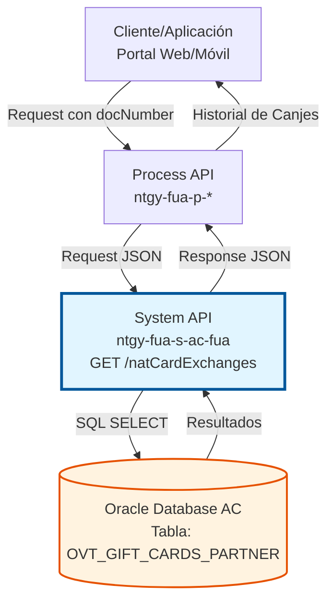
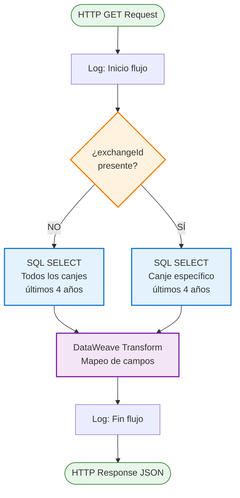
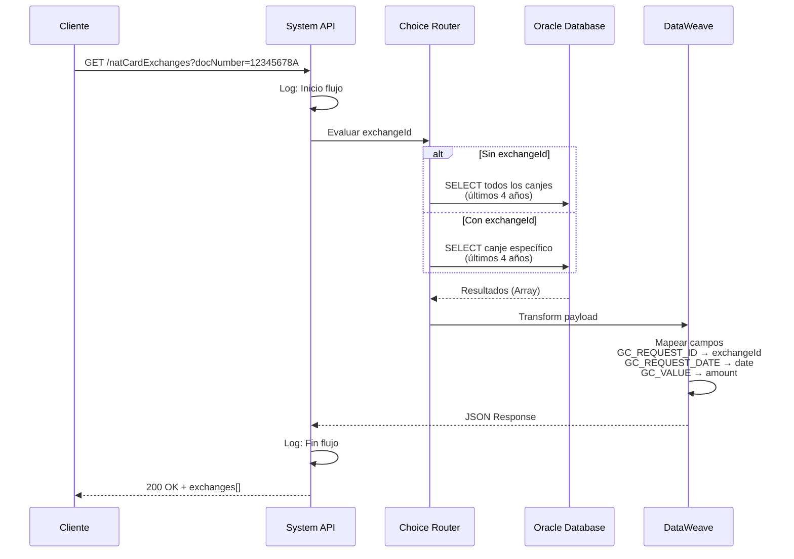
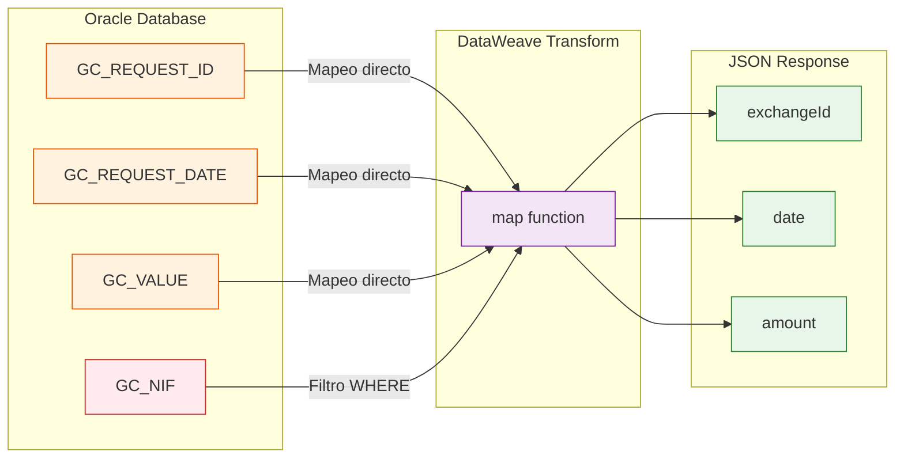

# GET /natCardExchanges

## 📌 Descripción General

### Propósito del Endpoint

Este endpoint permite consultar el historial de canjes de puntos de la Tarjeta Naturgy asociados a un cliente específico. Proporciona información detallada sobre las solicitudes de canje realizadas, incluyendo fechas y montos, con una ventana temporal de los últimos 4 años.

El endpoint soporta:
- **Consulta General**: Recupera todos los canjes del cliente en los últimos 4 años
- **Consulta Específica**: Permite filtrar por un ID de canje concreto
- **Filtrado Temporal**: Automáticamente limita resultados desde el inicio del año actual menos 4 años

### Tipo de API

**Capa:** System API (API-Led Connectivity)

**Función:** Integración directa con Oracle Database AC para consulta de datos de canjes de Tarjeta Naturgy.

### Patrón de Integración

**Tipo:** Request-Reply Síncrono con SQL Query

**Descripción:** El endpoint recibe el documento del cliente y opcionalmente un ID de canje, ejecuta una consulta SQL en la base de datos Oracle, transforma los resultados mediante DataWeave y retorna un JSON estructurado con el historial de canjes.

### Arquitectura API-Led Connectivity



---

## 💼 Propósito del Negocio

### Casos de Uso Principales

1. **Consulta de Historial Completo**
   - Cliente accede a su portal web/móvil para ver todos sus canjes
   - Sistema recupera historial completo de los últimos 4 años
   - Cliente puede revisar fechas y montos de canjes realizados

2. **Verificación de Canje Específico**
   - Cliente necesita verificar el estado de un canje concreto
   - Sistema filtra por ID de canje específico
   - Proporciona información detallada de ese canje particular

3. **Auditoría de Transacciones**
   - Servicio al cliente necesita verificar canjes de un cliente
   - Sistema proporciona trazabilidad completa de operaciones
   - Facilita resolución de consultas y reclamaciones

### Contexto Empresarial

- **Dominio:** Programa de Fidelización - Tarjeta Naturgy
- **Sector:** Energía - Utilities
- **División:** Naturgy España - Área Cliente
- **Proceso de Negocio:** Gestión de programa de puntos y canjes
- **Sistema:** Oracle Database AC (Área Cliente)

### Stakeholders

- **Clientes Finales**: Consultan su historial de canjes de puntos
- **Servicio al Cliente**: Verifican transacciones y resuelven consultas
- **Equipo de Marketing**: Analizan uso del programa de fidelización
- **Auditoría**: Revisan trazabilidad de operaciones de canje

### Valor de Negocio

- **Transparencia**: Clientes pueden ver historial completo de sus canjes
- **Autoservicio**: Reduce llamadas al call center por consultas de canjes
- **Trazabilidad**: Registro completo de todas las operaciones de canje
- **Satisfacción del Cliente**: Acceso inmediato a información de su programa de puntos

### Consumidores Potenciales

Este endpoint puede ser consumido por:
- Process APIs de gestión de clientes
- Portales web de autoservicio
- Aplicaciones móviles de clientes
- Sistemas de atención al cliente (call center)
- Herramientas de análisis y reporting

---

## 🔧 Especificación Técnica

### URLs por Ambiente

| Ambiente | URL Base | URL Completa |
|----------|----------|--------------|
| **Local** | `http://localhost:8081` | `http://localhost:8081/api/natCardExchanges?docNumber=:docNumber` |
| **Development** | `https://ntgy-fua-s-ac-fua-dev.us-e2.cloudhub.io` | `https://ntgy-fua-s-ac-fua-dev.us-e2.cloudhub.io/api/natCardExchanges?docNumber=:docNumber` |
| **UAT** | `https://ntgy-fua-s-ac-fua-uat.us-e2.cloudhub.io` | `https://ntgy-fua-s-ac-fua-uat.us-e2.cloudhub.io/api/natCardExchanges?docNumber=:docNumber` |
| **Production** | `https://ntgy-fua-s-ac-fua-pro.us-e2.cloudhub.io` | `https://ntgy-fua-s-ac-fua-pro.us-e2.cloudhub.io/api/natCardExchanges?docNumber=:docNumber` |

### Método HTTP

```
GET /api/natCardExchanges
```

### Parámetros de Entrada

#### Headers HTTP

| Header | Tipo | Requerido | Descripción | Ejemplo |
|--------|------|-----------|-------------|---------|
| `Accept` | string | ❌ No | Tipo de contenido esperado en response | `application/json` |

#### Query Parameters

| Parámetro | Tipo | Requerido | Descripción | Ejemplo |
|-----------|------|-----------|-------------|---------|
| `docNumber` | string | ✅ Sí | Documento de identidad del cliente (NIF/NIE) | `"12345678A"` |
| `exchangeId` | string | ❌ No | ID específico de canje para filtrar resultados | `"EXC123456"` |

**Validaciones:**
- `docNumber`: Obligatorio, formato de NIF/NIE español
- `exchangeId`: Opcional, si se proporciona filtra por ese canje específico

### Respuestas

#### Respuesta Exitosa (200 OK)

**Consulta sin exchangeId (todos los canjes):**

```json
{
  "result": {
    "codResult": "0000",
    "msgResult": "No hay error"
  },
  "exchanges": [
    {
      "exchangeId": "EXC123456",
      "date": "2026-01-15T10:30:00",
      "amount": 50.00
    },
    {
      "exchangeId": "EXC123457",
      "date": "2025-12-20T14:45:00",
      "amount": 75.50
    },
    {
      "exchangeId": "EXC123458",
      "date": "2025-11-10T09:15:00",
      "amount": 100.00
    }
  ]
}
```

**Consulta con exchangeId (canje específico):**

```json
{
  "result": {
    "codResult": "0000",
    "msgResult": "No hay error"
  },
  "exchanges": [
    {
      "exchangeId": "EXC123456",
      "date": "2026-01-15T10:30:00",
      "amount": 50.00
    }
  ]
}
```

**Sin resultados:**

```json
{
  "result": {
    "codResult": "0000",
    "msgResult": "No hay error"
  },
  "exchanges": []
}
```

#### Respuesta de Error (400 Bad Request)

```json
{
  "result": {
    "codResult": "0001",
    "msgResult": "Parámetro docNumber es obligatorio"
  }
}
```

#### Respuesta de Error Técnico (500 Internal Server Error)

```json
{
  "result": {
    "codResult": "0002",
    "msgResult": "Error al consultar base de datos"
  }
}
```

### Estructura de Datos

#### Exchange Object

| Campo | Tipo | Descripción |
|-------|------|-------------|
| `exchangeId` | string | Identificador único del canje (GC_REQUEST_ID) |
| `date` | datetime | Fecha y hora de la solicitud de canje (GC_REQUEST_DATE) |
| `amount` | number | Valor del canje en euros (GC_VALUE) |

### Autenticación y Autorización

- **Tipo:** Client ID & Client Secret (Anypoint Platform)
- **Autorización DB:** El usuario de base de datos debe tener permisos de:
  - SELECT en tabla `OVT_GIFT_CARDS_PARTNER`
  - Acceso al schema `OVT`

### Timeouts

| Tipo | Valor | Descripción |
|------|-------|-------------|
| **Query Timeout** | 15 segundos | Tiempo máximo de ejecución de la query SQL |
| **Request Timeout** | 30 segundos | Tiempo máximo de espera para la respuesta |
| **Connection Timeout** | 10 segundos | Tiempo máximo para establecer conexión con DB |

---

## 🏗️ Implementación Técnica

### Arquitectura del Flow



### Componentes del Flow

#### 1. Logger de Inicio
```xml
<logger level="DEBUG" doc:name="Inicio flujo" />
```
- Registra el inicio de la ejecución del flow
- Nivel DEBUG para troubleshooting

#### 2. Choice Router - Lógica Condicional
```xml
<choice doc:name="Choice">
    <when expression="#[isEmpty(attributes.queryParams.exchangeId)]">
        <!-- Query para todos los canjes -->
    </when>
    <otherwise>
        <!-- Query para canje específico -->
    </otherwise>
</choice>
```

**Condición:** Verifica si el parámetro `exchangeId` está presente
- **Rama WHEN (sin exchangeId)**: Consulta todos los canjes
- **Rama OTHERWISE (con exchangeId)**: Consulta canje específico

#### 3. Database Select - Todos los Canjes

**Query SQL:**
```sql
SELECT GC_REQUEST_ID, GC_REQUEST_DATE, GC_VALUE 
FROM OVT_GIFT_CARDS_PARTNER 
WHERE GC_NIF = :docNumber 
  AND GC_REQUEST_DATE >= trunc(sysdate, 'yyyy') - interval '4' year
```

**Configuración:**
```xml
<db:select config-ref="Database_Config" queryTimeout="${dbAC.queryTimeout}">
    <db:sql><![CDATA[...]]></db:sql>
    <db:input-parameters>
        <![CDATA[#[{"docNumber": attributes.queryParams.docNumber}]]]>
    </db:input-parameters>
</db:select>
```

**Parámetros:**
- `docNumber`: Documento del cliente (binding parameter)

**Filtros:**
- Por NIF del cliente
- Últimos 4 años desde inicio del año actual

#### 4. Database Select - Canje Específico

**Query SQL:**
```sql
SELECT GC_REQUEST_ID, GC_REQUEST_DATE, GC_VALUE 
FROM OVT_GIFT_CARDS_PARTNER 
WHERE GC_NIF = :docNumber 
  AND GC_REQUEST_ID = :exchangeId 
  AND GC_REQUEST_DATE >= trunc(sysdate, 'yyyy') - interval '4' year
```

**Configuración:**
```xml
<db:select config-ref="Database_Config" queryTimeout="${dbAC.queryTimeout}">
    <db:sql><![CDATA[...]]></db:sql>
    <db:input-parameters>
        <![CDATA[#[{
            "docNumber": attributes.queryParams.docNumber,
            "exchangeId": attributes.queryParams.exchangeId
        }]]]>
    </db:input-parameters>
</db:select>
```

**Parámetros:**
- `docNumber`: Documento del cliente
- `exchangeId`: ID del canje específico

**Filtros:**
- Por NIF del cliente
- Por ID de canje específico
- Últimos 4 años desde inicio del año actual

#### 5. DataWeave Transformation

**Transformación de Respuesta:**
```dataweave
%dw 2.0
output application/json
---
{
    result: {
        codResult: "0000",
        msgResult: "No hay error"
    },
    "exchanges": payload map((exchange, index) -> {
        "exchangeId": exchange.GC_REQUEST_ID,
        "date": exchange.GC_REQUEST_DATE,
        "amount": exchange.GC_VALUE
    })
}
```

**Mapeo de Campos:**
- `GC_REQUEST_ID` → `exchangeId`
- `GC_REQUEST_DATE` → `date`
- `GC_VALUE` → `amount`

#### 6. Logger de Fin
```xml
<logger level="DEBUG" doc:name="Fin flujo" />
```
- Registra la finalización exitosa del flow

### Diagrama de Secuencia



### Tabla de Base de Datos

#### OVT_GIFT_CARDS_PARTNER

**Propósito:** Almacena información de canjes de Tarjeta Naturgy

| Campo | Tipo | Descripción | Uso en Endpoint |
|-------|------|-------------|-----------------|
| `GC_REQUEST_ID` | VARCHAR2 | ID único de la solicitud de canje | ✅ Retornado como `exchangeId` |
| `GC_REQUEST_DATE` | TIMESTAMP | Fecha y hora de la solicitud | ✅ Retornado como `date` |
| `GC_VALUE` | NUMBER | Valor del canje en euros | ✅ Retornado como `amount` |
| `GC_NIF` | VARCHAR2 | NIF/NIE del cliente | ✅ Usado como filtro |

**Índices:**
- Primary Key: `GC_REQUEST_ID`
- Index: `GC_NIF` (para búsquedas por cliente)
- Index: `GC_REQUEST_DATE` (para filtros temporales)

### Configuración de Base de Datos

```yaml
dbAC:
  host1: "oc-pro-exa-04-clu-02-hdfdi-scan.prodb03.ocpro.oraclevcn.com"
  host2: "oc-pro-exa-03-clu-02-dfhl9-scan.prodb03.ocpro.oraclevcn.com"
  port: "1521"
  serviceName: "s_areapriv_online_pro.prodb03.ocpro.oraclevcn.com"
  user: "OVPRO_DELTA"
  queryTimeout: "15000"
  MaxPoolSize: "15"
  MaxWaitTime: "300000"
```

### Manejo de Errores

**Errores Manejados:**
1. **Parámetro faltante**: docNumber no proporcionado
2. **Error de conexión**: Base de datos no disponible
3. **Timeout de query**: Query excede 15 segundos
4. **Error de SQL**: Query mal formada o tabla no accesible

**Error Handler Global:** `s-ac-globalErrorHandler.xml`

### Diagrama de Transformación de Datos



---

## 💻 Ejemplos de Uso

### Ejemplo 1: Consultar Todos los Canjes

**Request:**
```bash
curl -X GET "https://ntgy-fua-s-ac-fua-pro.us-e2.cloudhub.io/api/natCardExchanges?docNumber=12345678A" \
  -H "Accept: application/json" \
  -H "client_id: YOUR_CLIENT_ID" \
  -H "client_secret: YOUR_CLIENT_SECRET"
```

**Response (200 OK):**
```json
{
  "result": {
    "codResult": "0000",
    "msgResult": "No hay error"
  },
  "exchanges": [
    {
      "exchangeId": "EXC202601001",
      "date": "2026-01-15T10:30:00",
      "amount": 50.00
    },
    {
      "exchangeId": "EXC202512001",
      "date": "2025-12-20T14:45:00",
      "amount": 75.50
    },
    {
      "exchangeId": "EXC202511001",
      "date": "2025-11-10T09:15:00",
      "amount": 100.00
    },
    {
      "exchangeId": "EXC202509001",
      "date": "2025-09-05T16:20:00",
      "amount": 25.00
    }
  ]
}
```

### Ejemplo 2: Consultar Canje Específico

**Request:**
```bash
curl -X GET "https://ntgy-fua-s-ac-fua-pro.us-e2.cloudhub.io/api/natCardExchanges?docNumber=12345678A&exchangeId=EXC202601001" \
  -H "Accept: application/json" \
  -H "client_id: YOUR_CLIENT_ID" \
  -H "client_secret: YOUR_CLIENT_SECRET"
```

**Response (200 OK):**
```json
{
  "result": {
    "codResult": "0000",
    "msgResult": "No hay error"
  },
  "exchanges": [
    {
      "exchangeId": "EXC202601001",
      "date": "2026-01-15T10:30:00",
      "amount": 50.00
    }
  ]
}
```

### Ejemplo 3: Cliente Sin Canjes

**Request:**
```bash
curl -X GET "https://ntgy-fua-s-ac-fua-pro.us-e2.cloudhub.io/api/natCardExchanges?docNumber=98765432B" \
  -H "Accept: application/json" \
  -H "client_id: YOUR_CLIENT_ID" \
  -H "client_secret: YOUR_CLIENT_SECRET"
```

**Response (200 OK):**
```json
{
  "result": {
    "codResult": "0000",
    "msgResult": "No hay error"
  },
  "exchanges": []
}
```

### Ejemplo 4: Error - Parámetro Faltante

**Request:**
```bash
curl -X GET "https://ntgy-fua-s-ac-fua-pro.us-e2.cloudhub.io/api/natCardExchanges" \
  -H "Accept: application/json" \
  -H "client_id: YOUR_CLIENT_ID" \
  -H "client_secret: YOUR_CLIENT_SECRET"
```

**Response (400 Bad Request):**
```json
{
  "result": {
    "codResult": "0001",
    "msgResult": "Parámetro docNumber es obligatorio"
  }
}
```

### Ejemplo 5: Uso desde JavaScript

```javascript
const getNatCardExchanges = async (docNumber, exchangeId = null) => {
  const baseUrl = 'https://ntgy-fua-s-ac-fua-pro.us-e2.cloudhub.io/api/natCardExchanges';
  const params = new URLSearchParams({ docNumber });
  
  if (exchangeId) {
    params.append('exchangeId', exchangeId);
  }
  
  const response = await fetch(`${baseUrl}?${params}`, {
    method: 'GET',
    headers: {
      'Accept': 'application/json',
      'client_id': 'YOUR_CLIENT_ID',
      'client_secret': 'YOUR_CLIENT_SECRET'
    }
  });
  
  if (!response.ok) {
    throw new Error(`HTTP error! status: ${response.status}`);
  }
  
  const data = await response.json();
  return data.exchanges;
};

// Uso: Obtener todos los canjes
const allExchanges = await getNatCardExchanges('12345678A');
console.log('Total de canjes:', allExchanges.length);

// Uso: Obtener canje específico
const specificExchange = await getNatCardExchanges('12345678A', 'EXC202601001');
console.log('Canje específico:', specificExchange[0]);
```

### Ejemplo 6: Uso desde Python

```python
import requests
from typing import Optional, List, Dict

def get_nat_card_exchanges(
    doc_number: str, 
    exchange_id: Optional[str] = None
) -> List[Dict]:
    """
    Consulta canjes de Tarjeta Naturgy
    
    Args:
        doc_number: NIF/NIE del cliente
        exchange_id: ID de canje específico (opcional)
    
    Returns:
        Lista de canjes
    """
    base_url = 'https://ntgy-fua-s-ac-fua-pro.us-e2.cloudhub.io/api/natCardExchanges'
    
    params = {'docNumber': doc_number}
    if exchange_id:
        params['exchangeId'] = exchange_id
    
    headers = {
        'Accept': 'application/json',
        'client_id': 'YOUR_CLIENT_ID',
        'client_secret': 'YOUR_CLIENT_SECRET'
    }
    
    response = requests.get(base_url, params=params, headers=headers)
    response.raise_for_status()
    
    data = response.json()
    return data.get('exchanges', [])

# Uso: Obtener todos los canjes
all_exchanges = get_nat_card_exchanges('12345678A')
print(f'Total de canjes: {len(all_exchanges)}')

# Uso: Obtener canje específico
specific_exchange = get_nat_card_exchanges('12345678A', 'EXC202601001')
if specific_exchange:
    print(f'Monto del canje: {specific_exchange[0]["amount"]} €')
```
