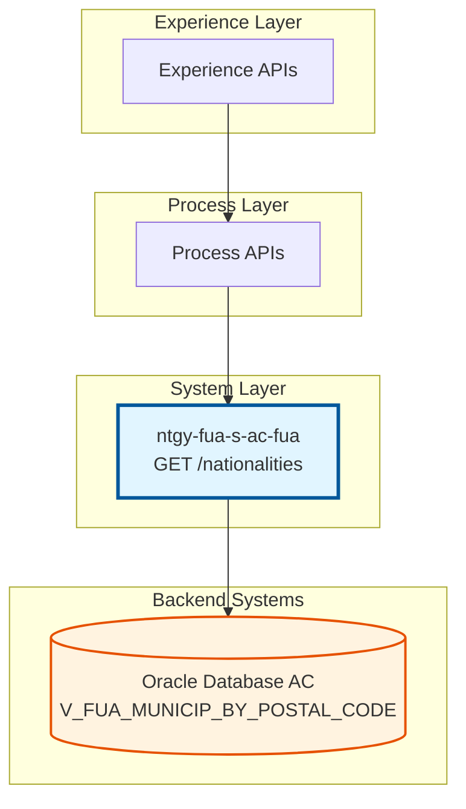
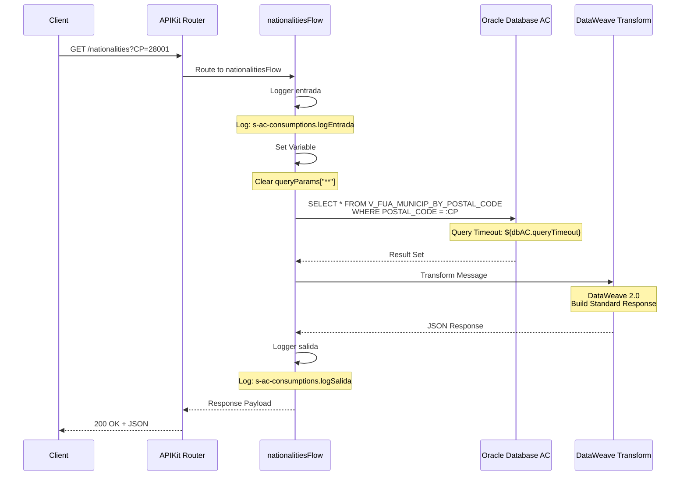
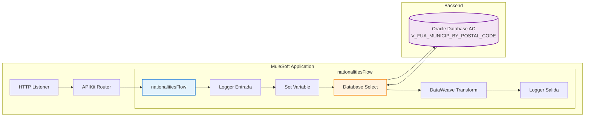
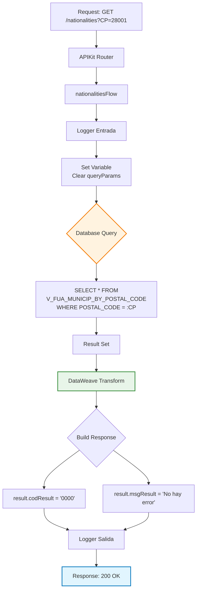

# GET /nationalities

## 📌 Descripción General

### Tipo de API
**System API** - Capa de acceso directo a sistemas de registro (Oracle Database AC)

### Patrón de Integración
**Request-Reply (Synchronous)** - Consulta síncrona a base de datos con respuesta inmediata

### Arquitectura API-Led Connectivity



### Propósito
Endpoint de System API que proporciona acceso a información geográfica almacenada en la base de datos AC, consultando la vista `V_FUA_MUNICIP_BY_POSTAL_CODE` mediante código postal.

---

## 💼 Propósito del Negocio

### Caso de Uso Principal
Consulta de información geográfica (municipios) asociada a un código postal específico para:
- Validación de direcciones en formularios de registro
- Autocompletado de datos geográficos
- Verificación de cobertura de servicios por zona

### Stakeholders

#### Consumidores Directos
- **Process APIs**: APIs de proceso que requieren validación de direcciones
- **Experience APIs**: APIs de experiencia para formularios web y móvil
- **Frontend Applications**: Aplicaciones del Frontal de Ventas (FUV)

#### Usuarios Finales Indirectos
- **Clientes**: Usuarios que completan formularios de registro
- **Agentes de Ventas**: Personal que valida direcciones de clientes
- **Sistemas de Validación**: Servicios automatizados de verificación de datos

### Valor de Negocio
- ✅ **Calidad de Datos**: Mejora la precisión de direcciones ingresadas
- ✅ **Experiencia de Usuario**: Facilita el autocompletado de formularios
- ✅ **Eficiencia Operativa**: Reduce errores en captura de direcciones
- ✅ **Cobertura de Servicios**: Permite validar disponibilidad por zona

---

## 🔧 Especificación Técnica

### Método HTTP
```
GET /api/nationalities
```

### URLs por Ambiente

| Ambiente | URL Base | URL Completa |
|----------|----------|--------------|
| **Local** | `http://localhost:8081` | `http://localhost:8081/api/nationalities?CP={codigo_postal}` |
| **Desarrollo** | `https://dev.naturgy.com` | `https://dev.naturgy.com/api/nationalities?CP={codigo_postal}` |
| **Test** | `https://test.naturgy.com` | `https://test.naturgy.com/api/nationalities?CP={codigo_postal}` |
| **Producción** | `https://api.naturgy.com` | `https://api.naturgy.com/api/nationalities?CP={codigo_postal}` |

### Parámetros de Entrada

#### Query Parameters

| Parámetro | Tipo | Requerido | Descripción | Ejemplo |
|-----------|------|-----------|-------------|---------|
| `CP` | String | ✅ Sí | Código postal a consultar | `28001` |

**Validaciones:**
- Formato: 5 dígitos numéricos
- Rango: Códigos postales válidos de España (01000-52999)

### Estructura de Respuesta

#### Respuesta Exitosa (200 OK)

```json
{
  "result": {
    "codResult": "0000",
    "msgResult": "No hay error"
  }
}
```

#### Campos de Respuesta

| Campo | Tipo | Descripción |
|-------|------|-------------|
| `result` | Object | Objeto contenedor del resultado |
| `result.codResult` | String | Código de resultado de la operación |
| `result.msgResult` | String | Mensaje descriptivo del resultado |

**Códigos de Resultado:**
- `0000`: Operación exitosa
- `9999`: Error en la operación

#### Respuesta de Error (400 Bad Request)

```json
{
  "result": {
    "codResult": "9999",
    "msgResult": "Parámetro CP requerido"
  }
}
```

#### Respuesta de Error (500 Internal Server Error)

```json
{
  "result": {
    "codResult": "9999",
    "msgResult": "Error al consultar base de datos"
  }
}
```

### Headers

#### Request Headers
```
Content-Type: application/json
Accept: application/json
```

#### Response Headers
```
Content-Type: application/json
```

---

## 🏗️ Implementación Técnica

### Diagrama de Secuencia



### Arquitectura de Componentes



### Flujo de Datos



### Configuración de Base de Datos

#### Connection Pool
```yaml
Database_Config:
  host: ${dbAC.host1}
  port: ${dbAC.port}
  serviceName: ${dbAC.serviceName}
  user: ${dbAC.user}
  password: ${dbAC.pass}
  pooling:
    maxPoolSize: 15
    maxWaitTime: 300s
    maxIdleTime: 300s
  timeout:
    queryTimeout: ${dbAC.queryTimeout} # 15 segundos
    connectionTimeout: 3600s
```

#### Query SQL
```sql
SELECT * 
FROM V_FUA_MUNICIP_BY_POSTAL_CODE 
WHERE POSTAL_CODE = :CP
```

**Tabla/Vista Consultada:**
- **Nombre**: `V_FUA_MUNICIP_BY_POSTAL_CODE`
- **Tipo**: Vista (View)
- **Schema**: OVPRO_DELTA
- **Operación**: READ
- **Descripción**: Vista consolidada de municipios indexada por código postal

### Transformación DataWeave

#### Output Transform (Inline)
```dataweave
%dw 2.0
output application/json
---
{
    result: {
        codResult: "0000",
        msgResult: "No hay error"
    }
}
```

**Características:**
- Transformación inline en el flow
- Output fijo con estructura estándar
- No incluye datos del result set de la base de datos
- Respuesta genérica de éxito

### Manejo de Errores

#### Error Handler Global
El endpoint utiliza el error handler global definido en `s-ac-globalErrorHandler.xml`:

**Tipos de Error Manejados:**
- `DB:CONNECTIVITY`: Error de conexión a base de datos
- `DB:QUERY_EXECUTION`: Error en ejecución de query
- `DB:BAD_SQL_SYNTAX`: Error de sintaxis SQL
- `VALIDATION:INVALID_INPUT`: Parámetros de entrada inválidos

#### Retry Policy
```yaml
reconnect:
  frequency: 1000ms
  count: 3
```

### Logging

#### Logger Entrada (Línea 11)
```
Level: INFO
Message: "s-ac-consumptions.logEntrada ## payload: #[payload]"
```

#### Logger Salida (Línea 29)
```
Level: INFO
Message: "s-ac-consumptions.logSalida ## payload: #[payload]"
```

**Información Registrada:**
- Timestamp de entrada y salida
- Payload de request y response
- Parámetros de query
- Duración de la operación

---

## 💻 Ejemplos de Uso

### Ejemplo 1: Consulta Exitosa

#### Request
```bash
curl -X GET "http://localhost:8081/api/nationalities?CP=28001" \
  -H "Content-Type: application/json" \
  -H "Accept: application/json"
```

#### Response (200 OK)
```json
{
  "result": {
    "codResult": "0000",
    "msgResult": "No hay error"
  }
}
```

### Ejemplo 2: Parámetro Faltante

#### Request
```bash
curl -X GET "http://localhost:8081/api/nationalities" \
  -H "Content-Type: application/json" \
  -H "Accept: application/json"
```

#### Response (400 Bad Request)
```json
{
  "result": {
    "codResult": "9999",
    "msgResult": "Parámetro CP requerido"
  }
}
```

### Ejemplo 3: Error de Base de Datos

#### Request
```bash
curl -X GET "http://localhost:8081/api/nationalities?CP=99999" \
  -H "Content-Type: application/json" \
  -H "Accept: application/json"
```

#### Response (500 Internal Server Error)
```json
{
  "result": {
    "codResult": "9999",
    "msgResult": "Error al consultar base de datos"
  }
}
```

### Ejemplo 4: Uso desde JavaScript

```javascript
async function getNationalities(postalCode) {
  try {
    const response = await fetch(
      `https://api.naturgy.com/api/nationalities?CP=${postalCode}`,
      {
        method: 'GET',
        headers: {
          'Content-Type': 'application/json',
          'Accept': 'application/json'
        }
      }
    );
    
    if (!response.ok) {
      throw new Error(`HTTP error! status: ${response.status}`);
    }
    
    const data = await response.json();
    
    if (data.result.codResult === '0000') {
      console.log('Consulta exitosa:', data);
      return data;
    } else {
      console.error('Error en consulta:', data.result.msgResult);
      return null;
    }
  } catch (error) {
    console.error('Error al consultar nationalities:', error);
    throw error;
  }
}

// Uso
getNationalities('28001')
  .then(data => console.log('Datos obtenidos:', data))
  .catch(error => console.error('Error:', error));
```

### Ejemplo 5: Uso desde Python

```python
import requests
import json

def get_nationalities(postal_code):
    """
    Consulta información geográfica por código postal
    
    Args:
        postal_code (str): Código postal a consultar
        
    Returns:
        dict: Respuesta del API o None si hay error
    """
    url = f"https://api.naturgy.com/api/nationalities"
    params = {"CP": postal_code}
    headers = {
        "Content-Type": "application/json",
        "Accept": "application/json"
    }
    
    try:
        response = requests.get(url, params=params, headers=headers, timeout=15)
        response.raise_for_status()
        
        data = response.json()
        
        if data.get("result", {}).get("codResult") == "0000":
            print(f"Consulta exitosa para CP: {postal_code}")
            return data
        else:
            print(f"Error: {data.get('result', {}).get('msgResult')}")
            return None
            
    except requests.exceptions.RequestException as e:
        print(f"Error al consultar API: {e}")
        return None

# Uso
result = get_nationalities("28001")
if result:
    print(json.dumps(result, indent=2))
```

### Ejemplo 6: Testing con Postman

#### Pre-request Script
```javascript
// Generar código postal aleatorio para testing
const postalCode = Math.floor(Math.random() * (52999 - 1000 + 1)) + 1000;
pm.environment.set("postal_code", postalCode.toString().padStart(5, '0'));
```

#### Tests
```javascript
// Validar status code
pm.test("Status code is 200", function () {
    pm.response.to.have.status(200);
});

// Validar estructura de respuesta
pm.test("Response has result object", function () {
    var jsonData = pm.response.json();
    pm.expect(jsonData).to.have.property('result');
    pm.expect(jsonData.result).to.have.property('codResult');
    pm.expect(jsonData.result).to.have.property('msgResult');
});

// Validar código de resultado exitoso
pm.test("Result code is success", function () {
    var jsonData = pm.response.json();
    pm.expect(jsonData.result.codResult).to.eql("0000");
});

// Validar tiempo de respuesta
pm.test("Response time is less than 3000ms", function () {
    pm.expect(pm.response.responseTime).to.be.below(3000);
});
```
