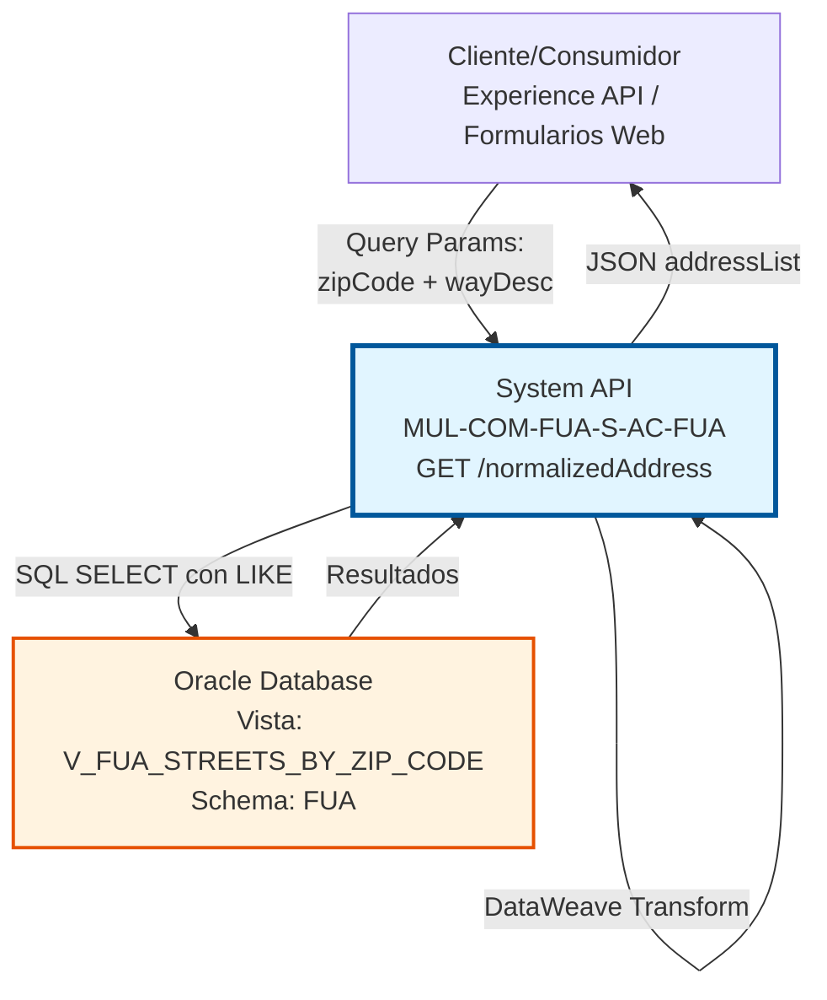
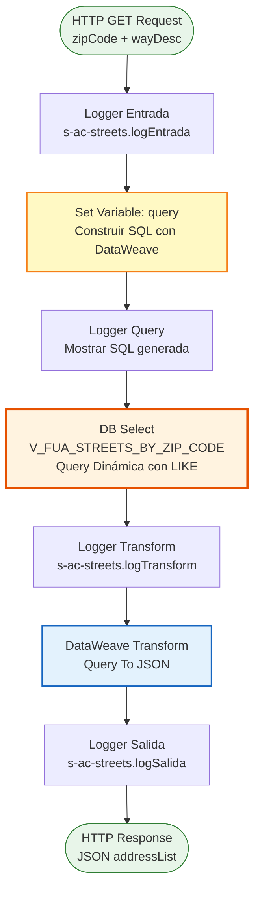
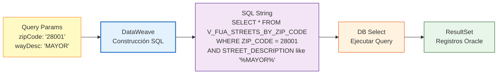

# GET /normalizedAddress

## 📌 Descripción General

### Propósito del Endpoint

Este endpoint proporciona funcionalidad de búsqueda de direcciones normalizadas mediante la combinación de código postal y nombre parcial de calle. Implementa una búsqueda flexible con patrón LIKE que permite autocompletado y sugerencias de direcciones mientras el usuario escribe, facilitando la captura precisa de direcciones en formularios y procesos de alta de clientes.

El endpoint soporta:
- **Búsqueda por Código Postal y Nombre Parcial**: Combina ambos criterios para búsquedas precisas
- **Búsqueda Parcial con LIKE**: Permite encontrar calles escribiendo solo parte del nombre
- **Autocompletado Inteligente**: Ideal para implementar sugerencias en tiempo real
- **Direcciones Normalizadas**: Retorna estructura completa de dirección con campos preparados
- **Query SQL Dinámica**: Construye la query en tiempo de ejecución con DataWeave

### Tipo de API

**Capa:** System API (API-Led Connectivity)

**Función:** Integración directa con Oracle Database para búsqueda flexible de direcciones normalizadas, optimizada para casos de uso de autocompletado y validación de direcciones.

### Patrón de Integración

**Tipo:** Request-Reply Síncrono con Query SQL Dinámica

**Descripción:** El endpoint recibe un código postal y una descripción parcial de calle como query parameters, construye dinámicamente una query SQL con patrón LIKE usando DataWeave, ejecuta la búsqueda contra la vista `V_FUA_STREETS_BY_ZIP_CODE` en Oracle Database, y transforma el resultado a una estructura JSON normalizada con campos de dirección completos.

### Arquitectura API-Led Connectivity



---

## 💼 Propósito del Negocio

### Casos de Uso Principales

1. **Autocompletado de Direcciones en Formularios Web**
   - Usuario comienza a escribir nombre de calle en formulario de alta
   - Sistema consulta en tiempo real con cada tecla presionada
   - Presenta lista de sugerencias de calles que coinciden con el texto
   - Usuario selecciona dirección correcta de la lista

2. **Validación de Direcciones en Procesos de Alta de Clientes**
   - Sistema recibe código postal y nombre de calle del usuario
   - Valida que la combinación existe en el catálogo de direcciones
   - Obtiene información normalizada (tipo de vía, municipio, provincia)
   - Asegura calidad de datos desde el punto de captura

3. **Búsqueda Flexible de Direcciones**
   - Usuario no recuerda el nombre exacto de la calle
   - Puede buscar con nombre parcial o aproximado
   - Sistema retorna todas las coincidencias posibles
   - Facilita encontrar la dirección correcta

4. **Normalización de Datos de Dirección**
   - Sistema recibe direcciones en formato libre
   - Busca coincidencias en catálogo normalizado
   - Estandariza formato de dirección (tipo de vía, nombre, etc.)
   - Prepara estructura completa para almacenamiento

### Contexto Empresarial

- **Dominio:** Gestión de Datos Maestros - Localización Geográfica
- **Sector:** Energía - Utilities
- **División:** Naturgy España - NewCo
- **Proceso de Negocio:** Gestión de Clientes, Contratos y Puntos de Suministro
- **Fuente de Datos:** Oracle Database (Sistema de Datos Maestros FUA)

### Stakeholders

- **Clientes Finales**: Necesitan ingresar direcciones de forma rápida y precisa
- **Equipos de Atención al Cliente**: Requieren herramientas de búsqueda flexible de direcciones
- **Desarrolladores de Portales Web**: Necesitan APIs para implementar autocompletado
- **Equipos de Calidad de Datos**: Aseguran que las direcciones capturadas sean válidas

### Valor de Negocio

- **Experiencia de Usuario Mejorada**: Autocompletado reduce tiempo y errores de captura
- **Calidad de Datos**: Garantiza direcciones válidas y normalizadas desde el origen
- **Eficiencia Operativa**: Reduce tiempo de validación manual de direcciones
- **Reducción de Errores**: Minimiza errores tipográficos y direcciones incorrectas
- **Flexibilidad de Búsqueda**: Permite encontrar direcciones con información parcial

### Consumidores Potenciales

Este endpoint puede ser consumido por:
- Experience APIs de portales web de autoservicio
- Aplicaciones móviles con formularios de dirección
- Process APIs de gestión de clientes y contratos
- Sistemas de CRM (Salesforce) para validación de direcciones
- Aplicaciones de call center para búsqueda asistida

---

## 🔧 Especificación Técnica

### URLs por Ambiente

| Ambiente | URL Base | URL Completa |
|----------|----------|--------------|
| **Local** | `http://localhost:8081` | `http://localhost:8081/api/normalizedAddress?zipCode=28001&wayDesc=MAYOR` |
| **Development** | `https://mul-com-fua-s-ac-fua-dev.us-e2.cloudhub.io` | `https://mul-com-fua-s-ac-fua-dev.us-e2.cloudhub.io/api/normalizedAddress?zipCode=28001&wayDesc=MAYOR` |
| **UAT** | `https://mul-com-fua-s-ac-fua-uat.us-e2.cloudhub.io` | `https://mul-com-fua-s-ac-fua-uat.us-e2.cloudhub.io/api/normalizedAddress?zipCode=28001&wayDesc=MAYOR` |
| **Production** | `https://mul-com-fua-s-ac-fua-pro.us-e2.cloudhub.io` | `https://mul-com-fua-s-ac-fua-pro.us-e2.cloudhub.io/api/normalizedAddress?zipCode=28001&wayDesc=MAYOR` |

### Método HTTP

```
GET /api/normalizedAddress
```

### Parámetros de Entrada

#### Headers HTTP

| Header | Tipo | Requerido | Descripción | Ejemplo |
|--------|------|-----------|-------------|---------|
| `Accept` | string | ❌ No | Tipo de contenido esperado en response | `application/json` |

#### Query Parameters

| Parámetro | Tipo | Requerido | Descripción | Ejemplo | Validación |
|-----------|------|-----------|-------------|---------|------------|
| `zipCode` | string | ✅ Sí | Código postal español (5 dígitos) | `"28001"` | Formato: 5 dígitos numéricos |
| `wayDesc` | string | ✅ Sí | Descripción parcial o completa de la calle | `"MAYOR"` | Mínimo 2 caracteres recomendado |

**Nota sobre wayDesc:**
- Acepta texto parcial (ej: "MAY" encontrará "CALLE MAYOR")
- No distingue mayúsculas/minúsculas en la búsqueda
- Se usa con patrón LIKE: `%wayDesc%`
- Cuanto más específico, menos resultados retornará

### Respuestas

#### Respuesta Exitosa (200 OK)

```json
{
  "result": {
    "codResult": "0000",
    "msgResult": "No hay error"
  },
  "addressList": [
    {
      "addressId": "12345",
      "wayId": "12345",
      "zipCode": "28001",
      "province": "Madrid",
      "city": "Madrid",
      "way": "CALLE MAYOR",
      "wayType": "CALLE",
      "town": "Madrid",
      "number": "",
      "floor": "",
      "door": "",
      "portal": "",
      "stairs": ""
    }
  ]
}
```

**Estructura de la Respuesta:**

| Campo | Tipo | Descripción |
|-------|------|-------------|
| `result` | object | Objeto con información del resultado de la operación |
| `result.codResult` | string | Código de resultado ("0000" = éxito) |
| `result.msgResult` | string | Mensaje descriptivo del resultado |
| `addressList` | array | Lista de direcciones encontradas |
| `addressList[].addressId` | string | Identificador único de la dirección/calle |
| `addressList[].wayId` | string | Identificador de la vía (mismo que addressId) |
| `addressList[].zipCode` | string | Código postal |
| `addressList[].province` | string | Nombre de la provincia |
| `addressList[].city` | string | Nombre del municipio/ciudad |
| `addressList[].way` | string | Nombre completo de la calle |
| `addressList[].wayType` | string | Tipo de vía (CALLE, PLAZA, AVENIDA, etc.) |
| `addressList[].town` | string | Nombre de la localidad |
| `addressList[].number` | string | Número de portal (vacío, para completar por usuario) |
| `addressList[].floor` | string | Piso (vacío, para completar por usuario) |
| `addressList[].door` | string | Puerta (vacío, para completar por usuario) |
| `addressList[].portal` | string | Portal (vacío, para completar por usuario) |
| `addressList[].stairs` | string | Escalera (vacío, para completar por usuario) |

**Nota sobre Campos Vacíos:**
Los campos `number`, `floor`, `door`, `portal` y `stairs` se retornan vacíos porque representan información específica de cada dirección que debe ser completada por el usuario. La API proporciona la estructura base de la calle.

#### Respuesta con Múltiples Resultados (200 OK)

```json
{
  "result": {
    "codResult": "0000",
    "msgResult": "No hay error"
  },
  "addressList": [
    {
      "addressId": "12345",
      "wayId": "12345",
      "zipCode": "28001",
      "province": "Madrid",
      "city": "Madrid",
      "way": "CALLE MAYOR",
      "wayType": "CALLE",
      "town": "Madrid",
      "number": "",
      "floor": "",
      "door": "",
      "portal": "",
      "stairs": ""
    },
    {
      "addressId": "12346",
      "wayId": "12346",
      "zipCode": "28001",
      "province": "Madrid",
      "city": "Madrid",
      "way": "PLAZA MAYOR",
      "wayType": "PLAZA",
      "town": "Madrid",
      "number": "",
      "floor": "",
      "door": "",
      "portal": "",
      "stairs": ""
    }
  ]
}
```

#### Respuesta sin Resultados (200 OK)

```json
{
  "result": {
    "codResult": "0000",
    "msgResult": "No hay error"
  },
  "addressList": []
}
```

#### Respuesta de Error Técnico (400 Bad Request)

```json
{
  "result": {
    "codResult": "0001",
    "msgResult": "Parámetros zipCode y wayDesc son requeridos"
  }
}
```

#### Respuesta de Error Técnico (500 Internal Server Error)

```json
{
  "result": {
    "codResult": "0002",
    "msgResult": "Error al consultar base de datos"
  }
}
```

### Autenticación y Autorización

- **Tipo:** Client ID & Client Secret (Anypoint Platform)
- **Autorización Oracle:** El usuario de base de datos debe tener permisos para:
  - Ejecutar SELECT sobre la vista `V_FUA_STREETS_BY_ZIP_CODE`
  - Acceso de lectura al schema `FUA`

### Timeouts

| Tipo | Valor | Descripción |
|------|-------|-------------|
| **Query Timeout** | Configurado en `${dbAC.queryTimeout}` | Tiempo máximo de espera para la consulta SQL |
| **Connection Timeout** | 10 segundos | Tiempo máximo para establecer conexión con Oracle |
| **Reconnect Policy** | Forever | Reintentos automáticos en caso de pérdida de conexión |

---

## 🏗️ Implementación Técnica

### Arquitectura del Flow



### Diagrama de Construcción de Query Dinámica



### Componentes del Flow

#### 1. Logger de Entrada
```xml
<logger level="INFO" doc:name="Logger Entrada" 
        message="s-ac-streets.logEntrada ## payload: #[payload]"/>
```
- **Propósito:** Registra el inicio de la ejecución del flow
- **Nivel:** INFO
- **Contenido:** Payload de entrada (query parameters)

#### 2. Set Variable - Construcción de Query SQL Dinámica

```xml
<set-variable variableName="query" doc:name="Set Variable">
    <![CDATA[
    %dw 2.0
    output application/dw
    
    var wayDesc = attributes.queryParams.wayDesc
    var zipCode = attributes.queryParams.zipCode
    
    ---
    "SELECT * FROM V_FUA_STREETS_BY_ZIP_CODE WHERE ZIP_CODE = " ++ zipCode ++ 
    " AND STREET_DESCRIPTION like '%" ++ wayDesc ++ "%'"
    ]]>
</set-variable>
```

**Propósito:** Construye dinámicamente la query SQL usando DataWeave

**Proceso de Construcción:**
1. Extrae `wayDesc` y `zipCode` de query parameters
2. Concatena strings para formar la query SQL
3. Añade wildcards `%` antes y después de `wayDesc` para búsqueda parcial
4. Almacena query completa en variable `query`

**Ejemplo de Query Generada:**
```sql
SELECT * FROM V_FUA_STREETS_BY_ZIP_CODE 
WHERE ZIP_CODE = 28001 
AND STREET_DESCRIPTION like '%MAYOR%'
```

**Características de la Búsqueda:**
- **Case-insensitive:** Oracle LIKE no distingue mayúsculas/minúsculas por defecto
- **Búsqueda parcial:** `%MAYOR%` encuentra "CALLE MAYOR", "PLAZA MAYOR", etc.
- **Flexible:** Permite encontrar calles con información incompleta

#### 3. Logger de Query
```xml
<logger level="INFO" doc:name="Logger" 
        message="#[vars.query]"/>
```
- **Propósito:** Registra la query SQL generada para debugging
- **Útil para:** Troubleshooting, auditoría, optimización

#### 4. Database Select - Ejecución de Query Dinámica

```xml
<db:select doc:name="Select" 
           config-ref="Database_Config" 
           queryTimeout="${dbAC.queryTimeout}">
    <reconnect-forever />
    <db:sql><![CDATA[#[vars.query]]]></db:sql>
</db:select>
```

**Detalles de la Consulta:**
- **Vista:** `V_FUA_STREETS_BY_ZIP_CODE`
- **Query:** Dinámica, construida en variable `vars.query`
- **Patrón:** `WHERE ZIP_CODE = [valor] AND STREET_DESCRIPTION like '%[texto]%'`
- **Timeout:** Configurado mediante property `${dbAC.queryTimeout}`
- **Reconnect:** Política de reconexión automática infinita

**Estructura de la Vista:**

| Campo Oracle | Tipo | Descripción |
|--------------|------|-------------|
| `STREET_ID` | VARCHAR2 | Identificador único de la calle |
| `ZIP_CODE` | VARCHAR2 | Código postal |
| `PROVINCE` | VARCHAR2 | Nombre de la provincia |
| `CITY` | VARCHAR2 | Nombre del municipio |
| `STREET_DESCRIPTION` | VARCHAR2 | Nombre completo de la calle |
| `STREET_TYPE` | VARCHAR2 | Tipo de vía (CALLE, PLAZA, etc.) |
| `TOWN` | VARCHAR2 | Nombre de la localidad |

#### 5. Logger Transform
```xml
<logger level="INFO" doc:name="Logger Transform" 
        message="s-ac-streets.logTransform ## payload: #[payload]"/>
```
- **Propósito:** Registra el resultado de la query antes de transformación
- **Útil para:** Verificar datos obtenidos de Oracle

#### 6. DataWeave Transformation - Query To JSON

```dataweave
%dw 2.0
output application/json
---
{
    result: {
        codResult: "0000",
        msgResult: "No hay error"
    },
    addressList: payload map (payload01, indexOfPayload01) -> {
        addressId: payload01.STREET_ID,
        wayId: payload01.STREET_ID,
        zipCode: payload01.ZIP_CODE,
        province: payload01.PROVINCE,
        city: payload01.CITY,
        way: payload01.STREET_DESCRIPTION default "",
        wayType: payload01.STREET_TYPE,
        town: payload01.TOWN,
        number: "",
        floor: "",
        door: "",
        portal: "",
        stairs: ""
    }
}
```

**Propósito:** Transforma el ResultSet de Oracle a estructura JSON normalizada

**Mapeo de Campos:**

| Campo Oracle | Campo JSON | Transformación |
|--------------|------------|----------------|
| `STREET_ID` | `addressId` | Directo |
| `STREET_ID` | `wayId` | Directo (duplicado) |
| `ZIP_CODE` | `zipCode` | Directo |
| `PROVINCE` | `province` | Directo |
| `CITY` | `city` | Directo |
| `STREET_DESCRIPTION` | `way` | Con default "" si null |
| `STREET_TYPE` | `wayType` | Directo |
| `TOWN` | `town` | Directo |
| N/A | `number` | Vacío (para completar) |
| N/A | `floor` | Vacío (para completar) |
| N/A | `door` | Vacío (para completar) |
| N/A | `portal` | Vacío (para completar) |
| N/A | `stairs` | Vacío (para completar) |

**Lógica de Transformación:**
- Itera sobre cada registro del resultado SQL usando `map`
- Transforma nombres de campos de Oracle (UPPER_CASE) a camelCase
- Añade campos de dirección completa vacíos para estructura normalizada
- Envuelve resultado en estructura estándar con `result` y `addressList`
- Siempre retorna `codResult: "0000"` para consultas exitosas

#### 7. Logger de Salida
```xml
<logger level="INFO" doc:name="Logger Salida" 
        message="s-ac-streets.logSalida ## payload: #[payload]"/>
```
- **Propósito:** Registra la respuesta final del flow
- **Nivel:** INFO
- **Contenido:** Payload transformado (JSON response)

### Configuración de Base de Datos

**Database Config Reference:** `Database_Config`

```xml
<db:config name="Database_Config">
    <db:oracle-connection 
        host="${dbAC.host}" 
        port="${dbAC.port}" 
        user="${dbAC.user}" 
        password="${dbAC.password}" 
        serviceName="${dbAC.serviceName}"/>
</db:config>
```

**Properties Utilizadas:**
- `${dbAC.host}` - Host del servidor Oracle
- `${dbAC.port}` - Puerto de conexión (típicamente 1521)
- `${dbAC.user}` - Usuario de base de datos
- `${dbAC.password}` - Contraseña (encriptada)
- `${dbAC.serviceName}` - Nombre del servicio Oracle
- `${dbAC.queryTimeout}` - Timeout para queries SQL

### Manejo de Errores

El flow implementa manejo de errores estándar de MuleSoft:

1. **Error de Conexión a BD:**
   - Política de reconexión automática (`reconnect-forever`)
   - Reintentos infinitos hasta restablecer conexión
   - Se captura mediante error handler global

2. **Error de Query SQL:**
   - Se captura mediante error handler
   - Retorna código 500 con detalles del error
   - Query SQL se registra en logs para debugging

3. **Parámetros Faltantes:**
   - Si `zipCode` o `wayDesc` no están presentes
   - La query SQL fallará o retornará resultados incorrectos
   - Validación debe implementarse en capa superior

4. **Sin Resultados:**
   - No es un error, retorna lista vacía `addressList: []`
   - Código de resultado sigue siendo "0000"
   - Cliente debe manejar lista vacía apropiadamente

### Consideraciones de Performance

- **Query Dinámica:** Construida en tiempo de ejecución, overhead mínimo
- **Búsqueda LIKE:** Puede ser costosa si no hay índices apropiados
- **Índices Recomendados:** 
  - Índice compuesto en `(ZIP_CODE, STREET_DESCRIPTION)`
  - Índice funcional para búsquedas case-insensitive
- **Volumen:** Típicamente retorna 1-20 registros por búsqueda
- **Caché:** Considerar caché en cliente para búsquedas repetidas
- **Throttling:** Implementar debounce en autocompletado (300-500ms)

### Logging Detallado

El flow implementa logging en 4 puntos estratégicos:

1. **Entrada:** Registra query parameters recibidos
2. **Query:** Registra SQL generada dinámicamente
3. **Transform:** Registra resultado de Oracle antes de transformación
4. **Salida:** Registra respuesta JSON final

**Beneficios:**
- Facilita debugging de queries dinámicas
- Permite auditoría de búsquedas
- Ayuda a identificar problemas de performance
- Útil para análisis de patrones de uso

---

## 💻 Ejemplos de Uso

### Ejemplo 1: Búsqueda de Calle por Nombre Parcial

#### Request

```bash
curl -X GET "https://mul-com-fua-s-ac-fua-dev.us-e2.cloudhub.io/api/normalizedAddress?zipCode=28001&wayDesc=MAYOR" \
  -H "Accept: application/json" \
  -H "client_id: YOUR_CLIENT_ID" \
  -H "client_secret: YOUR_CLIENT_SECRET"
```

#### Response (200 OK)

```json
{
  "result": {
    "codResult": "0000",
    "msgResult": "No hay error"
  },
  "addressList": [
    {
      "addressId": "280010001",
      "wayId": "280010001",
      "zipCode": "28001",
      "province": "Madrid",
      "city": "Madrid",
      "way": "CALLE MAYOR",
      "wayType": "CALLE",
      "town": "Madrid",
      "number": "",
      "floor": "",
      "door": "",
      "portal": "",
      "stairs": ""
    },
    {
      "addressId": "280010002",
      "wayId": "280010002",
      "zipCode": "28001",
      "province": "Madrid",
      "city": "Madrid",
      "way": "PLAZA MAYOR",
      "wayType": "PLAZA",
      "town": "Madrid",
      "number": "",
      "floor": "",
      "door": "",
      "portal": "",
      "stairs": ""
    }
  ]
}
```

### Ejemplo 2: Búsqueda con Texto Muy Corto

#### Request

```bash
curl -X GET "https://mul-com-fua-s-ac-fua-dev.us-e2.cloudhub.io/api/normalizedAddress?zipCode=28001&wayDesc=MA" \
  -H "Accept: application/json" \
  -H "client_id: YOUR_CLIENT_ID" \
  -H "client_secret: YOUR_CLIENT_SECRET"
```

#### Response (200 OK) - Múltiples Resultados

```json
{
  "result": {
    "codResult": "0000",
    "msgResult": "No hay error"
  },
  "addressList": [
    {
      "addressId": "280010001",
      "wayId": "280010001",
      "zipCode": "28001",
      "province": "Madrid",
      "city": "Madrid",
      "way": "CALLE MAYOR",
      "wayType": "CALLE",
      "town": "Madrid",
      "number": "",
      "floor": "",
      "door": "",
      "portal": "",
      "stairs": ""
    },
    {
      "addressId": "280010002",
      "wayId": "280010002",
      "zipCode": "28001",
      "province": "Madrid",
      "city": "Madrid",
      "way": "PLAZA MAYOR",
      "wayType": "PLAZA",
      "town": "Madrid",
      "number": "",
      "floor": "",
      "door": "",
      "portal": "",
      "stairs": ""
    },
    {
      "addressId": "280010003",
      "wayId": "280010003",
      "zipCode": "28001",
      "province": "Madrid",
      "city": "Madrid",
      "way": "CALLE MARQUES DE CUBAS",
      "wayType": "CALLE",
      "town": "Madrid",
      "number": "",
      "floor": "",
      "door": "",
      "portal": "",
      "stairs": ""
    }
  ]
}
```

### Ejemplo 3: Sin Resultados

#### Request

```bash
curl -X GET "https://mul-com-fua-s-ac-fua-dev.us-e2.cloudhub.io/api/normalizedAddress?zipCode=28001&wayDesc=INEXISTENTE" \
  -H "Accept: application/json" \
  -H "client_id: YOUR_CLIENT_ID" \
  -H "client_secret: YOUR_CLIENT_SECRET"
```

#### Response (200 OK)

```json
{
  "result": {
    "codResult": "0000",
    "msgResult": "No hay error"
  },
  "addressList": []
}
```

### Ejemplo 4: Error - Parámetros Faltantes

#### Request

```bash
curl -X GET "https://mul-com-fua-s-ac-fua-dev.us-e2.cloudhub.io/api/normalizedAddress?zipCode=28001" \
  -H "Accept: application/json" \
  -H "client_id: YOUR_CLIENT_ID" \
  -H "client_secret: YOUR_CLIENT_SECRET"
```

#### Response (400 Bad Request)

```json
{
  "result": {
    "codResult": "0001",
    "msgResult": "Parámetro wayDesc es requerido"
  }
}
```

### Ejemplo 5: Uso desde JavaScript - Autocompletado

```javascript
// Implementación de autocompletado con debounce
class AddressAutocomplete {
  constructor(apiUrl, clientId, clientSecret) {
    this.apiUrl = apiUrl;
    this.clientId = clientId;
    this.clientSecret = clientSecret;
    this.debounceTimer = null;
  }

  // Búsqueda con debounce para evitar demasiadas llamadas
  searchAddresses(zipCode, wayDesc, callback, delay = 300) {
    clearTimeout(this.debounceTimer);
    
    // Solo buscar si hay al menos 2 caracteres
    if (!wayDesc || wayDesc.length < 2) {
      callback([]);
      return;
    }

    this.debounceTimer = setTimeout(async () => {
      try {
        const addresses = await this.fetchAddresses(zipCode, wayDesc);
        callback(addresses);
      } catch (error) {
        console.error('Error al buscar direcciones:', error);
        callback([]);
      }
    }, delay);
  }

  async fetchAddresses(zipCode, wayDesc) {
    const url = `${this.apiUrl}/normalizedAddress?zipCode=${zipCode}&wayDesc=${encodeURIComponent(wayDesc)}`;
    
    const response = await fetch(url, {
      method: 'GET',
      headers: {
        'Accept': 'application/json',
        'client_id': this.clientId,
        'client_secret': this.clientSecret
      }
    });

    if (!response.ok) {
      throw new Error(`HTTP error! status: ${response.status}`);
    }

    const data = await response.json();
    
    if (data.result.codResult === "0000") {
      return data.addressList;
    } else {
      throw new Error(data.result.msgResult);
    }
  }
}

// Uso en formulario HTML
const autocomplete = new AddressAutocomplete(
  'https://mul-com-fua-s-ac-fua-pro.us-e2.cloudhub.io/api',
  'YOUR_CLIENT_ID',
  'YOUR_CLIENT_SECRET'
);

// Event listener en input de calle
document.getElementById('streetInput').addEventListener('input', function(e) {
  const zipCode = document.getElementById('zipCode').value;
  const wayDesc = e.target.value;
  
  autocomplete.searchAddresses(zipCode, wayDesc, (addresses) => {
    // Actualizar lista de sugerencias
    updateSuggestionsList(addresses);
  });
});

function updateSuggestionsList(addresses) {
  const suggestionsList = document.getElementById('suggestions');
  suggestionsList.innerHTML = '';
  
  addresses.forEach(address => {
    const li = document.createElement('li');
    li.textContent = `${address.wayType} ${address.way} - ${address.city}`;
    li.onclick = () => selectAddress(address);
    suggestionsList.appendChild(li);
  });
}

function selectAddress(address) {
  document.getElementById('streetInput').value = address.way;
  document.getElementById('wayType').value = address.wayType;
  document.getElementById('city').value = address.city;
  document.getElementById('province').value = address.province;
  document.getElementById('suggestions').innerHTML = '';
}
```

### Ejemplo 6: Uso desde Python

```python
import requests
from typing import List, Dict, Optional

class AddressSearchClient:
    """Cliente para búsqueda de direcciones normalizadas"""
    
    def __init__(self, base_url: str, client_id: str, client_secret: str):
        self.base_url = base_url
        self.client_id = client_id
        self.client_secret = client_secret
        self.session = requests.Session()
        self.session.headers.update({
            'Accept': 'application/json',
            'client_id': client_id,
            'client_secret': client_secret
        })
    
    def search_addresses(
        self, 
        zip_code: str, 
        way_desc: str
    ) -> List[Dict]:
        """
        Busca direcciones por código postal y descripción de calle
        
        Args:
            zip_code: Código postal (5 dígitos)
            way_desc: Descripción parcial o completa de la calle
            
        Returns:
            Lista de direcciones encontradas
            
        Raises:
            requests.exceptions.RequestException: Si hay error en la petición
            ValueError: Si la respuesta indica error
        """
        url = f"{self.base_url}/normalizedAddress"
        params = {
            'zipCode': zip_code,
            'wayDesc': way_desc
        }
        
        response = self.session.get(url, params=params)
        response.raise_for_status()
        
        data = response.json()
        
        if data['result']['codResult'] == "0000":
            return data['addressList']
        else:
            raise ValueError(f"Error en búsqueda: {data['result']['msgResult']}")
    
    def format_address(self, address: Dict) -> str:
        """Formatea una dirección para mostrar"""
        return f"{address['wayType']} {address['way']}, {address['city']} ({address['province']}) - CP: {address['zipCode']}"

# Uso
if __name__ == "__main__":
    client = AddressSearchClient(
        base_url="https://mul-com-fua-s-ac-fua-pro.us-e2.cloudhub.io/api",
        client_id="YOUR_CLIENT_ID",
        client_secret="YOUR_CLIENT_SECRET"
    )
    
    try:
        # Búsqueda de direcciones
        addresses = client.search_addresses("28001", "MAYOR")
        
        print(f"Encontradas {len(addresses)} direcciones:")
        for address in addresses:
            print(f"  - {client.format_address(address)}")
            
    except Exception as e:
        print(f"Error: {e}")
```

### Ejemplo 7: Integración con React - Componente de Autocompletado

```jsx
import React, { useState, useEffect, useCallback } from 'react';
import debounce from 'lodash/debounce';

const AddressAutocomplete = ({ zipCode, onAddressSelect }) => {
  const [inputValue, setInputValue] = useState('');
  const [suggestions, setSuggestions] = useState([]);
  const [loading, setLoading] = useState(false);
  const [error, setError] = useState(null);

  // Función de búsqueda con debounce
  const searchAddresses = useCallback(
    debounce(async (zipCode, wayDesc) => {
      if (!wayDesc || wayDesc.length < 2) {
        setSuggestions([]);
        return;
      }

      setLoading(true);
      setError(null);

      try {
        const response = await fetch(
          `https://mul-com-fua-s-ac-fua-pro.us-e2.cloudhub.io/api/normalizedAddress?zipCode=${zipCode}&wayDesc=${encodeURIComponent(wayDesc)}`,
          {
            headers: {
              'Accept': 'application/json',
              'client_id': process.env.REACT_APP_CLIENT_ID,
              'client_secret': process.env.REACT_APP_CLIENT_SECRET
            }
          }
        );

        const data = await response.json();

        if (data.result.codResult === "0000") {
          setSuggestions(data.addressList);
        } else {
          setError(data.result.msgResult);
        }
      } catch (err) {
        setError('Error al buscar direcciones');
        console.error(err);
      } finally {
        setLoading(false);
      }
    }, 300),
    []
  );

  useEffect(() => {
    if (zipCode && inputValue) {
      searchAddresses(zipCode, inputValue);
    }
  }, [zipCode, inputValue, searchAddresses]);

  const handleInputChange = (e) => {
    setInputValue(e.target.value);
  };

  const handleSelectAddress = (address) => {
    setInputValue(`${address.wayType} ${address.way}`);
    setSuggestions([]);
    onAddressSelect(address);
  };

  return (
    <div className="address-autocomplete">
      <input
        type="text"
        value={inputValue}
        onChange={handleInputChange}
        placeholder="Escribe el nombre de la calle..."
        className="form-control"
      />
      
      {loading && <div className="loading">Buscando...</div>}
      
      {error && <div className="error">{error}</div>}
      
      {suggestions.length > 0 && (
        <ul className="suggestions-list">
          {suggestions.map((address) => (
            <li
              key={address.addressId}
              onClick={() => handleSelectAddress(address)}
              className="suggestion-item"
            >
              <strong>{address.wayType} {address.way}</strong>
              <br />
              <small>{address.city}, {address.province} - CP: {address.zipCode}</small>
            </li>
          ))}
        </ul>
      )}
    </div>
  );
};

export default AddressAutocomplete;
```
