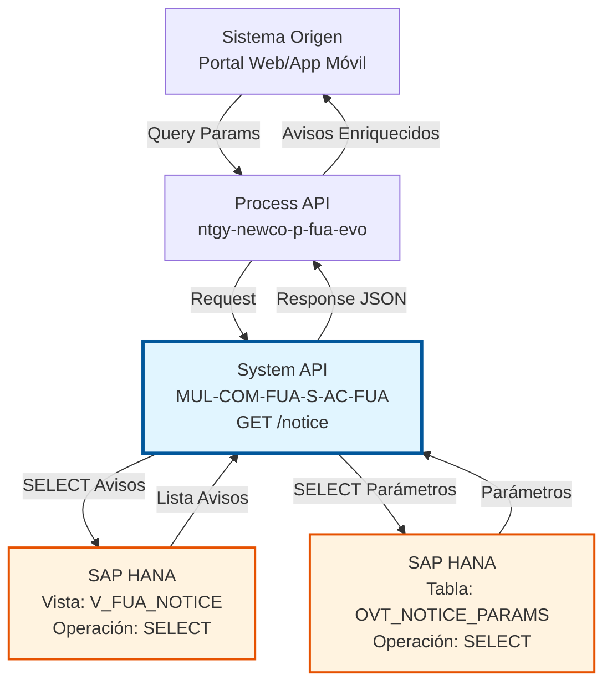
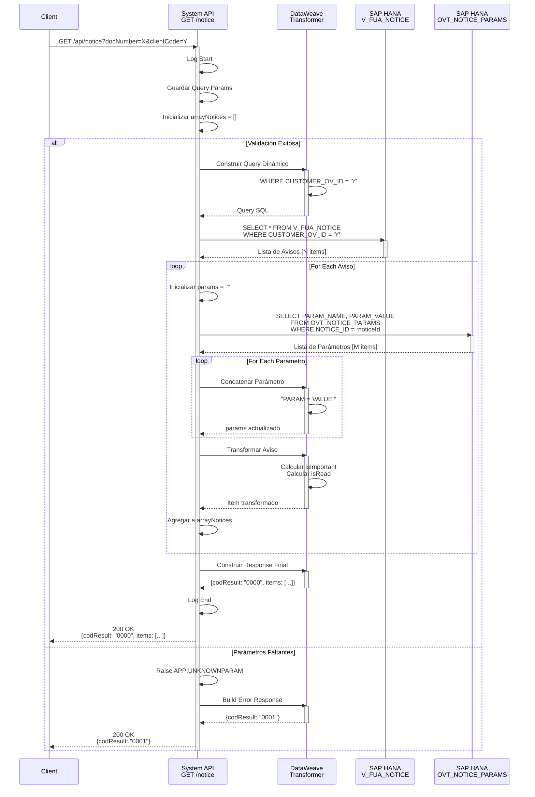

# GET /notice

## 📌 Descripción General

### Propósito del Endpoint

Este endpoint consulta avisos y notificaciones de clientes almacenados en SAP HANA, permitiendo búsquedas flexibles por código de cliente o ID de aviso específico. Incluye información detallada de cada aviso junto con sus parámetros personalizados.

El endpoint soporta:
- **Búsqueda por Código de Cliente**: Obtiene todos los avisos asociados a un cliente específico
- **Búsqueda por ID de Aviso**: Obtiene un aviso específico por su identificador único
- **Parámetros Personalizados**: Incluye parámetros adicionales configurables por aviso
- **Estado de Lectura**: Indica si el aviso ha sido leído por el cliente
- **Clasificación de Importancia**: Identifica avisos marcados como importantes

### Tipo de API

**Capa:** System API (API-Led Connectivity)

**Función:** Integración directa con SAP HANA (PostgreSQL compatible) para consulta de avisos y notificaciones de clientes.

### Patrón de Integración

**Tipo:** Request-Reply Síncrono con SQL SELECT

**Descripción:** Recibe parámetros de búsqueda (clientCode o noticeId), construye query SQL dinámico, consulta la vista V_FUA_NOTICE, obtiene parámetros adicionales de cada aviso desde OVT_NOTICE_PARAMS, transforma y enriquece los datos, y retorna un array estructurado de avisos con toda su información.

### Arquitectura API-Led Connectivity



---

## 💼 Propósito del Negocio

### Casos de Uso Principales

1. **Consulta de Avisos de Cliente**
   - Un cliente accede a su portal web o app móvil
   - El sistema consulta todos los avisos pendientes o históricos
   - Se muestran avisos ordenados por importancia y fecha

2. **Visualización de Aviso Específico**
   - El cliente selecciona un aviso para ver detalles completos
   - El sistema consulta el aviso específico con todos sus parámetros
   - Se marca el aviso como leído automáticamente

3. **Gestión de Notificaciones Importantes**
   - El sistema identifica avisos marcados como importantes
   - Se priorizan en la interfaz de usuario
   - Permite seguimiento de avisos críticos no leídos

4. **Auditoría de Comunicaciones**
   - El equipo de soporte consulta histórico de avisos enviados
   - Se verifica qué avisos ha recibido y leído un cliente
   - Facilita resolución de incidencias de comunicación

### Contexto Empresarial

- **Dominio:** Gestión de Comunicaciones con Clientes
- **Sector:** Energía - Utilities
- **División:** Naturgy España - NewCo
- **Proceso de Negocio:** Customer Engagement y Comunicaciones
- **Módulo SAP:** CRM (Customer Relationship Management)

### Stakeholders

- **Clientes Finales**: Necesitan consultar avisos y notificaciones importantes
- **Equipo de Atención al Cliente**: Consulta avisos enviados para soporte
- **Equipo de Marketing**: Gestiona comunicaciones y campañas
- **Equipo de Operaciones**: Envía avisos técnicos y operativos

### Valor de Negocio

- **Transparencia**: Clientes pueden consultar todas sus notificaciones
- **Trazabilidad**: Registro completo de comunicaciones enviadas
- **Personalización**: Parámetros configurables por tipo de aviso
- **Priorización**: Identificación de avisos importantes
- **Seguimiento**: Control de avisos leídos vs no leídos

### Consumidores Potenciales

Este endpoint puede ser consumido por:
- Process APIs de gestión de clientes (ntgy-newco-p-fua-evo)
- Portales web de autoservicio
- Aplicaciones móviles de clientes
- Sistemas de agentes de call center
- Flujos de Salesforce (Platform Events, Flows)

---

## 🔧 Especificación Técnica

### URLs por Ambiente

| Ambiente | URL Base | URL Completa |
|----------|----------|--------------|
| **Local** | `http://localhost:8081` | `http://localhost:8081/api/notice` |
| **Development** | `https://mul-com-fua-s-ac-fua-dev.us-e2.cloudhub.io` | `https://mul-com-fua-s-ac-fua-dev.us-e2.cloudhub.io/api/notice` |
| **UAT** | `https://mul-com-fua-s-ac-fua-uat.us-e2.cloudhub.io` | `https://mul-com-fua-s-ac-fua-uat.us-e2.cloudhub.io/api/notice` |
| **Production** | `https://mul-com-fua-s-ac-fua-pro.us-e2.cloudhub.io` | `https://mul-com-fua-s-ac-fua-pro.us-e2.cloudhub.io/api/notice` |

### Método HTTP

```
GET /api/notice
```

### Parámetros de Entrada

#### Headers HTTP

| Header | Tipo | Requerido | Descripción | Ejemplo |
|--------|------|-----------|-------------|---------|
| `Accept` | string | ❌ No | Tipo de contenido esperado en response | `application/json` |

#### Query Parameters

**Opción 1: Búsqueda por Código de Cliente**

| Parámetro | Tipo | Requerido | Descripción | Ejemplo |
|-----------|------|-----------|-------------|---------|
| `docNumber` | string | ✅ Sí | Número de documento del cliente | `"12345678A"` |
| `clientCode` | string | ✅ Sí | Código único del cliente | `"CLI-2024-001234"` |

**Opción 2: Búsqueda por ID de Aviso**

| Parámetro | Tipo | Requerido | Descripción | Ejemplo |
|-----------|------|-----------|-------------|---------|
| `docNumber` | string | ✅ Sí | Número de documento del cliente | `"12345678A"` |
| `noticeId` | string | ✅ Sí | Identificador único del aviso | `"NOT-2024-567890"` |

**⚠️ IMPORTANTE:** 
- El parámetro `docNumber` es **siempre requerido**
- Debe proporcionarse **clientCode** O **noticeId** (no ambos)
- Si faltan parámetros, se retorna error `0001`

### Respuestas

#### Respuesta Exitosa (200 OK)

**Búsqueda por clientCode (múltiples avisos):**

```json
{
  "result": {
    "codResult": "0000",
    "msgResult": "OK"
  },
  "items": [
    {
      "noticeId": "NOT-2024-001234",
      "type": "BILLING",
      "date": "2024-01-15T10:30:00Z",
      "START_DATE": "2024-01-15T00:00:00Z",
      "END_DATE": "2024-02-15T23:59:59Z",
      "address": "Calle Principal 123, Madrid",
      "isImportant": true,
      "params": "INVOICE_NUM = INV-2024-001 AMOUNT = 125.50 ",
      "isRead": false
    },
    {
      "noticeId": "NOT-2024-001235",
      "type": "MAINTENANCE",
      "date": "2024-01-10T08:00:00Z",
      "START_DATE": "2024-01-20T09:00:00Z",
      "END_DATE": "2024-01-20T18:00:00Z",
      "address": "Calle Principal 123, Madrid",
      "isImportant": false,
      "params": "DURATION = 4 hours AFFECTED_SERVICES = Electricity ",
      "isRead": true
    }
  ]
}
```

**Búsqueda por noticeId (aviso único):**

```json
{
  "result": {
    "codResult": "0000",
    "msgResult": "OK"
  },
  "items": [
    {
      "noticeId": "NOT-2024-001234",
      "type": "BILLING",
      "date": "2024-01-15T10:30:00Z",
      "START_DATE": "2024-01-15T00:00:00Z",
      "END_DATE": "2024-02-15T23:59:59Z",
      "address": "Calle Principal 123, Madrid",
      "isImportant": true,
      "params": "INVOICE_NUM = INV-2024-001 AMOUNT = 125.50 ",
      "isRead": false
    }
  ]
}
```

#### Estructura de Campos de Respuesta

| Campo | Tipo | Descripción |
|-------|------|-------------|
| `noticeId` | string | Identificador único del aviso |
| `type` | string | Tipo de aviso (BILLING, MAINTENANCE, ALERT, etc.) |
| `date` | string | Fecha de inserción del aviso (ISO 8601) |
| `START_DATE` | string | Fecha de inicio de vigencia del aviso |
| `END_DATE` | string | Fecha de fin de vigencia del aviso |
| `address` | string | Dirección asociada al aviso |
| `isImportant` | boolean | Indica si el aviso es importante (true/false) |
| `params` | string | Parámetros adicionales en formato "KEY = VALUE " |
| `isRead` | boolean | Indica si el aviso ha sido leído (true/false) |

#### Respuesta de Error - Parámetros Faltantes (200 OK)

```json
{
  "result": {
    "codResult": "0001",
    "msgResult": "Faltan parámetros de búsqueda"
  }
}
```

#### Códigos de Resultado

| Código | Descripción | Tipo |
|--------|-------------|------|
| `0000` | Operación exitosa | Success |
| `0001` | Faltan parámetros de búsqueda | Error |

### Autenticación y Autorización

- **Tipo:** Client ID & Client Secret (Anypoint Platform)
- **Autorización Base de Datos:** El usuario de conexión debe tener permisos para:
  - Ejecutar SELECT en vista `V_FUA_NOTICE`
  - Ejecutar SELECT en tabla `OVT_NOTICE_PARAMS`
  - Acceso al schema `SAPSR3`

### Timeouts

| Tipo | Valor | Descripción |
|------|-------|-------------|
| **Query Timeout** | 30000 ms (30 segundos) | Tiempo máximo de ejecución de cada SELECT |
| **Connection Timeout** | 10 segundos | Tiempo máximo para establecer conexión con BD |

---

## 🏗️ Implementación Técnica

### Arquitectura del Flow

```mermaid
flowchart TD
    Start([HTTP GET Request]) --> LogStart[Log Start<br/>s-ac-getNotice#start]
    LogStart --> SaveParams[Guardar Query Params<br/>vars.peticionOriginal]
    SaveParams --> InitArray[Inicializar Array<br/>vars.arrayNotices = []]
    InitArray --> Choice{Validar Parámetros}
    
    Choice -->|docNumber + clientCode| BuildQuery1[Construir Query<br/>WHERE CUSTOMER_OV_ID = clientCode]
    Choice -->|docNumber + noticeId| BuildQuery2[Construir Query<br/>WHERE NOTICE_ID = noticeId]
    Choice -->|Parámetros faltantes| RaiseError[Raise Error<br/>APP:UNKNOWNPARAM]
    
    BuildQuery1 --> SelectNotices[DB Select<br/>V_FUA_NOTICE]
    BuildQuery2 --> SelectNotices
    
    SelectNotices --> ForEachNotice[For Each Aviso]
    ForEachNotice --> SelectParams[DB Select<br/>OVT_NOTICE_PARAMS<br/>WHERE NOTICE_ID = :noticeId]
    SelectParams --> ForEachParam[For Each Parámetro]
    ForEachParam --> ConcatParams[Concatenar Parámetros<br/>PARAM_NAME = PARAM_VALUE]
    ConcatParams --> TransformNotice[Transformar Aviso<br/>+ Calcular isImportant/isRead]
    TransformNotice --> AddToArray[Agregar a arrayNotices]
    AddToArray --> ForEachNotice
    
    ForEachNotice --> BuildResponse[Construir Response<br/>codResult: 0000 + items]
    BuildResponse --> LogEnd[Log End<br/>s-ac-getNotice#end]
    LogEnd --> End([HTTP Response 200 OK])
    
    RaiseError --> ErrorHandler[Error Handler<br/>On Error Propagate]
    ErrorHandler --> ErrorResp[Response Error<br/>codResult: 0001]
    ErrorResp --> End
    
    style Start fill:#e8f5e9,stroke:#2e7d32
    style SelectNotices fill:#fff3e0,stroke:#e65100,stroke-width:3px
    style SelectParams fill:#fff3e0,stroke:#e65100,stroke-width:2px
    style BuildResponse fill:#c8e6c9,stroke:#388e3c
    style RaiseError fill:#ffcdd2,stroke:#c62828
    style End fill:#e8f5e9,stroke:#2e7d32
```

### Operaciones de Base de Datos

#### Operación 1: Consulta de Avisos

**Tipo:** SQL SELECT (Query Dinámico)

**Opción A - Búsqueda por Cliente (Líneas 14-22):**
```sql
SELECT * FROM V_FUA_NOTICE 
WHERE CUSTOMER_OV_ID = '{clientCode}'
```

**Opción B - Búsqueda por Aviso (Líneas 24-32):**
```sql
SELECT * FROM V_FUA_NOTICE 
WHERE NOTICE_ID = '{noticeId}'
```

**Vista:** `V_FUA_NOTICE`

**Columnas Retornadas:**

| Columna | Tipo | Descripción |
|---------|------|-------------|
| `NOTICE_ID` | VARCHAR | Identificador único del aviso |
| `TYPE_ID` | VARCHAR | Tipo de aviso |
| `INSERTION_DATE` | TIMESTAMP | Fecha de inserción |
| `START_DATE` | TIMESTAMP | Fecha de inicio de vigencia |
| `END_DATE` | TIMESTAMP | Fecha de fin de vigencia |
| `WAY` | VARCHAR | Dirección asociada |
| `IS_IMPORTANT` | VARCHAR | Indicador de importancia (NULL o valor) |
| `READ_DATE` | TIMESTAMP | Fecha de lectura (NULL si no leído) |
| `CUSTOMER_OV_ID` | VARCHAR | Código del cliente |

#### Operación 2: Consulta de Parámetros

**Tipo:** SQL SELECT con Parámetros Preparados

**Query SQL (Líneas 45-48):**
```sql
SELECT PARAM_NAME, PARAM_VALUE 
FROM OVT_NOTICE_PARAMS 
WHERE NOTICE_ID = :noticeId
```

**Tabla:** `OVT_NOTICE_PARAMS`

**Columnas:**

| Columna | Tipo | Descripción |
|---------|------|-------------|
| `NOTICE_ID` | VARCHAR | ID del aviso (FK) |
| `PARAM_NAME` | VARCHAR | Nombre del parámetro |
| `PARAM_VALUE` | VARCHAR | Valor del parámetro |

**Input Parameters:**
```dataweave
{'noticeId' : payload.NOTICE_ID}
```

### Transformaciones DataWeave

#### Transformación 1: Construcción de Query Dinámico (Líneas 14-22)

**Propósito:** Construir query SQL según parámetros de búsqueda

**Búsqueda por Cliente:**
```dataweave
%dw 2.0
output application/json

var busqueda = "SELECT * FROM V_FUA_NOTICE WHERE CUSTOMER_OV_ID = '" 
               ++ vars.peticionOriginal.clientCode ++ "'"
---
busqueda
```

**Búsqueda por Aviso:**
```dataweave
%dw 2.0
output application/json

var busqueda = "SELECT * FROM V_FUA_NOTICE WHERE NOTICE_ID = '" 
               ++ vars.peticionOriginal.noticeId ++ "'"
---
busqueda
```

#### Transformación 2: Concatenación de Parámetros (Líneas 50-57)

**Propósito:** Construir string con todos los parámetros del aviso

```dataweave
%dw 2.0
output application/json
var auxiliar = payload.PARAM_NAME as String 
               ++ " = " 
               ++ payload.PARAM_VALUE as String 
               ++ " "
---
vars.params ++ auxiliar
```

**Resultado:** `"PARAM1 = value1 PARAM2 = value2 "`

#### Transformación 3: Construcción de Item de Aviso (Líneas 58-67)

**Propósito:** Transformar datos de BD a estructura de respuesta

```dataweave
%dw 2.0
output application/json
var important = if(payload.IS_IMPORTANT != null) true else false
var read = if(payload.READ_DATE != null) true else false
---
vars.arrayNotices <<
{
    "noticeId" : payload.NOTICE_ID,
    "type" : payload.TYPE_ID,
    "date" : payload.INSERTION_DATE,
    "START_DATE" : payload.START_DATE,
    "END_DATE" : payload.END_DATE,
    "address" : payload.WAY,
    "isImportant" : important,
    "params" : vars.params,
    "isRead" : read
}
```

**Lógica de Campos Calculados:**
- `isImportant`: `true` si `IS_IMPORTANT` no es NULL, `false` en caso contrario
- `isRead`: `true` si `READ_DATE` no es NULL, `false` en caso contrario

#### Transformación 4: Respuesta Final (Líneas 68-78)

**Propósito:** Construir respuesta estándar con array de avisos

```dataweave
%dw 2.0
output application/json
---
{
    "result": {
        "codResult": "0000",
        "msgResult": "OK"
    },
    "items": vars.arrayNotices
}
```

### Lógica de Validación

**Validación de Parámetros (Líneas 11-42):**

```xml
<choice doc:name="Choice">
    <when expression="#[vars.peticionOriginal.docNumber != null 
                        and vars.peticionOriginal.clientCode != null]">
        <!-- Búsqueda por cliente -->
    </when>
    <when expression="#[vars.peticionOriginal.docNumber != null 
                        and vars.peticionOriginal.noticeId != null]">
        <!-- Búsqueda por aviso -->
    </when>
    <otherwise>
        <raise-error type="APP:UNKNOWNPARAM"/>
    </otherwise>
</choice>
```

**Criterios de Validación:**
- Opción 1: `docNumber` + `clientCode` presentes
- Opción 2: `docNumber` + `noticeId` presentes
- Si ninguna opción cumple → Error `APP:UNKNOWNPARAM`

### Procesamiento Anidado

**Estructura de Loops (Líneas 43-67):**

```
For Each Aviso en listaNotice:
    1. Inicializar vars.params = ""
    2. SELECT parámetros WHERE NOTICE_ID = aviso.NOTICE_ID
    3. For Each Parámetro en listaParams:
        a. Concatenar "PARAM_NAME = PARAM_VALUE " a vars.params
    4. Transformar aviso + calcular isImportant/isRead
    5. Agregar aviso transformado a vars.arrayNotices
```

**Resultado:** Array completo de avisos con todos sus parámetros

### Manejo de Errores

**Error Handler (Líneas 79-92):**

```xml
<on-error-propagate type="APP:UNKNOWNPARAM">
    <logger level="DEBUG" />
    <ee:transform>
        <!-- Response con codResult: 0001 -->
    </ee:transform>
</on-error-propagate>
```

**Comportamiento:**
- Captura errores de tipo `APP:UNKNOWNPARAM`
- Transforma a respuesta JSON con código `0001`
- Propaga el error (HTTP 200 con mensaje de error)

### ⚠️ Consideraciones de Seguridad

**Query Dinámico con Concatenación:**

El código construye queries SQL mediante concatenación de strings:
```dataweave
var busqueda = "SELECT * FROM V_FUA_NOTICE WHERE CUSTOMER_OV_ID = '" 
               ++ vars.peticionOriginal.clientCode ++ "'"
```

**⚠️ RIESGO:** Potencial vulnerabilidad de SQL Injection

**Recomendaciones:**
1. **Usar Parámetros Preparados:** Modificar para usar `<db:input-parameters>`
2. **Validación de Entrada:** Implementar validación estricta de parámetros
3. **Sanitización:** Escapar caracteres especiales en inputs
4. **Mejora Futura:** Refactorizar a query parametrizado

**Ejemplo de Mejora Sugerida:**
```xml
<db:select config-ref="Database_Config">
    <db:sql>
        SELECT * FROM V_FUA_NOTICE WHERE CUSTOMER_OV_ID = :clientCode
    </db:sql>
    <db:input-parameters>
        #[{'clientCode': vars.peticionOriginal.clientCode}]
    </db:input-parameters>
</db:select>
```

### Diagrama de Secuencia Completo



---

## 💻 Ejemplos de Uso

### Ejemplo 1: Búsqueda por Código de Cliente

#### Request

```bash
curl -X GET "https://mul-com-fua-s-ac-fua-dev.us-e2.cloudhub.io/api/notice?docNumber=12345678A&clientCode=CLI-2024-001234" \
  -H "Accept: application/json" \
  -H "client_id: YOUR_CLIENT_ID" \
  -H "client_secret: YOUR_CLIENT_SECRET"
```

#### Response (200 OK)

```json
{
  "result": {
    "codResult": "0000",
    "msgResult": "OK"
  },
  "items": [
    {
      "noticeId": "NOT-2024-001234",
      "type": "BILLING",
      "date": "2024-01-15T10:30:00Z",
      "START_DATE": "2024-01-15T00:00:00Z",
      "END_DATE": "2024-02-15T23:59:59Z",
      "address": "Calle Principal 123, Madrid",
      "isImportant": true,
      "params": "INVOICE_NUM = INV-2024-001 AMOUNT = 125.50 DUE_DATE = 2024-02-15 ",
      "isRead": false
    },
    {
      "noticeId": "NOT-2024-001235",
      "type": "MAINTENANCE",
      "date": "2024-01-10T08:00:00Z",
      "START_DATE": "2024-01-20T09:00:00Z",
      "END_DATE": "2024-01-20T18:00:00Z",
      "address": "Calle Principal 123, Madrid",
      "isImportant": false,
      "params": "DURATION = 4 hours AFFECTED_SERVICES = Electricity CONTACT = 900123456 ",
      "isRead": true
    }
  ]
}
```

### Ejemplo 2: Búsqueda por ID de Aviso

#### Request

```bash
curl -X GET "https://mul-com-fua-s-ac-fua-dev.us-e2.cloudhub.io/api/notice?docNumber=12345678A&noticeId=NOT-2024-001234" \
  -H "Accept: application/json" \
  -H "client_id: YOUR_CLIENT_ID" \
  -H "client_secret: YOUR_CLIENT_SECRET"
```

#### Response (200 OK)

```json
{
  "result": {
    "codResult": "0000",
    "msgResult": "OK"
  },
  "items": [
    {
      "noticeId": "NOT-2024-001234",
      "type": "BILLING",
      "date": "2024-01-15T10:30:00Z",
      "START_DATE": "2024-01-15T00:00:00Z",
      "END_DATE": "2024-02-15T23:59:59Z",
      "address": "Calle Principal 123, Madrid",
      "isImportant": true,
      "params": "INVOICE_NUM = INV-2024-001 AMOUNT = 125.50 DUE_DATE = 2024-02-15 ",
      "isRead": false
    }
  ]
}
```

### Ejemplo 3: Error - Parámetros Faltantes

#### Request

```bash
curl -X GET "https://mul-com-fua-s-ac-fua-dev.us-e2.cloudhub.io/api/notice?docNumber=12345678A" \
  -H "Accept: application/json" \
  -H "client_id: YOUR_CLIENT_ID" \
  -H "client_secret: YOUR_CLIENT_SECRET"
```

#### Response (200 OK)

```json
{
  "result": {
    "codResult": "0001",
    "msgResult": "Faltan parámetros de búsqueda"
  }
}
```

### Ejemplo 4: Integración desde JavaScript

```javascript
// Búsqueda por código de cliente
async function getClientNotices(docNumber, clientCode) {
  const params = new URLSearchParams({
    docNumber: docNumber,
    clientCode: clientCode
  });

  const response = await fetch(
    `https://mul-com-fua-s-ac-fua-dev.us-e2.cloudhub.io/api/notice?${params}`,
    {
      method: 'GET',
      headers: {
        'Accept': 'application/json',
        'client_id': 'YOUR_CLIENT_ID',
        'client_secret': 'YOUR_CLIENT_SECRET'
      }
    }
  );

  const result = await response.json();

  if (result.result.codResult === "0000") {
    console.log(`Encontrados ${result.items.length} avisos`);
    
    // Filtrar avisos no leídos e importantes
    const unreadImportant = result.items.filter(
      notice => !notice.isRead && notice.isImportant
    );
    
    console.log(`Avisos importantes no leídos: ${unreadImportant.length}`);
    return result.items;
  } else {
    console.error("Error:", result.result.msgResult);
    return [];
  }
}

// Uso
getClientNotices("12345678A", "CLI-2024-001234");
```

### Ejemplo 5: Integración desde Python

```python
import requests
from typing import List, Dict, Optional

def get_client_notices(
    doc_number: str, 
    client_code: Optional[str] = None,
    notice_id: Optional[str] = None
) -> List[Dict]:
    """
    Consulta avisos de un cliente
    
    Args:
        doc_number: Número de documento del cliente
        client_code: Código del cliente (opcional)
        notice_id: ID del aviso específico (opcional)
    
    Returns:
        Lista de avisos
    """
    base_url = "https://mul-com-fua-s-ac-fua-dev.us-e2.cloudhub.io/api/notice"
    
    # Construir parámetros
    params = {"docNumber": doc_number}
    if client_code:
        params["clientCode"] = client_code
    elif notice_id:
        params["noticeId"] = notice_id
    else:
        raise ValueError("Debe proporcionar clientCode o noticeId")
    
    headers = {
        "Accept": "application/json",
        "client_id": "YOUR_CLIENT_ID",
        "client_secret": "YOUR_CLIENT_SECRET"
    }
    
    response = requests.get(base_url, params=params, headers=headers)
    result = response.json()
    
    if result["result"]["codResult"] == "0000":
        notices = result["items"]
        print(f"Encontrados {len(notices)} avisos")
        
        # Estadísticas
        important_count = sum(1 for n in notices if n["isImportant"])
        unread_count = sum(1 for n in notices if not n["isRead"])
        
        print(f"Avisos importantes: {important_count}")
        print(f"Avisos no leídos: {unread_count}")
        
        return notices
    else:
        print(f"Error: {result['result']['msgResult']}")
        return []

# Uso
notices = get_client_notices("12345678A", client_code="CLI-2024-001234")

# Procesar avisos
for notice in notices:
    print(f"\nAviso: {notice['noticeId']}")
    print(f"Tipo: {notice['type']}")
    print(f"Importante: {'Sí' if notice['isImportant'] else 'No'}")
    print(f"Leído: {'Sí' if notice['isRead'] else 'No'}")
    print(f"Parámetros: {notice['params']}")
```

### Ejemplo 6: Consulta Local para Testing

```bash
# Testing en ambiente local
curl -X GET "http://localhost:8081/api/notice?docNumber=12345678A&clientCode=CLI-2024-001234" \
  -H "Accept: application/json"
```

### Ejemplo 7: Filtrado de Avisos Importantes No Leídos

```javascript
// Función para obtener solo avisos importantes no leídos
async function getUnreadImportantNotices(docNumber, clientCode) {
  const params = new URLSearchParams({
    docNumber: docNumber,
    clientCode: clientCode
  });

  const response = await fetch(
    `https://mul-com-fua-s-ac-fua-dev.us-e2.cloudhub.io/api/notice?${params}`,
    {
      method: 'GET',
      headers: {
        'Accept': 'application/json',
        'client_id': 'YOUR_CLIENT_ID',
        'client_secret': 'YOUR_CLIENT_SECRET'
      }
    }
  );

  const result = await response.json();

  if (result.result.codResult === "0000") {
    // Filtrar avisos importantes no leídos
    const urgentNotices = result.items.filter(
      notice => notice.isImportant && !notice.isRead
    );
    
    // Ordenar por fecha (más recientes primero)
    urgentNotices.sort((a, b) => 
      new Date(b.date) - new Date(a.date)
    );
    
    return urgentNotices;
  }
  
  return [];
}
```
