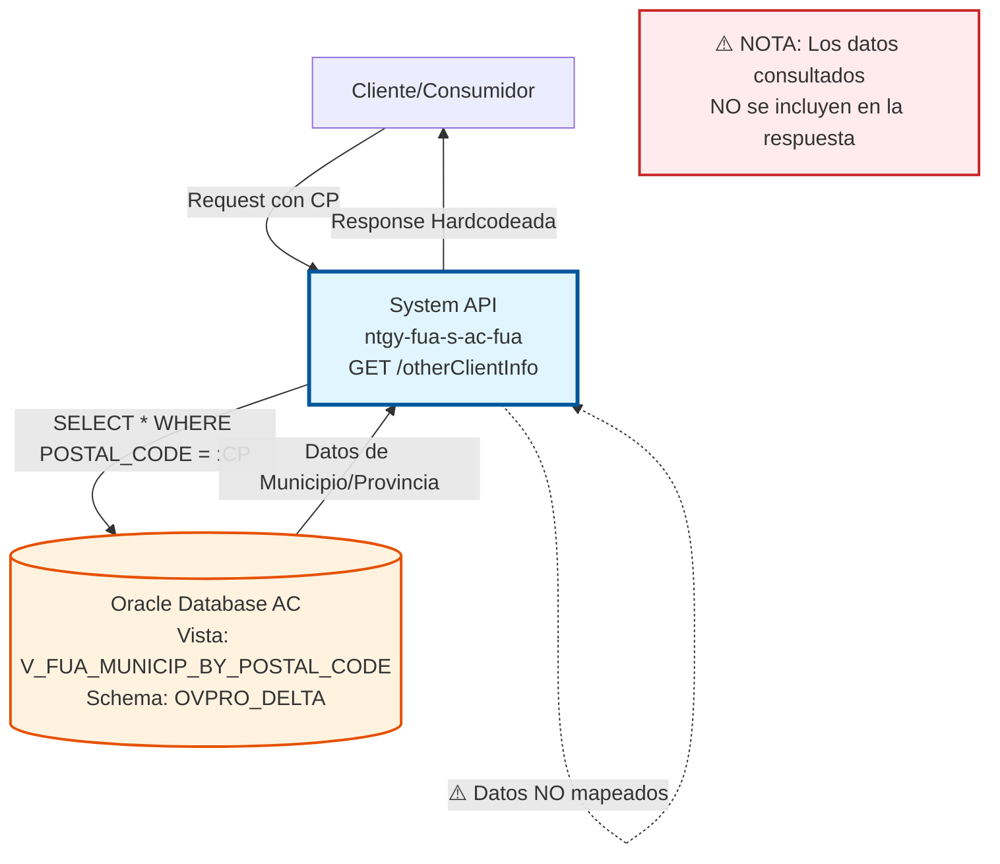
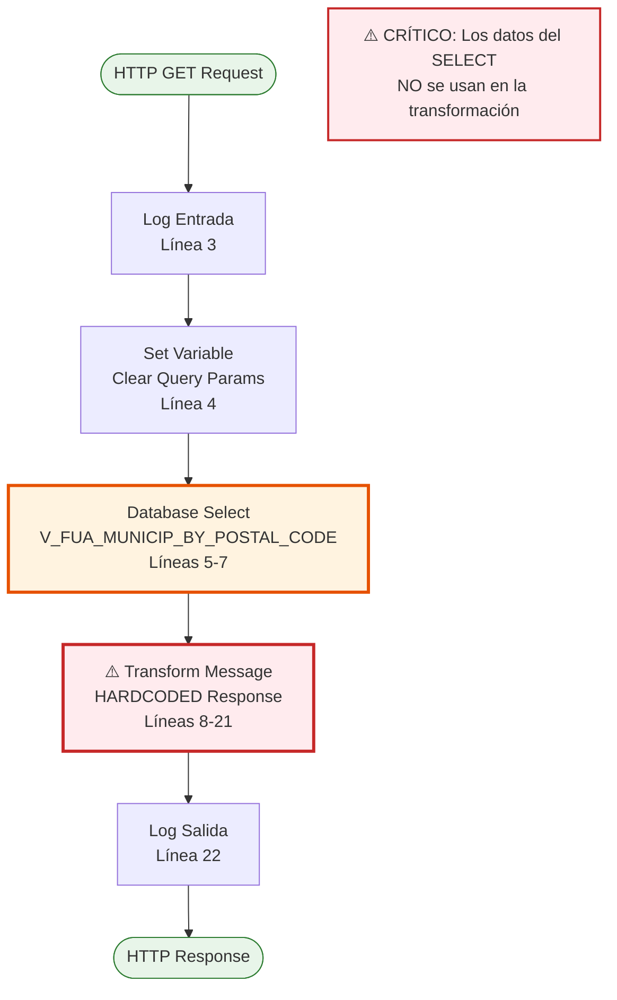
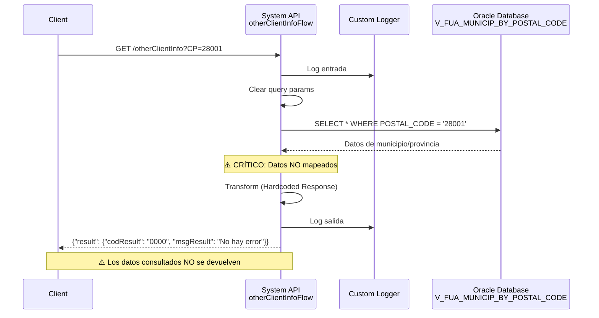

# GET /otherClientInfo

## 📌 Descripción General

### Propósito del Endpoint

Este endpoint consulta información adicional de cliente relacionada con datos geográficos (municipio y provincia) basándose en un código postal proporcionado. Accede a la vista `V_FUA_MUNICIP_BY_POSTAL_CODE` en la base de datos Oracle AC.

⚠️ **ADVERTENCIA CRÍTICA - IMPLEMENTACIÓN INCOMPLETA:**
El endpoint actualmente ejecuta la consulta SQL pero **NO devuelve los datos obtenidos**. La respuesta está hardcodeada y siempre retorna el mismo mensaje de éxito sin incluir la información consultada. Esto sugiere que la implementación está incompleta o en desarrollo.

El endpoint soporta:
- **Consulta por Código Postal**: Búsqueda de municipio y provincia asociados a un código postal
- **Validación de Existencia**: Verificación de que el código postal existe en la base de datos
- **Datos Geográficos**: Acceso a información de localización geográfica

### Tipo de API

**Capa:** System API (API-Led Connectivity)

**Función:** Integración directa con Oracle Database AC para consulta de datos geográficos por código postal.

### Patrón de Integración

**Tipo:** Request-Reply Síncrono con SQL Query

**Descripción:** El endpoint recibe un código postal como parámetro, ejecuta una consulta SQL contra la vista `V_FUA_MUNICIP_BY_POSTAL_CODE`, pero actualmente retorna una respuesta hardcodeada sin los datos consultados.

### Arquitectura API-Led Connectivity



---

## 💼 Propósito del Negocio

### Casos de Uso Principales

1. **Validación de Código Postal**
   - Verificar que un código postal existe en la base de datos
   - Obtener información geográfica asociada (municipio, provincia)
   - Validar direcciones durante procesos de alta de clientes

2. **Enriquecimiento de Datos de Cliente**
   - Completar información de dirección con datos de municipio y provincia
   - Normalizar direcciones con información geográfica oficial
   - Facilitar búsquedas y filtros por ubicación geográfica

3. **Soporte a Procesos de Registro**
   - Validar códigos postales durante registro de nuevos clientes
   - Autocompletar información de municipio y provincia
   - Mejorar experiencia de usuario en formularios

### Contexto Empresarial

- **Dominio:** Gestión de Clientes - Datos Maestros Geográficos
- **Sector:** Energía - Utilities
- **División:** Naturgy España - Área Cliente (AC)
- **Proceso de Negocio:** Validación y enriquecimiento de datos de dirección
- **Sistema Backend:** Oracle Database AC

### Stakeholders

- **Equipos de Desarrollo Frontend**: Necesitan validar códigos postales en tiempo real
- **Agentes de Atención al Cliente**: Requieren información geográfica para completar registros
- **Sistemas de Registro**: Automatizan validación de direcciones
- **Equipos de Calidad de Datos**: Mantienen integridad de información geográfica

### Valor de Negocio

- **Calidad de Datos**: Mejora la precisión de direcciones de clientes
- **Experiencia de Usuario**: Facilita el proceso de registro con autocompletado
- **Eficiencia Operativa**: Reduce errores en captura de direcciones
- **Normalización**: Estandariza información geográfica en toda la organización

### Consumidores Potenciales

Este endpoint puede ser consumido por:
- Process APIs de gestión de clientes
- Experience APIs de portales web y móviles
- Flujos de registro y alta de clientes
- Sistemas de validación de direcciones
- Aplicaciones de agentes de call center

---

## 🔧 Especificación Técnica

### URLs por Ambiente

| Ambiente | URL Completa |
|----------|--------------|
| **Local** | `http://localhost:8081/api/otherClientInfo?CP={codigoPostal}` |
| **Development** | `https://ntgy-fua-s-ac-fua-dev.us-e2.cloudhub.io/api/otherClientInfo?CP={codigoPostal}` |
| **UAT** | `https://ntgy-fua-s-ac-fua-uat.us-e2.cloudhub.io/api/otherClientInfo?CP={codigoPostal}` |
| **Production** | `https://ntgy-fua-s-ac-fua-pro.us-e2.cloudhub.io/api/otherClientInfo?CP={codigoPostal}` |

### Método HTTP

```
GET /api/otherClientInfo
```

### Parámetros de Entrada

#### Headers HTTP

| Header | Tipo | Requerido | Descripción | Ejemplo |
|--------|------|-----------|-------------|---------|
| `Accept` | string | ❌ No | Tipo de contenido esperado en response | `application/json` |

#### Query Parameters

| Parámetro | Tipo | Requerido | Descripción | Ejemplo | Validación |
|-----------|------|-----------|-------------|---------|------------|
| `CP` | string | ✅ Sí | Código postal español (5 dígitos) | `"28001"` | Formato: `^\d{5}$` |

**Notas sobre parámetros:**
- El código postal debe ser válido y existir en la base de datos
- Se espera formato español de 5 dígitos numéricos
- El parámetro es case-sensitive (usar mayúsculas: `CP`)

### Respuestas

#### ⚠️ Respuesta Actual (Hardcodeada) - 200 OK

**ADVERTENCIA:** Esta es la respuesta actual del endpoint, que NO incluye los datos consultados de la base de datos.

```json
{
  "result": {
    "codResult": "0000",
    "msgResult": "No hay error"
  }
}
```

**Campos de la respuesta actual:**

| Campo | Tipo | Descripción |
|-------|------|-------------|
| `result` | object | Objeto de resultado |
| `result.codResult` | string | Código de resultado (siempre "0000") |
| `result.msgResult` | string | Mensaje de resultado (siempre "No hay error") |

#### 📋 Respuesta Esperada (Basada en la Vista Consultada)

**NOTA:** Esta es la estructura esperada basándose en la vista `V_FUA_MUNICIP_BY_POSTAL_CODE` que se consulta. Actualmente NO se devuelve.

```json
{
  "result": {
    "codResult": "0000",
    "msgResult": "Consulta exitosa"
  },
  "data": {
    "postalCode": "28001",
    "municipality": "Madrid",
    "province": "Madrid",
    "provinceCode": "28"
  }
}
```

#### Respuesta de Error (400 Bad Request)

```json
{
  "result": {
    "codResult": "0001",
    "msgResult": "Parámetro CP requerido"
  }
}
```

#### Respuesta de Error (404 Not Found)

```json
{
  "result": {
    "codResult": "0002",
    "msgResult": "Código postal no encontrado"
  }
}
```

#### Respuesta de Error Técnico (500 Internal Server Error)

```json
{
  "result": {
    "codResult": "0003",
    "msgResult": "Error interno del servidor"
  }
}
```

### Autenticación y Autorización

- **Tipo:** Client ID & Client Secret (Anypoint Platform)
- **Autorización Oracle:** El usuario de base de datos debe tener permisos para:
  - Acceso de lectura a la vista `V_FUA_MUNICIP_BY_POSTAL_CODE`
  - Acceso al schema `OVPRO_DELTA`

### Timeouts

| Tipo | Valor | Descripción |
|------|-------|-------------|
| **Query Timeout** | 15 segundos | Tiempo máximo de ejecución de la query SQL |
| **Connection Timeout** | 3600 segundos | Tiempo máximo para establecer conexión con Oracle |
| **Response Timeout** | 30 segundos | Tiempo máximo de espera para la respuesta completa |

---

## 🏗️ Implementación Técnica

### Arquitectura del Flow



### Componentes del Flow

#### 1. Logger de Entrada (Línea 3)
```xml
<logger level="INFO" doc:name="Logger entrada" 
        message="s-ac-consumptions.logEntrada ## payload: #[payload]"/>
```

**Propósito:** Registrar el inicio de la ejecución del flow con el payload de entrada.

#### 2. Set Variable (Línea 4)
```xml
<set-variable value="" doc:name="Set Variable" 
              variableName='attributes.queryParams["**"]'/>
```

**Propósito:** Limpiar parámetros de query adicionales (posible limpieza de seguridad).

#### 3. Database Select (Líneas 5-7)

**Query SQL Ejecutada:**
```sql
SELECT * FROM V_FUA_MUNICIP_BY_POSTAL_CODE 
WHERE POSTAL_CODE = :CP
```

**Configuración:**
- **Config Reference:** `Database_Config`
- **Query Timeout:** `${dbAC.queryTimeout}` (15 segundos según configuración)
- **Parámetro de entrada:** `:CP` (código postal)

**Vista Consultada:** `V_FUA_MUNICIP_BY_POSTAL_CODE`

**Campos Esperados de la Vista:**
- `POSTAL_CODE`: Código postal
- `MUNICIPALITY`: Nombre del municipio
- `PROVINCE`: Nombre de la provincia
- `PROVINCE_CODE`: Código de la provincia

⚠️ **NOTA CRÍTICA:** Los datos obtenidos de esta consulta NO se utilizan en la transformación posterior.

#### 4. Transform Message (Líneas 8-21)

**⚠️ IMPLEMENTACIÓN ACTUAL (HARDCODEADA):**

```dataweave
%dw 2.0
output application/json
---
{
	result: {
		codResult: "0000",
		msgResult: "No hay error"
	}
}
```

**Problema Identificado:**
- La transformación ignora completamente el resultado del `SELECT`
- Siempre devuelve la misma respuesta hardcodeada
- No hay mapeo de campos de la base de datos a la respuesta JSON
- El payload de la consulta SQL se pierde

**Transformación Esperada (Sugerida):**

```dataweave
%dw 2.0
output application/json
---
{
	result: {
		codResult: if (isEmpty(payload)) "0002" else "0000",
		msgResult: if (isEmpty(payload)) "Código postal no encontrado" else "Consulta exitosa"
	},
	data: if (!isEmpty(payload)) {
		postalCode: payload[0].POSTAL_CODE,
		municipality: payload[0].MUNICIPALITY,
		province: payload[0].PROVINCE,
		provinceCode: payload[0].PROVINCE_CODE
	} else null
}
```

#### 5. Logger de Salida (Línea 22)
```xml
<logger level="INFO" doc:name="Logger salida" 
        message="s-ac-consumptions.logSalida ## payload: #[payload]"/>
```

**Propósito:** Registrar la respuesta final antes de devolverla al cliente.

### Configuración de Base de Datos

**Connection String:**
```yaml
dbAC:
  host1: "oc-pro-exa-04-clu-02-hdfdi-scan.prodb03.ocpro.oraclevcn.com"
  host2: "oc-pro-exa-03-clu-02-dfhl9-scan.prodb03.ocpro.oraclevcn.com"
  port: "1521"
  serviceName: "s_areapriv_online_pro.prodb03.ocpro.oraclevcn.com"
  user: "OVPRO_DELTA"
  queryTimeout: "15000"
```

**Connection Pool:**
- **Max Pool Size:** 15 conexiones
- **Max Wait Time:** 300 segundos
- **Max Idle Time:** 300 segundos

### Vista de Base de Datos

**Nombre:** `V_FUA_MUNICIP_BY_POSTAL_CODE`

**Schema:** `OVPRO_DELTA`

**Propósito:** Vista consolidada que relaciona códigos postales con municipios y provincias.

**Estructura Esperada:**

| Columna | Tipo | Descripción |
|---------|------|-------------|
| `POSTAL_CODE` | VARCHAR2 | Código postal (5 dígitos) |
| `MUNICIPALITY` | VARCHAR2 | Nombre del municipio |
| `PROVINCE` | VARCHAR2 | Nombre de la provincia |
| `PROVINCE_CODE` | VARCHAR2 | Código de la provincia (2 dígitos) |

### Diagrama de Secuencia



### Manejo de Errores

**Error Handler Global:** `s-ac-globalErrorHandler.xml`

**Tipos de Errores Manejados:**

1. **DB:CONNECTIVITY**
   - Fallo de conexión a Oracle
   - Timeout de conexión
   - Respuesta: HTTP 500

2. **DB:QUERY_EXECUTION**
   - Error en ejecución de query
   - Timeout de query (>15s)
   - Respuesta: HTTP 500

3. **VALIDATION**
   - Parámetro CP faltante
   - Formato de CP inválido
   - Respuesta: HTTP 400

### Logging

**Niveles de Log:**
- **INFO:** Entrada y salida del flow
- **DEBUG:** Detalles de ejecución (si está habilitado)
- **ERROR:** Errores y excepciones

**Información Registrada:**
- Timestamp de entrada y salida
- Parámetros de entrada (CP)
- Payload de respuesta
- Duración de ejecución
- Errores y stack traces

---

## 💻 Ejemplos de Uso

### Ejemplo 1: Consulta Exitosa (Comportamiento Actual)

#### Request

```bash
curl -X GET "https://ntgy-fua-s-ac-fua-pro.us-e2.cloudhub.io/api/otherClientInfo?CP=28001" \
  -H "Accept: application/json" \
  -H "client_id: YOUR_CLIENT_ID" \
  -H "client_secret: YOUR_CLIENT_SECRET"
```

#### Response Actual (200 OK)

⚠️ **ADVERTENCIA:** Esta es la respuesta actual, que NO incluye los datos consultados.

```json
{
  "result": {
    "codResult": "0000",
    "msgResult": "No hay error"
  }
}
```

### Ejemplo 2: Consulta con Código Postal de Barcelona

#### Request

```bash
curl -X GET "https://ntgy-fua-s-ac-fua-pro.us-e2.cloudhub.io/api/otherClientInfo?CP=08001" \
  -H "Accept: application/json" \
  -H "client_id: YOUR_CLIENT_ID" \
  -H "client_secret: YOUR_CLIENT_SECRET"
```

#### Response Actual (200 OK)

```json
{
  "result": {
    "codResult": "0000",
    "msgResult": "No hay error"
  }
}
```

**Nota:** La respuesta es idéntica independientemente del código postal consultado.

### Ejemplo 3: Respuesta Esperada (Implementación Completa)

#### Response Esperado (200 OK)

📋 **NOTA:** Esta es la respuesta que DEBERÍA devolver el endpoint si estuviera completamente implementado.

```json
{
  "result": {
    "codResult": "0000",
    "msgResult": "Consulta exitosa"
  },
  "data": {
    "postalCode": "28001",
    "municipality": "Madrid",
    "province": "Madrid",
    "provinceCode": "28"
  }
}
```

### Ejemplo 4: Error - Parámetro Faltante

#### Request

```bash
curl -X GET "https://ntgy-fua-s-ac-fua-pro.us-e2.cloudhub.io/api/otherClientInfo" \
  -H "Accept: application/json" \
  -H "client_id: YOUR_CLIENT_ID" \
  -H "client_secret: YOUR_CLIENT_SECRET"
```

#### Response (400 Bad Request)

```json
{
  "result": {
    "codResult": "0001",
    "msgResult": "Parámetro CP requerido"
  }
}
```

### Ejemplo 5: Uso desde JavaScript

```javascript
const getOtherClientInfo = async (postalCode) => {
  const url = `https://ntgy-fua-s-ac-fua-pro.us-e2.cloudhub.io/api/otherClientInfo?CP=${postalCode}`;
  
  try {
    const response = await fetch(url, {
      method: 'GET',
      headers: {
        'Accept': 'application/json',
        'client_id': 'YOUR_CLIENT_ID',
        'client_secret': 'YOUR_CLIENT_SECRET'
      }
    });
    
    if (!response.ok) {
      throw new Error(`HTTP error! status: ${response.status}`);
    }
    
    const data = await response.json();
    
    // ⚠️ ADVERTENCIA: Actualmente solo devuelve resultado genérico
    console.log('Resultado:', data.result);
    
    return data;
  } catch (error) {
    console.error('Error al consultar información de cliente:', error);
    throw error;
  }
};

// Uso
getOtherClientInfo('28001')
  .then(data => console.log('Información obtenida:', data))
  .catch(error => console.error('Error:', error));
```

### Ejemplo 6: Uso desde Python

```python
import requests

def get_other_client_info(postal_code):
    """
    Consulta información adicional de cliente por código postal.
    
    Args:
        postal_code (str): Código postal español (5 dígitos)
        
    Returns:
        dict: Información del cliente (actualmente solo resultado genérico)
    """
    url = f"https://ntgy-fua-s-ac-fua-pro.us-e2.cloudhub.io/api/otherClientInfo"
    
    params = {
        'CP': postal_code
    }
    
    headers = {
        'Accept': 'application/json',
        'client_id': 'YOUR_CLIENT_ID',
        'client_secret': 'YOUR_CLIENT_SECRET'
    }
    
    try:
        response = requests.get(url, params=params, headers=headers, timeout=30)
        response.raise_for_status()
        
        data = response.json()
        
        # ⚠️ ADVERTENCIA: Actualmente solo devuelve resultado genérico
        print(f"Código resultado: {data['result']['codResult']}")
        print(f"Mensaje: {data['result']['msgResult']}")
        
        return data
        
    except requests.exceptions.RequestException as e:
        print(f"Error al consultar información: {e}")
        raise

# Uso
try:
    info = get_other_client_info('28001')
    print(f"Información obtenida: {info}")
except Exception as e:
    print(f"Error: {e}")
```
