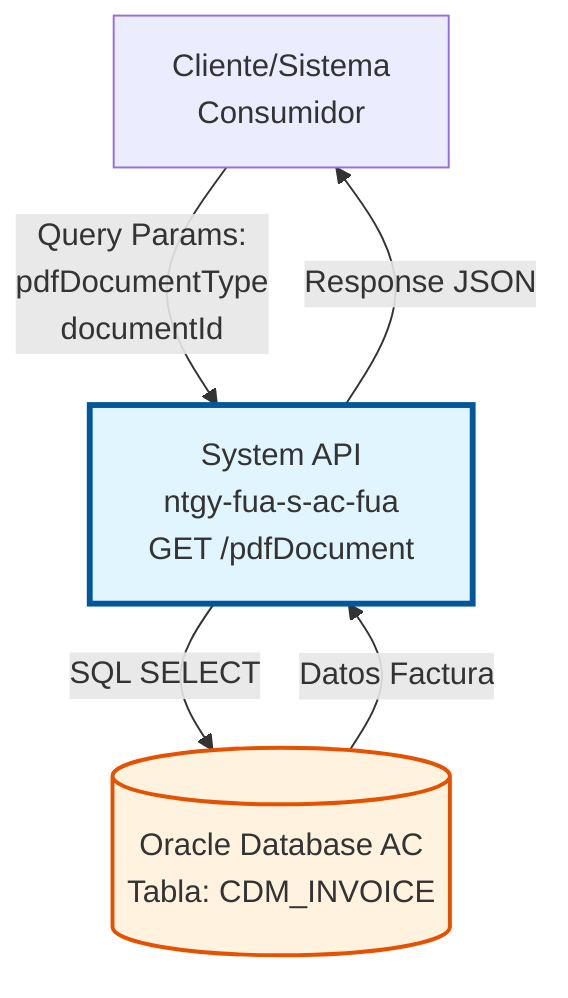
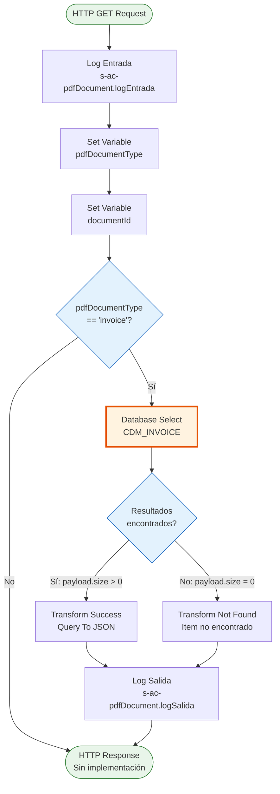
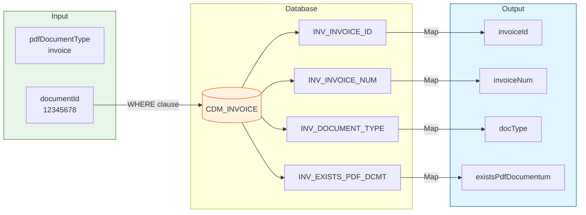

# GET /pdfDocument

## 📌 Descripción General

### Propósito del Endpoint

Este endpoint consulta información sobre documentos PDF de facturas almacenados en el sistema Documentum. Permite verificar la existencia de PDFs de facturas y obtener metadatos asociados antes de proceder con la descarga del documento.

El endpoint soporta:
- **Consulta de Facturas**: Verificación de existencia de PDF de factura en Documentum
- **Metadatos de Documento**: Obtención de información del documento (ID, número, tipo)
- **Validación Pre-Descarga**: Verificación antes de intentar descargar el PDF

### Tipo de API

**Capa:** System API (API-Led Connectivity)

**Función:** Integración directa con base de datos Oracle AC para consultar información de documentos PDF de facturas almacenados en Documentum.

### Patrón de Integración

**Tipo:** Request-Reply Síncrono con SQL Query

**Descripción:** Recibe parámetros de consulta (tipo de documento y ID), ejecuta query SQL en tabla CDM_INVOICE, valida resultados y retorna información del documento o mensaje de error si no se encuentra.

### Arquitectura API-Led Connectivity



---

## 💼 Propósito del Negocio

### Casos de Uso Principales

1. **Validación Pre-Descarga de Factura**
   - Usuario solicita descargar PDF de factura desde portal web/móvil
   - Sistema verifica existencia del PDF en Documentum antes de intentar descarga
   - Evita errores de descarga y mejora experiencia de usuario

2. **Verificación de Disponibilidad de Documentos**
   - Sistema necesita confirmar que el PDF existe en Documentum
   - Obtiene metadatos del documento (ID, número, tipo)
   - Permite mostrar indicador visual de disponibilidad en interfaz

3. **Auditoría de Documentos**
   - Sistemas de auditoría verifican existencia de documentos
   - Identifican facturas sin PDF disponible
   - Generan reportes de documentos faltantes

### Contexto Empresarial

- **Dominio:** Gestión Documental - Facturas
- **Sector:** Energía - Utilities
- **División:** Naturgy España - Área Cliente
- **Proceso de Negocio:** Consulta y descarga de documentos de facturación
- **Sistema Documental:** Documentum (gestión de documentos corporativos)

### Stakeholders

- **Clientes Finales**: Necesitan acceder a sus facturas en formato PDF
- **Agentes de Servicio al Cliente**: Verifican disponibilidad de documentos para clientes
- **Sistemas de Facturación**: Validan que las facturas generadas tienen PDF disponible
- **Equipo de Auditoría**: Verifican completitud de documentación

### Valor de Negocio

- **Mejora de Experiencia**: Validación previa evita errores de descarga
- **Eficiencia Operativa**: Reduce llamadas al call center por documentos no disponibles
- **Transparencia**: Clientes saben de antemano si el documento está disponible
- **Auditoría**: Facilita identificación de documentos faltantes

### Consumidores Potenciales

Este endpoint puede ser consumido por:
- Process APIs de gestión de facturas
- Experience APIs de portales web y móviles
- Sistemas de descarga de documentos
- Herramientas de auditoría y reporting

---

## 🔧 Especificación Técnica

### URLs por Ambiente

| Ambiente | URL Base | URL Completa |
|----------|----------|--------------|
| **Local** | `http://localhost:8081` | `http://localhost:8081/api/pdfDocument?pdfDocumentType=invoice&documentId=12345` |
| **Development** | `https://ntgy-fua-s-ac-fua-dev.us-e2.cloudhub.io` | `https://ntgy-fua-s-ac-fua-dev.us-e2.cloudhub.io/api/pdfDocument?pdfDocumentType=invoice&documentId=12345` |
| **UAT** | `https://ntgy-fua-s-ac-fua-uat.us-e2.cloudhub.io` | `https://ntgy-fua-s-ac-fua-uat.us-e2.cloudhub.io/api/pdfDocument?pdfDocumentType=invoice&documentId=12345` |
| **Production** | `https://ntgy-fua-s-ac-fua-pro.us-e2.cloudhub.io` | `https://ntgy-fua-s-ac-fua-pro.us-e2.cloudhub.io/api/pdfDocument?pdfDocumentType=invoice&documentId=12345` |

### Método HTTP

```
GET /api/pdfDocument
```

### Parámetros de Entrada

#### Headers HTTP

| Header | Tipo | Requerido | Descripción | Ejemplo |
|--------|------|-----------|-------------|---------|
| `Accept` | string | ❌ No | Tipo de contenido esperado en response | `application/json` |

#### Query Parameters

| Parámetro | Tipo | Requerido | Descripción | Ejemplo | Valores Válidos |
|-----------|------|-----------|-------------|---------|-----------------|
| `pdfDocumentType` | string | ✅ Sí | Tipo de documento PDF a consultar | `"invoice"` | `"invoice"` (actualmente solo facturas) |
| `documentId` | string | ✅ Sí | Número de factura a consultar | `"12345678"` | Número de factura válido |

**⚠️ Nota Importante:** Actualmente el endpoint solo soporta `pdfDocumentType = "invoice"`. Otros tipos de documentos no están implementados.

### Respuestas

#### Respuesta Exitosa - Documento Encontrado (200 OK)

```json
{
  "result": {
    "codResult": "0000",
    "msgResult": "No hay error"
  },
  "item": {
    "invoiceId": "INV123456",
    "invoiceNum": "12345678",
    "docType": "INVOICE",
    "existsPdfDocumentum": "S"
  }
}
```

**Descripción de Campos:**

| Campo | Tipo | Descripción |
|-------|------|-------------|
| `result.codResult` | string | Código de resultado: "0000" = éxito |
| `result.msgResult` | string | Mensaje descriptivo del resultado |
| `item.invoiceId` | string | ID interno de la factura en base de datos |
| `item.invoiceNum` | string | Número de factura consultado |
| `item.docType` | string | Tipo de documento (INVOICE) |
| `item.existsPdfDocumentum` | string | Indica si existe PDF en Documentum: "S" = Sí, "N" = No |

#### Respuesta - Documento No Encontrado (200 OK)

```json
{
  "result": {
    "codResult": "0001",
    "msgResult": "Item no encontrado"
  }
}
```

**Descripción:**
- Se retorna cuando no existe factura con el `documentId` proporcionado
- HTTP Status: 200 OK (error de negocio, no técnico)
- No se incluye objeto `item` en la respuesta

#### Respuesta de Error Técnico (400/500)

```json
{
  "result": {
    "codResult": "0002",
    "msgResult": "Error al consultar base de datos"
  }
}
```

### Códigos de Resultado

| Código | Tipo | Descripción | HTTP Status |
|--------|------|-------------|-------------|
| `0000` | Éxito | Documento encontrado | 200 |
| `0001` | Error Negocio | Documento no encontrado | 200 |
| `0002` | Error Técnico | Error de base de datos | 500 |
| `0003` | Error Validación | Parámetros inválidos | 400 |

### Autenticación y Autorización

- **Tipo:** Client ID & Client Secret (Anypoint Platform)
- **Autorización DB:** El usuario de base de datos debe tener permisos para:
  - Ejecutar SELECT en tabla `CDM_INVOICE`
  - Acceso al schema `OVPRO_DELTA`

### Timeouts

| Tipo | Valor | Descripción |
|------|-------|-------------|
| **Query Timeout** | 15 segundos | Tiempo máximo de ejecución de query SQL |
| **Request Timeout** | 30 segundos | Tiempo máximo de espera para la respuesta |
| **Connection Timeout** | 10 segundos | Tiempo máximo para establecer conexión a DB |

---

## 🏗️ Implementación Técnica

### Arquitectura del Flow



### Componentes del Flow

#### 1. Logger de Entrada (Línea 8)
```xml
<logger level="INFO" doc:name="Logger entrada" 
        message="s-ac-pdfDocument.logEntrada ## payload: #[payload]"/>
```
**Propósito:** Registra inicio de ejecución con payload recibido

#### 2. Set Variables (Líneas 9-10)
```xml
<set-variable value="#[attributes.queryParams.pdfDocumentType]" 
              variableName="pdfDocumentType" />
<set-variable value="#[attributes.queryParams.documentId]" 
              variableName='documentId'/>
```
**Propósito:** Extrae query parameters y los almacena en variables para uso posterior

#### 3. Choice Router (Línea 11)
```xml
<choice doc:name="Choice">
    <when expression='#[vars.pdfDocumentType == "invoice"]'>
```
**Propósito:** Valida tipo de documento, actualmente solo procesa "invoice"

#### 4. Database Select (Líneas 12-16)
```xml
<db:select config-ref="Database_Config" queryTimeout="${dbAC.queryTimeout}">
    <db:sql><![CDATA[SELECT * FROM CDM_INVOICE WHERE INV_INVOICE_NUM = :documentId]]></db:sql>
    <db:input-parameters><![CDATA[#[{'documentId': vars.documentId}]]]></db:input-parameters>
</db:select>
```

**Query SQL:**
```sql
SELECT * FROM CDM_INVOICE WHERE INV_INVOICE_NUM = :documentId
```

**Tabla:** `CDM_INVOICE`

**Campos Consultados:**
- `INV_INVOICE_ID`: ID interno de la factura
- `INV_INVOICE_NUM`: Número de factura
- `INV_DOCUMENT_TYPE`: Tipo de documento
- `INV_EXISTS_PDF_DCMT`: Indicador de existencia en Documentum

**Parámetros:**
- `:documentId` → Número de factura a buscar

#### 5. Choice de Resultados (Línea 17)
```xml
<choice doc:name="Choice">
    <when expression="#[sizeOf(payload) &gt; 0]">
```
**Propósito:** Verifica si la query retornó resultados

#### 6. Transformación Exitosa (Líneas 18-32)
```dataweave
%dw 2.0
output application/json
---
{
    result: {
        codResult: "0000",
        msgResult: "No hay error"
    },
    item: {
        invoiceId: payload[0].INV_INVOICE_ID,
        invoiceNum: payload[0].INV_INVOICE_NUM,
        docType: payload[0].INV_DOCUMENT_TYPE,
        existsPdfDocumentum: payload[0].INV_EXISTS_PDF_DCMT
    }
}
```

**Mapeo de Campos:**

| Campo DB | Campo Response | Descripción |
|----------|----------------|-------------|
| `INV_INVOICE_ID` | `invoiceId` | ID interno de factura |
| `INV_INVOICE_NUM` | `invoiceNum` | Número de factura |
| `INV_DOCUMENT_TYPE` | `docType` | Tipo de documento |
| `INV_EXISTS_PDF_DCMT` | `existsPdfDocumentum` | Existe en Documentum (S/N) |

#### 7. Transformación No Encontrado (Líneas 34-44)
```dataweave
%dw 2.0
output application/json
---
{
    result: {
        codResult: "0001",
        msgResult: "Item no encontrado"
    }
}
```

#### 8. Logger de Salida (Línea 47)
```xml
<logger level="INFO" doc:name="Logger salida" 
        message="s-ac-pdfDocument.logSalida ## payload: #[payload]"/>
```
**Propósito:** Registra fin de ejecución con payload de respuesta

### Diagrama de Secuencia

```mermaid
sequenceDiagram
    participant Client as Cliente
    participant API as System API<br/>pdfDocumentFlow
    participant DB as Oracle Database<br/>CDM_INVOICE
    
    Client->>API: GET /pdfDocument?pdfDocumentType=invoice&documentId=12345
    activate API
    
    API->>API: Log Entrada
    API->>API: Set pdfDocumentType variable
    API->>API: Set documentId variable
    
    alt pdfDocumentType == "invoice"
        API->>DB: SELECT * FROM CDM_INVOICE<br/>WHERE INV_INVOICE_NUM = :documentId
        activate DB
        
        alt Factura encontrada
            DB-->>API: Datos de factura
            deactivate DB
            API->>API: Transform: Query To JSON<br/>(codResult: "0000")
        else Factura no encontrada
            DB-->>API: Resultado vacío
            deactivate DB
            API->>API: Transform: Not Found<br/>(codResult: "0001")
        end
    else pdfDocumentType != "invoice"
        API->>API: No implementado<br/>(sin procesamiento)
    end
    
    API->>API: Log Salida
    API-->>Client: Response JSON
    deactivate API
```

### Configuración de Base de Datos

**Connection Config:** `Database_Config`

```yaml
dbAC:
  host1: "oc-pro-exa-04-clu-02-hdfdi-scan.prodb03.ocpro.oraclevcn.com"
  host2: "oc-pro-exa-03-clu-02-dfhl9-scan.prodb03.ocpro.oraclevcn.com"
  port: "1521"
  serviceName: "s_areapriv_online_pro.prodb03.ocpro.oraclevcn.com"
  user: "OVPRO_DELTA"
  queryTimeout: "15000"
  MaxPoolSize: "15"
  MaxWaitTime: "300000"
  MaxIdleTime: "300000"
```

**Características:**
- **High Availability:** Dual host configuration
- **Connection Pooling:** Máximo 15 conexiones
- **Query Timeout:** 15 segundos
- **Prepared Statements:** Prevención de SQL injection

### Manejo de Errores

**Global Error Handler:** `s-ac-globalErrorHandler.xml`

**Tipos de Error:**

1. **Database Connection Error**
   - Código: `DB_CONNECTION_ERROR`
   - HTTP Status: 500
   - Retry: 3 intentos automáticos

2. **Query Timeout**
   - Código: `DB_TIMEOUT_ERROR`
   - HTTP Status: 500
   - Timeout: 15 segundos

3. **Validation Error**
   - Código: `VALIDATION_ERROR`
   - HTTP Status: 400
   - Sin retry

### Diagrama de Transformación de Datos



---

## 💻 Ejemplos de Uso

### Ejemplo 1: Consulta Exitosa - Documento Encontrado

#### Request con curl

```bash
curl -X GET "https://ntgy-fua-s-ac-fua-pro.us-e2.cloudhub.io/api/pdfDocument?pdfDocumentType=invoice&documentId=12345678" \
  -H "Accept: application/json" \
  -H "client_id: YOUR_CLIENT_ID" \
  -H "client_secret: YOUR_CLIENT_SECRET"
```

#### Response (200 OK)

```json
{
  "result": {
    "codResult": "0000",
    "msgResult": "No hay error"
  },
  "item": {
    "invoiceId": "INV123456",
    "invoiceNum": "12345678",
    "docType": "INVOICE",
    "existsPdfDocumentum": "S"
  }
}
```

**Interpretación:**
- ✅ Factura encontrada en base de datos
- ✅ PDF existe en Documentum (`existsPdfDocumentum: "S"`)
- ✅ Se puede proceder con la descarga del PDF

---

### Ejemplo 2: Documento No Encontrado

#### Request con curl

```bash
curl -X GET "https://ntgy-fua-s-ac-fua-pro.us-e2.cloudhub.io/api/pdfDocument?pdfDocumentType=invoice&documentId=99999999" \
  -H "Accept: application/json" \
  -H "client_id: YOUR_CLIENT_ID" \
  -H "client_secret: YOUR_CLIENT_SECRET"
```

#### Response (200 OK)

```json
{
  "result": {
    "codResult": "0001",
    "msgResult": "Item no encontrado"
  }
}
```

**Interpretación:**
- ❌ No existe factura con número `99999999`
- ℹ️ No se puede descargar el PDF
- ℹ️ Mostrar mensaje al usuario: "Factura no encontrada"

---

### Ejemplo 3: Request con JavaScript (Fetch API)

```javascript
const getPdfDocumentInfo = async (documentId) => {
  const baseUrl = 'https://ntgy-fua-s-ac-fua-pro.us-e2.cloudhub.io';
  const endpoint = '/api/pdfDocument';
  
  const params = new URLSearchParams({
    pdfDocumentType: 'invoice',
    documentId: documentId
  });
  
  try {
    const response = await fetch(`${baseUrl}${endpoint}?${params}`, {
      method: 'GET',
      headers: {
        'Accept': 'application/json',
        'client_id': 'YOUR_CLIENT_ID',
        'client_secret': 'YOUR_CLIENT_SECRET'
      }
    });
    
    const data = await response.json();
    
    if (data.result.codResult === '0000') {
      console.log('Documento encontrado:', data.item);
      
      if (data.item.existsPdfDocumentum === 'S') {
        console.log('✅ PDF disponible en Documentum');
        // Proceder con descarga
        return { available: true, data: data.item };
      } else {
        console.log('⚠️ PDF no disponible en Documentum');
        return { available: false, data: data.item };
      }
    } else if (data.result.codResult === '0001') {
      console.log('❌ Documento no encontrado');
      return { available: false, error: 'NOT_FOUND' };
    }
  } catch (error) {
    console.error('Error al consultar documento:', error);
    return { available: false, error: 'TECHNICAL_ERROR' };
  }
};

// Uso
getPdfDocumentInfo('12345678').then(result => {
  if (result.available) {
    console.log('Puede descargar PDF');
  } else {
    console.log('No puede descargar PDF');
  }
});
```

---

### Ejemplo 4: Integración con Flujo de Descarga

```javascript
/**
 * Flujo completo: Validar existencia → Descargar PDF
 */
const downloadInvoicePdf = async (invoiceNumber) => {
  // Paso 1: Verificar existencia del PDF
  const checkResult = await getPdfDocumentInfo(invoiceNumber);
  
  if (!checkResult.available) {
    if (checkResult.error === 'NOT_FOUND') {
      throw new Error('Factura no encontrada');
    } else if (checkResult.error === 'TECHNICAL_ERROR') {
      throw new Error('Error técnico al verificar documento');
    } else {
      throw new Error('PDF no disponible en Documentum');
    }
  }
  
  // Paso 2: Si existe, proceder con descarga
  console.log('Iniciando descarga de PDF...');
  const downloadUrl = `/api/NCDownloadInvoice?invoiceId=${checkResult.data.invoiceId}`;
  
  // Realizar descarga
  window.location.href = downloadUrl;
  
  return {
    success: true,
    message: 'Descarga iniciada',
    invoiceData: checkResult.data
  };
};

// Uso en aplicación
try {
  await downloadInvoicePdf('12345678');
  console.log('✅ Descarga completada');
} catch (error) {
  console.error('❌ Error:', error.message);
  // Mostrar mensaje al usuario
  alert(`No se pudo descargar la factura: ${error.message}`);
}
```

---

### Ejemplo 5: Validación en Batch

```javascript
/**
 * Validar múltiples facturas en batch
 */
const validateMultipleInvoices = async (invoiceNumbers) => {
  const results = await Promise.all(
    invoiceNumbers.map(async (invoiceNum) => {
      const result = await getPdfDocumentInfo(invoiceNum);
      return {
        invoiceNumber: invoiceNum,
        available: result.available,
        existsInDocumentum: result.data?.existsPdfDocumentum === 'S',
        data: result.data
      };
    })
  );
  
  // Resumen
  const summary = {
    total: results.length,
    available: results.filter(r => r.available).length,
    notFound: results.filter(r => r.error === 'NOT_FOUND').length,
    noPdf: results.filter(r => r.available && !r.existsInDocumentum).length
  };
  
  console.log('Resumen de validación:', summary);
  return { results, summary };
};

// Uso
const invoices = ['12345678', '87654321', '11111111'];
validateMultipleInvoices(invoices).then(({ results, summary }) => {
  console.log(`✅ ${summary.available} de ${summary.total} facturas disponibles`);
  console.log(`❌ ${summary.notFound} facturas no encontradas`);
  console.log(`⚠️ ${summary.noPdf} facturas sin PDF en Documentum`);
});
```

---

### Caso de Uso Completo: Portal de Cliente

```javascript
/**
 * Componente de Portal de Cliente
 * Muestra lista de facturas con indicador de disponibilidad de PDF
 */
class InvoiceListComponent {
  async loadInvoices(customerId) {
    // 1. Obtener lista de facturas del cliente
    const invoices = await this.getCustomerInvoices(customerId);
    
    // 2. Validar disponibilidad de PDF para cada factura
    const invoicesWithPdfStatus = await Promise.all(
      invoices.map(async (invoice) => {
        const pdfInfo = await getPdfDocumentInfo(invoice.invoiceNumber);
        
        return {
          ...invoice,
          pdfAvailable: pdfInfo.available,
          pdfInDocumentum: pdfInfo.data?.existsPdfDocumentum === 'S',
          canDownload: pdfInfo.available && pdfInfo.data?.existsPdfDocumentum === 'S'
        };
      })
    );
    
    // 3. Renderizar lista con indicadores
    this.renderInvoiceList(invoicesWithPdfStatus);
  }
  
  renderInvoiceList(invoices) {
    invoices.forEach(invoice => {
      const icon = invoice.canDownload ? '📄 ✅' : '📄 ❌';
      const status = invoice.canDownload 
        ? 'PDF disponible' 
        : 'PDF no disponible';
      
      console.log(`${icon} Factura ${invoice.invoiceNumber}: ${status}`);
    });
  }
}

// Uso
const component = new InvoiceListComponent();
component.loadInvoices('CUST123456');