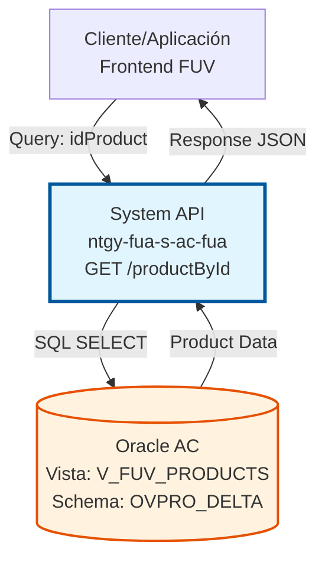
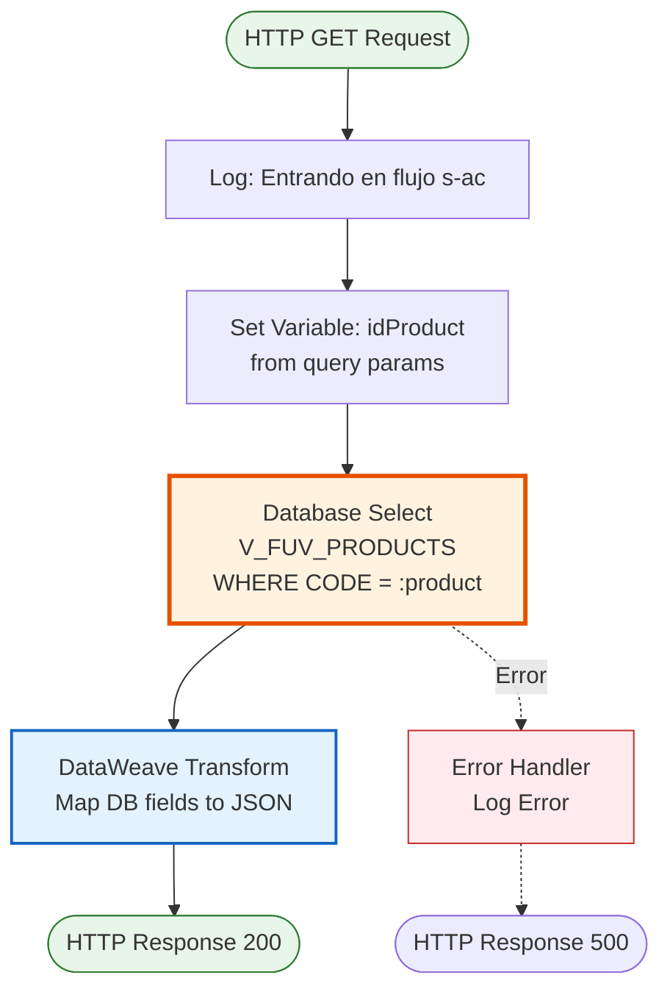
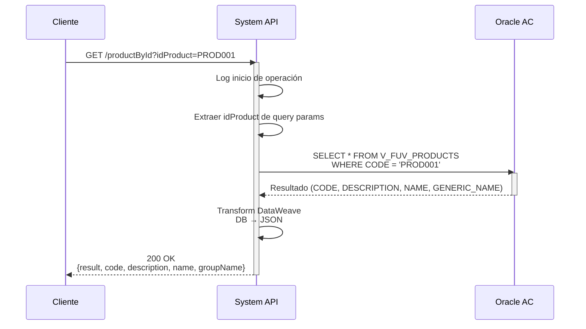
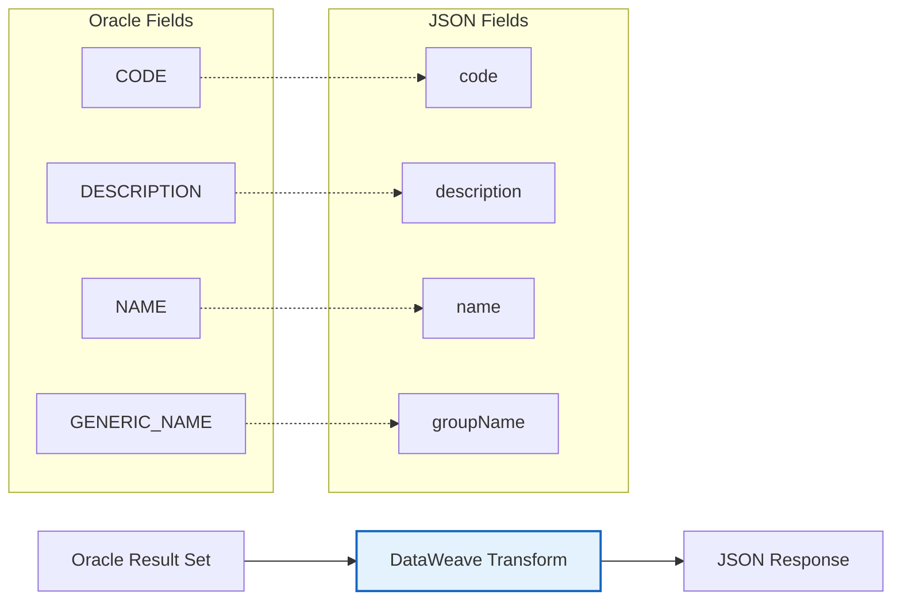

# GET /productById

## 📌 Descripción General

### Propósito del Endpoint

Este endpoint permite consultar información detallada de un producto específico del catálogo FUV (Frontal Único de Ventas) mediante su código identificador. Proporciona datos completos del producto incluyendo código, descripción, nombre comercial y grupo genérico al que pertenece.

El endpoint soporta:
- **Consulta Individual**: Recuperación de información de un producto específico por su código
- **Datos Completos**: Retorna toda la información relevante del producto
- **Respuesta Estructurada**: Formato JSON estandarizado con resultado de operación

### Tipo de API

**Capa:** System API (API-Led Connectivity)

**Función:** Integración directa con base de datos Oracle AC para consulta de productos del catálogo FUV.

### Patrón de Integración

**Tipo:** Request-Reply Síncrono con SQL Query

**Descripción:** El endpoint recibe el código del producto como query parameter, ejecuta una consulta SQL directa sobre la vista V_FUV_PRODUCTS en Oracle, transforma el resultado a formato JSON y retorna la información del producto.

### Arquitectura API-Led Connectivity



---

## 💼 Propósito del Negocio

### Casos de Uso Principales

1. **Consulta de Catálogo de Productos**
   - Los agentes de ventas necesitan consultar información detallada de productos durante el proceso de venta
   - Se obtiene descripción completa, nombre comercial y clasificación del producto
   - Facilita la correcta identificación y oferta de productos a clientes

2. **Validación de Productos en Pedidos**
   - Durante la creación de pedidos, se valida que el producto seleccionado existe y está activo
   - Se recupera información para mostrar al usuario antes de confirmar el pedido
   - Asegura la integridad de datos en el proceso de venta

3. **Información para Portales de Autoservicio**
   - Los clientes pueden consultar detalles de productos disponibles
   - Se muestra información clara y estructurada del catálogo
   - Mejora la experiencia de usuario en canales digitales

### Contexto Empresarial

- **Dominio:** Gestión de Productos y Catálogo
- **Sector:** Energía - Utilities
- **División:** Naturgy España - Área Cliente (AC)
- **Proceso de Negocio:** Consulta de Catálogo de Productos FUV
- **Sistema Origen:** Oracle Database AC

### Stakeholders

- **Agentes de Ventas**: Necesitan información precisa de productos para ofrecer a clientes
- **Clientes Finales**: Consultan productos disponibles en portales de autoservicio
- **Equipo de Producto**: Mantienen el catálogo actualizado y requieren visibilidad de datos
- **Sistemas de Integración**: Consumen información de productos para procesos automatizados

### Valor de Negocio

- **Precisión en Ventas**: Información exacta de productos reduce errores en pedidos
- **Experiencia de Usuario**: Datos claros y completos mejoran la satisfacción del cliente
- **Eficiencia Operativa**: Consulta rápida evita búsquedas manuales en múltiples sistemas
- **Consistencia de Datos**: Fuente única de verdad para información de productos

### Consumidores Potenciales

Este endpoint puede ser consumido por:
- Process APIs de gestión de pedidos (ntgy-fua-p-*)
- Experience APIs de portales web y móvil (ntgy-fua-e-*)
- Aplicaciones del Frontal de Ventas (FUV)
- Sistemas de integración que requieren catálogo de productos
- Herramientas de reporting y analytics

---

## 🔧 Especificación Técnica

### URLs por Ambiente

| Ambiente | URL Base | URL Completa |
|----------|----------|--------------|
| **Local** | `http://localhost:8081` | `http://localhost:8081/api/productById?idProduct=PROD001` |
| **Development** | `https://ntgy-fua-s-ac-fua-dev.us-e2.cloudhub.io` | `https://ntgy-fua-s-ac-fua-dev.us-e2.cloudhub.io/api/productById?idProduct=PROD001` |
| **Test** | `https://ntgy-fua-s-ac-fua-test.us-e2.cloudhub.io` | `https://ntgy-fua-s-ac-fua-test.us-e2.cloudhub.io/api/productById?idProduct=PROD001` |
| **Production** | `https://ntgy-fua-s-ac-fua-pro.us-e2.cloudhub.io` | `https://ntgy-fua-s-ac-fua-pro.us-e2.cloudhub.io/api/productById?idProduct=PROD001` |

### Método HTTP

```
GET /api/productById
```

### Parámetros de Entrada

#### Headers HTTP

| Header | Tipo | Requerido | Descripción | Ejemplo |
|--------|------|-----------|-------------|---------|
| `Accept` | string | ❌ No | Tipo de contenido esperado en response | `application/json` |

#### Query Parameters

| Parámetro | Tipo | Requerido | Descripción | Ejemplo |
|-----------|------|-----------|-------------|---------|
| `idProduct` | string | ✅ Sí | Código identificador del producto a consultar | `"PROD001"` |

**Validaciones:**
- `idProduct` no puede estar vacío
- `idProduct` debe corresponder a un código válido en el catálogo

### Respuestas

#### Respuesta Exitosa (200 OK)

```json
{
  "result": {
    "codResult": "0000",
    "msgResult": "No hay error"
  },
  "code": "PROD001",
  "description": "Tarifa 2.0TD Electricidad",
  "name": "Tarifa 2.0TD",
  "groupName": "Electricidad Regulada"
}
```

**Descripción de Campos:**

| Campo | Tipo | Descripción |
|-------|------|-------------|
| `result.codResult` | string | Código de resultado de la operación ("0000" = éxito) |
| `result.msgResult` | string | Mensaje descriptivo del resultado |
| `code` | string | Código único del producto |
| `description` | string | Descripción completa del producto |
| `name` | string | Nombre comercial del producto |
| `groupName` | string | Nombre del grupo genérico al que pertenece el producto |

#### Respuesta de Producto No Encontrado (200 OK)

```json
{
  "result": {
    "codResult": "0000",
    "msgResult": "No hay error"
  },
  "code": null,
  "description": null,
  "name": null,
  "groupName": null
}
```

**Nota:** Cuando el producto no existe, la respuesta retorna HTTP 200 con campos null.

#### Respuesta de Error Técnico (500)

```json
{
  "result": {
    "codResult": "0001",
    "msgResult": "Error interno del servidor"
  }
}
```

### Autenticación y Autorización

- **Tipo:** Client ID & Client Secret (Anypoint Platform)
- **Autorización Base de Datos:** El usuario de conexión debe tener permisos para:
  - Acceso de lectura a la vista `V_FUV_PRODUCTS`
  - Acceso al schema `OVPRO_DELTA`

### Timeouts

| Tipo | Valor | Descripción |
|------|-------|-------------|
| **Query Timeout** | 15 segundos | Tiempo máximo de ejecución de la query SQL |
| **Connection Timeout** | 3600 segundos | Tiempo máximo para mantener conexión a base de datos |

---

## 🏗️ Implementación Técnica

### Arquitectura del Flow



### Componentes del Flow

#### 1. Logger de Entrada
```xml
<logger level="INFO" 
        message='#["Entrando en el flujo s-ac. Consultando Producto " ++ attributes.queryParams.idProduct]'/>
```

**Propósito:** Registrar el inicio de la operación con el código del producto solicitado.

#### 2. Extracción de Parámetro
```xml
<set-variable value="#[attributes.queryParams.idProduct]" 
              variableName="idProduct"/>
```

**Propósito:** Almacenar el código del producto en una variable para uso en la query.

#### 3. Consulta a Base de Datos
```xml
<db:select config-ref="Database_Config" 
           queryTimeout="${dbAC.queryTimeout}">
    <db:sql><![CDATA[
        select * from V_FUV_PRODUCTS
        where CODE = :product
    ]]></db:sql>
    <db:input-parameters><![CDATA[
        #[{'product': vars.idProduct}]
    ]]></db:input-parameters>
</db:select>
```

**Propósito:** Ejecutar query SQL con prepared statement para prevenir SQL injection.

**Configuración:**
- **Config Reference:** `Database_Config` (Oracle connection pool)
- **Query Timeout:** Configurable vía property `${dbAC.queryTimeout}` (15 segundos)
- **Parámetros:** Binding seguro con prepared statement

#### 4. Transformación de Respuesta
```dataweave
%dw 2.0
output application/json
---
{
    "result": {
        "codResult": "0000",
        "msgResult": "No hay error"
    },
    "code": payload.CODE[0],
    "description": payload.DESCRIPTION[0],
    "name": payload.NAME[0],
    "groupName": payload.GENERIC_NAME[0]
}
```

**Propósito:** Transformar el resultado de la base de datos a formato JSON estándar.

**Lógica:**
- Accede al primer elemento del array de resultados `[0]`
- Mapea campos de base de datos a nombres JSON
- Incluye resultado de operación estándar

### Diagrama de Secuencia



### Configuración de Base de Datos

#### Connection Pool
```yaml
dbAC:
  host1: "oc-pro-exa-04-clu-02-hdfdi-scan.prodb03.ocpro.oraclevcn.com"
  host2: "oc-pro-exa-03-clu-02-dfhl9-scan.prodb03.ocpro.oraclevcn.com"
  port: "1521"
  serviceName: "s_areapriv_online_pro.prodb03.ocpro.oraclevcn.com"
  user: "OVPRO_DELTA"
  MaxPoolSize: "15"
  MaxWaitTime: "300"
  MaxIdleTime: "300"
  queryTimeout: "15"
```

**Características:**
- **High Availability:** Dual host configuration para failover automático
- **Connection Pooling:** Máximo 15 conexiones simultáneas
- **Timeout Management:** Query timeout de 15 segundos

### Estructura de Datos

#### Vista V_FUV_PRODUCTS

| Columna | Tipo | Descripción |
|---------|------|-------------|
| `CODE` | VARCHAR2 | Código único del producto (PK) |
| `DESCRIPTION` | VARCHAR2 | Descripción completa del producto |
| `NAME` | VARCHAR2 | Nombre comercial del producto |
| `GENERIC_NAME` | VARCHAR2 | Nombre del grupo genérico |

**Índices:**
- Primary Key en `CODE` para búsquedas rápidas

### Manejo de Errores

#### Error Handler Global
```xml
<error-handler>
    <on-error-propagate enableNotifications="true" 
                        logException="true">
        <logger level="ERROR" 
                message="s-ac-existingCUPS.logError"/>
    </on-error-propagate>
</error-handler>
```

**Tipos de Errores Manejados:**
- **DB:CONNECTIVITY**: Error de conexión a base de datos
- **DB:QUERY_EXECUTION**: Error en ejecución de query
- **DB:TIMEOUT**: Timeout de query excedido

### Diagrama de Transformación de Datos



### Performance y Optimización

#### Métricas Esperadas
- **Tiempo de Respuesta Promedio:** < 1 segundo
- **Tiempo de Respuesta p95:** < 2 segundos
- **Throughput:** > 50 requests/segundo

#### Optimizaciones Implementadas
1. **Prepared Statements:** Previene SQL injection y mejora performance
2. **Connection Pooling:** Reutilización de conexiones reduce overhead
3. **Vista Consolidada:** `V_FUV_PRODUCTS` optimizada para consultas
4. **Índice en CODE:** Búsqueda rápida por clave primaria

---

## 💻 Ejemplos de Uso

### Ejemplo 1: Consulta Exitosa con curl

```bash
curl -X GET "https://ntgy-fua-s-ac-fua-pro.us-e2.cloudhub.io/api/productById?idProduct=PROD001" \
  -H "Accept: application/json"
```

**Respuesta:**
```json
{
  "result": {
    "codResult": "0000",
    "msgResult": "No hay error"
  },
  "code": "PROD001",
  "description": "Tarifa 2.0TD Electricidad con discriminación horaria",
  "name": "Tarifa 2.0TD",
  "groupName": "Electricidad Regulada"
}
```

### Ejemplo 2: Consulta con Postman

**Request:**
- **Method:** GET
- **URL:** `{{baseUrl}}/api/productById`
- **Query Params:**
  - `idProduct`: `GAS_STD`

**Response (200 OK):**
```json
{
  "result": {
    "codResult": "0000",
    "msgResult": "No hay error"
  },
  "code": "GAS_STD",
  "description": "Tarifa estándar de gas natural",
  "name": "Gas Natural Estándar",
  "groupName": "Gas Natural"
}
```

### Ejemplo 3: Producto No Encontrado

```bash
curl -X GET "https://ntgy-fua-s-ac-fua-pro.us-e2.cloudhub.io/api/productById?idProduct=INVALID" \
  -H "Accept: application/json"
```

**Respuesta (200 OK):**
```json
{
  "result": {
    "codResult": "0000",
    "msgResult": "No hay error"
  },
  "code": null,
  "description": null,
  "name": null,
  "groupName": null
}
```

### Ejemplo 4: Error de Base de Datos

**Escenario:** Base de datos no disponible

**Respuesta (500 Internal Server Error):**
```json
{
  "result": {
    "codResult": "0001",
    "msgResult": "Error interno del servidor"
  }
}
```

### Ejemplo 5: Integración con JavaScript

```javascript
async function getProductById(productId) {
  try {
    const response = await fetch(
      `https://ntgy-fua-s-ac-fua-pro.us-e2.cloudhub.io/api/productById?idProduct=${productId}`,
      {
        method: 'GET',
        headers: {
          'Accept': 'application/json'
        }
      }
    );
    
    const data = await response.json();
    
    if (data.result.codResult === "0000" && data.code) {
      console.log(`Producto encontrado: ${data.name}`);
      console.log(`Descripción: ${data.description}`);
      console.log(`Grupo: ${data.groupName}`);
      return data;
    } else {
      console.log('Producto no encontrado');
      return null;
    }
  } catch (error) {
    console.error('Error al consultar producto:', error);
    throw error;
  }
}

// Uso
getProductById('PROD001')
  .then(product => {
    if (product) {
      console.log('Producto:', product);
    }
  });
```

### Ejemplo 6: Integración con Python

```python
import requests
import json

def get_product_by_id(product_id):
    """
    Consulta información de un producto por su código
    
    Args:
        product_id (str): Código del producto
        
    Returns:
        dict: Información del producto o None si no existe
    """
    url = "https://ntgy-fua-s-ac-fua-pro.us-e2.cloudhub.io/api/productById"
    params = {"idProduct": product_id}
    headers = {"Accept": "application/json"}
    
    try:
        response = requests.get(url, params=params, headers=headers, timeout=30)
        response.raise_for_status()
        
        data = response.json()
        
        if data["result"]["codResult"] == "0000" and data.get("code"):
            print(f"Producto encontrado: {data['name']}")
            return data
        else:
            print("Producto no encontrado")
            return None
            
    except requests.exceptions.RequestException as e:
        print(f"Error al consultar producto: {e}")
        raise

# Uso
if __name__ == "__main__":
    product = get_product_by_id("PROD001")
    if product:
        print(json.dumps(product, indent=2))
```
