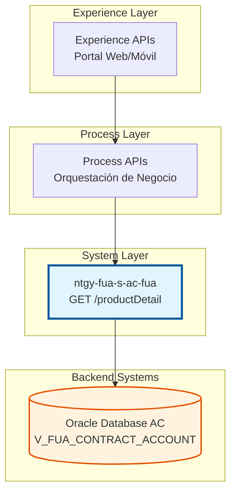
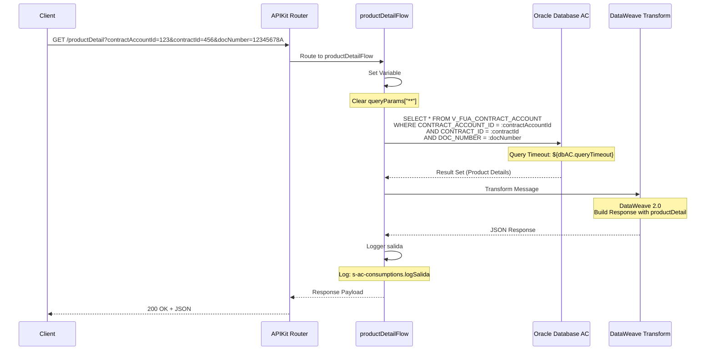
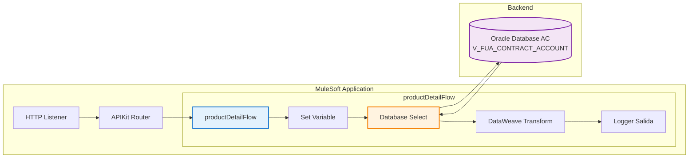
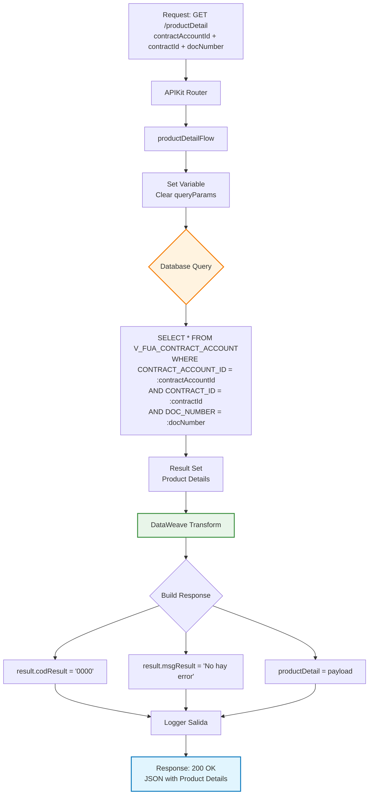

# GET /productDetail

## 📌 Descripción General

### Tipo de API
**System API** - Capa de acceso directo a sistemas de registro (Oracle Database AC)

### Patrón de Integración
**Request-Reply (Synchronous)** - Consulta síncrona a base de datos con respuesta inmediata

### Arquitectura API-Led Connectivity



### Propósito
Endpoint de System API que proporciona acceso a información detallada de productos asociados a cuentas contrato, consultando la vista `V_FUA_CONTRACT_ACCOUNT` mediante identificadores específicos de contrato y cliente.

---

## 💼 Propósito del Negocio

### Caso de Uso Principal
Consulta de información detallada de productos energéticos (gas, electricidad) asociados a contratos de clientes para:
- Visualización de detalles de productos contratados
- Validación de productos activos en portales de clientes
- Consulta de características técnicas y comerciales de productos
- Soporte a procesos de gestión de contratos

### Stakeholders

#### Consumidores Directos
- **Process APIs**: APIs de proceso que gestionan información de contratos
- **Experience APIs**: APIs de experiencia para portales web y aplicaciones móviles
- **Frontend Applications**: Aplicaciones del Frontal de Ventas (FUV)
- **Customer Service Systems**: Sistemas de atención al cliente

#### Usuarios Finales Indirectos
- **Clientes**: Usuarios que consultan sus productos contratados
- **Agentes de Ventas**: Personal que verifica productos de clientes
- **Servicio al Cliente**: Equipo que atiende consultas sobre productos
- **Sistemas de Facturación**: Servicios que requieren información de productos

### Valor de Negocio
- ✅ **Transparencia**: Clientes pueden consultar detalles de sus productos
- ✅ **Eficiencia Operativa**: Acceso rápido a información de productos
- ✅ **Soporte a Ventas**: Información completa para procesos comerciales
- ✅ **Gestión de Contratos**: Base para operaciones de modificación de contratos

---

## 🔧 Especificación Técnica

### Método HTTP
```
GET /api/productDetail
```

### URLs por Ambiente

| Ambiente | URL Base | URL Completa |
|----------|----------|--------------|
| **Local** | `http://localhost:8081` | `http://localhost:8081/api/productDetail?contractAccountId={id}&contractId={id}&docNumber={doc}` |
| **Desarrollo** | `https://dev.naturgy.com` | `https://dev.naturgy.com/api/productDetail?contractAccountId={id}&contractId={id}&docNumber={doc}` |
| **Test** | `https://test.naturgy.com` | `https://test.naturgy.com/api/productDetail?contractAccountId={id}&contractId={id}&docNumber={doc}` |
| **Producción** | `https://api.naturgy.com` | `https://api.naturgy.com/api/productDetail?contractAccountId={id}&contractId={id}&docNumber={doc}` |

### Parámetros de Entrada

#### Query Parameters

| Parámetro | Tipo | Requerido | Descripción | Ejemplo |
|-----------|------|-----------|-------------|---------|
| `contractAccountId` | String | ✅ Sí | ID de la cuenta contrato | `1234567890` |
| `contractId` | String | ✅ Sí | ID del contrato | `9876543210` |
| `docNumber` | String | ✅ Sí | Número de documento del cliente (NIF/NIE) | `12345678A` |

**Validaciones:**
- Todos los parámetros son obligatorios
- `contractAccountId`: Numérico, longitud variable
- `contractId`: Numérico, longitud variable
- `docNumber`: Formato NIF/NIE español válido

### Estructura de Respuesta

#### Respuesta Exitosa (200 OK)

> ⚠️ **NOTA IMPORTANTE SOBRE LA ESTRUCTURA DE DATOS**: 
> 
> Los campos mostrados en el objeto `productDetail` son **campos inferidos con propósitos ilustrativos**. La estructura real y los nombres exactos de los campos dependen de la definición de la vista `V_FUA_CONTRACT_ACCOUNT` en la base de datos Oracle AC.
>
> **Razón**: El código utiliza `SELECT *` y la transformación DataWeave simplemente pasa el payload sin modificaciones (`productDetail: payload`), por lo que retorna **todos los campos tal como vienen de la vista** sin transformación alguna.
>
> **Para obtener la estructura exacta de campos**, consulte:
> - La definición de la vista en la base de datos: `V_FUA_CONTRACT_ACCOUNT` (schema: OVPRO_DELTA)
> - La documentación de la base de datos AC
> - O ejecute una consulta de prueba para ver los campos reales retornados

```json
{
  "result": {
    "codResult": "0000",
    "msgResult": "No hay error"
  },
  "productDetail": [
    {
      "CONTRACT_ACCOUNT_ID": "1234567890",
      "CONTRACT_ID": "9876543210",
      "DOC_NUMBER": "12345678A",
      "PRODUCT_CODE": "GAS_NATURAL",
      "PRODUCT_NAME": "Gas Natural Residencial",
      "PRODUCT_TYPE": "GAS",
      "STATUS": "ACTIVE",
      "START_DATE": "2024-01-15",
      "END_DATE": null,
      "TARIFF": "3.1",
      "CONSUMPTION_POINT": "ES0031406508123456789012AB",
      "ADDRESS": "Calle Mayor 123, Madrid",
      "POSTAL_CODE": "28001",
      "PROVINCE": "Madrid",
      "MUNICIPALITY": "Madrid"
    }
  ]
}
```

#### Campos de Respuesta

> **Nota**: Los campos listados a continuación son **ejemplos ilustrativos** basados en el contexto de negocio. Los campos reales dependen de la vista `V_FUA_CONTRACT_ACCOUNT`.

| Campo | Tipo | Descripción |
|-------|------|-------------|
| `result` | Object | Objeto contenedor del resultado de la operación |
| `result.codResult` | String | Código de resultado (`0000` = éxito, `9999` = error) |
| `result.msgResult` | String | Mensaje descriptivo del resultado |
| `productDetail` | Array | Array de objetos con información detallada del producto |
| `productDetail[].CONTRACT_ACCOUNT_ID` | String | ID de la cuenta contrato |
| `productDetail[].CONTRACT_ID` | String | ID del contrato |
| `productDetail[].DOC_NUMBER` | String | Número de documento del cliente |
| `productDetail[].PRODUCT_CODE` | String | Código del producto |
| `productDetail[].PRODUCT_NAME` | String | Nombre descriptivo del producto |
| `productDetail[].PRODUCT_TYPE` | String | Tipo de producto (GAS, ELECTRICIDAD, DUAL) |
| `productDetail[].STATUS` | String | Estado del producto (ACTIVE, INACTIVE, SUSPENDED) |
| `productDetail[].START_DATE` | String | Fecha de inicio del contrato (formato: YYYY-MM-DD) |
| `productDetail[].END_DATE` | String/null | Fecha de fin del contrato (null si está activo) |
| `productDetail[].TARIFF` | String | Tarifa aplicada |
| `productDetail[].CONSUMPTION_POINT` | String | CUPS (Código Universal del Punto de Suministro) |
| `productDetail[].ADDRESS` | String | Dirección del punto de suministro |
| `productDetail[].POSTAL_CODE` | String | Código postal |
| `productDetail[].PROVINCE` | String | Provincia |
| `productDetail[].MUNICIPALITY` | String | Municipio |

**Códigos de Resultado:**
- `0000`: Operación exitosa
- `9999`: Error en la operación

#### Respuesta de Error (400 Bad Request)

```json
{
  "result": {
    "codResult": "9999",
    "msgResult": "Parámetros requeridos: contractAccountId, contractId, docNumber"
  }
}
```

#### Respuesta de Error (404 Not Found)

```json
{
  "result": {
    "codResult": "9999",
    "msgResult": "No se encontró producto para los parámetros proporcionados"
  },
  "productDetail": []
}
```

#### Respuesta de Error (500 Internal Server Error)

```json
{
  "result": {
    "codResult": "9999",
    "msgResult": "Error al consultar base de datos"
  }
}
```

### Headers

#### Request Headers
```
Content-Type: application/json
Accept: application/json
```

#### Response Headers
```
Content-Type: application/json
```

---

## 🏗️ Implementación Técnica

### Diagrama de Secuencia



### Arquitectura de Componentes



### Flujo de Datos



### Configuración de Base de Datos

#### Connection Pool
```yaml
Database_Config:
  host: ${dbAC.host1}
  port: ${dbAC.port}
  serviceName: ${dbAC.serviceName}
  user: ${dbAC.user}
  password: ${dbAC.pass}
  pooling:
    maxPoolSize: 15
    maxWaitTime: 300s
    maxIdleTime: 300s
  timeout:
    queryTimeout: ${dbAC.queryTimeout} # 15 segundos
    connectionTimeout: 3600s
```

#### Query SQL
```sql
SELECT * 
FROM V_FUA_CONTRACT_ACCOUNT 
WHERE CONTRACT_ACCOUNT_ID = :contractAccountId 
  AND CONTRACT_ID = :contractId 
  AND DOC_NUMBER = :docNumber
```

**Tabla/Vista Consultada:**
- **Nombre**: `V_FUA_CONTRACT_ACCOUNT`
- **Tipo**: Vista (View)
- **Schema**: OVPRO_DELTA
- **Operación**: READ
- **Descripción**: Vista consolidada de cuentas contrato con información detallada de productos, incluyendo datos técnicos y comerciales

**Parámetros de Query:**
```dataweave
{
  contractAccountId: attributes.queryParams.contractAccountId,
  contractId: attributes.queryParams.contractId,
  docNumber: attributes.queryParams.docNumber
}
```

### Transformación DataWeave

#### Output Transform (Inline)
```dataweave
%dw 2.0
output application/json
---
{
    result: {
        codResult: "0000",
        msgResult: "No hay error"
    },
    productDetail: payload
}
```

**Características:**
- Transformación inline en el flow
- Output incluye resultado estándar + datos del producto
- `productDetail` contiene el array completo del result set
- **Preserva todos los campos retornados por la vista sin modificación** (pass-through)
- **No hay transformación de campos**: Los nombres y valores vienen directamente de `V_FUA_CONTRACT_ACCOUNT`

> ⚠️ **IMPORTANTE**: Como la transformación usa `productDetail: payload` sin mapeo de campos, la estructura exacta de la respuesta depende completamente de la definición de la vista `V_FUA_CONTRACT_ACCOUNT` en la base de datos.

### Manejo de Errores

#### Error Handler Global
El endpoint utiliza el error handler global definido en `s-ac-globalErrorHandler.xml`:

**Tipos de Error Manejados:**
- `DB:CONNECTIVITY`: Error de conexión a base de datos
- `DB:QUERY_EXECUTION`: Error en ejecución de query
- `DB:BAD_SQL_SYNTAX`: Error de sintaxis SQL
- `VALIDATION:INVALID_INPUT`: Parámetros de entrada inválidos
- `DB:NO_SUCH_TABLE`: Vista no encontrada

#### Retry Policy
```yaml
reconnect:
  frequency: 1000ms
  count: 3
```

### Logging

#### Logger Salida (Línea 20)
```
Level: INFO
Message: "s-ac-consumptions.logSalida ## payload: #[payload]"
```

**Información Registrada:**
- Timestamp de salida
- Payload de response completo
- Datos del producto retornados
- Duración de la operación

---

## 💻 Ejemplos de Uso

### Ejemplo 1: Consulta Exitosa de Producto de Gas

#### Request
```bash
curl -X GET "http://localhost:8081/api/productDetail?contractAccountId=1234567890&contractId=9876543210&docNumber=12345678A" \
  -H "Content-Type: application/json" \
  -H "Accept: application/json"
```

#### Response (200 OK)
```json
{
  "result": {
    "codResult": "0000",
    "msgResult": "No hay error"
  },
  "productDetail": [
    {
      // ⚠️ NOTA: Los campos mostrados son ilustrativos
      // La estructura real depende de la vista V_FUA_CONTRACT_ACCOUNT
      "CONTRACT_ACCOUNT_ID": "1234567890",
      "CONTRACT_ID": "9876543210",
      "DOC_NUMBER": "12345678A",
      "PRODUCT_CODE": "GAS_NATURAL",
      "PRODUCT_NAME": "Gas Natural Residencial",
      "PRODUCT_TYPE": "GAS",
      "STATUS": "ACTIVE",
      "START_DATE": "2024-01-15",
      "END_DATE": null,
      "TARIFF": "3.1",
      "CONSUMPTION_POINT": "ES0031406508123456789012AB",
      "ADDRESS": "Calle Mayor 123, Madrid",
      "POSTAL_CODE": "28001",
      "PROVINCE": "Madrid",
      "MUNICIPALITY": "Madrid"
    }
  ]
}
```

### Ejemplo 2: Parámetros Faltantes

#### Request
```bash
curl -X GET "http://localhost:8081/api/productDetail?contractAccountId=1234567890" \
  -H "Content-Type: application/json" \
  -H "Accept: application/json"
```

#### Response (400 Bad Request)
```json
{
  "result": {
    "codResult": "9999",
    "msgResult": "Parámetros requeridos: contractAccountId, contractId, docNumber"
  }
}
```

### Ejemplo 3: Producto No Encontrado

#### Request
```bash
curl -X GET "http://localhost:8081/api/productDetail?contractAccountId=9999999999&contractId=0000000000&docNumber=99999999Z" \
  -H "Content-Type: application/json" \
  -H "Accept: application/json"
```

#### Response (404 Not Found)
```json
{
  "result": {
    "codResult": "9999",
    "msgResult": "No se encontró producto para los parámetros proporcionados"
  },
  "productDetail": []
}
```

### Ejemplo 4: Uso desde JavaScript

```javascript
async function getProductDetail(contractAccountId, contractId, docNumber) {
  try {
    const params = new URLSearchParams({
      contractAccountId: contractAccountId,
      contractId: contractId,
      docNumber: docNumber
    });
    
    const response = await fetch(
      `https://api.naturgy.com/api/productDetail?${params}`,
      {
        method: 'GET',
        headers: {
          'Content-Type': 'application/json',
          'Accept': 'application/json'
        }
      }
    );
    
    if (!response.ok) {
      throw new Error(`HTTP error! status: ${response.status}`);
    }
    
    const data = await response.json();
    
    if (data.result.codResult === '0000') {
      console.log('Producto encontrado:', data.productDetail);
      return data.productDetail;
    } else {
      console.error('Error en consulta:', data.result.msgResult);
      return null;
    }
  } catch (error) {
    console.error('Error al consultar producto:', error);
    throw error;
  }
}

// Uso
getProductDetail('1234567890', '9876543210', '12345678A')
  .then(product => {
    if (product && product.length > 0) {
      console.log('Tipo de producto:', product[0].PRODUCT_TYPE);
      console.log('Estado:', product[0].STATUS);
      console.log('CUPS:', product[0].CONSUMPTION_POINT);
    }
  })
  .catch(error => console.error('Error:', error));
```

### Ejemplo 5: Uso desde Python

```python
import requests
import json
from typing import Optional, Dict, List

def get_product_detail(
    contract_account_id: str,
    contract_id: str,
    doc_number: str
) -> Optional[List[Dict]]:
    """
    Consulta detalle de producto por cuenta contrato, contrato y documento
    
    Args:
        contract_account_id: ID de cuenta contrato
        contract_id: ID de contrato
        doc_number: Número de documento del cliente
        
    Returns:
        Lista de productos o None si hay error
    """
    url = "https://api.naturgy.com/api/productDetail"
    params = {
        "contractAccountId": contract_account_id,
        "contractId": contract_id,
        "docNumber": doc_number
    }
    headers = {
        "Content-Type": "application/json",
        "Accept": "application/json"
    }
    
    try:
        response = requests.get(
            url, 
            params=params, 
            headers=headers, 
            timeout=15
        )
        response.raise_for_status()
        
        data = response.json()
        
        if data.get("result", {}).get("codResult") == "0000":
            products = data.get("productDetail", [])
            print(f"Productos encontrados: {len(products)}")
            
            for product in products:
                print(f"  - {product.get('PRODUCT_NAME')} ({product.get('PRODUCT_TYPE')})")
                print(f"    Estado: {product.get('STATUS')}")
                print(f"    CUPS: {product.get('CONSUMPTION_POINT')}")
            
            return products
        else:
            print(f"Error: {data.get('result', {}).get('msgResult')}")
            return None
            
    except requests.exceptions.RequestException as e:
        print(f"Error al consultar API: {e}")
        return None

# Uso
products = get_product_detail(
    contract_account_id="1234567890",
    contract_id="9876543210",
    doc_number="12345678A"
)

if products:
    print(json.dumps(products, indent=2, ensure_ascii=False))
```

### Ejemplo 6: Testing con Postman

#### Pre-request Script
```javascript
// Configurar variables de entorno para testing
pm.environment.set("contractAccountId", "1234567890");
pm.environment.set("contractId", "9876543210");
pm.environment.set("docNumber", "12345678A");
```

#### Tests
```javascript
// Validar status code
pm.test("Status code is 200", function () {
    pm.response.to.have.status(200);
});

// Validar estructura de respuesta
pm.test("Response has result and productDetail", function () {
    var jsonData = pm.response.json();
    pm.expect(jsonData).to.have.property('result');
    pm.expect(jsonData).to.have.property('productDetail');
    pm.expect(jsonData.result).to.have.property('codResult');
    pm.expect(jsonData.result).to.have.property('msgResult');
});

// Validar código de resultado exitoso
pm.test("Result code is success", function () {
    var jsonData = pm.response.json();
    pm.expect(jsonData.result.codResult).to.eql("0000");
});

// Validar que productDetail es un array
pm.test("productDetail is an array", function () {
    var jsonData = pm.response.json();
    pm.expect(jsonData.productDetail).to.be.an('array');
});

// Validar campos obligatorios en productDetail
pm.test("productDetail has required fields", function () {
    var jsonData = pm.response.json();
    if (jsonData.productDetail.length > 0) {
        var product = jsonData.productDetail[0];
        pm.expect(product).to.have.property('CONTRACT_ACCOUNT_ID');
        pm.expect(product).to.have.property('CONTRACT_ID');
        pm.expect(product).to.have.property('DOC_NUMBER');
        pm.expect(product).to.have.property('PRODUCT_CODE');
        pm.expect(product).to.have.property('PRODUCT_TYPE');
        pm.expect(product).to.have.property('STATUS');
    }
});

// Validar tiempo de respuesta
pm.test("Response time is less than 3000ms", function () {
    pm.expect(pm.response.responseTime).to.be.below(3000);
});

// Guardar datos del producto para siguientes requests
if (pm.response.code === 200) {
    var jsonData = pm.response.json();
    if (jsonData.productDetail.length > 0) {
        pm.environment.set("productType", jsonData.productDetail[0].PRODUCT_TYPE);
        pm.environment.set("productStatus", jsonData.productDetail[0].STATUS);
    }
}
```
