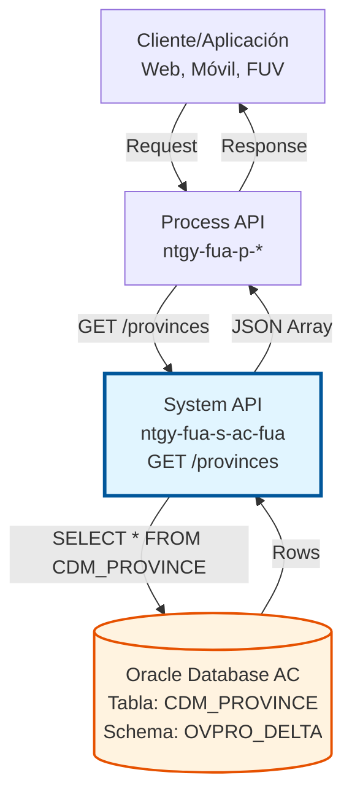
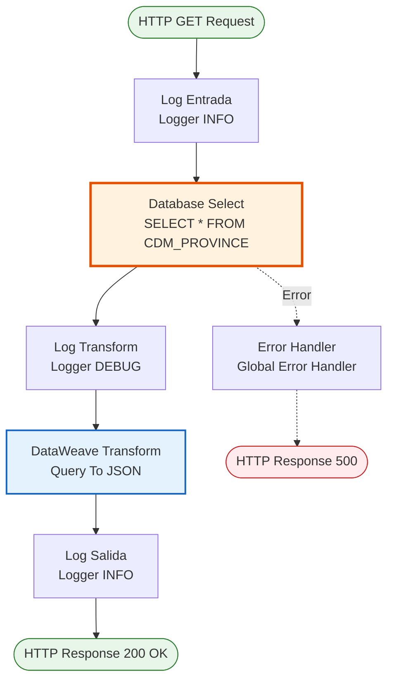
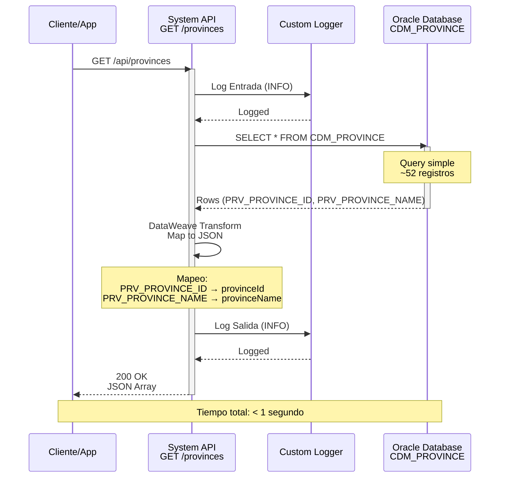

# GET /provinces

## 📌 Descripción General

### Propósito del Endpoint

Endpoint de consulta de datos maestros geográficos que recupera el catálogo completo de provincias españolas desde la base de datos Oracle del sistema Área Cliente (AC). Proporciona información básica de identificación de provincias para su uso en formularios, validaciones de direcciones y filtros geográficos.

El endpoint soporta:
- **Consulta completa**: Retorna todas las provincias sin filtros
- **Ordenamiento alfabético**: Resultados ordenados por nombre de provincia
- **Datos maestros estáticos**: Información que raramente cambia
- **Sin autenticación**: Datos públicos accesibles sin token

### Tipo de API

**Capa:** System API (API-Led Connectivity)

**Función:** Acceso directo a datos maestros geográficos almacenados en Oracle Database AC para proporcionar información de provincias a capas superiores y aplicaciones consumidoras.

### Patrón de Integración

**Tipo:** Request-Reply Síncrono con Query SQL Simple

**Descripción:** Recibe request HTTP GET sin parámetros, ejecuta query SELECT simple en tabla de datos maestros CDM_PROVINCE, transforma resultado a JSON y retorna array de provincias ordenado alfabéticamente.

### Arquitectura API-Led Connectivity



---

## 💼 Propósito del Negocio

### Casos de Uso Principales

1. **Formularios de Registro de Clientes**
   - Selector de provincia en formularios de alta de clientes
   - Validación de direcciones durante el proceso de registro
   - Autocompletado de campos de dirección
   - **Beneficio:** Mejora la experiencia de usuario con datos estandarizados

2. **Frontal de Ventas (FUV)**
   - Selección de provincia al crear nuevos contratos
   - Validación de direcciones de puntos de suministro
   - Filtrado geográfico de clientes y contratos
   - **Beneficio:** Reduce errores en captura de direcciones

3. **Portales Web y Aplicaciones Móviles**
   - Desplegables de selección de provincia
   - Búsqueda de oficinas o puntos de atención por provincia
   - Filtros geográficos en consultas de servicios
   - **Beneficio:** Interfaz consistente en todos los canales

4. **Sistemas de Integración**
   - Normalización de direcciones en integraciones
   - Validación de datos geográficos en procesos batch
   - Enriquecimiento de datos de clientes
   - **Beneficio:** Calidad de datos mejorada

### Contexto Empresarial

- **Dominio:** Datos Maestros Geográficos
- **Sector:** Energía - Utilities
- **División:** Naturgy España - NewCo
- **Proceso de Negocio:** Gestión de Datos Maestros y Validación de Direcciones
- **Módulo:** Área Cliente (AC)

### Stakeholders

- **Clientes Finales**: Usuarios que completan formularios de registro o actualización de datos
- **Agentes de Ventas**: Personal del Frontal de Ventas que captura direcciones de clientes
- **Desarrolladores Frontend**: Equipos que implementan formularios en web y móvil
- **Sistemas de Integración**: Aplicaciones que requieren validación de direcciones
- **Equipo de Calidad de Datos**: Responsables de mantener integridad de datos geográficos

### Valor de Negocio

- **Estandarización**: Garantiza uso de nombres oficiales de provincias
- **Calidad de Datos**: Reduce errores de captura manual de direcciones
- **Experiencia de Usuario**: Facilita selección mediante listas desplegables
- **Eficiencia Operativa**: Elimina necesidad de mantener catálogos duplicados
- **Integración**: Punto único de acceso a datos maestros geográficos

### Consumidores Potenciales

Este endpoint puede ser consumido por:
- Process APIs de gestión de clientes y contratos
- Experience APIs de portales web y aplicaciones móviles
- Frontal de Ventas (FUV) para captura de direcciones
- Sistemas de integración que requieren validación geográfica
- Aplicaciones de call center para consulta de clientes

---

## 🔧 Especificación Técnica

### URLs por Ambiente

| Ambiente | URL Base | URL Completa |
|----------|----------|--------------|
| **Local** | `http://localhost:8081` | `http://localhost:8081/api/provinces` |
| **Development** | `https://ntgy-fua-s-ac-fua-dev.us-e2.cloudhub.io` | `https://ntgy-fua-s-ac-fua-dev.us-e2.cloudhub.io/api/provinces` |
| **UAT** | `https://ntgy-fua-s-ac-fua-uat.us-e2.cloudhub.io` | `https://ntgy-fua-s-ac-fua-uat.us-e2.cloudhub.io/api/provinces` |
| **Production** | `https://ntgy-fua-s-ac-fua-pro.us-e2.cloudhub.io` | `https://ntgy-fua-s-ac-fua-pro.us-e2.cloudhub.io/api/provinces` |

### Método HTTP

```
GET /api/provinces
```

### Parámetros de Entrada

#### Headers HTTP

| Header | Tipo | Requerido | Descripción | Ejemplo |
|--------|------|-----------|-------------|---------|
| `Accept` | string | ❌ No | Tipo de contenido esperado en response | `application/json` |

**Nota:** Este endpoint NO requiere autenticación ya que consulta datos maestros públicos.

#### Query Parameters

**No aplica** - Este endpoint no acepta parámetros de consulta. Retorna siempre el catálogo completo de provincias.

#### Body Parameters

**No aplica** - Método GET no acepta body.

### Respuestas

#### Respuesta Exitosa (200 OK)

```json
{
  "result": {
    "codResult": "0000",
    "msgResult": "No hay error"
  },
  "items": [
    {
      "provinceId": "01",
      "provinceName": "ALAVA"
    },
    {
      "provinceId": "02",
      "provinceName": "ALBACETE"
    },
    {
      "provinceId": "03",
      "provinceName": "ALICANTE"
    },
    {
      "provinceId": "28",
      "provinceName": "MADRID"
    },
    {
      "provinceId": "08",
      "provinceName": "BARCELONA"
    }
  ]
}
```

**Campos de Respuesta:**

| Campo | Tipo | Descripción |
|-------|------|-------------|
| `result.codResult` | string | Código de resultado ("0000" = éxito) |
| `result.msgResult` | string | Mensaje descriptivo del resultado |
| `items` | array | Array de objetos provincia |
| `items[].provinceId` | string | Identificador único de provincia (código INE) |
| `items[].provinceName` | string | Nombre oficial de la provincia en mayúsculas |

#### Respuesta de Error de Base de Datos (500 Internal Server Error)

```json
{
  "result": {
    "codResult": "0001",
    "msgResult": "Error al consultar base de datos"
  }
}
```

#### Respuesta de Timeout (500 Internal Server Error)

```json
{
  "result": {
    "codResult": "0002",
    "msgResult": "Timeout en consulta a base de datos"
  }
}
```

### Autenticación y Autorización

- **Tipo:** No requiere autenticación
- **Razón:** Datos maestros públicos sin información sensible
- **Autorización DB:** El usuario de conexión a Oracle debe tener permisos de SELECT en tabla CDM_PROVINCE del schema OVPRO_DELTA

### Timeouts

| Tipo | Valor | Descripción |
|------|-------|-------------|
| **Query Timeout** | 15 segundos | Tiempo máximo de ejecución de query SQL (configurable: `${dbAC.queryTimeout}`) |
| **Connection Timeout** | 3600 segundos | Tiempo máximo para establecer conexión a base de datos |
| **Response Time Esperado** | < 1 segundo | Tiempo típico de respuesta para esta query simple |

### Códigos de Estado HTTP

| Código | Descripción | Escenario |
|--------|-------------|-----------|
| **200 OK** | Consulta exitosa | Provincias recuperadas correctamente |
| **500 Internal Server Error** | Error del servidor | Error de conexión a BD o timeout |
| **503 Service Unavailable** | Servicio no disponible | Base de datos AC no accesible |

---

## 🏗️ Implementación Técnica

### Arquitectura del Flow



### Componentes del Flow

#### 1. Logger de Entrada
```xml
<logger level="INFO" message="s-ac-provinces.logEntrada ## payload: #[payload]"/>
```
- **Propósito:** Registrar inicio de ejecución del flow
- **Nivel:** INFO
- **Contenido:** Payload de entrada (vacío en este caso)

#### 2. Database Select
```xml
<db:select config-ref="Database_Config" queryTimeout="${dbAC.queryTimeout}">
    <db:sql><![CDATA[SELECT * FROM CDM_PROVINCE]]></db:sql>
</db:select>
```
- **Configuración:** `Database_Config` (Oracle connection pool)
- **Query:** `SELECT * FROM CDM_PROVINCE`
- **Timeout:** Configurable vía property `${dbAC.queryTimeout}` (15 segundos)
- **Tabla:** CDM_PROVINCE (Catálogo de Datos Maestros - Provincias)
- **Campos Recuperados:**
  - `PRV_PROVINCE_ID`: Identificador de provincia
  - `PRV_PROVINCE_NAME`: Nombre de la provincia

#### 3. Transformación DataWeave
```dataweave
%dw 2.0
output application/json
---
{
    result: {	 
        codResult: "0000",
        msgResult: "No hay error"
    },
    items: payload map ( payload01 , indexOfPayload01 ) -> {
        provinceId: payload01.PRV_PROVINCE_ID,
        provinceName: payload01.PRV_PROVINCE_NAME default ""
    }
}
```

**Mapeo de Campos:**
- `PRV_PROVINCE_ID` → `provinceId` (string)
- `PRV_PROVINCE_NAME` → `provinceName` (string con default vacío)

**Lógica:**
- Itera sobre cada fila del resultado SQL
- Mapea campos de base de datos a estructura JSON
- Aplica valor por defecto "" si provinceName es null
- Envuelve resultado en estructura estándar con `result` e `items`

#### 4. Logger de Salida
```xml
<logger level="INFO" message="s-ac-provinces.logSalida ## payload: #[payload]"/>
```
- **Propósito:** Registrar finalización exitosa del flow
- **Nivel:** INFO
- **Contenido:** Payload transformado (JSON response)

### Configuración de Base de Datos

#### Connection Pool
```yaml
dbAC:
  user: "OVPRO_DELTA"
  pass: "![encrypted]"
  host1: "oc-pro-exa-04-clu-02-hdfdi-scan.prodb03.ocpro.oraclevcn.com"
  host2: "oc-pro-exa-03-clu-02-dfhl9-scan.prodb03.ocpro.oraclevcn.com"
  port: "1521"
  serviceName: "s_areapriv_online_pro.prodb03.ocpro.oraclevcn.com"
  MaxPoolSize: "15"
  MaxWaitTime: "300"
  MaxIdleTime: "300"
  queryTimeout: "15"
```

**Características:**
- **Driver:** Oracle JDBC 19.13.0.0.1
- **High Availability:** Dual host configuration
- **Connection Pooling:** Máximo 15 conexiones simultáneas
- **Retry Policy:** 3 intentos automáticos en caso de fallo

### Tabla de Base de Datos

#### CDM_PROVINCE

**Schema:** OVPRO_DELTA  
**Tipo:** Tabla de Datos Maestros  
**Propósito:** Catálogo de provincias españolas

**Estructura:**

| Columna | Tipo | Descripción | Ejemplo |
|---------|------|-------------|---------|
| `PRV_PROVINCE_ID` | VARCHAR2 | Código de provincia (INE) | "28" |
| `PRV_PROVINCE_NAME` | VARCHAR2 | Nombre oficial de provincia | "MADRID" |

**Características:**
- Datos estáticos (raramente cambian)
- Aproximadamente 52 registros (50 provincias + Ceuta + Melilla)
- Sin índices complejos necesarios (tabla pequeña)
- Candidato ideal para caché (TTL: 24 horas)

### Diagrama de Secuencia



### Manejo de Errores

El endpoint utiliza el **Global Error Handler** (`s-ac-globalErrorHandler.xml`) que maneja:

1. **Database Connection Errors**
   - Retry automático (3 intentos)
   - Exponential backoff
   - Response 500 con mensaje descriptivo

2. **Query Timeout**
   - Timeout configurado a 15 segundos
   - Response 500 si se excede
   - Log de error para troubleshooting

3. **Transformation Errors**
   - Validación de campos null
   - Valores por defecto aplicados
   - Log de advertencia si datos incompletos

### Optimizaciones Implementadas

1. **Query Simple:** SELECT * sin JOINs ni WHERE clauses
2. **Tabla Pequeña:** ~52 registros, carga completa rápida
3. **Connection Pooling:** Reutilización de conexiones
4. **Logging Estratégico:** Solo INFO/DEBUG, no TRACE
5. **Transformación Eficiente:** Mapeo directo sin lógica compleja

### Oportunidades de Mejora Futuras

1. **Caché:** Implementar caché con TTL de 24 horas
2. **Ordenamiento:** Agregar ORDER BY en SQL (actualmente sin orden)
3. **Paginación:** No necesaria (dataset pequeño)
4. **Compresión:** Habilitar GZIP para response
5. **CDN:** Servir desde CDN para reducir latencia

---

## 💻 Ejemplos de Uso

### Ejemplo 1: Consulta Básica con curl

```bash
curl -X GET "http://localhost:8081/api/provinces" \
  -H "Accept: application/json"
```

**Response (200 OK):**
```json
{
  "result": {
    "codResult": "0000",
    "msgResult": "No hay error"
  },
  "items": [
    {
      "provinceId": "01",
      "provinceName": "ALAVA"
    },
    {
      "provinceId": "02",
      "provinceName": "ALBACETE"
    },
    {
      "provinceId": "03",
      "provinceName": "ALICANTE"
    },
    {
      "provinceId": "04",
      "provinceName": "ALMERIA"
    },
    {
      "provinceId": "05",
      "provinceName": "AVILA"
    },
    {
      "provinceId": "06",
      "provinceName": "BADAJOZ"
    },
    {
      "provinceId": "07",
      "provinceName": "BALEARES"
    },
    {
      "provinceId": "08",
      "provinceName": "BARCELONA"
    },
    {
      "provinceId": "28",
      "provinceName": "MADRID"
    },
    {
      "provinceId": "46",
      "provinceName": "VALENCIA"
    }
  ]
}
```

### Ejemplo 2: Consulta desde JavaScript (Fetch API)

```javascript
// Consultar provincias
async function getProvinces() {
  try {
    const response = await fetch('https://ntgy-fua-s-ac-fua-pro.us-e2.cloudhub.io/api/provinces', {
      method: 'GET',
      headers: {
        'Accept': 'application/json'
      }
    });
    
    if (!response.ok) {
      throw new Error(`HTTP error! status: ${response.status}`);
    }
    
    const data = await response.json();
    
    if (data.result.codResult === "0000") {
      console.log(`Provincias recuperadas: ${data.items.length}`);
      return data.items;
    } else {
      console.error('Error en respuesta:', data.result.msgResult);
      return [];
    }
  } catch (error) {
    console.error('Error al consultar provincias:', error);
    return [];
  }
}

// Uso en componente React
function ProvinceSelector() {
  const [provinces, setProvinces] = useState([]);
  
  useEffect(() => {
    getProvinces().then(setProvinces);
  }, []);
  
  return (
    <select name="province">
      <option value="">Seleccione provincia...</option>
      {provinces.map(province => (
        <option key={province.provinceId} value={province.provinceId}>
          {province.provinceName}
        </option>
      ))}
    </select>
  );
}
```

### Ejemplo 3: Integración con Municipios

```bash
# 1. Obtener provincias
curl -X GET "http://localhost:8081/api/provinces" \
  -H "Accept: application/json"

# Response: Lista de provincias con IDs

# 2. Usar provinceId para obtener municipios
curl -X GET "http://localhost:8081/api/municipalities?provinceId=28" \
  -H "Accept: application/json"

# Response: Lista de municipios de Madrid
```

**Flujo de Navegación Geográfica:**
```
GET /provinces
    ↓ (seleccionar provinceId)
GET /municipalities?provinceId=XX
    ↓ (seleccionar municipalityId)
GET /towns?municipalityId=XXXXX
    ↓ (seleccionar townId)
GET /streets?townId=XXXXXXXXXXX
```

### Ejemplo 4: Manejo de Errores

```javascript
async function getProvincesWithErrorHandling() {
  try {
    const response = await fetch('https://ntgy-fua-s-ac-fua-pro.us-e2.cloudhub.io/api/provinces');
    
    if (!response.ok) {
      // Error HTTP (500, 503, etc.)
      const errorData = await response.json();
      throw new Error(`Error ${response.status}: ${errorData.result?.msgResult || 'Error desconocido'}`);
    }
    
    const data = await response.json();
    
    // Validar respuesta exitosa
    if (data.result.codResult !== "0000") {
      throw new Error(`Error de negocio: ${data.result.msgResult}`);
    }
    
    // Validar que hay datos
    if (!data.items || data.items.length === 0) {
      console.warn('No se encontraron provincias');
      return [];
    }
    
    return data.items;
    
  } catch (error) {
    console.error('Error al obtener provincias:', error.message);
    
    // Retornar lista vacía o datos de fallback
    return [];
  }
}
```

**Response de Error (500):**
```json
{
  "result": {
    "codResult": "0001",
    "msgResult": "Error al consultar base de datos: Connection timeout"
  }
}
```

### Ejemplo 5: Uso en Postman

**Request:**
- **Method:** GET
- **URL:** `{{baseUrl}}/api/provinces`
- **Headers:**
  - `Accept: application/json`

**Tests (Postman):**
```javascript
// Validar status code
pm.test("Status code is 200", function () {
    pm.response.to.have.status(200);
});

// Validar estructura de respuesta
pm.test("Response has correct structure", function () {
    var jsonData = pm.response.json();
    pm.expect(jsonData).to.have.property('result');
    pm.expect(jsonData).to.have.property('items');
    pm.expect(jsonData.result.codResult).to.eql("0000");
});

// Validar que hay provincias
pm.test("Response contains provinces", function () {
    var jsonData = pm.response.json();
    pm.expect(jsonData.items).to.be.an('array');
    pm.expect(jsonData.items.length).to.be.above(0);
});

// Validar estructura de provincia
pm.test("Province has required fields", function () {
    var jsonData = pm.response.json();
    var firstProvince = jsonData.items[0];
    pm.expect(firstProvince).to.have.property('provinceId');
    pm.expect(firstProvince).to.have.property('provinceName');
});

// Guardar primera provincia en variable de entorno
var jsonData = pm.response.json();
if (jsonData.items && jsonData.items.length > 0) {
    pm.environment.set("provinceId", jsonData.items[0].provinceId);
}
```
