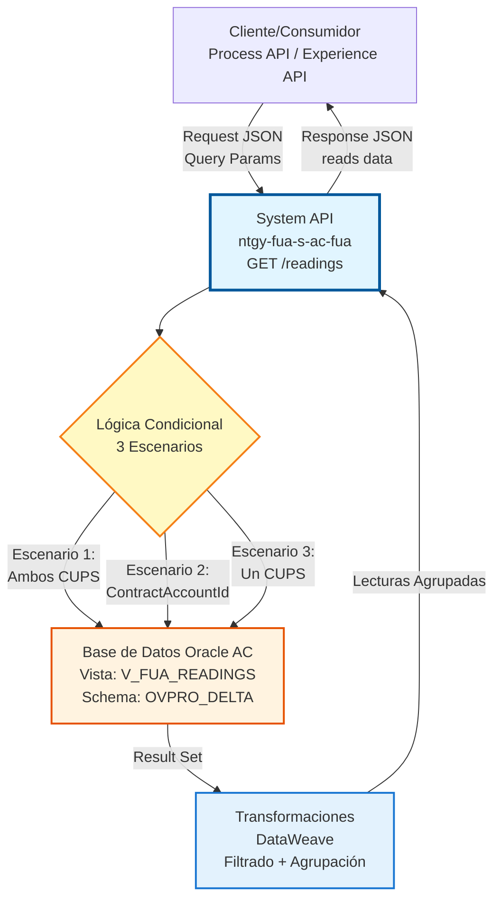
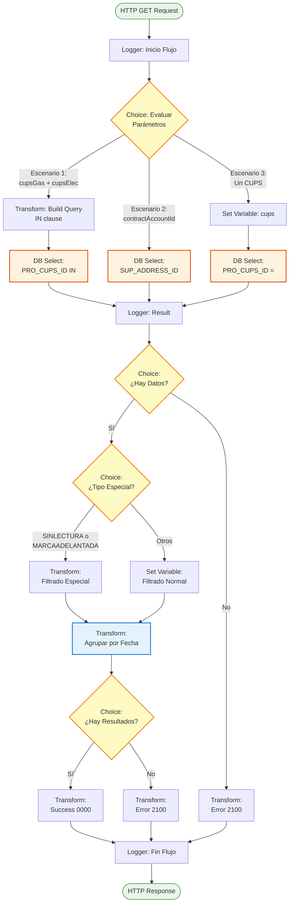
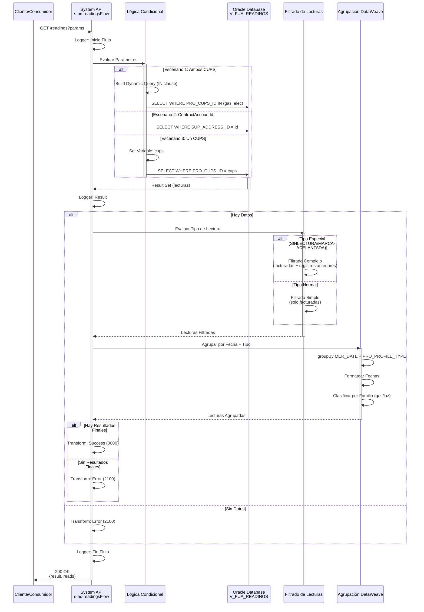

# GET /readings

## 📌 Descripción General

### Propósito del Endpoint

El endpoint `GET /readings` permite consultar el histórico de lecturas de contadores de gas y electricidad asociadas a puntos de suministro (CUPS) de clientes en el sistema Área Cliente (AC) de Naturgy. Este servicio proporciona acceso directo a la vista `V_FUA_READINGS` de la base de datos Oracle, implementando lógica de negocio compleja para filtrar, agrupar y formatear las lecturas según diferentes criterios de búsqueda.

El endpoint soporta:
- **Consulta por CUPS Dual**: Búsqueda simultánea de lecturas de gas y electricidad
- **Consulta por Cuenta Contrato**: Búsqueda por identificador de dirección de suministro
- **Consulta por CUPS Individual**: Búsqueda por un solo CUPS (gas o electricidad)
- **Filtrado Inteligente**: Exclusión de lecturas no facturadas y manejo especial de tipos específicos
- **Agrupación por Fecha**: Organización de lecturas por fecha y tipo de producto
- **Formateo Avanzado**: Transformación de datos para consumo optimizado

### Tipo de API

**Capa:** System API (API-Led Connectivity)

**Función:** Integración directa con base de datos Oracle AC para consulta de lecturas de contadores con lógica de negocio compleja para filtrado, agrupación y formateo de datos.

### Patrón de Integración

**Tipo:** Request-Reply Síncrono con Query SQL Condicional

**Descripción:** El endpoint recibe parámetros de consulta variables (cupsGas, cupsElec, contractAccountId, docNumber), evalúa el escenario mediante lógica condicional (Choice), ejecuta la query SQL apropiada contra la vista V_FUA_READINGS, aplica múltiples transformaciones DataWeave para filtrar y agrupar datos, y retorna la información en formato JSON estructurado y optimizado.

### Arquitectura API-Led Connectivity



---

## 💼 Propósito del Negocio

### Casos de Uso Principales

1. **Consulta de Histórico de Lecturas para Facturación**
   - Permite a sistemas de facturación obtener lecturas de contadores para cálculo de consumos
   - Facilita la validación de importes facturados con lecturas reales
   - Soporta auditorías de facturación y reclamaciones de clientes

2. **Visualización de Consumos en Portales de Cliente**
   - Proporciona datos de lecturas para gráficos de evolución de consumo
   - Permite a clientes verificar sus lecturas históricas
   - Facilita la comparación de consumos entre períodos

3. **Gestión de Lecturas Dual (Gas + Electricidad)**
   - Soporta consulta simultánea de lecturas de ambos suministros
   - Facilita la gestión de clientes con contratos duales
   - Optimiza la obtención de datos para clientes multi-suministro

4. **Soporte a Atención al Cliente**
   - Proporciona información detallada de lecturas para resolución de consultas
   - Permite verificar fechas de lectura y valores registrados
   - Facilita la identificación de anomalías en lecturas

5. **Validación de Lecturas para Nuevos Contratos**
   - Verifica histórico de lecturas en procesos de cambio de titular
   - Permite validar lecturas iniciales en altas de suministro
   - Facilita la detección de contadores con problemas

### Contexto Empresarial

- **Dominio:** Gestión de Mediciones y Lecturas
- **Sector:** Energía - Utilities
- **División:** Naturgy España - Área Cliente
- **Proceso de Negocio:** Consulta de lecturas de contadores para facturación y seguimiento
- **Sistema Backend:** Oracle Database AC (OVPRO_DELTA schema)
- **Criticidad:** Alta (impacta facturación y atención al cliente)

### Stakeholders

- **Clientes Finales**: Consultan su histórico de lecturas y consumos
- **Sistemas de Facturación**: Obtienen lecturas para cálculo de importes
- **Agentes de Atención al Cliente**: Verifican lecturas en gestiones y reclamaciones
- **Portales Web/Móvil**: Muestran evolución de consumos a clientes
- **Sistemas de Auditoría**: Validan consistencia de lecturas y facturación
- **Distribuidoras**: Reciben información de lecturas para gestión de red

### Valor de Negocio

- **Transparencia**: Proporciona visibilidad completa del histórico de lecturas
- **Precisión en Facturación**: Asegura que la facturación se base en lecturas reales
- **Reducción de Reclamaciones**: Permite a clientes verificar sus lecturas
- **Eficiencia Operativa**: Reduce tiempo de consulta de información de mediciones
- **Mejora de Experiencia**: Facilita autoservicio de clientes
- **Detección de Anomalías**: Identifica lecturas atípicas o problemáticas

### Consumidores Potenciales

Este endpoint puede ser consumido por:
- Process APIs de facturación y billing
- Experience APIs de portales web y aplicaciones móviles
- Sistemas de atención al cliente (call center)
- Aplicaciones de gestión comercial
- Sistemas de auditoría y control
- Plataformas de análisis de consumos
- Sistemas de distribuidoras eléctricas y gasistas

---

## 🔧 Especificación Técnica

### URLs por Ambiente

| Ambiente | URL Base | URL Completa |
|----------|----------|--------------|
| **Local** | `http://localhost:8081` | `http://localhost:8081/api/readings` |
| **Development** | `https://ntgy-fua-s-ac-fua-dev.us-e2.cloudhub.io` | `https://ntgy-fua-s-ac-fua-dev.us-e2.cloudhub.io/api/readings` |
| **UAT** | `https://ntgy-fua-s-ac-fua-uat.us-e2.cloudhub.io` | `https://ntgy-fua-s-ac-fua-uat.us-e2.cloudhub.io/api/readings` |
| **Production** | `https://ntgy-fua-s-ac-fua-pro.us-e2.cloudhub.io` | `https://ntgy-fua-s-ac-fua-pro.us-e2.cloudhub.io/api/readings` |

### Método HTTP

```
GET /api/readings
```

### Parámetros de Entrada

#### Headers HTTP

| Header | Tipo | Requerido | Descripción | Ejemplo |
|--------|------|-----------|-------------|---------|
| `Content-Type` | string | ❌ No | Tipo de contenido del request | `application/json` |
| `Accept` | string | ❌ No | Tipo de contenido esperado en response | `application/json` |

#### Query Parameters

| Parámetro | Tipo | Requerido | Descripción | Ejemplo |
|-----------|------|-----------|-------------|---------|
| `cupsGas` | string | ⚠️ Condicional | CUPS del suministro de gas | `"ES0021000000000001JN"` |
| `cupsElec` | string | ⚠️ Condicional | CUPS del suministro de electricidad | `"ES0031000000000001KP"` |
| `contractAccountId` | string | ⚠️ Condicional | Identificador de dirección de suministro | `"1234567890"` |
| `docNumber` | string | ✅ Sí | Número de documento del cliente (NIF/NIE) | `"12345678A"` |

**Escenarios de Parámetros:**

1. **Escenario 1 - Consulta Dual (Gas + Electricidad):**
   - Requeridos: `cupsGas`, `cupsElec`, `docNumber`
   - Query: Busca en ambos CUPS simultáneamente

2. **Escenario 2 - Consulta por Cuenta Contrato:**
   - Requeridos: `contractAccountId`, `docNumber`
   - Condición: `cupsGas` y `cupsElec` deben estar vacíos
   - Query: Busca por dirección de suministro

3. **Escenario 3 - Consulta por CUPS Individual:**
   - Requeridos: (`cupsGas` O `cupsElec`), `docNumber`
   - Query: Busca por el CUPS proporcionado

**Nota:** El parámetro `docNumber` es obligatorio en todos los escenarios.

### Respuestas

#### Respuesta Exitosa con Datos (200 OK)

```json
{
  "result": {
    "codResult": "0000",
    "msgResult": "No hay error"
  },
  "reads": [
    {
      "readId": "12345",
      "readingDate": "2024-01-15",
      "type": "REAL",
      "data": [
        {
          "subType": "",
          "value": "1234.56"
        }
      ],
      "productTypeFamily": "gas"
    },
    {
      "readId": "12346",
      "readingDate": "2024-01-15",
      "type": "REAL",
      "data": [
        {
          "subType": "",
          "value": "5678.90"
        }
      ],
      "productTypeFamily": "luz"
    }
  ]
}
```

**Campos de Respuesta:**

| Campo | Tipo | Descripción |
|-------|------|-------------|
| `result` | object | Objeto con información del resultado de la operación |
| `result.codResult` | string | Código de resultado ("0000" = éxito) |
| `result.msgResult` | string | Mensaje descriptivo del resultado |
| `reads` | array | Array con las lecturas agrupadas por fecha y tipo de producto |
| `reads[].readId` | string | Identificador único de la lectura |
| `reads[].readingDate` | string | Fecha de la lectura (formato: YYYY-MM-DD) |
| `reads[].type` | string | Tipo de lectura (REAL, ESTIMADA, SINLECTURA, MARCAADELANTADA) |
| `reads[].data` | array | Array con los valores de lectura |
| `reads[].data[].subType` | string | Subtipo de lectura (actualmente vacío) |
| `reads[].data[].value` | string | Valor de la lectura del contador |
| `reads[].productTypeFamily` | string | Familia de producto ("gas" o "luz") |

#### Respuesta Sin Datos (200 OK)

```json
{
  "result": {
    "codResult": "2100",
    "msgResult": "Registro no encontrado"
  }
}
```

**Descripción:** Se retorna cuando no se encuentran lecturas que cumplan los criterios de búsqueda.

#### Respuesta de Error Técnico (400)

```json
{
  "result": {
    "codResult": "0002",
    "msgResult": "Error en la consulta de base de datos"
  }
}
```

### Códigos de Estado HTTP

| Código | Descripción | Escenario |
|--------|-------------|-----------|
| **200** | OK | Consulta ejecutada correctamente (con o sin datos) |
| **400** | Bad Request | Error en parámetros o error técnico en la consulta |
| **500** | Internal Server Error | Error interno del servidor |

### Códigos de Resultado de Negocio

| Código | Mensaje | Descripción |
|--------|---------|-------------|
| **0000** | No hay error | Consulta exitosa con datos |
| **2100** | Registro no encontrado | No se encontraron lecturas para los criterios especificados |
| **0002** | [Descripción del error] | Error técnico en la ejecución de la consulta |

### Autenticación y Autorización

- **Tipo:** Client ID & Client Secret (Anypoint Platform)
- **Autorización Oracle:** El usuario de base de datos debe tener permisos para:
  - Ejecutar SELECT en la vista `V_FUA_READINGS`
  - Acceso al schema `OVPRO_DELTA`

### Timeouts

| Tipo | Valor | Descripción |
|------|-------|-------------|
| **Query Timeout** | 15 segundos | Tiempo máximo de ejecución de la query SQL |
| **Connection Timeout** | 3600 segundos | Tiempo máximo para establecer conexión con Oracle |
| **Response Timeout** | 30 segundos | Tiempo máximo de espera para la respuesta completa |

---

## 🏗️ Implementación Técnica

### Arquitectura del Flow



### Componentes del Flow por Escenario

#### Escenario 1: Ambos CUPS (Líneas 10-23)

**Condición:**
```dataweave
!isEmpty(attributes.queryParams.cupsGas) and 
!isEmpty(attributes.queryParams.cupsElec)
```

**Construcción de Query Dinámica:**
```dataweave
%dw 2.0
output application/json
var query = "select * FROM V_FUA_READINGS WHERE PRO_CUPS_ID IN ('" 
    ++ attributes.queryParams.cupsGas 
    ++ "','" 
    ++ attributes.queryParams.cupsElec 
    ++ "') AND CLI_DOCUMENT ='" 
    ++ attributes.queryParams.docNumber 
    ++ "' ORDER BY MER_DATE DESC"
---
query
```

**Database Select:**
```xml
<db:select config-ref="Database_Config" 
           queryTimeout="${dbAC.queryTimeout}" 
           target="readings">
    <db:sql>#[vars.query]</db:sql>
</db:select>
```

**Query SQL Resultante:**
```sql
SELECT * FROM V_FUA_READINGS 
WHERE PRO_CUPS_ID IN ('ES0021000000000001JN', 'ES0031000000000001KP') 
AND CLI_DOCUMENT = '12345678A' 
ORDER BY MER_DATE DESC
```

#### Escenario 2: ContractAccountId (Líneas 25-35)

**Condición:**
```dataweave
isEmpty(attributes.queryParams.cupsGas) and 
isEmpty(attributes.queryParams.cupsElec) and 
!isEmpty(attributes.queryParams.contractAccountId)
```

**Database Select:**
```xml
<db:select config-ref="Database_Config" 
           queryTimeout="${dbAC.queryTimeout}">
    <db:sql>
        SELECT * FROM V_FUA_READINGS 
        WHERE SUP_ADDRESS_ID = :contractAccountId 
        AND CLI_DOCUMENT = :docNumber 
        ORDER BY MER_DATE DESC
    </db:sql>
    <db:input-parameters>
        {
            contractAccountId: attributes.queryParams.contractAccountId,
            docNumber: attributes.queryParams.docNumber
        }
    </db:input-parameters>
</db:select>
```

#### Escenario 3: Un Solo CUPS (Líneas 37-50)

**Lógica de Selección de CUPS:**
```dataweave
%dw 2.0
output application/json
var cups = if (isEmpty(attributes.queryParams.cupsGas)) 
           attributes.queryParams.cupsElec 
           else 
           attributes.queryParams.cupsGas
---
cups
```

**Database Select:**
```xml
<db:select config-ref="Database_Config" 
           queryTimeout="${dbAC.queryTimeout}" 
           target="readings">
    <db:sql>
        SELECT * FROM V_FUA_READINGS 
        WHERE PRO_CUPS_ID = :cups 
        AND CLI_DOCUMENT = :docNumber 
        ORDER BY MER_DATE DESC
    </db:sql>
    <db:input-parameters>
        {
            "cups": vars.cups,
            docNumber: attributes.queryParams.docNumber
        }
    </db:input-parameters>
</db:select>
```

### Lógica de Filtrado de Lecturas

#### Filtrado Normal (Líneas 60-62)

**Condición:** Tipos de lectura estándar (no SINLECTURA ni MARCAADELANTADA)

```dataweave
vars.readings filter (value, index) -> (value."MER_FACTURADA" == 'Y')
```

**Descripción:** Filtra solo las lecturas que han sido facturadas.

#### Filtrado Especial (Líneas 56-59)

**Condición:** Contiene tipos SINLECTURA o MARCAADELANTADA

```dataweave
%dw 2.0
output application/json

var auxReadings = vars.readings filter (value, index) -> 
    (value."MER_FACTURADA" == 'Y')
    
var auxReadingsN = vars.readings filter (value, index) -> 
    (value."MER_FACTURADA" == 'N')
    
var readings = auxReadings filter (value, index) -> 
    ((value."MER_TYPE" != 'SINLECTURA') and 
     (value."MER_TYPE" != 'MARCAADELANTADA'))
     
var readingsN = vars.readings filter (value, index) -> 
    ((value."MER_TYPE" == 'SINLECTURA') or 
     (value."MER_TYPE" == 'MARCAADELANTADA'))
     
var registrosAnteriores = auxReadingsN filter (value,index) -> 
    (readingsN..MER_VALUE contains value.MER_VALUE)
---
((readings ++ registrosAnteriores) orderBy (-$.MER_DATE)) distinctBy $.MER_VALUE
```

**Lógica:**
1. Separa lecturas facturadas (Y) y no facturadas (N)
2. Filtra lecturas facturadas excluyendo tipos especiales
3. Identifica lecturas con tipos especiales
4. Busca registros anteriores no facturados con mismos valores
5. Combina ambos conjuntos, ordena por fecha descendente
6. Elimina duplicados por valor de lectura

### Transformación Final de Agrupación (Líneas 65-82)

```dataweave
%dw 2.0
output application/json

var readingsFecha = vars.readings groupBy (item, index) -> 
    item.MER_DATE ++ "_" ++ item.PRO_PROFILE_TYPE
    
var fechasKey = readingsFecha pluck $$

var dateReads = if (isEmpty(attributes.queryParams.cupsGas) == false) 
                vars.readings[0].MER_PLANNED_READING_DATE 
                else ""
                
var adviseGasAllowed = if (isEmpty(attributes.queryParams.cupsGas) == false and 
                          vars.readings[0].PRO_CONTADOR_VIVIENDA == 'Y') 
                       true 
                       else false

fun tipoFamilia(aString) = 
    if(aString == 'Electricidad') "luz" 
    else if(aString == 'Gas') "gas" 
    else ""

fun formatDate(aNumber) = 
    aNumber as String as Date {format: 'yyyyMMdd'} as String

fun filtrarReadings(arreglo,llave) = arreglo[llave]

---
fechasKey map ( payload01 , indexOfPayload01 ) -> {
    readId: readingsFecha[payload01][0].MER_ID,
    readingDate: formatDate(readingsFecha[payload01][0].MER_DATE),
    "type": readingsFecha[payload01][0].MER_TYPE,
    data: filtrarReadings(readingsFecha,payload01) map ( payload02 , indexOfPayload02 ) -> {
        subType: "",
        value: payload02.MER_VALUE  
    },
    productTypeFamily: tipoFamilia(readingsFecha[payload01][0].PRO_PROFILE_TYPE)
}
```

**Funciones Auxiliares:**

1. **tipoFamilia:** Convierte tipo de perfil a familia de producto
   - "Electricidad" → "luz"
   - "Gas" → "gas"

2. **formatDate:** Convierte fecha de yyyyMMdd a YYYY-MM-DD

3. **filtrarReadings:** Extrae lecturas de un grupo específico

**Proceso de Agrupación:**
1. Agrupa lecturas por `MER_DATE + "_" + PRO_PROFILE_TYPE`
2. Extrae las claves de agrupación
3. Para cada grupo, crea un objeto con:
   - `readId`: ID de la primera lectura del grupo
   - `readingDate`: Fecha formateada
   - `type`: Tipo de lectura
   - `data`: Array con valores de todas las lecturas del grupo
   - `productTypeFamily`: Familia de producto (gas/luz)

### Diagrama de Secuencia Detallado



### Configuración de Base de Datos

**Connection Configuration:**
```yaml
dbAC:
  user: "OVPRO_DELTA"
  pass: "![encrypted]"
  host1: "oc-pro-exa-04-clu-02-hdfdi-scan.prodb03.ocpro.oraclevcn.com"
  host2: "oc-pro-exa-03-clu-02-dfhl9-scan.prodb03.ocpro.oraclevcn.com"
  port: "1521"
  serviceName: "s_areapriv_online_pro.prodb03.ocpro.oraclevcn.com"
  MaxPoolSize: "15"
  MaxWaitTime: "300"
  MaxIdleTime: "300"
  queryTimeout: "15"
```

### Manejo de Errores

**Error Handler (Líneas 107-122):**

```xml
<on-error-propagate>
    <logger level="ERROR" 
            message='#["Error s-ac-readingsFlow: " ++ error.description]'/>
    <ee:transform>
        <ee:set-payload>
            {
                "result": {
                    "codResult": "0002",
                    "msgResult": error.description
                }
            }
        </ee:set-payload>
        <ee:set-variable variableName="httpStatus">400</ee:set-variable>
    </ee:transform>
</on-error-propagate>
```

**Tipos de Errores Manejados:**
1. **Database Connection Error**: Fallo en conexión a Oracle
2. **Query Timeout**: Query excede 15 segundos
3. **SQL Exception**: Error en ejecución de query
4. **Transformation Error**: Error en DataWeave
5. **Parameter Validation Error**: Parámetros inválidos

### Performance y Optimización

**Métricas Esperadas:**
- **Response Time:** < 3 segundos (promedio)
- **Query Execution:** < 2 segundos
- **Transformation Time:** < 500ms
- **Total Processing:** < 3.5 segundos

**Optimizaciones Aplicadas:**
1. **Prepared Statements**: Prevención de SQL injection en escenarios 2 y 3
2. **Connection Pooling**: Reutilización de conexiones Oracle
3. **Query Timeout**: Evita bloqueos prolongados (15s)
4. **Índices en BD**: Columnas PRO_CUPS_ID, CLI_DOCUMENT, SUP_ADDRESS_ID
5. **Filtrado en DataWeave**: Reduce carga de procesamiento
6. **Agrupación Eficiente**: Minimiza iteraciones sobre datos

---

## 💻 Ejemplos de Uso

### Ejemplo 1: Consulta Dual (Gas + Electricidad)

#### Request con cURL

```bash
curl -X GET "http://localhost:8081/api/readings?cupsGas=ES0021000000000001JN&cupsElec=ES0031000000000001KP&docNumber=12345678A" \
  -H "Accept: application/json"
```

#### Request con JavaScript (Fetch)

```javascript
const response = await fetch(
  'http://localhost:8081/api/readings?cupsGas=ES0021000000000001JN&cupsElec=ES0031000000000001KP&docNumber=12345678A',
  {
    method: 'GET',
    headers: {
      'Accept': 'application/json'
    }
  }
);

const data = await response.json();
console.log('Lecturas encontradas:', data.reads.length);
```

#### Response Exitoso

```json
{
  "result": {
    "codResult": "0000",
    "msgResult": "No hay error"
  },
  "reads": [
    {
      "readId": "12345",
      "readingDate": "2024-01-15",
      "type": "REAL",
      "data": [
        {
          "subType": "",
          "value": "1234.56"
        }
      ],
      "productTypeFamily": "gas"
    },
    {
      "readId": "12346",
      "readingDate": "2024-01-15",
      "type": "REAL",
      "data": [
        {
          "subType": "",
          "value": "5678.90"
        }
      ],
      "productTypeFamily": "luz"
    },
    {
      "readId": "12347",
      "readingDate": "2023-12-15",
      "type": "REAL",
      "data": [
        {
          "subType": "",
          "value": "1200.00"
        }
      ],
      "productTypeFamily": "gas"
    }
  ]
}
```

### Ejemplo 2: Consulta por Cuenta Contrato

#### Request

```bash
curl -X GET "http://localhost:8081/api/readings?contractAccountId=1234567890&docNumber=12345678A" \
  -H "Accept: application/json"
```

#### Response

```json
{
  "result": {
    "codResult": "0000",
    "msgResult": "No hay error"
  },
  "reads": [
    {
      "readId": "98765",
      "readingDate": "2024-01-20",
      "type": "ESTIMADA",
      "data": [
        {
          "subType": "",
          "value": "1500.00"
        }
      ],
      "productTypeFamily": "luz"
    }
  ]
}
```

### Ejemplo 3: Consulta por CUPS Individual (Solo Gas)

#### Request

```bash
curl -X GET "http://localhost:8081/api/readings?cupsGas=ES0021000000000001JN&docNumber=12345678A" \
  -H "Accept: application/json"
```

#### Response

```json
{
  "result": {
    "codResult": "0000",
    "msgResult": "No hay error"
  },
  "reads": [
    {
      "readId": "54321",
      "readingDate": "2024-02-01",
      "type": "REAL",
      "data": [
        {
          "subType": "",
          "value": "1350.75"
        }
      ],
      "productTypeFamily": "gas"
    }
  ]
}
```

### Ejemplo 4: Sin Resultados

#### Request

```bash
curl -X GET "http://localhost:8081/api/readings?cupsGas=ES0000000000000000XX&docNumber=00000000Z" \
  -H "Accept: application/json"
```

#### Response

```json
{
  "result": {
    "codResult": "2100",
    "msgResult": "Registro no encontrado"
  }
}
```

**Interpretación:** No se encontraron lecturas para los criterios especificados.

### Ejemplo 5: Error de Base de Datos

#### Request

```bash
curl -X GET "http://localhost:8081/api/readings?cupsGas=INVALID_CUPS&docNumber=12345678A" \
  -H "Accept: application/json"
```

#### Response

```json
{
  "result": {
    "codResult": "0002",
    "msgResult": "Error en la consulta de base de datos: Invalid CUPS format"
  }
}
```

### Ejemplo 6: Integración desde Process API

```javascript
// Ejemplo de consumo desde un Process API
async function getCustomerReadings(cupsGas, cupsElec, docNumber) {
  try {
    const params = new URLSearchParams({
      docNumber: docNumber
    });
    
    if (cupsGas) params.append('cupsGas', cupsGas);
    if (cupsElec) params.append('cupsElec', cupsElec);

    const response = await fetch(
      `https://ntgy-fua-s-ac-fua-pro.us-e2.cloudhub.io/api/readings?${params}`,
      {
        method: 'GET',
        headers: {
          'Accept': 'application/json',
          'client_id': process.env.CLIENT_ID,
          'client_secret': process.env.CLIENT_SECRET
        }
      }
    );

    if (!response.ok) {
      throw new Error(`HTTP error! status: ${response.status}`);
    }

    const data = await response.json();
    
    if (data.result.codResult === "0000") {
      return {
        success: true,
        readings: data.reads,
        totalReadings: data.reads.length
      };
    } else if (data.result.codResult === "2100") {
      return {
        success: true,
        readings: [],
        totalReadings: 0,
        message: 'No se encontraron lecturas'
      };
    } else {
      return {
        success: false,
        error: data.result.msgResult
      };
    }
  } catch (error) {
    console.error('Error fetching readings:', error);
    return {
      success: false,
      error: error.message
    };
  }
}

// Uso - Consulta dual
const result = await getCustomerReadings(
  'ES0021000000000001JN', 
  'ES0031000000000001KP', 
  '12345678A'
);

if (result.success) {
  console.log(`Total lecturas: ${result.totalReadings}`);
  
  // Agrupar por familia de producto
  const gasReadings = result.readings.filter(r => r.productTypeFamily === 'gas');
  const luzReadings = result.readings.filter(r => r.productTypeFamily === 'luz');
  
  console.log(`Lecturas Gas: ${gasReadings.length}`);
  console.log(`Lecturas Luz: ${luzReadings.length}`);
  
  // Mostrar última lectura de cada tipo
  if (gasReadings.length > 0) {
    const lastGas = gasReadings[0];
    console.log(`Última lectura Gas: ${lastGas.data[0].value} (${lastGas.readingDate})`);
  }
  
  if (luzReadings.length > 0) {
    const lastLuz = luzReadings[0];
    console.log(`Última lectura Luz: ${lastLuz.data[0].value} (${lastLuz.readingDate})`);
  }
} else {
  console.error('Error:', result.error);
}
```

### Ejemplo 7: Análisis de Evolución de Consumo

```javascript
// Función para analizar evolución de consumo
function analyzeConsumptionTrend(readings) {
  if (!readings || readings.length < 2) {
    return { trend: 'insufficient_data' };
  }

  // Ordenar por fecha (más reciente primero)
  const sortedReadings = [...readings].sort((a, b) => 
    new Date(b.readingDate) - new Date(a.readingDate)
  );

  // Calcular diferencias entre lecturas consecutivas
  const consumptions = [];
  for (let i = 0; i < sortedReadings.length - 1; i++) {
    const current = parseFloat(sortedReadings[i].data[0].value);
    const previous = parseFloat(sortedReadings[i + 1].data[0].value);
    const consumption = current - previous;
    
    consumptions.push({
      period: `${sortedReadings[i + 1].readingDate} - ${sortedReadings[i].readingDate}`,
      consumption: consumption,
      type: sortedReadings[i].type
    });
  }

  // Calcular promedio
  const avgConsumption = consumptions.reduce((sum, c) => sum + c.consumption, 0) / consumptions.length;

  // Determinar tendencia
  const lastConsumption = consumptions[0].consumption;
  let trend;
  if (lastConsumption > avgConsumption * 1.1) {
    trend = 'increasing';
  } else if (lastConsumption < avgConsumption * 0.9) {
    trend = 'decreasing';
  } else {
    trend = 'stable';
  }

  return {
    trend: trend,
    lastConsumption: lastConsumption,
    avgConsumption: avgConsumption,
    consumptions: consumptions
  };
}

// Uso
const readingsData = await getCustomerReadings('ES0021000000000001JN', null, '12345678A');
if (readingsData.success && readingsData.readings.length > 0) {
  const gasReadings = readingsData.readings.filter(r => r.productTypeFamily === 'gas');
  const analysis = analyzeConsumptionTrend(gasReadings);
  
  console.log('Análisis de Consumo de Gas:');
  console.log(`Tendencia: ${analysis.trend}`);
  console.log(`Último consumo: ${analysis.lastConsumption.toFixed(2)} kWh`);
  console.log(`Consumo promedio: ${analysis.avgConsumption.toFixed(2)} kWh`);
}
```
