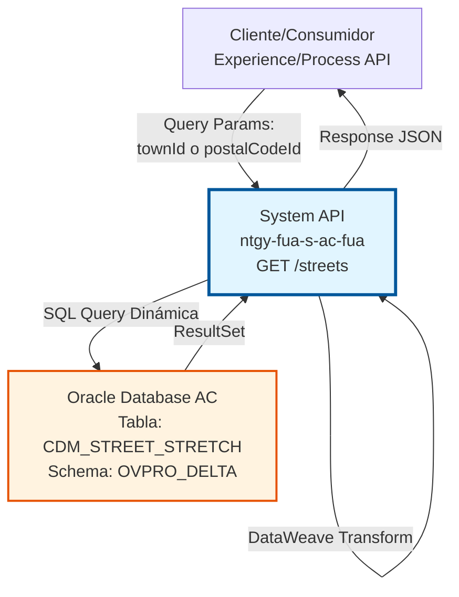
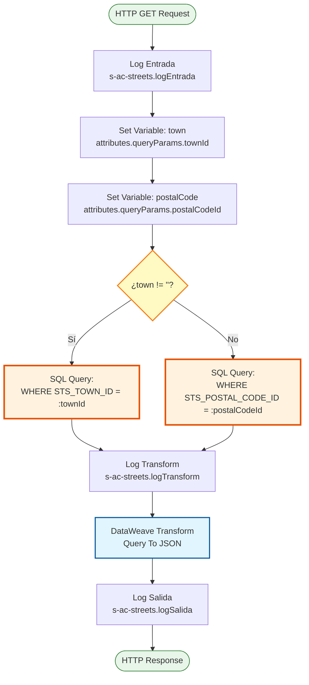
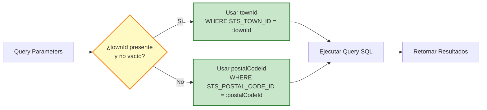

# GET /streets

## 📌 Descripción General

### Propósito del Endpoint

Este endpoint proporciona acceso a la información de calles (street stretches) almacenada en la base de datos Oracle del Área Cliente (AC). Permite consultar calles mediante dos criterios alternativos: por identificador de municipio (`townId`) o por código postal (`postalCodeId`), implementando una lógica condicional que prioriza la búsqueda por municipio.

El endpoint soporta:
- **Búsqueda por Municipio**: Consulta calles asociadas a un municipio específico (criterio prioritario)
- **Búsqueda por Código Postal**: Consulta calles asociadas a un código postal (criterio alternativo)
- **Información de Tipo de Calle**: Retorna tanto el ID como el nombre del tipo de calle para validación y presentación
- **Respuesta Estructurada**: Formato JSON estandarizado con código de resultado y array de items

### Tipo de API

**Capa:** System API (API-Led Connectivity)

**Función:** Integración directa con Oracle Database (Área Cliente) para acceso a datos maestros de localización geográfica, específicamente información de calles y tramos de calles.

### Patrón de Integración

**Tipo:** Request-Reply Síncrono con Query SQL Dinámica

**Descripción:** El endpoint recibe parámetros de consulta (townId o postalCodeId), evalúa mediante lógica condicional cuál criterio utilizar, ejecuta una query SQL dinámica contra la tabla `CDM_STREET_STRETCH` de Oracle, y transforma el resultado a formato JSON mediante DataWeave.

### Arquitectura API-Led Connectivity



---

## 💼 Propósito del Negocio

### Casos de Uso Principales

1. **Selección de Calle en Formularios de Dirección**
   - Usuario completa dirección en portal web o app móvil
   - Sistema consulta calles disponibles para el municipio seleccionado
   - Usuario selecciona calle de lista desplegable con nombres normalizados

2. **Validación de Direcciones por Código Postal**
   - Sistema recibe código postal en proceso de alta de cliente
   - Consulta calles válidas para ese código postal
   - Valida que la calle ingresada existe en el sistema

3. **Autocompletado de Direcciones**
   - Usuario comienza a escribir nombre de calle
   - Sistema consulta calles del municipio/código postal
   - Presenta sugerencias de calles válidas con tipo de calle

### Contexto Empresarial

- **Dominio:** Gestión de Datos Maestros - Localización Geográfica
- **Sector:** Energía - Utilities
- **División:** Naturgy España - Área Cliente (AC)
- **Proceso de Negocio:** Gestión de Direcciones y Puntos de Suministro
- **Sistema Origen:** Oracle Database AC (OVPRO_DELTA schema)

### Stakeholders

- **Clientes Finales**: Necesitan ingresar direcciones correctas para alta de servicios
- **Agentes de Ventas**: Requieren validación de direcciones en proceso de contratación
- **Sistemas de Facturación**: Necesitan direcciones normalizadas para envío de facturas
- **Equipo de Calidad de Datos**: Mantiene catálogo de calles actualizado

### Valor de Negocio

- **Calidad de Datos**: Garantiza direcciones normalizadas y válidas en el sistema
- **Experiencia de Usuario**: Facilita ingreso de direcciones con autocompletado
- **Reducción de Errores**: Evita errores de captura manual de direcciones
- **Eficiencia Operativa**: Reduce tiempo de validación manual de direcciones

### Consumidores Potenciales

Este endpoint puede ser consumido por:
- Process APIs de gestión de clientes y contratos
- Experience APIs de portales web y aplicaciones móviles
- Flujos de Salesforce para validación de direcciones
- Sistemas de integración middleware para normalización de datos

---

## 🔧 Especificación Técnica

### URLs por Ambiente

| Ambiente | URL Base | URL Completa |
|----------|----------|--------------|
| **Local** | `http://localhost:8081` | `http://localhost:8081/api/streets?townId=123` |
| **Development** | `https://ntgy-fua-s-ac-fua-dev.us-e2.cloudhub.io` | `https://ntgy-fua-s-ac-fua-dev.us-e2.cloudhub.io/api/streets?townId=123` |
| **UAT** | `https://ntgy-fua-s-ac-fua-uat.us-e2.cloudhub.io` | `https://ntgy-fua-s-ac-fua-uat.us-e2.cloudhub.io/api/streets?townId=123` |
| **Production** | `https://ntgy-fua-s-ac-fua-pro.us-e2.cloudhub.io` | `https://ntgy-fua-s-ac-fua-pro.us-e2.cloudhub.io/api/streets?townId=123` |

### Método HTTP

```
GET /api/streets
```

### Parámetros de Entrada

#### Headers HTTP

| Header | Tipo | Requerido | Descripción | Ejemplo |
|--------|------|-----------|-------------|---------|
| `Accept` | string | ❌ No | Tipo de contenido esperado en response | `application/json` |

#### Query Parameters

| Parámetro | Tipo | Requerido | Descripción | Ejemplo |
|-----------|------|-----------|-------------|---------|
| `townId` | string | ⚠️ Condicional | ID del municipio para filtrar calles. **Prioritario**: Si está presente, se usa este criterio. | `"123"` |
| `postalCodeId` | string | ⚠️ Condicional | ID del código postal para filtrar calles. Se usa solo si `townId` no está presente. | `"28001"` |

**Nota Importante:** Al menos uno de los dos parámetros debe estar presente. La lógica de prioridad es:
1. Si `townId` está presente (no vacío) → Busca por `STS_TOWN_ID`
2. Si `townId` está ausente o vacío → Busca por `STS_POSTAL_CODE_ID`

### Respuestas

#### Respuesta Exitosa (200 OK)

```json
{
  "result": {
    "codResult": "0000",
    "msgResult": "No hay error"
  },
  "items": [
    {
      "streetId": "12345",
      "streetDescription": "CALLE MAYOR",
      "streetTypeId": "1",
      "streetTypeName": "CALLE",
      "postalCodeId": "28001"
    },
    {
      "streetId": "12346",
      "streetDescription": "PLAZA ESPAÑA",
      "streetTypeId": "2",
      "streetTypeName": "PLAZA",
      "postalCodeId": "28001"
    }
  ]
}
```

**Campos de Respuesta:**

| Campo | Tipo | Descripción |
|-------|------|-------------|
| `result.codResult` | string | Código de resultado: "0000" = éxito |
| `result.msgResult` | string | Mensaje descriptivo del resultado |
| `items` | array | Array de objetos de calle |
| `items[].streetId` | string | Identificador único de la calle |
| `items[].streetDescription` | string | Nombre/descripción de la calle |
| `items[].streetTypeId` | string | Identificador del tipo de calle |
| `items[].streetTypeName` | string | Nombre del tipo de calle (CALLE, PLAZA, AVENIDA, etc.) |
| `items[].postalCodeId` | string | Código postal asociado a la calle |

#### Respuesta Sin Resultados (200 OK)

```json
{
  "result": {
    "codResult": "0000",
    "msgResult": "No hay error"
  },
  "items": []
}
```

#### Respuesta de Error Técnico (400/500)

```json
{
  "result": {
    "codResult": "0001",
    "msgResult": "Error al consultar calles: [detalle del error]"
  }
}
```

### Autenticación y Autorización

- **Tipo:** Client ID & Client Secret (Anypoint Platform)
- **Autorización Oracle:** El usuario de base de datos debe tener permisos para:
  - Acceso de lectura (SELECT) a tabla `CDM_STREET_STRETCH`
  - Acceso al schema `OVPRO_DELTA`

### Timeouts

| Tipo | Valor | Descripción |
|------|-------|-------------|
| **Query Timeout** | 15 segundos | Tiempo máximo de ejecución de la query SQL (configurable: `${dbAC.queryTimeout}`) |
| **Connection Timeout** | 3600 segundos | Tiempo máximo para mantener conexión activa |

---

## 🏗️ Implementación Técnica

### Arquitectura del Flow



### Flujo de Decisión Condicional



### Componentes del Flow

#### 1. Logger de Entrada
```xml
<logger level="INFO" 
        message="s-ac-streets.logEntrada ## payload: #[payload]" />
```
**Propósito:** Registra el inicio de la ejecución del flow con el payload recibido.

#### 2. Extracción de Parámetros
```xml
<set-variable variableName="town" 
              value='#[attributes.queryParams["townId"]]'/>
<set-variable variableName="postalCode" 
              value='#[attributes.queryParams["postalCodeId"]]'/>
```
**Propósito:** Extrae los query parameters y los almacena en variables para uso posterior.

#### 3. Query SQL Dinámica
```xml
<db:select config-ref="Database_Config" 
           queryTimeout="${dbAC.queryTimeout}">
    <reconnect-forever />
    <db:sql><![CDATA[
        #["SELECT * FROM CDM_STREET_STRETCH $(if (vars.town != '') 
          " WHERE STS_TOWN_ID = :townId " 
          else 
          " WHERE STS_POSTAL_CODE_ID = :postalCodeId" )" ]
    ]]></db:sql>
    <db:input-parameters><![CDATA[
        #[{'townId': vars.town, 'postalCodeId': vars.postalCode}]
    ]]></db:input-parameters>
</db:select>
```

**Propósito:** Ejecuta query SQL dinámica con lógica condicional.

**Lógica Condicional:**
- **Condición:** `if (vars.town != '')`
- **Rama TRUE:** Usa `WHERE STS_TOWN_ID = :townId`
- **Rama FALSE:** Usa `WHERE STS_POSTAL_CODE_ID = :postalCodeId`

**Configuración:**
- **Connection Pool:** Configurado en `Database_Config`
- **Query Timeout:** Configurable vía `${dbAC.queryTimeout}` (15 segundos)
- **Reconnect Policy:** `reconnect-forever` para resiliencia

#### 4. Transformación DataWeave
```dataweave
%dw 2.0
output application/json
---
{
    result: {
        codResult: "0000",
        msgResult: "No hay error"
    },
    items: payload map (payload01, indexOfPayload01) -> {
        streetId: payload01.STS_STREET_ID,
        streetDescription: payload01.STS_STREET_DESCRIPTION default "",
        streetTypeId: payload01.STS_STREET_TYPE_ID,
        streetTypeName: payload01.STS_STREET_TYPE_NAME default "",
        postalCodeId: payload01.STS_POSTAL_CODE_ID
    }
}
```

**Propósito:** Transforma el ResultSet de Oracle a formato JSON estandarizado.

**Mapeo de Campos:**
| Campo Oracle | Campo JSON | Transformación |
|--------------|------------|----------------|
| `STS_STREET_ID` | `streetId` | Directo |
| `STS_STREET_DESCRIPTION` | `streetDescription` | Con default "" si null |
| `STS_STREET_TYPE_ID` | `streetTypeId` | Directo |
| `STS_STREET_TYPE_NAME` | `streetTypeName` | Con default "" si null |
| `STS_POSTAL_CODE_ID` | `postalCodeId` | Directo |

### Tabla Oracle: CDM_STREET_STRETCH

**Schema:** OVPRO_DELTA

**Descripción:** Tabla maestra de tramos de calles que contiene información detallada de calles incluyendo tipo de calle, descripción y asociación con municipios y códigos postales.

**Campos Principales:**
- `STS_STREET_ID`: Identificador único de la calle
- `STS_STREET_DESCRIPTION`: Nombre/descripción de la calle
- `STS_STREET_TYPE_ID`: ID del tipo de calle (referencia a catálogo)
- `STS_STREET_TYPE_NAME`: Nombre del tipo de calle (CALLE, PLAZA, AVENIDA, etc.)
- `STS_TOWN_ID`: ID del municipio al que pertenece
- `STS_POSTAL_CODE_ID`: Código postal asociado

**Índices:** Probablemente indexada por `STS_TOWN_ID` y `STS_POSTAL_CODE_ID` para optimizar búsquedas.

### Manejo de Errores

El endpoint utiliza el error handler global del proyecto (`s-ac-globalErrorHandler.xml`) que maneja:

- **Database Connection Errors**: Reintentos automáticos con `reconnect-forever`
- **Query Timeout**: Error después de 15 segundos
- **SQL Exceptions**: Captura y transforma a formato estándar
- **Validation Errors**: Si ambos parámetros están ausentes

### Logging

El flow implementa logging en 3 puntos clave:
1. **Entrada**: Registra payload recibido
2. **Transform**: Registra resultado de query antes de transformación
3. **Salida**: Registra respuesta final antes de retornar

---

## 💻 Ejemplos de Uso

### Ejemplo 1: Consulta por Municipio (townId)

#### Request
```bash
curl -X GET "https://ntgy-fua-s-ac-fua-pro.us-e2.cloudhub.io/api/streets?townId=123" \
  -H "Accept: application/json"
```

#### Response (200 OK)
```json
{
  "result": {
    "codResult": "0000",
    "msgResult": "No hay error"
  },
  "items": [
    {
      "streetId": "10001",
      "streetDescription": "CALLE MAYOR",
      "streetTypeId": "1",
      "streetTypeName": "CALLE",
      "postalCodeId": "28001"
    },
    {
      "streetId": "10002",
      "streetDescription": "PLAZA ESPAÑA",
      "streetTypeId": "2",
      "streetTypeName": "PLAZA",
      "postalCodeId": "28001"
    },
    {
      "streetId": "10003",
      "streetDescription": "AVENIDA CONSTITUCION",
      "streetTypeId": "3",
      "streetTypeName": "AVENIDA",
      "postalCodeId": "28001"
    }
  ]
}
```

### Ejemplo 2: Consulta por Código Postal (postalCodeId)

#### Request
```bash
curl -X GET "https://ntgy-fua-s-ac-fua-pro.us-e2.cloudhub.io/api/streets?postalCodeId=28001" \
  -H "Accept: application/json"
```

#### Response (200 OK)
```json
{
  "result": {
    "codResult": "0000",
    "msgResult": "No hay error"
  },
  "items": [
    {
      "streetId": "10001",
      "streetDescription": "CALLE MAYOR",
      "streetTypeId": "1",
      "streetTypeName": "CALLE",
      "postalCodeId": "28001"
    },
    {
      "streetId": "10004",
      "streetDescription": "PASEO RECOLETOS",
      "streetTypeId": "4",
      "streetTypeName": "PASEO",
      "postalCodeId": "28001"
    }
  ]
}
```

### Ejemplo 3: Sin Resultados

#### Request
```bash
curl -X GET "https://ntgy-fua-s-ac-fua-pro.us-e2.cloudhub.io/api/streets?townId=99999" \
  -H "Accept: application/json"
```

#### Response (200 OK)
```json
{
  "result": {
    "codResult": "0000",
    "msgResult": "No hay error"
  },
  "items": []
}
```

### Ejemplo 4: Error - Parámetros Faltantes

#### Request
```bash
curl -X GET "https://ntgy-fua-s-ac-fua-pro.us-e2.cloudhub.io/api/streets" \
  -H "Accept: application/json"
```

#### Response (400 Bad Request)
```json
{
  "result": {
    "codResult": "0001",
    "msgResult": "Debe proporcionar townId o postalCodeId"
  }
}
```

### Ejemplo 5: Uso desde JavaScript

```javascript
// Consulta por municipio
async function getStreetsByTown(townId) {
  const response = await fetch(
    `https://ntgy-fua-s-ac-fua-pro.us-e2.cloudhub.io/api/streets?townId=${townId}`,
    {
      method: 'GET',
      headers: {
        'Accept': 'application/json'
      }
    }
  );
  
  const data = await response.json();
  
  if (data.result.codResult === "0000") {
    return data.items;
  } else {
    throw new Error(data.result.msgResult);
  }
}

// Uso
try {
  const streets = await getStreetsByTown("123");
  console.log(`Encontradas ${streets.length} calles`);
  streets.forEach(street => {
    console.log(`${street.streetTypeName} ${street.streetDescription}`);
  });
} catch (error) {
  console.error("Error al consultar calles:", error);
}
```

### Ejemplo 6: Uso desde Python

```python
import requests

def get_streets_by_postal_code(postal_code_id):
    """
    Consulta calles por código postal
    """
    url = "https://ntgy-fua-s-ac-fua-pro.us-e2.cloudhub.io/api/streets"
    params = {"postalCodeId": postal_code_id}
    headers = {"Accept": "application/json"}
    
    response = requests.get(url, params=params, headers=headers)
    response.raise_for_status()
    
    data = response.json()
    
    if data["result"]["codResult"] == "0000":
        return data["items"]
    else:
        raise Exception(data["result"]["msgResult"])

# Uso
try:
    streets = get_streets_by_postal_code("28001")
    print(f"Encontradas {len(streets)} calles")
    for street in streets:
        print(f"{street['streetTypeName']} {street['streetDescription']}")
except Exception as e:
    print(f"Error al consultar calles: {e}")
```

### Notas de Implementación

1. **Prioridad de Parámetros**: Siempre que sea posible, usar `townId` ya que es el criterio prioritario y probablemente más eficiente.

2. **Manejo de Resultados Vacíos**: Un array vacío en `items` es una respuesta válida y no debe tratarse como error.

3. **Tipos de Calle Comunes**: Los valores típicos de `streetTypeName` incluyen:
   - CALLE
   - PLAZA
   - AVENIDA
   - PASEO
   - CAMINO
   - CARRETERA

4. **Performance**: La query está optimizada para búsquedas por índice. Evitar búsquedas sin parámetros.

5. **Caché**: Considerar implementar caché en el consumidor para datos maestros que cambian poco frecuentemente.