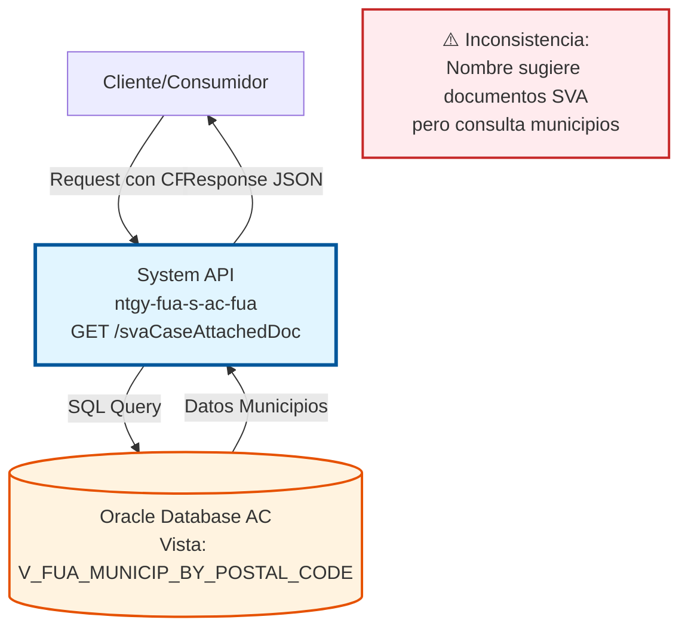
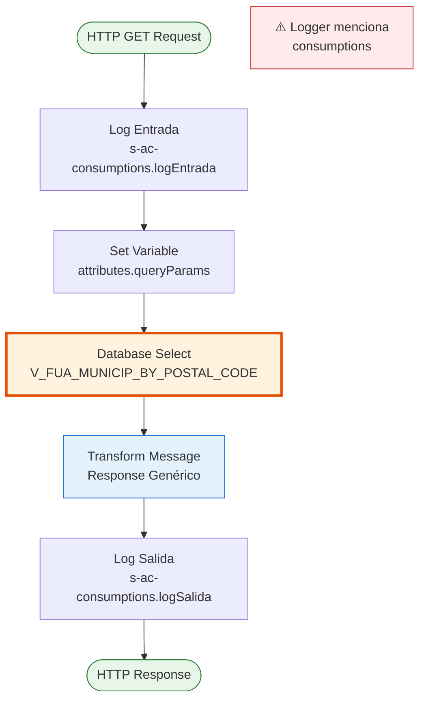
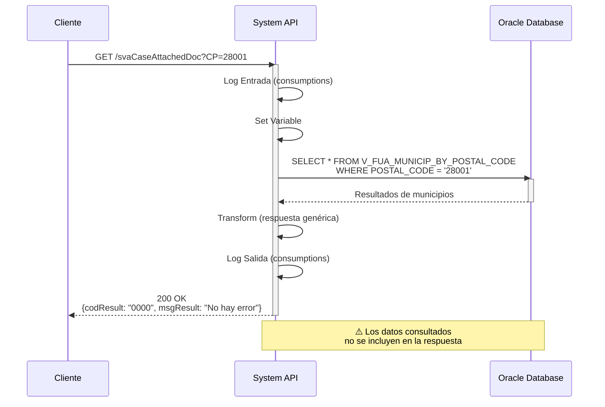

# GET /svaCaseAttachedDoc

## ⚠️ ADVERTENCIA CRÍTICA - INCONSISTENCIA DETECTADA

:::danger INCONSISTENCIA EN LA IMPLEMENTACIÓN

**Problema Identificado:**
- **Nombre del endpoint:** `svaCaseAttachedDoc` (sugiere: documentos adjuntos de casos SVA)
- **Funcionalidad real:** Consulta municipios por código postal
- **Vista consultada:** `V_FUA_MUNICIP_BY_POSTAL_CODE`
- **Logger:** Menciona "s-ac-consumptions" (posible código copiado)

**Evidencia:**
- Archivo: `s-ac-svaCaseAttachedDoc.xml`
- Query SQL: `SELECT * FROM V_FUA_MUNICIP_BY_POSTAL_CODE where POSTAL_CODE = :CP`
- Parámetro: `:CP` (código postal, no ID de caso o documento)

**Recomendación:**
Esta documentación refleja la **implementación actual** del código. Se recomienda verificar con el equipo de desarrollo si:
1. El endpoint debe renombrarse para reflejar su funcionalidad real
2. La implementación debe corregirse para consultar documentos SVA
3. Es un placeholder temporal que requiere implementación completa

:::

---

## 📌 Descripción General

### Propósito del Endpoint

**Funcionalidad Actual (según código):**
Este endpoint consulta información de municipios filtrados por código postal desde la base de datos Oracle AC. A pesar de su nombre que sugiere documentos adjuntos de casos SVA, la implementación real realiza una consulta geográfica.

El endpoint actualmente:
- **Consulta geográfica**: Obtiene datos de municipios por código postal
- **Vista Oracle**: Accede a `V_FUA_MUNICIP_BY_POSTAL_CODE`
- **Respuesta genérica**: Retorna estructura estándar de resultado

### Tipo de API

**Capa:** System API (API-Led Connectivity)

**Función:** Integración directa con Oracle Database AC para consulta de datos geográficos (municipios).

### Patrón de Integración

**Tipo:** Request-Reply Síncrono con Oracle Database

**Descripción:** El endpoint recibe un código postal como parámetro, ejecuta una consulta SQL sobre la vista de municipios, y retorna una respuesta genérica. No realiza transformaciones complejas de datos.

### Arquitectura API-Led Connectivity



---

## 💼 Propósito del Negocio

### Casos de Uso Actuales (según implementación)

1. **Consulta de Municipios por Código Postal**
   - Un sistema necesita obtener información de municipios
   - Proporciona un código postal como filtro
   - Recibe datos de municipios asociados a ese código postal
   - **Nota:** Este caso de uso no coincide con el nombre del endpoint

### Contexto Empresarial

- **Dominio:** Datos Geográficos / Maestros
- **Sector:** Energía - Utilities
- **División:** Naturgy España - Área Cliente
- **Proceso de Negocio:** Consulta de datos maestros geográficos
- **Sistema Backend:** Oracle Database AC

### Stakeholders

- **Sistemas de Integración**: Requieren datos de municipios para validaciones
- **Aplicaciones Frontend**: Necesitan información geográfica para formularios
- **Equipos de Desarrollo**: Requieren clarificación sobre la funcionalidad real

### Valor de Negocio Actual

- **Acceso a datos geográficos**: Proporciona información de municipios
- **Validación de códigos postales**: Permite verificar existencia de municipios
- **Datos maestros**: Acceso a información geográfica centralizada

### Consumidores Potenciales

Este endpoint puede ser consumido por:
- Process APIs que requieren datos geográficos
- Sistemas de validación de direcciones
- Aplicaciones que necesitan información de municipios
- **Nota:** No está claro si hay consumidores esperando documentos SVA

---

## 🔧 Especificación Técnica

### URLs por Ambiente

| Ambiente | URL Base | URL Completa |
|----------|----------|--------------|
| **Local** | `http://localhost:8081` | `http://localhost:8081/api/svaCaseAttachedDoc?CP={codigo_postal}` |
| **Development** | `https://ntgy-fua-s-ac-fua-dev.us-e2.cloudhub.io` | `https://ntgy-fua-s-ac-fua-dev.us-e2.cloudhub.io/api/svaCaseAttachedDoc?CP={codigo_postal}` |
| **Production** | `https://ntgy-fua-s-ac-fua-pro.us-e2.cloudhub.io` | `https://ntgy-fua-s-ac-fua-pro.us-e2.cloudhub.io/api/svaCaseAttachedDoc?CP={codigo_postal}` |

### Método HTTP

```
GET /api/svaCaseAttachedDoc
```

### Parámetros de Entrada

#### Headers HTTP

| Header | Tipo | Requerido | Descripción | Ejemplo |
|--------|------|-----------|-------------|---------|
| `Accept` | string | ❌ No | Tipo de contenido esperado en response | `application/json` |

#### Query Parameters

| Parámetro | Tipo | Requerido | Descripción | Ejemplo |
|-----------|------|-----------|-------------|---------|
| `CP` | string | ✅ Sí | Código postal para filtrar municipios | `"28001"` |

**Nota:** El parámetro se llama `CP` (código postal), no parámetros relacionados con casos o documentos SVA.

### Respuestas

#### Respuesta Exitosa (200 OK)

```json
{
  "result": {
    "codResult": "0000",
    "msgResult": "No hay error"
  }
}
```

**Nota:** La respuesta actual es genérica y no incluye datos de municipios. Esto sugiere que la implementación está incompleta.

#### Respuesta de Error Técnico (500)

```json
{
  "result": {
    "codResult": "0001",
    "msgResult": "Error interno del servidor"
  }
}
```

### Autenticación y Autorización

- **Tipo:** Client ID & Client Secret (Anypoint Platform)
- **Autorización Oracle:** El usuario de base de datos debe tener permisos para:
  - Acceso de lectura a la vista `V_FUA_MUNICIP_BY_POSTAL_CODE`
  - Schema: `OVPRO_DELTA`

### Timeouts

| Tipo | Valor | Descripción |
|------|-------|-------------|
| **Query Timeout** | `${dbAC.queryTimeout}` | Configurado en properties del proyecto |
| **Connection Timeout** | 3600 segundos | Timeout de conexión a Oracle |

---

## 🏗️ Implementación Técnica

### Arquitectura del Flow



### Componentes del Flow

#### 1. Logger de Entrada
```xml
<logger level="INFO" doc:name="Logger entrada" 
        message="s-ac-consumptions.logEntrada ## payload: #[payload]"/>
```
**Nota:** El mensaje menciona "consumptions", no "svaCaseAttachedDoc"

#### 2. Set Variable
```xml
<set-variable value="" doc:name="Set Variable" 
              variableName='attributes.queryParams["**"]'/>
```

#### 3. Database Select
```xml
<db:select doc:name="Select" 
           config-ref="Database_Config" 
           queryTimeout="${dbAC.queryTimeout}">
    <db:sql><![CDATA[
        SELECT * FROM V_FUA_MUNICIP_BY_POSTAL_CODE 
        WHERE POSTAL_CODE = :CP
    ]]></db:sql>
</db:select>
```

**Detalles de la Query:**
- **Vista:** `V_FUA_MUNICIP_BY_POSTAL_CODE`
- **Filtro:** `POSTAL_CODE = :CP`
- **Parámetro:** `:CP` (código postal del query parameter)
- **Operación:** SELECT (solo lectura)

#### 4. Transformación de Respuesta

```dataweave
%dw 2.0
output application/json
---
{
    result: {
        codResult: "0000",
        msgResult: "No hay error"
    }
}
```

**Observación:** La transformación ignora los datos obtenidos de la base de datos y retorna una respuesta genérica fija.

#### 5. Logger de Salida
```xml
<logger level="INFO" doc:name="Logger salida" 
        message="s-ac-consumptions.logSalida ## payload: #[payload]"/>
```

### Diagrama de Secuencia



### Configuración de Base de Datos

**Connection Config:** `Database_Config`

```yaml
dbAC:
  host1: "oc-pro-exa-04-clu-02-hdfdi-scan.prodb03.ocpro.oraclevcn.com"
  host2: "oc-pro-exa-03-clu-02-dfhl9-scan.prodb03.ocpro.oraclevcn.com"
  port: "1521"
  serviceName: "s_areapriv_online_pro.prodb03.ocpro.oraclevcn.com"
  user: "OVPRO_DELTA"
  queryTimeout: "15000"
  MaxPoolSize: "15"
```

### Vista de Base de Datos

**Vista:** `V_FUA_MUNICIP_BY_POSTAL_CODE`

**Propósito:** Vista consolidada que relaciona códigos postales con municipios.

**Campos Esperados (típicos en vistas de municipios):**
- Código postal
- Nombre del municipio
- Código de provincia
- Nombre de provincia
- Otros datos geográficos

**Nota:** La estructura exacta de la vista no está documentada en el código.

### Manejo de Errores

El endpoint utiliza el error handler global del proyecto:
- **Errores de BD:** Capturados y transformados a respuesta estándar
- **Timeouts:** Configurados a nivel de query (15 segundos)
- **Errores de conexión:** Retry automático según configuración del conector

---

## 💻 Ejemplos de Uso

### Ejemplo 1: Consulta Básica

#### Request

```bash
curl -X GET "http://localhost:8081/api/svaCaseAttachedDoc?CP=28001" \
  -H "Accept: application/json"
```

#### Response Exitoso (200 OK)

```json
{
  "result": {
    "codResult": "0000",
    "msgResult": "No hay error"
  }
}
```

### Ejemplo 2: Consulta en Producción

#### Request

```bash
curl -X GET "https://ntgy-fua-s-ac-fua-pro.us-e2.cloudhub.io/api/svaCaseAttachedDoc?CP=08001" \
  -H "Accept: application/json" \
  -H "client_id: YOUR_CLIENT_ID" \
  -H "client_secret: YOUR_CLIENT_SECRET"
```

#### Response Exitoso (200 OK)

```json
{
  "result": {
    "codResult": "0000",
    "msgResult": "No hay error"
  }
}
```

### Ejemplo 3: Error - Código Postal Inválido

#### Request

```bash
curl -X GET "http://localhost:8081/api/svaCaseAttachedDoc?CP=99999" \
  -H "Accept: application/json"
```

#### Response (200 OK - sin datos)

```json
{
  "result": {
    "codResult": "0000",
    "msgResult": "No hay error"
  }
}
```

**Nota:** Incluso si no hay datos, la respuesta es la misma.

### Ejemplo 4: Error Técnico

#### Response (500 Internal Server Error)

```json
{
  "result": {
    "codResult": "0001",
    "msgResult": "Error interno del servidor"
  }
}
```

### Ejemplo con JavaScript/Node.js

```javascript
const axios = require('axios');

async function consultarMunicipios(codigoPostal) {
  try {
    const response = await axios.get(
      'https://ntgy-fua-s-ac-fua-pro.us-e2.cloudhub.io/api/svaCaseAttachedDoc',
      {
        params: { CP: codigoPostal },
        headers: {
          'Accept': 'application/json',
          'client_id': process.env.CLIENT_ID,
          'client_secret': process.env.CLIENT_SECRET
        }
      }
    );
    
    console.log('Respuesta:', response.data);
    return response.data;
  } catch (error) {
    console.error('Error:', error.response?.data || error.message);
    throw error;
  }
}

// Uso
consultarMunicipios('28001')
  .then(data => console.log('Éxito:', data))
  .catch(err => console.error('Fallo:', err));
```

### Ejemplo con Python

```python
import requests
import os

def consultar_municipios(codigo_postal):
    url = "https://ntgy-fua-s-ac-fua-pro.us-e2.cloudhub.io/api/svaCaseAttachedDoc"
    
    headers = {
        "Accept": "application/json",
        "client_id": os.getenv("CLIENT_ID"),
        "client_secret": os.getenv("CLIENT_SECRET")
    }
    
    params = {"CP": codigo_postal}
    
    try:
        response = requests.get(url, headers=headers, params=params)
        response.raise_for_status()
        return response.json()
    except requests.exceptions.RequestException as e:
        print(f"Error: {e}")
        raise

# Uso
if __name__ == "__main__":
    resultado = consultar_municipios("28001")
    print(f"Respuesta: {resultado}")
```
