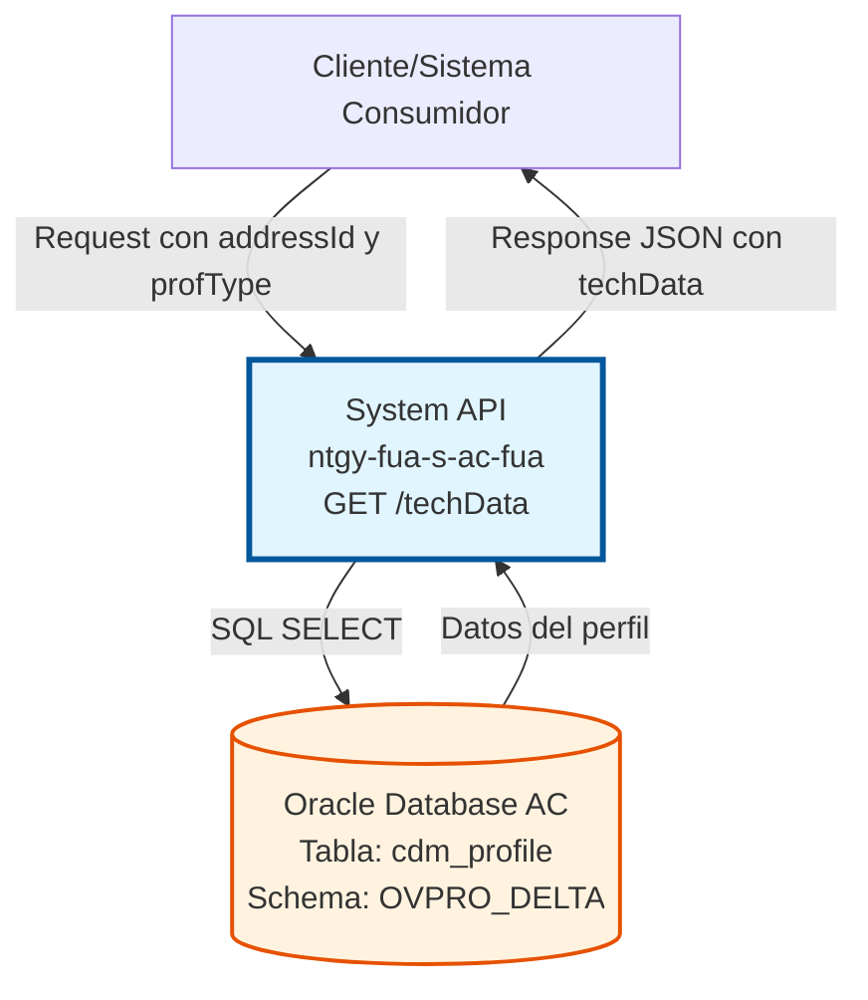
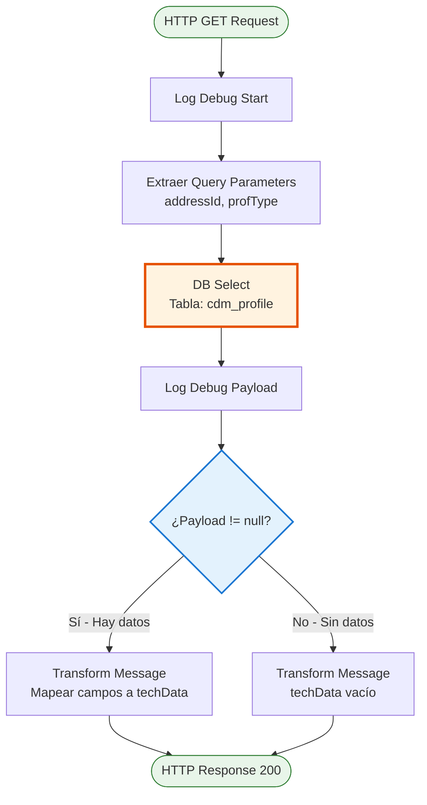
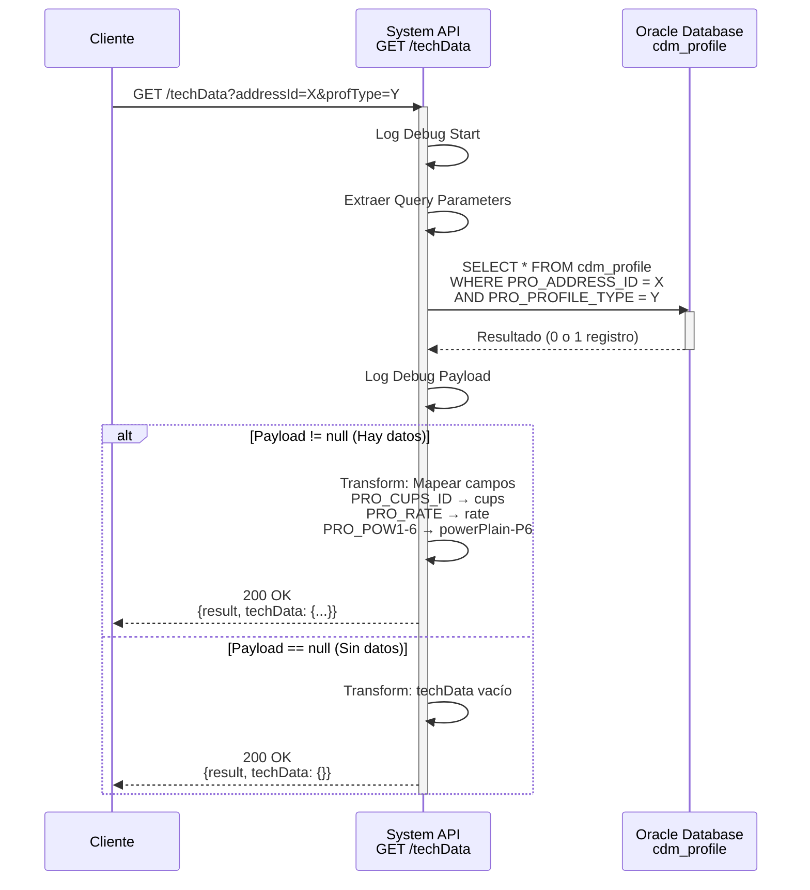

# GET /techData

## 📌 Descripción General

### Propósito del Endpoint

Este endpoint consulta los datos técnicos de un perfil de suministro eléctrico almacenados en la tabla `cdm_profile` del modelo de datos común (CDM) de Oracle AC. Retorna información crítica como el CUPS, tarifa contratada y potencias por periodo.

El endpoint soporta:
- **Consulta de perfiles técnicos**: Obtiene características técnicas de un punto de suministro
- **Información de potencias**: Retorna potencias contratadas en los 6 periodos (P1-P6)
- **Datos de tarificación**: Proporciona información de la tarifa asociada al perfil

### Tipo de API

**Capa:** System API (API-Led Connectivity)

**Función:** Integración directa con Oracle Database AC para consultar datos técnicos de perfiles de suministro eléctrico.

### Patrón de Integración

**Tipo:** Request-Reply Síncrono con SQL Query

**Descripción:** El endpoint recibe parámetros de consulta (ID de dirección y tipo de perfil), ejecuta una query SQL contra la tabla `cdm_profile`, transforma el resultado mediante DataWeave y retorna los datos técnicos del perfil.

### Arquitectura API-Led Connectivity



---

## 💼 Propósito del Negocio

### Casos de Uso Principales

1. **Consulta de Características Técnicas de Suministro**
   - Un proceso de alta de contrato necesita conocer las características técnicas del punto de suministro
   - Se consulta el perfil técnico asociado a una dirección específica
   - Se obtienen potencias contratadas, tarifa y CUPS

2. **Validación de Potencias Contratadas**
   - Durante una modificación de contrato, se necesita conocer las potencias actuales
   - Se consultan las 6 potencias por periodo (P1-P6)
   - Se valida si las nuevas potencias solicitadas son compatibles

3. **Obtención de Datos para Presupuestos**
   - El Frontal de Ventas necesita generar un presupuesto
   - Se consultan los datos técnicos del punto de suministro
   - Se utiliza la información de tarifa y potencias para calcular costes

### Contexto Empresarial

- **Dominio:** Gestión de Suministro Eléctrico
- **Sector:** Energía - Utilities
- **División:** Naturgy España - Área Cliente
- **Proceso de Negocio:** Alta y modificación de contratos de suministro eléctrico
- **Módulo:** Common Data Model (CDM) - Perfiles Técnicos

### Stakeholders

- **Frontal de Ventas (FUV)**: Necesita datos técnicos para procesos de venta
- **Agentes de Ventas**: Consultan características técnicas durante la venta
- **Sistemas de Gestión de Contratos**: Requieren información técnica para validaciones
- **Área de Operaciones**: Utilizan datos técnicos para gestión de suministros

### Valor de Negocio

- **Centralización de Datos Técnicos**: Punto único de acceso a información técnica de perfiles
- **Agilización de Procesos**: Consulta rápida de características técnicas sin acceso directo a BD
- **Soporte a Ventas**: Proporciona información necesaria para procesos comerciales
- **Validación de Contratos**: Facilita validaciones técnicas en procesos de alta/modificación

### Consumidores Potenciales

Este endpoint puede ser consumido por:
- Process APIs de gestión de contratos
- Frontal de Ventas (FUV)
- Sistemas de presupuestación
- APIs de validación de suministros
- Portales de autoservicio (para consultas técnicas)

---

## 🔧 Especificación Técnica

### URLs por Ambiente

| Ambiente | URL Base | URL Completa |
|----------|----------|--------------|
| **Local** | `http://localhost:8081` | `http://localhost:8081/api/techData` |
| **Development** | `https://ntgy-fua-s-ac-fua-dev.us-e2.cloudhub.io` | `https://ntgy-fua-s-ac-fua-dev.us-e2.cloudhub.io/api/techData` |
| **UAT** | `https://ntgy-fua-s-ac-fua-uat.us-e2.cloudhub.io` | `https://ntgy-fua-s-ac-fua-uat.us-e2.cloudhub.io/api/techData` |
| **Production** | `https://ntgy-fua-s-ac-fua-pro.us-e2.cloudhub.io` | `https://ntgy-fua-s-ac-fua-pro.us-e2.cloudhub.io/api/techData` |

### Método HTTP

```
GET /api/techData
```

### Parámetros de Entrada

#### Headers HTTP

| Header | Tipo | Requerido | Descripción | Ejemplo |
|--------|------|-----------|-------------|---------|
| `Accept` | string | ❌ No | Tipo de contenido esperado en response | `application/json` |

#### Query Parameters

| Parámetro | Tipo | Requerido | Descripción | Ejemplo |
|-----------|------|-----------|-------------|---------|
| `addressId` | string | ✅ Sí | Identificador de la dirección del punto de suministro | `"12345678"` |
| `profType` | string | ✅ Sí | Tipo de perfil técnico a consultar | `"RESIDENTIAL"` |

### Respuestas

#### Respuesta Exitosa con Datos (200 OK)

```json
{
  "result": {
    "codResult": "0000",
    "msgResult": "No hay error"
  },
  "techData": {
    "cups": "ES0031406305532001JN0F",
    "distribution": "",
    "rateId": "2.0TD",
    "rate": "2.0TD",
    "voltage": "",
    "selfConsumption": "",
    "installation": "",
    "changePower": "",
    "isValidCIE": "",
    "powerPlain": "3.45",
    "powerValley": "3.45",
    "powerP3": "3.45",
    "powerP4": "3.45",
    "powerP5": "3.45",
    "powerP6": "3.45",
    "recommendedPowerPlain": "",
    "recommendedPowerValley": "",
    "IPDate": "",
    "remoteManagement": null,
    "cnae": ""
  }
}
```

#### Respuesta Sin Datos (200 OK)

```json
{
  "result": {
    "codResult": "0000",
    "msgResult": "No hay error"
  },
  "techData": {}
}
```

#### Respuesta de Error Técnico (500)

```json
{
  "result": {
    "codResult": "0001",
    "msgResult": "Error interno del servidor"
  }
}
```

### Descripción de Campos de Respuesta

#### Objeto `techData`

| Campo | Tipo | Descripción |
|-------|------|-------------|
| `cups` | string | Código Universal del Punto de Suministro |
| `distribution` | string | Información de distribuidora (actualmente vacío) |
| `rateId` | string | Identificador de la tarifa contratada |
| `rate` | string | Código de la tarifa contratada |
| `voltage` | string | Nivel de tensión (actualmente vacío) |
| `selfConsumption` | string | Indicador de autoconsumo (actualmente vacío) |
| `installation` | string | Tipo de instalación (actualmente vacío) |
| `changePower` | string | Indicador de cambio de potencia (actualmente vacío) |
| `isValidCIE` | string | Validación CIE (actualmente vacío) |
| `powerPlain` | string | Potencia contratada periodo 1 (P1) en kW |
| `powerValley` | string | Potencia contratada periodo 2 (P2) en kW |
| `powerP3` | string | Potencia contratada periodo 3 (P3) en kW |
| `powerP4` | string | Potencia contratada periodo 4 (P4) en kW |
| `powerP5` | string | Potencia contratada periodo 5 (P5) en kW |
| `powerP6` | string | Potencia contratada periodo 6 (P6) en kW |
| `recommendedPowerPlain` | string | Potencia recomendada P1 (actualmente vacío) |
| `recommendedPowerValley` | string | Potencia recomendada P2 (actualmente vacío) |
| `IPDate` | string | Fecha de instalación/puesta en marcha (actualmente vacío) |
| `remoteManagement` | null | Gestión remota (actualmente null) |
| `cnae` | string | Código CNAE de actividad (actualmente vacío) |

### Autenticación y Autorización

- **Tipo:** Client ID & Client Secret (Anypoint Platform)
- **Autorización Oracle:** El usuario de base de datos debe tener permisos para:
  - Ejecutar SELECT en tabla `cdm_profile`
  - Acceso al schema `OVPRO_DELTA`

### Timeouts

| Tipo | Valor | Descripción |
|------|-------|-------------|
| **Query Timeout** | 15 segundos | Tiempo máximo de ejecución de la query SQL |
| **Connection Timeout** | 3600 segundos | Tiempo máximo para establecer conexión con BD |

---

## 🏗️ Implementación Técnica

### Arquitectura del Flow



### Componentes del Flow

#### 1. Logger Inicial
```xml
<logger level="DEBUG" doc:name="Logger" />
```
- Registra el inicio de la ejecución del flow

#### 2. Database Select
```xml
<db:select doc:name="Datos técnicos producto" 
           config-ref="Database_Config" 
           queryTimeout="${dbAC.queryTimeout}">
    <db:sql>
        SELECT *
        FROM cdm_profile pro
        WHERE pro.PRO_ADDRESS_ID = :addressId 
          AND pro.PRO_PROFILE_TYPE = :profType
    </db:sql>
    <db:input-parameters>
        {
            "addressId": attributes.queryParams.'addressId',
            "profType": attributes.queryParams.'profType'
        }
    </db:input-parameters>
</db:select>
```

**Query SQL:**
```sql
SELECT *
FROM cdm_profile pro
WHERE pro.PRO_ADDRESS_ID = :addressId 
  AND pro.PRO_PROFILE_TYPE = :profType
```

**Tabla:** `cdm_profile` (Common Data Model - Perfiles)  
**Schema:** `OVPRO_DELTA`  
**Operación:** SELECT (READ)

**Campos Consultados:**
- `PRO_ADDRESS_ID`: ID de dirección (filtro)
- `PRO_PROFILE_TYPE`: Tipo de perfil (filtro)
- `PRO_CUPS_ID`: CUPS del punto de suministro
- `PRO_RATE`: Tarifa contratada
- `PRO_POW1` a `PRO_POW6`: Potencias por periodo

#### 3. Logger de Payload
```xml
<logger level="DEBUG" doc:name="techData" message="#[payload]" />
```
- Registra el resultado de la query para debugging

#### 4. Choice - Validación de Datos

**Condición:** `payload != null`

##### Rama TRUE - Con Datos

**DataWeave Transformation:**
```dataweave
%dw 2.0
output application/json
---
{
    result: {
        codResult: "0000",
        msgResult: "No hay error"
    },
    techData: {
        "cups": payload[0].PRO_CUPS_ID,
        "distribution": "",
        "rateId": payload[0].PRO_RATE,
        "rate": payload[0].PRO_RATE,
        "voltage": "",
        "selfConsumption": "",
        "installation": "",
        "changePower": "",
        "isValidCIE": "",
        "powerPlain": payload[0].PRO_POW1,
        "powerValley": payload[0].PRO_POW2,
        "powerP3": payload[0].PRO_POW3,
        "powerP4": payload[0].PRO_POW4,
        "powerP5": payload[0].PRO_POW5,
        "powerP6": payload[0].PRO_POW6,
        "recommendedPowerPlain": "",
        "recommendedPowerValley": "",
        "IPDate": "",
        "remoteManagement": null,
        "cnae": ""
    }
}
```

**Mapeo de Campos:**
- `PRO_CUPS_ID` → `cups`
- `PRO_RATE` → `rateId` y `rate`
- `PRO_POW1` → `powerPlain`
- `PRO_POW2` → `powerValley`
- `PRO_POW3` → `powerP3`
- `PRO_POW4` → `powerP4`
- `PRO_POW5` → `powerP5`
- `PRO_POW6` → `powerP6`

**Nota:** Varios campos se retornan vacíos (`""`) o `null`, posiblemente para mantener compatibilidad con versiones anteriores o para campos que se poblarán en el futuro.

##### Rama FALSE - Sin Datos

**DataWeave Transformation:**
```dataweave
%dw 2.0
output application/json
---
{
    result: {
        codResult: "0000",
        msgResult: "No hay error"
    },
    techData: {}
}
```

Retorna un objeto `techData` vacío cuando no se encuentran datos para los parámetros proporcionados.

### Diagrama de Secuencia



### Configuración de Base de Datos

**Connection Config:** `Database_Config`

**Propiedades (desde `ntgy-fua-s-ac-fua-pro-config.yaml`):**
```yaml
dbAC:
  user: "OVPRO_DELTA"
  pass: "![encrypted]"
  host1: "oc-pro-exa-04-clu-02-hdfdi-scan.prodb03.ocpro.oraclevcn.com"
  host2: "oc-pro-exa-03-clu-02-dfhl9-scan.prodb03.ocpro.oraclevcn.com"
  port: "1521"
  serviceName: "s_areapriv_online_pro.prodb03.ocpro.oraclevcn.com"
  MaxPoolSize: "15"
  MaxWaitTime: "300000"
  MaxIdleTime: "300000"
  queryTimeout: "15000"
```

**Connection Pooling:**
- Max Pool Size: 15 conexiones
- Max Wait Time: 300 segundos
- Max Idle Time: 300 segundos
- Query Timeout: 15 segundos

### Manejo de Errores

El endpoint utiliza el error handler global `s-ac-globalErrorHandler.xml` que maneja:

- **DB:CONNECTIVITY**: Errores de conexión a base de datos
- **DB:QUERY_EXECUTION**: Errores en ejecución de query
- **TIMEOUT**: Timeouts de query o conexión
- **ANY**: Cualquier otro error no categorizado

Todos los errores se transforman a formato estándar:
```json
{
  "result": {
    "codResult": "0001",
    "msgResult": "Descripción del error"
  }
}
```

---

## 💻 Ejemplos de Uso

### Ejemplo 1: Consulta Exitosa con Datos

#### Request

```bash
curl -X GET "https://ntgy-fua-s-ac-fua-pro.us-e2.cloudhub.io/api/techData?addressId=12345678&profType=RESIDENTIAL" \
  -H "Accept: application/json" \
  -H "client_id: YOUR_CLIENT_ID" \
  -H "client_secret: YOUR_CLIENT_SECRET"
```

#### Response (200 OK)

```json
{
  "result": {
    "codResult": "0000",
    "msgResult": "No hay error"
  },
  "techData": {
    "cups": "ES0031406305532001JN0F",
    "distribution": "",
    "rateId": "2.0TD",
    "rate": "2.0TD",
    "voltage": "",
    "selfConsumption": "",
    "installation": "",
    "changePower": "",
    "isValidCIE": "",
    "powerPlain": "3.45",
    "powerValley": "3.45",
    "powerP3": "3.45",
    "powerP4": "3.45",
    "powerP5": "3.45",
    "powerP6": "3.45",
    "recommendedPowerPlain": "",
    "recommendedPowerValley": "",
    "IPDate": "",
    "remoteManagement": null,
    "cnae": ""
  }
}
```

### Ejemplo 2: Consulta Sin Datos

#### Request

```bash
curl -X GET "https://ntgy-fua-s-ac-fua-pro.us-e2.cloudhub.io/api/techData?addressId=99999999&profType=UNKNOWN" \
  -H "Accept: application/json" \
  -H "client_id: YOUR_CLIENT_ID" \
  -H "client_secret: YOUR_CLIENT_SECRET"
```

#### Response (200 OK)

```json
{
  "result": {
    "codResult": "0000",
    "msgResult": "No hay error"
  },
  "techData": {}
}
```

### Ejemplo 3: Error de Parámetros Faltantes

#### Request

```bash
curl -X GET "https://ntgy-fua-s-ac-fua-pro.us-e2.cloudhub.io/api/techData?addressId=12345678" \
  -H "Accept: application/json" \
  -H "client_id: YOUR_CLIENT_ID" \
  -H "client_secret: YOUR_CLIENT_SECRET"
```

#### Response (400 Bad Request)

```json
{
  "message": "Bad request"
}
```

### Ejemplo 4: Error de Base de Datos

#### Request

```bash
curl -X GET "https://ntgy-fua-s-ac-fua-pro.us-e2.cloudhub.io/api/techData?addressId=12345678&profType=RESIDENTIAL" \
  -H "Accept: application/json" \
  -H "client_id: YOUR_CLIENT_ID" \
  -H "client_secret: YOUR_CLIENT_SECRET"
```

#### Response (500 Internal Server Error)

```json
{
  "result": {
    "codResult": "0001",
    "msgResult": "Error al consultar base de datos: Connection timeout"
  }
}
```

### Ejemplo 5: Uso desde JavaScript

```javascript
const axios = require('axios');

async function getTechData(addressId, profType) {
  try {
    const response = await axios.get('https://ntgy-fua-s-ac-fua-pro.us-e2.cloudhub.io/api/techData', {
      params: {
        addressId: addressId,
        profType: profType
      },
      headers: {
        'Accept': 'application/json',
        'client_id': process.env.CLIENT_ID,
        'client_secret': process.env.CLIENT_SECRET
      }
    });
    
    if (response.data.result.codResult === '0000') {
      console.log('Datos técnicos obtenidos:', response.data.techData);
      return response.data.techData;
    } else {
      console.error('Error en respuesta:', response.data.result.msgResult);
      return null;
    }
  } catch (error) {
    console.error('Error en petición:', error.message);
    throw error;
  }
}

// Uso
getTechData('12345678', 'RESIDENTIAL')
  .then(techData => {
    if (techData && techData.cups) {
      console.log(`CUPS: ${techData.cups}`);
      console.log(`Tarifa: ${techData.rate}`);
      console.log(`Potencia P1: ${techData.powerPlain} kW`);
    }
  });
```

### Ejemplo 6: Uso desde Python

```python
import requests
import os

def get_tech_data(address_id, prof_type):
    url = "https://ntgy-fua-s-ac-fua-pro.us-e2.cloudhub.io/api/techData"
    
    params = {
        "addressId": address_id,
        "profType": prof_type
    }
    
    headers = {
        "Accept": "application/json",
        "client_id": os.getenv("CLIENT_ID"),
        "client_secret": os.getenv("CLIENT_SECRET")
    }
    
    try:
        response = requests.get(url, params=params, headers=headers)
        response.raise_for_status()
        
        data = response.json()
        
        if data["result"]["codResult"] == "0000":
            print("Datos técnicos obtenidos:", data["techData"])
            return data["techData"]
        else:
            print("Error en respuesta:", data["result"]["msgResult"])
            return None
            
    except requests.exceptions.RequestException as e:
        print(f"Error en petición: {e}")
        raise

# Uso
tech_data = get_tech_data("12345678", "RESIDENTIAL")
if tech_data and tech_data.get("cups"):
    print(f"CUPS: {tech_data['cups']}")
    print(f"Tarifa: {tech_data['rate']}")
    print(f"Potencia P1: {tech_data['powerPlain']} kW")