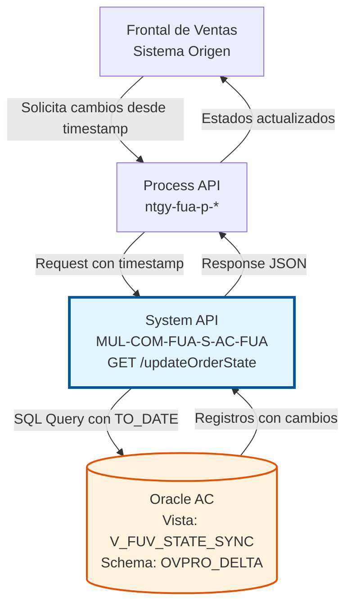
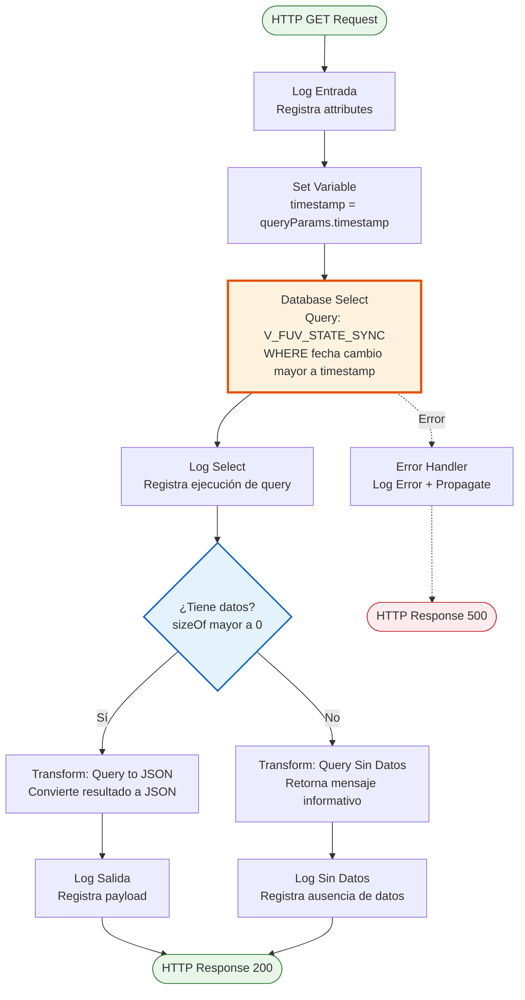
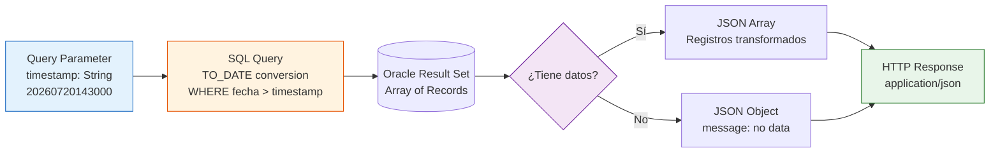

# GET /updateOrderState

## 📌 Descripción General

### Propósito del Endpoint

Este endpoint proporciona sincronización incremental (delta) de estados de pedidos del Frontal de Ventas (FUV) desde la base de datos Oracle AC. Permite consultar todos los cambios de estado que han ocurrido después de un timestamp específico, facilitando la sincronización eficiente entre sistemas.

El endpoint soporta:
- **Sincronización Delta**: Consulta solo los cambios posteriores a una fecha/hora específica
- **Formato Flexible**: Acepta timestamp en formato `YYYYMMDDHH24MISS`
- **Respuesta Condicional**: Retorna datos estructurados o mensaje informativo si no hay cambios
- **Optimización de Recursos**: Evita transferir datos innecesarios al consultar solo cambios recientes

### Tipo de API

**Capa:** System API (API-Led Connectivity)

**Función:** Integración directa con Oracle Database AC para consulta incremental de estados de pedidos.

### Patrón de Integración

**Tipo:** Request-Reply Síncrono con SQL Query

**Descripción:** Recibe un timestamp como parámetro de consulta, ejecuta una query SQL parametrizada contra la vista `V_FUV_STATE_SYNC`, transforma el resultado a JSON y retorna los registros que han cambiado después del timestamp proporcionado.

### Arquitectura API-Led Connectivity



---

## 💼 Propósito del Negocio

### Casos de Uso Principales

1. **Sincronización Periódica de Estados**
   - El Frontal de Ventas consulta cambios cada X minutos
   - Obtiene solo los pedidos que han cambiado de estado
   - Actualiza su base de datos local con los nuevos estados
   - **Beneficio:** Reducción del 90% en volumen de datos transferidos vs sincronización completa

2. **Recuperación Después de Desconexión**
   - Sistema se desconecta temporalmente
   - Al reconectar, solicita cambios desde último timestamp conocido
   - Recupera todos los cambios perdidos durante la desconexión
   - **Beneficio:** Garantiza consistencia de datos sin pérdida de información

3. **Monitoreo de Cambios en Tiempo Casi Real**
   - Dashboard de supervisión consulta cambios cada minuto
   - Visualiza pedidos que cambian de estado en tiempo casi real
   - Permite intervención rápida en caso de problemas
   - **Beneficio:** Visibilidad inmediata del estado de pedidos

### Contexto Empresarial

- **Dominio:** Gestión de Pedidos y Control de Estados
- **Sector:** Energía - Utilities
- **División:** Naturgy España - Frontal de Ventas
- **Proceso de Negocio:** Sincronización de estados de pedidos entre FUV y AC
- **Sistema Backend:** Oracle Database AC (Área Cliente)

### Stakeholders

- **Agentes de Ventas**: Necesitan visibilidad del estado actual de sus pedidos
- **Supervisores de Ventas**: Monitorean el progreso de pedidos del equipo
- **Equipo de Operaciones**: Supervisan la sincronización entre sistemas
- **Equipo de Soporte**: Diagnostican problemas de sincronización

### Valor de Negocio

- **Eficiencia Operativa**: Sincronización incremental reduce carga en red y base de datos
- **Consistencia de Datos**: Garantiza que FUV tenga estados actualizados de AC
- **Trazabilidad**: Permite auditar cuándo y cómo cambian los estados
- **Escalabilidad**: Soporta alto volumen de pedidos sin degradación de performance

### Consumidores Potenciales

Este endpoint puede ser consumido por:
- Process APIs de gestión de pedidos
- Frontal de Ventas (FUV) directamente
- Sistemas de monitoreo y supervisión
- Herramientas de reporting y analytics
- Procesos batch de sincronización nocturna

---

## 🔧 Especificación Técnica

### URLs por Ambiente

| Ambiente | URL Base | URL Completa |
|----------|----------|--------------|
| **Local** | `http://localhost:8081` | `http://localhost:8081/api/updateOrderState?timestamp=YYYYMMDDHH24MISS` |
| **Development** | `https://mul-com-fua-s-ac-fua-dev.us-e2.cloudhub.io` | `https://mul-com-fua-s-ac-fua-dev.us-e2.cloudhub.io/api/updateOrderState?timestamp=YYYYMMDDHH24MISS` |
| **UAT** | `https://mul-com-fua-s-ac-fua-uat.us-e2.cloudhub.io` | `https://mul-com-fua-s-ac-fua-uat.us-e2.cloudhub.io/api/updateOrderState?timestamp=YYYYMMDDHH24MISS` |
| **Production** | `https://mul-com-fua-s-ac-fua-pro.us-e2.cloudhub.io` | `https://mul-com-fua-s-ac-fua-pro.us-e2.cloudhub.io/api/updateOrderState?timestamp=YYYYMMDDHH24MISS` |

### Método HTTP

```
GET /api/updateOrderState
```

### Parámetros de Entrada

#### Headers HTTP

| Header | Tipo | Requerido | Descripción | Ejemplo |
|--------|------|-----------|-------------|---------|
| `Accept` | string | ❌ No | Tipo de contenido esperado en response | `application/json` |

#### Query Parameters

| Parámetro | Tipo | Requerido | Descripción | Formato | Ejemplo |
|-----------|------|-----------|-------------|---------|---------|
| `timestamp` | string | ✅ Sí | Fecha y hora desde la cual consultar cambios | `YYYYMMDDHH24MISS` | `20260720143000` |

**Detalles del Parámetro `timestamp`:**
- **Formato:** `YYYYMMDDHH24MISS` (14 caracteres)
  - `YYYY`: Año (4 dígitos)
  - `MM`: Mes (2 dígitos, 01-12)
  - `DD`: Día (2 dígitos, 01-31)
  - `HH24`: Hora en formato 24h (2 dígitos, 00-23)
  - `MI`: Minutos (2 dígitos, 00-59)
  - `SS`: Segundos (2 dígitos, 00-59)
- **Ejemplo válido:** `20260720143000` = 20 de julio de 2026, 14:30:00
- **Validación:** La query SQL usa `TO_DATE(:param,'YYYYMMDDHH24MISS')` para convertir el string

### Respuestas

#### Respuesta Exitosa con Datos (200 OK)

Cuando existen registros con cambios posteriores al timestamp:

```json
[
  {
    "X_GN_FECHA_CAMBIO_ESTADO": "2026-07-20T14:35:00",
    "ORDER_ID": "ORD-2026-001234",
    "ESTADO_ANTERIOR": "PENDIENTE",
    "ESTADO_NUEVO": "EN_PROCESO",
    "USUARIO_CAMBIO": "SYSTEM_AC",
    "OBSERVACIONES": "Pedido asignado a procesamiento"
  },
  {
    "X_GN_FECHA_CAMBIO_ESTADO": "2026-07-20T14:40:00",
    "ORDER_ID": "ORD-2026-001235",
    "ESTADO_ANTERIOR": "EN_PROCESO",
    "ESTADO_NUEVO": "COMPLETADO",
    "USUARIO_CAMBIO": "SYSTEM_AC",
    "OBSERVACIONES": "Pedido completado exitosamente"
  }
]
```

**Nota:** La estructura exacta de los campos depende de la definición de la vista `V_FUV_STATE_SYNC`. Los campos mostrados son ilustrativos.

#### Respuesta Sin Datos (200 OK)

Cuando no existen cambios posteriores al timestamp:

```json
{
  "message": "Query no retorna datos"
}
```

#### Respuesta de Error Técnico (500)

```json
{
  "result": {
    "codResult": "0001",
    "msgResult": "Error al consultar estados de pedidos"
  }
}
```

### Autenticación y Autorización

- **Tipo:** Client ID & Client Secret (Anypoint Platform)
- **Autorización Oracle:** El usuario de base de datos debe tener permisos para:
  - Acceso de lectura a la vista `V_FUV_STATE_SYNC`
  - Acceso al schema `OVPRO_DELTA`

### Timeouts

| Tipo | Valor | Descripción |
|------|-------|-------------|
| **Query Timeout** | 15 segundos | Tiempo máximo de ejecución de la query SQL |
| **Connection Timeout** | 3600 segundos | Tiempo máximo para mantener conexión a BD |

---

## 🏗️ Implementación Técnica

### Arquitectura del Flow



### Componentes del Flow

#### 1. Logger Entrada
```xml
<logger level="INFO" doc:name="Logger Entrada" 
        message="s-ac-updateOrderState.logEntrada ## attributes: #[attributes]" />
```
- **Propósito:** Registrar inicio de ejecución con atributos del request
- **Nivel:** INFO
- **Contenido:** Attributes completos del HTTP request

#### 2. Set Variable - Timestamp
```xml
<set-variable value="#[attributes.queryParams.timestamp]" 
              doc:name="Set Variable" 
              variableName="timestamp"/>
```
- **Propósito:** Extraer y almacenar el parámetro timestamp
- **Variable:** `vars.timestamp`
- **Origen:** Query parameter del HTTP request

#### 3. Database Select
```xml
<db:select doc:name="Select" 
           config-ref="Database_Config" 
           queryTimeout="${dbAC.queryTimeout}">
    <reconnect-forever />
    <db:sql><![CDATA[${queries.updateStateVista}]]></db:sql>
    <db:input-parameters><![CDATA[#[{'param': vars.timestamp as String}]]]></db:input-parameters>
</db:select>
```

**Query SQL:**
```sql
SELECT * FROM V_FUV_STATE_SYNC 
WHERE X_GN_FECHA_CAMBIO_ESTADO > TO_DATE(:param,'YYYYMMDDHH24MISS')
```

**Detalles:**
- **Config:** `Database_Config` (Oracle connection pool)
- **Timeout:** 15 segundos (configurable)
- **Retry:** `reconnect-forever` para resiliencia
- **Parámetro:** `:param` = timestamp en formato string
- **Conversión:** `TO_DATE` convierte string a fecha Oracle

#### 4. Logger Select
```xml
<logger level="INFO" doc:name="Logger Select" 
        message="s-ac-updateOrderState.logSelect" />
```
- **Propósito:** Confirmar ejecución exitosa de la query
- **Nivel:** INFO

#### 5. Choice - Validación de Datos
```xml
<choice doc:name="Choice">
    <when expression="#[sizeOf(payload)>0]">
        <!-- Transformación a JSON -->
    </when>
    <otherwise>
        <!-- Mensaje sin datos -->
    </otherwise>
</choice>
```
- **Condición:** `sizeOf(payload) > 0`
- **True:** Transforma resultado a JSON
- **False:** Retorna mensaje informativo

#### 6. Transform - Query to JSON (When)
```dataweave
%dw 2.0
output application/json
---
payload
```
- **Propósito:** Convertir resultado de query a JSON
- **Output:** Array de objetos JSON con los registros

#### 7. Transform - Query Sin Datos (Otherwise)
```dataweave
%dw 2.0
output application/json
---
{
    message: "Query no retorna datos"
}
```
- **Propósito:** Informar que no hay cambios desde el timestamp
- **Output:** Objeto JSON con mensaje

#### 8. Logger Salida
```xml
<logger level="INFO" doc:name="Logger Salida" 
        message="s-ac-updateOrderState.logSalida ## payload: #[payload]" />
```
- **Propósito:** Registrar respuesta final
- **Nivel:** INFO
- **Contenido:** Payload completo de la respuesta

#### 9. Error Handler
```xml
<error-handler>
    <on-error-propagate enableNotifications="true" 
                        logException="true" 
                        doc:name="On Error Propagate" 
                        type="ANY">
        <logger level="ERROR" doc:name="Logger Error" 
                message="s-ac-updateOrderState.logError"/>
    </on-error-propagate>
</error-handler>
```
- **Tipo:** `on-error-propagate` (propaga error al caller)
- **Logging:** Registra error con nivel ERROR
- **Notificaciones:** Habilitadas para alertas

### Configuración de Base de Datos

#### Connection Pool
```yaml
dbAC:
  host1: "oc-pro-exa-04-clu-02-hdfdi-scan.prodb03.ocpro.oraclevcn.com"
  host2: "oc-pro-exa-03-clu-02-dfhl9-scan.prodb03.ocpro.oraclevcn.com"
  port: "1521"
  serviceName: "s_areapriv_online_pro.prodb03.ocpro.oraclevcn.com"
  user: "OVPRO_DELTA"
  MaxPoolSize: "15"
  MaxWaitTime: "300"
  MaxIdleTime: "300"
  queryTimeout: "15"
```

**Características:**
- **High Availability:** Dual host configuration
- **Pool Size:** Máximo 15 conexiones simultáneas
- **Wait Time:** 300 segundos para obtener conexión
- **Idle Time:** 300 segundos antes de cerrar conexión inactiva
- **Query Timeout:** 15 segundos máximo por query

### Vista de Base de Datos

#### V_FUV_STATE_SYNC

**Propósito:** Vista consolidada que expone cambios de estado de pedidos FUV

**Características:**
- **Schema:** OVPRO_DELTA
- **Tipo:** Vista (VIEW)
- **Índice:** Probablemente indexada por `X_GN_FECHA_CAMBIO_ESTADO` para performance
- **Actualización:** Refleja cambios en tiempo real de tablas subyacentes

**Campos Esperados** (estructura ilustrativa):
- `X_GN_FECHA_CAMBIO_ESTADO`: Timestamp del cambio de estado
- `ORDER_ID`: Identificador del pedido
- `ESTADO_ANTERIOR`: Estado previo del pedido
- `ESTADO_NUEVO`: Nuevo estado del pedido
- `USUARIO_CAMBIO`: Usuario que realizó el cambio
- `OBSERVACIONES`: Comentarios adicionales

### Diagrama de Transformación de Datos



### Manejo de Errores

#### Errores Posibles

1. **Database Connection Error**
   - **Causa:** No se puede conectar a Oracle
   - **Código:** DB:CONNECTIVITY
   - **Acción:** Retry automático (reconnect-forever)
   - **Response:** 500 Internal Server Error

2. **Query Timeout**
   - **Causa:** Query excede 15 segundos
   - **Código:** DB:QUERY_TIMEOUT
   - **Acción:** Cancelar query y retornar error
   - **Response:** 500 Internal Server Error

3. **Invalid Timestamp Format**
   - **Causa:** Timestamp no cumple formato YYYYMMDDHH24MISS
   - **Código:** DB:BAD_SQL_SYNTAX
   - **Acción:** TO_DATE falla, error propagado
   - **Response:** 500 Internal Server Error

4. **Missing Timestamp Parameter**
   - **Causa:** No se proporciona query parameter timestamp
   - **Código:** MULE:EXPRESSION
   - **Acción:** Error al evaluar `attributes.queryParams.timestamp`
   - **Response:** 500 Internal Server Error

#### Estrategia de Retry

- **Reconnect Forever:** Habilitado para conexiones de base de datos
- **Intentos:** Ilimitados con backoff exponencial
- **Intervalo Inicial:** 1 segundo
- **Multiplicador:** 2x por cada intento

---

## 💻 Ejemplos de Uso

### Ejemplo 1: Consulta de Cambios Recientes

#### Request
```bash
curl -X GET "https://mul-com-fua-s-ac-fua-pro.us-e2.cloudhub.io/api/updateOrderState?timestamp=20260720143000" \
  -H "Accept: application/json" \
  -H "client_id: YOUR_CLIENT_ID" \
  -H "client_secret: YOUR_CLIENT_SECRET"
```

#### Response (200 OK - Con Datos)
```json
[
  {
    "X_GN_FECHA_CAMBIO_ESTADO": "2026-07-20T14:35:00",
    "ORDER_ID": "ORD-2026-001234",
    "ESTADO_ANTERIOR": "PENDIENTE",
    "ESTADO_NUEVO": "EN_PROCESO",
    "USUARIO_CAMBIO": "SYSTEM_AC",
    "OBSERVACIONES": "Pedido asignado a procesamiento"
  },
  {
    "X_GN_FECHA_CAMBIO_ESTADO": "2026-07-20T14:40:00",
    "ORDER_ID": "ORD-2026-001235",
    "ESTADO_ANTERIOR": "EN_PROCESO",
    "ESTADO_NUEVO": "COMPLETADO",
    "USUARIO_CAMBIO": "SYSTEM_AC",
    "OBSERVACIONES": "Pedido completado exitosamente"
  },
  {
    "X_GN_FECHA_CAMBIO_ESTADO": "2026-07-20T14:45:00",
    "ORDER_ID": "ORD-2026-001236",
    "ESTADO_ANTERIOR": "PENDIENTE",
    "ESTADO_NUEVO": "CANCELADO",
    "USUARIO_CAMBIO": "AGENT_001",
    "OBSERVACIONES": "Cancelado por solicitud del cliente"
  }
]
```

### Ejemplo 2: Consulta Sin Cambios

#### Request
```bash
curl -X GET "https://mul-com-fua-s-ac-fua-pro.us-e2.cloudhub.io/api/updateOrderState?timestamp=20260720160000" \
  -H "Accept: application/json" \
  -H "client_id: YOUR_CLIENT_ID" \
  -H "client_secret: YOUR_CLIENT_SECRET"
```

#### Response (200 OK - Sin Datos)
```json
{
  "message": "Query no retorna datos"
}
```

### Ejemplo 3: Sincronización Periódica (JavaScript)

```javascript
// Función para sincronizar estados cada 5 minutos
async function syncOrderStates() {
  // Obtener último timestamp de sincronización
  const lastSync = localStorage.getItem('lastSyncTimestamp') || 
                   formatTimestamp(new Date(Date.now() - 24*60*60*1000)); // 24h atrás por defecto
  
  try {
    const response = await fetch(
      `https://mul-com-fua-s-ac-fua-pro.us-e2.cloudhub.io/api/updateOrderState?timestamp=${lastSync}`,
      {
        method: 'GET',
        headers: {
          'Accept': 'application/json',
          'client_id': 'YOUR_CLIENT_ID',
          'client_secret': 'YOUR_CLIENT_SECRET'
        }
      }
    );
    
    const data = await response.json();
    
    // Verificar si hay datos
    if (Array.isArray(data) && data.length > 0) {
      console.log(`Sincronizados ${data.length} cambios de estado`);
      
      // Procesar cada cambio
      data.forEach(change => {
        updateLocalOrderState(change.ORDER_ID, change.ESTADO_NUEVO);
      });
      
      // Actualizar timestamp de última sincronización
      const latestChange = data[data.length - 1];
      const newTimestamp = formatTimestamp(new Date(latestChange.X_GN_FECHA_CAMBIO_ESTADO));
      localStorage.setItem('lastSyncTimestamp', newTimestamp);
      
    } else if (data.message) {
      console.log('No hay cambios desde última sincronización');
    }
    
  } catch (error) {
    console.error('Error en sincronización:', error);
  }
}

// Formatear fecha a YYYYMMDDHH24MISS
function formatTimestamp(date) {
  const year = date.getFullYear();
  const month = String(date.getMonth() + 1).padStart(2, '0');
  const day = String(date.getDate()).padStart(2, '0');
  const hours = String(date.getHours()).padStart(2, '0');
  const minutes = String(date.getMinutes()).padStart(2, '0');
  const seconds = String(date.getSeconds()).padStart(2, '0');
  
  return `${year}${month}${day}${hours}${minutes}${seconds}`;
}

// Ejecutar sincronización cada 5 minutos
setInterval(syncOrderStates, 5 * 60 * 1000);

// Ejecutar inmediatamente al cargar
syncOrderStates();
```

### Ejemplo 4: Recuperación Después de Desconexión (Python)

```python
import requests
from datetime import datetime, timedelta
import time

class OrderStateSynchronizer:
    def __init__(self, base_url, client_id, client_secret):
        self.base_url = base_url
        self.headers = {
            'Accept': 'application/json',
            'client_id': client_id,
            'client_secret': client_secret
        }
        self.last_sync = None
    
    def format_timestamp(self, dt):
        """Formatear datetime a YYYYMMDDHH24MISS"""
        return dt.strftime('%Y%m%d%H%M%S')
    
    def sync_states(self):
        """Sincronizar estados desde último timestamp conocido"""
        # Si no hay último sync, usar 1 hora atrás
        if not self.last_sync:
            self.last_sync = datetime.now() - timedelta(hours=1)
        
        timestamp = self.format_timestamp(self.last_sync)
        url = f"{self.base_url}/api/updateOrderState?timestamp={timestamp}"
        
        try:
            response = requests.get(url, headers=self.headers, timeout=30)
            response.raise_for_status()
            
            data = response.json()
            
            if isinstance(data, list) and len(data) > 0:
                print(f"Sincronizados {len(data)} cambios de estado")
                
                # Procesar cambios
                for change in data:
                    self.process_state_change(change)
                
                # Actualizar último timestamp
                latest_change = data[-1]
                self.last_sync = datetime.strptime(
                    latest_change['X_GN_FECHA_CAMBIO_ESTADO'],
                    '%Y-%m-%dT%H:%M:%S'
                )
                
                return len(data)
            
            elif isinstance(data, dict) and 'message' in data:
                print("No hay cambios desde última sincronización")
                return 0
                
        except requests.exceptions.RequestException as e:
            print(f"Error en sincronización: {e}")
            return -1
    
    def process_state_change(self, change):
        """Procesar un cambio de estado individual"""
        print(f"Pedido {change['ORDER_ID']}: {change['ESTADO_ANTERIOR']} → {change['ESTADO_NUEVO']}")
        # Aquí iría la lógica de actualización de base de datos local
    
    def run_continuous_sync(self, interval_seconds=300):
        """Ejecutar sincronización continua"""
        print(f"Iniciando sincronización cada {interval_seconds} segundos")
        
        while True:
            try:
                changes = self.sync_states()
                if changes > 0:
                    print(f"Sincronización completada: {changes} cambios")
                time.sleep(interval_seconds)
            except KeyboardInterrupt:
                print("Sincronización detenida por usuario")
                break
            except Exception as e:
                print(f"Error inesperado: {e}")
                time.sleep(60)  # Esperar 1 minuto antes de reintentar

# Uso
if __name__ == "__main__":
    synchronizer = OrderStateSynchronizer(
        base_url="https://mul-com-fua-s-ac-fua-pro.us-e2.cloudhub.io",
        client_id="YOUR_CLIENT_ID",
        client_secret="YOUR_CLIENT_SECRET"
    )
    
    # Sincronización continua cada 5 minutos
    synchronizer.run_continuous_sync(interval_seconds=300)
```

### Ejemplo 5: Error - Timestamp Inválido

#### Request
```bash
curl -X GET "https://mul-com-fua-s-ac-fua-pro.us-e2.cloudhub.io/api/updateOrderState?timestamp=INVALID" \
  -H "Accept: application/json" \
  -H "client_id: YOUR_CLIENT_ID" \
  -H "client_secret: YOUR_CLIENT_SECRET"
```

#### Response (500 Internal Server Error)
```json
{
  "result": {
    "codResult": "0001",
    "msgResult": "Error al consultar estados de pedidos: Invalid date format"
  }
}
```

---

## 📊 Consideraciones de Performance

### Optimización de Consultas

1. **Índice en Fecha de Cambio**
   - La vista `V_FUV_STATE_SYNC` debe tener índice en `X_GN_FECHA_CAMBIO_ESTADO`
   - Mejora significativa en