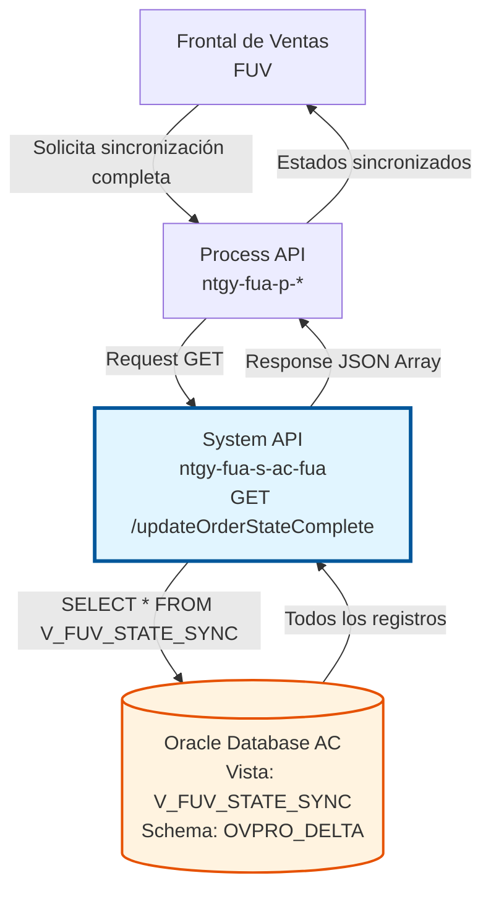
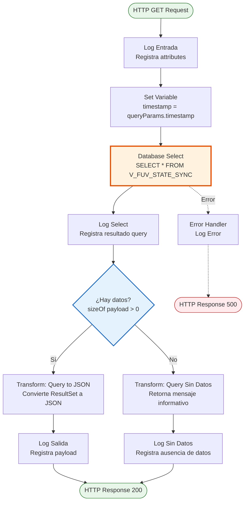
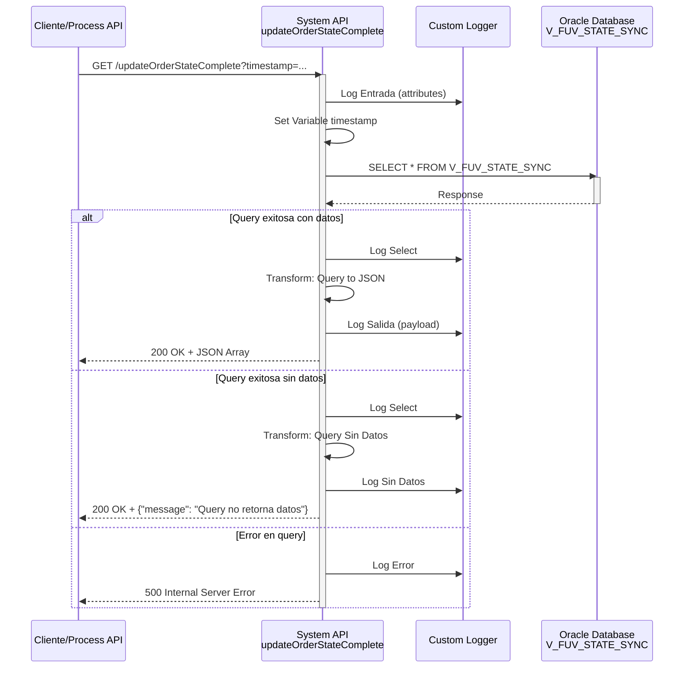

# GET /updateOrderStateComplete

## 📌 Descripción General

### Propósito del Endpoint

Este endpoint consulta el **estado completo de sincronización de órdenes** desde la vista `V_FUV_STATE_SYNC` de la base de datos Oracle AC. A diferencia del endpoint `/updateOrderState` que retorna solo cambios incrementales (delta), este endpoint retorna **todos los registros** de la vista sin aplicar filtros de fecha.

El endpoint soporta:
- **Consulta Completa**: Retorna todos los registros de sincronización disponibles en la vista
- **Sin Filtros**: No aplica filtros de fecha ni estado (consulta completa)
- **Parámetro Timestamp**: Acepta parámetro opcional `timestamp` (aunque no se utiliza en la query)
- **Manejo de Casos Sin Datos**: Retorna mensaje informativo cuando no hay registros

### Tipo de API

**Capa:** System API (API-Led Connectivity)

**Función:** Integración directa con Oracle Database AC para consulta completa de estados de sincronización de órdenes del Frontal de Ventas (FUV).

### Patrón de Integración

**Tipo:** Request-Reply Síncrono con SQL Query

**Descripción:** El endpoint recibe una petición HTTP GET, ejecuta una consulta SQL completa sobre la vista `V_FUV_STATE_SYNC`, transforma el resultado a JSON y retorna todos los registros encontrados. Si no hay datos, retorna un mensaje informativo.

### Arquitectura API-Led Connectivity



---

## 💼 Propósito del Negocio

### Casos de Uso Principales

1. **Sincronización Completa Inicial**
   - Cuando el sistema FUV necesita cargar todos los estados de órdenes por primera vez
   - Útil después de un reinicio del sistema o mantenimiento
   - Permite reconstruir el estado completo de sincronización

2. **Auditoría y Reconciliación**
   - Verificar el estado completo de todas las órdenes en el sistema
   - Identificar discrepancias entre FUV y AC
   - Generar reportes de estado global de órdenes

3. **Recuperación de Desastres**
   - Restaurar el estado completo de sincronización después de un fallo
   - Validar integridad de datos tras una recuperación
   - Sincronizar sistemas después de una caída

### Contexto Empresarial

- **Dominio:** Gestión de Pedidos y Control de Órdenes
- **Sector:** Energía - Utilities
- **División:** Naturgy España - NewCo
- **Proceso de Negocio:** Sincronización de estados de órdenes entre Frontal de Ventas (FUV) y Área Cliente (AC)
- **Sistema Origen:** Oracle Database AC (OVPRO_DELTA schema)

### Stakeholders

- **Equipo de Ventas**: Necesita visibilidad completa del estado de todas las órdenes
- **Equipo de Operaciones**: Requiere auditoría y reconciliación de estados
- **Equipo de Desarrollo**: Utiliza para debugging y validación de sincronización
- **Equipo de Soporte**: Necesita consultar estado completo para resolución de incidencias

### Valor de Negocio

- **Visibilidad Total**: Proporciona una vista completa del estado de sincronización de todas las órdenes
- **Auditoría**: Facilita la auditoría y reconciliación de estados entre sistemas
- **Recuperación**: Permite recuperación rápida del estado completo tras fallos
- **Trazabilidad**: Mejora la trazabilidad de órdenes en el sistema

### Consumidores Potenciales

Este endpoint puede ser consumido por:
- Process APIs de gestión de pedidos (ntgy-fua-p-fua)
- Sistemas de monitoreo y auditoría
- Herramientas de reconciliación de datos
- Procesos batch de sincronización completa
- Sistemas de reporting y analytics

---

## 🔧 Especificación Técnica

### URLs por Ambiente

| Ambiente | URL Base | URL Completa |
|----------|----------|--------------|
| **Local** | `http://localhost:8081` | `http://localhost:8081/api/updateOrderStateComplete` |
| **Development** | `https://ntgy-fua-s-ac-fua-dev.us-e2.cloudhub.io` | `https://ntgy-fua-s-ac-fua-dev.us-e2.cloudhub.io/api/updateOrderStateComplete` |
| **UAT** | `https://ntgy-fua-s-ac-fua-uat.us-e2.cloudhub.io` | `https://ntgy-fua-s-ac-fua-uat.us-e2.cloudhub.io/api/updateOrderStateComplete` |
| **Production** | `https://ntgy-fua-s-ac-fua-pro.us-e2.cloudhub.io` | `https://ntgy-fua-s-ac-fua-pro.us-e2.cloudhub.io/api/updateOrderStateComplete` |

### Método HTTP

```
GET /api/updateOrderStateComplete
```

### Parámetros de Entrada

#### Headers HTTP

| Header | Tipo | Requerido | Descripción | Ejemplo |
|--------|------|-----------|-------------|---------|
| `Accept` | string | ❌ No | Tipo de contenido esperado en response | `application/json` |

#### Query Parameters

| Parámetro | Tipo | Requerido | Descripción | Ejemplo | Notas |
|-----------|------|-----------|-------------|---------|-------|
| `timestamp` | string | ❌ No | Timestamp de referencia (no utilizado en query) | `"2026-07-20T10:00:00"` | ⚠️ Parámetro legacy - se captura pero no se usa en la query SQL |

> **⚠️ Nota Importante:** El parámetro `timestamp` se captura en el flow pero **NO se utiliza** en la query SQL. La consulta siempre retorna todos los registros de la vista sin filtros de fecha.

### Respuestas

#### Respuesta Exitosa con Datos (200 OK)

```json
[
  {
    "CAMPO1": "valor1",
    "CAMPO2": "valor2",
    "CAMPO3": "valor3",
    "ESTADO": "SINCRONIZADO",
    "FECHA_ACTUALIZACION": "2026-07-20T10:30:00"
  },
  {
    "CAMPO1": "valor4",
    "CAMPO2": "valor5",
    "CAMPO3": "valor6",
    "ESTADO": "PENDIENTE",
    "FECHA_ACTUALIZACION": "2026-07-20T11:00:00"
  }
]
```

**Descripción:** Array JSON con todos los registros de la vista V_FUV_STATE_SYNC. La estructura exacta depende de las columnas definidas en la vista.

#### Respuesta Sin Datos (200 OK)

```json
{
  "message": "Query no retorna datos"
}
```

**Descripción:** Cuando la vista no contiene registros, se retorna un objeto JSON con un mensaje informativo.

#### Respuesta de Error Técnico (500)

```json
{
  "error": "Error interno del servidor",
  "details": "Error al ejecutar query en base de datos"
}
```

**Descripción:** Error en la ejecución de la query o problemas de conectividad con la base de datos.

### Autenticación y Autorización

- **Tipo:** Client ID & Client Secret (Anypoint Platform)
- **Autorización DB:** El usuario de base de datos debe tener permisos para:
  - Acceso de lectura (SELECT) a la vista `V_FUV_STATE_SYNC`
  - Acceso al schema `OVPRO_DELTA`

### Timeouts

| Tipo | Valor | Descripción |
|------|-------|-------------|
| **Query Timeout** | 15 segundos | Tiempo máximo de ejecución de la query SQL |
| **Connection Timeout** | 3600 segundos | Tiempo máximo para establecer conexión con DB |
| **Request Timeout** | 30 segundos | Tiempo máximo de espera para la respuesta HTTP |

---

## 🏗️ Implementación Técnica

### Arquitectura del Flow



### Componentes del Flow

#### 1. Logger Entrada
```xml
<logger level="INFO" message="s-ac-updateOrderStateComplete.logEntrada ## attributes: #[attributes]"/>
```
- Registra los atributos de la petición HTTP
- Incluye query parameters y headers

#### 2. Set Variable - Timestamp
```xml
<set-variable value="#[attributes.queryParams.timestamp]" variableName="timestamp"/>
```
- Captura el parámetro `timestamp` del query string
- ⚠️ **Nota:** Esta variable NO se utiliza en la query SQL

#### 3. Database Select
```xml
<db:select config-ref="Database_Config" queryTimeout="${dbAC.queryTimeout}">
    <reconnect-forever />
    <db:sql><![CDATA[${queries.updateStateVistaComplete}]]></db:sql>
</db:select>
```
- **Query SQL:** `SELECT * FROM V_FUV_STATE_SYNC`
- **Timeout:** 15 segundos (configurado en `dbAC.queryTimeout`)
- **Reconnect:** Política de reconexión automática habilitada

#### 4. Logger Select
```xml
<logger level="INFO" message="s-ac-updateOrderState.logSelect"/>
```
- Registra la ejecución exitosa de la query

#### 5. Choice - Validación de Datos
```xml
<choice>
    <when expression="#[sizeOf(payload)>0]">
        <!-- Transformación a JSON -->
    </when>
    <otherwise>
        <!-- Mensaje sin datos -->
    </otherwise>
</choice>
```
- Evalúa si la query retornó registros
- Bifurca el flujo según el resultado

#### 6. Transform - Query to JSON
```dataweave
%dw 2.0
output application/json
---
payload
```
- Convierte el ResultSet de la base de datos a JSON
- Mantiene la estructura original de las columnas de la vista

#### 7. Transform - Query Sin Datos
```dataweave
%dw 2.0
output application/json
---
{
    message: "Query no retorna datos"
}
```
- Retorna mensaje informativo cuando no hay registros

#### 8. Logger Salida
```xml
<logger level="INFO" message="s-ac-updateOrderState.logSalida ## payload: #[payload]"/>
```
- Registra el payload de respuesta

#### 9. Error Handler
```xml
<on-error-propagate type="ANY">
    <logger level="ERROR" message="s-ac-updateOrderState.logError"/>
</on-error-propagate>
```
- Captura cualquier error durante la ejecución
- Registra el error en logs
- Propaga el error al cliente

### Configuración de Base de Datos

#### Connection Pool
```yaml
dbAC:
  MaxPoolSize: 15
  MaxWaitTime: 300
  MaxIdleTime: 300
  queryTimeout: 15
```

#### Dual Host Configuration (High Availability)
```yaml
dbAC:
  host1: "oc-pro-exa-04-clu-02-hdfdi-scan.prodb03.ocpro.oraclevcn.com"
  host2: "oc-pro-exa-03-clu-02-dfhl9-scan.prodb03.ocpro.oraclevcn.com"
  port: "1521"
  serviceName: "s_areapriv_online_pro.prodb03.ocpro.oraclevcn.com"
```

### Query SQL Completa

```sql
SELECT * FROM V_FUV_STATE_SYNC
```

**Características:**
- **Sin filtros:** Retorna todos los registros de la vista
- **Sin paginación:** No aplica LIMIT ni OFFSET
- **Sin ordenamiento:** Retorna en el orden natural de la vista
- **Todas las columnas:** Selecciona todas las columnas disponibles

> **⚠️ Advertencia de Performance:** Esta query puede retornar un volumen grande de datos. Se recomienda monitorear el tiempo de respuesta y considerar implementar paginación si el volumen crece significativamente.

### Vista V_FUV_STATE_SYNC

**Propósito:** Vista consolidada que contiene los estados de sincronización de órdenes entre FUV y AC.

**Ubicación:** Schema `OVPRO_DELTA` en Oracle Database AC

**Características:**
- Consolida información de múltiples tablas de control
- Proporciona vista unificada del estado de sincronización
- Actualizada en tiempo real por triggers o procesos batch

### Diagrama de Secuencia Detallado



### Manejo de Errores

#### Tipos de Errores Manejados

1. **DB:CONNECTIVITY**
   - Error de conexión a base de datos
   - Timeout de conexión
   - Acción: Retry automático (3 intentos)

2. **DB:QUERY_TIMEOUT**
   - Query excede 15 segundos
   - Acción: Cancelar query y retornar error

3. **DB:BAD_SQL_SYNTAX**
   - Error de sintaxis SQL (no debería ocurrir)
   - Acción: Log error y retornar 500

4. **ANY**
   - Cualquier otro error no categorizado
   - Acción: Log error y retornar 500

### Logging Strategy

#### Puntos de Logging

1. **Entrada:** Registra attributes de la petición
2. **Select:** Confirma ejecución exitosa de query
3. **Salida:** Registra payload de respuesta
4. **Sin Datos:** Registra cuando no hay resultados
5. **Error:** Registra cualquier excepción

#### Formato de Logs

```
INFO: s-ac-updateOrderStateComplete.logEntrada ## attributes: {...}
INFO: s-ac-updateOrderState.logSelect
INFO: s-ac-updateOrderState.logSalida ## payload: [...]
INFO: s-ac-updateOrderState.logSalida ## Query sin datos
ERROR: s-ac-updateOrderState.logError
```

---

## 💻 Ejemplos de Uso

### Ejemplo 1: Consulta Completa Básica

#### Request
```bash
curl -X GET "https://ntgy-fua-s-ac-fua-pro.us-e2.cloudhub.io/api/updateOrderStateComplete" \
  -H "Accept: application/json"
```

#### Response (200 OK - Con Datos)
```json
[
  {
    "ORDER_ID": "ORD-2026-001",
    "ESTADO": "SINCRONIZADO",
    "FECHA_CREACION": "2026-07-15T08:30:00",
    "FECHA_ACTUALIZACION": "2026-07-20T10:15:00",
    "SISTEMA_ORIGEN": "FUV",
    "SISTEMA_DESTINO": "AC",
    "INTENTOS": 1,
    "ULTIMO_ERROR": null
  },
  {
    "ORDER_ID": "ORD-2026-002",
    "ESTADO": "PENDIENTE",
    "FECHA_CREACION": "2026-07-18T14:20:00",
    "FECHA_ACTUALIZACION": "2026-07-20T09:45:00",
    "SISTEMA_ORIGEN": "FUV",
    "SISTEMA_DESTINO": "AC",
    "INTENTOS": 2,
    "ULTIMO_ERROR": "Timeout en conexión"
  },
  {
    "ORDER_ID": "ORD-2026-003",
    "ESTADO": "ERROR",
    "FECHA_CREACION": "2026-07-19T11:00:00",
    "FECHA_ACTUALIZACION": "2026-07-20T08:30:00",
    "SISTEMA_ORIGEN": "FUV",
    "SISTEMA_DESTINO": "AC",
    "INTENTOS": 4,
    "ULTIMO_ERROR": "Validación de datos fallida"
  }
]
```

### Ejemplo 2: Consulta con Timestamp (Legacy)

#### Request
```bash
curl -X GET "https://ntgy-fua-s-ac-fua-pro.us-e2.cloudhub.io/api/updateOrderStateComplete?timestamp=2026-07-20T10:00:00" \
  -H "Accept: application/json"
```

#### Response (200 OK - Con Datos)
```json
[
  {
    "ORDER_ID": "ORD-2026-001",
    "ESTADO": "SINCRONIZADO",
    "FECHA_ACTUALIZACION": "2026-07-20T10:15:00"
  }
]
```

> **⚠️ Nota:** El parámetro `timestamp` se acepta pero **no afecta** el resultado. La query siempre retorna todos los registros.

### Ejemplo 3: Respuesta Sin Datos

#### Request
```bash
curl -X GET "https://ntgy-fua-s-ac-fua-pro.us-e2.cloudhub.io/api/updateOrderStateComplete" \
  -H "Accept: application/json"
```

#### Response (200 OK - Sin Datos)
```json
{
  "message": "Query no retorna datos"
}
```

**Escenario:** La vista V_FUV_STATE_SYNC no contiene registros (caso poco probable en producción).

### Ejemplo 4: Error de Conexión

#### Request
```bash
curl -X GET "https://ntgy-fua-s-ac-fua-pro.us-e2.cloudhub.io/api/updateOrderStateComplete" \
  -H "Accept: application/json"
```

#### Response (500 Internal Server Error)
```json
{
  "error": "Database connection error",
  "message": "No se pudo conectar a la base de datos AC",
  "timestamp": "2026-07-20T10:30:00Z"
}
```

**Escenario:** Error de conectividad con la base de datos Oracle.

### Ejemplo 5: Uso desde JavaScript

```javascript
async function getSyncStateComplete() {
  try {
    const response = await fetch(
      'https://ntgy-fua-s-ac-fua-pro.us-e2.cloudhub.io/api/updateOrderStateComplete',
      {
        method: 'GET',
        headers: {
          'Accept': 'application/json'
        }
      }
    );

    if (!response.ok) {
      throw new Error(`HTTP error! status: ${response.status}`);
    }

    const data = await response.json();
    
    // Verificar si hay datos
    if (Array.isArray(data)) {
      console.log(`Total de registros: ${data.length}`);
      
      // Procesar cada registro
      data.forEach(record => {
        console.log(`Order ID: ${record.ORDER_ID}, Estado: ${record.ESTADO}`);
      });
    } else if (data.message) {
      console.log('Sin datos:', data.message);
    }
    
    return data;
  } catch (error) {
    console.error('Error al consultar estados:', error);
    throw error;
  }
}

// Uso
getSyncStateComplete()
  .then(data => console.log('Sincronización completa obtenida'))
  .catch(error => console.error('Error:', error));
```

### Ejemplo 6: Uso desde Python

```python
import requests
import json

def get_sync_state_complete():
    """
    Consulta el estado completo de sincronización de órdenes
    """
    url = "https://ntgy-fua-s-ac-fua-pro.us-e2.cloudhub.io/api/updateOrderStateComplete"
    
    headers = {
        "Accept": "application/json"
    }
    
    try:
        response = requests.get(url, headers=headers, timeout=30)
        response.raise_for_status()
        
        data = response.json()
        
        # Verificar si hay datos
        if isinstance(data, list):
            print(f"Total de registros: {len(data)}")
            
            # Procesar cada registro
            for record in data:
                print(f"Order ID: {record.get('ORDER_ID')}, Estado: {record.get('ESTADO')}")
        elif isinstance(data, dict) and 'message' in data:
            print(f"Sin datos: {data['message']}")
        
        return data
        
    except requests.exceptions.RequestException as e:
        print(f"Error al consultar estados: {e}")
        raise

# Uso
if __name__ == "__main__":
    try:
        sync_data = get_sync_state_complete()
        print("Sincronización completa obtenida exitosamente")
    except Exception as e:
        print(f"Error: {e}")
```

### Ejemplo 7: Filtrado de Resultados en Cliente

```javascript
// Obtener todos los estados y filtrar en cliente
async function getOrdersByState(targetState) {
  const allStates = await getSyncStateComplete();
  
  if (!Array.isArray(allStates)) {
    return [];
  }
  
  // Filtrar por estado específico
  const filtered = allStates.filter(order => order.ESTADO === targetState);
  
  console.log(`Órdenes en estado ${targetState}: ${filtered.length}`);
  return filtered;
}

// Ejemplos de uso
getOrdersByState('SINCRONIZADO');  // Solo órdenes sincronizadas
getOrdersByState('PENDIENTE');     // Solo órdenes pendientes
getOrdersByState('ERROR');         // Solo órdenes con error
```

### Ejemplo 8: Análisis de Volumen

```javascript
async function analyzeOrderStates() {
  const allStates = await getSyncStateComplete();
  
  if (!Array.isArray(allStates)) {
    console.log('No hay datos para analizar');
    return;
  }
  
  // Contar por estado
  const stateCount = allStates.reduce((acc, order) => {
    const state = order.ESTADO || 'DESCONOCIDO';
    acc[state] = (acc[state] || 0) + 1;
    return acc;
  }, {});
  
  console.log('Distribución de estados:');
  Object.entries(stateCount).forEach(([state, count]) => {
    const percentage = ((count / allStates.length) * 100).toFixed(2);
    console.log(`  ${state}: ${count} (${percentage}%)`);
  });
  
  return stateCount;
}

// Uso
analyzeOrderStates();
```
