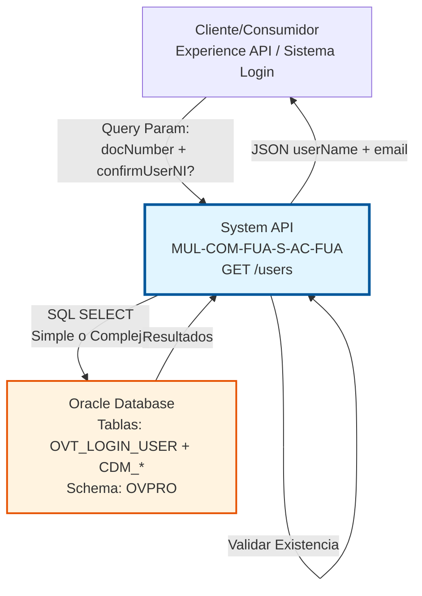
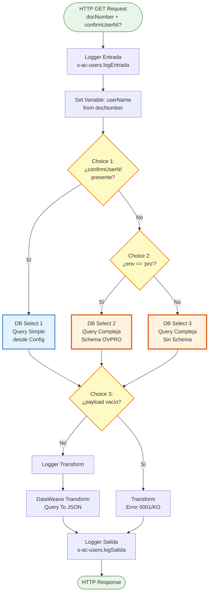
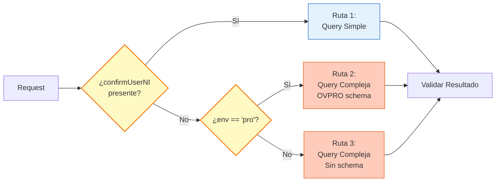

# GET /users

## 📌 Descripción General

### Propósito del Endpoint

Este endpoint proporciona funcionalidad de validación y consulta de usuarios por número de documento (NIF/NIE/DNI) desde Oracle Database. Implementa lógica condicional compleja que varía según el parámetro de entrada y el ambiente de ejecución, permitiendo tanto validaciones simples de existencia como consultas complejas que verifican contratos activos y condiciones de portabilidad a NewCo.

El endpoint soporta:
- **Validación Simple de Usuario**: Verifica existencia por documento (modo confirmación)
- **Validación Compleja con Contratos**: Verifica usuario con contratos activos no portados
- **Lógica por Ambiente**: Comportamiento diferente en producción vs otros ambientes
- **Detección de No Existencia**: Retorna error específico si usuario no existe
- **Datos de Usuario**: Retorna username y email del primer registro encontrado

### Tipo de API

**Capa:** System API (API-Led Connectivity)

**Función:** Integración directa con Oracle Database para validación de usuarios con lógica de negocio condicional según ambiente y parámetros.

### Patrón de Integración

**Tipo:** Request-Reply Síncrono con Lógica Condicional Múltiple

**Descripción:** El endpoint recibe un número de documento como query parameter, evalúa condiciones para determinar qué query SQL ejecutar (simple o compleja, con o sin prefijo de schema), ejecuta la consulta contra Oracle Database, valida si hay resultados, y retorna los datos del usuario o un error si no existe.

### Arquitectura API-Led Connectivity



---

## 💼 Propósito del Negocio

### Casos de Uso Principales

1. **Validación de Usuario en Proceso de Login**
   - Usuario intenta acceder al portal con su documento
   - Sistema valida que el usuario existe en la base de datos
   - Retorna username y email para proceso de autenticación
   - Previene intentos de login con documentos no registrados

2. **Verificación de Existencia de Cuenta (Modo Confirmación)**
   - Sistema necesita verificar rápidamente si un documento está registrado
   - Usa query simple sin validaciones de contratos
   - Útil para procesos de recuperación de contraseña
   - Respuesta rápida sin joins complejos

3. **Validación de Usuario con Contratos Activos**
   - Verifica que el usuario tiene contratos activos
   - Filtra usuarios con contratos portados a NewCo
   - Excluye contratos inactivos
   - Asegura que solo usuarios con servicios activos puedan acceder

4. **Gestión de Usuarios por Ambiente**
   - Comportamiento diferente en producción vs desarrollo
   - Schemas de base de datos diferentes por ambiente
   - Facilita testing y desarrollo sin afectar producción

### Contexto Empresarial

- **Dominio:** Gestión de Usuarios y Autenticación
- **Sector:** Energía - Utilities
- **División:** Naturgy España - Área Cliente (AC)
- **Proceso de Negocio:** Autenticación y Validación de Usuarios
- **Fuente de Datos:** Oracle Database (Sistema de Login y Contratos)

### Stakeholders

- **Clientes Finales**: Necesitan acceder al portal con sus credenciales
- **Sistemas de Autenticación**: Requieren validación de usuarios antes de login
- **Equipos de Soporte**: Verifican existencia de usuarios para resolución de incidencias
- **Sistemas de Recuperación de Contraseña**: Validan usuarios antes de enviar emails
- **Equipos de Desarrollo**: Necesitan comportamiento diferente por ambiente

### Valor de Negocio

- **Seguridad**: Valida usuarios antes de permitir acceso
- **Experiencia de Usuario**: Mensajes claros si usuario no existe
- **Integridad de Datos**: Verifica contratos activos y no portados
- **Flexibilidad**: Dos modos de validación según necesidad
- **Mantenibilidad**: Lógica por ambiente facilita desarrollo

### Consumidores Potenciales

Este endpoint puede ser consumido por:
- Experience APIs de portales de login
- Sistemas de autenticación y autorización
- Process APIs de gestión de usuarios
- Sistemas de recuperación de contraseña
- Aplicaciones de soporte al cliente
- Sistemas de validación de identidad

---

## 🔧 Especificación Técnica

### URLs por Ambiente

| Ambiente | URL Base | URL Completa |
|----------|----------|--------------|
| **Local** | `http://localhost:8081` | `http://localhost:8081/api/users?docNumber=12345678A` |
| **Development** | `https://mul-com-fua-s-ac-fua-dev.us-e2.cloudhub.io` | `https://mul-com-fua-s-ac-fua-dev.us-e2.cloudhub.io/api/users?docNumber=12345678A` |
| **UAT** | `https://mul-com-fua-s-ac-fua-uat.us-e2.cloudhub.io` | `https://mul-com-fua-s-ac-fua-uat.us-e2.cloudhub.io/api/users?docNumber=12345678A` |
| **Production** | `https://mul-com-fua-s-ac-fua-pro.us-e2.cloudhub.io` | `https://mul-com-fua-s-ac-fua-pro.us-e2.cloudhub.io/api/users?docNumber=12345678A` |

### Método HTTP

```
GET /api/users
```

### Parámetros de Entrada

#### Headers HTTP

| Header | Tipo | Requerido | Descripción | Ejemplo |
|--------|------|-----------|-------------|---------|
| `Accept` | string | ❌ No | Tipo de contenido esperado en response | `application/json` |

#### Query Parameters

| Parámetro | Tipo | Requerido | Descripción | Ejemplo | Validación |
|-----------|------|-----------|-------------|---------|------------|
| `docNumber` | string | ✅ Sí | Número de documento del usuario (NIF/NIE/DNI) | `"12345678A"` | Alfanumérico, 8-9 caracteres |
| `confirmUserNI` | string | ❌ No | Si está presente, usa validación simple sin verificar contratos | `"true"` | Cualquier valor |

**Nota sobre confirmUserNI:**
- Si este parámetro está presente (con cualquier valor), se ejecuta query simple
- Si no está presente, se ejecuta query compleja con validación de contratos
- Útil para diferenciar entre validación rápida vs validación completa

### Respuestas

#### Respuesta Exitosa (200 OK) - Usuario Encontrado

```json
{
  "result": {
    "codResult": "0000",
    "msgResult": "No hay error"
  },
  "userName": "usuario123",
  "email": "usuario@example.com"
}
```

**Estructura de la Respuesta:**

| Campo | Tipo | Descripción |
|-------|------|-------------|
| `result` | object | Objeto con información del resultado de la operación |
| `result.codResult` | string | Código de resultado ("0000" = éxito) |
| `result.msgResult` | string | Mensaje descriptivo del resultado |
| `userName` | string | Nombre de usuario (login) del usuario encontrado |
| `email` | string | Email del usuario (puede estar vacío) |

**Nota:** Si la query retorna múltiples registros (por DISTINCT), solo se retorna el primero.

#### Respuesta de Usuario No Encontrado (200 OK)

```json
{
  "result": {
    "codResult": "0001",
    "msgResult": "KO"
  }
}
```

**Nota:** Este no es un error HTTP 404, sino una respuesta exitosa indicando que el usuario no existe.

#### Respuesta de Error Técnico (400 Bad Request)

```json
{
  "result": {
    "codResult": "0001",
    "msgResult": "Parámetro docNumber es requerido"
  }
}
```

#### Respuesta de Error Técnico (500 Internal Server Error)

```json
{
  "result": {
    "codResult": "0002",
    "msgResult": "Error al consultar base de datos"
  }
}
```

### Autenticación y Autorización

- **Tipo:** Client ID & Client Secret (Anypoint Platform)
- **Autorización Oracle:** El usuario de base de datos debe tener permisos para:
  - Ejecutar SELECT sobre tabla `OVT_LOGIN_USER`
  - Ejecutar SELECT sobre tablas `CDM_*` (CLIENT, SUPPLY_POINT, CONTRACT_HEADER, CONTRACT_LINE)
  - Acceso de lectura al schema `OVPRO` (en producción)

### Timeouts

| Tipo | Valor | Descripción |
|------|-------|-------------|
| **Query Timeout** | Configurado en `${dbAC.queryTimeout}` | Tiempo máximo de espera para la consulta SQL |
| **Connection Timeout** | 10 segundos | Tiempo máximo para establecer conexión con Oracle |
| **Fetch Size** | 1000 registros | Número de registros a recuperar por lote |

---

## 🏗️ Implementación Técnica

### Arquitectura del Flow



### Diagrama de Decisión de Rutas



### Componentes del Flow

#### 1. Logger de Entrada
```xml
<logger level="DEBUG" doc:name="Logger Entrada" 
        message="s-ac-users.logEntrada ## payload: #[payload]"/>
```
- **Propósito:** Registra el inicio de la ejecución del flow
- **Nivel:** DEBUG
- **Contenido:** Payload de entrada (query parameters)

#### 2. Set Variable - Extracción de Parámetro

```xml
<set-variable value='#[attributes.queryParams["docNumber"]]' 
              doc:name="Set Variable" 
              variableName="userName"/>
```

- **Propósito:** Extrae el query parameter `docNumber` y lo almacena en variable `userName`
- **Nota:** El nombre de variable `userName` es confuso, realmente contiene el documento

#### 3. Choice 1 - Decisión por Parámetro confirmUserNI

```xml
<choice doc:name="Choice">
    <when expression='#[!isEmpty(attributes.queryParams["confirmUserNI"])]'>
        <!-- Ruta 1: Query Simple -->
    </when>
    <when expression="#[p('env') == 'pro']">
        <!-- Ruta 2: Query Compleja Producción -->
    </when>
    <otherwise>
        <!-- Ruta 3: Query Compleja Otros Ambientes -->
    </otherwise>
</choice>
```

**Lógica de Decisión:**
1. **Primera condición:** Si `confirmUserNI` está presente → Ruta 1 (query simple)
2. **Segunda condición:** Si ambiente es 'pro' → Ruta 2 (query compleja con OVPRO)
3. **Otherwise:** Otros ambientes → Ruta 3 (query compleja sin OVPRO)

### Ruta 1: Query Simple (Modo Confirmación)

#### Database Select 1

```xml
<db:select doc:name="Select1" 
           config-ref="Database_Config" 
           queryTimeout="${dbAC.queryTimeout}" 
           fetchSize="1000">
    <ee:repeatable-file-store-iterable inMemoryObjects="1000" />
    <db:sql><![CDATA[${queries.existLoginUser}]]></db:sql>
    <db:input-parameters><![CDATA[#[{'user': vars.userName}]]]></db:input-parameters>
</db:select>
```

**Query desde Configuración:**
```sql
SELECT USERNAME, EMAIL 
FROM OVPRO.OVT_LOGIN_USER 
WHERE NIF = :user
```

**Características:**
- **Propósito:** Validación rápida de existencia de usuario
- **Tablas:** Solo `OVT_LOGIN_USER`
- **Filtro:** Solo por NIF
- **Performance:** Rápida, sin joins
- **Uso:** Recuperación de contraseña, validaciones simples

**Estructura de la Tabla OVT_LOGIN_USER:**

| Campo | Tipo | Descripción |
|-------|------|-------------|
| `NIF` | VARCHAR2 | Número de documento (clave de búsqueda) |
| `USERNAME` | VARCHAR2 | Nombre de usuario para login |
| `EMAIL` | VARCHAR2 | Email del usuario |
| `CUSTOMER_ID` | VARCHAR2 | ID del cliente asociado |

### Ruta 2: Query Compleja Producción

#### Database Select 2

```xml
<db:select doc:name="Select" 
           config-ref="Database_Config" 
           queryTimeout="${dbAC.queryTimeout}" 
           fetchSize="1000">
    <ee:repeatable-file-store-iterable inMemoryObjects="1000" />
    <db:sql><![CDATA[
        SELECT DISTINCT USERNAME, EMAIL 
        FROM OVPRO.OVT_LOGIN_USER U, 
             OVPRO.CDM_CLIENT CLI,
             OVPRO.CDM_SUPPLY_POINT SUP,
             OVPRO.CDM_CONTRACT_HEADER COH,
             OVPRO.CDM_CONTRACT_LINE COL 
        WHERE U.NIF = :user
          AND u.CUSTOMER_ID = CLI.CLI_COD_CLIENT 
          AND CLI.CLI_CLIENT_ID = SUP.SUP_CLIENT_ID (+)
          AND SUP.SUP_SUPPLY_ID = COH.COH_SUPPLY_ID (+)
          AND COH.COH_ID = COL.COL_CONTRACT_HEADER_ID 
          AND col.col_portabilidad_newco is NULL 
          AND col.col_fecha_portabilidad_newco is NULL
          AND COL.COL_STATUS != 'Inactivo'
    ]]></db:sql>
    <db:input-parameters><![CDATA[#[{'user': vars.userName}]]]></db:input-parameters>
</db:select>
```

**Características:**
- **Schema:** `OVPRO.` (prefijo en todas las tablas)
- **Ambiente:** Solo producción
- **Propósito:** Validación completa con contratos activos

**Tablas Involucradas:**

| Tabla | Alias | Propósito |
|-------|-------|-----------|
| `OVPRO.OVT_LOGIN_USER` | U | Usuario de login |
| `OVPRO.CDM_CLIENT` | CLI | Cliente asociado |
| `OVPRO.CDM_SUPPLY_POINT` | SUP | Puntos de suministro |
| `OVPRO.CDM_CONTRACT_HEADER` | COH | Cabeceras de contratos |
| `OVPRO.CDM_CONTRACT_LINE` | COL | Líneas de contratos |

**Joins y Relaciones:**

```mermaid
graph LR
    U[OVT_LOGIN_USER<br/>U] -->|CUSTOMER_ID =<br/>CLI_COD_CLIENT| CLI[CDM_CLIENT<br/>CLI]
    CLI -->|CLI_CLIENT_ID =<br/>SUP_CLIENT_ID +| SUP[CDM_SUPPLY_POINT<br/>SUP]
    SUP -->|SUP_SUPPLY_ID =<br/>COH_SUPPLY_ID +| COH[CDM_CONTRACT_HEADER<br/>COH]
    COH -->|COH_ID =<br/>COL_CONTRACT_HEADER_ID| COL[CDM_CONTRACT_LINE<br/>COL]
    
    style U fill:#e3f2fd,stroke:#1565c0
    style CLI fill:#fff3e0,stroke:#e65100
    style SUP fill:#fff3e0,stroke:#e65100
    style COH fill:#fff3e0,stroke:#e65100
    style COL fill:#fff3e0,stroke:#e65100
```



**Nota sobre Outer Joins (+):**
- `(+)` es sintaxis Oracle para LEFT OUTER JOIN
- Permite que existan clientes sin puntos de suministro o contratos

**Filtros de Negocio:**

| Filtro | Propósito |
|--------|-----------|
| `col.col_portabilidad_newco is NULL` | Excluye contratos portados a NewCo |
| `col.col_fecha_portabilidad_newco is NULL` | Excluye contratos con fecha de portabilidad |
| `COL.COL_STATUS != 'Inactivo'` | Solo contratos activos |

**Uso de DISTINCT:**
- Elimina duplicados si usuario tiene múltiples contratos
- Solo retorna una combinación USERNAME/EMAIL única

### Ruta 3: Query Compleja Otros Ambientes

#### Database Select 3

```xml
<db:select doc:name="Select" 
           config-ref="Database_Config" 
           queryTimeout="${dbAC.queryTimeout}" 
           fetchSize="1000">
    <ee:repeatable-file-store-iterable inMemoryObjects="1000" />
    <db:sql><![CDATA[
        SELECT DISTINCT USERNAME, EMAIL 
        FROM OVT_LOGIN_USER U, 
             CDM_CLIENT CLI,
             CDM_SUPPLY_POINT SUP,
             CDM_CONTRACT_HEADER COH,
             CDM_CONTRACT_LINE COL 
        WHERE U.NIF = :user 
          AND u.CUSTOMER_ID = CLI.CLI_COD_CLIENT 
          AND CLI.CLI_CLIENT_ID = SUP.SUP_CLIENT_ID (+)
          AND SUP.SUP_SUPPLY_ID = COH.COH_SUPPLY_ID (+)
          AND COH.COH_ID = COL.COL_CONTRACT_HEADER_ID 
          AND col.col_portabilidad_newco is NULL 
          AND col.col_fecha_portabilidad_newco is NULL
          AND COL.COL_STATUS != 'Inactivo'
    ]]></db:sql>
    <db:input-parameters><![CDATA[#[{'user': vars.userName}]]]></db:input-parameters>
</db:select>
```

**Diferencias con Ruta 2:**
- **Sin prefijo `OVPRO.`** en nombres de tablas
- **Misma lógica** de joins y filtros
- **Ambientes:** Development, UAT, otros

**Razón de la Diferencia:**
- Ambientes no productivos pueden usar schemas diferentes
- Simplifica configuración de base de datos por ambiente
- Evita necesidad de sinónimos o vistas

#### 4. Choice 2 - Validación de Resultados

```xml
<choice doc:name="Choice">
    <when expression="#[isEmpty(payload)]">
        <!-- Usuario no encontrado -->
    </when>
    <otherwise>
        <!-- Usuario encontrado -->
    </otherwise>
</choice>
```

**Lógica:**
- Si `payload` está vacío → Usuario no existe → Error
- Si `payload` tiene datos → Usuario existe → Transformar y retornar

#### 5. Transformación de Error - Usuario No Encontrado

```dataweave
%dw 2.0
output application/json
---
{
    result: {
        codResult: "0001",
        msgResult: "KO"
    }
}
```

**Propósito:** Indica que el usuario no fue encontrado
**Nota:** No incluye campos `userName` ni `email`

#### 6. Logger Transform
```xml
<logger level="DEBUG" doc:name="Logger Transform" 
        message="s-ac-users.logTransform"/>
```
- **Propósito:** Marca el punto antes de transformación exitosa
- **Nivel:** DEBUG
- **Solo se ejecuta si usuario fue encontrado**

#### 7. DataWeave Transformation - Query To JSON

```dataweave
%dw 2.0
output application/json
---
{
    result: {
        codResult: "0000",
        msgResult: "No hay error"
    },
    userName: payload[0].USERNAME,
    email: payload[0].EMAIL default ""
}
```

**Propósito:** Transforma el resultado de la query a JSON

**Mapeo de Campos:**

| Campo Oracle | Campo JSON | Transformación |
|--------------|------------|----------------|
| `USERNAME` | `userName` | Primer registro `payload[0]` |
| `EMAIL` | `email` | Primer registro con default "" |

**Nota Importante:**
- Solo toma el **primer registro** aunque la query retorne múltiples
- Usa `default ""` para email por si es NULL
- El uso de `DISTINCT` en queries complejas minimiza duplicados

#### 8. Logger de Salida
```xml
<logger level="DEBUG" doc:name="Logger Salida" 
        message="s-ac-users.logSalida ## payload: #[payload]"/>
```
- **Propósito:** Registra la respuesta final del flow
- **Nivel:** DEBUG
- **Contenido:** Payload transformado (JSON response)

### Configuración de Base de Datos

**Database Config Reference:** `Database_Config`

```xml
<db:config name="Database_Config">
    <db:oracle-connection 
        host="${dbAC.host}" 
        port="${dbAC.port}" 
        user="${dbAC.user}" 
        password="${dbAC.password}" 
        serviceName="${dbAC.serviceName}"/>
</db:config>
```

**Properties Utilizadas:**
- `${dbAC.host}` - Host del servidor Oracle
- `${dbAC.port}` - Puerto de conexión (típicamente 1521)
- `${dbAC.user}` - Usuario de base de datos
- `${dbAC.password}` - Contraseña (encriptada)
- `${dbAC.serviceName}` - Nombre del servicio Oracle
- `${dbAC.queryTimeout}` - Timeout para queries SQL
- `${queries.existLoginUser}` - Query simple desde archivo de configuración

### Manejo de Errores

El flow implementa manejo de errores en múltiples niveles:

1. **Usuario No Encontrado:**
   - No es un error técnico, es un caso de negocio
   - Retorna código "0001" con mensaje "KO"
   - HTTP 200 OK (no 404)

2. **Error de Conexión a BD:**
   - Se captura mediante error handler global
   - Retorna código 500 con mensaje de error técnico

3. **Error de Query SQL:**
   - Se captura mediante error handler
   - Retorna código 500 con detalles del error

4. **Parámetro Faltante:**
   - Si `docNumber` no está presente
   - Variable `userName` será null
   - Query SQL fallará

### Consideraciones de Performance

- **Fetch Size:** Configurado en 1000 registros
- **In-Memory Objects:** 1000 objetos en memoria
- **Query Simple:** Muy rápida, solo una tabla, índice en NIF
- **Query Compleja:** Más lenta por 5 joins, pero necesaria para validación completa
- **DISTINCT:** Añade overhead pero elimina duplicados
- **Outer Joins:** Permiten flexibilidad pero pueden ser costosos
- **Índices Recomendados:**
  - `OVT_LOGIN_USER.NIF` (clave primaria o índice único)
  - `CDM_CLIENT.CLI_COD_CLIENT`
  - `CDM_CONTRACT_LINE.COL_STATUS`
  - Índices compuestos en claves foráneas

### Logging

El flow implementa logging en 3 puntos:

1. **Entrada:** Registra query parameters recibidos (DEBUG)
2. **Transform:** Marca punto antes de transformación exitosa (DEBUG)
3. **Salida:** Registra respuesta JSON final (DEBUG)

**Nota:** Todos los logs son nivel DEBUG, no INFO

---

## 💻 Ejemplos de Uso

### Ejemplo 1: Validación Simple (Modo Confirmación)

#### Request

```bash
curl -X GET "https://mul-com-fua-s-ac-fua-dev.us-e2.cloudhub.io/api/users?docNumber=12345678A&confirmUserNI=true" \
  -H "Accept: application/json" \
  -H "client_id: YOUR_CLIENT_ID" \
  -H "client_secret: YOUR_CLIENT_SECRET"
```

#### Response (200 OK) - Usuario Encontrado

```json
{
  "result": {
    "codResult": "0000",
    "msgResult": "No hay error"
  },
  "userName": "usuario123",
  "email": "usuario@example.com"
}
```

**Nota:** Usa query simple sin validar contratos.

### Ejemplo 2: Validación Compleja (Sin confirmUserNI)

#### Request

```bash
curl -X GET "https://mul-com-fua-s-ac-fua-dev.us-e2.cloudhub.io/api/users?docNumber=98765432B" \
  -H "Accept: application/json" \
  -H "client_id: YOUR_CLIENT_ID" \
  -H "client_secret: YOUR_CLIENT_SECRET"
```

#### Response (200 OK) - Usuario con Contratos Activos

```json
{
  "result": {
    "codResult": "0000",
    "msgResult": "No hay error"
  },
  "userName": "cliente456",
  "email": "cliente@example.com"
}
```

**Nota:** Usa query compleja que valida contratos activos y no portados.

### Ejemplo 3: Usuario No Encontrado

#### Request

```bash
curl -X GET "https://mul-com-fua-s-ac-fua-dev.us-e2.cloudhub.io/api/users?docNumber=99999999Z" \
  -H "Accept: application/json" \
  -H "client_id: YOUR_CLIENT_ID" \
  -H "client_secret: YOUR_CLIENT_SECRET"
```

#### Response (200 OK) - Usuario No Existe

```json
{
  "result": {
    "codResult": "0001",
    "msgResult": "KO"
  }
}
```

**Nota:** No incluye campos `userName` ni `email` cuando el usuario no existe.

### Ejemplo 4: Error - Parámetro Faltante

#### Request

```bash
curl -X GET "https://mul-com-fua-s-ac-fua-dev.us-e2.cloudhub.io/api/users" \
  -H "Accept: application/json" \
  -H "client_id: YOUR_CLIENT_ID" \
  -H "client_secret: YOUR_CLIENT_SECRET"
```

#### Response (400 Bad Request)

```json
{
  "result": {
    "codResult": "0001",
    "msgResult": "Parámetro docNumber es requerido"
  }
}
```

### Ejemplo 5: Uso desde JavaScript

```javascript
class UsersClient {
  constructor(baseUrl, clientId, clientSecret) {
    this.baseUrl = baseUrl;
    this.clientId = clientId;
    this.clientSecret = clientSecret;
  }

  async validateUser(docNumber, simpleValidation = false) {
    let url = `${this.baseUrl}/users?docNumber=${encodeURIComponent(docNumber)}`;
    
    // Añadir parámetro para validación simple si se solicita
    if (simpleValidation) {
      url += '&confirmUserNI=true';
    }
    
    try {
      const response = await fetch(url, {
        method: 'GET',
        headers: {
          'Accept': 'application/json',
          'client_id': this.clientId,
          'client_secret': this.clientSecret
        }
      });

      if (!response.ok) {
        throw new Error(`HTTP error! status: ${response.status}`);
      }

      const data = await response.json();
      
      if (data.result.codResult === "0000") {
        return {
          exists: true,
          userName: data.userName,
          email: data.email
        };
      } else if (data.result.codResult === "0001") {
        return {
          exists: false,
          userName: null,
          email: null
        };
      } else {
        throw new Error(data.result.msgResult);
      }
    } catch (error) {
      console.error('Error al validar usuario:', error);
      throw error;
    }
  }

  async validateForLogin(docNumber) {
    // Usa validación compleja (con contratos)
    return this.validateUser(docNumber, false);
  }

  async validateForPasswordRecovery(docNumber) {
    // Usa validación simple (sin contratos)
    return this.validateUser(docNumber, true);
  }
}

// Uso
const client = new UsersClient(
  'https://mul-com-fua-s-ac-fua-pro.us-e2.cloudhub.io/api',
  'YOUR_CLIENT_ID',
  'YOUR_CLIENT_SECRET'
);

// Validación para login (compleja)
client.validateForLogin('12345678A')
  .then(result => {
    if (result.exists) {
      console.log(`Usuario encontrado: ${result.userName}`);
      console.log(`Email: ${result.email}`);
    } else {
      console.log('Usuario no encontrado');
    }
  })
  .catch(error => console.error('Error:', error));

// Validación para recuperación de contraseña (simple)
client.validateForPasswordRecovery('12345678A')
  .then(result => {
    if (result.exists) {
      console.log(`Enviar email a: ${result.email}`);
    } else {
      console.log('Usuario no registrado');
    }
  });
```

### Ejemplo 6: Uso desde Python

```python
import requests
from typing import Optional, Dict

class UsersClient:
    """Cliente para validación de usuarios"""
    
    def __init__(self, base_url: str, client_id: str, client_secret: str):
        self.base_url = base_url
        self.session = requests.Session()
        self.session.headers.update({
            'Accept': 'application/json',
            'client_id': client_id,
            'client_secret': client_secret
        })
    
    def validate_user(
        self, 
        doc_number: str, 
        simple_validation: bool = False
    ) -> Dict:
        """
        Valida existencia de usuario por documento
        
        Args:
            doc_number: Número de documento (NIF/NIE/DNI)
            simple_validation: Si True, usa validación simple sin contratos
            
        Returns:
            Dict con exists, userName, email
            
        Raises:
            requests.exceptions.RequestException: Si hay error en la petición
        """
        url = f"{self.base_url}/users"
        params = {'docNumber': doc_number}
        
        if simple_validation:
            params['confirmUserNI'] = 'true'
        
        response = self.session.get(url, params=params)
        response.raise_for_status()
        
        data = response.json()
        
        if data['result']['codResult'] == "0000":
            return {
                'exists': True,
                'userName': data['userName'],
                'email': data.get('email', '')
            }
        elif data['result']['codResult'] == "0001":
            return {
                'exists': False,
                'userName': None,
                'email': None
            }
        else:
            raise ValueError(f"Error: {data['result']['msgResult']}")
    
    def validate_for_login(self, doc_number: str) -> Dict:
        """Validación completa para login (con contratos)"""
        return self.validate_user(doc_number, simple_validation=False)
    
    def validate_for_password_recovery(self, doc_number: str) -> Dict:
        """Validación simple para recuperación de contraseña"""
        return self.validate_user(doc_number, simple_validation=True)

# Uso
if __name__ == "__main__":
    client = UsersClient(
        base_url="https://mul-com-fua-s-ac-fua-pro.us-e2.cloudhub.io/api",
        client_id="YOUR_CLIENT_ID",
        client_secret="YOUR_CLIENT_SECRET"
    )
    
    try:
        # Validación para login
        result = client.validate_for_login("12345678A")
        
        if result['exists']:
            print(f"Usuario encontrado: {result['userName']}")
            print(f"Email: {result['email']}")
        else:
            print("Usuario no encontrado")
        
        # Validación para recuperación de contraseña
        result = client.validate_for_password_recovery("12345678A")
        
        if result['exists']:
            print(f"Enviar email de recuperación a: {result['email']}")
        else:
            print("Usuario no registrado")
            
    except Exception as e:
        print(f"Error: {e}")
```

### Notas de Implementación

1. **Dos Modos de Validación:**
   - **Simple (confirmUserNI presente):** Rápida, solo verifica existencia
   - **Compleja (sin confirmUserNI):** Valida contratos activos y no portados
   - Elegir según caso de uso

2. **Diferencias por Ambiente:**
   - **Producción:** Usa schema `OVPRO.` en todas las tablas
   - **Otros ambientes:** Sin prefijo de schema
   - Transparente para el consumidor

3. **Manejo de Usuario No Encontrado:**
   - No es un error HTTP 404
   - Retorna 200 OK con código "0001"
   - Cliente debe verificar `codResult`

4. **Primer Registro:**
   - Si hay múltiples registros, solo retorna el primero
   - DISTINCT minimiza duplicados
   - Considerar si esto es apropiado para el caso de uso

5. **Performance:**
   - Query simple: ~10-50ms (solo una tabla)
   - Query compleja: ~100-500ms (5 tablas con joins)
   - Usar validación simple cuando sea posible

6. **Seguridad:**
   - No exponer información sensible en errores
   - Validar formato de documento antes de consultar
   - Implementar rate limiting para prevenir ataques
   - Logs en DEBUG para no exponer datos personales

7. **Contratos Portados:**
   - Query compleja excluye contratos portados a NewCo
   - Importante para gestión de clientes migrados
   - Asegura que solo usuarios activos puedan acceder

8. **Email Vacío:**
   - Campo email puede estar vacío
   - Usar `default ""` en transformación
   - Validar en cliente antes de enviar emails
