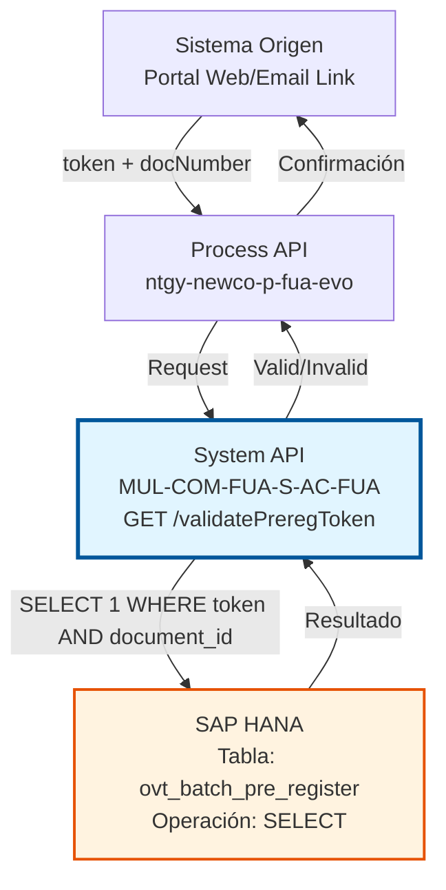
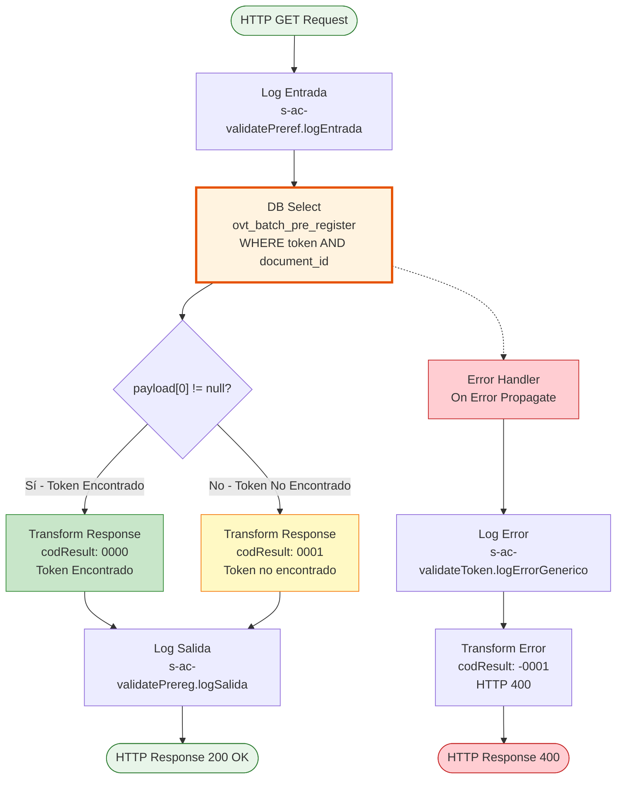

# GET /validatePreregToken

## 📌 Descripción General

### Propósito del Endpoint

Este endpoint valida tokens de pre-registro de clientes verificando su existencia en la base de datos SAP HANA. Se utiliza en procesos de onboarding masivo donde los clientes reciben tokens únicos para completar su registro.

El endpoint soporta:
- **Validación de Token**: Verifica que el token existe y está asociado al documento correcto
- **Seguridad**: Previene accesos no autorizados al proceso de registro
- **Respuesta Rápida**: Query optimizado que solo verifica existencia
- **Manejo Robusto de Errores**: Diferencia entre token inválido y errores técnicos

### Tipo de API

**Capa:** System API (API-Led Connectivity)

**Función:** Integración directa con SAP HANA (PostgreSQL compatible) para validación de tokens de pre-registro.

### Patrón de Integración

**Tipo:** Request-Reply Síncrono con SQL SELECT

**Descripción:** Recibe token y número de documento como query parameters, ejecuta una consulta SQL para verificar si existe un registro con esa combinación, evalúa el resultado, y retorna una respuesta indicando si el token es válido o no.

### Arquitectura API-Led Connectivity



---

## 💼 Propósito del Negocio

### Casos de Uso Principales

1. **Validación de Token de Pre-Registro**
   - Cliente recibe email/SMS con link que contiene token único
   - Cliente hace clic en el link y accede al portal
   - Sistema valida que el token es válido antes de mostrar formulario
   - Si válido → Permite continuar con registro
   - Si inválido → Muestra mensaje de error

2. **Onboarding Masivo de Clientes**
   - Empresa genera lote de tokens para nuevos clientes
   - Tokens se almacenan en tabla ovt_batch_pre_register
   - Cada cliente recibe su token personalizado
   - Sistema valida token antes de permitir acceso

3. **Seguridad en Proceso de Alta**
   - Previene accesos no autorizados al formulario de registro
   - Verifica que token corresponde al documento del cliente
   - Evita registros fraudulentos o duplicados

4. **Auditoría de Accesos**
   - Registra intentos de validación de tokens
   - Identifica tokens inválidos o expirados
   - Facilita seguimiento de proceso de onboarding

### Contexto Empresarial

- **Dominio:** Gestión de Clientes y Onboarding
- **Sector:** Energía - Utilities
- **División:** Naturgy España - NewCo
- **Proceso de Negocio:** Customer Onboarding y Pre-Registro
- **Módulo SAP:** CRM (Customer Relationship Management)

### Stakeholders

- **Clientes Nuevos**: Necesitan validar su token para completar registro
- **Equipo de Onboarding**: Gestiona proceso de alta masiva de clientes
- **Equipo de Marketing**: Envía comunicaciones con tokens
- **Equipo de Seguridad**: Monitorea intentos de acceso no autorizados

### Valor de Negocio

- **Seguridad**: Control de acceso al proceso de registro
- **Eficiencia**: Validación rápida sin intervención manual
- **Trazabilidad**: Registro de validaciones exitosas y fallidas
- **Experiencia de Usuario**: Proceso fluido de onboarding

### Consumidores Potenciales

Este endpoint puede ser consumido por:
- Process APIs de gestión de clientes (ntgy-newco-p-fua-evo)
- Portales web de registro de clientes
- Aplicaciones móviles de onboarding
- Sistemas de gestión de campañas
- Flujos de Salesforce (Platform Events, Flows)

---

## 🔧 Especificación Técnica

### URLs por Ambiente

| Ambiente | URL Base | URL Completa |
|----------|----------|--------------|
| **Local** | `http://localhost:8081` | `http://localhost:8081/api/validatePreregToken` |
| **Development** | `https://mul-com-fua-s-ac-fua-dev.us-e2.cloudhub.io` | `https://mul-com-fua-s-ac-fua-dev.us-e2.cloudhub.io/api/validatePreregToken` |
| **UAT** | `https://mul-com-fua-s-ac-fua-uat.us-e2.cloudhub.io` | `https://mul-com-fua-s-ac-fua-uat.us-e2.cloudhub.io/api/validatePreregToken` |
| **Production** | `https://mul-com-fua-s-ac-fua-pro.us-e2.cloudhub.io` | `https://mul-com-fua-s-ac-fua-pro.us-e2.cloudhub.io/api/validatePreregToken` |

### Método HTTP

```
GET /api/validatePreregToken
```

### Parámetros de Entrada

#### Headers HTTP

| Header | Tipo | Requerido | Descripción | Ejemplo |
|--------|------|-----------|-------------|---------|
| `Accept` | string | ❌ No | Tipo de contenido esperado en response | `application/json` |

#### Query Parameters

| Parámetro | Tipo | Requerido | Descripción | Ejemplo |
|-----------|------|-----------|-------------|---------|
| `token` | string | ✅ Sí | Token único de pre-registro | `"abc123def456ghi789"` |
| `docNumber` | string | ✅ Sí | Número de documento del cliente | `"12345678A"` |

**⚠️ IMPORTANTE:** 
- Ambos parámetros son **obligatorios**
- El token debe corresponder al documento proporcionado
- Si falta algún parámetro, se producirá un error técnico

### Respuestas

#### Respuesta Exitosa - Token Válido (200 OK)

Cuando el token existe y corresponde al documento:

```json
{
  "result": {
    "codResult": "0000",
    "msgResult": "Token Encontrado"
  }
}
```

#### Respuesta Exitosa - Token No Encontrado (200 OK)

Cuando el token no existe o no corresponde al documento:

```json
{
  "result": {
    "codResult": "0001",
    "msgResult": "Token no encontrado"
  }
}
```

#### Respuesta de Error Técnico (400 Bad Request)

Cuando ocurre un error en la consulta o parámetros inválidos:

```json
{
  "result": {
    "codResult": "-0001",
    "msgResult": "Error técnico"
  }
}
```

#### Códigos de Resultado

| Código | HTTP Status | Descripción | Tipo |
|--------|-------------|-------------|------|
| `0000` | 200 OK | Token válido encontrado | Success |
| `0001` | 200 OK | Token no encontrado o inválido | Not Found |
| `-0001` | 400 Bad Request | Error técnico en la validación | Error |

### Autenticación y Autorización

- **Tipo:** Client ID & Client Secret (Anypoint Platform)
- **Autorización Base de Datos:** El usuario de conexión debe tener permisos para:
  - Ejecutar SELECT en tabla `ovt_batch_pre_register`
  - Acceso al schema `SAPSR3`

### Timeouts

| Tipo | Valor | Descripción |
|------|-------|-------------|
| **Query Timeout** | 30000 ms (30 segundos) | Tiempo máximo de ejecución del SELECT |
| **Connection Timeout** | 10 segundos | Tiempo máximo para establecer conexión con BD |

---

## 🏗️ Implementación Técnica

### Arquitectura del Flow



### Operación de Base de Datos

**Tipo:** SQL SELECT con Parámetros Preparados

**Query SQL (Líneas 10-11):**
```sql
SELECT 1 
FROM ovt_batch_pre_register 
WHERE token = :token 
  AND document_id = :docNumber
```

**Tabla:** `ovt_batch_pre_register`

**Propósito del Query:**
- `SELECT 1`: Solo verifica existencia (no retorna datos completos)
- Optimizado para rendimiento
- Retorna array con un elemento si existe, array vacío si no existe

**Columnas de Búsqueda:**

| Columna | Tipo | Descripción | Origen |
|---------|------|-------------|--------|
| `token` | VARCHAR | Token único de pre-registro | `attributes.queryParams.token` |
| `document_id` | VARCHAR | Número de documento del cliente | `attributes.queryParams.docNumber` |

**Input Parameters (Líneas 12-15):**
```dataweave
{
    'token': attributes.queryParams.token,
    'docNumber': attributes.queryParams.docNumber
}
```

**✅ Seguridad:** Usa parámetros preparados (previene SQL injection)

### Lógica de Validación

**Evaluación de Resultado (Líneas 16-42):**

```xml
<choice doc:name="Choice">
    <when expression="#[payload[0] != null]">
        <!-- Token encontrado: codResult 0000 -->
    </when>
    <otherwise>
        <!-- Token no encontrado: codResult 0001 -->
    </otherwise>
</choice>
```

**Criterios de Validación:**
- Si `payload[0] != null` → Existe registro → Token válido
- Si `payload[0] == null` → No existe registro → Token inválido

**Resultado del SELECT:**
- Token válido: `[{"1": 1}]` → `payload[0]` existe
- Token inválido: `[]` → `payload[0]` es null

### Transformaciones DataWeave

#### Transformación 1: Response Token Encontrado (Líneas 18-30)

**Propósito:** Construir respuesta de éxito

```dataweave
%dw 2.0
output application/json
---
{
    "result": {
        "codResult": "0000",
        "msgResult": "Token Encontrado"
    }
}
```

**Variable adicional:**
```dataweave
%dw 2.0
output application/java
---
attributes.statusCode
```
Almacena el status code HTTP en variable `httpStatus`

#### Transformación 2: Response Token No Encontrado (Líneas 33-42)

**Propósito:** Construir respuesta de token inválido

```dataweave
%dw 2.0
output application/json
---
{
    "result": {
        "codResult": "0001",
        "msgResult": "Token no encontrado"
    }
}
```

#### Transformación 3: Response Error Técnico (Líneas 50-60)

**Propósito:** Construir respuesta de error

```dataweave
%dw 2.0
output application/json
---
{
    "result": {
        "codResult": "-0001",
        "msgResult": "Error técnico"
    }
}
```

**Variable adicional:**
```dataweave
httpStatus = 400
```
Establece HTTP status 400 para errores técnicos

### Manejo de Errores

**Error Handler (Líneas 44-60):**

```xml
<on-error-propagate type="ANY">
    <logger level="INFO" message="s-ac-validateToken.logErrorGenerico 
                                   payload:#[payload] 
                                   attributes: #[attributes] 
                                   error: #[error]" />
    <ee:transform>
        <!-- Response con codResult: -0001 -->
        <!-- httpStatus: 400 -->
    </ee:transform>
</on-error-propagate>
```

**Comportamiento:**
- Captura **cualquier tipo de error** (`type="ANY"`)
- Registra información completa del error en logs
- Transforma a respuesta JSON con código `-0001`
- Establece HTTP status 400
- Propaga el error (no lo consume)

**Errores Potenciales:**
1. **Parámetros faltantes:** Error técnico (-0001)
2. **Error de conexión BD:** Error técnico (-0001)
3. **Timeout de query:** Error técnico (-0001)
4. **Error de sintaxis SQL:** Error técnico (-0001)

### Logging

**Logs Implementados:**

1. **Log de Entrada (Línea 8):**
   ```
   s-ac-validatePreref.logEntrada #[attributes.queryParams]
   ```
   Registra parámetros recibidos

2. **Log de Salida (Línea 43):**
   ```
   s-ac-validatePrereg.logSalida ## payload:#[payload]
   ```
   Registra respuesta generada

3. **Log de Error (Línea 47):**
   ```
   s-ac-validateToken.logErrorGenerico 
   payload:#[payload] 
   attributes: #[attributes] 
   error: #[error]
   ```
   Registra información completa del error

### Diagrama de Secuencia Completo

```mermaid
sequenceDiagram
    participant Client
    participant API as System API<br/>GET /validatePreregToken
    participant DB as SAP HANA<br/>ovt_batch_pre_register
    
    Client->>API: GET /api/validatePreregToken?token=X&docNumber=Y
    activate API
    
    API->>API: Log Entrada<br/>Parámetros: token, docNumber
    
    API->>DB: SELECT 1<br/>FROM ovt_batch_pre_register<br/>WHERE token = :token<br/>AND document_id = :docNumber
    activate DB
    
    alt Token Válido
        DB-->>API: [{"1": 1}]
        deactivate DB
        API->>API: Evaluar: payload[0] != null → TRUE
        API->>API: Transform Response<br/>codResult: "0000"
        API->>API: Log Salida
        API-->>Client: 200 OK<br/>{codResult: "0000", msgResult: "Token Encontrado"}
        
    else Token No Encontrado
        DB-->>API: []
        deactivate DB
        API->>API: Evaluar: payload[0] != null → FALSE
        API->>API: Transform Response<br/>codResult: "0001"
        API->>API: Log Salida
        API-->>Client: 200 OK<br/>{codResult: "0001", msgResult: "Token no encontrado"}
        
    else Error Técnico
        DB-->>API: Error de BD
        deactivate DB
        API->>API: Error Handler Activado
        API->>API: Log Error Genérico<br/>payload, attributes, error
        API->>API: Transform Error<br/>codResult: "-0001"<br/>httpStatus: 400
        API-->>Client: 400 Bad Request<br/>{codResult: "-0001", msgResult: "Error técnico"}
    end
    
    deactivate API
```

---

## 💻 Ejemplos de Uso

### Ejemplo 1: Validación Exitosa - Token Válido

#### Request

```bash
curl -X GET "https://mul-com-fua-s-ac-fua-dev.us-e2.cloudhub.io/api/validatePreregToken?token=abc123def456ghi789&docNumber=12345678A" \
  -H "Accept: application/json" \
  -H "client_id: YOUR_CLIENT_ID" \
  -H "client_secret: YOUR_CLIENT_SECRET"
```

#### Response (200 OK)

```json
{
  "result": {
    "codResult": "0000",
    "msgResult": "Token Encontrado"
  }
}
```

### Ejemplo 2: Token No Encontrado

#### Request

```bash
curl -X GET "https://mul-com-fua-s-ac-fua-dev.us-e2.cloudhub.io/api/validatePreregToken?token=invalid_token&docNumber=12345678A" \
  -H "Accept: application/json" \
  -H "client_id: YOUR_CLIENT_ID" \
  -H "client_secret: YOUR_CLIENT_SECRET"
```

#### Response (200 OK)

```json
{
  "result": {
    "codResult": "0001",
    "msgResult": "Token no encontrado"
  }
}
```

### Ejemplo 3: Error Técnico - Parámetros Faltantes

#### Request

```bash
curl -X GET "https://mul-com-fua-s-ac-fua-dev.us-e2.cloudhub.io/api/validatePreregToken?token=abc123" \
  -H "Accept: application/json" \
  -H "client_id: YOUR_CLIENT_ID" \
  -H "client_secret: YOUR_CLIENT_SECRET"
```

#### Response (400 Bad Request)

```json
{
  "result": {
    "codResult": "-0001",
    "msgResult": "Error técnico"
  }
}
```

### Ejemplo 4: Integración desde JavaScript

```javascript
// Función para validar token de pre-registro
async function validatePreregToken(token, docNumber) {
  const params = new URLSearchParams({
    token: token,
    docNumber: docNumber
  });

  try {
    const response = await fetch(
      `https://mul-com-fua-s-ac-fua-dev.us-e2.cloudhub.io/api/validatePreregToken?${params}`,
      {
        method: 'GET',
        headers: {
          'Accept': 'application/json',
          'client_id': 'YOUR_CLIENT_ID',
          'client_secret': 'YOUR_CLIENT_SECRET'
        }
      }
    );

    const result = await response.json();

    if (result.result.codResult === "0000") {
      console.log("✓ Token válido - Permitir acceso al registro");
      return { valid: true, message: "Token válido" };
    } else if (result.result.codResult === "0001") {
      console.log("✗ Token inválido - Denegar acceso");
      return { valid: false, message: "Token no encontrado" };
    } else {
      console.error("✗ Error técnico en validación");
      return { valid: false, message: "Error técnico" };
    }
  } catch (error) {
    console.error("Error de conexión:", error);
    return { valid: false, message: "Error de conexión" };
  }
}

// Uso
const result = await validatePreregToken("abc123def456ghi789", "12345678A");
if (result.valid) {
  // Mostrar formulario de registro
  showRegistrationForm();
} else {
  // Mostrar mensaje de error
  showErrorMessage(result.message);
}
```

### Ejemplo 5: Integración desde Python

```python
import requests
from typing import Dict, Tuple

def validate_prereg_token(token: str, doc_number: str) -> Tuple[bool, str]:
    """
    Valida un token de pre-registro
    
    Args:
        token: Token único de pre-registro
        doc_number: Número de documento del cliente
    
    Returns:
        Tupla (es_válido, mensaje)
    """
    url = "https://mul-com-fua-s-ac-fua-dev.us-e2.cloudhub.io/api/validatePreregToken"
    
    params = {
        "token": token,
        "docNumber": doc_number
    }
    
    headers = {
        "Accept": "application/json",
        "client_id": "YOUR_CLIENT_ID",
        "client_secret": "YOUR_CLIENT_SECRET"
    }
    
    try:
        response = requests.get(url, params=params, headers=headers)
        result = response.json()
        
        cod_result = result["result"]["codResult"]
        msg_result = result["result"]["msgResult"]
        
        if cod_result == "0000":
            print(f"✓ Token válido: {msg_result}")
            return (True, msg_result)
        elif cod_result == "0001":
            print(f"✗ Token inválido: {msg_result}")
            return (False, msg_result)
        else:
            print(f"✗ Error técnico: {msg_result}")
            return (False, msg_result)
            
    except Exception as e:
        print(f"✗ Error de conexión: {str(e)}")
        return (False, "Error de conexión")

# Uso
is_valid, message = validate_prereg_token("abc123def456ghi789", "12345678A")

if is_valid:
    print("Permitir acceso al formulario de registro")
    # Continuar con proceso de registro
else:
    print(f"Denegar acceso: {message}")
    # Mostrar mensaje de error al usuario
```

### Ejemplo 6: Flujo Completo de Onboarding (React)

```javascript
import React, { useState, useEffect } from 'react';
import { useSearchParams } from 'react-router-dom';

function PreRegistrationPage() {
  const [searchParams] = useSearchParams();
  const [validationStatus, setValidationStatus] = useState('validating');
  const [errorMessage, setErrorMessage] = useState('');

  useEffect(() => {
    // Extraer token y docNumber de URL
    const token = searchParams.get('token');
    const docNumber = searchParams.get('docNumber');

    if (!token || !docNumber) {
      setValidationStatus('error');
      setErrorMessage('Faltan parámetros en el enlace');
      return;
    }

    // Validar token
    validateToken(token, docNumber);
  }, [searchParams]);

  const validateToken = async (token, docNumber) => {
    try {
      const response = await fetch(
        `https://mul-com-fua-s-ac-fua-dev.us-e2.cloudhub.io/api/validatePreregToken?token=${token}&docNumber=${docNumber}`,
        {
          method: 'GET',
          headers: {
            'Accept': 'application/json',
            'client_id': process.env.REACT_APP_CLIENT_ID,
            'client_secret': process.env.REACT_APP_CLIENT_SECRET
          }
        }
      );

      const result = await response.json();

      if (result.result.codResult === "0000") {
        setValidationStatus('valid');
      } else if (result.result.codResult === "0001") {
        setValidationStatus('invalid');
        setErrorMessage('El token no es válido o ha expirado');
      } else {
        setValidationStatus('error');
        setErrorMessage('Error técnico al validar el token');
      }
    } catch (error) {
      setValidationStatus('error');
      setErrorMessage('Error de conexión con el servidor');
    }
  };

  if (validationStatus === 'validating') {
    return (
      <div className="validation-loading">
        <h2>Validando token...</h2>
        <p>Por favor espere</p>
      </div>
    );
  }

  if (validationStatus === 'valid') {
    return (
      <div className="registration-form">
        <h2>Completar Registro</h2>
        {/* Formulario de registro */}
      </div>
    );
  }

  return (
    <div className="validation-error">
      <h2>Token Inválido</h2>
      <p>{errorMessage}</p>
      <p>Por favor, contacte con nuestro servicio de atención al cliente.</p>
    </div>
  );
}

export default PreRegistrationPage;
```

### Ejemplo 7: Testing Local

```bash
# Testing en ambiente local
curl -X GET "http://localhost:8081/api/validatePreregToken?token=test_token_123&docNumber=12345678A" \
  -H "Accept: application/json"
```

### Ejemplo 8: Validación con Logging Detallado

```python
import requests
import logging
from datetime import datetime

# Configurar logging
logging.basicConfig(
    level=logging.INFO,
    format='%(asctime)s - %(levelname)s - %(message)s'
)
logger = logging.getLogger(__name__)

def validate_token_with_logging(token: str, doc_number: str) -> Dict:
    """
    Valida token con logging detallado para auditoría
    """
    logger.info(f"Iniciando validación de token para documento: {doc_number}")
    
    url = "https://mul-com-fua-s-ac-fua-dev.us-e2.cloudhub.io/api/validatePreregToken"
    
    params = {
        "token": token,
        "docNumber": doc_number
    }
    
    headers = {
        "Accept": "application/json",
        "client_id": "YOUR_CLIENT_ID",
        "client_secret": "YOUR_CLIENT_SECRET"
    }
    
    start_time = datetime.now()
    
    try:
        response = requests.get(url, params=params, headers=headers, timeout=10)
        elapsed_time = (datetime.now() - start_time).total_seconds()
        
        logger.info(f"Respuesta recibida en {elapsed_time:.2f}s - Status: {response.status_code}")
        
        result = response.json()
        cod_result = result["result"]["codResult"]
        
        if cod_result == "0000":
            logger.info(f"✓ Token válido para documento {doc_number}")
            return {
                "valid": True,
                "code": cod_result,
                "message": result["result"]["msgResult"],
                "elapsed_time": elapsed_time
            }
        elif cod_result == "0001":
            logger.warning(f"✗ Token inválido para documento {doc_number}")
            return {
                "valid": False,
                "code": cod_result,
                "message": result["result"]["msgResult"],
                "elapsed_time": elapsed_time
            }
        else:
            logger.error(f"✗ Error técnico al validar token: {result['result']['msgResult']}")
            return {
                "valid": False,
                "code": cod_result,
                "message": result["result"]["msgResult"],
                "elapsed_time": elapsed_time
            }
            
    except requests.Timeout:
        logger.error("✗ Timeout al validar token")
        return {
            "valid": False,
            "code": "TIMEOUT",
            "message": "Timeout en la validación"
        }
    except Exception as e:
        logger.error(f"✗ Error inesperado: {str(e)}")
        return {
            "valid": False,
            "code": "ERROR",
            "message": str(e)
        }

# Uso
result = validate_token_with_logging("abc123def456ghi789", "12345678A")
print(f"Resultado: {result}")