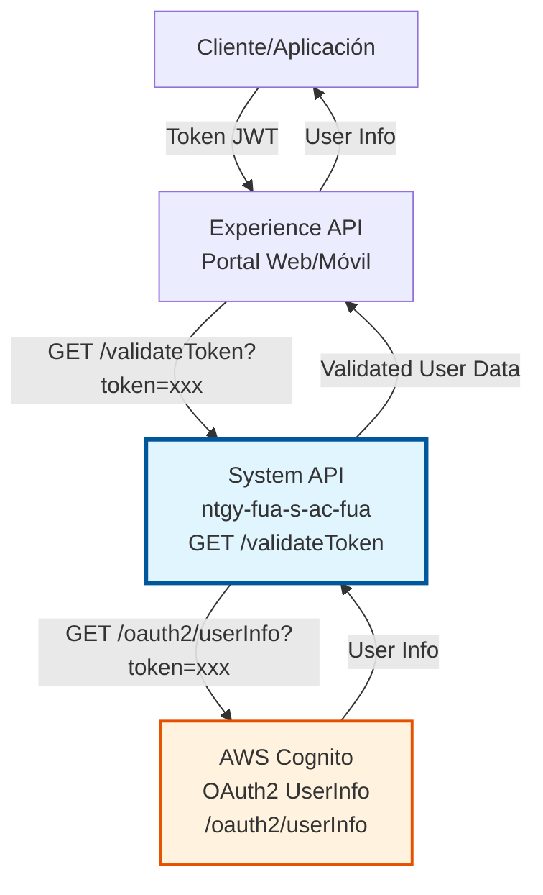
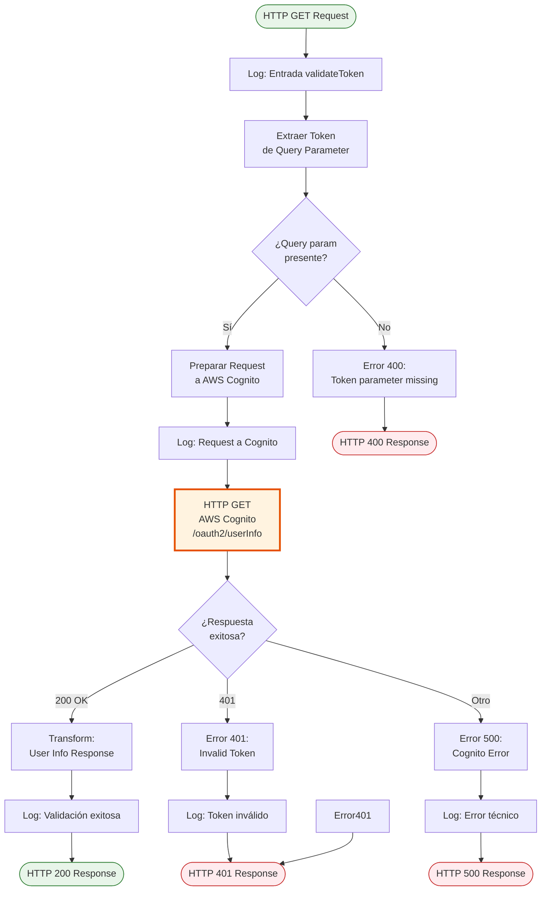
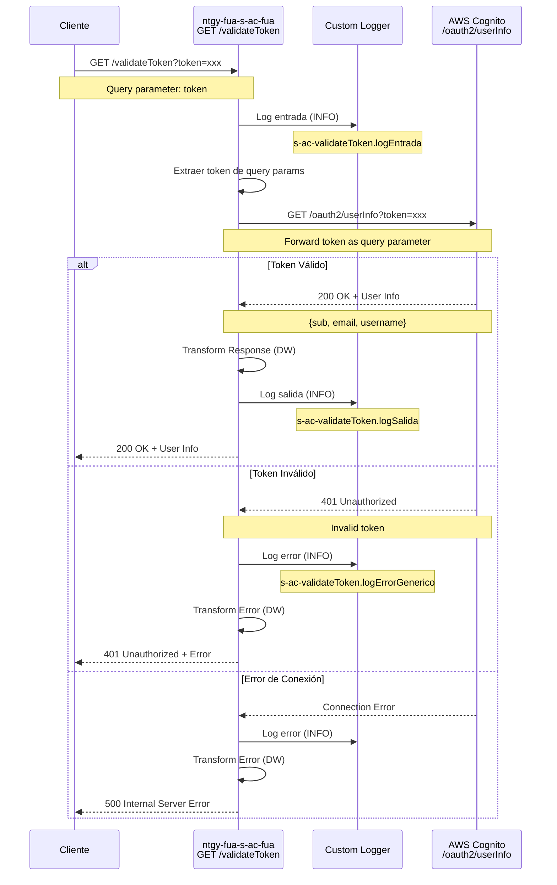

# GET /validateToken

## 📌 Descripción General

### Propósito del Endpoint

El endpoint **GET /validateToken** valida tokens JWT (JSON Web Tokens) emitidos por AWS Cognito y retorna información del usuario autenticado. Este endpoint es fundamental para verificar la autenticidad y validez de tokens de acceso en el ecosistema de autenticación de Naturgy.

El endpoint soporta:
- **Validación de Tokens JWT**: Verifica que el token sea válido y no haya expirado
- **Obtención de Información de Usuario**: Retorna datos del usuario autenticado (sub, email, username)
- **Verificación de Sesión**: Confirma que la sesión del usuario está activa
- **Integración con AWS Cognito**: Utiliza el endpoint OAuth2 UserInfo de AWS Cognito

### Tipo de API

**Capa:** System API (API-Led Connectivity)

**Función:** Integración directa con AWS Cognito para validación de tokens de autenticación y obtención de información de usuario.

### Patrón de Integración

**Tipo:** Request-Reply Síncrono con AWS Cognito OAuth2 UserInfo

**Descripción:** El endpoint recibe un token JWT como query parameter, lo reenvía al servicio OAuth2 UserInfo de AWS Cognito (también como query parameter), y retorna la información del usuario si el token es válido. En caso de token inválido o expirado, retorna un error 401.

### Arquitectura API-Led Connectivity



---

## 💼 Propósito del Negocio

### Casos de Uso Principales

1. **Validación de Sesión de Usuario**
   - Un usuario autenticado intenta acceder a recursos protegidos
   - El sistema valida que su token JWT sea válido y no haya expirado
   - Se confirma la identidad del usuario antes de permitir el acceso
   - **Beneficio:** Seguridad en el acceso a recursos protegidos

2. **Verificación de Identidad en Transacciones**
   - Antes de ejecutar operaciones sensibles (cambio de datos, pagos)
   - Se valida que el token del usuario sea legítimo
   - Se obtiene información actualizada del usuario
   - **Beneficio:** Prevención de fraude y accesos no autorizados

3. **Renovación de Contexto de Usuario**
   - Durante una sesión larga, se revalida periódicamente el token
   - Se actualiza la información del usuario si ha cambiado
   - Se detecta si el token ha sido revocado
   - **Beneficio:** Mantener sesiones seguras y actualizadas

### Contexto Empresarial

- **Dominio:** Seguridad y Autenticación
- **Sector:** Energía - Utilities
- **División:** Naturgy España - Área Cliente
- **Proceso de Negocio:** Gestión de Identidad y Acceso (IAM)
- **Sistema Externo:** AWS Cognito (Servicio de Autenticación)

### Stakeholders

- **Clientes Finales**: Usuarios que acceden al portal web o app móvil de Naturgy
- **Equipo de Seguridad**: Responsables de la gestión de identidades y accesos
- **Desarrolladores de Frontend**: Implementan la lógica de validación de tokens en aplicaciones
- **Equipo de Operaciones**: Monitorean y gestionan incidencias de autenticación

### Valor de Negocio

- **Seguridad Mejorada**: Validación centralizada de tokens reduce riesgo de accesos no autorizados
- **Experiencia de Usuario**: Validación rápida permite acceso fluido a recursos protegidos
- **Cumplimiento Normativo**: Trazabilidad de accesos para auditorías de seguridad
- **Escalabilidad**: Integración con AWS Cognito permite gestionar millones de usuarios

### Consumidores Potenciales

Este endpoint puede ser consumido por:
- Experience APIs de portales web y aplicaciones móviles
- Process APIs que requieren validación de identidad
- Middleware de autenticación y autorización
- Sistemas de monitoreo y auditoría de accesos
- Aplicaciones de terceros autorizados (con permisos)

---

## 🔧 Especificación Técnica

### URLs por Ambiente

| Ambiente | URL Base | URL Completa |
|----------|----------|--------------|
| **Local** | `http://localhost:8081` | `http://localhost:8081/api/validateToken` |
| **Development** | `https://ntgy-fua-s-ac-fua-dev.us-e2.cloudhub.io` | `https://ntgy-fua-s-ac-fua-dev.us-e2.cloudhub.io/api/validateToken` |
| **UAT** | `https://ntgy-fua-s-ac-fua-uat.us-e2.cloudhub.io` | `https://ntgy-fua-s-ac-fua-uat.us-e2.cloudhub.io/api/validateToken` |
| **Production** | `https://ntgy-fua-s-ac-fua-pro.us-e2.cloudhub.io` | `https://ntgy-fua-s-ac-fua-pro.us-e2.cloudhub.io/api/validateToken` |

### Método HTTP

```
GET /api/validateToken
```

### Parámetros de Entrada

#### Headers HTTP

| Header | Tipo | Requerido | Descripción | Ejemplo |
|--------|------|-----------|-------------|---------|
| `Accept` | string | ❌ No | Tipo de contenido esperado en response | `application/json` |

#### Query Parameters

| Parámetro | Tipo | Requerido | Descripción | Ejemplo |
|-----------|------|-----------|-------------|---------|
| `token` | string | ✅ Sí | Token JWT a validar | `eyJhbGciOiJSUzI1NiIsInR5cCI6IkpXVCJ9...` |

#### Body Parameters

Este endpoint **no requiere** body. Es una operación GET que recibe el token como query parameter.

### Respuestas

#### Respuesta Exitosa (200 OK)

Cuando el token es válido, el servicio retorna información del usuario:

```json
{
  "result": {
    "codResult": "0000",
    "msgResult": "Token validado correctamente"
  },
  "userid": "12345",
  "username": "usuario123",
  "email": "usuario@example.com"
}
```

**Campos de la Respuesta:**

| Campo | Tipo | Descripción |
|-------|------|-------------|
| `result` | object | Objeto con el resultado de la operación |
| `result.codResult` | string | Código del resultado (0000 = éxito) |
| `result.msgResult` | string | Mensaje descriptivo del resultado |
| `userid` | string | Identificador único del usuario |
| `username` | string | Nombre de usuario en el sistema |
| `email` | string | Dirección de email del usuario |

#### Respuesta de Error - Token Inválido (401 Unauthorized)

Cuando el token es inválido, expirado o ha sido revocado:

```json
{
  "error": "invalid_token",
  "error_description": "The access token provided is invalid"
}
```

#### Respuesta de Error - Token Faltante (401 Unauthorized)

Cuando no se proporciona el header de autorización:

```json
{
  "error": "unauthorized",
  "error_description": "Authorization header is missing"
}
```

#### Respuesta de Error Técnico (500 Internal Server Error)

Cuando hay un error en la comunicación con AWS Cognito:

```json
{
  "result": {
    "codResult": "0001",
    "msgResult": "Error al validar token con AWS Cognito"
  }
}
```

### Autenticación y Autorización

- **Tipo:** Query Parameter con JWT
- **Proveedor:** AWS Cognito
- **Formato:** `?token={jwt_token}`
- **Validación:** El token debe ser un JWT válido emitido por AWS Cognito
- **Expiración:** Los tokens típicamente expiran en 1 hora (configurable en Cognito)

### Timeouts

| Tipo | Valor | Descripción |
|------|-------|-------------|
| **Request Timeout** | 15 segundos | Tiempo máximo de espera para la respuesta de AWS Cognito |
| **Connection Timeout** | 15 segundos | Tiempo máximo para establecer conexión con AWS Cognito |

---

## 🏗️ Implementación Técnica

### Arquitectura del Flow



### Componentes del Flow

#### 1. Flow Principal: `get:\validateToken:ntgy-fua-s-ac-fua-config`

**Ubicación:** `src/main/mule/ntgy-fua-s-ac-fua.xml` (línea 28)

**Responsabilidad:** Recibir el request HTTP y delegar al subflow de implementación

```xml
<flow name="get:\validateToken:ntgy-fua-s-ac-fua-config">
    <logger level="DEBUG" message="ntgy-fua-s-ac-fua-post:\validateToken" />
    <flow-ref name="validateTokenFlow" />
</flow>
```

#### 2. Subflow de Implementación: `validateTokenFlow`

**Ubicación:** `src/main/mule/s-ac-validateToken.xml` (línea 5)

**Responsabilidad:** Lógica completa de validación de token

**Pasos:**
1. **Log de Entrada** (línea 6): Registra parámetros de entrada
2. **HTTP Request a AWS Cognito** (líneas 7-17): Llama al endpoint OAuth2 UserInfo
3. **Transformación de Respuesta** (líneas 18-22): Formatea la respuesta de Cognito
4. **Log de Salida** (línea 23): Registra respuesta exitosa
5. **Error Handler** (líneas 25-31): Maneja errores y retorna respuestas apropiadas

### Integración con AWS Cognito

#### Configuración HTTP

**Config Reference:** `HTTP_Request_configuration_AC`

**Detalles de Conexión:**
- **Host:** `rov.intranet.gasnatural.com`
- **Port:** 443 (HTTPS)
- **Protocol:** HTTPS con TLS 1.2+
- **Timeout:** 15 segundos

#### Endpoint AWS Cognito

**Path:** `/oauth2/userInfo` (configurado en `${ac.path.validateToken}`)

**Configuración en YAML** (`ntgy-fua-s-ac-fua-pro-config.yaml`):
```yaml
ac:
  path:
    validateToken: "/oauth2/userInfo"
```

**Método:** GET

**Query Parameters Enviados:**
```dataweave
{
  "token": attributes.queryParams.token
}
```

El token recibido como query parameter se reenvía directamente al servicio de AWS Cognito también como query parameter.

### Transformación de Datos

#### Transformación de Respuesta Exitosa

**Ubicación:** `s-ac-validateToken.xml` (líneas 18-22)

**DataWeave:**
```dataweave
%dw 2.0
output application/json
---
payload
```

La respuesta del servicio de validación se retorna con la estructura estándar del API:

```json
{
  "result": {
    "codResult": "0000",
    "msgResult": "Token validado correctamente"
  },
  "userid": "12345",
  "username": "usuario123",
  "email": "usuario@example.com"
}
```

**Nota:** El código retorna el payload directamente sin transformación adicional (pass-through), por lo que la estructura depende del servicio backend de AWS Cognito.

#### Transformación de Error

**Ubicación:** `s-ac-validateToken.xml` (líneas 28-30)

**DataWeave:**
```dataweave
%dw 2.0
output application/json
---
{
  error: "Error genérico en validación de token"
}
```

### Manejo de Errores

#### Error Handler Global

**Ubicación:** `s-ac-validateToken.xml` (líneas 25-31)

**Tipo:** `on-error-propagate` (propaga el error al cliente)

**Estrategia:**
1. **Log del Error:** Registra payload, attributes y error completo
2. **Transformación:** Convierte el error a formato JSON estándar
3. **Propagación:** Retorna el error al cliente con código HTTP apropiado

**Tipos de Errores Manejados:**
- `HTTP:UNAUTHORIZED` (401): Token inválido o expirado
- `HTTP:CONNECTIVITY` (500): Error de conexión con AWS Cognito
- `ANY` (500): Cualquier otro error no esperado

### Diagrama de Secuencia Detallado



### Logging y Trazabilidad

#### Puntos de Logging

1. **Log de Entrada** (línea 6):
   ```
   s-ac-validateToken.logEntrada #[attributes.queryParams]
   ```
   - **Nivel:** INFO
   - **Contenido:** Query parameters (aunque este endpoint no los usa)

2. **Log de Salida Exitosa** (línea 23):
   ```
   s-ac-validateToken.logSalida ## payload:#[payload]
   ```
   - **Nivel:** INFO
   - **Contenido:** Payload de respuesta (user info)

3. **Log de Error** (línea 27):
   ```
   s-ac-validateToken.logErrorGenerico payload:#[payload] ## attributes: #[attributes] ## error: #[error]
   ```
   - **Nivel:** INFO
   - **Contenido:** Payload, attributes y error completo

#### Información de Trazabilidad

Cada log incluye automáticamente (vía custom logger extension):
- **Timestamp:** Fecha y hora del evento
- **Correlation ID:** Identificador único del request
- **Flow Name:** Nombre del flow ejecutándose
- **Application Name:** ntgy-fua-s-ac-fua
- **Environment:** dev/uat/pro

### Configuración de Propiedades

#### Propiedades de Producción

**Archivo:** `ntgy-fua-s-ac-fua-pro-config.yaml`

```yaml
ac:
  host: "rov.intranet.gasnatural.com"
  port: "443"
  protocol: "HTTPS"
  path:
    validateToken: "/oauth2/userInfo"
```

#### Propiedades de Desarrollo

Las mismas propiedades se configuran en archivos específicos por ambiente:
- `ntgy-fua-s-ac-fua-dev-config.yaml`
- `ntgy-fua-s-ac-fua-uat-config.yaml`

---

## 💻 Ejemplos de Uso

### Ejemplo 1: Validación Exitosa de Token

#### Request

```bash
curl -X GET "https://ntgy-fua-s-ac-fua-pro.us-e2.cloudhub.io/api/validateToken?token=eyJhbGciOiJSUzI1NiIsInR5cCI6IkpXVCJ9.eyJzdWIiOiJhMWIyYzNkNC1lNWY2LTc4OTAtYWJjZC1lZjEyMzQ1Njc4OTAiLCJlbWFpbF92ZXJpZmllZCI6dHJ1ZSwiZW1haWwiOiJ1c3VhcmlvQGV4YW1wbGUuY29tIiwidXNlcm5hbWUiOiJ1c3VhcmlvMTIzIiwiaWF0IjoxNjQwOTk1MjAwLCJleHAiOjE2NDA5OTg4MDB9.signature" \
  -H "Accept: application/json"
```

#### Response (200 OK)

```json
{
  "result": {
    "codResult": "0000",
    "msgResult": "Token validado correctamente"
  },
  "userid": "12345",
  "username": "usuario123",
  "email": "usuario@example.com"
}
```

**Interpretación:**
- El token es válido (`codResult: "0000"`)
- El usuario está identificado por el `userid`
- Se retorna el username y email del usuario
- El mensaje confirma la validación exitosa

---

### Ejemplo 2: Token Inválido o Expirado

#### Request

```bash
curl -X GET "https://ntgy-fua-s-ac-fua-pro.us-e2.cloudhub.io/api/validateToken?token=token_invalido_o_expirado" \
  -H "Accept: application/json"
```

#### Response (401 Unauthorized)

```json
{
  "error": "invalid_token",
  "error_description": "The access token provided is invalid"
}
```

**Interpretación:**
- El token no es válido o ha expirado
- AWS Cognito rechazó el token
- El cliente debe obtener un nuevo token mediante `/login`

---

### Ejemplo 3: Query Parameter Faltante

#### Request

```bash
curl -X GET "https://ntgy-fua-s-ac-fua-pro.us-e2.cloudhub.io/api/validateToken" \
  -H "Accept: application/json"
```

#### Response (400 Bad Request)

```json
{
  "result": {
    "codResult": "-0001",
    "msgResult": "Error técnico"
  }
}
```

**Interpretación:**
- No se proporcionó el query parameter `token`
- El request es rechazado por falta de parámetro requerido
- El cliente debe incluir el token como query parameter

---

### Ejemplo 4: Error de Conexión con AWS Cognito

#### Request

```bash
curl -X GET "https://ntgy-fua-s-ac-fua-pro.us-e2.cloudhub.io/api/validateToken?token=eyJhbGciOiJSUzI1NiIsInR5cCI6IkpXVCJ9..." \
  -H "Accept: application/json"
```

#### Response (500 Internal Server Error)

```json
{
  "result": {
    "codResult": "0001",
    "msgResult": "Error al validar token con AWS Cognito"
  }
}
```

**Interpretación:**
- Hubo un error de conectividad con AWS Cognito
- El servicio de AWS Cognito no está disponible temporalmente
- El cliente debe reintentar la operación

---

### Ejemplo 5: Uso en JavaScript (Frontend)

```javascript
async function validateToken(token) {
  try {
    const response = await fetch(
      `https://ntgy-fua-s-ac-fua-pro.us-e2.cloudhub.io/api/validateToken?token=${encodeURIComponent(token)}`,
      {
        method: 'GET',
        headers: {
          'Accept': 'application/json'
        }
      }
    );

    if (response.ok) {
      const data = await response.json();
      if (data.result.codResult === "0000") {
        console.log('Token válido. Usuario:', data.username);
        console.log('Email:', data.email);
        console.log('User ID:', data.userid);
        return data;
      } else {
        console.error('Error en validación:', data.result.msgResult);
        return null;
      }
    } else if (response.status === 401) {
      console.error('Token inválido o expirado');
      // Redirigir a login
      window.location.href = '/login';
      return null;
    } else {
      console.error('Error al validar token:', response.status);
      return null;
    }
  } catch (error) {
    console.error('Error de red:', error);
    return null;
  }
}

// Uso
const token = localStorage.getItem('access_token');
if (token) {
  const userInfo = await validateToken(token);
  if (userInfo) {
    // Token válido, continuar con la aplicación
    console.log('Usuario autenticado:', userInfo.username);
  }
}
```

---

### Ejemplo 6: Uso en Python (Backend)

```python
import requests

def validate_token(token):
    """
    Valida un token JWT con AWS Cognito
    
    Args:
        token (str): Token JWT a validar
        
    Returns:
        dict: Información del usuario si el token es válido
        None: Si el token es inválido o hay error
    """
    url = "https://ntgy-fua-s-ac-fua-pro.us-e2.cloudhub.io/api/validateToken"
    params = {
        "token": token
    }
    headers = {
        "Accept": "application/json"
    }
    
    try:
        response = requests.get(url, params=params, headers=headers, timeout=15)
        
        if response.status_code == 200:
            data = response.json()
            if data['result']['codResult'] == "0000":
                print(f"Token válido. Usuario: {data['username']}")
                print(f"Email: {data['email']}")
                print(f"User ID: {data['userid']}")
                return data
            else:
                print(f"Error en validación: {data['result']['msgResult']}")
                return None
        elif response.status_code == 401:
            print("Token inválido o expirado")
            return None
        else:
            print(f"Error al validar token: {response.status_code}")
            return None
    except requests.exceptions.RequestException as e:
        print(f"Error de conexión: {e}")
        return None

# Uso
token = "eyJhbGciOiJSUzI1NiIsInR5cCI6IkpXVCJ9..."
data = validate_token(token)
if data:
    print(f"Usuario autenticado: {data['username']}")
    print(f"Email: {data['email']}")
    print(f"User ID: {data['userid']}")
else:
    print("Token inválido, redirigir a login")
```
