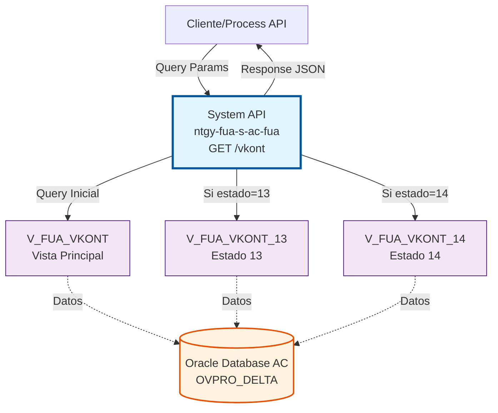
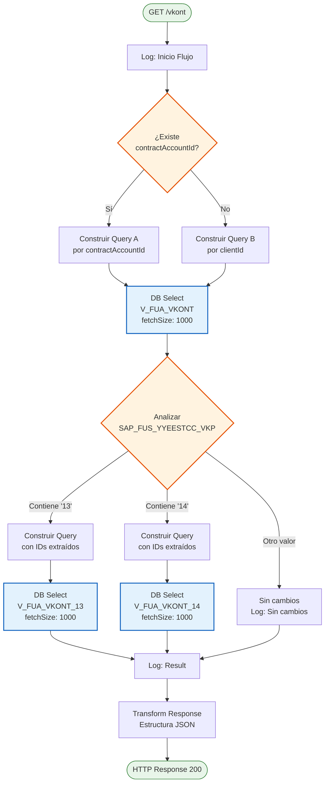
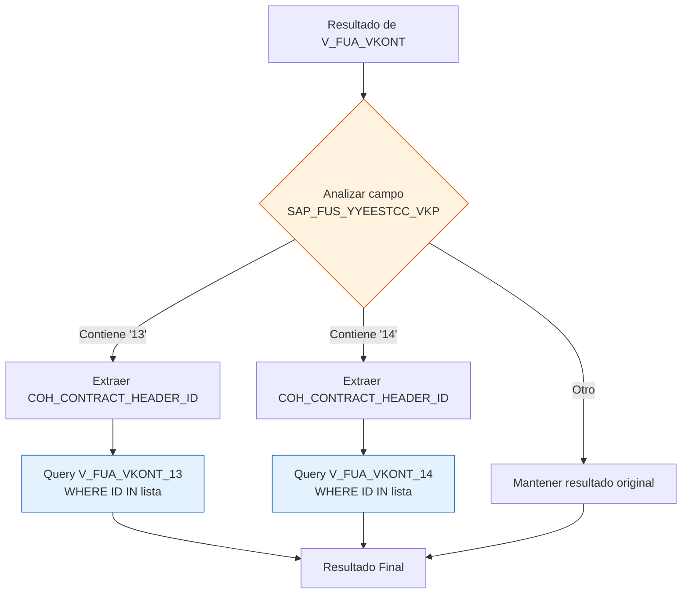
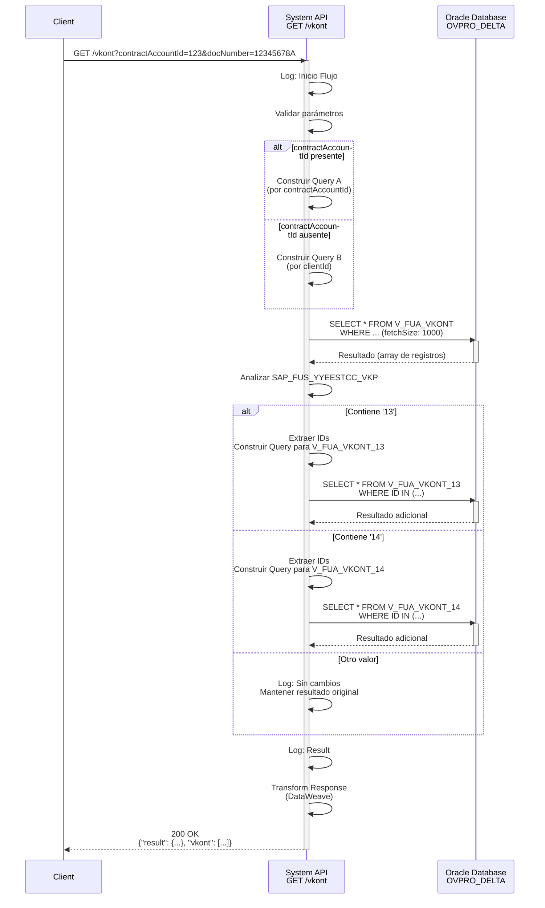

# GET /vkont

## 📌 Descripción General

### Propósito del Endpoint

Este endpoint consulta información de cuentas de contrato (VKONT) desde la base de datos Oracle AC, implementando una lógica condicional compleja que adapta las consultas según los parámetros de entrada y el estado del contrato.

El endpoint soporta:
- **Consulta por ID de Contrato**: Búsqueda directa usando `contractAccountId`
- **Consulta por ID de Cliente**: Búsqueda alternativa usando `clientId`
- **Consultas Condicionales Adicionales**: Queries específicas según el estado del contrato (13 o 14)
- **Filtrado por Documento**: Todas las consultas requieren el número de documento del cliente

### Tipo de API

**Capa:** System API (API-Led Connectivity)

**Función:** Integración directa con Oracle Database AC para consulta de cuentas de contrato con lógica de negocio específica según estados.

### Patrón de Integración

**Tipo:** Request-Reply Síncrono con Consultas SQL Condicionales

**Descripción:** El endpoint recibe parámetros de búsqueda, ejecuta una consulta inicial a la vista `V_FUA_VKONT`, analiza el campo `SAP_FUS_YYEESTCC_VKP` del resultado, y si contiene los valores '13' o '14', ejecuta una segunda consulta a vistas específicas (`V_FUA_VKONT_13` o `V_FUA_VKONT_14`) para obtener información adicional.

### Arquitectura API-Led Connectivity



---

## 💼 Propósito del Negocio

### Casos de Uso Principales

1. **Consulta de Cuenta de Contrato por ID**
   - Un sistema necesita obtener información completa de una cuenta de contrato específica
   - Se proporciona el `contractAccountId` y el `docNumber` del cliente
   - El sistema retorna todos los datos de la cuenta de contrato

2. **Consulta de Cuentas por Cliente**
   - Un sistema necesita listar todas las cuentas de contrato asociadas a un cliente
   - Se proporciona el `clientId` y el `docNumber` del cliente
   - El sistema retorna todas las cuentas de contrato del cliente

3. **Consulta con Información Adicional según Estado**
   - Para contratos con estados específicos (13 o 14), se requiere información adicional
   - El sistema detecta automáticamente el estado y ejecuta consultas adicionales
   - Se retorna información enriquecida según el estado del contrato

### Contexto Empresarial

- **Dominio:** Gestión de Clientes y Contratos
- **Sector:** Energía - Utilities
- **División:** Naturgy España - Área Cliente (AC)
- **Proceso de Negocio:** Consulta de información de cuentas de contrato para gestión de clientes
- **Sistema Origen:** Oracle Database AC (OVPRO_DELTA)

### Stakeholders

- **Equipos de Atención al Cliente**: Necesitan consultar información de cuentas de contrato para resolver consultas
- **Sistemas de Facturación**: Requieren datos de cuentas de contrato para procesos de facturación
- **Portales de Autoservicio**: Permiten a clientes consultar sus cuentas de contrato
- **Sistemas de Integración**: Process APIs que orquestan flujos de negocio complejos

### Valor de Negocio

- **Flexibilidad de Consulta**: Permite búsquedas por ID de contrato o ID de cliente
- **Información Contextual**: Proporciona datos adicionales según el estado del contrato
- **Optimización de Consultas**: Ejecuta queries específicas solo cuando es necesario
- **Consistencia de Datos**: Acceso centralizado a información de cuentas de contrato

### Consumidores Potenciales

Este endpoint puede ser consumido por:
- Process APIs de gestión de clientes
- Process APIs de facturación
- Experience APIs de portales web y móviles
- Sistemas de integración middleware
- Flujos de Salesforce que requieren datos de AC

---

## 🔧 Especificación Técnica

### URLs por Ambiente

| Ambiente | URL Base | URL Completa |
|----------|----------|--------------|
| **Local** | `http://localhost:8081` | `http://localhost:8081/api/vkont` |
| **Development** | `https://ntgy-fua-s-ac-fua-dev.us-e2.cloudhub.io` | `https://ntgy-fua-s-ac-fua-dev.us-e2.cloudhub.io/api/vkont` |
| **UAT** | `https://ntgy-fua-s-ac-fua-uat.us-e2.cloudhub.io` | `https://ntgy-fua-s-ac-fua-uat.us-e2.cloudhub.io/api/vkont` |
| **Production** | `https://ntgy-fua-s-ac-fua-pro.us-e2.cloudhub.io` | `https://ntgy-fua-s-ac-fua-pro.us-e2.cloudhub.io/api/vkont` |

### Método HTTP

```
GET /api/vkont
```

### Parámetros de Entrada

#### Headers HTTP

| Header | Tipo | Requerido | Descripción | Ejemplo |
|--------|------|-----------|-------------|---------|
| `Accept` | string | ❌ No | Tipo de contenido esperado en response | `application/json` |

#### Query Parameters

| Parámetro | Tipo | Requerido | Descripción | Ejemplo |
|-----------|------|-----------|-------------|---------|
| `contractAccountId` | string | ⚠️ Condicional | ID del contrato (si se proporciona, se usa en lugar de clientId) | `"12345678"` |
| `clientId` | string | ⚠️ Condicional | ID del cliente (se usa si no hay contractAccountId) | `"CLI001"` |
| `docNumber` | string | ✅ Sí | Número de documento del cliente (NIF/NIE) | `"12345678A"` |

**Lógica de Parámetros:**
- **Opción A**: Proporcionar `contractAccountId` + `docNumber` → Busca por ID de contrato
- **Opción B**: Proporcionar `clientId` + `docNumber` → Busca por ID de cliente
- Al menos uno de los dos (`contractAccountId` o `clientId`) debe estar presente

### Respuestas

#### Respuesta Exitosa (200 OK)

```json
{
  "result": {
    "codResult": "0000",
    "msgResult": "No hay error"
  },
  "vkont": [
    {
      "COH_CONTRACT_HEADER_ID": "12345678",
      "CLI_CLIENT_ID": "CLI001",
      "CLI_DOCUMENT": "12345678A",
      "SAP_FUS_YYEESTCC_VKP": "13",
      "VKONT": "200012345678",
      "GPART": "1000123456",
      "VKONA": "CUENTA PRINCIPAL",
      "ADATSOLL": "2024-01-01",
      "ADATBIS": "9999-12-31"
    }
  ]
}
```

#### Respuesta Sin Resultados (200 OK)

```json
{
  "result": {
    "codResult": "0000",
    "msgResult": "No hay error"
  },
  "vkont": []
}
```

#### Respuesta de Error Técnico (500)

```json
{
  "result": {
    "codResult": "0001",
    "msgResult": "Error interno del servidor"
  }
}
```

### Autenticación y Autorización

- **Tipo:** Client ID & Client Secret (Anypoint Platform)
- **Autorización Oracle:** El usuario de base de datos debe tener permisos para:
  - Acceso de lectura a vista `V_FUA_VKONT`
  - Acceso de lectura a vista `V_FUA_VKONT_13`
  - Acceso de lectura a vista `V_FUA_VKONT_14`
  - Schema: `OVPRO_DELTA`

### Timeouts

| Tipo | Valor | Descripción |
|------|-------|-------------|
| **Query Timeout** | 15 segundos | Configurado en `${dbAC.queryTimeout}` |
| **Connection Timeout** | 3600 segundos | Tiempo máximo para establecer conexión con BD |

---

## 🏗️ Implementación Técnica

### Arquitectura del Flow



### Componentes Principales

#### 1. Validación y Construcción de Query Inicial

**Ubicación:** Líneas 11-35 del flow XML

**Lógica:**
- **Choice 1**: Si existe `contractAccountId` → Query por ID de contrato
- **Choice 2**: Si NO existe `contractAccountId` → Query por ID de cliente

**Query A (por contractAccountId):**
```sql
SELECT * FROM V_FUA_VKONT 
WHERE coh_contract_header_id = '[contractAccountId]' 
  AND CLI_DOCUMENT = '[docNumber]'
```

**Query B (por clientId):**
```sql
SELECT * FROM V_FUA_VKONT 
WHERE CLI_CLIENT_ID = '[clientId]' 
  AND CLI_DOCUMENT = '[docNumber]'
```

#### 2. Ejecución de Query Principal

**Ubicación:** Líneas 36-39 del flow XML

**Configuración:**
```xml
<db:select config-ref="Database_Config" 
           queryTimeout="${dbAC.queryTimeout}" 
           fetchSize="1000">
    <ee:repeatable-file-store-iterable inMemoryObjects="1000" />
    <db:sql>#[vars.query]</db:sql>
</db:select>
```

**Características:**
- **Fetch Size:** 1000 registros por lote
- **In-Memory Objects:** 1000 objetos en memoria
- **Repeatable Iterable:** Permite múltiples iteraciones sobre el resultado

#### 3. Análisis de Estado y Query Condicional

**Ubicación:** Líneas 40-72 del flow XML

**Lógica de Decisión:**



**Query para Estado 13:**
```sql
SELECT * FROM V_FUA_VKONT_13 
WHERE COH_CONTRACT_HEADER_ID IN ('[id1]', '[id2]', ...)
```

**Query para Estado 14:**
```sql
SELECT * FROM V_FUA_VKONT_14 
WHERE COH_CONTRACT_HEADER_ID IN ('[id1]', '[id2]', ...)
```

#### 4. Transformación de Respuesta

**Ubicación:** Líneas 74-85 del flow XML

**DataWeave:**
```dataweave
%dw 2.0
output application/json
---
{
    "result": {
        "codResult": "0000",
        "msgResult": "No hay error"	
    },
    "vkont": payload
}
```

### Vistas de Base de Datos

#### Vista Principal: V_FUA_VKONT

**Propósito:** Vista consolidada de cuentas de contrato

**Campos Clave:**
- `COH_CONTRACT_HEADER_ID`: ID del contrato
- `CLI_CLIENT_ID`: ID del cliente
- `CLI_DOCUMENT`: Documento del cliente
- `SAP_FUS_YYEESTCC_VKP`: Estado del contrato (determina queries adicionales)
- `VKONT`: Número de cuenta de contrato SAP
- `GPART`: Business Partner
- `VKONA`: Nombre de la cuenta
- `ADATSOLL`: Fecha desde
- `ADATBIS`: Fecha hasta

#### Vista Condicional: V_FUA_VKONT_13

**Propósito:** Información adicional para contratos con estado '13'

**Uso:** Se consulta automáticamente cuando el resultado de `V_FUA_VKONT` contiene el valor '13' en el campo `SAP_FUS_YYEESTCC_VKP`

#### Vista Condicional: V_FUA_VKONT_14

**Propósito:** Información adicional para contratos con estado '14'

**Uso:** Se consulta automáticamente cuando el resultado de `V_FUA_VKONT` contiene el valor '14' en el campo `SAP_FUS_YYEESTCC_VKP`

### Diagrama de Secuencia Completo



### Manejo de Errores

**Error Handler Global:** `s-ac-globalErrorHandler.xml`

**Tipos de Error:**
- **DB:CONNECTIVITY**: Error de conexión a base de datos
- **DB:QUERY_EXECUTION**: Error en ejecución de query
- **DB:TIMEOUT**: Timeout en query (> 15 segundos)

**Respuesta de Error:**
```json
{
  "result": {
    "codResult": "0001",
    "msgResult": "Error interno del servidor"
  }
}
```

### Configuración de Base de Datos

**Connection Config:** `Database_Config`

**Parámetros:**
- **Host Primary:** `${dbAC.host1}`
- **Host Secondary:** `${dbAC.host2}` (High Availability)
- **Port:** `${dbAC.port}` (1521)
- **Service Name:** `${dbAC.serviceName}`
- **User:** `${dbAC.user}`
- **Password:** `${dbAC.pass}` (encriptado)
- **Query Timeout:** `${dbAC.queryTimeout}` (15 segundos)
- **Max Pool Size:** 15 conexiones
- **Max Wait Time:** 300 segundos

---

## 💻 Ejemplos de Uso

### Ejemplo 1: Consulta por ID de Contrato

#### Request

```bash
curl -X GET "https://ntgy-fua-s-ac-fua-pro.us-e2.cloudhub.io/api/vkont?contractAccountId=12345678&docNumber=12345678A" \
  -H "Accept: application/json" \
  -H "client_id: YOUR_CLIENT_ID" \
  -H "client_secret: YOUR_CLIENT_SECRET"
```

#### Response (200 OK)

```json
{
  "result": {
    "codResult": "0000",
    "msgResult": "No hay error"
  },
  "vkont": [
    {
      "COH_CONTRACT_HEADER_ID": "12345678",
      "CLI_CLIENT_ID": "CLI001",
      "CLI_DOCUMENT": "12345678A",
      "SAP_FUS_YYEESTCC_VKP": "13",
      "VKONT": "200012345678",
      "GPART": "1000123456",
      "VKONA": "CUENTA PRINCIPAL GAS",
      "ADATSOLL": "2024-01-01",
      "ADATBIS": "9999-12-31",
      "DIVISION": "01",
      "PRODUCT_TYPE": "GAS"
    }
  ]
}
```

**Nota:** Como el campo `SAP_FUS_YYEESTCC_VKP` contiene '13', el sistema ejecutó automáticamente una consulta adicional a `V_FUA_VKONT_13` para obtener información enriquecida.

### Ejemplo 2: Consulta por ID de Cliente

#### Request

```bash
curl -X GET "https://ntgy-fua-s-ac-fua-pro.us-e2.cloudhub.io/api/vkont?clientId=CLI001&docNumber=12345678A" \
  -H "Accept: application/json" \
  -H "client_id: YOUR_CLIENT_ID" \
  -H "client_secret: YOUR_CLIENT_SECRET"
```

#### Response (200 OK) - Múltiples Contratos

```json
{
  "result": {
    "codResult": "0000",
    "msgResult": "No hay error"
  },
  "vkont": [
    {
      "COH_CONTRACT_HEADER_ID": "12345678",
      "CLI_CLIENT_ID": "CLI001",
      "CLI_DOCUMENT": "12345678A",
      "SAP_FUS_YYEESTCC_VKP": "14",
      "VKONT": "200012345678",
      "GPART": "1000123456",
      "VKONA": "CUENTA PRINCIPAL GAS",
      "ADATSOLL": "2024-01-01",
      "ADATBIS": "9999-12-31"
    },
    {
      "COH_CONTRACT_HEADER_ID": "87654321",
      "CLI_CLIENT_ID": "CLI001",
      "CLI_DOCUMENT": "12345678A",
      "SAP_FUS_YYEESTCC_VKP": "14",
      "VKONT": "200087654321",
      "GPART": "1000123456",
      "VKONA": "CUENTA SECUNDARIA ELECTRICIDAD",
      "ADATSOLL": "2024-06-01",
      "ADATBIS": "9999-12-31"
    }
  ]
}
```

**Nota:** Como ambos contratos tienen `SAP_FUS_YYEESTCC_VKP` = '14', el sistema ejecutó una consulta adicional a `V_FUA_VKONT_14`.

### Ejemplo 3: Consulta Sin Resultados

#### Request

```bash
curl -X GET "https://ntgy-fua-s-ac-fua-pro.us-e2.cloudhub.io/api/vkont?contractAccountId=99999999&docNumber=99999999Z" \
  -H "Accept: application/json" \
  -H "client_id: YOUR_CLIENT_ID" \
  -H "client_secret: YOUR_CLIENT_SECRET"
```

#### Response (200 OK)

```json
{
  "result": {
    "codResult": "0000",
    "msgResult": "No hay error"
  },
  "vkont": []
}
```

### Ejemplo 4: Error - Parámetros Faltantes

#### Request

```bash
curl -X GET "https://ntgy-fua-s-ac-fua-pro.us-e2.cloudhub.io/api/vkont?docNumber=12345678A" \
  -H "Accept: application/json" \
  -H "client_id: YOUR_CLIENT_ID" \
  -H "client_secret: YOUR_CLIENT_SECRET"
```

**Nota:** Falta `contractAccountId` o `clientId`

#### Response (400 Bad Request)

```json
{
  "message": "Bad request"
}
```

### Ejemplo 5: Consulta con Estado Sin Queries Adicionales

#### Request

```bash
curl -X GET "https://ntgy-fua-s-ac-fua-pro.us-e2.cloudhub.io/api/vkont?contractAccountId=11111111&docNumber=11111111A" \
  -H "Accept: application/json" \
  -H "client_id: YOUR_CLIENT_ID" \
  -H "client_secret: YOUR_CLIENT_SECRET"
```

#### Response (200 OK)

```json
{
  "result": {
    "codResult": "0000",
    "msgResult": "No hay error"
  },
  "vkont": [
    {
      "COH_CONTRACT_HEADER_ID": "11111111",
      "CLI_CLIENT_ID": "CLI002",
      "CLI_DOCUMENT": "11111111A",
      "SAP_FUS_YYEESTCC_VKP": "01",
      "VKONT": "200011111111",
      "GPART": "1000111111",
      "VKONA": "CUENTA ESTÁNDAR",
      "ADATSOLL": "2024-03-01",
      "ADATBIS": "9999-12-31"
    }
  ]
}
```

**Nota:** Como `SAP_FUS_YYEESTCC_VKP` = '01' (no es '13' ni '14'), el sistema retorna solo el resultado de la query inicial sin ejecutar consultas adicionales.

### Ejemplo 6: Uso desde JavaScript

```javascript
const getVkont = async (contractAccountId, docNumber) => {
  const url = new URL('https://ntgy-fua-s-ac-fua-pro.us-e2.cloudhub.io/api/vkont');
  url.searchParams.append('contractAccountId', contractAccountId);
  url.searchParams.append('docNumber', docNumber);
  
  const response = await fetch(url, {
    method: 'GET',
    headers: {
      'Accept': 'application/json',
      'client_id': 'YOUR_CLIENT_ID',
      'client_secret': 'YOUR_CLIENT_SECRET'
    }
  });
  
  if (!response.ok) {
    throw new Error(`HTTP error! status: ${response.status}`);
  }
  
  const data = await response.json();
  return data.vkont;
};

// Uso
try {
  const vkontList = await getVkont('12345678', '12345678A');
  console.log('Cuentas de contrato:', vkontList);
} catch (error) {
  console.error('Error al consultar VKONT:', error);
}
```

### Ejemplo 7: Uso desde Python

```python
import requests

def get_vkont(contract_account_id=None, client_id=None, doc_number=None):
    """
    Consulta cuentas de contrato (VKONT)
    
    Args:
        contract_account_id: ID del contrato (opcional)
        client_id: ID del cliente (opcional)
        doc_number: Número de documento (requerido)
    
    Returns:
        Lista de cuentas de contrato
    """
    url = 'https://ntgy-fua-s-ac-fua-pro.us-e2.cloudhub.io/api/vkont'
    
    params = {'docNumber': doc_number}
    if contract_account_id:
        params['contractAccountId'] = contract_account_id
    elif client_id:
        params['clientId'] = client_id
    else:
        raise ValueError('Debe proporcionar contractAccountId o clientId')
    
    headers = {
        'Accept': 'application/json',
        'client_id': 'YOUR_CLIENT_ID',
        'client_secret': 'YOUR_CLIENT_SECRET'
    }
    
    response = requests.get(url, params=params, headers=headers)
    response.raise_for_status()
    
    data = response.json()
    return data.get('vkont', [])

# Uso
try:
    vkont_list = get_vkont(contract_account_id='12345678', doc_number='12345678A')
    print(f'Encontradas {len(vkont_list)} cuentas de contrato')
    for vkont in vkont_list:
        print(f"  - {vkont['VKONT']}: {vkont['VKONA']}")
except Exception as e:
    print(f'Error: {e}')