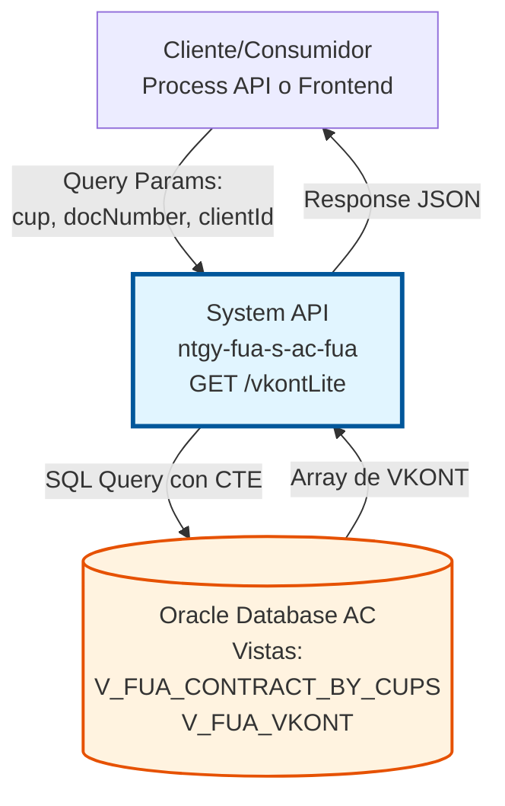
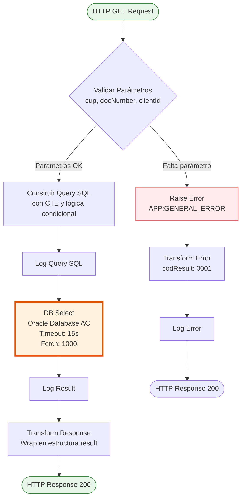
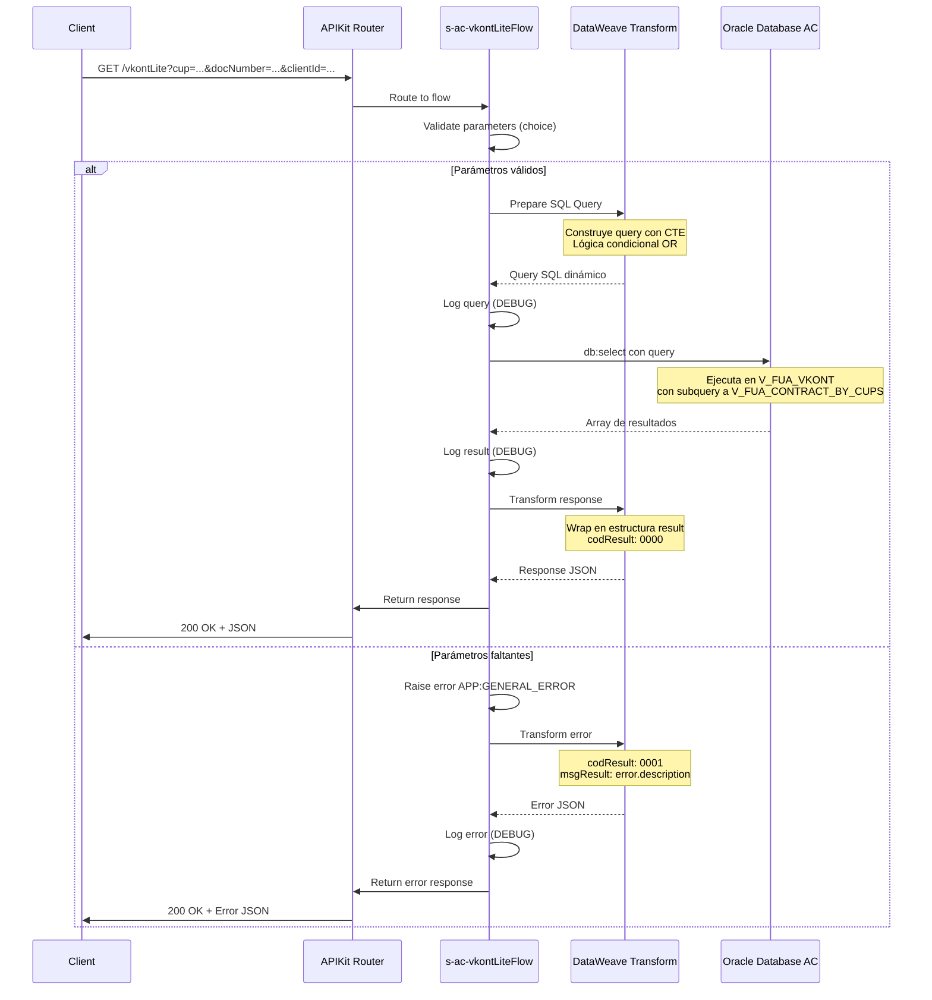
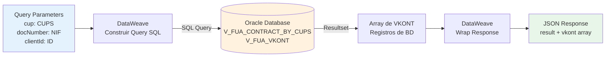

# GET /vkontLite

## 📌 Descripción General

### Propósito del Endpoint

Endpoint de consulta simplificada (versión "lite") de cuentas contrato SAP (VKONT) desde la base de datos Oracle del Área Cliente. Proporciona acceso optimizado a información de cuentas contrato mediante búsqueda por CUPS (Código Universal del Punto de Suministro) y documento del cliente.

El endpoint soporta:
- **Consulta por CUPS y Documento**: Búsqueda de VKONT asociados a un CUPS específico y documento de cliente
- **Lógica Condicional Inteligente**: Si existe contrato por CUPS, busca por contract header; si no, busca por client ID
- **Respuesta Optimizada**: Retorna solo campos esenciales de la cuenta contrato para consultas rápidas
- **Query con CTE**: Utiliza Common Table Expression para optimizar la consulta en Oracle

### Tipo de API

**Capa:** System API (API-Led Connectivity)

**Función:** Integración directa con Oracle Database AC para consulta optimizada de cuentas contrato SAP (VKONT) mediante vistas consolidadas.

### Patrón de Integración

**Tipo:** Request-Reply Síncrono con SQL Query (Oracle Database)

**Descripción:** Recibe parámetros de búsqueda (CUPS, documento, clientId), construye query SQL dinámica con lógica condicional, ejecuta consulta en vistas Oracle consolidadas y retorna array de cuentas contrato encontradas.

### Arquitectura API-Led Connectivity



---

## 💼 Propósito del Negocio

### Casos de Uso Principales

1. **Consulta Rápida de Cuentas Contrato por CUPS**
   - Un cliente o agente necesita consultar las cuentas contrato asociadas a un punto de suministro específico
   - Se proporciona el CUPS y documento del cliente
   - El sistema retorna todas las cuentas contrato (VKONT) relacionadas

2. **Validación de Relación Cliente-Contrato**
   - Verificar que un cliente específico tiene contratos asociados a determinados CUPS
   - Útil en procesos de alta, baja o modificación de contratos
   - Permite validar la titularidad antes de operaciones críticas

3. **Búsqueda Alternativa por Client ID**
   - Si no existe relación directa por CUPS, busca por identificador de cliente
   - Permite encontrar cuentas contrato incluso cuando la relación CUPS no está establecida
   - Útil en procesos de migración o consolidación de datos

### Contexto Empresarial

- **Dominio:** Gestión de Contratos y Cuentas Cliente
- **Sector:** Energía - Utilities (Gas y Electricidad)
- **División:** Naturgy España - Área Cliente
- **Proceso de Negocio:** Consulta de información contractual para gestión de clientes
- **Sistema Origen:** SAP ISU (datos almacenados en Oracle AC)

### Stakeholders

- **Agentes de Atención al Cliente**: Necesitan consultar rápidamente las cuentas contrato de un cliente
- **Sistemas de Frontal de Ventas**: Requieren validar contratos existentes antes de crear nuevos
- **Portales de Autoservicio**: Clientes consultan sus propias cuentas contrato
- **Sistemas de Facturación**: Necesitan identificar cuentas contrato para procesos de billing

### Valor de Negocio

- **Rapidez**: Consulta optimizada con vistas consolidadas reduce tiempo de respuesta
- **Flexibilidad**: Lógica condicional permite encontrar datos por múltiples criterios
- **Precisión**: Acceso directo a datos de SAP ISU garantiza información actualizada
- **Eficiencia**: Versión "lite" retorna solo datos esenciales, reduciendo carga de red

### Consumidores Potenciales

Este endpoint puede ser consumido por:
- Process APIs de gestión de contratos
- Experience APIs de portales web y móviles
- Sistemas de CRM y atención al cliente
- Aplicaciones de Frontal de Ventas
- Integraciones con sistemas de terceros autorizados

---

## 🔧 Especificación Técnica

### URLs por Ambiente

| Ambiente | URL Base | URL Completa |
|----------|----------|--------------|
| **Local** | `http://localhost:8081` | `http://localhost:8081/api/vkontLite?cup=ES...&docNumber=12345678A&clientId=123` |
| **Development** | `https://ntgy-fua-s-ac-fua-dev.us-e2.cloudhub.io` | `https://ntgy-fua-s-ac-fua-dev.us-e2.cloudhub.io/api/vkontLite?cup=ES...&docNumber=12345678A&clientId=123` |
| **UAT** | `https://ntgy-fua-s-ac-fua-uat.us-e2.cloudhub.io` | `https://ntgy-fua-s-ac-fua-uat.us-e2.cloudhub.io/api/vkontLite?cup=ES...&docNumber=12345678A&clientId=123` |
| **Production** | `https://ntgy-fua-s-ac-fua-pro.us-e2.cloudhub.io` | `https://ntgy-fua-s-ac-fua-pro.us-e2.cloudhub.io/api/vkontLite?cup=ES...&docNumber=12345678A&clientId=123` |

### Método HTTP

```
GET /api/vkontLite
```

### Parámetros de Entrada

#### Headers HTTP

| Header | Tipo | Requerido | Descripción | Ejemplo |
|--------|------|-----------|-------------|---------|
| `Accept` | string | ❌ No | Tipo de contenido esperado en response | `application/json` |

#### Query Parameters

| Parámetro | Tipo | Requerido | Descripción | Ejemplo |
|-----------|------|-----------|-------------|---------|
| `cup` | string | ✅ Sí | CUPS (Código Universal del Punto de Suministro). Puede ser múltiple separado por comas | `"ES0021000000000001JN,ES0021000000000002JN"` |
| `docNumber` | string | ✅ Sí | Número de documento del cliente (NIF/NIE/CIF) | `"12345678A"` |
| `clientId` | string | ✅ Sí | Identificador único del cliente en el sistema | `"123456"` |

**Validación de Parámetros:**
- Los tres parámetros son obligatorios
- Si falta alguno, se retorna error `APP:GENERAL_ERROR`
- El parámetro `cup` soporta múltiples valores separados por comas

### Respuestas

#### Respuesta Exitosa (200 OK)

**⚠️ NOTA IMPORTANTE:** Los campos exactos retornados en el array `vkont` dependen de la estructura de la vista Oracle `V_FUA_VKONT`. La implementación ejecuta `SELECT *` sin transformación, por lo que el payload contiene todos los campos de la vista tal como están definidos en la base de datos Oracle AC (schema OVPRO_DELTA). Los campos mostrados en el ejemplo siguiente son ilustrativos y pueden variar según la definición actual de la vista.

```json
{
  "result": {
    "codResult": "0000",
    "msgResult": "No hay error"
  },
  "vkont": [
    {
      "COH_CONTRACT_HEADER_ID": "1234567890",
      "CLI_CLIENT_ID": "123456",
      "CLI_DOCUMENT": "12345678A",
      "PRO_CUPS": "ES0021000000000001JN",
      "VKONT": "200012345678",
      "ACCOUNT_STATUS": "ACTIVO",
      "CREATION_DATE": "2023-01-15",
      "BUSINESS_PARTNER": "0001234567"
    }
  ]
}
```

**Descripción de Campos de Respuesta:**

**Nota:** Esta tabla muestra campos comunes esperados en la vista `V_FUA_VKONT`. Los campos exactos pueden variar según la definición de la vista en Oracle Database AC.

| Campo | Tipo | Descripción |
|-------|------|-------------|
| `result.codResult` | string | Código de resultado: "0000" = éxito, "0001" = error |
| `result.msgResult` | string | Mensaje descriptivo del resultado |
| `vkont` | array | Array de objetos con información de cuentas contrato |
| `vkont[].COH_CONTRACT_HEADER_ID` | string | ID del header del contrato |
| `vkont[].CLI_CLIENT_ID` | string | ID del cliente |
| `vkont[].CLI_DOCUMENT` | string | Documento del cliente |
| `vkont[].PRO_CUPS` | string | CUPS del punto de suministro |
| `vkont[].VKONT` | string | Número de cuenta contrato SAP |
| `vkont[].ACCOUNT_STATUS` | string | Estado de la cuenta |
| `vkont[].CREATION_DATE` | string | Fecha de creación |
| `vkont[].BUSINESS_PARTNER` | string | Número de Business Partner SAP |


#### Respuesta Sin Resultados (200 OK)

```json
{
  "result": {
    "codResult": "0000",
    "msgResult": "No hay error"
  },
  "vkont": []
}
```

#### Respuesta de Error - Parámetros Faltantes (200 OK)

```json
{
  "result": {
    "codResult": "0001",
    "msgResult": "Campo obligatorio no recibido"
  }
}
```

#### Respuesta de Error Técnico (500)

```json
{
  "result": {
    "codResult": "0001",
    "msgResult": "Error al ejecutar query en base de datos"
  }
}
```

### Autenticación y Autorización

- **Tipo:** Client ID & Client Secret (Anypoint Platform)
- **Autorización Oracle:** El usuario de base de datos debe tener permisos para:
  - Acceso de lectura a vista `V_FUA_CONTRACT_BY_CUPS`
  - Acceso de lectura a vista `V_FUA_VKONT`
  - Ejecución de queries con CTEs (Common Table Expressions)

### Timeouts y Configuración

| Tipo | Valor | Descripción |
|------|-------|-------------|
| **Query Timeout** | 15 segundos | Configurado en `${dbAC.queryTimeout}` |
| **Fetch Size** | 1000 registros | Tamaño de lote para recuperación de resultados |
| **Connection Pool** | MaxPoolSize=15 | Pool de conexiones a Oracle Database |
| **In-Memory Objects** | 1000 | Objetos mantenidos en memoria para iteración |

---

## 🏗️ Implementación Técnica

### Arquitectura del Flow



### Flujo de Datos Detallado



### Componentes Técnicos

#### 1. Validación de Parámetros (Línea 11)

**Archivo:** `s-ac-vkontLite.xml`

```xml
<choice doc:name="Choice">
    <when expression='#[!isEmpty(attributes.queryParams["cup"]) and !isEmpty(attributes.queryParams["docNumber"])]'>
        <!-- Procesamiento normal -->
    </when>
    <otherwise>
        <raise-error type="APP:GENERAL_ERROR" description="Campo obligatorio no recibido"/>
    </otherwise>
</choice>
```

**Validación:**
- Verifica que `cup` no esté vacío
- Verifica que `docNumber` no esté vacío
- Si falta alguno, lanza error `APP:GENERAL_ERROR`

#### 2. Construcción de Query SQL (Líneas 15-32)

**Archivo:** `s-ac-vkontLite.xml`

```dataweave
%dw 2.0
output application/json
var query = "
WITH contract_header AS (
    SELECT
        DISTINCT CONTRACT_HEADER
    FROM
        V_FUA_CONTRACT_BY_CUPS
    WHERE CLI_DOCUMENT = '" ++ attributes.queryParams.docNumber ++ "'
      AND PRO_CUPS IN ('" ++ (attributes.queryParams.cup replace "," with "','" ) ++ "')
)
SELECT * 
    FROM V_FUA_VKONT
WHERE (EXISTS (SELECT 1 FROM V_FUA_CONTRACT_BY_CUPS WHERE CLI_DOCUMENT = '" ++ attributes.queryParams.docNumber ++ "' AND PRO_CUPS IN ('" ++ (attributes.queryParams.cup replace "," with "','" ) ++ "')) 
       AND COH_CONTRACT_HEADER_ID IN (SELECT CONTRACT_HEADER FROM contract_header) 
       AND CLI_DOCUMENT = '" ++ attributes.queryParams.docNumber ++ "')
   OR (NOT EXISTS (SELECT 1 FROM V_FUA_CONTRACT_BY_CUPS WHERE CLI_DOCUMENT = '" ++ attributes.queryParams.docNumber ++ "' AND PRO_CUPS IN ('" ++ (attributes.queryParams.cup replace "," with "','" ) ++ "')) 
       AND CLI_CLIENT_ID = '" ++ attributes.queryParams.clientId ++ "' 
       AND CLI_DOCUMENT = '" ++ attributes.queryParams.docNumber ++ "')
"
---
query
```

**Lógica de la Query:**

1. **CTE (Common Table Expression):** Crea tabla temporal `contract_header` con contract headers únicos
2. **Primera condición OR:** Si existe contrato por CUPS
   - Busca en `V_FUA_VKONT` donde el contract header esté en la CTE
   - Filtra por documento del cliente
3. **Segunda condición OR:** Si NO existe contrato por CUPS
   - Busca en `V_FUA_VKONT` por client ID
   - Filtra por documento del cliente

**Manejo de Múltiples CUPS:**
- El parámetro `cup` puede contener múltiples valores separados por comas
- DataWeave transforma: `"CUPS1,CUPS2"` → `"'CUPS1','CUPS2'"`
- Permite búsqueda con operador SQL `IN`

#### 3. Ejecución de Query (Línea 36)

**Archivo:** `s-ac-vkontLite.xml`

```xml
<db:select 
    doc:name="Sacamos todos los VKONT de SAP" 
    config-ref="Database_Config" 
    queryTimeout="${dbAC.queryTimeout}" 
    fetchSize="1000">
    <ee:repeatable-file-store-iterable inMemoryObjects="1000" />
    <db:sql><![CDATA[#[vars.query]]]></db:sql>
</db:select>
```

**Configuración:**
- **Config:** `Database_Config` (conexión a Oracle AC)
- **Query Timeout:** Configurado en properties (`${dbAC.queryTimeout}` = 15 segundos)
- **Fetch Size:** 1000 registros por lote
- **Repeatable Iterable:** Mantiene 1000 objetos en memoria

#### 4. Transformación de Respuesta (Líneas 48-57)

**Archivo:** `s-ac-vkontLite.xml`

```dataweave
%dw 2.0
output application/json
---
{
    "result": {
        "codResult": "0000",
        "msgResult": "No hay error"	
    },
    "vkont": payload
}
```

**Estructura:**
- Envuelve el array de resultados en objeto `result`
- Añade código de resultado exitoso: `"0000"`
- El payload (array de VKONT) se asigna directamente a campo `vkont`

#### 5. Manejo de Errores (Líneas 61-77)

**Archivo:** `s-ac-vkontLite.xml`

```xml
<on-error-propagate type="APP:GENERAL_ERROR">
    <ee:transform>
        <ee:set-payload><![CDATA[
            %dw 2.0
            output application/json
            ---
            {
                result: {
                    codResult: "0001",
                    msgResult: error.description
                }
            }
        ]]></ee:set-payload>
    </ee:transform>
    <logger level="DEBUG" message="vkontLite - error: #[payload]" />
</on-error-propagate>
```

**Manejo:**
- Captura errores de tipo `APP:GENERAL_ERROR`
- Transforma a estructura estándar con `codResult: "0001"`
- Incluye descripción del error en `msgResult`
- Registra error en logs con nivel DEBUG

### Vistas Oracle Utilizadas

#### Vista: V_FUA_CONTRACT_BY_CUPS

**Propósito:** Relaciona documentos de cliente con CUPS y contract headers

**Campos Utilizados:**
- `CLI_DOCUMENT`: Documento del cliente
- `PRO_CUPS`: CUPS del punto de suministro
- `CONTRACT_HEADER`: ID del header del contrato

**Operación:** READ (SELECT)

#### Vista: V_FUA_VKONT

**Propósito:** Vista principal consolidada de cuentas contrato SAP (VKONT)

**Campos Utilizados:**
- `COH_CONTRACT_HEADER_ID`: ID del header del contrato (usado en filtros)
- `CLI_CLIENT_ID`: ID del cliente (usado en filtros)
- `CLI_DOCUMENT`: Documento del cliente (usado en filtros)
- **Todos los demás campos (SELECT *)**: La query retorna todos los campos de la vista sin filtrado ni transformación

**Operación:** READ (SELECT *)

**⚠️ IMPORTANTE:** La implementación ejecuta `SELECT * FROM V_FUA_VKONT`, por lo que retorna TODOS los campos definidos en la vista. Los campos exactos y su estructura dependen de la definición de la vista en Oracle Database AC (schema OVPRO_DELTA). El payload se retorna tal cual sin transformación DataWeave.

### Diagrama de Transformación de Datos



### Configuración de Base de Datos

**Archivo:** `global.xml` o configuración de properties

```yaml
dbAC:
  host1: "oc-pro-exa-04-clu-02-hdfdi-scan.prodb03.ocpro.oraclevcn.com"
  host2: "oc-pro-exa-03-clu-02-dfhl9-scan.prodb03.ocpro.oraclevcn.com"
  port: "1521"
  serviceName: "s_areapriv_online_pro.prodb03.ocpro.oraclevcn.com"
  user: "OVPRO_DELTA"
  pass: "![encrypted]"
  queryTimeout: "15000"
  MaxPoolSize: "15"
  MaxWaitTime: "300000"
  MaxIdleTime: "300000"
```

**Características:**
- **Alta Disponibilidad:** Dual host configuration
- **Connection Pooling:** Máximo 15 conexiones
- **Timeout:** 15 segundos para queries
- **Schema:** OVPRO_DELTA

---

## 💻 Ejemplos de Uso

### Ejemplo 1: Consulta por CUPS Único

#### Request

```bash
curl -X GET "https://ntgy-fua-s-ac-fua-pro.us-e2.cloudhub.io/api/vkontLite?cup=ES0021000000000001JN&docNumber=12345678A&clientId=123456" \
  -H "Accept: application/json"
```

#### Response (200 OK)

```json
{
  "result": {
    "codResult": "0000",
    "msgResult": "No hay error"
  },
  "vkont": [
    {
      "COH_CONTRACT_HEADER_ID": "1234567890",
      "CLI_CLIENT_ID": "123456",
      "CLI_DOCUMENT": "12345678A",
      "PRO_CUPS": "ES0021000000000001JN",
      "VKONT": "200012345678"
      // ... más campos según definición de V_FUA_VKONT
    }
  ]
}
```

**Nota:** Los campos mostrados son ilustrativos. La respuesta real contiene todos los campos de la vista `V_FUA_VKONT`.

### Ejemplo 2: Consulta por Múltiples CUPS

#### Request

```bash
curl -X GET "https://ntgy-fua-s-ac-fua-pro.us-e2.cloudhub.io/api/vkontLite?cup=ES0021000000000001JN,ES0021000000000002JN,ES0021000000000003JN&docNumber=12345678A&clientId=123456" \
  -H "Accept: application/json"
```

#### Response (200 OK)

```json
{
  "result": {
    "codResult": "0000",
    "msgResult": "No hay error"
  },
  "vkont": [
    {
      "COH_CONTRACT_HEADER_ID": "1234567890",
      "CLI_CLIENT_ID": "123456",
      "CLI_DOCUMENT": "12345678A",
      "PRO_CUPS": "ES0021000000000001JN",
      "VKONT": "200012345678"
      // ... más campos de V_FUA_VKONT
    },
    {
      "COH_CONTRACT_HEADER_ID": "1234567891",
      "CLI_CLIENT_ID": "123456",
      "CLI_DOCUMENT": "12345678A",
      "PRO_CUPS": "ES0021000000000002JN",
      "VKONT": "200012345679"
      // ... más campos de V_FUA_VKONT
    },
    {
      "COH_CONTRACT_HEADER_ID": "1234567892",
      "CLI_CLIENT_ID": "123456",
      "CLI_DOCUMENT": "12345678A",
      "PRO_CUPS": "ES0021000000000003JN",
      "VKONT": "200012345680"
      // ... más campos de V_FUA_VKONT
    }
  ]
}
```

**Nota:** Los campos mostrados son ilustrativos. Cada objeto contiene todos los campos de la vista `V_FUA_VKONT`.

### Ejemplo 3: Sin Resultados

#### Request

```bash
curl -X GET "https://ntgy-fua-s-ac-fua-pro.us-e2.cloudhub.io/api/vkontLite?cup=ES9999999999999999XX&docNumber=99999999Z&clientId=999999" \
  -H "Accept: application/json"
```

#### Response (200 OK)

```json
{
  "result": {
    "codResult": "0000",
    "msgResult": "No hay error"
  },
  "vkont": []
}
```

### Ejemplo 4: Error - Parámetro Faltante

#### Request

```bash
curl -X GET "https://ntgy-fua-s-ac-fua-pro.us-e2.cloudhub.io/api/vkontLite?cup=ES0021000000000001JN&clientId=123456" \
  -H "Accept: application/json"
```

**Nota:** Falta el parámetro `docNumber`

#### Response (200 OK)

```json
{
  "result": {
    "codResult": "0001",
    "msgResult": "Campo obligatorio no recibido"
  }
}
```

### Ejemplo 5: Uso desde JavaScript

```javascript
async function getVkontLite(cup, docNumber, clientId) {
  const baseUrl = 'https://ntgy-fua-s-ac-fua-pro.us-e2.cloudhub.io';
  const endpoint = '/api/vkontLite';
  
  // Construir query string
  const params = new URLSearchParams({
    cup: cup,
    docNumber: docNumber,
    clientId: clientId
  });
  
  try {
    const response = await fetch(`${baseUrl}${endpoint}?${params}`, {
      method: 'GET',
      headers: {
        'Accept': 'application/json'
      }
    });
    
    const data = await response.json();
    
    if (data.result.codResult === '0000') {
      console.log('Cuentas contrato encontradas:', data.vkont.length);
      return data.vkont;
    } else {
      console.error('Error:', data.result.msgResult);
      return null;
    }
  } catch (error) {
    console.error('Error de red:', error);
    return null;
  }
}

// Uso
const vkonts = await getVkontLite(
  'ES0021000000000001JN,ES0021000000000002JN',
  '12345678A',
  '123456'
);

console.log('Resultados:', vkonts);
```

### Ejemplo 6: Uso desde Python

```python
import requests
from typing import List, Dict, Optional

def get_vkont_lite(
    cup: str,
    doc_number: str,
    client_id: str,
    base_url: str = 'https://ntgy-fua-s-ac-fua-pro.us-e2.cloudhub.io'
) -> Optional[List[Dict]]:
    """
    Consulta cuentas contrato (VKONT) por CUPS y documento.
    
    Args:
        cup: CUPS del punto de suministro (puede ser múltiple separado por comas)
        doc_number: Documento del cliente (NIF/NIE/CIF)
        client_id: ID del cliente
        base_url: URL base del API
        
    Returns:
        Lista de cuentas contrato o None si hay error
    """
    endpoint = f'{base_url}/api/vkontLite'
    
    params = {
        'cup': cup,
        'docNumber': doc_number,
        'clientId': client_id
    }
    
    headers = {
        'Accept': 'application/json'
    }
    
    try:
        response = requests.get(endpoint, params=params, headers=headers)
        response.raise_for_status()
        
        data = response.json