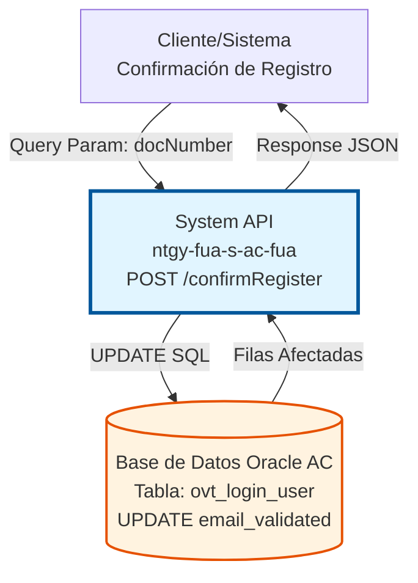
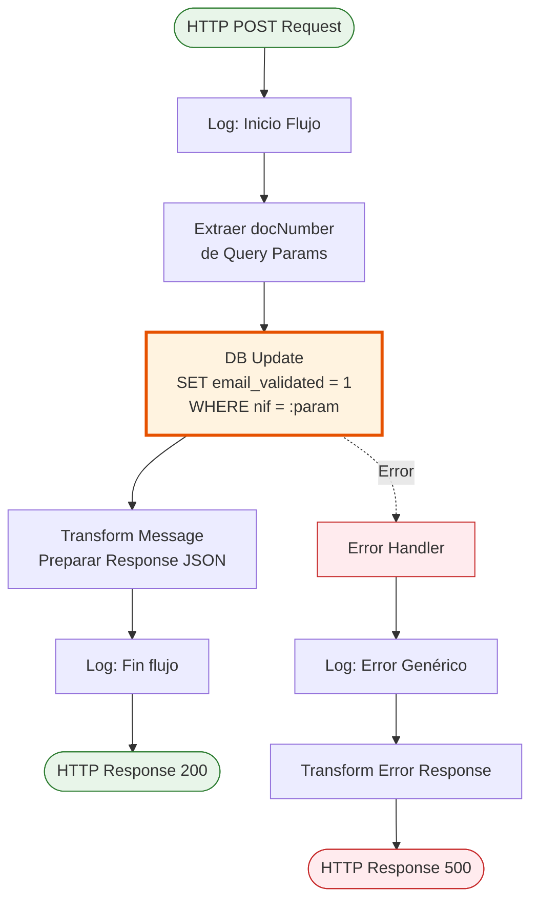
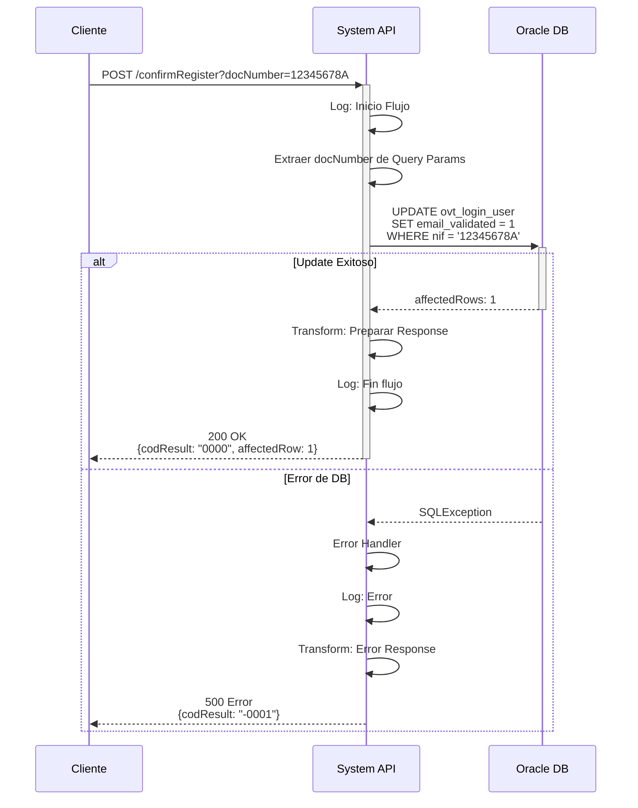
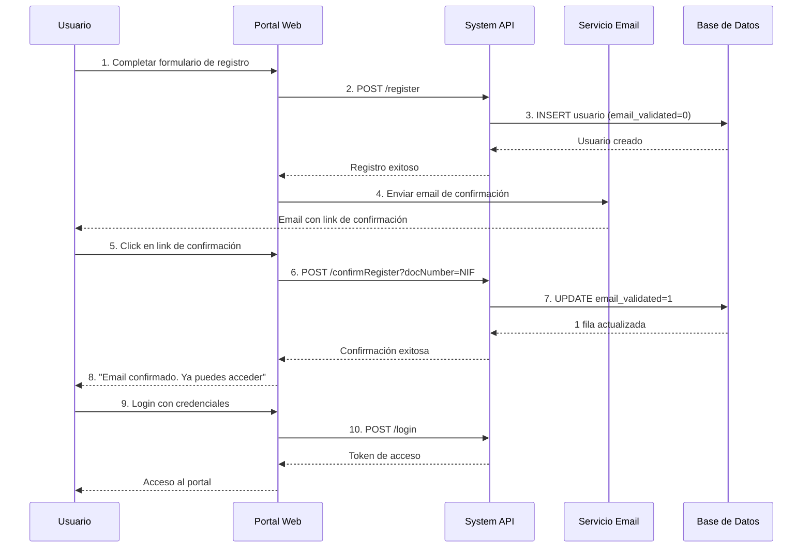

# POST /confirmRegister

## 📌 Descripción General

### Propósito del Endpoint

Este endpoint confirma el registro de un usuario en el sistema Área Cliente mediante la validación de su dirección de email. Actualiza el campo `email_validated` a 1 en la tabla `ovt_login_user`, completando así el proceso de registro iniciado previamente.

El endpoint soporta:
- **Validación de Email**: Marca el email del usuario como validado en la base de datos
- **Activación de Cuenta**: Completa el proceso de registro permitiendo el acceso completo al usuario
- **Confirmación Automática**: Proceso simple basado en el número de documento (NIF/NIE)

### Tipo de API

**Capa:** System API (API-Led Connectivity)

**Función:** Integración directa con base de datos Oracle AC para actualizar el estado de validación de email de usuarios registrados.

### Patrón de Integración

**Tipo:** Request-Reply Síncrono con SQL UPDATE

**Descripción:** Recibe el número de documento del usuario como query parameter, ejecuta una actualización SQL en la tabla `ovt_login_user` para marcar el email como validado, y retorna el resultado de la operación incluyendo el número de filas afectadas.

### Arquitectura API-Led Connectivity



---

## 💼 Propósito del Negocio

### Casos de Uso Principales

1. **Confirmación de Registro por Email**
   - Usuario recibe email con link de confirmación
   - Al hacer clic, se invoca este endpoint con su NIF
   - El sistema valida el email y activa la cuenta
   - **Beneficio**: Verificación de email real del usuario

2. **Activación de Cuenta de Usuario**
   - Completa el proceso de registro iniciado con `/register`
   - Permite al usuario acceder con credenciales completas
   - Habilita funcionalidades que requieren email validado
   - **Beneficio**: Seguridad y verificación de identidad

3. **Proceso de Onboarding**
   - Parte del flujo de alta de nuevos usuarios
   - Garantiza que el usuario tiene acceso a su email
   - Previene registros fraudulentos o con emails incorrectos
   - **Beneficio**: Calidad de datos y prevención de fraude

### Contexto Empresarial

- **Dominio:** Gestión de Usuarios y Autenticación
- **Sector:** Energía - Utilities
- **División:** Naturgy España - Área Cliente
- **Proceso de Negocio:** Registro y Onboarding de Clientes
- **Sistema:** Área Cliente (AC) - Sistema de Login

### Stakeholders

- **Clientes Finales**: Necesitan confirmar su registro para acceder al portal
- **Equipo de Seguridad**: Requiere validación de email para prevenir fraude
- **Equipo de Soporte**: Necesita visibilidad del estado de validación de usuarios

### Valor de Negocio

- **Seguridad**: Verificación de que el usuario tiene acceso al email proporcionado
- **Calidad de Datos**: Garantiza emails válidos en la base de datos
- **Experiencia de Usuario**: Proceso simple y rápido de confirmación
- **Prevención de Fraude**: Dificulta registros con datos falsos

### Consumidores Potenciales

Este endpoint puede ser consumido por:
- Process APIs de gestión de usuarios
- Servicios de email (links de confirmación)
- Portales web de autoservicio
- Aplicaciones móviles de Naturgy
- Sistemas de onboarding automatizado

---

## 🔧 Especificación Técnica

### URLs por Ambiente

| Ambiente | URL Base | URL Completa |
|----------|----------|--------------|
| **Local** | `http://localhost:8081` | `http://localhost:8081/api/confirmRegister?docNumber={nif}` |
| **Development** | `https://ntgy-fua-s-ac-fua-dev.us-e2.cloudhub.io` | `https://ntgy-fua-s-ac-fua-dev.us-e2.cloudhub.io/api/confirmRegister?docNumber={nif}` |
| **UAT** | `https://ntgy-fua-s-ac-fua-uat.us-e2.cloudhub.io` | `https://ntgy-fua-s-ac-fua-uat.us-e2.cloudhub.io/api/confirmRegister?docNumber={nif}` |
| **Production** | `https://ntgy-fua-s-ac-fua-pro.us-e2.cloudhub.io` | `https://ntgy-fua-s-ac-fua-pro.us-e2.cloudhub.io/api/confirmRegister?docNumber={nif}` |

### Método HTTP

```
POST /api/confirmRegister
```

### Parámetros de Entrada

#### Headers HTTP

| Header | Tipo | Requerido | Descripción | Ejemplo |
|--------|------|-----------|-------------|---------|
| `Content-Type` | string | ✅ Sí | Tipo de contenido del request | `application/json` |
| `Accept` | string | ❌ No | Tipo de contenido esperado en response | `application/json` |

#### Query Parameters

| Parámetro | Tipo | Requerido | Descripción | Ejemplo |
|-----------|------|-----------|-------------|---------|
| `docNumber` | string | ✅ Sí | Número de documento (NIF/NIE) del usuario a confirmar | `"12345678A"` |

**Validaciones:**
- Formato válido de NIF/NIE español
- Usuario debe existir en la tabla `ovt_login_user`
- Campo `nif` debe coincidir exactamente

### Respuestas

#### Respuesta Exitosa (200 OK)

```json
{
  "result": {
    "codResult": "0000",
    "msgResult": "OK"
  },
  "affectedRow": 1
}
```

**Descripción de Campos:**
- `result.codResult`: Código de resultado ("0000" = éxito)
- `result.msgResult`: Mensaje descriptivo del resultado
- `affectedRow`: Número de filas actualizadas en la base de datos (debe ser 1)

#### Respuesta de Error Técnico (500)

```json
{
  "result": {
    "codResult": "-0001",
    "msgResult": "Error técnico"
  }
}
```

**Casos de Error:**
- Usuario no encontrado (affectedRow = 0)
- Error de conexión a base de datos
- Timeout en la operación
- Error interno del sistema

### Autenticación y Autorización

- **Tipo:** Client ID & Client Secret (Anypoint Platform)
- **Autorización DB:** El usuario de base de datos debe tener permisos para:
  - Ejecutar UPDATE en tabla `ovt_login_user`
  - Acceso al schema `OVPRO_DELTA`

**Nota de Seguridad:** Este endpoint típicamente se invoca desde un link en email, por lo que el `docNumber` actúa como token de confirmación. En producción, se recomienda usar un token temporal adicional para mayor seguridad.

### Timeouts

| Tipo | Valor | Descripción |
|------|-------|-------------|
| **Request Timeout** | 15 segundos | Tiempo máximo de espera para la respuesta |
| **Connection Timeout** | 10 segundos | Tiempo máximo para establecer conexión con DB |
| **Query Timeout** | 15 segundos | Tiempo máximo de ejecución de la query SQL |

---

## 🏗️ Implementación Técnica

### Arquitectura del Flow



### Operación de Base de Datos

#### Query SQL Ejecutada

```sql
UPDATE ovt_login_user 
SET email_validated = 1 
WHERE nif = :param
```

**Detalles de la Operación:**
- **Tipo:** UPDATE
- **Tabla:** `ovt_login_user`
- **Schema:** `OVPRO_DELTA`
- **Campo Actualizado:** `email_validated` (se establece a 1)
- **Condición:** `nif` = valor del query parameter `docNumber`
- **Prepared Statement:** Sí (previene SQL injection)

#### Configuración de Base de Datos

```xml
<db:update config-ref="Database_Config">
    <db:sql><![CDATA[
        update ovt_login_user 
        set email_validated = 1 
        where nif = :param
    ]]></db:sql>
    <db:input-parameters><![CDATA[
        #[{'param': attributes.queryParams.docNumber as String}]
    ]]></db:input-parameters>
</db:update>
```

**Características:**
- Connection pooling habilitado (MaxPoolSize=15)
- Retry automático (3 intentos)
- Timeout de query: 15 segundos
- Transacción automática

### Transformación de Respuesta

#### DataWeave - Response Exitoso

```dataweave
%dw 2.0
output application/json
---
{
    result: {	 
        codResult: "0000",
        msgResult: "OK"
    },
    affectedRow: payload.affectedRows
}
```

**Lógica:**
- Extrae el número de filas afectadas del resultado del UPDATE
- Construye respuesta estándar con código "0000" (éxito)
- Incluye contador de filas actualizadas para validación

#### DataWeave - Response de Error

```dataweave
%dw 2.0
output application/json
---
{
    "result": {
        "codResult": "-0001",
        "msgResult": "Error técnico"
    }
}
```

**Manejo de Errores:**
- Captura cualquier excepción (tipo ANY)
- Retorna código genérico "-0001"
- No expone detalles internos del error
- Log completo del error para troubleshooting

### Diagrama de Secuencia Completo



### Tabla de Datos

#### Estructura de `ovt_login_user`

| Campo | Tipo | Descripción | Ejemplo |
|-------|------|-------------|---------|
| `nif` | VARCHAR2 | Número de documento (PK) | `"12345678A"` |
| `email` | VARCHAR2 | Email del usuario | `"user@example.com"` |
| `email_validated` | NUMBER | Estado de validación (0=no, 1=sí) | `1` |
| `password` | VARCHAR2 | Contraseña encriptada | `"***"` |
| `created_date` | DATE | Fecha de creación | `2026-07-20` |
| `last_login` | DATE | Último acceso | `2026-07-23` |

**Índices:**
- Primary Key en `nif`
- Index en `email`

### Manejo de Errores

#### Estrategia de Error Handling

```xml
<error-handler>
    <on-error-propagate enableNotifications="true" 
                        logException="true" 
                        type="ANY">
        <logger level="DEBUG" doc:name="logErrorGenerico"/>
        <ee:transform doc:name="Transform Message">
            <ee:message>
                <ee:set-payload><![CDATA[%dw 2.0
                    output application/json
                    ---
                    {
                        "result": {
                            "codResult": "-0001",
                            "msgResult": "Error técnico"
                        }
                    }
                ]]></ee:set-payload>
            </ee:message>
        </ee:transform>
    </on-error-propagate>
</error-handler>
```

**Tipos de Errores Manejados:**
- `DB:CONNECTIVITY`: Error de conexión a base de datos
- `DB:QUERY_EXECUTION`: Error en ejecución de query
- `DB:TIMEOUT`: Timeout de query
- `ANY`: Cualquier otro error no esperado

### Logging

#### Puntos de Log

1. **Inicio del Flow** (DEBUG)
   - Timestamp de inicio
   - Query parameters recibidos

2. **Fin del Flow** (DEBUG)
   - Timestamp de fin
   - Resultado de la operación
   - Filas afectadas

3. **Errores** (DEBUG)
   - Stack trace completo
   - Parámetros de entrada
   - Contexto del error

**Formato de Log:**
```
[DEBUG] Inicio Flujo - confirmRegisterFlow
[DEBUG] Query Param: docNumber=12345678A
[DEBUG] DB Update: affectedRows=1
[DEBUG] Fin flujo - confirmRegisterFlow
```

---

## 💻 Ejemplos de Uso

### Ejemplo 1: Confirmación Exitosa

#### Request

```bash
curl -X POST "https://ntgy-fua-s-ac-fua-pro.us-e2.cloudhub.io/api/confirmRegister?docNumber=12345678A" \
  -H "Content-Type: application/json" \
  -H "client_id: your-client-id" \
  -H "client_secret: your-client-secret"
```

#### Response (200 OK)

```json
{
  "result": {
    "codResult": "0000",
    "msgResult": "OK"
  },
  "affectedRow": 1
}
```

**Interpretación:**
- ✅ Email validado correctamente
- ✅ 1 fila actualizada (usuario encontrado y actualizado)
- ✅ Usuario puede ahora hacer login completo

---

### Ejemplo 2: Usuario No Encontrado

#### Request

```bash
curl -X POST "https://ntgy-fua-s-ac-fua-pro.us-e2.cloudhub.io/api/confirmRegister?docNumber=99999999Z" \
  -H "Content-Type: application/json" \
  -H "client_id: your-client-id" \
  -H "client_secret: your-client-secret"
```

#### Response (200 OK)

```json
{
  "result": {
    "codResult": "0000",
    "msgResult": "OK"
  },
  "affectedRow": 0
}
```

**Interpretación:**
- ⚠️ Query ejecutada correctamente pero sin resultados
- ⚠️ 0 filas actualizadas (usuario no existe)
- ⚠️ Puede indicar NIF incorrecto o usuario no registrado

---

### Ejemplo 3: Error de Base de Datos

#### Request

```bash
curl -X POST "https://ntgy-fua-s-ac-fua-pro.us-e2.cloudhub.io/api/confirmRegister?docNumber=12345678A" \
  -H "Content-Type: application/json" \
  -H "client_id: your-client-id" \
  -H "client_secret: your-client-secret"
```

#### Response (500 Internal Server Error)

```json
{
  "result": {
    "codResult": "-0001",
    "msgResult": "Error técnico"
  }
}
```

**Interpretación:**
- ❌ Error en la ejecución de la operación
- ❌ Puede ser timeout, conexión perdida, o error de DB
- ❌ Revisar logs para detalles específicos

---

### Ejemplo 4: Integración con JavaScript

```javascript
async function confirmUserRegistration(docNumber) {
  const url = 'https://ntgy-fua-s-ac-fua-pro.us-e2.cloudhub.io/api/confirmRegister';
  
  try {
    const response = await fetch(`${url}?docNumber=${docNumber}`, {
      method: 'POST',
      headers: {
        'Content-Type': 'application/json',
        'client_id': 'your-client-id',
        'client_secret': 'your-client-secret'
      }
    });
    
    const data = await response.json();
    
    if (data.result.codResult === "0000" && data.affectedRow === 1) {
      console.log('✅ Email confirmado exitosamente');
      return { success: true, message: 'Registro confirmado' };
    } else if (data.affectedRow === 0) {
      console.log('⚠️ Usuario no encontrado');
      return { success: false, message: 'Usuario no existe' };
    } else {
      console.log('❌ Error en confirmación');
      return { success: false, message: 'Error técnico' };
    }
  } catch (error) {
    console.error('Error:', error);
    return { success: false, message: 'Error de conexión' };
  }
}

// Uso
confirmUserRegistration('12345678A')
  .then(result => console.log(result));
```

---

### Ejemplo 5: Flujo Completo de Registro


