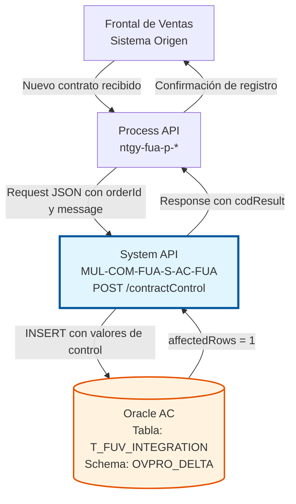
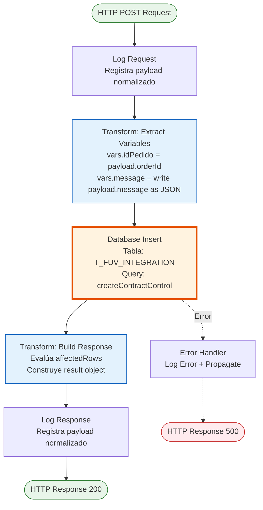
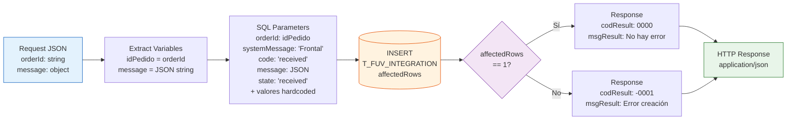

# POST /contractControl

## 📌 Descripción General

### Propósito del Endpoint

Este endpoint registra el inicio de un proceso de contrato en la tabla de control de integración `T_FUV_INTEGRATION`. Actúa como punto de entrada para la auditoría y trazabilidad del ciclo de vida completo de los contratos procesados por el sistema FUA (Frontal Único de Alta).

El endpoint soporta:
- **Registro de Auditoría**: Crea un registro inicial cuando un contrato es recibido desde el frontal
- **Trazabilidad Completa**: Almacena información del contrato, mensaje original y metadatos de control
- **Estado Inicial**: Marca el contrato con estado 'received' para seguimiento posterior
- **Control de Intentos**: Inicializa contador de intentos de procesamiento en 0

### Tipo de API

**Capa:** System API (API-Led Connectivity)

**Función:** Integración directa con Oracle Database AC para registro de control de contratos.

### Patrón de Integración

**Tipo:** Request-Reply Síncrono con SQL INSERT

**Descripción:** Recibe datos del contrato en formato JSON, extrae el ID del pedido y el mensaje completo, ejecuta una inserción en la tabla `T_FUV_INTEGRATION` con valores predefinidos para auditoría, y retorna un código de resultado basado en el éxito de la operación.

### Arquitectura API-Led Connectivity



---

## 💼 Propósito del Negocio

### Casos de Uso Principales

1. **Registro Inicial de Contrato**
   - Un nuevo contrato es recibido desde el Frontal de Ventas
   - El sistema registra el evento en la tabla de control
   - Se marca con estado 'received' para procesamiento posterior
   - **Beneficio:** Trazabilidad desde el momento de recepción del contrato

2. **Auditoría de Integraciones**
   - Cada contrato recibido queda registrado con timestamp automático
   - Se almacena el mensaje original completo en formato JSON
   - Se registra el sistema origen ('Frontal')
   - **Beneficio:** Auditoría completa de todas las integraciones de contratos

3. **Control de Procesamiento**
   - El registro inicial permite seguimiento del ciclo de vida del contrato
   - El contador de intentos se inicializa en 0
   - Los campos de respuesta y error se dejan null para actualización posterior
   - **Beneficio:** Base para control de reintentos y gestión de errores

### Contexto Empresarial

- **Dominio:** Gestión de Contratos y Control de Integraciones
- **Sector:** Energía - Utilities
- **División:** Naturgy España - Frontal de Ventas (FUV)
- **Proceso de Negocio:** Registro y control de contratos en proceso de alta
- **Sistema Backend:** Oracle Database AC (Área Cliente)

### Stakeholders

- **Equipo de Operaciones**: Necesitan visibilidad de todos los contratos recibidos
- **Equipo de Soporte**: Diagnostican problemas de integración consultando esta tabla
- **Auditores**: Verifican trazabilidad completa de contratos procesados
- **Desarrolladores**: Utilizan esta tabla para debugging y análisis de flujos

### Valor de Negocio

- **Trazabilidad**: Registro completo de todos los contratos desde su recepción
- **Auditoría**: Cumplimiento de requisitos de auditoría y compliance
- **Diagnóstico**: Facilita identificación de problemas en el procesamiento
- **Control**: Base para gestión de reintentos y recuperación de errores

### Consumidores Potenciales

Este endpoint puede ser consumido por:
- Process APIs de gestión de contratos
- Frontal de Ventas (FUV) directamente
- Sistemas de orquestación de procesos
- Flujos de integración de contratos
- Procesos batch de carga masiva

---

## 🔧 Especificación Técnica

### URLs por Ambiente

| Ambiente | URL Base | URL Completa |
|----------|----------|--------------|
| **Local** | `http://localhost:8081` | `http://localhost:8081/api/contractControl` |
| **Development** | `https://mul-com-fua-s-ac-fua-dev.us-e2.cloudhub.io` | `https://mul-com-fua-s-ac-fua-dev.us-e2.cloudhub.io/api/contractControl` |
| **UAT** | `https://mul-com-fua-s-ac-fua-uat.us-e2.cloudhub.io` | `https://mul-com-fua-s-ac-fua-uat.us-e2.cloudhub.io/api/contractControl` |
| **Production** | `https://mul-com-fua-s-ac-fua-pro.us-e2.cloudhub.io` | `https://mul-com-fua-s-ac-fua-pro.us-e2.cloudhub.io/api/contractControl` |

### Método HTTP

```
POST /api/contractControl
```

### Parámetros de Entrada

#### Headers HTTP

| Header | Tipo | Requerido | Descripción | Ejemplo |
|--------|------|-----------|-------------|---------|
| `Content-Type` | string | ✅ Sí | Tipo de contenido del request | `application/json` |
| `Accept` | string | ❌ No | Tipo de contenido esperado en response | `application/json` |

#### Body Parameters

**Estructura del Request:**

```json
{
  "orderId": "string",
  "message": {
    // Objeto con detalles del contrato
    // Estructura flexible según el tipo de contrato
  }
}
```

**Campos del Body:**

| Campo | Tipo | Requerido | Descripción | Ejemplo |
|-------|------|-----------|-------------|---------|
| `orderId` | string | ✅ Sí | Identificador único del pedido/contrato | `"ORD-2026-001234"` |
| `message` | object | ✅ Sí | Objeto JSON con información completa del contrato | `{ "contractType": "NEW", "customerId": "12345" }` |

**Notas sobre el campo `message`:**
- Se serializa a JSON string antes de almacenar en base de datos
- Puede contener cualquier estructura JSON válida
- Se almacena completo para auditoría y trazabilidad
- No se valida la estructura interna del objeto

### Respuestas

#### Respuesta Exitosa (200 OK)

Cuando el registro se inserta correctamente (1 fila afectada):

```json
{
  "result": {
    "codResult": "0000",
    "msgResult": "No hay error"
  }
}
```

#### Respuesta de Error de Inserción (200 OK)

Cuando la inserción falla (0 filas afectadas):

```json
{
  "result": {
    "codResult": "-0001",
    "msgResult": "Ha habido un error en la creación del registro"
  }
}
```

**Códigos de Resultado:**

| Código | Significado | Descripción |
|--------|-------------|-------------|
| `0000` | Éxito | El registro se insertó correctamente |
| `-0001` | Error | La inserción falló (0 filas afectadas) |

#### Respuesta de Error Técnico (500)

```json
{
  "result": {
    "codResult": "0001",
    "msgResult": "Error interno del servidor"
  }
}
```

### Autenticación y Autorización

- **Tipo:** Client ID & Client Secret (Anypoint Platform)
- **Autorización Oracle:** El usuario de base de datos debe tener permisos para:
  - Ejecutar INSERT en tabla `T_FUV_INTEGRATION`
  - Acceso a secuencia `SEQ_T_FUV_INTEGRATION`
  - Acceso al schema `OVPRO_DELTA`

### Timeouts

| Tipo | Valor | Descripción |
|------|-------|-------------|
| **Query Timeout** | 15 segundos | Tiempo máximo de ejecución de la query SQL |
| **Connection Timeout** | 3600 segundos | Tiempo máximo para mantener conexión a BD |

---

## 🏗️ Implementación Técnica

### Arquitectura del Flow



### Componentes del Flow

#### 1. Logger Request (Entrada)

```xml
<logger level="INFO" doc:name="request" 
        message="#[%dw 2.0
output application/java

var payloadStr = write(payload,'application/json')
var request = common::commonFunctions::normalizeJSON(payloadStr)
---

'STARTING createContractControl METHOD. REQUEST: '  ++ request]"/>
```

**Propósito:** Registrar el inicio de la ejecución con el payload normalizado

**Detalles:**
- **Nivel:** INFO
- **Función:** `common::commonFunctions::normalizeJSON` para formatear JSON
- **Contenido:** Payload completo del request

#### 2. Transform: Extract Variables

```xml
<ee:transform doc:name="vars idPedido, message">
    <ee:variables>
        <ee:set-variable variableName="idPedido"><![CDATA[%dw 2.0
output application/java
---
payload.orderId]]></ee:set-variable>
        <ee:set-variable variableName="message"><![CDATA[%dw 2.0
output application/java
---
write(payload.message, "application/json")]]></ee:set-variable>
    </ee:variables>
</ee:transform>
```

**Propósito:** Extraer y preparar datos para la inserción

**Variables Creadas:**
- `vars.idPedido`: ID del pedido extraído de `payload.orderId`
- `vars.message`: Objeto `message` serializado a JSON string

**Transformación DataWeave:**
```dataweave
%dw 2.0
output application/java
---
{
  idPedido: payload.orderId,
  message: write(payload.message, "application/json")
}
```

#### 3. Database Insert

```xml
<db:insert doc:name="Insert" 
           config-ref="Database_Config">
    <db:sql><![CDATA[${queries.createContractControl}]]></db:sql>
    <db:input-parameters><![CDATA[#[{
        orderId : vars.idPedido,
        systemMessage: 'Frontal',
        code: 'received',
        message: vars.message,
        state: 'received',
        response: null,
        error: null,
        contractATR: 0
    }]]]></db:input-parameters>
</db:insert>
```

**Query SQL:**
```sql
INSERT INTO T_FUV_INTEGRATION (
    T_FUV_INTEGRATION_ID,
    CONTRACT_ID,
    SYSTEM_MESSAGE,
    CODE,
    MESSAGE,
    STATE,
    RESPONSE,
    ERROR,
    CONTRACT_ATR,
    CREATE_DATE,
    UPDATE_DATE,
    UPDATE_USER,
    UPDATE_PROGRAM,
    ATTEMPTS_NUMBER
) VALUES (
    SEQ_T_FUV_INTEGRATION.nextval,
    :orderId,
    :systemMessage,
    :code,
    :message,
    :state,
    :response,
    :error,
    :contractATR,
    sysdate,
    sysdate,
    'mulesoft',
    'mulesoft',
    0
)
```

**Parámetros de Entrada:**

| Parámetro | Valor | Origen | Descripción |
|-----------|-------|--------|-------------|
| `:orderId` | `vars.idPedido` | Request | ID del pedido/contrato |
| `:systemMessage` | `'Frontal'` | Hardcoded | Sistema origen del mensaje |
| `:code` | `'received'` | Hardcoded | Código de estado inicial |
| `:message` | `vars.message` | Request | Mensaje completo en JSON |
| `:state` | `'received'` | Hardcoded | Estado inicial del contrato |
| `:response` | `null` | Hardcoded | Respuesta (se actualiza después) |
| `:error` | `null` | Hardcoded | Error (se actualiza si hay fallo) |
| `:contractATR` | `0` | Hardcoded | Atributo de contrato |

**Campos Auto-generados:**

| Campo | Valor | Descripción |
|-------|-------|-------------|
| `T_FUV_INTEGRATION_ID` | `SEQ_T_FUV_INTEGRATION.nextval` | ID único auto-incrementado |
| `CREATE_DATE` | `sysdate` | Fecha/hora de creación |
| `UPDATE_DATE` | `sysdate` | Fecha/hora de última actualización |
| `UPDATE_USER` | `'mulesoft'` | Usuario que realizó la operación |
| `UPDATE_PROGRAM` | `'mulesoft'` | Programa que realizó la operación |
| `ATTEMPTS_NUMBER` | `0` | Contador de intentos inicializado |

#### 4. Transform: Build Response

```xml
<ee:transform doc:name="response">
    <ee:message>
        <ee:set-payload><![CDATA[%dw 2.0
output application/json
---
{
    "result": {
        "codResult": if (payload.affectedRows == 1) "0000" else "-0001",
        "msgResult": if (payload.affectedRows == 1) "No hay error" else "Ha habido un error en la creación del registro"
    }
}]]></ee:set-payload>
    </ee:message>
</ee:transform>
```

**Lógica de Respuesta:**

```dataweave
%dw 2.0
output application/json
---
{
  result: {
    codResult: if (payload.affectedRows == 1) "0000" else "-0001",
    msgResult: if (payload.affectedRows == 1) 
                  "No hay error" 
               else 
                  "Ha habido un error en la creación del registro"
  }
}
```

**Evaluación:**
- Si `affectedRows == 1` → Éxito (`0000`)
- Si `affectedRows != 1` → Error (`-0001`)

#### 5. Logger Response (Salida)

```xml
<logger level="INFO" doc:name="response" 
        message="#[%dw 2.0
output application/java

var payloadStr = write(payload,'application/json')
var response = common::commonFunctions::normalizeJSON(payloadStr)
---

'FINISHED createContractControl METHOD. RESPONSE: '  ++ response]" />
```

**Propósito:** Registrar la respuesta final normalizada

**Detalles:**
- **Nivel:** INFO
- **Función:** `common::commonFunctions::normalizeJSON` para formatear JSON
- **Contenido:** Payload de respuesta completo

### Configuración de Base de Datos

#### Connection Pool

```yaml
dbAC:
  host1: "oc-pro-exa-04-clu-02-hdfdi-scan.prodb03.ocpro.oraclevcn.com"
  host2: "oc-pro-exa-03-clu-02-dfhl9-scan.prodb03.ocpro.oraclevcn.com"
  port: "1521"
  serviceName: "s_areapriv_online_pro.prodb03.ocpro.oraclevcn.com"
  user: "OVPRO_DELTA"
  MaxPoolSize: "15"
  MaxWaitTime: "300"
  MaxIdleTime: "300"
  queryTimeout: "15"
```

**Características:**
- **High Availability:** Configuración dual host para failover
- **Pool Size:** Máximo 15 conexiones simultáneas
- **Wait Time:** 300 segundos para obtener conexión del pool
- **Idle Time:** 300 segundos antes de cerrar conexión inactiva
- **Query Timeout:** 15 segundos máximo por query

### Tabla de Base de Datos

#### T_FUV_INTEGRATION

**Propósito:** Tabla de control y auditoría de integraciones de contratos FUV

**Schema:** OVPRO_DELTA

**Estructura de Campos:**

| Campo | Tipo | Nullable | Descripción |
|-------|------|----------|-------------|
| `T_FUV_INTEGRATION_ID` | NUMBER | NO | ID único (PK), auto-generado por secuencia |
| `CONTRACT_ID` | VARCHAR2 | NO | ID del contrato/pedido |
| `SYSTEM_MESSAGE` | VARCHAR2 | YES | Sistema origen del mensaje |
| `CODE` | VARCHAR2 | YES | Código de estado |
| `MESSAGE` | CLOB | YES | Mensaje completo en JSON |
| `STATE` | VARCHAR2 | YES | Estado actual del contrato |
| `RESPONSE` | CLOB | YES | Respuesta del procesamiento |
| `ERROR` | CLOB | YES | Mensaje de error si aplica |
| `CONTRACT_ATR` | NUMBER | YES | Atributo de contrato |
| `CREATE_DATE` | DATE | NO | Fecha de creación |
| `UPDATE_DATE` | DATE | NO | Fecha de última actualización |
| `UPDATE_USER` | VARCHAR2 | YES | Usuario que actualizó |
| `UPDATE_PROGRAM` | VARCHAR2 | YES | Programa que actualizó |
| `ATTEMPTS_NUMBER` | NUMBER | YES | Número de intentos de procesamiento |

**Índices:**
- Primary Key: `T_FUV_INTEGRATION_ID`
- Índice recomendado: `CONTRACT_ID` (para búsquedas por contrato)
- Índice recomendado: `STATE` (para consultas por estado)

**Secuencia:**
- `SEQ_T_FUV_INTEGRATION`: Genera IDs únicos para nuevos registros

### Diagrama de Transformación de Datos



### Manejo de Errores

#### Errores Posibles

1. **Database Connection Error**
   - **Causa:** No se puede conectar a Oracle
   - **Código:** DB:CONNECTIVITY
   - **Acción:** Error propagado al caller
   - **Response:** 500 Internal Server Error

2. **Query Timeout**
   - **Causa:** INSERT excede 15 segundos
   - **Código:** DB:QUERY_TIMEOUT
   - **Acción:** Cancelar operación y retornar error
   - **Response:** 500 Internal Server Error

3. **Constraint Violation**
   - **Causa:** Violación de constraint (ej: duplicate key)
   - **Código:** DB:BAD_SQL_SYNTAX
   - **Acción:** Error propagado con detalles
   - **Response:** 500 Internal Server Error

4. **Missing Required Field**
   - **Causa:** Campo `orderId` o `message` no presente en request
   - **Código:** MULE:EXPRESSION
   - **Acción:** Error al evaluar expresión DataWeave
   - **Response:** 500 Internal Server Error

5. **Sequence Error**
   - **Causa:** Secuencia `SEQ_T_FUV_INTEGRATION` no disponible
   - **Código:** DB:BAD_SQL_SYNTAX
   - **Acción:** Error propagado
   - **Response:** 500 Internal Server Error

#### Error Handler

```xml
<error-handler>
    <on-error-propagate enableNotifications="true" 
                        logException="true" 
                        doc:name="On Error Propagate" 
                        type="ANY">
        <logger level="ERROR" doc:name="Logger Error" 
                message="Error in createContractControl"/>
    </on-error-propagate>
</error-handler>
```

**Características:**
- **Tipo:** `on-error-propagate` (propaga error al caller)
- **Logging:** Registra error con nivel ERROR
- **Notificaciones:** Habilitadas para alertas
- **Exception:** Se registra la excepción completa

---

## 💻 Ejemplos de Uso

### Ejemplo 1: Registro Exitoso de Contrato

#### Request

```bash
curl -X POST "https://mul-com-fua-s-ac-fua-pro.us-e2.cloudhub.io/api/contractControl" \
  -H "Content-Type: application/json" \
  -H "Accept: application/json" \
  -H "client_id: YOUR_CLIENT_ID" \
  -H "client_secret: YOUR_CLIENT_SECRET" \
  -d '{
    "orderId": "ORD-2026-001234",
    "message": {
      "contractType": "NEW",
      "customerId": "12345",
      "serviceType": "ELECTRICITY",
      "requestDate": "2026-07-20T14:30:00",
      "channel": "WEB"
    }
  }'
```

#### Response (200 OK)

```json
{
  "result": {
    "codResult": "0000",
    "msgResult": "No hay error"
  }
}
```

**Registro en Base de Datos:**

```sql
-- Registro insertado en T_FUV_INTEGRATION
T_FUV_INTEGRATION_ID: 12345 (auto-generado)
CONTRACT_ID: "ORD-2026-001234"
SYSTEM_MESSAGE: "Frontal"
CODE: "received"
MESSAGE: '{"contractType":"NEW","customerId":"12345","serviceType":"ELECTRICITY","requestDate":"2026-07-20T14:30:00","channel":"WEB"}'
STATE: "received"
RESPONSE: null
ERROR: null
CONTRACT_ATR: 0
CREATE_DATE: 2026-07-20 14:30:15
UPDATE_DATE: 2026-07-20 14:30:15
UPDATE_USER: "mulesoft"
UPDATE_PROGRAM: "mulesoft"
ATTEMPTS_NUMBER: 0
```

### Ejemplo 2: Contrato con Información Compleja

#### Request

```bash
curl -X POST "https://mul-com-fua-s-ac-fua-dev.us-e2.cloudhub.io/api/contractControl" \
  -H "Content-Type: application/json" \
  -H "client_id: YOUR_CLIENT_ID" \
  -H "client_secret: YOUR_CLIENT_SECRET" \
  -d '{
    "orderId": "ORD-2026-001235",
    "message": {
      "contractType": "MODIFICATION",
      "customerId": "67890",
      "serviceType": "GAS",
      "requestDate": "2026-07-20T15:00:00",
      "channel": "MOBILE_APP",
      "modifications": [
        {
          "field": "tariff",
          "oldValue": "TARIFF_A",
          "newValue": "TARIFF_B"
        },
        {
          "field": "paymentMethod",
          "oldValue": "BANK_TRANSFER",
          "newValue": "DIRECT_DEBIT"
        }
      ],
      "requestedBy": {
        "userId": "agent_123",
        "userName": "Juan Pérez",
        "role": "SALES_AGENT"
      }
    }
  }'
```

#### Response (200 OK)

```json
{
  "result": {
    "codResult": "0000",
    "msgResult": "No hay error"
  }
}
```

### Ejemplo 3: Integración con JavaScript

```javascript
// Función para registrar inicio de contrato
async function registerContractControl(orderId, contractData) {
  const endpoint = 'https://mul-com-fua-s-ac-fua-pro.us-e2.cloudhub.io/api/contractControl';
  
  const requestBody = {
    orderId: orderId,
    message: contractData
  };
  
  try {
    const response = await fetch(endpoint, {
      method: 'POST',
      headers: {
        'Content-Type': 'application/json',
        'Accept': 'application/json',
        'client_id': process.env.CLIENT_ID,
        'client_secret': process.env.CLIENT_SECRET
      },
      body: JSON.stringify(requestBody)
    });
    
    const result = await response.json();
    
    if (result.result.codResult === '0000') {
      console.log(`✅ Contrato ${orderId} registrado exitosamente`);
      return { success: true, orderId: orderId };
    } else {
      console.error(`❌ Error al registrar contrato ${orderId}: ${result.result.msgResult}`);
      return { success: false, error: result.result.msgResult };
    }
    
  } catch (error) {
    console.error(`❌ Error de conexión: ${error.message}`);
    return { success: false, error: error.message };
  }
}

// Ejemplo de uso
const contractData = {
  contractType: 'NEW',
  customerId: '12345',
  serviceType: 'ELECTRICITY',
  requestDate: new Date().toISOString(),
  channel: 'WEB',
  details: {
    cups: 'ES0021000000000001JN',
    tariff: 'TARIFF_2.0TD',
    power: 4.6
  }
};

registerContractControl('ORD-2026-001236', contractData)
  .then(result => {
    if (result.success) {
      console.log('Contrato registrado, proceder con siguiente paso');
    } else {
      console.log('Error en registro, implementar retry logic');
    }
  });
```

### Ejemplo 4: Integración con Python

```python
import requests
import json
from datetime import datetime
from typing import Dict, Any

class ContractControlClient:
    def __init__(self, base_url: str, client_id: str, client_secret: str):
        self.base_url = base_url
        self.headers = {
            'Content-Type': 'application/json',
            'Accept': 'application/json',
            'client_id': client_id,
            'client_secret': client_secret
        }
    
    def register_contract(self, order_id: str, message: Dict[str, Any]) -> Dict[str, Any]:
        """
        Registra el inicio de un contrato en el sistema de control
        
        Args:
            order_id: ID único del pedido/contrato
            message: Diccionario con información del contrato
            
        Returns:
            Diccionario con resultado de la operación
        """
        endpoint = f"{self.base_url}/api/contractControl"
        
        payload = {
            "orderId": order_id,
            "message": message
        }
        
        try:
            response = requests.post(
                endpoint,
                headers=self.headers,
                json=payload,
                timeout=30
            )
            response.raise_for_status()
            
            result = response.json()
            
            if result['result']['codResult'] == '0000':
                print(f"✅ Contrato {order_id} registrado exitosamente")
                return {
                    'success': True,
                    'orderId': order_id,
                    'result': result
                }
            else:
                print(f"❌ Error al registrar contrato {order_id}: {result['result']['msgResult']}")
                return {
                    'success': False,
                    'error': result['result']['msgResult']
                }
                
        except requests.exceptions.RequestException as e:
            print(f"❌ Error de conexión: {e}")
            return {
                'success': False,
                'error': str(e)
            }

# Ejemplo de uso
if __name__ == "__main__":
    client = ContractControlClient(
        base_url="https://mul-com-fua-s-ac-fua-pro.us-e2.cloudhub.io",
        client_id="YOUR_CLIENT_ID",
        client_secret="YOUR_CLIENT_SECRET"
    )
    
    # Ejemplo 1: Contrato nuevo
    contract_message = {
        "contractType": "NEW",
        "customerId": "12345",
        "serviceType": "ELECTRICITY",
        "requestDate": datetime.now().isoformat(),
        "channel": "WEB",
        "details": {
            "cups": "ES0021000000000001JN",
            "tariff": "TARIFF_2.0TD",
            "power": 4.6,
            "address": {
                "street": "Calle Principal",
                "number": "123",
                "city": "Madrid",
                "postalCode": "28001"
            }
        }
    }
    
    result = client.register_contract("ORD-2026-001237", contract_message)
    
    if result['success']:
        print("✅ Contrato registrado correctamente")
        print(f"   Order ID: {result['orderId']}")
    else:
        print(f"❌ Error: {result['error']}")
```

### Ejemplo 5: Error - Campo Requerido Faltante

#### Request (Sin campo orderId)

```bash
curl -X POST "https://mul-com-fua-s-ac-fua-pro.us-e2.cloudhub.io/api/contractControl" \
  -H "Content-Type: application/json" \
  -H "client_id: YOUR_CLIENT_ID" \
  -H "client_secret: YOUR_CLIENT_SECRET" \
  -d '{
    "message": {
      "contractType": "NEW",
      "customerId": "12345"
    }
  }'
```

#### Response (500 Internal Server Error)

```json
{
  "result": {
    "codResult": "0001",
    "msgResult": "Error interno del servidor: Campo orderId requerido"
  }
}
```

### Ejemplo 6: Batch Processing con Node.js

```javascript
const axios = require('axios');

class ContractBatchProcessor {
  constructor(baseUrl, clientId, clientSecret) {
    this.baseUrl = baseUrl;
    this.headers = {
      'Content-Type': 'application/json',
      'Accept': 'application/json',
      'client_id': clientId,
      'client_secret': clientSecret
    };
  }

  async registerContract(orderId, message) {
    try {
      const response = await axios.post(
        `${this.baseUrl}/api/contractControl`,
        { orderId, message },
        { headers: this.headers, timeout: 30000 }
      );
      
      return {
        success: response.data.result.codResult === '0000',
        orderId: orderId,
        response: response.data
      };
    } catch (error) {
      return {
        success: false,
        orderId: orderId,
        error: error.message
      };
    }
  }

  async processBatch(contracts) {
    console.log(`📦 Procesando lote de ${contracts.length} contratos...`);
    
    const results = {
      total: contracts.length,
      successful: 0,
      failed: 0,
      details: []
    };

    // Procesar en paralelo con límite de concurrencia
    const batchSize = 5;
    for (let i = 0; i < contracts.length; i += batchSize) {
      const batch = contracts.slice(i, i + batchSize);
      const promises = batch.map(contract => 
        this.registerContract(contract.orderId, contract.message)
      );
      
      const batchResults = await Promise.all(promises);
      
      batchResults.forEach(result => {
        if (result.success) {
          results.successful++;
          console.log(`✅ ${result.orderId} - Registrado`);
        } else {
          results.failed++;
          console.log(`❌ ${result.orderId} - Error: ${result.error}`);
        }
        results.details.push(result);
      });
      
      // Pausa entre lotes para no saturar el servidor
      if (i + batchSize < contracts.length) {
        await new Promise(resolve => setTimeout(resolve, 1000));
      }
    }

    console.log(`\n📊 Resumen del lote:`);
    console.log(`   Total: ${results.total}`);
    console.log(`   Exitosos: ${results.successful}`);
    console.log(`   Fallidos: ${results.failed}`);
    console.log(`   Tasa de éxito: ${(results.successful/results.total*100).toFixed(2)}%`);

    return results;
  }
}

// Ejemplo de uso
const processor = new ContractBatchProcessor(
  'https://mul-com-fua-s-ac-fua-pro.us-e2.cloudhub.io',
  process.env.CLIENT_ID,
  process.env.CLIENT_SECRET
);

const contracts = [
  {
    orderId: 'ORD-2026-001238',
    message: { contractType: 'NEW', customerId: '11111', serviceType: 'ELECTRICITY' }
  },
  {
    orderId: 'ORD-2026-001239',
    message: { contractType: 'NEW', customerId: '22222', serviceType: 'GAS' }
  },
  {
    orderId: 'ORD-2026-001240',
    message: { contractType: 'MODIFICATION', customerId: '33333', serviceType: 'ELECTRICITY' }
  }
];

processor.processBatch(contracts)
  .then(results => {
    console.log('\n✅ Procesamiento de lote completado');
  })
  .catch(error => {
    console.error('❌ Error en procesamiento de lote:', error);
  });
```
