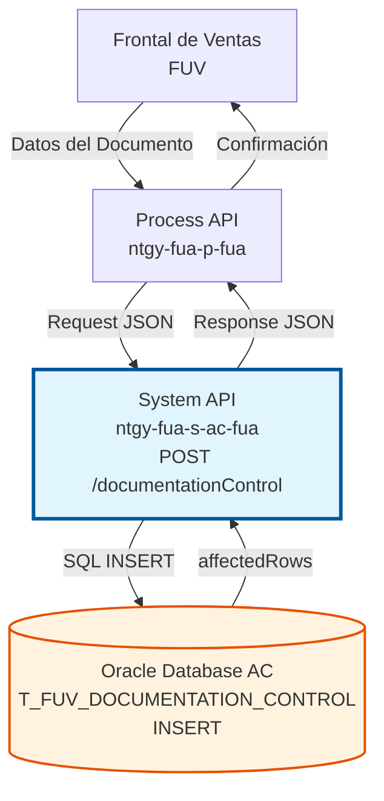
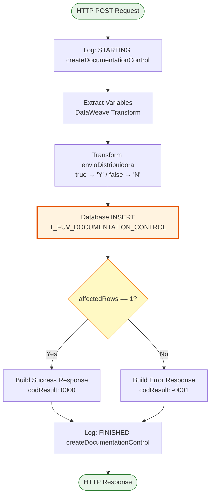
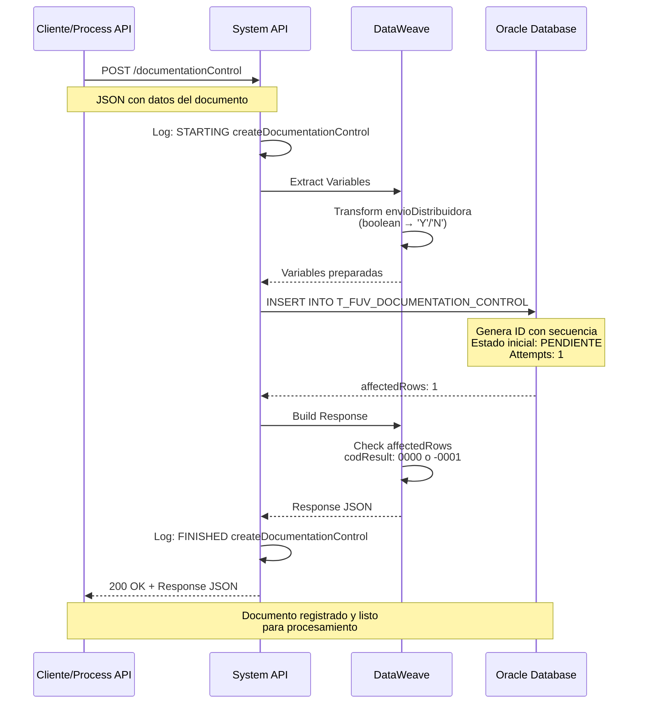

# POST /documentationControl

## 📌 Descripción General

### Propósito del Endpoint

Este endpoint crea un nuevo registro de control de documentación asociado a un pedido del Frontal de Ventas (FUV). Permite registrar y hacer seguimiento de los documentos que deben generarse para cada pedido, incluyendo su estado, número de intentos de generación, y si deben enviarse a la distribuidora.

El endpoint soporta:
- **Registro de Documentación**: Crea un nuevo registro de control con estado inicial "PENDIENTE"
- **Trazabilidad**: Asocia documentos a pedidos específicos mediante CONTRACT_ID
- **Control de Intentos**: Inicializa el contador de intentos en 1
- **Gestión de Envíos**: Indica si el documento debe enviarse a la distribuidora
- **Auditoría**: Registra fecha de creación y actualización automáticamente

### Tipo de API

**Capa:** System API (API-Led Connectivity)

**Función:** Integración directa con Oracle Database AC para gestión de control de documentación de pedidos del Frontal de Ventas.

### Patrón de Integración

**Tipo:** Request-Reply Síncrono con SQL INSERT

**Descripción:** Recibe los datos del documento a controlar, transforma los campos según las reglas de negocio (especialmente el campo envioDistribuidora de boolean a 'Y'/'N'), ejecuta un INSERT en la tabla de control, y retorna el resultado de la operación con código de éxito o error.

### Arquitectura API-Led Connectivity



---

## 💼 Propósito del Negocio

### Casos de Uso Principales

1. **Registro de Documentación de Pedido**
   - Un pedido del FUV requiere generar documentación (contrato, anexos, etc.)
   - El sistema registra el documento en estado PENDIENTE
   - Se inicia el proceso de generación y seguimiento

2. **Control de Documentos para Distribuidora**
   - Ciertos documentos deben enviarse a la distribuidora eléctrica/gas
   - El sistema marca el documento con envioDistribuidora='Y'
   - Permite filtrar y procesar documentos que requieren envío externo

3. **Trazabilidad de Generación de Documentos**
   - Cada documento tiene un registro único con ID autogenerado
   - Se registra el tipo documental y nombre del documento
   - Permite auditar cuándo se creó y actualizó cada documento

### Contexto Empresarial

- **Dominio:** Gestión de Pedidos y Documentación
- **Sector:** Energía - Utilities
- **División:** Naturgy España - Frontal de Ventas (FUV)
- **Proceso de Negocio:** Control y seguimiento de documentación contractual
- **Sistema:** Área Cliente (AC) - Oracle Database

### Stakeholders

- **Agentes de Ventas FUV**: Necesitan que los documentos de sus pedidos se generen correctamente
- **Equipo de Operaciones**: Monitorea el estado de generación de documentos
- **Distribuidoras**: Reciben documentación de contratos que requieren su procesamiento
- **Equipo de Sistemas**: Gestiona reintentos y resolución de errores en generación

### Valor de Negocio

- **Automatización**: Elimina seguimiento manual de documentos pendientes
- **Trazabilidad**: Visibilidad completa del estado de cada documento
- **Control de Calidad**: Registro de intentos permite identificar problemas recurrentes
- **Cumplimiento**: Asegura que documentos requeridos se generen y envíen correctamente

### Consumidores Potenciales

Este endpoint puede ser consumido por:
- Process APIs de gestión de pedidos FUV
- Flujos de Salesforce que gestionan pedidos
- Sistemas de workflow de documentación
- Servicios de generación de documentos (PDF, contratos)

---

## 🔧 Especificación Técnica

### URLs por Ambiente

| Ambiente | URL Base | URL Completa |
|----------|----------|--------------|
| **Local** | `http://localhost:8081` | `http://localhost:8081/api/documentationControl` |
| **Development** | `https://ntgy-fua-s-ac-fua-dev.us-e2.cloudhub.io` | `https://ntgy-fua-s-ac-fua-dev.us-e2.cloudhub.io/api/documentationControl` |
| **UAT** | `https://ntgy-fua-s-ac-fua-uat.us-e2.cloudhub.io` | `https://ntgy-fua-s-ac-fua-uat.us-e2.cloudhub.io/api/documentationControl` |
| **Production** | `https://ntgy-fua-s-ac-fua-pro.us-e2.cloudhub.io` | `https://ntgy-fua-s-ac-fua-pro.us-e2.cloudhub.io/api/documentationControl` |

### Método HTTP

```
POST /api/documentationControl
```

### Parámetros de Entrada

#### Headers HTTP

| Header | Tipo | Requerido | Descripción | Ejemplo |
|--------|------|-----------|-------------|---------|
| `Content-Type` | string | ✅ Sí | Tipo de contenido del request | `application/json` |
| `Accept` | string | ❌ No | Tipo de contenido esperado en response | `application/json` |

#### Body Parameters

| Campo | Tipo | Requerido | Descripción | Ejemplo |
|-------|------|-----------|-------------|---------|
| `orderId` | string | ✅ Sí | ID del pedido (CONTRACT_ID) | `"PED-2024-001234"` |
| `documentName` | string | ✅ Sí | Nombre del documento a generar | `"Contrato_Suministro_Gas.pdf"` |
| `numDocumento` | string | ✅ Sí | Número identificador del documento | `"DOC-2024-5678"` |
| `cabeceraContrato` | string | ✅ Sí | Datos de cabecera del contrato | `"Cliente: Juan Pérez..."` |
| `lineasContrato` | string | ✅ Sí | Líneas de detalle del contrato | `"Tarifa: 2.0TD..."` |
| `tipoDocumental` | string | ✅ Sí | Tipo de documento | `"CONTRATO"` |
| `envioDistribuidora` | boolean | ✅ Sí | Indica si debe enviarse a distribuidora | `true` |

**Ejemplo de Request Body:**

```json
{
  "orderId": "PED-2024-001234",
  "documentName": "Contrato_Suministro_Gas.pdf",
  "numDocumento": "DOC-2024-5678",
  "cabeceraContrato": "Cliente: Juan Pérez, NIF: 12345678A, Dirección: Calle Mayor 1",
  "lineasContrato": "Tarifa: 2.0TD, Potencia: 3.45 kW, CUPS: ES0021000000000001JN",
  "tipoDocumental": "CONTRATO",
  "envioDistribuidora": true
}
```

### Respuestas

#### Respuesta Exitosa (200 OK)

```json
{
  "result": {
    "codResult": "0000",
    "msgResult": "No hay error"
  }
}
```

**Descripción:** El registro se creó correctamente en la base de datos (affectedRows == 1).

#### Respuesta de Error de Negocio (200 OK)

```json
{
  "result": {
    "codResult": "-0001",
    "msgResult": "Ha habido un error en la creación del registro"
  }
}
```

**Descripción:** El INSERT no afectó ninguna fila (affectedRows != 1), indicando un problema en la inserción.

#### Respuesta de Error Técnico (500)

```json
{
  "result": {
    "codResult": "0001",
    "msgResult": "Error interno del servidor"
  }
}
```

**Descripción:** Error de conexión a base de datos, timeout, o excepción no controlada.

### Autenticación y Autorización

- **Tipo:** Client ID & Client Secret (Anypoint Platform)
- **Autorización DB:** El usuario de base de datos debe tener permisos para:
  - INSERT en tabla `T_FUV_DOCUMENTATION_CONTROL`
  - Acceso a secuencia `SEQ_T_FUV_DOCUMENTATION.nextval`
  - Permisos de escritura en schema `OVPRO_DELTA`

### Timeouts

| Tipo | Valor | Descripción |
|------|-------|-------------|
| **Request Timeout** | 15 segundos | Tiempo máximo de espera para la respuesta |
| **Connection Timeout** | 10 segundos | Tiempo máximo para establecer conexión con DB |
| **Query Timeout** | 15 segundos | Timeout específico de la query SQL |

---

## 🏗️ Implementación Técnica

### Arquitectura del Flow



### Subflow Principal

**Nombre:** `s-ac-createDocumentationControl`

**Ubicación:** `src/main/mule/implementation/s-ac-documentationControl.xml`

**Componentes:**

1. **Logger (request)**: Registra el inicio de la operación con el payload normalizado
2. **Transform (vars request fields)**: Extrae campos del payload a variables
3. **Database Insert**: Ejecuta INSERT en tabla de control
4. **Transform (response)**: Construye respuesta según affectedRows
5. **Logger (response)**: Registra el fin de la operación con la respuesta

### Query SQL

```sql
INSERT INTO T_FUV_DOCUMENTATION_CONTROL
(
  T_FUV_DOCUMENTATION_CONTROL_ID,
  CONTRACT_ID,
  DOCUMENT_NAME,
  DOCUMENT_STATUS,
  ATTEMPTS_NUMBER,
  CREATE_DATE,
  UPDATE_DATE,
  UPDATE_USER,
  UPDATE_PROGRAM,
  NUM_DOCUMENTO,
  CABECERA_CONTRATO,
  LINEAS_CONTRATO,
  TIPO_DOCUMENTAL,
  ENVIO_DISTRIBUIDORA
)
VALUES (
  SEQ_T_FUV_DOCUMENTATION.nextval,
  :idPedido,
  :documentName,
  :documentStatus,
  1,
  sysdate,
  sysdate,
  'mulesoft',
  'mulesoft',
  :numDocumento,
  :cabeceraContrato,
  :lineasContrato,
  :tipoDocumental,
  :envioDistribuidora
)
```

**Parámetros:**
- `:idPedido` → `vars.idPedido` (del payload.orderId)
- `:documentName` → `vars.documentName`
- `:documentStatus` → `'PENDIENTE'` (valor fijo)
- `:numDocumento` → `vars.numDocumento`
- `:cabeceraContrato` → `vars.cabeceraContrato`
- `:lineasContrato` → `vars.lineasContrato`
- `:tipoDocumental` → `vars.tipoDocumental`
- `:envioDistribuidora` → `vars.envioDistribuidora` (transformado a 'Y'/'N')

### Transformaciones DataWeave

#### 1. Extracción de Variables

```dataweave
%dw 2.0
output application/java
---
{
  idPedido: payload.orderId,
  documentName: payload.documentName,
  numDocumento: payload.numDocumento,
  cabeceraContrato: payload.cabeceraContrato,
  lineasContrato: payload.lineasContrato,
  tipoDocumental: payload.tipoDocumental,
  envioDistribuidora: if (payload.envioDistribuidora == true) 'Y' else 'N'
}
```

**Lógica Especial:**
- `envioDistribuidora`: Convierte boolean a string ('Y' o 'N') para compatibilidad con Oracle

#### 2. Construcción de Respuesta

```dataweave
%dw 2.0
output application/json
---
{
  result: {
    codResult: if (payload.affectedRows == 1) "0000" else "-0001",
    msgResult: if (payload.affectedRows == 1) 
                 "No hay error" 
               else 
                 "Ha habido un error en la creación del registro"
  }
}
```

**Lógica:**
- Si `affectedRows == 1`: Éxito (código 0000)
- Si `affectedRows != 1`: Error (código -0001)

### Tabla de Base de Datos

**Nombre:** `T_FUV_DOCUMENTATION_CONTROL`

**Schema:** `OVPRO_DELTA`

**Columnas:**

| Columna | Tipo | Descripción | Valor |
|---------|------|-------------|-------|
| `T_FUV_DOCUMENTATION_CONTROL_ID` | NUMBER | ID único autogenerado | `SEQ_T_FUV_DOCUMENTATION.nextval` |
| `CONTRACT_ID` | VARCHAR2 | ID del pedido | Del payload |
| `DOCUMENT_NAME` | VARCHAR2 | Nombre del documento | Del payload |
| `DOCUMENT_STATUS` | VARCHAR2 | Estado del documento | `'PENDIENTE'` (fijo) |
| `ATTEMPTS_NUMBER` | NUMBER | Número de intentos | `1` (fijo) |
| `CREATE_DATE` | DATE | Fecha de creación | `sysdate` |
| `UPDATE_DATE` | DATE | Fecha de actualización | `sysdate` |
| `UPDATE_USER` | VARCHAR2 | Usuario que actualiza | `'mulesoft'` (fijo) |
| `UPDATE_PROGRAM` | VARCHAR2 | Programa que actualiza | `'mulesoft'` (fijo) |
| `NUM_DOCUMENTO` | VARCHAR2 | Número del documento | Del payload |
| `CABECERA_CONTRATO` | CLOB | Cabecera del contrato | Del payload |
| `LINEAS_CONTRATO` | CLOB | Líneas del contrato | Del payload |
| `TIPO_DOCUMENTAL` | VARCHAR2 | Tipo de documento | Del payload |
| `ENVIO_DISTRIBUIDORA` | VARCHAR2(1) | Envío a distribuidora | `'Y'` o `'N'` |

### Diagrama de Secuencia



### Manejo de Errores

#### Errores de Base de Datos

**Escenario:** Fallo en conexión o timeout de query

**Manejo:**
- Retry automático (3 intentos)
- Error handler global captura excepción
- Respuesta con código 0001

**Ejemplo:**
```json
{
  "result": {
    "codResult": "0001",
    "msgResult": "Error de conexión a base de datos"
  }
}
```

#### Errores de Validación

**Escenario:** Campos requeridos faltantes o formato inválido

**Manejo:**
- Validación en APIKit Router (RAML)
- Respuesta 400 Bad Request
- Mensaje descriptivo del campo faltante

#### Errores de Negocio

**Escenario:** INSERT no afecta filas (affectedRows != 1)

**Manejo:**
- Respuesta 200 OK con codResult -0001
- Indica problema en la inserción
- Requiere investigación de logs

### Configuración de Conexión

**Database Config:** `Database_Config`

**Propiedades:**
- **Host:** Dual-host configuration (HA)
- **Port:** 1521
- **Service Name:** `s_areapriv_online_pro.prodb03.ocpro.oraclevcn.com`
- **Schema:** `OVPRO_DELTA`
- **Connection Pool:** MaxPoolSize=15, MaxWaitTime=300s
- **Query Timeout:** 15 segundos

---

## 💻 Ejemplos de Uso

### Ejemplo 1: Registro de Contrato de Suministro

**Request:**

```bash
curl -X POST "https://ntgy-fua-s-ac-fua-pro.us-e2.cloudhub.io/api/documentationControl" \
  -H "Content-Type: application/json" \
  -H "client_id: YOUR_CLIENT_ID" \
  -H "client_secret: YOUR_CLIENT_SECRET" \
  -d '{
    "orderId": "PED-2024-001234",
    "documentName": "Contrato_Suministro_Gas.pdf",
    "numDocumento": "DOC-2024-5678",
    "cabeceraContrato": "Cliente: Juan Pérez, NIF: 12345678A, Dirección: Calle Mayor 1, Madrid",
    "lineasContrato": "Tarifa: 2.0TD, Potencia: 3.45 kW, CUPS: ES0021000000000001JN, Producto: Gas Natural",
    "tipoDocumental": "CONTRATO",
    "envioDistribuidora": true
  }'
```

**Response (Éxito):**

```json
{
  "result": {
    "codResult": "0000",
    "msgResult": "No hay error"
  }
}
```

### Ejemplo 2: Registro de Anexo sin Envío a Distribuidora

**Request:**

```bash
curl -X POST "https://ntgy-fua-s-ac-fua-pro.us-e2.cloudhub.io/api/documentationControl" \
  -H "Content-Type: application/json" \
  -H "client_id: YOUR_CLIENT_ID" \
  -H "client_secret: YOUR_CLIENT_SECRET" \
  -d '{
    "orderId": "PED-2024-001235",
    "documentName": "Anexo_Condiciones_Particulares.pdf",
    "numDocumento": "DOC-2024-5679",
    "cabeceraContrato": "Anexo de condiciones particulares del contrato",
    "lineasContrato": "Descuentos aplicables, Promociones vigentes, Condiciones especiales",
    "tipoDocumental": "ANEXO",
    "envioDistribuidora": false
  }'
```

**Response (Éxito):**

```json
{
  "result": {
    "codResult": "0000",
    "msgResult": "No hay error"
  }
}
```

### Ejemplo 3: Error en Inserción

**Request:**

```bash
curl -X POST "https://ntgy-fua-s-ac-fua-pro.us-e2.cloudhub.io/api/documentationControl" \
  -H "Content-Type: application/json" \
  -H "client_id: YOUR_CLIENT_ID" \
  -H "client_secret: YOUR_CLIENT_SECRET" \
  -d '{
    "orderId": "PED-INVALID",
    "documentName": "Test.pdf",
    "numDocumento": "DOC-TEST",
    "cabeceraContrato": "Test",
    "lineasContrato": "Test",
    "tipoDocumental": "TEST",
    "envioDistribuidora": false
  }'
```

**Response (Error de Negocio):**

```json
{
  "result": {
    "codResult": "-0001",
    "msgResult": "Ha habido un error en la creación del registro"
  }
}
```

### Ejemplo 4: Validación de Campos Requeridos

**Request (Falta campo orderId):**

```bash
curl -X POST "https://ntgy-fua-s-ac-fua-pro.us-e2.cloudhub.io/api/documentationControl" \
  -H "Content-Type: application/json" \
  -H "client_id: YOUR_CLIENT_ID" \
  -H "client_secret: YOUR_CLIENT_SECRET" \
  -d '{
    "documentName": "Contrato.pdf",
    "numDocumento": "DOC-2024-5680",
    "cabeceraContrato": "Test",
    "lineasContrato": "Test",
    "tipoDocumental": "CONTRATO",
    "envioDistribuidora": true
  }'
```

**Response (Error de Validación):**

```json
{
  "error": {
    "code": "BAD_REQUEST",
    "message": "Missing required field: orderId"
  }
}
```

### Ejemplo 5: Integración desde JavaScript

```javascript
const createDocumentationControl = async (documentData) => {
  const url = 'https://ntgy-fua-s-ac-fua-pro.us-e2.cloudhub.io/api/documentationControl';
  
  const payload = {
    orderId: documentData.orderId,
    documentName: documentData.documentName,
    numDocumento: documentData.numDocumento,
    cabeceraContrato: documentData.cabeceraContrato,
    lineasContrato: documentData.lineasContrato,
    tipoDocumental: documentData.tipoDocumental,
    envioDistribuidora: documentData.envioDistribuidora
  };
  
  try {
    const response = await fetch(url, {
      method: 'POST',
      headers: {
        'Content-Type': 'application/json',
        'client_id': process.env.CLIENT_ID,
        'client_secret': process.env.CLIENT_SECRET
      },
      body: JSON.stringify(payload)
    });
    
    const result = await response.json();
    
    if (result.result.codResult === '0000') {
      console.log('Documento registrado exitosamente');
      return { success: true, data: result };
    } else {
      console.error('Error al registrar documento:', result.result.msgResult);
      return { success: false, error: result.result.msgResult };
    }
  } catch (error) {
    console.error('Error de conexión:', error);
    return { success: false, error: error.message };
  }
};

// Uso
const documentData = {
  orderId: 'PED-2024-001236',
  documentName: 'Contrato_Electricidad.pdf',
  numDocumento: 'DOC-2024-5681',
  cabeceraContrato: 'Cliente: María García, NIF: 87654321B',
  lineasContrato: 'Tarifa: 2.0TD, Potencia: 4.6 kW',
  tipoDocumental: 'CONTRATO',
  envioDistribuidora: true
};

createDocumentationControl(documentData);
```
