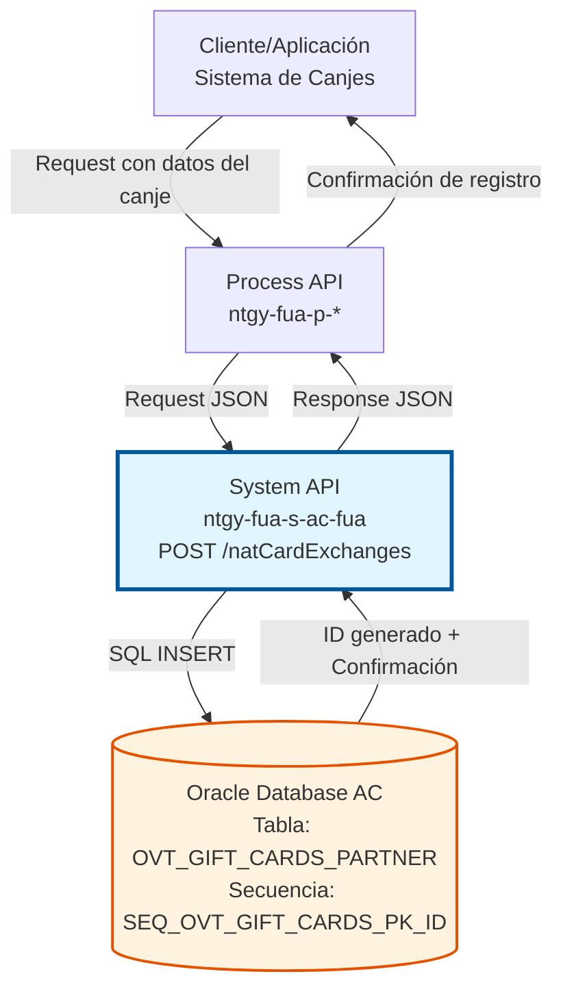
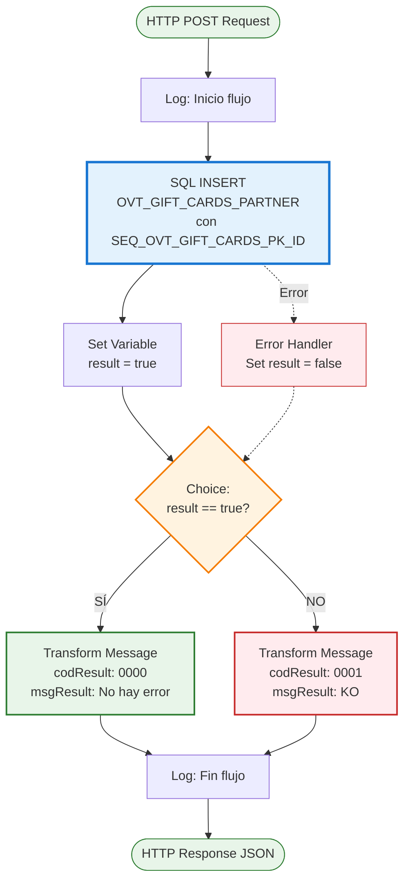
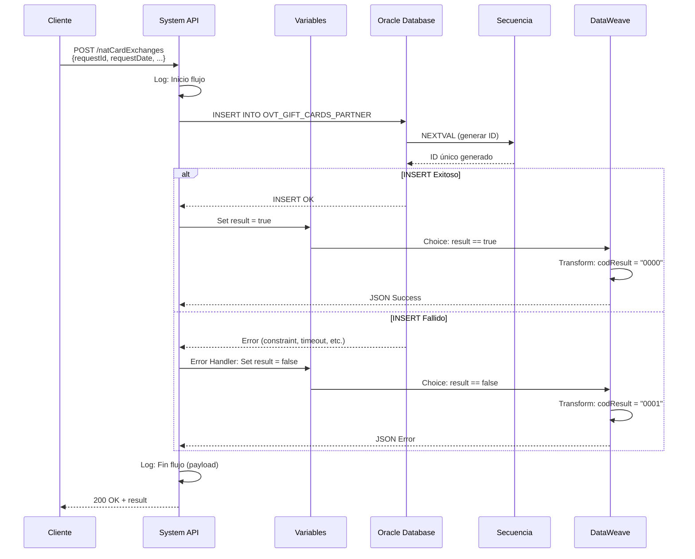
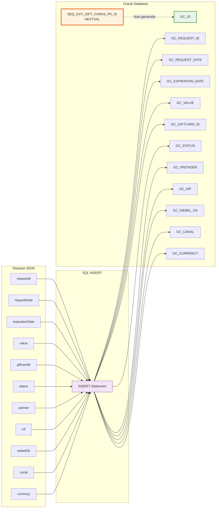

# POST /natCardExchanges

## 📌 Descripción General

### Propósito del Endpoint

Este endpoint permite registrar un nuevo canje de puntos de la Tarjeta Naturgy en el sistema. Crea un registro completo en la base de datos con toda la información del canje, incluyendo datos del cliente, valor del canje, fechas de solicitud y expiración, y estado del proceso.

El endpoint soporta:
- **Registro de Canje**: Crea un nuevo registro de canje en la base de datos
- **Generación Automática de ID**: Utiliza secuencia Oracle para ID único
- **Validación de Datos**: Verifica formato de fechas y campos obligatorios
- **Trazabilidad**: Registra información completa para auditoría

### Tipo de API

**Capa:** System API (API-Led Connectivity)

**Función:** Integración directa con Oracle Database AC para inserción de datos de canjes de Tarjeta Naturgy.

### Patrón de Integración

**Tipo:** Request-Reply Síncrono con SQL INSERT

**Descripción:** El endpoint recibe un JSON con los datos del canje, ejecuta un INSERT en la base de datos Oracle utilizando una secuencia para generar el ID único, y retorna una confirmación de éxito o error.

### Arquitectura API-Led Connectivity



---

## 💼 Propósito del Negocio

### Casos de Uso Principales

1. **Registro de Canje de Puntos**
   - Cliente solicita canje de puntos por valor monetario
   - Sistema registra la solicitud con todos los detalles
   - Se genera ID único para seguimiento del canje

2. **Integración con Sistema de Gift Cards**
   - Sistema externo de gift cards notifica canje realizado
   - API registra la transacción en base de datos AC
   - Mantiene sincronización entre sistemas

3. **Trazabilidad de Operaciones**
   - Cada canje queda registrado con fecha y hora
   - Información completa para auditoría y reporting
   - Seguimiento del estado del canje (pendiente, procesado, etc.)

### Contexto Empresarial

- **Dominio:** Programa de Fidelización - Tarjeta Naturgy
- **Sector:** Energía - Utilities
- **División:** Naturgy España - Área Cliente
- **Proceso de Negocio:** Gestión de canjes de programa de puntos
- **Sistema:** Oracle Database AC (Área Cliente)

### Stakeholders

- **Sistema de Gift Cards**: Registra canjes realizados por clientes
- **Equipo de Marketing**: Gestiona programa de fidelización
- **Finanzas**: Controla valores de canjes y contabilidad
- **Auditoría**: Revisa trazabilidad de operaciones monetarias
- **Servicio al Cliente**: Consulta estado de canjes registrados

### Valor de Negocio

- **Automatización**: Registro automático de canjes sin intervención manual
- **Integridad de Datos**: Garantiza registro completo y consistente
- **Trazabilidad**: Auditoría completa de todas las operaciones de canje
- **Sincronización**: Mantiene sistemas AC y gift cards sincronizados

### Consumidores Potenciales

Este endpoint puede ser consumido por:
- Process APIs de gestión de canjes
- Sistema de gift cards (partner externo)
- Plataforma de fidelización
- Sistemas de integración middleware
- Herramientas de administración de canjes

---

## 🔧 Especificación Técnica

### URLs por Ambiente

| Ambiente | URL Base | URL Completa |
|----------|----------|--------------|
| **Local** | `http://localhost:8081` | `http://localhost:8081/api/natCardExchanges` |
| **Development** | `https://ntgy-fua-s-ac-fua-dev.us-e2.cloudhub.io` | `https://ntgy-fua-s-ac-fua-dev.us-e2.cloudhub.io/api/natCardExchanges` |
| **UAT** | `https://ntgy-fua-s-ac-fua-uat.us-e2.cloudhub.io` | `https://ntgy-fua-s-ac-fua-uat.us-e2.cloudhub.io/api/natCardExchanges` |
| **Production** | `https://ntgy-fua-s-ac-fua-pro.us-e2.cloudhub.io` | `https://ntgy-fua-s-ac-fua-pro.us-e2.cloudhub.io/api/natCardExchanges` |

### Método HTTP

```
POST /api/natCardExchanges
```

### Parámetros de Entrada

#### Headers HTTP

| Header | Tipo | Requerido | Descripción | Ejemplo |
|--------|------|-----------|-------------|---------|
| `Content-Type` | string | ✅ Sí | Tipo de contenido del request | `application/json` |
| `Accept` | string | ❌ No | Tipo de contenido esperado en response | `application/json` |

#### Body Parameters

**Estructura del Request Body:**

| Campo | Tipo | Requerido | Descripción | Ejemplo |
|-------|------|-----------|-------------|---------|
| `requestId` | string | ✅ Sí | ID único de la solicitud de canje | `"REQ123456"` |
| `requestDate` | string | ✅ Sí | Fecha de solicitud (formato: yyyy-MM-dd) | `"2026-01-15"` |
| `expirationDate` | string | ✅ Sí | Fecha de expiración (formato: yyyy-MM-dd) | `"2027-01-15"` |
| `value` | number | ✅ Sí | Valor del canje en euros | `50.00` |
| `giftcardId` | string | ✅ Sí | ID de la gift card asociada | `"GC789012"` |
| `status` | string | ✅ Sí | Estado del canje | `"PENDING"` |
| `partner` | string | ✅ Sí | Proveedor del servicio de gift cards | `"PARTNER_NAME"` |
| `nif` | string | ✅ Sí | NIF/NIE del cliente | `"12345678A"` |
| `siebelOk` | string | ✅ Sí | Indicador de sincronización con Siebel | `"Y"` o `"N"` |
| `canal` | string | ✅ Sí | Canal de origen del canje | `"WEB"`, `"MOBILE"`, `"CALL_CENTER"` |
| `currency` | string | ✅ Sí | Moneda del canje | `"EUR"` |

**Validaciones:**
- Todos los campos son obligatorios
- `requestDate` y `expirationDate`: Formato yyyy-MM-dd
- `value`: Número positivo
- `nif`: Formato de NIF/NIE español válido
- `siebelOk`: Solo valores "Y" o "N"
- `currency`: Código ISO de moneda (típicamente "EUR")

**Ejemplo de Request Body:**

```json
{
  "requestId": "REQ123456",
  "requestDate": "2026-01-15",
  "expirationDate": "2027-01-15",
  "value": 50.00,
  "giftcardId": "GC789012",
  "status": "PENDING",
  "partner": "GIFT_CARD_PROVIDER",
  "nif": "12345678A",
  "siebelOk": "Y",
  "canal": "WEB",
  "currency": "EUR"
}
```

### Respuestas

#### Respuesta Exitosa (200 OK)

```json
{
  "result": {
    "codResult": "0000",
    "msgResult": "No hay error"
  }
}
```

**Descripción:** El canje se registró correctamente en la base de datos.

#### Respuesta de Error de Validación (400 Bad Request)

```json
{
  "result": {
    "codResult": "0001",
    "msgResult": "Error en validación de datos"
  }
}
```

**Causas comunes:**
- Campo obligatorio faltante
- Formato de fecha incorrecto
- Valor numérico inválido
- NIF con formato incorrecto

#### Respuesta de Error Técnico (500 Internal Server Error)

```json
{
  "result": {
    "codResult": "0001",
    "msgResult": "KO"
  }
}
```

**Causas comunes:**
- Error de conexión con base de datos
- Violación de constraint (ej: requestId duplicado)
- Error en secuencia de base de datos
- Timeout de query

### Códigos de Resultado

| Código | Mensaje | Descripción |
|--------|---------|-------------|
| `0000` | No hay error | Operación exitosa |
| `0001` | KO | Error en la operación |

### Autenticación y Autorización

- **Tipo:** Client ID & Client Secret (Anypoint Platform)
- **Autorización DB:** El usuario de base de datos debe tener permisos de:
  - INSERT en tabla `OVT_GIFT_CARDS_PARTNER`
  - EXECUTE en secuencia `SEQ_OVT_GIFT_CARDS_PK_ID`
  - Acceso al schema `OVT`

### Timeouts

| Tipo | Valor | Descripción |
|------|-------|-------------|
| **Query Timeout** | 15 segundos | Tiempo máximo de ejecución del INSERT |
| **Request Timeout** | 30 segundos | Tiempo máximo de espera para la respuesta |
| **Connection Timeout** | 10 segundos | Tiempo máximo para establecer conexión con DB |

---

## 🏗️ Implementación Técnica

### Arquitectura del Flow



### Componentes del Flow

#### 1. Logger de Inicio
```xml
<logger level="DEBUG" doc:name="Inicio flujo" />
```
- Registra el inicio de la ejecución del flow
- Nivel DEBUG para troubleshooting

#### 2. Database Insert

**Query SQL:**
```sql
INSERT INTO OVT_GIFT_CARDS_PARTNER (
    GC_ID,
    GC_REQUEST_ID,
    GC_REQUEST_DATE,
    GC_EXPIRATION_DATE,
    GC_VALUE,
    GC_GIFTCARD_ID,
    GC_STATUS,
    GC_PROVIDER,
    GC_NIF,
    GC_SIEBEL_OK,
    GC_CANAL,
    GC_CURRENCY
) 
VALUES (
    SEQ_OVT_GIFT_CARDS_PK_ID.NEXTVAL,
    :requestId,
    TO_DATE(:requestDate, 'yyyy-MM-dd'),
    TO_DATE(:expirationDate, 'yyyy-MM-dd'),
    :value,
    :giftcardId,
    :status,
    :partner,
    :nif,
    :siebelOk,
    :canal,
    :currency
)
```

**Configuración:**
```xml
<db:insert config-ref="Database_Config" queryTimeout="${dbAC.queryTimeout}">
    <db:sql><![CDATA[...]]></db:sql>
    <db:input-parameters>
        <![CDATA[#[{
            requestId: payload.requestId,
            requestDate: payload.requestDate,
            expirationDate: payload.expirationDate,
            value: payload.value,
            giftcardId: payload.giftcardId,
            status: payload.status,
            partner: payload.partner,
            nif: payload.nif,
            siebelOk: payload.siebelOk,
            canal: payload.canal,
            currency: payload.currency
        }]]]>
    </db:input-parameters>
</db:insert>
```

**Características:**
- **Auto-incremento**: `GC_ID` se genera automáticamente con `SEQ_OVT_GIFT_CARDS_PK_ID.NEXTVAL`
- **Conversión de fechas**: `TO_DATE()` convierte strings a formato DATE de Oracle
- **Binding parameters**: Previene SQL injection

#### 3. Set Variable - Result
```xml
<set-variable value="#[true]" variableName="result" />
```
- Establece variable `result = true` después del INSERT exitoso
- Se usa en el Choice router para determinar la respuesta

#### 4. Choice Router - Lógica Condicional

```xml
<choice doc:name="Choice">
    <when expression="#[vars.result == true]">
        <!-- Transform Message: Success -->
    </when>
    <otherwise>
        <!-- Transform Message: Error -->
    </otherwise>
</choice>
```

**Condición:** Evalúa si `result == true`
- **Rama WHEN**: INSERT exitoso → Response con codResult "0000"
- **Rama OTHERWISE**: Error → Response con codResult "0001"

#### 5. DataWeave Transformation - Success

**Transformación de Respuesta Exitosa:**
```dataweave
%dw 2.0
output application/json
---
{
    result: {
        codResult: "0000",
        msgResult: "No hay error"
    }
}
```

#### 6. DataWeave Transformation - Error

**Transformación de Respuesta de Error:**
```dataweave
%dw 2.0
output application/json
---
{
    result: {
        codResult: "0001",
        msgResult: "KO"
    }
}
```

#### 7. Error Handler

```xml
<error-handler>
    <on-error-continue type="ANY">
        <set-variable value="false" variableName="result" />
    </on-error-continue>
</error-handler>
```

**Comportamiento:**
- Captura cualquier error durante el INSERT
- Establece `result = false`
- Continúa el flow hacia el Choice router
- El Choice router ejecutará la rama OTHERWISE (error)

#### 8. Logger de Fin
```xml
<logger level="DEBUG" doc:name="fin flujo" message="#[payload]" />
```
- Registra el payload final (response JSON)
- Útil para debugging y auditoría

### Diagrama de Secuencia



### Tabla de Base de Datos

#### OVT_GIFT_CARDS_PARTNER

**Propósito:** Almacena información de canjes de Tarjeta Naturgy

| Campo | Tipo | Descripción | Origen en Request |
|-------|------|-------------|-------------------|
| `GC_ID` | NUMBER | ID único del registro (PK) | ✅ Auto-generado por secuencia |
| `GC_REQUEST_ID` | VARCHAR2 | ID de la solicitud de canje | ✅ `requestId` |
| `GC_REQUEST_DATE` | DATE | Fecha de solicitud | ✅ `requestDate` |
| `GC_EXPIRATION_DATE` | DATE | Fecha de expiración | ✅ `expirationDate` |
| `GC_VALUE` | NUMBER | Valor del canje en euros | ✅ `value` |
| `GC_GIFTCARD_ID` | VARCHAR2 | ID de la gift card | ✅ `giftcardId` |
| `GC_STATUS` | VARCHAR2 | Estado del canje | ✅ `status` |
| `GC_PROVIDER` | VARCHAR2 | Proveedor del servicio | ✅ `partner` |
| `GC_NIF` | VARCHAR2 | NIF/NIE del cliente | ✅ `nif` |
| `GC_SIEBEL_OK` | VARCHAR2(1) | Sincronización Siebel | ✅ `siebelOk` |
| `GC_CANAL` | VARCHAR2 | Canal de origen | ✅ `canal` |
| `GC_CURRENCY` | VARCHAR2(3) | Moneda del canje | ✅ `currency` |

**Constraints:**
- Primary Key: `GC_ID`
- Unique: `GC_REQUEST_ID` (no permite duplicados)
- Not Null: Todos los campos son obligatorios

**Secuencia:**
- `SEQ_OVT_GIFT_CARDS_PK_ID`: Genera valores únicos para `GC_ID`

### Diagrama de Transformación de Datos



### Configuración de Base de Datos

```yaml
dbAC:
  host1: "oc-pro-exa-04-clu-02-hdfdi-scan.prodb03.ocpro.oraclevcn.com"
  host2: "oc-pro-exa-03-clu-02-dfhl9-scan.prodb03.ocpro.oraclevcn.com"
  port: "1521"
  serviceName: "s_areapriv_online_pro.prodb03.ocpro.oraclevcn.com"
  user: "OVPRO_DELTA"
  queryTimeout: "15000"
  MaxPoolSize: "15"
  MaxWaitTime: "300000"
```

### Manejo de Errores

**Errores Manejados:**
1. **Constraint violation**: requestId duplicado
2. **Error de conexión**: Base de datos no disponible
3. **Timeout de query**: INSERT excede 15 segundos
4. **Error de formato**: Fechas con formato incorrecto
5. **Error de secuencia**: Problema al generar ID único

**Error Handler Global:** `s-ac-globalErrorHandler.xml`

**Estrategia:**
- Todos los errores se capturan con `on-error-continue`
- Se establece `result = false`
- Se retorna response con `codResult = "0001"`
- El error se registra en logs para troubleshooting

---

## 💻 Ejemplos de Uso

### Ejemplo 1: Registro Exitoso de Canje

**Request:**
```bash
curl -X POST "https://ntgy-fua-s-ac-fua-pro.us-e2.cloudhub.io/api/natCardExchanges" \
  -H "Content-Type: application/json" \
  -H "Accept: application/json" \
  -H "client_id: YOUR_CLIENT_ID" \
  -H "client_secret: YOUR_CLIENT_SECRET" \
  -d '{
    "requestId": "REQ202601001",
    "requestDate": "2026-01-15",
    "expirationDate": "2027-01-15",
    "value": 50.00,
    "giftcardId": "GC789012345",
    "status": "PENDING",
    "partner": "GIFT_CARD_PROVIDER",
    "nif": "12345678A",
    "siebelOk": "Y",
    "canal": "WEB",
    "currency": "EUR"
  }'
```

**Response (200 OK):**
```json
{
  "result": {
    "codResult": "0000",
    "msgResult": "No hay error"
  }
}
```

### Ejemplo 2: Canje desde App Móvil

**Request:**
```bash
curl -X POST "https://ntgy-fua-s-ac-fua-pro.us-e2.cloudhub.io/api/natCardExchanges" \
  -H "Content-Type: application/json" \
  -H "Accept: application/json" \
  -H "client_id: YOUR_CLIENT_ID" \
  -H "client_secret: YOUR_CLIENT_SECRET" \
  -d '{
    "requestId": "REQ202601002",
    "requestDate": "2026-01-16",
    "expirationDate": "2027-01-16",
    "value": 75.50,
    "giftcardId": "GC789012346",
    "status": "APPROVED",
    "partner": "MOBILE_PARTNER",
    "nif": "98765432B",
    "siebelOk": "Y",
    "canal": "MOBILE",
    "currency": "EUR"
  }'
```

**Response (200 OK):**
```json
{
  "result": {
    "codResult": "0000",
    "msgResult": "No hay error"
  }
}
```

### Ejemplo 3: Error - Request ID Duplicado

**Request:**
```bash
curl -X POST "https://ntgy-fua-s-ac-fua-pro.us-e2.cloudhub.io/api/natCardExchanges" \
  -H "Content-Type: application/json" \
  -H "Accept: application/json" \
  -H "client_id: YOUR_CLIENT_ID" \
  -H "client_secret: YOUR_CLIENT_SECRET" \
  -d '{
    "requestId": "REQ202601001",
    "requestDate": "2026-01-17",
    "expirationDate": "2027-01-17",
    "value": 100.00,
    "giftcardId": "GC789012347",
    "status": "PENDING",
    "partner": "GIFT_CARD_PROVIDER",
    "nif": "11223344C",
    "siebelOk": "Y",
    "canal": "WEB",
    "currency": "EUR"
  }'
```

**Response (200 OK con error):**
```json
{
  "result": {
    "codResult": "0001",
    "msgResult": "KO"
  }
}
```

**Causa:** El `requestId` "REQ202601001" ya existe en la base de datos (constraint violation).

### Ejemplo 4: Error - Campo Faltante

**Request:**
```bash
curl -X POST "https://ntgy-fua-s-ac-fua-pro.us-e2.cloudhub.io/api/natCardExchanges" \
  -H "Content-Type: application/json" \
  -H "Accept: application/json" \
  -H "client_id: YOUR_CLIENT_ID" \
  -H "client_secret: YOUR_CLIENT_SECRET" \
  -d '{
    "requestId": "REQ202601003",
    "requestDate": "2026-01-18",
    "expirationDate": "2027-01-18",
    "value": 25.00,
    "giftcardId": "GC789012348",
    "status": "PENDING",
    "partner": "GIFT_CARD_PROVIDER",
    "siebelOk": "Y",
    "canal": "WEB",
    "currency": "EUR"
  }'
```

**Response (200 OK con error):**
```json
{
  "result": {
    "codResult": "0001",
    "msgResult": "KO"
  }
}
```

**Causa:** Falta el campo obligatorio `nif`.

### Ejemplo 5: Uso desde JavaScript

```javascript
const createNatCardExchange = async (exchangeData) => {
  const url = 'https://ntgy-fua-s-ac-fua-pro.us-e2.cloudhub.io/api/natCardExchanges';
  
  const response = await fetch(url, {
    method: 'POST',
    headers: {
      'Content-Type': 'application/json',
      'Accept': 'application/json',
      'client_id': 'YOUR_CLIENT_ID',
      'client_secret': 'YOUR_CLIENT_SECRET'
    },
    body: JSON.stringify(exchangeData)
  });
  
  if (!response.ok) {
    throw new Error(`HTTP error! status: ${response.status}`);
  }
  
  const data = await response.json();
  
  if (data.result.codResult === "0000") {
    return { success: true, message: 'Canje registrado correctamente' };
  } else {
    return { success: false, message: 'Error al registrar canje' };
  }
};

// Uso: Registrar nuevo canje
const exchangeData = {
  requestId: 'REQ202601004',
  requestDate: '2026-01-19',
  expirationDate: '2027-01-19',
  value: 100.00,
  giftcardId: 'GC789012349',
  status: 'PENDING',
  partner: 'GIFT_CARD_PROVIDER',
  nif: '55667788D',
  siebelOk: 'Y',
  canal: 'WEB',
  currency: 'EUR'
};

try {
  const result = await createNatCardExchange(exchangeData);
  console.log(result.message);
} catch (error) {
  console.error('Error:', error.message);
}
```

### Ejemplo 6: Uso desde Python

```python
import requests
from typing import Dict, Any

def create_nat_card_exchange(exchange_data: Dict[str, Any]) -> Dict[str, Any]:
    """
    Registra un nuevo canje de Tarjeta Naturgy
    
    Args:
        exchange_data: Diccionario con datos del canje
    
    Returns:
        Diccionario con resultado de la operación
    """
    url = 'https://ntgy-fua-s-ac-fua-pro.us-e2.cloudhub.io/api/natCardExchanges'
    
    headers = {
        'Content-Type': 'application/json',
        'Accept': 'application/json',
        'client_id': 'YOUR_CLIENT_ID',
        'client_secret': 'YOUR_CLIENT_SECRET'
    }
    
    response = requests.post(url, json=exchange_data, headers=headers)
    response.raise_for_status()
    
    data = response.json()
    
    if data['result']['codResult'] == '0000':
        return {'success': True, 'message': 'Canje registrado correctamente'}
    else:
        return {'success': False, 'message': 'Error al registrar canje'}

# Uso: Registrar nuevo canje
exchange_data = {
    'requestId': 'REQ202601005',
    'requestDate': '2026-01-20',
    'expirationDate': '2027-01-20',
    'value': 150.00,
    'giftcardId': 'GC789012350',
    'status': 'PENDING',
    'partner': 'GIFT_CARD_PROVIDER',
    'nif': '99887766E',
    'siebelOk': 'Y',
    'canal': 'CALL_CENTER',
    'currency': 'EUR'
}

try:
    result = create_nat_card_exchange(exchange_data)
    print(result['message'])
except requests.exceptions.RequestException as e:
    print(f'Error: {e}')
```
