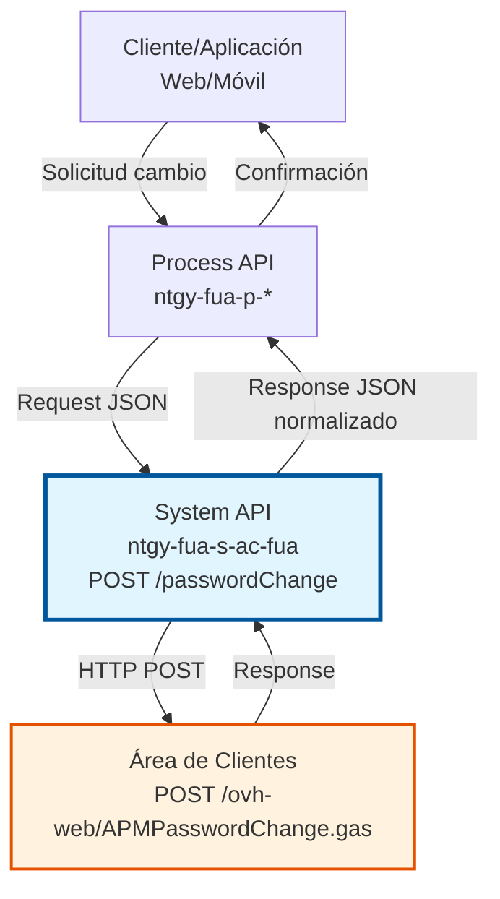
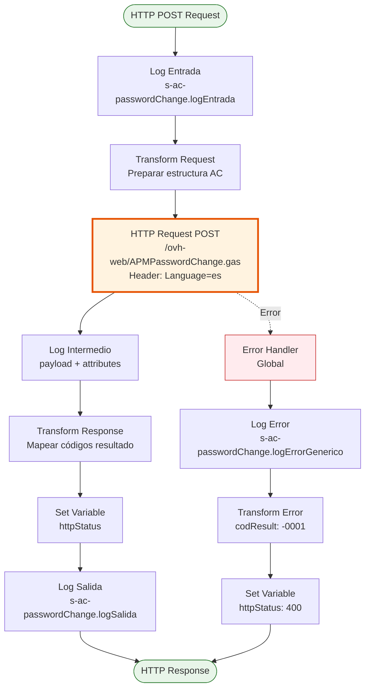
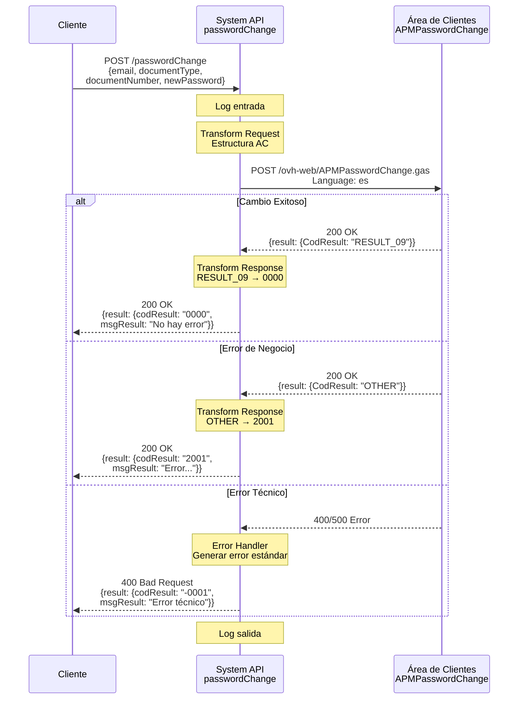

# POST /passwordChange

## 📌 Descripción General

### Propósito del Endpoint

Permite a los usuarios cambiar su contraseña de acceso al Área de Clientes de Naturgy mediante validación de identidad con documento (NIF/NIE). El endpoint actúa como proxy hacia el servicio de cambio de contraseña de AC, transformando la solicitud al formato esperado y normalizando la respuesta.

El endpoint soporta:
- **Cambio de Contraseña**: Actualización de contraseña mediante validación de identidad
- **Validación de Documento**: Verificación de identidad del usuario mediante tipo y número de documento
- **Normalización de Respuestas**: Mapeo de códigos de resultado de AC a códigos estándar
- **Manejo de Errores**: Gestión consistente de errores técnicos y de negocio

### Tipo de API

**Capa:** System API (API-Led Connectivity)

**Función:** Integración directa con servicios HTTP del Área de Clientes (AC) para gestión de contraseñas de usuario.

### Patrón de Integración

**Tipo:** Request-Reply Síncrono con REST API Externa

**Descripción:** Recibe solicitud de cambio de contraseña con datos del usuario, transforma al formato AC, invoca servicio REST externo `/ovh-web/APMPasswordChange.gas`, procesa respuesta y retorna resultado normalizado.

### Arquitectura API-Led Connectivity



---

## 💼 Propósito del Negocio

### Casos de Uso Principales

1. **Cambio de Contraseña por Usuario**
   - Usuario solicita cambio de contraseña desde portal web o app móvil
   - Sistema valida identidad mediante documento
   - Se actualiza contraseña en Área de Clientes
   - Usuario puede acceder con nueva contraseña

2. **Recuperación de Acceso**
   - Usuario olvidó su contraseña
   - Completa proceso de validación de identidad
   - Establece nueva contraseña
   - Recupera acceso a su cuenta

3. **Actualización de Seguridad**
   - Usuario desea actualizar contraseña por seguridad
   - Valida identidad con documento
   - Sistema actualiza credenciales
   - Mejora seguridad de la cuenta

### Contexto Empresarial

- **Dominio:** Gestión de Usuarios y Autenticación
- **Sector:** Energía - Utilities
- **División:** Naturgy España - Área de Clientes
- **Proceso de Negocio:** Gestión de Credenciales de Usuario
- **Sistema Backend:** Área de Clientes (AC) - Servicios HTTP

### Stakeholders

- **Clientes Finales**: Usuarios que necesitan cambiar su contraseña de acceso
- **Equipo de Soporte**: Personal que asiste en recuperación de acceso
- **Equipo de Seguridad**: Responsables de políticas de contraseñas
- **Equipo AC**: Propietarios del sistema de autenticación

### Valor de Negocio

- **Autoservicio**: Usuarios pueden cambiar contraseña sin intervención de soporte
- **Seguridad**: Validación de identidad antes de permitir cambio
- **Disponibilidad**: Servicio disponible 24/7 para cambios de contraseña
- **Reducción de Costos**: Menos llamadas al call center por recuperación de acceso

### Consumidores Potenciales

Este endpoint puede ser consumido por:
- Process APIs de gestión de usuarios
- Portales web de autoservicio
- Aplicaciones móviles
- Sistemas de call center
- Flujos de recuperación de contraseña

---

## 🔧 Especificación Técnica

### URLs por Ambiente

| Ambiente | URL Base | URL Completa |
|----------|----------|--------------|
| **Local** | `http://localhost:8081` | `http://localhost:8081/api/passwordChange` |
| **Development** | `https://ntgy-fua-s-ac-fua-dev.us-e2.cloudhub.io` | `https://ntgy-fua-s-ac-fua-dev.us-e2.cloudhub.io/api/passwordChange` |
| **UAT** | `https://ntgy-fua-s-ac-fua-uat.us-e2.cloudhub.io` | `https://ntgy-fua-s-ac-fua-uat.us-e2.cloudhub.io/api/passwordChange` |
| **Production** | `https://ntgy-fua-s-ac-fua-pro.us-e2.cloudhub.io` | `https://ntgy-fua-s-ac-fua-pro.us-e2.cloudhub.io/api/passwordChange` |

### Método HTTP

```
POST /api/passwordChange
```

### Parámetros de Entrada

#### Headers HTTP

| Header | Tipo | Requerido | Descripción | Ejemplo |
|--------|------|-----------|-------------|---------|
| `Content-Type` | string | ✅ Sí | Tipo de contenido del request | `application/json` |
| `Accept` | string | ❌ No | Tipo de contenido esperado en response | `application/json` |

#### Body Parameters

| Campo | Tipo | Requerido | Descripción | Ejemplo |
|-------|------|-----------|-------------|---------|
| `email` | string | ✅ Sí | Email del usuario | `"usuario@example.com"` |
| `documentType` | string | ✅ Sí | Tipo de documento (NIF/NIE) | `"NIF"` |
| `documentNumber` | string | ✅ Sí | Número de documento | `"12345678A"` |
| `newPassword` | string | ✅ Sí | Nueva contraseña | `"NuevaPass123!"` |

**Ejemplo de Request Body:**

```json
{
  "email": "usuario@example.com",
  "documentType": "NIF",
  "documentNumber": "12345678A",
  "newPassword": "NuevaPass123!"
}
```

### Respuestas

#### Respuesta Exitosa (200 OK)

```json
{
  "result": {
    "codResult": "0000",
    "msgResult": "No hay error"
  }
}
```

**Descripción de Campos:**
- `codResult`: `"0000"` indica cambio exitoso (mapeado desde `RESULT_09` de AC)
- `msgResult`: Mensaje descriptivo del resultado

#### Respuesta de Error de Negocio (200 OK)

```json
{
  "result": {
    "codResult": "2001",
    "msgResult": "Error en el cambio de contraseña"
  }
}
```

**Códigos de Error de Negocio:**
- `2001`: Error en el cambio de contraseña (cualquier código diferente a `RESULT_09` de AC)

#### Respuesta de Error Técnico (400 Bad Request)

```json
{
  "result": {
    "codResult": "-0001",
    "msgResult": "Error técnico"
  }
}
```

**Códigos de Error Técnico:**
- `-0001`: Error técnico en la comunicación con AC o error interno

### Autenticación y Autorización

- **Tipo:** Client ID & Client Secret (Anypoint Platform)
- **Autorización AC:** El servicio AC valida la identidad del usuario mediante:
  - Email registrado
  - Tipo y número de documento
  - Coincidencia de datos con registro en AC

### Timeouts

| Tipo | Valor | Descripción |
|------|-------|-------------|
| **Request Timeout** | 15 segundos | Tiempo máximo de espera para respuesta de AC |
| **Connection Timeout** | 15 segundos | Tiempo máximo para establecer conexión con AC |

---

## 🏗️ Implementación Técnica

### Arquitectura del Flow



### Componentes del Flow

#### 1. Flow Principal: `passwordChangeFlow`

**Ubicación:** `src/main/mule/implementation/s-ac-passwordChange.xml`

**Responsabilidades:**
- Recibir solicitud de cambio de contraseña
- Transformar request al formato AC
- Invocar servicio REST de AC
- Transformar y normalizar respuesta
- Manejar errores técnicos

#### 2. Transformación de Request (DataWeave)

**Propósito:** Convertir estructura de entrada a formato esperado por AC

```dataweave
%dw 2.0
output application/json
---
{
  "email": payload.email,
  "NIFInfo": {
    "documentType": payload.documentType,
    "documentNumber": payload.documentNumber 
  },
  "newAccessInformationUser": {
    "Password": payload.newPassword
  }
}
```

**Mapeo de Campos:**
- `email` → `email` (directo)
- `documentType` + `documentNumber` → `NIFInfo` (objeto anidado)
- `newPassword` → `newAccessInformationUser.Password`

#### 3. Llamada HTTP a AC

**Configuración:**
- **Config Reference:** `HTTP_Request_configuration_AC`
- **Método:** POST
- **Path:** `${ac.path.passwordChange}` → `/ovh-web/APMPasswordChange.gas`
- **Headers:** `Language: es`
- **Response Validator:** Acepta códigos 200, 400, 401

**Propiedad de Configuración:**
```yaml
ac:
  path:
    passwordChange: "/ovh-web/APMPasswordChange.gas"
```

#### 4. Transformación de Response (DataWeave)

**Propósito:** Normalizar respuesta de AC a formato estándar

```dataweave
%dw 2.0
output application/json
---
{
  result: {
    codResult: if (payload.result.CodResult == "RESULT_09") "0000" else "2001",
    msgResult: if (payload.result.CodResult == "RESULT_09") "No hay error" else payload.result.MsgResult
  }
}
```

**Lógica de Mapeo:**
- `RESULT_09` (AC) → `0000` (éxito)
- Cualquier otro código → `2001` (error de negocio)
- Mensaje de error se propaga desde AC

**Variable httpStatus:**
```dataweave
%dw 2.0
output application/java
---
attributes.statusCode
```

### Manejo de Errores

#### Error Handler Global

**Tipos de Error Capturados:**
- `HTTP:BAD_GATEWAY`
- `HTTP:BAD_REQUEST`
- `HTTP:CLIENT_SECURITY`
- `HTTP:CONNECTIVITY`
- `HTTP:FORBIDDEN`
- `HTTP:METHOD_NOT_ALLOWED`
- `HTTP:NOT_ACCEPTABLE`
- `HTTP:NOT_FOUND`
- `HTTP:PARSING`
- `HTTP:RETRY_EXHAUSTED`
- `HTTP:SECURITY`
- `HTTP:SERVICE_UNAVAILABLE`
- `HTTP:TIMEOUT`
- `HTTP:TOO_MANY_REQUESTS`
- `HTTP:UNAUTHORIZED`
- `HTTP:UNSUPPORTED_MEDIA_TYPE`
- `EXPRESSION`
- `STREAM_MAXIMUM_SIZE_EXCEEDED`

**Respuesta de Error:**
```json
{
  "result": {
    "codResult": "-0001",
    "msgResult": "Error técnico"
  }
}
```

**HTTP Status:** 400 Bad Request

### Diagrama de Secuencia



### Configuración de Conexión HTTP

**HTTP Request Configuration:**
- **Host:** `rov.intranet.gasnatural.com`
- **Port:** 443 (HTTPS)
- **Protocol:** HTTPS
- **TLS Context:** Configurado para comunicación segura
- **Timeout:** 15 segundos

### Logging

**Puntos de Logging:**

1. **Log Entrada:**
   - Level: INFO
   - Message: `s-ac-passwordChange.logEntrada #[attributes.queryParams]`
   - Propósito: Registrar inicio de operación

2. **Log Intermedio:**
   - Level: INFO
   - Message: `s-ac-passwordChange.log ## payload: #[payload] attributes: #[attributes]`
   - Propósito: Registrar respuesta de AC antes de transformar

3. **Log Salida:**
   - Level: INFO
   - Message: `s-ac-passwordChange.logSalida ## payload: #[payload] attributes: #[attributes]`
   - Propósito: Registrar respuesta final

4. **Log Error:**
   - Level: ERROR
   - Message: `s-ac-passwordChange.logErrorGenerico`
   - Propósito: Registrar errores técnicos

---

## 💻 Ejemplos de Uso

### Ejemplo 1: Cambio de Contraseña Exitoso

#### Request

```bash
curl -X POST "https://ntgy-fua-s-ac-fua-pro.us-e2.cloudhub.io/api/passwordChange" \
  -H "Content-Type: application/json" \
  -H "client_id: YOUR_CLIENT_ID" \
  -H "client_secret: YOUR_CLIENT_SECRET" \
  -d '{
    "email": "usuario@example.com",
    "documentType": "NIF",
    "documentNumber": "12345678A",
    "newPassword": "NuevaPass123!"
  }'
```

#### Response (200 OK)

```json
{
  "result": {
    "codResult": "0000",
    "msgResult": "No hay error"
  }
}
```

**Interpretación:**
- Código `0000` indica cambio exitoso
- Usuario puede acceder con nueva contraseña

---

### Ejemplo 2: Error de Validación de Identidad

#### Request

```bash
curl -X POST "https://ntgy-fua-s-ac-fua-pro.us-e2.cloudhub.io/api/passwordChange" \
  -H "Content-Type: application/json" \
  -H "client_id: YOUR_CLIENT_ID" \
  -H "client_secret: YOUR_CLIENT_SECRET" \
  -d '{
    "email": "usuario@example.com",
    "documentType": "NIF",
    "documentNumber": "99999999Z",
    "newPassword": "NuevaPass123!"
  }'
```

#### Response (200 OK)

```json
{
  "result": {
    "codResult": "2001",
    "msgResult": "Los datos proporcionados no coinciden con el registro"
  }
}
```

**Interpretación:**
- Código `2001` indica error de negocio
- Documento no coincide con email registrado
- Usuario debe verificar sus datos

---

### Ejemplo 3: Error Técnico de Conectividad

#### Request

```bash
curl -X POST "https://ntgy-fua-s-ac-fua-pro.us-e2.cloudhub.io/api/passwordChange" \
  -H "Content-Type: application/json" \
  -H "client_id: YOUR_CLIENT_ID" \
  -H "client_secret: YOUR_CLIENT_SECRET" \
  -d '{
    "email": "usuario@example.com",
    "documentType": "NIF",
    "documentNumber": "12345678A",
    "newPassword": "NuevaPass123!"
  }'
```

#### Response (400 Bad Request)

```json
{
  "result": {
    "codResult": "-0001",
    "msgResult": "Error técnico"
  }
}
```

**Interpretación:**
- Código `-0001` indica error técnico
- Puede ser timeout, error de conexión, o error interno
- Usuario debe reintentar más tarde

---

### Ejemplo 4: Uso desde JavaScript

```javascript
async function cambiarContrasena(email, documentType, documentNumber, newPassword) {
  const url = 'https://ntgy-fua-s-ac-fua-pro.us-e2.cloudhub.io/api/passwordChange';
  
  const requestBody = {
    email: email,
    documentType: documentType,
    documentNumber: documentNumber,
    newPassword: newPassword
  };
  
  try {
    const response = await fetch(url, {
      method: 'POST',
      headers: {
        'Content-Type': 'application/json',
        'client_id': 'YOUR_CLIENT_ID',
        'client_secret': 'YOUR_CLIENT_SECRET'
      },
      body: JSON.stringify(requestBody)
    });
    
    const data = await response.json();
    
    if (data.result.codResult === '0000') {
      console.log('Contraseña cambiada exitosamente');
      return { success: true, message: data.result.msgResult };
    } else if (data.result.codResult === '2001') {
      console.error('Error de validación:', data.result.msgResult);
      return { success: false, message: data.result.msgResult };
    } else {
      console.error('Error técnico:', data.result.msgResult);
      return { success: false, message: 'Error técnico. Intente más tarde.' };
    }
  } catch (error) {
    console.error('Error de red:', error);
    return { success: false, message: 'Error de conexión. Verifique su red.' };
  }
}

// Uso
cambiarContrasena(
  'usuario@example.com',
  'NIF',
  '12345678A',
  'NuevaPass123!'
).then(result => {
  if (result.success) {
    alert('Contraseña actualizada correctamente');
  } else {
    alert('Error: ' + result.message);
  }
});
```

---

### Ejemplo 5: Uso desde Python

```python
import requests
import json

def cambiar_contrasena(email, document_type, document_number, new_password):
    """
    Cambia la contraseña de un usuario en Área de Clientes
    
    Args:
        email (str): Email del usuario
        document_type (str): Tipo de documento (NIF/NIE)
        document_number (str): Número de documento
        new_password (str): Nueva contraseña
        
    Returns:
        dict: Resultado de la operación
    """
    url = 'https://ntgy-fua-s-ac-fua-pro.us-e2.cloudhub.io/api/passwordChange'
    
    headers = {
        'Content-Type': 'application/json',
        'client_id': 'YOUR_CLIENT_ID',
        'client_secret': 'YOUR_CLIENT_SECRET'
    }
    
    payload = {
        'email': email,
        'documentType': document_type,
        'documentNumber': document_number,
        'newPassword': new_password
    }
    
    try:
        response = requests.post(url, headers=headers, json=payload, timeout=30)
        data = response.json()
        
        if data['result']['codResult'] == '0000':
            return {
                'success': True,
                'message': 'Contraseña cambiada exitosamente'
            }
        elif data['result']['codResult'] == '2001':
            return {
                'success': False,
                'message': f"Error de validación: {data['result']['msgResult']}"
            }
        else:
            return {
                'success': False,
                'message': f"Error técnico: {data['result']['msgResult']}"
            }
            
    except requests.exceptions.Timeout:
        return {
            'success': False,
            'message': 'Timeout: El servicio no respondió a tiempo'
        }
    except requests.exceptions.RequestException as e:
        return {
            'success': False,
            'message': f'Error de conexión: {str(e)}'
        }

# Uso
resultado = cambiar_contrasena(
    email='usuario@example.com',
    document_type='NIF',
    document_number='12345678A',
    new_password='NuevaPass123!'
)

if resultado['success']:
    print('✓', resultado['message'])
else:
    print('✗', resultado['message'])
```

---

## 📊 Códigos de Resultado

### Tabla de Códigos

| Código | Tipo | Descripción | Acción Recomendada |
|--------|------|-------------|-------------------|
| `0000` | Éxito | Contraseña cambiada exitosamente | Informar al usuario del cambio exitoso |
| `2001` | Error Negocio | Error en validación o cambio | Verificar datos de identidad |
| `-0001` | Error Técnico | Error de sistema o conectividad | Reintentar más tarde |

### Mapeo de Códigos AC

| Código AC | Código API | Descripción |
|-----------|------------|-------------|
| `RESULT_09` | `0000` | Operación exitosa |
| Otros códigos | `2001` | Error de negocio (mensaje de AC) |
| Excepciones HTTP | `-0001` | Error técnico |
