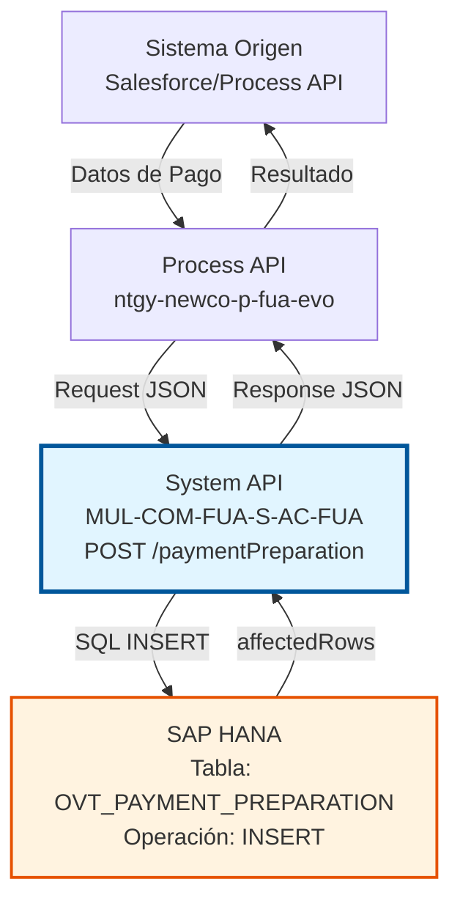
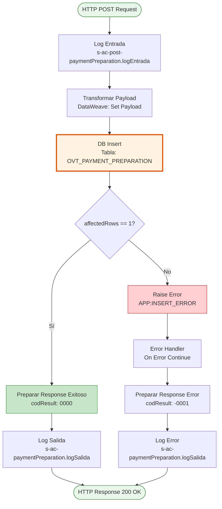
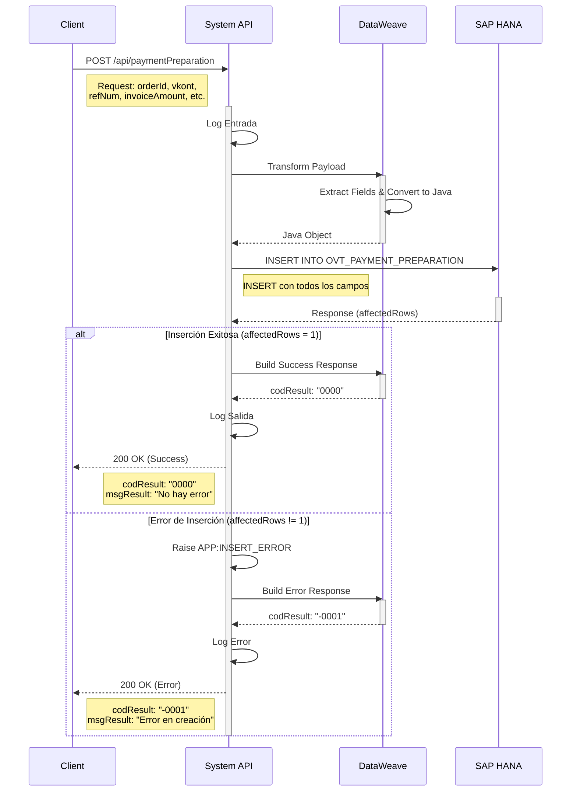

# POST /paymentPreparation

## 📌 Descripción General

### Propósito del Endpoint

Este endpoint registra información de preparación de pagos en la base de datos SAP HANA, almacenando datos críticos de transacciones de facturación para su posterior procesamiento y trazabilidad.

El endpoint soporta:
- **Registro de Preparación de Pagos**: Inserta un nuevo registro con información completa de la transacción
- **Validación de Inserción**: Verifica que el registro se haya creado correctamente
- **Respuesta Estructurada**: Retorna código de resultado estándar indicando éxito o error

### Tipo de API

**Capa:** System API (API-Led Connectivity)

**Función:** Integración directa con SAP HANA (PostgreSQL compatible) para persistencia de datos de preparación de pagos.

### Patrón de Integración

**Tipo:** Request-Reply Síncrono con SQL INSERT

**Descripción:** Recibe datos de preparación de pago en formato JSON, transforma los campos al formato requerido por la base de datos, ejecuta una inserción en la tabla OVT_PAYMENT_PREPARATION, valida que se haya insertado exactamente un registro, y retorna una respuesta estructurada indicando el resultado de la operación.

### Arquitectura API-Led Connectivity



---

## 💼 Propósito del Negocio

### Casos de Uso Principales

1. **Registro de Preparación de Pagos**
   - Un cliente realiza un pago a través de un canal digital
   - El sistema necesita registrar la preparación del pago antes de procesarlo
   - Se almacena información completa para trazabilidad y auditoría

2. **Sincronización de Datos de Facturación**
   - El sistema de facturación genera una nueva factura
   - Se registra la preparación del pago asociado a la factura
   - Permite seguimiento del ciclo completo de facturación y cobro

3. **Trazabilidad de Transacciones**
   - Se necesita un registro histórico de todas las preparaciones de pago
   - Cada transacción queda registrada con su número de referencia único
   - Facilita auditorías y resolución de incidencias

### Contexto Empresarial

- **Dominio:** Gestión de Pagos y Facturación
- **Sector:** Energía - Utilities
- **División:** Naturgy España - NewCo
- **Proceso de Negocio:** Ciclo de Facturación y Cobro (Order-to-Cash)
- **Módulo SAP:** FI-CA (Financial Contract Accounting)

### Stakeholders

- **Equipo de Facturación**: Necesita registrar preparaciones de pago para seguimiento
- **Equipo de Cobros**: Requiere trazabilidad de transacciones de pago
- **Auditoría Interna**: Necesita histórico completo de operaciones de pago
- **Soporte al Cliente**: Consulta estado de pagos y transacciones

### Valor de Negocio

- **Trazabilidad Completa**: Registro detallado de cada preparación de pago
- **Integridad de Datos**: Validación de inserción garantiza consistencia
- **Auditoría**: Histórico completo para cumplimiento normativo
- **Resolución de Incidencias**: Información detallada para investigación de problemas

### Consumidores Potenciales

Este endpoint puede ser consumido por:
- Process APIs de gestión de pagos (ntgy-newco-p-fua-evo)
- Flujos de Salesforce (Platform Events, Flows)
- Sistemas de integración middleware
- Aplicaciones de facturación y cobros

---

## 🔧 Especificación Técnica

### URLs por Ambiente

| Ambiente | URL Base | URL Completa |
|----------|----------|--------------|
| **Local** | `http://localhost:8081` | `http://localhost:8081/api/paymentPreparation` |
| **Development** | `https://mul-com-fua-s-ac-fua-dev.us-e2.cloudhub.io` | `https://mul-com-fua-s-ac-fua-dev.us-e2.cloudhub.io/api/paymentPreparation` |
| **UAT** | `https://mul-com-fua-s-ac-fua-uat.us-e2.cloudhub.io` | `https://mul-com-fua-s-ac-fua-uat.us-e2.cloudhub.io/api/paymentPreparation` |
| **Production** | `https://mul-com-fua-s-ac-fua-pro.us-e2.cloudhub.io` | `https://mul-com-fua-s-ac-fua-pro.us-e2.cloudhub.io/api/paymentPreparation` |

### Método HTTP

```
POST /api/paymentPreparation
```

### Parámetros de Entrada

#### Headers HTTP

| Header | Tipo | Requerido | Descripción | Ejemplo |
|--------|------|-----------|-------------|---------|
| `Content-Type` | string | ✅ Sí | Tipo de contenido del request | `application/json` |
| `Accept` | string | ❌ No | Tipo de contenido esperado en response | `application/json` |

#### Body Parameters

| Campo | Tipo | Requerido | Descripción | Ejemplo |
|-------|------|-----------|-------------|---------|
| `orderId` | string | ✅ Sí | Identificador único de la orden | `"ORD-2024-001234"` |
| `vkont` | string | ✅ Sí | Número de cuenta de contrato (Contract Account) | `"200012345678"` |
| `refNum` | string | ✅ Sí | Número de referencia de la transacción | `"REF-2024-567890"` |
| `invoiceAmount` | number | ✅ Sí | Monto de la factura | `125.50` |
| `invoiceNum` | string | ✅ Sí | Número de factura | `"INV-2024-001234"` |
| `paymentStatus` | string | ✅ Sí | Estado del pago | `"PENDING"` |
| `paymentDate` | string | ✅ Sí | Fecha del pago (formato ISO 8601) | `"2024-01-15T10:30:00Z"` |

**Ejemplo de Request Body:**

```json
{
  "orderId": "ORD-2024-001234",
  "vkont": "200012345678",
  "refNum": "REF-2024-567890",
  "invoiceAmount": 125.50,
  "invoiceNum": "INV-2024-001234",
  "paymentStatus": "PENDING",
  "paymentDate": "2024-01-15T10:30:00Z"
}
```

### Respuestas

#### Respuesta Exitosa (200 OK)

Cuando el registro se inserta correctamente (affectedRows == 1):

```json
{
  "result": {
    "codResult": "0000",
    "msgResult": "No hay error"
  }
}
```

#### Respuesta de Error de Inserción (200 OK)

Cuando la inserción falla o no afecta exactamente 1 fila:

```json
{
  "result": {
    "codResult": "-0001",
    "msgResult": "Ha habido un error en la creación del registro"
  }
}
```

#### Códigos de Resultado

| Código | Descripción | Tipo |
|--------|-------------|------|
| `0000` | Operación exitosa | Success |
| `-0001` | Error en la creación del registro | Error |

### Autenticación y Autorización

- **Tipo:** Client ID & Client Secret (Anypoint Platform)
- **Autorización Base de Datos:** El usuario de conexión debe tener permisos para:
  - Ejecutar INSERT en tabla `OVT_PAYMENT_PREPARATION`
  - Acceso al schema `SAPSR3`

### Timeouts

| Tipo | Valor | Descripción |
|------|-------|-------------|
| **Query Timeout** | 30000 ms (30 segundos) | Tiempo máximo de ejecución del INSERT |
| **Connection Timeout** | 10 segundos | Tiempo máximo para establecer conexión con BD |

---

## 🏗️ Implementación Técnica

### Arquitectura del Flow



### Operación de Base de Datos

**Tipo:** SQL INSERT

**Query SQL:**
```sql
INSERT INTO OVT_PAYMENT_PREPARATION (
    ORDER_ID, 
    VKONT, 
    NUM_REF, 
    INVOICE_AMOUNT, 
    INVOICE_NUM, 
    STATUS, 
    PAYMENT_DATE
) VALUES (
    :orderId, 
    :vkont, 
    :refNum, 
    :invoiceAmount, 
    :invoiceNum, 
    :paymentStatus, 
    :paymentDate
)
```

**Tabla:** `OVT_PAYMENT_PREPARATION`

**Columnas:**

| Columna | Tipo | Descripción | Origen |
|---------|------|-------------|--------|
| `ORDER_ID` | VARCHAR | Identificador de la orden | `payload.orderId` |
| `VKONT` | VARCHAR | Número de cuenta de contrato | `payload.vkont` |
| `NUM_REF` | VARCHAR | Número de referencia | `payload.refNum` |
| `INVOICE_AMOUNT` | DECIMAL | Monto de la factura | `payload.invoiceAmount` |
| `INVOICE_NUM` | VARCHAR | Número de factura | `payload.invoiceNum` |
| `STATUS` | VARCHAR | Estado del pago | `payload.paymentStatus` |
| `PAYMENT_DATE` | TIMESTAMP | Fecha del pago | `payload.paymentDate` |

### Transformaciones DataWeave

#### Transformación de Input (Líneas 10-17)

**Propósito:** Preparar el payload para la inserción en base de datos

```dataweave
%dw 2.0
output application/java
---
{
    vkont : payload.vkont,
    refNum : payload.refNum,
    invoiceAmount : payload.invoiceAmount,
    invoiceNum : payload.invoiceNum,
    orderId : payload.orderId,
    paymentDate : payload.paymentDate,
    paymentStatus : payload.paymentStatus
}
```

**Mapeo de Campos:**
- Extrae campos del payload JSON
- Convierte a formato Java para uso en query SQL
- Mantiene nombres de campos consistentes

#### Transformación de Response Exitoso (Líneas 30-38)

**Propósito:** Construir respuesta estándar de éxito

```dataweave
%dw 2.0
output application/json
---
{
    "result": {
        "codResult": "0000",
        "msgResult": "No hay error"
    }
}
```

#### Transformación de Response de Error (Líneas 48-56)

**Propósito:** Construir respuesta estándar de error

```dataweave
%dw 2.0
output application/json
---
{
    "result": {
        "codResult": "-0001",
        "msgResult": "Ha habido un error en la creación del registro"
    }
}
```

### Lógica de Validación

**Validación de Inserción (Líneas 27-42):**

```xml
<choice doc:name="Choice">
    <when expression="#[payload.affectedRows == 1]">
        <!-- Response exitoso -->
    </when>
    <otherwise>
        <raise-error type="APP:INSERT_ERROR"/>
    </otherwise>
</choice>
```

**Criterio de Éxito:**
- La inserción debe afectar exactamente 1 fila
- Si `affectedRows != 1`, se lanza error `APP:INSERT_ERROR`
- Garantiza que cada operación inserta un único registro

### Manejo de Errores

**Error Handler (Líneas 43-58):**

```xml
<on-error-continue type="APP:INSERT_ERROR">
    <!-- Transformar a response de error -->
    <!-- Log de error -->
</on-error-continue>
```

**Comportamiento:**
- Captura errores de tipo `APP:INSERT_ERROR`
- Transforma a respuesta JSON con código `-0001`
- Registra error en logs
- Retorna HTTP 200 con mensaje de error (patrón de error de negocio)

### Configuración de Base de Datos

**Config Reference:** `Database_Config`

**Parámetros:**
- **Query Timeout:** `${dbAC.queryTimeout}` (30000 ms)
- **Connection Pool:** Configurado en `s-ac-fua-global-config.yaml`
- **Driver:** PostgreSQL (compatible con SAP HANA)

### Diagrama de Secuencia Completo



---

## 💻 Ejemplos de Uso

### Ejemplo 1: Inserción Exitosa

#### Request

```bash
curl -X POST "https://mul-com-fua-s-ac-fua-dev.us-e2.cloudhub.io/api/paymentPreparation" \
  -H "Content-Type: application/json" \
  -H "client_id: YOUR_CLIENT_ID" \
  -H "client_secret: YOUR_CLIENT_SECRET" \
  -d '{
    "orderId": "ORD-2024-001234",
    "vkont": "200012345678",
    "refNum": "REF-2024-567890",
    "invoiceAmount": 125.50,
    "invoiceNum": "INV-2024-001234",
    "paymentStatus": "PENDING",
    "paymentDate": "2024-01-15T10:30:00Z"
  }'
```

#### Response (200 OK)

```json
{
  "result": {
    "codResult": "0000",
    "msgResult": "No hay error"
  }
}
```

### Ejemplo 2: Error de Inserción

#### Request

```bash
curl -X POST "https://mul-com-fua-s-ac-fua-dev.us-e2.cloudhub.io/api/paymentPreparation" \
  -H "Content-Type: application/json" \
  -H "client_id: YOUR_CLIENT_ID" \
  -H "client_secret: YOUR_CLIENT_SECRET" \
  -d '{
    "orderId": "ORD-DUPLICATE",
    "vkont": "200012345678",
    "refNum": "REF-2024-567890",
    "invoiceAmount": 125.50,
    "invoiceNum": "INV-2024-001234",
    "paymentStatus": "PENDING",
    "paymentDate": "2024-01-15T10:30:00Z"
  }'
```

#### Response (200 OK)

```json
{
  "result": {
    "codResult": "-0001",
    "msgResult": "Ha habido un error en la creación del registro"
  }
}
```

### Ejemplo 3: Registro de Pago con Monto Alto

#### Request

```bash
curl -X POST "http://localhost:8081/api/paymentPreparation" \
  -H "Content-Type: application/json" \
  -d '{
    "orderId": "ORD-2024-999999",
    "vkont": "200099887766",
    "refNum": "REF-2024-HIGH-AMOUNT",
    "invoiceAmount": 5000.00,
    "invoiceNum": "INV-2024-999999",
    "paymentStatus": "PENDING_APPROVAL",
    "paymentDate": "2024-01-20T14:45:00Z"
  }'
```

#### Response (200 OK)

```json
{
  "result": {
    "codResult": "0000",
    "msgResult": "No hay error"
  }
}
```

### Ejemplo 4: Integración desde JavaScript

```javascript
const paymentData = {
  orderId: "ORD-2024-001234",
  vkont: "200012345678",
  refNum: "REF-2024-567890",
  invoiceAmount: 125.50,
  invoiceNum: "INV-2024-001234",
  paymentStatus: "PENDING",
  paymentDate: new Date().toISOString()
};

const response = await fetch(
  'https://mul-com-fua-s-ac-fua-dev.us-e2.cloudhub.io/api/paymentPreparation',
  {
    method: 'POST',
    headers: {
      'Content-Type': 'application/json',
      'client_id': 'YOUR_CLIENT_ID',
      'client_secret': 'YOUR_CLIENT_SECRET'
    },
    body: JSON.stringify(paymentData)
  }
);

const result = await response.json();

if (result.result.codResult === "0000") {
  console.log("Pago registrado exitosamente");
} else {
  console.error("Error al registrar pago:", result.result.msgResult);
}
```

### Ejemplo 5: Integración desde Python

```python
import requests
from datetime import datetime

payment_data = {
    "orderId": "ORD-2024-001234",
    "vkont": "200012345678",
    "refNum": "REF-2024-567890",
    "invoiceAmount": 125.50,
    "invoiceNum": "INV-2024-001234",
    "paymentStatus": "PENDING",
    "paymentDate": datetime.utcnow().isoformat() + "Z"
}

headers = {
    "Content-Type": "application/json",
    "client_id": "YOUR_CLIENT_ID",
    "client_secret": "YOUR_CLIENT_SECRET"
}

response = requests.post(
    "https://mul-com-fua-s-ac-fua-dev.us-e2.cloudhub.io/api/paymentPreparation",
    json=payment_data,
    headers=headers
)

result = response.json()

if result["result"]["codResult"] == "0000":
    print("Pago registrado exitosamente")
else:
    print(f"Error: {result['result']['msgResult']}")