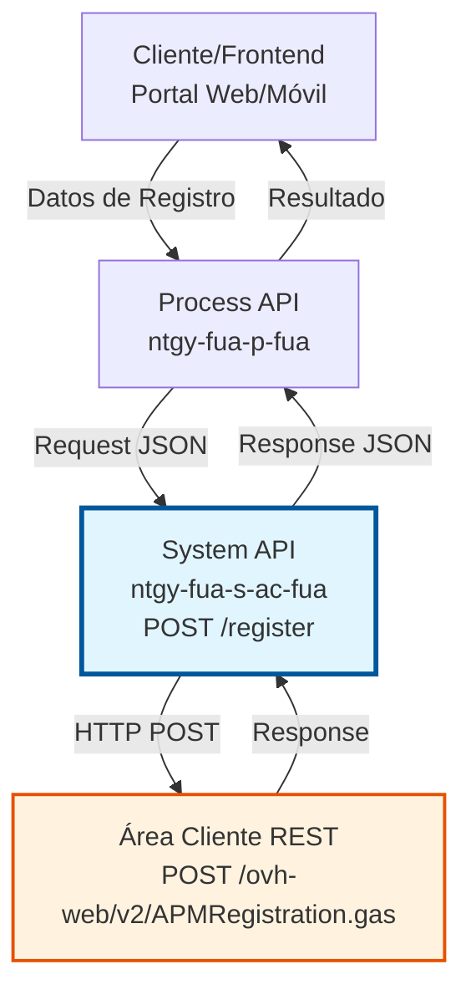
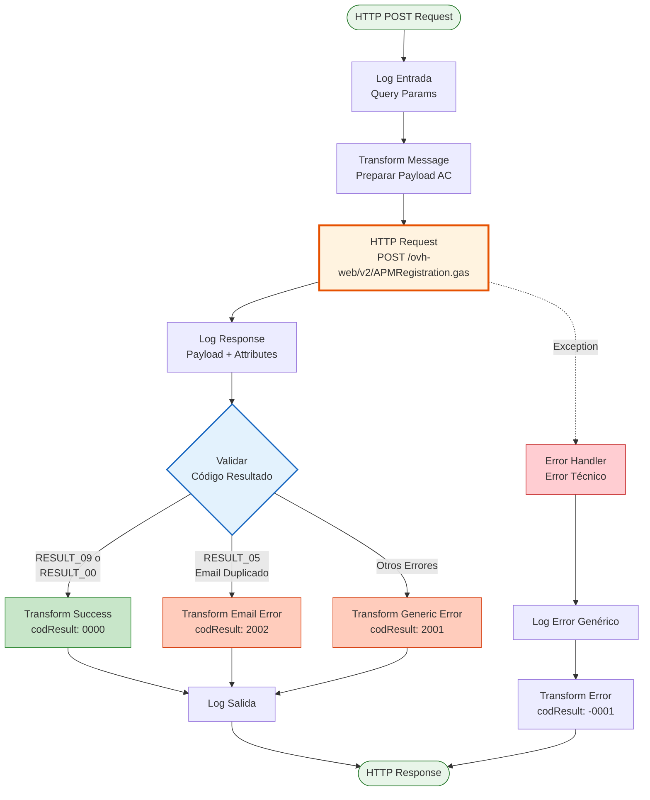
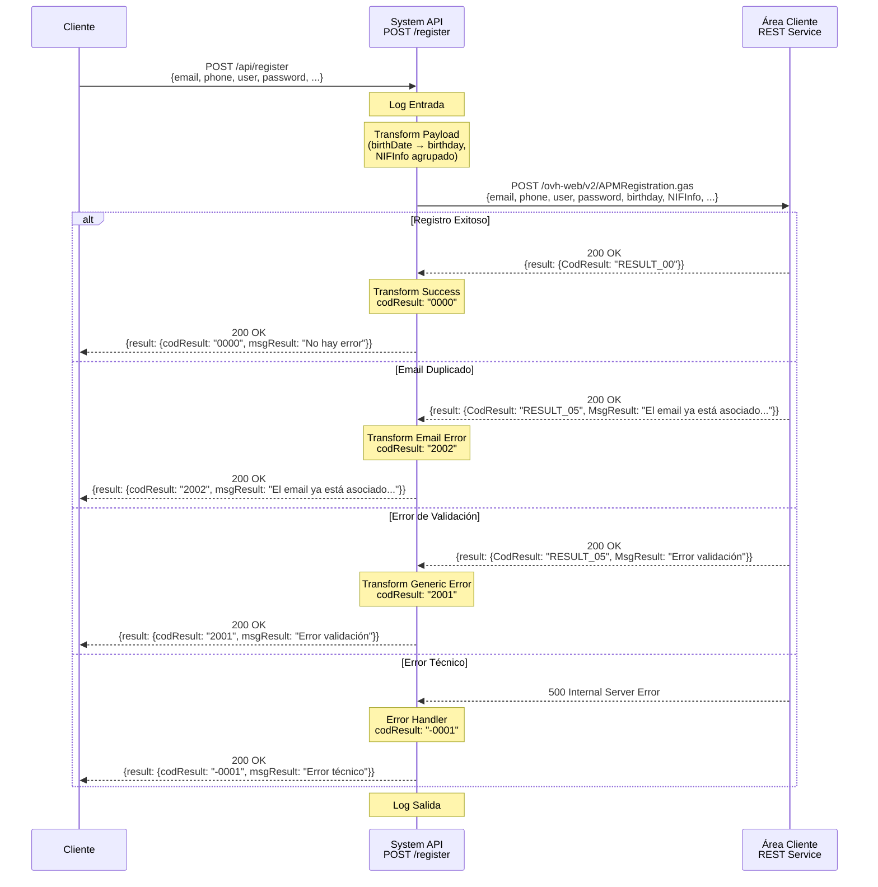

# POST /register

## 📌 Descripción General

### Propósito del Endpoint

Este endpoint permite el registro de nuevos usuarios en el sistema Área Cliente (AC) de Naturgy. Recibe los datos del usuario, los valida, los transforma al formato requerido por el servicio AC y crea la cuenta de usuario en el sistema backend.

El endpoint soporta:
- **Registro de Nuevos Usuarios**: Creación de cuentas de usuario con datos personales completos
- **Validación de Email**: Verificación de unicidad del email en el sistema
- **Asociación de Datos**: Vinculación con CUO (Código Único de Operación) y FOL (Folio) si aplica
- **Confirmación de Contacto**: Compromiso de datos de contacto del usuario

### Tipo de API

**Capa:** System API (API-Led Connectivity)

**Función:** Integración directa con el servicio REST de Área Cliente (AC) para registro de usuarios.

### Patrón de Integración

**Tipo:** Request-Reply Síncrono con REST API

**Descripción:** El endpoint recibe los datos del usuario en formato JSON, los transforma al formato esperado por el servicio AC, realiza una llamada HTTP POST al servicio de registro, procesa la respuesta y retorna un resultado estandarizado indicando el éxito o fallo del registro.

### Arquitectura API-Led Connectivity



---

## 💼 Propósito del Negocio

### Casos de Uso Principales

1. **Registro de Nuevo Cliente**
   - Un cliente nuevo desea crear una cuenta en el portal de Naturgy
   - Proporciona sus datos personales, email, teléfono y contraseña
   - El sistema valida que el email no esté ya registrado
   - Se crea la cuenta y el usuario puede acceder al portal

2. **Registro con Vinculación de Contrato**
   - Un cliente con contrato existente (CUO/FOL) desea registrarse
   - Proporciona sus datos y los códigos de vinculación
   - El sistema asocia la cuenta con el contrato existente
   - El cliente puede gestionar su contrato desde el portal

3. **Validación de Unicidad de Email**
   - Durante el registro, se valida que el email no esté duplicado
   - Si el email ya existe, se retorna un código de error específico (2002)
   - Esto previene duplicados y mejora la calidad de datos

### Contexto Empresarial

- **Dominio:** Gestión de Clientes y Autenticación
- **Sector:** Energía - Utilities
- **División:** Naturgy España - Área Cliente
- **Proceso de Negocio:** Onboarding de Clientes Digitales
- **Sistema Backend:** Área Cliente (AC) - Oracle Database + REST Services

### Stakeholders

- **Clientes Finales**: Necesitan crear cuentas para acceder a servicios digitales
- **Equipo de Marketing Digital**: Requieren facilitar el registro para aumentar adopción digital
- **Equipo de Servicio al Cliente**: Necesitan que los clientes puedan autogestionar sus cuentas
- **Equipo de Seguridad**: Requieren validación de datos y prevención de duplicados

### Valor de Negocio

- **Autoservicio Digital**: Permite a los clientes registrarse sin intervención de agentes
- **Reducción de Costos**: Disminuye llamadas al call center para gestiones básicas
- **Calidad de Datos**: Validación de email previene duplicados y mejora la base de datos
- **Experiencia del Cliente**: Proceso de registro rápido y sencillo (< 3 segundos)

### Consumidores Potenciales

Este endpoint puede ser consumido por:
- Process APIs de gestión de clientes (ntgy-fua-p-fua)
- Experience APIs de portales web y móviles
- Aplicaciones de frontend (Angular, React)
- Sistemas de CRM que requieren sincronización de usuarios

---

## 🔧 Especificación Técnica

### URLs por Ambiente

| Ambiente | URL Base | URL Completa |
|----------|----------|--------------|
| **Local** | `http://localhost:8081` | `http://localhost:8081/api/register` |
| **Development** | `https://ntgy-fua-s-ac-fua-dev.us-e2.cloudhub.io` | `https://ntgy-fua-s-ac-fua-dev.us-e2.cloudhub.io/api/register` |
| **UAT** | `https://ntgy-fua-s-ac-fua-uat.us-e2.cloudhub.io` | `https://ntgy-fua-s-ac-fua-uat.us-e2.cloudhub.io/api/register` |
| **Production** | `https://ntgy-fua-s-ac-fua-pro.us-e2.cloudhub.io` | `https://ntgy-fua-s-ac-fua-pro.us-e2.cloudhub.io/api/register` |

### Método HTTP

```
POST /api/register
```

### Parámetros de Entrada

#### Headers HTTP

| Header | Tipo | Requerido | Descripción | Ejemplo |
|--------|------|-----------|-------------|---------|
| `Content-Type` | string | ✅ Sí | Tipo de contenido del request | `application/json` |
| `Accept` | string | ❌ No | Tipo de contenido esperado en response | `application/json` |

#### Body Parameters

| Campo | Tipo | Requerido | Descripción | Ejemplo |
|-------|------|-----------|-------------|---------|
| `email` | string | ✅ Sí | Email del usuario (debe ser único) | `"usuario@example.com"` |
| `phone` | string | ✅ Sí | Teléfono de contacto | `"+34612345678"` |
| `language` | string | ✅ Sí | Idioma preferido del usuario | `"es"` |
| `user` | string | ✅ Sí | Nombre de usuario | `"juanperez"` |
| `password` | string | ✅ Sí | Contraseña del usuario | `"SecurePass123!"` |
| `birthDate` | string | ✅ Sí | Fecha de nacimiento (formato: YYYY-MM-DD) | `"1985-06-15"` |
| `documentType` | string | ✅ Sí | Tipo de documento (NIF, NIE, etc.) | `"NIF"` |
| `documentNumber` | string | ✅ Sí | Número de documento | `"12345678A"` |
| `nationality` | string | ❌ No | Nacionalidad del usuario (código país) | `"ES"` |
| `CUO` | string | ❌ No | Código Único de Operación | `"CUO123456"` |
| `FOL` | string | ❌ No | Folio asociado | `"FOL789012"` |

### Respuestas

#### Respuesta Exitosa (200 OK)

```json
{
  "result": {
    "codResult": "0000",
    "msgResult": "No hay error"
  }
}
```

**Descripción:** El usuario se registró correctamente en el sistema AC.

#### Respuesta de Error - Email Duplicado (200 OK)

```json
{
  "result": {
    "codResult": "2002",
    "msgResult": "El email ya está asociado a otro usuario NI"
  }
}
```

**Descripción:** El email proporcionado ya existe en el sistema y no se puede registrar.

#### Respuesta de Error Genérico (200 OK)

```json
{
  "result": {
    "codResult": "2001",
    "msgResult": "Error en el registro del usuario"
  }
}
```

**Descripción:** Error genérico durante el proceso de registro (validación fallida, datos incorrectos, etc.).

#### Respuesta de Error Técnico (500)

```json
{
  "result": {
    "codResult": "-0001",
    "msgResult": "Error técnico"
  }
}
```

**Descripción:** Error técnico interno del sistema (timeout, conexión fallida, excepción no controlada).

### Códigos de Resultado

| Código | Tipo | Descripción | Acción Recomendada |
|--------|------|-------------|-------------------|
| `0000` | Éxito | Registro exitoso | Proceder con login |
| `2001` | Error de Negocio | Error genérico de registro | Revisar datos y reintentar |
| `2002` | Error de Negocio | Email ya existe | Usar otro email o recuperar cuenta |
| `-0001` | Error Técnico | Error interno del sistema | Contactar soporte técnico |

### Autenticación y Autorización

- **Tipo:** Client ID & Client Secret (Anypoint Platform)
- **Autorización AC:** El servicio AC requiere autenticación OAuth 2.0 para el registro
- **Permisos Necesarios:** Acceso al servicio `/ovh-web/v2/APMRegistration.gas`

### Timeouts

| Tipo | Valor | Descripción |
|------|-------|-------------|
| **Request Timeout** | 15 segundos | Tiempo máximo de espera para la respuesta del servicio AC |
| **Connection Timeout** | 10 segundos | Tiempo máximo para establecer conexión con AC |

---

## 🏗️ Implementación Técnica

### Arquitectura del Flow



### Componentes del Flow

#### 1. Log de Entrada (Línea 7)
```xml
<logger level="INFO" message="s-ac-register.logEntrada #[attributes.queryParams]"/>
```
**Propósito:** Registrar los parámetros de entrada para trazabilidad.

#### 2. Transformación de Entrada (Líneas 8-23)
```dataweave
%dw 2.0
output application/json
---
{
    "email": payload.email,
    "phone": payload.phone,
    "language": payload.language,
    "user": payload.user,
    "password": payload.password,
    "birthday": payload.birthDate,
    "NIFInfo": {
        "documentType": payload.documentType,
        "documentNumber": payload.documentNumber,
        ("documentCountry": payload.nationality) if (!isEmpty(payload.nationality))
    },
    "CUO": payload.CUO,
    "FOL": payload.FOL,
    "commitContactData": "Y"
}
```

**Propósito:** Transformar el payload de entrada al formato esperado por el servicio AC.

**Transformaciones Aplicadas:**
- Mapeo directo de campos básicos (email, phone, language, user, password)
- Renombrado de `birthDate` a `birthday`
- Agrupación de datos de documento en objeto `NIFInfo`
- Inclusión condicional de `documentCountry` solo si `nationality` no está vacío
- Adición de campo fijo `commitContactData: "Y"` para confirmar datos de contacto

#### 3. Llamada HTTP al Servicio AC (Líneas 24-28)
```xml
<http:request method="POST" 
              config-ref="HTTP_Request_configuration_AC" 
              path="${ac.path.register}">
    <http:response-validator>
        <http:success-status-code-validator values="200,400,401" />
    </http:response-validator>
</http:request>
```

**Configuración:**
- **Método:** POST
- **Path:** `/ovh-web/v2/APMRegistration.gas` (configurado en `${ac.path.register}`)
- **Config:** `HTTP_Request_configuration_AC`
- **Status Codes Válidos:** 200, 400, 401

**Backend:** Servicio REST de Área Cliente (AC)
- **Host:** rov.intranet.gasnatural.com:443
- **Protocol:** HTTPS
- **Timeout:** 15 segundos

#### 4. Log de Respuesta (Línea 29)
```xml
<logger level="INFO" message="s-ac-register.log ## payload: #[payload] attributes: #[attributes]"/>
```
**Propósito:** Registrar la respuesta del servicio AC para auditoría.

#### 5. Lógica de Decisión (Líneas 30-56)

##### Caso Exitoso (Líneas 31-43)
**Condición:** `payload.result.CodResult == "RESULT_09" OR "RESULT_00"`

```dataweave
{
    result: {
        codResult: "0000",
        msgResult: "No hay error"
    }
}
```

##### Caso Email Duplicado (Líneas 45-54)
**Condición:** `payload.result.CodResult == "RESULT_05" AND payload.result.MsgResult contains "El email ya está asociado a otro usuario"`

```dataweave
{
    result: {
        codResult: "2002",
        msgResult: "El email ya está asociado a otro usuario NI"
    }
}
```

##### Caso Error Genérico (Líneas 45-54)
**Condición:** Cualquier otro código de resultado

```dataweave
{
    result: {
        codResult: "2001",
        msgResult: payload.result.MsgResult
    }
}
```

#### 6. Log de Salida (Línea 57)
```xml
<logger level="INFO" message="s-ac-register.logSalida ## payload: #[payload] attributes: #[attributes]"/>
```
**Propósito:** Registrar el resultado final antes de retornar al cliente.

#### 7. Manejo de Errores (Líneas 58-73)
```xml
<on-error-propagate>
    <logger level="ERROR" message='#["s-ac-register.logErrorGenerico error: " ++ error.description]'/>
    <ee:transform>
        <ee:set-payload>
            {
                "result": {
                    "codResult": "-0001",
                    "msgResult": "Error técnico"
                }
            }
        </ee:set-payload>
    </ee:transform>
</on-error-propagate>
```

**Propósito:** Capturar excepciones no controladas y retornar error técnico estandarizado.

### Diagrama de Secuencia



### Transformaciones DataWeave Detalladas

#### Transformación de Entrada

**Ubicación:** Inline en el flow (líneas 8-23)

**Mapeo de Campos:**

| Campo Entrada | Campo Salida AC | Transformación |
|---------------|-----------------|----------------|
| `email` | `email` | Directo |
| `phone` | `phone` | Directo |
| `language` | `language` | Directo |
| `user` | `user` | Directo |
| `password` | `password` | Directo |
| `birthDate` | `birthday` | Renombrado |
| `documentType` | `NIFInfo.documentType` | Agrupado en objeto |
| `documentNumber` | `NIFInfo.documentNumber` | Agrupado en objeto |
| `nationality` | `NIFInfo.documentCountry` | Condicional (solo si no vacío) |
| `CUO` | `CUO` | Directo |
| `FOL` | `FOL` | Directo |
| N/A | `commitContactData` | Valor fijo: "Y" |

**Lógica Condicional:**
```dataweave
("documentCountry": payload.nationality) if (!isEmpty(payload.nationality))
```
Solo incluye `documentCountry` si `nationality` tiene valor.

#### Transformación de Respuesta Exitosa

**Ubicación:** Inline en el flow (líneas 34-42)

**Mapeo:**
- Código AC `RESULT_09` o `RESULT_00` → Código estandarizado `0000`
- Mensaje fijo: "No hay error"

#### Transformación de Respuesta con Error

**Ubicación:** Inline en el flow (líneas 47-54)

**Lógica de Mapeo:**
```dataweave
codResult: if ((payload.result.CodResult=="RESULT_05") and 
               (payload.result.MsgResult contains "El email ya está asociado a otro usuario")) 
           "2002" 
           else "2001"
```

**Casos:**
1. **Email Duplicado:** `RESULT_05` + mensaje específico → `2002`
2. **Otros Errores:** Cualquier otro código → `2001`

### Configuración del Backend

#### HTTP Request Configuration

**Archivo:** `global.xml` o archivo de configuración HTTP

**Propiedades (desde `ntgy-fua-s-ac-fua-pro-config.yaml`):**
```yaml
ac:
  host: "rov.intranet.gasnatural.com"
  port: "443"
  protocol: "HTTPS"
  path:
    register: "/ovh-web/v2/APMRegistration.gas"
```

**Configuración de Timeout:**
- Connection Timeout: 10 segundos
- Response Timeout: 15 segundos

**Retry Policy:**
- Max Attempts: 3
- Retry Interval: 1 segundo

### Manejo de Errores

#### Tipos de Error

1. **Errores de Negocio (HTTP 200)**
   - `RESULT_09`, `RESULT_00`: Éxito → `0000`
   - `RESULT_05` + email duplicado: Error específico → `2002`
   - Otros `RESULT_*`: Error genérico → `2001`

2. **Errores HTTP (400, 401, 500)**
   - Capturados por error handler
   - Transformados a código `-0001`
   - Mensaje genérico: "Error técnico"

3. **Excepciones de Sistema**
   - Timeout, conexión fallida, etc.
   - Capturados por `on-error-propagate`
   - Código `-0001`

#### Estrategia de Logging

**Niveles de Log:**
- **INFO:** Entrada, respuesta, salida (operación normal)
- **ERROR:** Excepciones y errores técnicos

**Información Registrada:**
- Query parameters de entrada
- Payload y attributes de respuesta AC
- Descripción de errores técnicos

---

## 💻 Ejemplos de Uso

### Ejemplo 1: Registro Exitoso

#### Request

```bash
curl -X POST "https://ntgy-fua-s-ac-fua-pro.us-e2.cloudhub.io/api/register" \
  -H "Content-Type: application/json" \
  -H "client_id: YOUR_CLIENT_ID" \
  -H "client_secret: YOUR_CLIENT_SECRET" \
  -d '{
    "email": "juan.perez@example.com",
    "phone": "+34612345678",
    "language": "es",
    "user": "juanperez",
    "password": "SecurePass123!",
    "birthDate": "1985-06-15",
    "documentType": "NIF",
    "documentNumber": "12345678A",
    "nationality": "ES",
    "CUO": "CUO123456",
    "FOL": "FOL789012"
  }'
```

#### Response (200 OK)

```json
{
  "result": {
    "codResult": "0000",
    "msgResult": "No hay error"
  }
}
```

**Interpretación:** El usuario se registró correctamente. Puede proceder con el login.

---

### Ejemplo 2: Email Duplicado

#### Request

```bash
curl -X POST "https://ntgy-fua-s-ac-fua-pro.us-e2.cloudhub.io/api/register" \
  -H "Content-Type: application/json" \
  -H "client_id: YOUR_CLIENT_ID" \
  -H "client_secret: YOUR_CLIENT_SECRET" \
  -d '{
    "email": "usuario.existente@example.com",
    "phone": "+34698765432",
    "language": "es",
    "user": "usuarioexistente",
    "password": "AnotherPass456!",
    "birthDate": "1990-03-20",
    "documentType": "NIE",
    "documentNumber": "X1234567Y"
  }'
```

#### Response (200 OK)

```json
{
  "result": {
    "codResult": "2002",
    "msgResult": "El email ya está asociado a otro usuario NI"
  }
}
```

**Interpretación:** El email ya existe en el sistema. El usuario debe usar otro email o recuperar su cuenta existente.

---

### Ejemplo 3: Error de Validación

#### Request

```bash
curl -X POST "https://ntgy-fua-s-ac-fua-pro.us-e2.cloudhub.io/api/register" \
  -H "Content-Type: application/json" \
  -H "client_id: YOUR_CLIENT_ID" \
  -H "client_secret: YOUR_CLIENT_SECRET" \
  -d '{
    "email": "email-invalido",
    "phone": "123",
    "language": "es",
    "user": "user",
    "password": "weak",
    "birthDate": "2020-01-01",
    "documentType": "NIF",
    "documentNumber": "INVALID"
  }'
```

#### Response (200 OK)

```json
{
  "result": {
    "codResult": "2001",
    "msgResult": "Error en la validación de datos del usuario"
  }
}
```

**Interpretación:** Los datos proporcionados no cumplen con las validaciones del servicio AC (email inválido, contraseña débil, documento incorrecto, etc.).

---

### Ejemplo 4: Error Técnico

#### Request

```bash
curl -X POST "https://ntgy-fua-s-ac-fua-pro.us-e2.cloudhub.io/api/register" \
  -H "Content-Type: application/json" \
  -H "client_id: YOUR_CLIENT_ID" \
  -H "client_secret: YOUR_CLIENT_SECRET" \
  -d '{
    "email": "nuevo.usuario@example.com",
    "phone": "+34611223344",
    "language": "es",
    "user": "nuevousuario",
    "password": "SecurePass789!",
    "birthDate": "1988-11-25",
    "documentType": "NIF",
    "documentNumber": "87654321B"
  }'
```

#### Response (200 OK) - En caso de timeout o error de conexión

```json
{
  "result": {
    "codResult": "-0001",
    "msgResult": "Error técnico"
  }
}
```

**Interpretación:** Error técnico del sistema (timeout, servicio AC no disponible, error de conexión). Contactar con soporte técnico.

---

### Ejemplo 5: Registro sin Nacionalidad (Campo Opcional)

#### Request

```bash
curl -X POST "https://ntgy-fua-s-ac-fua-pro.us-e2.cloudhub.io/api/register" \
  -H "Content-Type: application/json" \
  -H "client_id: YOUR_CLIENT_ID" \
  -H "client_secret: YOUR_CLIENT_SECRET" \
  -d '{
    "email": "maria.garcia@example.com",
    "phone": "+34655443322",
    "language": "es",
    "user": "mariagarcia",
    "password": "SecurePass456!",
    "birthDate": "1992-08-10",
    "documentType": "NIF",
    "documentNumber": "98765432B"
  }'
```

**Nota:** En este ejemplo, los campos opcionales `nationality`, `CUO` y `FOL` no se incluyen.

#### Response (200 OK)

```json
{
  "result": {
    "codResult": "0000",
    "msgResult": "No hay error"
  }
}
```

**Interpretación:** El registro se completó exitosamente sin los campos opcionales. El campo `documentCountry` no se incluye en el payload enviado a AC.
