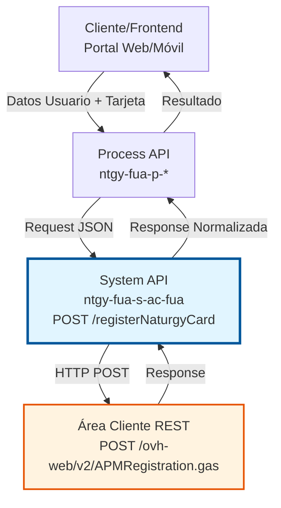
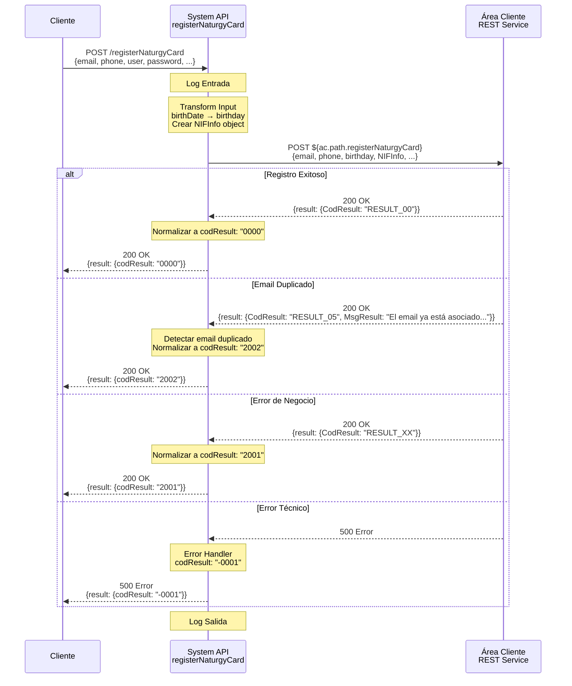

# POST /registerNaturgyCard

## 📌 Descripción General

### Propósito del Endpoint

Este endpoint permite registrar una tarjeta Naturgy (tarjeta de puntos de fidelización) asociándola a un usuario en el sistema Área Cliente (AC). El proceso valida los datos del usuario, crea la asociación con la tarjeta de puntos y gestiona los códigos CUO (Código Único de Operación) y FOL (Folio) necesarios para el registro.

El endpoint soporta:
- **Registro de Usuario con Tarjeta**: Asocia una tarjeta de puntos Naturgy a un nuevo usuario
- **Validación de Datos**: Verifica email, teléfono, documento de identidad y fecha de nacimiento
- **Gestión de Duplicados**: Detecta y maneja casos de email ya registrado
- **Integración con AC**: Comunica con el servicio REST de Área Cliente para completar el registro

### Tipo de API

**Capa:** System API (API-Led Connectivity)

**Función:** Integración directa con servicios REST de Área Cliente (AC) para registro de tarjetas Naturgy.

### Patrón de Integración

**Tipo:** Request-Reply Síncrono con REST API Externa

**Descripción:** Recibe datos del usuario y tarjeta, transforma el payload al formato esperado por AC, invoca el servicio REST de registro, normaliza la respuesta y retorna el resultado estandarizado.

### Arquitectura API-Led Connectivity



---

## 💼 Propósito del Negocio

### Casos de Uso Principales

1. **Registro de Nuevo Cliente con Tarjeta Naturgy**
   - Un cliente se registra en el portal web/móvil y desea asociar su tarjeta de puntos
   - El sistema valida los datos y crea la asociación
   - El cliente puede comenzar a acumular y canjear puntos

2. **Asociación de Tarjeta Existente**
   - Un cliente ya tiene una tarjeta física Naturgy
   - Desea vincularla a su cuenta digital
   - El sistema valida el número de tarjeta y completa la asociación

3. **Gestión de Errores de Duplicidad**
   - El sistema detecta si el email ya está registrado
   - Retorna un código de error específico (2002)
   - Permite al usuario recuperar su cuenta o usar otro email

### Contexto Empresarial

- **Dominio:** Gestión de Clientes y Programa de Fidelización
- **Sector:** Energía - Utilities
- **División:** Naturgy España - Área Cliente
- **Proceso de Negocio:** Onboarding de clientes y gestión de programa de puntos
- **Sistema Backend:** Área Cliente (AC) - Servicios REST

### Stakeholders

- **Clientes Finales**: Usuarios que desean registrar su tarjeta Naturgy
- **Equipo de Marketing**: Gestiona el programa de fidelización y puntos
- **Equipo de Atención al Cliente**: Soporte para problemas de registro
- **Equipo de Desarrollo Frontend**: Consume este endpoint desde web/móvil

### Valor de Negocio

- **Fidelización de Clientes**: Facilita la participación en el programa de puntos
- **Experiencia Digital**: Permite registro online sin necesidad de llamar al call center
- **Reducción de Costes**: Automatiza el proceso de registro de tarjetas
- **Calidad de Datos**: Valida información del usuario en el momento del registro

### Consumidores Potenciales

Este endpoint puede ser consumido por:
- Process APIs de gestión de clientes
- Portales web de autoservicio
- Aplicaciones móviles de Naturgy
- Sistemas de registro de nuevos clientes
- Flujos de onboarding digital

---

## 🔧 Especificación Técnica

### URLs por Ambiente

| Ambiente | URL Base | URL Completa |
|----------|----------|--------------|
| **Local** | `http://localhost:8081` | `http://localhost:8081/api/registerNaturgyCard` |
| **Development** | `https://ntgy-fua-s-ac-fua-dev.us-e2.cloudhub.io` | `https://ntgy-fua-s-ac-fua-dev.us-e2.cloudhub.io/api/registerNaturgyCard` |
| **UAT** | `https://ntgy-fua-s-ac-fua-uat.us-e2.cloudhub.io` | `https://ntgy-fua-s-ac-fua-uat.us-e2.cloudhub.io/api/registerNaturgyCard` |
| **Production** | `https://ntgy-fua-s-ac-fua-pro.us-e2.cloudhub.io` | `https://ntgy-fua-s-ac-fua-pro.us-e2.cloudhub.io/api/registerNaturgyCard` |

### Método HTTP

```
POST /api/registerNaturgyCard
```

### Parámetros de Entrada

#### Headers HTTP

| Header | Tipo | Requerido | Descripción | Ejemplo |
|--------|------|-----------|-------------|---------|
| `Content-Type` | string | ✅ Sí | Tipo de contenido del request | `application/json` |
| `Accept` | string | ❌ No | Tipo de contenido esperado en response | `application/json` |

#### Body Parameters

| Campo | Tipo | Requerido | Descripción | Ejemplo |
|-------|------|-----------|-------------|---------|
| `email` | string | ✅ Sí | Email del usuario | `"usuario@example.com"` |
| `phone` | string | ✅ Sí | Teléfono del usuario | `"+34600123456"` |
| `language` | string | ✅ Sí | Idioma preferido | `"es"` |
| `user` | string | ✅ Sí | Nombre de usuario | `"usuario123"` |
| `password` | string | ✅ Sí | Contraseña del usuario | `"********"` |
| `birthDate` | string | ✅ Sí | Fecha de nacimiento (formato: YYYY-MM-DD) | `"1990-01-15"` |
| `documentType` | string | ✅ Sí | Tipo de documento (NIF/NIE/PASSPORT) | `"NIF"` |
| `documentNumber` | string | ✅ Sí | Número de documento | `"12345678A"` |
| `nationality` | string | ❌ No | Nacionalidad (código país) | `"ES"` |
| `numTarjetaPuntos` | string | ❌ No | Número de tarjeta de puntos | `"1234567890"` |
| `CUO` | string | ✅ Sí | Código Único de Operación | `"CUO123456"` |
| `FOL` | string | ✅ Sí | Folio de la operación | `"FOL789012"` |

**Ejemplo de Request Body:**

```json
{
  "email": "usuario@example.com",
  "phone": "+34600123456",
  "language": "es",
  "user": "usuario123",
  "password": "MiPassword123!",
  "birthDate": "1990-01-15",
  "documentType": "NIF",
  "documentNumber": "12345678A",
  "nationality": "ES",
  "numTarjetaPuntos": "1234567890",
  "CUO": "CUO123456",
  "FOL": "FOL789012"
}
```

### Respuestas

#### Respuesta Exitosa (200 OK)

```json
{
  "result": {
    "codResult": "0000",
    "msgResult": "No hay error"
  }
}
```

**Descripción:** El registro se completó exitosamente. La tarjeta Naturgy ha sido asociada al usuario.

#### Respuesta de Error - Email Duplicado (200 OK)

```json
{
  "result": {
    "codResult": "2002",
    "msgResult": "El email ya está asociado a otro usuario NI"
  }
}
```

**Descripción:** El email proporcionado ya está registrado en el sistema.

#### Respuesta de Error de Negocio (200 OK)

```json
{
  "result": {
    "codResult": "2001",
    "msgResult": "Error en el registro de la tarjeta"
  }
}
```

**Descripción:** Error genérico en el proceso de registro (validación fallida, datos incorrectos, etc.).

#### Respuesta de Error Técnico (500)

```json
{
  "result": {
    "codResult": "-0001",
    "msgResult": "Error técnico"
  }
}
```

**Descripción:** Error técnico interno del sistema o del servicio AC.

### Códigos de Resultado

| Código | Tipo | Descripción | Acción Recomendada |
|--------|------|-------------|-------------------|
| `0000` | Éxito | Registro completado exitosamente | Continuar con el flujo |
| `2001` | Error Negocio | Error genérico en el registro | Verificar datos y reintentar |
| `2002` | Error Negocio | Email ya registrado | Usar otro email o recuperar cuenta |
| `-0001` | Error Técnico | Error interno del sistema | Contactar soporte técnico |

### Validaciones del Servicio AC

El servicio AC valida internamente:
- Formato de email válido
- Formato de teléfono válido
- Documento de identidad válido según tipo
- Fecha de nacimiento en formato correcto
- Unicidad del email en el sistema
- Validez del número de tarjeta de puntos (si se proporciona)

### Autenticación y Autorización

- **Tipo:** Client ID & Client Secret (Anypoint Platform)
- **Autorización AC:** El servicio AC valida internamente las credenciales y permisos
- **Seguridad:** Comunicación HTTPS con el servicio AC

### Timeouts

| Tipo | Valor | Descripción |
|------|-------|-------------|
| **Request Timeout** | 15 segundos | Tiempo máximo de espera para la respuesta del servicio AC |
| **Connection Timeout** | 15 segundos | Tiempo máximo para establecer conexión con AC |

---

## 🏗️ Implementación Técnica

### Arquitectura del Flow

```mermaid
flowchart TD
    Start([HTTP POST Request]) --> LogEntry[Log Entrada<br/>Query Params]
    LogEntry --> Transform[Transform Message<br/>Mapeo a Formato AC]
    Transform --> HTTPReq[HTTP Request POST<br/>AC Registration Service<br/>${ac.path.registerNaturgyCard}]
    HTTPReq --> LogResp[Log Response<br/>Payload + Attributes]
    LogResp --> Choice{Validar<br/>CodResult}
    
    Choice -->|RESULT_09 o<br/>RESULT_00| Success[Transform Success<br/>codResult: 0000]
    Choice -->|RESULT_05 +<br/>Email duplicado| EmailDup[Transform Email Dup<br/>codResult: 2002]
    Choice -->|Otros errores| GenError[Transform Error<br/>codResult: 2001]
    
    Success --> LogExit[Log Salida]
    EmailDup --> LogExit
    GenError --> LogExit
    LogExit --> End([HTTP Response])
    
    HTTPReq -.->|Error| ErrorHandler[Error Handler<br/>Error Técnico<br/>codResult: -0001]
    ErrorHandler --> End
    
    style Start fill:#e8f5e9,stroke:#2e7d32
    style HTTPReq fill:#fff3e0,stroke:#e65100,stroke-width:3px
    style Choice fill:#e1f5fe,stroke:#01579b
    style Success fill:#c8e6c9,stroke:#388e3c
    style EmailDup fill:#fff9c4,stroke:#f57f17
    style GenError fill:#ffccbc,stroke:#d84315
    style ErrorHandler fill:#ffcdd2,stroke:#c62828
    style End fill:#e8f5e9,stroke:#2e7d32
```

### Componentes del Flow

#### 1. Log de Entrada
```xml
<logger level="INFO" doc:name="logEntrada" 
        message="s-ac-registerNaturgyCard.logEntrada #[attributes.queryParams]"/>
```
**Propósito:** Registra los parámetros de entrada para trazabilidad.

#### 2. Transformación de Input (DataWeave)
```dataweave
%dw 2.0
output application/json
---
{
    "email": payload.email,
    "phone": payload.phone,
    "language": payload.language,
    "user": payload.user,
    "password": payload.password,
    "birthday": payload.birthDate,
    "NIFInfo": {
        "documentType": payload.documentType,
        "documentNumber": payload.documentNumber,
        ("documentCountry": payload.nationality) if (!isEmpty(payload.nationality))
    },
    "numTarjetaPuntos": payload.numTarjetaPuntos default "",
    "CUO": payload.CUO,
    "FOL": payload.FOL
}
```

**Mapeo de Campos:**
- `birthDate` → `birthday`
- `documentType`, `documentNumber`, `nationality` → `NIFInfo` (objeto)
- `nationality` es condicional (solo si no está vacío)
- `numTarjetaPuntos` tiene valor por defecto `""` si no se proporciona

#### 3. Llamada HTTP al Servicio AC
```xml
<http:request method="POST" doc:name="Request" 
              config-ref="HTTP_Request_configuration_AC" 
              path="${ac.path.registerNaturgyCard}">
    <http:response-validator>
        <http:success-status-code-validator values="200,400,401" />
    </http:response-validator>
</http:request>
```

**Configuración:**
- **Método:** POST
- **Path:** Variable de configuración `${ac.path.registerNaturgyCard}`
- **Config:** `HTTP_Request_configuration_AC`
- **Códigos Válidos:** 200, 400, 401 (todos se procesan como respuestas válidas)

#### 4. Log de Respuesta
```xml
<logger level="INFO" doc:name="Logger" 
        message="s-ac-registerNaturgyCard.log ## payload: #[payload] attributes: #[attributes]"/>
```

#### 5. Lógica de Normalización de Respuesta

**Choice Router con 2 ramas:**

**Rama 1 - Éxito:**
```xml
<when expression='#[payload.result.CodResult=="RESULT_09" or payload.result.CodResult=="RESULT_00"]'>
```
Transforma a:
```json
{
  "result": {
    "codResult": "0000",
    "msgResult": "No hay error"
  }
}
```

**Rama 2 - Error (Otherwise):**
Evalúa si es error de email duplicado:
```dataweave
{
    result: {
        codResult: if ((payload.result.CodResult=="RESULT_05") and 
                      (payload.result.MsgResult contains "El email ya está asociado a otro usuario")) 
                   "2002" 
                   else "2001",
        msgResult: if ((payload.result.CodResult=="RESULT_05") and 
                      (payload.result.MsgResult contains "El email ya está asociado a otro usuario")) 
                   "El email ya está asociado a otro usuario NI" 
                   else payload.result.MsgResult
    }
}
```

#### 6. Error Handler Global
```xml
<on-error-propagate enableNotifications="true" logException="true">
    <logger level="ERROR" doc:name="logErrorGenerico" 
            message='#["s-ac-registerNaturgyCard.logErrorGenerico error: " ++ 
                     error.description as String replace /\"/ with("")]' />
    <ee:transform doc:name="Error generico">
        <ee:set-payload>
            {
                "result": {
                    "codResult": "-0001",
                    "msgResult": "Error técnico"
                }
            }
        </ee:set-payload>
    </ee:transform>
</on-error-propagate>
```

### Diagrama de Secuencia Completo



### Configuración del Servicio AC

**Archivo de Configuración:** `ntgy-fua-s-ac-fua-[env]-config.yaml`

```yaml
ac:
  path:
    registerNaturgyCard: "/ovh-web/v2/APMRegistration.gas"
  host: "rov.intranet.gasnatural.com"
  port: "443"
  protocol: "HTTPS"
```

**HTTP Request Configuration:**
- **Host:** `rov.intranet.gasnatural.com`
- **Port:** 443
- **Protocol:** HTTPS
- **Timeout:** 15 segundos
- **TLS:** Configurado para comunicación segura

### Manejo de Errores

#### Errores de Conectividad
- **Retry Policy:** 3 intentos automáticos
- **Timeout:** 15 segundos
- **Respuesta:** Error técnico (codResult: "-0001")

#### Errores de Validación AC
- **Email duplicado:** Código específico 2002
- **Otros errores de validación:** Código genérico 2001
- **Mensaje:** Se propaga el mensaje original de AC

#### Errores Técnicos
- **Exception handling:** Global error handler
- **Logging:** ERROR level con stack trace
- **Respuesta:** Mensaje genérico "Error técnico"

---

## 💻 Ejemplos de Uso

### Ejemplo 1: Registro Exitoso

**Request:**
```bash
curl -X POST "https://ntgy-fua-s-ac-fua-pro.us-e2.cloudhub.io/api/registerNaturgyCard" \
  -H "Content-Type: application/json" \
  -H "client_id: YOUR_CLIENT_ID" \
  -H "client_secret: YOUR_CLIENT_SECRET" \
  -d '{
    "email": "nuevo.usuario@example.com",
    "phone": "+34600123456",
    "language": "es",
    "user": "nuevousuario",
    "password": "Password123!",
    "birthDate": "1990-05-15",
    "documentType": "NIF",
    "documentNumber": "12345678A",
    "nationality": "ES",
    "numTarjetaPuntos": "9876543210",
    "CUO": "CUO20260724001",
    "FOL": "FOL20260724001"
  }'
```

**Response (200 OK):**
```json
{
  "result": {
    "codResult": "0000",
    "msgResult": "No hay error"
  }
}
```

### Ejemplo 2: Email Duplicado

**Request:**
```bash
curl -X POST "https://ntgy-fua-s-ac-fua-pro.us-e2.cloudhub.io/api/registerNaturgyCard" \
  -H "Content-Type: application/json" \
  -H "client_id: YOUR_CLIENT_ID" \
  -H "client_secret: YOUR_CLIENT_SECRET" \
  -d '{
    "email": "usuario.existente@example.com",
    "phone": "+34600987654",
    "language": "es",
    "user": "usuarioexistente",
    "password": "Password456!",
    "birthDate": "1985-03-20",
    "documentType": "NIF",
    "documentNumber": "87654321B",
    "CUO": "CUO20260724002",
    "FOL": "FOL20260724002"
  }'
```

**Response (200 OK):**
```json
{
  "result": {
    "codResult": "2002",
    "msgResult": "El email ya está asociado a otro usuario NI"
  }
}
```

### Ejemplo 3: Error de Validación

**Request:**
```bash
curl -X POST "https://ntgy-fua-s-ac-fua-pro.us-e2.cloudhub.io/api/registerNaturgyCard" \
  -H "Content-Type: application/json" \
  -H "client_id: YOUR_CLIENT_ID" \
  -H "client_secret: YOUR_CLIENT_SECRET" \
  -d '{
    "email": "email-invalido",
    "phone": "telefono-invalido",
    "language": "es",
    "user": "usuario",
    "password": "123",
    "birthDate": "fecha-invalida",
    "documentType": "TIPO_INVALIDO",
    "documentNumber": "DOC123",
    "CUO": "CUO20260724003",
    "FOL": "FOL20260724003"
  }'
```

**Response (200 OK):**
```json
{
  "result": {
    "codResult": "2001",
    "msgResult": "Error en la validación de datos"
  }
}
```

### Ejemplo 4: Error Técnico

**Request:**
```bash
curl -X POST "https://ntgy-fua-s-ac-fua-pro.us-e2.cloudhub.io/api/registerNaturgyCard" \
  -H "Content-Type: application/json" \
  -H "client_id: YOUR_CLIENT_ID" \
  -H "client_secret: YOUR_CLIENT_SECRET" \
  -d '{
    "email": "usuario@example.com",
    "phone": "+34600123456",
    "language": "es",
    "user": "usuario",
    "password": "Password789!",
    "birthDate": "1992-08-10",
    "documentType": "NIF",
    "documentNumber": "11223344C",
    "CUO": "CUO20260724004",
    "FOL": "FOL20260724004"
  }'
```

**Response (500 Internal Server Error):**
```json
{
  "result": {
    "codResult": "-0001",
    "msgResult": "Error técnico"
  }
}
```

### Ejemplo 5: Registro sin Tarjeta de Puntos

**Request:**
```bash
curl -X POST "https://ntgy-fua-s-ac-fua-pro.us-e2.cloudhub.io/api/registerNaturgyCard" \
  -H "Content-Type: application/json" \
  -H "client_id: YOUR_CLIENT_ID" \
  -H "client_secret: YOUR_CLIENT_SECRET" \
  -d '{
    "email": "usuario.sin.tarjeta@example.com",
    "phone": "+34600555666",
    "language": "es",
    "user": "usuariosintarjeta",
    "password": "Password000!",
    "birthDate": "1988-12-25",
    "documentType": "NIE",
    "documentNumber": "X1234567Y",
    "nationality": "FR",
    "CUO": "CUO20260724005",
    "FOL": "FOL20260724005"
  }'
```

**Response (200 OK):**
```json
{
  "result": {
    "codResult": "0000",
    "msgResult": "No hay error"
  }
}
```

**Nota:** El campo `numTarjetaPuntos` se envía como cadena vacía `""` cuando no se proporciona.

### Ejemplo de Integración en JavaScript

```javascript
async function registerNaturgyCard(userData) {
  const endpoint = 'https://ntgy-fua-s-ac-fua-pro.us-e2.cloudhub.io/api/registerNaturgyCard';
  
  const requestBody = {
    email: userData.email,
    phone: userData.phone,
    language: userData.language || 'es',
    user: userData.username,
    password: userData.password,
    birthDate: userData.birthDate, // formato: YYYY-MM-DD
    documentType: userData.documentType,
    documentNumber: userData.documentNumber,
    nationality: userData.nationality,
    numTarjetaPuntos: userData.cardNumber || '',
    CUO: userData.cuo,
    FOL: userData.fol
  };
  
  try {
    const response = await fetch(endpoint, {
      method: 'POST',
      headers: {
        'Content-Type': 'application/json',
        'client_id': process.env.CLIENT_ID,
        'client_secret': process.env.CLIENT_SECRET
      },
      body: JSON.stringify(requestBody)
    });
    
    const data = await response.json();
    
    if (data.result.codResult === '0000') {
      console.log('Registro exitoso');
      return { success: true, data };
    } else if (data.result.codResult === '2002') {
      console.error('Email ya registrado');
      return { success: false, error: 'EMAIL_DUPLICATE', data };
    } else {
      console.error('Error en el registro:', data.result.msgResult);
      return { success: false, error: 'REGISTRATION_ERROR', data };
    }
  } catch (error) {
    console.error('Error técnico:', error);
    return { success: false, error: 'TECHNICAL_ERROR', message: error.message };
  }
}

// Uso
const result = await registerNaturgyCard({
  email: 'usuario@example.com',
  phone: '+34600123456',
  language: 'es',
  username: 'usuario123',
  password: 'Password123!',
  birthDate: '1990-01-15',
  documentType: 'NIF',
  documentNumber: '12345678A',
  nationality: 'ES',
  cardNumber: '9876543210',
  cuo: 'CUO20260724001',
  fol: 'FOL20260724001'
});
```

### Ejemplo de Integración en Python

```python
import requests
import os
from typing import Dict, Any

def register_naturgy_card(user_data: Dict[str, Any]) -> Dict[str, Any]:
    """
    Registra una tarjeta Naturgy para un usuario.
    
    Args:
        user_data: Diccionario con los datos del usuario
        
    Returns:
        Diccionario con el resultado de la operación
    """
    endpoint = 'https://ntgy-fua-s-ac-fua-pro.us-e2.cloudhub.io/api/registerNaturgyCard'
    
    headers = {
        'Content-Type': 'application/json',
        'client_id': os.getenv('CLIENT_ID'),
        'client_secret': os.getenv('CLIENT_SECRET')
    }
    
    request_body = {
        'email': user_data['email'],
        'phone': user_data['phone'],
        'language': user_data.get('language', 'es'),
        'user': user_data['username'],
        'password': user_data['password'],
        'birthDate': user_data['birth_date'],  # formato: YYYY-MM-DD
        'documentType': user_data['document_type'],
        'documentNumber': user_data['document_number'],
        'nationality': user_data.get('nationality'),
        'numTarjetaPuntos': user_data.get('card_number', ''),
        'CUO': user_data['cuo'],
        'FOL': user_data['fol']
    }
    
    try:
        response = requests.post(endpoint, json=request_body, headers=headers, timeout=30)
        data = response.json()
        
        if data['result']['codResult'] == '0000':
            print('Registro exitoso')
            return {'success': True, 'data': data}
        elif data['result']['codResult'] == '2002':
            print('Email ya registrado')
            return {'success': False, 'error': 'EMAIL_DUPLICATE', 'data': data}
        else:
            print(f"Error en el registro: {data['result']['msgResult']}")
            return {'success': False, 'error': 'REGISTRATION_ERROR', 'data': data}
    except requests.exceptions.Timeout:
        print('Timeout en la petición')
        return {'success': False, 'error': 'TIMEOUT'}
    except requests.exceptions.RequestException as e:
        print(f'Error técnico: {str(e)}')
        return {'success': False, 'error': 'TECHNICAL_ERROR', 'message': str(e)}

# Uso
result = register_naturgy_card({
    'email': 'usuario@example.com',
    'phone': '+34600123456',
    'language': 'es',
    'username': 'usuario123',
    'password': 'Password123!',
    'birth_date': '1990-01-15',
    'document_type': 'NIF',
    'document_number': '12345678A',
    'nationality': 'ES',
    'card_number': '9876543210',
    'cuo': 'CUO20260724001',
    'fol': 'FOL20260724001'
})

if result['success']:
    print('✅ Tarjeta Naturgy registrada exitosamente')
else:
    print(f'❌ Error: {result["error"]}')
```
