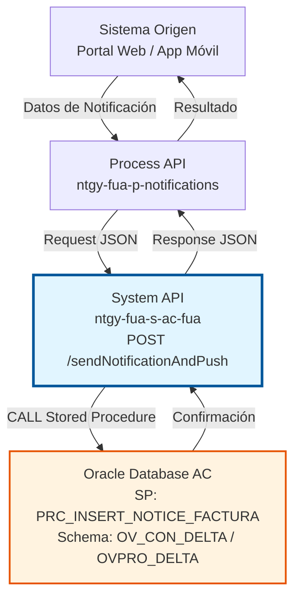
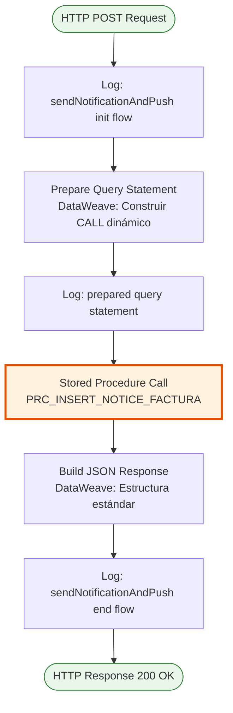
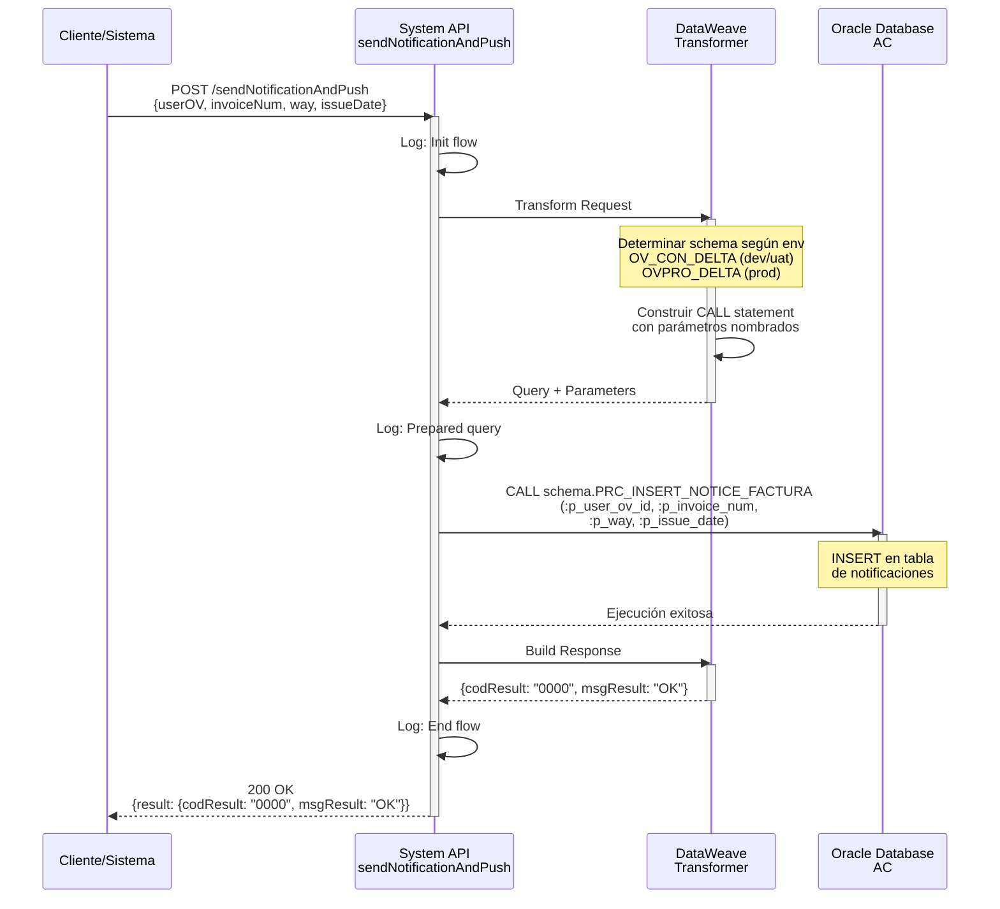
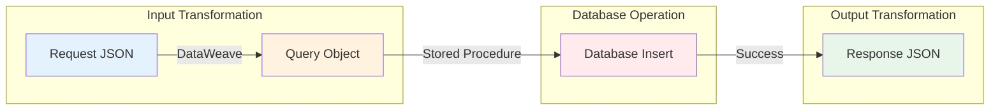

# POST /sendNotificationAndPush

## 📌 Descripción General

### Propósito del Endpoint

Este endpoint registra notificaciones de facturas emitidas en el sistema del Área Cliente (AC) de Naturgy y habilita el envío de push notifications a los usuarios. Permite asociar facturas con usuarios específicos y registrar el canal de notificación utilizado.

El endpoint soporta:
- **Registro de Avisos**: Crea registros de notificaciones de facturas en la base de datos Oracle
- **Asociación Usuario-Factura**: Vincula facturas emitidas con usuarios del Área Cliente
- **Trazabilidad de Notificaciones**: Registra el canal y fecha de emisión de cada notificación
- **Habilitación de Push**: Prepara el sistema para envío de notificaciones push a dispositivos móviles

### Tipo de API

**Capa:** System API (API-Led Connectivity)

**Función:** Integración directa con Oracle Database AC para registro de notificaciones de facturas y habilitación de push notifications.

### Patrón de Integración

**Tipo:** Request-Reply Síncrono con Stored Procedure Oracle

**Descripción:** El endpoint recibe los datos de la notificación (usuario, factura, canal, fecha), construye dinámicamente la llamada al stored procedure según el ambiente, ejecuta la inserción en la base de datos Oracle y retorna confirmación de éxito.

### Arquitectura API-Led Connectivity



---

## 💼 Propósito del Negocio

### Casos de Uso Principales

1. **Notificación de Nueva Factura**
   - Un cliente recibe una nueva factura emitida
   - El sistema registra la notificación para envío de push notification
   - El usuario recibe alerta en su dispositivo móvil
   - **Beneficio:** Mejora la comunicación proactiva con clientes

2. **Trazabilidad de Comunicaciones**
   - Se registra cada notificación enviada con fecha y canal
   - Permite auditoría de comunicaciones con clientes
   - Facilita seguimiento de facturas notificadas
   - **Beneficio:** Cumplimiento normativo y mejor servicio al cliente

3. **Gestión Multi-Canal**
   - Registra el canal utilizado para la notificación (push, email, SMS)
   - Permite estrategias de comunicación diferenciadas
   - Habilita análisis de efectividad por canal
   - **Beneficio:** Optimización de estrategias de comunicación

### Contexto Empresarial

- **Dominio:** Gestión de Notificaciones y Comunicaciones
- **Sector:** Energía - Utilities
- **División:** Naturgy España - Área Cliente
- **Proceso de Negocio:** Notificación de Facturas y Comunicación con Clientes
- **Sistema:** Oracle Database AC (Área Cliente)

### Stakeholders

- **Clientes Finales**: Reciben notificaciones oportunas sobre sus facturas
- **Equipo de Facturación**: Asegura que los clientes sean notificados de nuevas facturas
- **Equipo de Atención al Cliente**: Reduce consultas sobre facturas no recibidas
- **Equipo de Marketing**: Utiliza canal de notificaciones para comunicaciones relevantes

### Valor de Negocio

- **Comunicación Proactiva**: Notificación inmediata de facturas emitidas
- **Reducción de Consultas**: Menos llamadas al call center por facturas no recibidas
- **Mejora de Experiencia**: Clientes informados en tiempo real
- **Trazabilidad Completa**: Registro de todas las notificaciones enviadas

### Consumidores Potenciales

Este endpoint puede ser consumido por:
- Process APIs de notificaciones y comunicaciones
- Sistemas de gestión de facturas
- Plataformas de notificaciones push
- Servicios de comunicación multi-canal

---

## 🔧 Especificación Técnica

### URLs por Ambiente

| Ambiente | URL Base | URL Completa |
|----------|----------|--------------|
| **Local** | `http://localhost:8081` | `http://localhost:8081/api/sendNotificationAndPush` |
| **Development** | `https://ntgy-fua-s-ac-fua-dev.us-e2.cloudhub.io` | `https://ntgy-fua-s-ac-fua-dev.us-e2.cloudhub.io/api/sendNotificationAndPush` |
| **UAT** | `https://ntgy-fua-s-ac-fua-uat.us-e2.cloudhub.io` | `https://ntgy-fua-s-ac-fua-uat.us-e2.cloudhub.io/api/sendNotificationAndPush` |
| **Production** | `https://ntgy-fua-s-ac-fua-pro.us-e2.cloudhub.io` | `https://ntgy-fua-s-ac-fua-pro.us-e2.cloudhub.io/api/sendNotificationAndPush` |

### Método HTTP

```
POST /api/sendNotificationAndPush
```

### Parámetros de Entrada

#### Headers HTTP

| Header | Tipo | Requerido | Descripción | Ejemplo |
|--------|------|-----------|-------------|---------|
| `Content-Type` | string | ✅ Sí | Tipo de contenido del request | `application/json` |
| `Accept` | string | ❌ No | Tipo de contenido esperado en response | `application/json` |

#### Body Parameters

| Campo | Tipo | Requerido | Descripción | Ejemplo |
|-------|------|-----------|-------------|---------|
| `userOV` | string | ✅ Sí | ID del usuario en el sistema Área Cliente | `"12345"` |
| `invoiceNum` | string | ✅ Sí | Número de la factura emitida | `"FAC-2026-001234"` |
| `way` | string | ✅ Sí | Canal de notificación utilizado | `"PUSH"` |
| `issueDate` | string | ✅ Sí | Fecha de emisión de la factura | `"2026-01-15"` |

**Estructura del Request:**

```json
{
  "userOV": "12345",
  "invoiceNum": "FAC-2026-001234",
  "way": "PUSH",
  "issueDate": "2026-01-15"
}
```

### Respuestas

#### Respuesta Exitosa (200 OK)

```json
{
  "result": {
    "codResult": "0000",
    "msgResult": "OK"
  }
}
```

**Descripción de Campos:**
- `codResult`: Código de resultado (`"0000"` = éxito)
- `msgResult`: Mensaje descriptivo del resultado

#### Respuesta de Error de Negocio (400 Bad Request)

```json
{
  "result": {
    "codResult": "0001",
    "msgResult": "Error: Usuario no encontrado"
  }
}
```

#### Respuesta de Error Técnico (500 Internal Server Error)

```json
{
  "result": {
    "codResult": "0002",
    "msgResult": "Error interno del servidor al ejecutar stored procedure"
  }
}
```

### Autenticación y Autorización

- **Tipo:** Client ID & Client Secret (Anypoint Platform)
- **Autorización Oracle:** El usuario de base de datos debe tener permisos para:
  - Ejecutar stored procedure `PRC_INSERT_NOTICE_FACTURA`
  - Acceso de INSERT en tablas de notificaciones
  - Permisos en schema `OV_CON_DELTA` (dev/uat) o `OVPRO_DELTA` (prod)

### Timeouts

| Tipo | Valor | Descripción |
|------|-------|-------------|
| **Request Timeout** | 15 segundos | Tiempo máximo de espera para la respuesta |
| **Connection Timeout** | 3600 segundos | Tiempo máximo para establecer conexión con BD |
| **Query Timeout** | 15 segundos | Tiempo máximo de ejecución del stored procedure |

---

## 🏗️ Implementación Técnica

### Arquitectura del Flow



### Componentes del Flow

#### 1. Logging Inicial
```xml
<logger level="INFO" 
        message="Log sendNotificationAndPush init flow"/>
```

#### 2. Preparación del Query Statement (DataWeave)

**Lógica de Construcción Dinámica del Schema:**

```dataweave
%dw 2.0
output application/json
var env = p('env')
var schema = if(env == 'local' or env == 'dev' or env == 'uat') 'OV_CON_DELTA.' 
else if(env == 'pro') 'OVPRO_DELTA.'
else ''
---
{
  query: "CALL " ++ schema ++ "PRC_INSERT_NOTICE_FACTURA(:p_user_ov_id, :p_invoice_num, :p_way, :p_issue_date)",
  parameters: {
    "p_user_ov_id": payload.userOV,
    "p_invoice_num": payload.invoiceNum,
    "p_way": payload.way,
    "p_issue_date": payload.issueDate
  }
}
```

**Características:**
- **Schema Dinámico**: Selecciona schema según ambiente
- **Prepared Statement**: Usa parámetros nombrados para seguridad
- **Mapeo de Campos**: Transforma JSON a parámetros del SP

#### 3. Ejecución del Stored Procedure

```xml
<db:stored-procedure config-ref="Database_Config">
    <db:sql><![CDATA[#[vars.queryJson.query]]]></db:sql>
    <db:input-parameters><![CDATA[#[vars.queryJson.parameters]]]></db:input-parameters>
</db:stored-procedure>
```

#### 4. Construcción de Respuesta (DataWeave)

```dataweave
%dw 2.0
output application/json
---
{
  result: {
    codResult: "0000",
    msgResult: "OK"
  }
}
```

### Stored Procedure: PRC_INSERT_NOTICE_FACTURA

#### Parámetros de Entrada

| Parámetro | Tipo | Descripción |
|-----------|------|-------------|
| `p_user_ov_id` | VARCHAR2 | ID del usuario en Área Cliente |
| `p_invoice_num` | VARCHAR2 | Número de factura |
| `p_way` | VARCHAR2 | Canal de notificación (PUSH, EMAIL, SMS) |
| `p_issue_date` | DATE | Fecha de emisión de la factura |

#### Operación

- **Tipo:** INSERT
- **Tabla Destino:** Tabla de notificaciones de facturas (nombre específico en schema AC)
- **Función:** Registra un nuevo aviso de factura para el usuario

### Configuración de Base de Datos

#### Connection Pooling

```yaml
dbAC:
  MaxPoolSize: 15
  MaxWaitTime: 300
  MaxIdleTime: 300
  ConnectionTimeout: 3600
  QueryTimeout: 15
```

#### Dual Host Configuration (Alta Disponibilidad)

- **Primary Host:** oc-pro-exa-04-clu-02-hdfdi-scan.prodb03.ocpro.oraclevcn.com
- **Secondary Host:** oc-pro-exa-03-clu-02-dfhl9-scan.prodb03.ocpro.oraclevcn.com
- **Port:** 1521
- **Service Name:** s_areapriv_online_pro.prodb03.ocpro.oraclevcn.com

### Diagrama de Secuencia Detallado



### Manejo de Errores

#### Error Handler Global

El endpoint utiliza el error handler global `s-ac-globalErrorHandler.xml` que maneja:

1. **Database Connection Errors**
   - Retry automático (3 intentos)
   - Failover a host secundario
   - Response: 500 con código de error específico

2. **SQL Execution Errors**
   - Captura de excepciones del stored procedure
   - Logging detallado del error
   - Response: 500 con mensaje descriptivo

3. **Validation Errors**
   - Validación de parámetros requeridos
   - Response: 400 con detalle del campo faltante

### Diagrama de Transformación de Datos



---

## 💻 Ejemplos de Uso

### Ejemplo 1: Notificación de Nueva Factura (Push)

#### Request

```bash
curl -X POST "https://ntgy-fua-s-ac-fua-pro.us-e2.cloudhub.io/api/sendNotificationAndPush" \
  -H "Content-Type: application/json" \
  -H "client_id: your-client-id" \
  -H "client_secret: your-client-secret" \
  -d '{
    "userOV": "12345",
    "invoiceNum": "FAC-2026-001234",
    "way": "PUSH",
    "issueDate": "2026-01-15"
  }'
```

#### Response (200 OK)

```json
{
  "result": {
    "codResult": "0000",
    "msgResult": "OK"
  }
}
```

### Ejemplo 2: Notificación por Email

#### Request

```json
{
  "userOV": "67890",
  "invoiceNum": "FAC-2026-005678",
  "way": "EMAIL",
  "issueDate": "2026-01-20"
}
```

#### Response (200 OK)

```json
{
  "result": {
    "codResult": "0000",
    "msgResult": "OK"
  }
}
```

### Ejemplo 3: Error - Usuario No Encontrado

#### Request

```json
{
  "userOV": "99999",
  "invoiceNum": "FAC-2026-009999",
  "way": "PUSH",
  "issueDate": "2026-01-25"
}
```

#### Response (400 Bad Request)

```json
{
  "result": {
    "codResult": "0001",
    "msgResult": "Error: Usuario no encontrado en el sistema"
  }
}
```

### Ejemplo 4: Error - Parámetro Faltante

#### Request (Falta campo 'way')

```json
{
  "userOV": "12345",
  "invoiceNum": "FAC-2026-001234",
  "issueDate": "2026-01-15"
}
```

#### Response (400 Bad Request)

```json
{
  "result": {
    "codResult": "0003",
    "msgResult": "Error: Campo requerido 'way' no proporcionado"
  }
}
```

### Ejemplo 5: Integración con JavaScript

```javascript
const sendNotification = async (userData) => {
  const endpoint = 'https://ntgy-fua-s-ac-fua-pro.us-e2.cloudhub.io/api/sendNotificationAndPush';
  
  const payload = {
    userOV: userData.userId,
    invoiceNum: userData.invoiceNumber,
    way: 'PUSH',
    issueDate: new Date().toISOString().split('T')[0]
  };
  
  try {
    const response = await fetch(endpoint, {
      method: 'POST',
      headers: {
        'Content-Type': 'application/json',
        'client_id': process.env.CLIENT_ID,
        'client_secret': process.env.CLIENT_SECRET
      },
      body: JSON.stringify(payload)
    });
    
    const result = await response.json();
    
    if (result.result.codResult === '0000') {
      console.log('Notificación registrada exitosamente');
      return true;
    } else {
      console.error('Error al registrar notificación:', result.result.msgResult);
      return false;
    }
  } catch (error) {
    console.error('Error de conexión:', error);
    return false;
  }
};

// Uso
sendNotification({
  userId: '12345',
  invoiceNumber: 'FAC-2026-001234'
});
```

### Ejemplo 6: Integración con Python

```python
import requests
import os
from datetime import date

def send_notification(user_id, invoice_num, channel='PUSH'):
    """
    Registra una notificación de factura en el sistema AC
    
    Args:
        user_id (str): ID del usuario en Área Cliente
        invoice_num (str): Número de factura
        channel (str): Canal de notificación (PUSH, EMAIL, SMS)
    
    Returns:
        bool: True si la notificación se registró exitosamente
    """
    endpoint = 'https://ntgy-fua-s-ac-fua-pro.us-e2.cloudhub.io/api/sendNotificationAndPush'
    
    payload = {
        'userOV': user_id,
        'invoiceNum': invoice_num,
        'way': channel,
        'issueDate': date.today().isoformat()
    }
    
    headers = {
        'Content-Type': 'application/json',
        'client_id': os.getenv('CLIENT_ID'),
        'client_secret': os.getenv('CLIENT_SECRET')
    }
    
    try:
        response = requests.post(endpoint, json=payload, headers=headers, timeout=15)
        response.raise_for_status()
        
        result = response.json()
        
        if result['result']['codResult'] == '0000':
            print(f'Notificación registrada: {invoice_num} para usuario {user_id}')
            return True
        else:
            print(f"Error: {result['result']['msgResult']}")
            return False
            
    except requests.exceptions.RequestException as e:
        print(f'Error de conexión: {e}')
        return False

# Uso
send_notification('12345', 'FAC-2026-001234', 'PUSH')
```

### Notas de Implementación

1. **Idempotencia**: El stored procedure debe manejar duplicados si se reintenta la misma notificación
2. **Validación de Fechas**: El formato de fecha debe ser compatible con Oracle (YYYY-MM-DD)
3. **Canales Soportados**: Verificar con el equipo de AC los valores válidos para el campo `way`
4. **Timeouts**: Configurar timeouts apropiados en el cliente (15 segundos recomendado)
5. **Retry Logic**: Implementar reintentos en el cliente para errores transitorios (5xx)