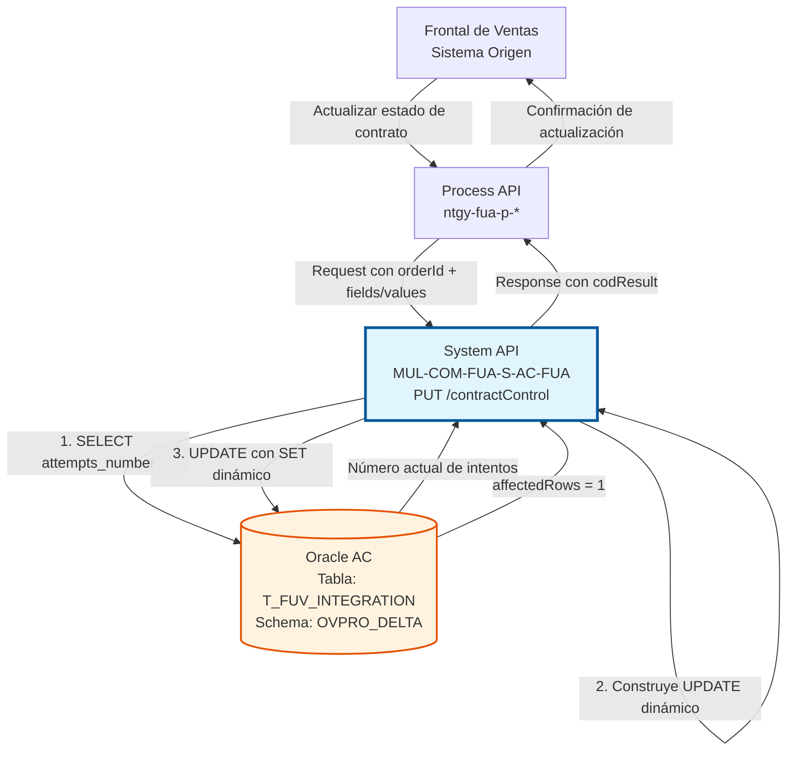
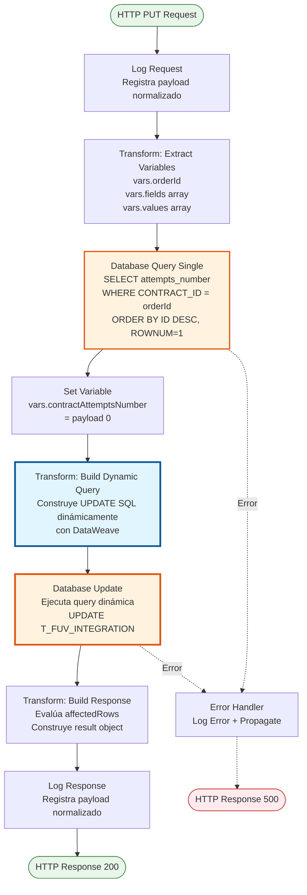
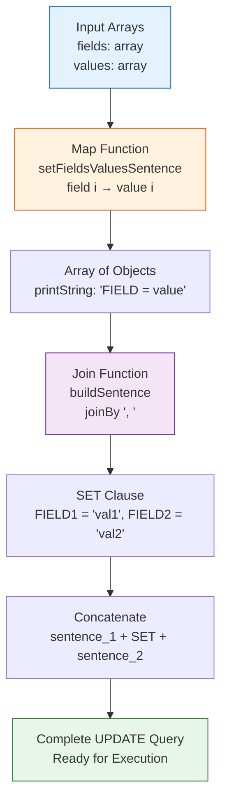

# PUT /contractControl

## 📌 Descripción General

### Propósito del Endpoint

Este endpoint actualiza campos específicos del registro más reciente de un contrato en la tabla de control de integración `T_FUV_INTEGRATION`. Utiliza una **construcción dinámica de query SQL** mediante DataWeave, permitiendo actualizar cualquier combinación de campos de forma flexible. Además, incrementa automáticamente el contador de intentos de procesamiento.

El endpoint soporta:
- **Actualización Flexible**: Puede actualizar cualquier campo(s) especificado(s) en el request
- **Query SQL Dinámica**: Construye la query UPDATE en tiempo de ejecución con DataWeave
- **Incremento Automático**: Incrementa `ATTEMPTS_NUMBER` en +1 automáticamente
- **Registro Más Reciente**: Actualiza siempre el último registro del contrato (MAX ID)
- **Actualización de Timestamp**: Actualiza `UPDATE_DATE` a sysdate automáticamente

### Tipo de API

**Capa:** System API (API-Led Connectivity)

**Función:** Integración directa con Oracle Database AC para actualización de estado de contratos.

### Patrón de Integración

**Tipo:** Request-Reply Síncrono con SQL UPDATE Dinámico

**Descripción:** Recibe el ID del contrato y arrays de campos/valores a actualizar, consulta el número de intentos actual, construye dinámicamente una query SQL UPDATE mediante transformaciones DataWeave, ejecuta la actualización en el registro más reciente del contrato, y retorna confirmación de la operación.

### Arquitectura API-Led Connectivity



---

## 💼 Propósito del Negocio

### Casos de Uso Principales

1. **Actualizar Estado de Procesamiento**
   - Un contrato avanza en su ciclo de vida (received → processing → completed)
   - El sistema actualiza el campo `STATE` y `CODE` con el nuevo estado
   - Se incrementa automáticamente el contador de intentos
   - **Beneficio:** Trazabilidad completa del progreso del contrato

2. **Registrar Respuesta de Sistema Backend**
   - El sistema backend (SAP, Salesforce, etc.) retorna una respuesta
   - Se actualiza el campo `RESPONSE` con la respuesta completa en JSON
   - Se marca el estado como completado o error según corresponda
   - **Beneficio:** Auditoría completa de respuestas de sistemas externos

3. **Registrar Errores de Procesamiento**
   - Ocurre un error durante el procesamiento del contrato
   - Se actualiza el campo `ERROR` con el mensaje de error detallado
   - Se actualiza `STATE` a 'error' y se incrementa intentos
   - **Beneficio:** Diagnóstico preciso de problemas y control de reintentos

4. **Actualización Masiva de Campos**
   - Se necesita actualizar múltiples campos simultáneamente
   - El endpoint permite actualizar cualquier combinación de campos en una sola operación
   - Reduce número de llamadas a base de datos
   - **Beneficio:** Eficiencia operativa y consistencia de datos

5. **Control de Reintentos Automático**
   - Cada actualización incrementa automáticamente `ATTEMPTS_NUMBER`
   - Permite implementar lógica de reintentos basada en número de intentos
   - Previene loops infinitos de procesamiento
   - **Beneficio:** Gestión automática de reintentos y prevención de errores

### Contexto Empresarial

- **Dominio:** Gestión de Contratos y Control de Integraciones
- **Sector:** Energía - Utilities
- **División:** Naturgy España - Frontal de Ventas (FUV)
- **Proceso de Negocio:** Actualización de estado y control de contratos en proceso de alta
- **Sistema Backend:** Oracle Database AC (Área Cliente)

### Stakeholders

- **Sistemas de Procesamiento**: Actualizan estado de contratos automáticamente
- **Equipo de Operaciones**: Monitorean progreso y detectan contratos con múltiples intentos
- **Equipo de Soporte**: Actualizan manualmente contratos con problemas
- **Sistemas de Orquestación**: Coordinan el flujo de procesamiento de contratos
- **Auditores**: Verifican trazabilidad de cambios de estado

### Valor de Negocio

- **Flexibilidad**: Actualiza cualquier campo sin modificar código
- **Trazabilidad**: Registro automático de intentos y timestamps
- **Eficiencia**: Actualización de múltiples campos en una sola operación
- **Control**: Gestión automática de reintentos y prevención de loops

### Consumidores Potenciales

Este endpoint puede ser consumido por:
- Process APIs de gestión de contratos
- Sistemas de orquestación de procesos
- Flujos de integración con backends (SAP, Salesforce, etc.)
- Procesos de retry y recuperación de errores
- Herramientas de administración y soporte

---

## 🔧 Especificación Técnica

### URLs por Ambiente

| Ambiente | URL Base | URL Completa |
|----------|----------|--------------|
| **Local** | `http://localhost:8081` | `http://localhost:8081/api/contractControl` |
| **Development** | `https://mul-com-fua-s-ac-fua-dev.us-e2.cloudhub.io` | `https://mul-com-fua-s-ac-fua-dev.us-e2.cloudhub.io/api/contractControl` |
| **UAT** | `https://mul-com-fua-s-ac-fua-uat.us-e2.cloudhub.io` | `https://mul-com-fua-s-ac-fua-uat.us-e2.cloudhub.io/api/contractControl` |
| **Production** | `https://mul-com-fua-s-ac-fua-pro.us-e2.cloudhub.io` | `https://mul-com-fua-s-ac-fua-pro.us-e2.cloudhub.io/api/contractControl` |

### Método HTTP

```
PUT /api/contractControl
```

### Parámetros de Entrada

#### Headers HTTP

| Header | Tipo | Requerido | Descripción | Ejemplo |
|--------|------|-----------|-------------|---------|
| `Content-Type` | string | ✅ Sí | Tipo de contenido del request | `application/json` |
| `Accept` | string | ❌ No | Tipo de contenido esperado en response | `application/json` |

#### Body Parameters

**Estructura del Request:**

```json
{
  "orderId": "string",
  "update": {
    "field": ["string", "string", ...],
    "value": ["string", "string", ...]
  }
}
```

**Campos del Body:**

| Campo | Tipo | Requerido | Descripción | Ejemplo |
|-------|------|-----------|-------------|---------|
| `orderId` | string | ✅ Sí | Identificador único del pedido/contrato | `"ORD-2026-001234"` |
| `update` | object | ✅ Sí | Objeto con arrays de campos y valores a actualizar | Ver estructura abajo |
| `update.field` | array[string] | ✅ Sí | Array de nombres de campos a actualizar | `["STATE", "CODE", "RESPONSE"]` |
| `update.value` | array[string] | ✅ Sí | Array de valores correspondientes a cada campo | `["completed", "success", "{...}"]` |

**Reglas Importantes:**

1. **Longitud de Arrays**: Los arrays `field` y `value` DEBEN tener la misma longitud
2. **Mapeo por Índice**: Se mapean por posición: `field[0] = value[0]`, `field[1] = value[1]`, etc.
3. **Campos Actualizables**: Cualquier campo de la tabla `T_FUV_INTEGRATION` excepto:
   - `T_FUV_INTEGRATION_ID` (PK, no modificable)
   - `CONTRACT_ID` (identificador, no modificable)
   - `ATTEMPTS_NUMBER` (se incrementa automáticamente)
   - `UPDATE_DATE` (se actualiza automáticamente a sysdate)
4. **Valores como String**: Todos los valores deben ser strings (se convierten en la query)

**Campos Comúnmente Actualizados:**

| Campo | Descripción | Valores Típicos |
|-------|-------------|-----------------|
| `STATE` | Estado actual del contrato | `"received"`, `"processing"`, `"completed"`, `"error"` |
| `CODE` | Código de estado | `"received"`, `"success"`, `"error"`, `"retry"` |
| `RESPONSE` | Respuesta del backend | JSON string con respuesta completa |
| `ERROR` | Mensaje de error | Descripción del error si aplica |
| `SYSTEM_MESSAGE` | Sistema que actualiza | `"SAP"`, `"Salesforce"`, `"Process"` |

### Respuestas

#### Respuesta Exitosa (200 OK)

Cuando la actualización se realiza correctamente (1 fila afectada):

```json
{
  "result": {
    "codResult": "0000",
    "msgResult": "No hay error"
  }
}
```

#### Respuesta de Error de Actualización (200 OK)

Cuando la actualización falla (0 filas afectadas):

```json
{
  "result": {
    "codResult": "-0001",
    "msgResult": "Ha habido un error en la actualización del registro o el registro no existe"
  }
}
```

**Códigos de Resultado:**

| Código | Significado | Descripción |
|--------|-------------|-------------|
| `0000` | Éxito | El registro se actualizó correctamente |
| `-0001` | Error | La actualización falló (0 filas afectadas o registro no existe) |

#### Respuesta de Error Técnico (500)

```json
{
  "result": {
    "codResult": "0001",
    "msgResult": "Error interno del servidor"
  }
}
```

### Autenticación y Autorización

- **Tipo:** Client ID & Client Secret (Anypoint Platform)
- **Autorización Oracle:** El usuario de base de datos debe tener permisos para:
  - Ejecutar SELECT en tabla `T_FUV_INTEGRATION`
  - Ejecutar UPDATE en tabla `T_FUV_INTEGRATION`
  - Acceso al schema `OVPRO_DELTA`

### Timeouts

| Tipo | Valor | Descripción |
|------|-------|-------------|
| **Query Timeout** | 15 segundos | Tiempo máximo de ejecución de cada query SQL |
| **Connection Timeout** | 3600 segundos | Tiempo máximo para mantener conexión a BD |

---

## 🏗️ Implementación Técnica

### Arquitectura del Flow



### Componentes del Flow

#### 1. Logger Request (Entrada)

```xml
<logger level="INFO" doc:name="request" 
        message="#[%dw 2.0
output application/java

var payloadStr = write(payload,'application/json')
var request = common::commonFunctions::normalizeJSON(payloadStr)
---

'STARTING updateContractControl METHOD. REQUEST: '  ++ request]"/>
```

**Propósito:** Registrar el inicio de la ejecución con el payload normalizado

**Detalles:**
- **Nivel:** INFO
- **Función:** `common::commonFunctions::normalizeJSON` para formatear JSON
- **Contenido:** Payload completo del request

#### 2. Transform: Extract Variables

```xml
<ee:transform doc:name="var orderId">
    <ee:variables>
        <ee:set-variable variableName="orderId"><![CDATA[%dw 2.0
output application/java
---
payload.orderId]]></ee:set-variable>
        <ee:set-variable variableName="fields"><![CDATA[%dw 2.0
output application/java
---
payload.update.field]]></ee:set-variable>
        <ee:set-variable variableName="values"><![CDATA[%dw 2.0
output application/java
---
payload.update.value]]></ee:set-variable>
    </ee:variables>
</ee:transform>
```

**Propósito:** Extraer y preparar datos para la actualización

**Variables Creadas:**
- `vars.orderId`: ID del pedido extraído de `payload.orderId`
- `vars.fields`: Array de nombres de campos a actualizar
- `vars.values`: Array de valores correspondientes

**Transformación DataWeave:**
```dataweave
%dw 2.0
output application/java
---
{
  orderId: payload.orderId,
  fields: payload.update.field,
  values: payload.update.value
}
```

#### 3. Database Query Single - Get Attempts Number

```xml
<db:query-single doc:name="getAttemptsNumber" 
                 config-ref="Database_Config">
    <db:sql><![CDATA[${queries.getContractControlAttemptsNumber}]]></db:sql>
    <db:input-parameters><![CDATA[#[{contractId: vars.orderId}]]]></db:input-parameters>
</db:query-single>
```

**Query SQL:**
```sql
SELECT * FROM (
    SELECT attempts_number 
    FROM t_fuv_integration 
    WHERE contract_id = :contractId 
    ORDER BY t_fuv_integration_id DESC
) WHERE rownum = 1
```

**Propósito:** Obtener el número de intentos actual del registro más reciente

**Detalles:**
- **Operación:** `query-single` (retorna UN solo registro)
- **Parámetro:** `:contractId` = `vars.orderId`
- **Ordenamiento:** Por `t_fuv_integration_id DESC` (más reciente primero)
- **Límite:** `rownum = 1` (solo el primer registro)

#### 4. Set Variable - Contract Attempts Number

```xml
<set-variable value="#[payload[0]]" 
              doc:name="var contractAttemptsNumber" 
              variableName="contractAttemptsNumber"/>
```

**Propósito:** Almacenar el número de intentos actual

**Variable Creada:**
- `vars.contractAttemptsNumber`: Número actual de intentos (o null si no existe)

#### 5. Transform: Build Dynamic UPDATE Query ⭐

**Este es el componente más importante del endpoint**

```xml
<ee:transform doc:name="prepare update sentence">
    <ee:message>
        <ee:set-payload><![CDATA[%dw 2.0
output application/java

var sentence_1 = "UPDATE T_FUV_INTEGRATION SET ATTEMPTS_NUMBER = " ++ 
                 ((vars.contractAttemptsNumber default 1) + 1) as String ++ 
                 ", UPDATE_DATE = sysdate, "

var sentence_2 = " WHERE T_FUV_INTEGRATION_ID = (SELECT MAX (T_FUV_INTEGRATION_ID) FROM T_FUV_INTEGRATION WHERE CONTRACT_ID = "

//1. Recorro las variables fields y values para montar el string "field = value"
fun setFieldsValuesSentence(listFields) = listFields map (field, findex) -> {
    printString : field ++ " = '" ++ 
                  (vars.values filter ((item, vindex) -> (findex == vindex)) map $)[0] ++ 
                  "'"
}

//2. Aplico la función 1 y guardo el resultado
var fieldsValuesSentence = setFieldsValuesSentence (vars.fields)

//3. Uno los strings de tipo "field = value", concatenando una "," entre ellos
fun buildSentence(listfieldsValuesSentence) = listfieldsValuesSentence joinBy ", "

//4. Aplico la función 3 y guardo el resultado
var SETSentenceGenerated = buildSentence(fieldsValuesSentence.printString)
---

sentence_1 ++ SETSentenceGenerated ++ sentence_2 ++ vars.orderId ++ ")"]]></ee:set-payload>
    </ee:message>
</ee:transform>
```

**Lógica de Construcción Dinámica:**

**Paso 1: Construir Parte Fija Inicial**
```dataweave
var sentence_1 = "UPDATE T_FUV_INTEGRATION SET ATTEMPTS_NUMBER = " ++ 
                 ((vars.contractAttemptsNumber default 1) + 1) as String ++ 
                 ", UPDATE_DATE = sysdate, "
```
- Incrementa `ATTEMPTS_NUMBER` en +1 (usa default 1 si es null)
- Actualiza `UPDATE_DATE` a sysdate
- Resultado: `"UPDATE T_FUV_INTEGRATION SET ATTEMPTS_NUMBER = 1, UPDATE_DATE = sysdate, "`

**Paso 2: Mapear Fields con Values**
```dataweave
fun setFieldsValuesSentence(listFields) = listFields map (field, findex) -> {
    printString : field ++ " = '" ++ 
                  (vars.values filter ((item, vindex) -> (findex == vindex)) map $)[0] ++ 
                  "'"
}
```
- Recorre array `fields` con índice
- Para cada field, busca el value correspondiente por índice
- Construye string: `"FIELD = 'value'"`
- Resultado: Array de objetos con `printString`

**Ejemplo:**
```
Input:
  fields: ["STATE", "CODE", "RESPONSE"]
  values: ["completed", "success", "{\"result\":\"ok\"}"]

Output:
  [
    {printString: "STATE = 'completed'"},
    {printString: "CODE = 'success'"},
    {printString: "RESPONSE = '{\"result\":\"ok\"}'"}
  ]
```

**Paso 3: Unir con Comas**
```dataweave
fun buildSentence(listfieldsValuesSentence) = listfieldsValuesSentence joinBy ", "
var SETSentenceGenerated = buildSentence(fieldsValuesSentence.printString)
```
- Une todos los strings con ", "
- Resultado: `"STATE = 'completed', CODE = 'success', RESPONSE = '{\"result\":\"ok\"}'"`

**Paso 4: Construir Parte Fija Final (WHERE)**
```dataweave
var sentence_2 = " WHERE T_FUV_INTEGRATION_ID = (SELECT MAX (T_FUV_INTEGRATION_ID) FROM T_FUV_INTEGRATION WHERE CONTRACT_ID = "
```
- Subquery para obtener el ID del registro más reciente
- Usa `MAX(T_FUV_INTEGRATION_ID)` para asegurar el último registro

**Paso 5: Concatenar Todo**
```dataweave
sentence_1 ++ SETSentenceGenerated ++ sentence_2 ++ vars.orderId ++ ")"
```

**Query Final Generada:**
```sql
UPDATE T_FUV_INTEGRATION 
SET ATTEMPTS_NUMBER = 1, 
    UPDATE_DATE = sysdate, 
    STATE = 'completed', 
    CODE = 'success', 
    RESPONSE = '{"result":"ok"}' 
WHERE T_FUV_INTEGRATION_ID = (
    SELECT MAX(T_FUV_INTEGRATION_ID) 
    FROM T_FUV_INTEGRATION 
    WHERE CONTRACT_ID = 'ORD-2026-001234'
)
```

#### 6. Database Update

```xml
<db:update doc:name="Update" 
           config-ref="Database_Config">
    <db:sql><![CDATA[#[payload]]]></db:sql>
</db:update>
```

**Propósito:** Ejecutar la query UPDATE construida dinámicamente

**Detalles:**
- **Config:** `Database_Config` (Oracle connection pool)
- **SQL:** El payload contiene la query completa construida en el paso anterior
- **Resultado:** Retorna objeto con `affectedRows`

**Comportamiento:**
- Si actualiza 1 registro: `affectedRows = 1`
- Si no encuentra registro: `affectedRows = 0`
- Si hay error SQL: Lanza excepción

#### 7. Transform: Build Response

```xml
<ee:transform doc:name="response">
    <ee:message>
        <ee:set-payload><![CDATA[%dw 2.0
output application/json
---
{
    "result": {
        "codResult": if (payload.affectedRows == 1) "0000" else "-0001",
        "msgResult": if (payload.affectedRows == 1) "No hay error" else "Ha habido un error en la actualización del registro o el registro no existe"
    }
}]]></ee:set-payload>
    </ee:message>
</ee:transform>
```

**Lógica de Respuesta:**

```dataweave
%dw 2.0
output application/json
---
{
  result: {
    codResult: if (payload.affectedRows == 1) "0000" else "-0001",
    msgResult: if (payload.affectedRows == 1) 
                  "No hay error" 
               else 
                  "Ha habido un error en la actualización del registro o el registro no existe"
  }
}
```

**Evaluación:**
- Si `affectedRows == 1` → Éxito (`0000`)
- Si `affectedRows != 1` → Error (`-0001`)

#### 8. Logger Response (Salida)

```xml
<logger level="INFO" doc:name="response" 
        message="#[%dw 2.0
output application/java

var payloadStr = write(payload,'application/json')
var response = common::commonFunctions::normalizeJSON(payloadStr)
---

'FINISHED updateContractControl METHOD. RESPONSE: '  ++ response]" />
```

**Propósito:** Registrar la respuesta final normalizada

### Diagrama de Construcción Dinámica de Query



### Configuración de Base de Datos

#### Connection Pool

```yaml
dbAC:
  host1: "oc-pro-exa-04-clu-02-hdfdi-scan.prodb03.ocpro.oraclevcn.com"
  host2: "oc-pro-exa-03-clu-02-dfhl9-scan.prodb03.ocpro.oraclevcn.com"
  port: "1521"
  serviceName: "s_areapriv_online_pro.prodb03.ocpro.oraclevcn.com"
  user: "OVPRO_DELTA"
  MaxPoolSize: "15"
  MaxWaitTime: "300"
  MaxIdleTime: "300"
  queryTimeout: "15"
```

**Características:**
- **High Availability:** Configuración dual host para failover
- **Pool Size:** Máximo 15 conexiones simultáneas
- **Wait Time:** 300 segundos para obtener conexión del pool
- **Idle Time:** 300 segundos antes de cerrar conexión inactiva
- **Query Timeout:** 15 segundos máximo por query

### Manejo de Errores

#### Errores Posibles

1. **Database Connection Error**
   - **Causa:** No se puede conectar a Oracle
   - **Código:** DB:CONNECTIVITY
   - **Acción:** Error propagado al caller
   - **Response:** 500 Internal Server Error

2. **Query Timeout**
   - **Causa:** SELECT o UPDATE excede 15 segundos
   - **Código:** DB:QUERY_TIMEOUT
   - **Acción:** Cancelar operación y retornar error
   - **Response:** 500 Internal Server Error

3. **Arrays Length Mismatch**
   - **Causa:** Arrays `field` y `value` tienen diferente longitud
   - **Código:** MULE:EXPRESSION
   - **Acción:** Error al mapear fields con values
   - **Response:** 500 Internal Server Error

4. **Missing Required Field**
   - **Causa:** Campo `orderId` o `update` no presente en request
   - **Código:** MULE:EXPRESSION
   - **Acción:** Error al evaluar expresión DataWeave
   - **Response:** 500 Internal Server Error

5. **Invalid SQL Syntax**
   - **Causa:** Query generada tiene sintaxis inválida
   - **Código:** DB:BAD_SQL_SYNTAX
   - **Acción:** Error propagado con detalles
   - **Response:** 500 Internal Server Error

6. **Contract Not Found**
   - **Causa:** No existe registro con el `orderId` especificado
   - **Código:** N/A (no es excepción)
   - **Acción:** Retorna `affectedRows = 0`
   - **Response:** 200 OK con `codResult: "-0001"`

#### Error Handler

```xml
<error-handler>
    <on-error-propagate enableNotifications="true" 
                        logException="true" 
                        doc:name="On Error Propagate" 
                        type="ANY">
        <logger level="ERROR" doc:name="Logger Error" 
                message="Error in updateContractControl"/>
    </on-error-propagate>
</error-handler>
```

**Características:**
- **Tipo:** `on-error-propagate` (propaga error al caller)
- **Logging:** Registra error con nivel ERROR
- **Notificaciones:** Habilitadas para alertas
- **Exception:** Se registra la excepción completa

---

## 💻 Ejemplos de Uso

### Ejemplo 1: Actualizar Estado a Completado

#### Request

```bash
curl -X PUT "https://mul-com-fua-s-ac-fua-pro.us-e2.cloudhub.io/api/contractControl" \
  -H "Content-Type: application/json" \
  -H "Accept: application/json" \
  -H "client_id: YOUR_CLIENT_ID" \
  -H "client_secret: YOUR_CLIENT_SECRET" \
  -d '{
    "orderId": "ORD-2026-001234",
    "update": {
      "field": ["STATE", "CODE"],
      "value": ["completed", "success"]
    }
  }'
```

#### Response (200 OK)

```json
{
  "result": {
    "codResult": "0000",
    "msgResult": "No hay error"
  }
}
```

**Query SQL Generada:**
```sql
UPDATE T_FUV_INTEGRATION 
SET ATTEMPTS_NUMBER = 1, 
    UPDATE_DATE = sysdate, 
    STATE = 'completed', 
    CODE = 'success' 
WHERE T_FUV_INTEGRATION_ID = (
    SELECT MAX(T_FUV_INTEGRATION_ID) 
    FROM T_FUV_INTEGRATION 
    WHERE CONTRACT_ID = 'ORD-2026-001234'
)
```

### Ejemplo 2: Registrar Error de Procesamiento

#### Request

```bash
curl -X PUT "https://mul-com-fua-s-ac-fua-pro.us-e2.cloudhub.io/api/contractControl" \
  -H "Content-Type: application/json" \
  -H "client_id: YOUR_CLIENT_ID" \
  -H "client_secret: YOUR_CLIENT_SECRET" \
  -d '{
    "orderId": "ORD-2026-001235",
    "update": {
      "field": ["STATE", "CODE", "ERROR"],
      "value": ["error", "backend_error", "SAP RFC timeout after 30 seconds"]
    }
  }'
```

#### Response (200 OK)

```json
{
  "result": {
    "codResult": "0000",
    "msgResult": "No hay error"
  }
}
```

### Ejemplo 3: Actualizar con Respuesta de Backend

#### Request

```bash
curl -X PUT "https://mul-com-fua-s-ac-fua-dev.us-e2.cloudhub.io/api/contractControl" \
  -H "Content-Type: application/json" \
  -H "client_id: YOUR_CLIENT_ID" \
  -H "client_secret: YOUR_CLIENT_SECRET" \
  -d '{
    "orderId": "ORD-2026-001236",
    "update": {
      "field": ["STATE", "CODE", "RESPONSE", "SYSTEM_MESSAGE"],
      "value": ["completed", "success", "{\"contractNumber\":\"CNT-2026-5678\",\"status\":\"ACTIVE\"}", "SAP"]
    }
  }'
```

#### Response (200 OK)

```json
{
  "result": {
    "codResult": "0000",
    "msgResult": "No hay error"
  }
}
```

### Ejemplo 4: Flujo Completo CRUD

```javascript
// Flujo completo: POST → GET → PUT → GET
async function completeContractLifecycle(orderId, contractData) {
  const baseUrl = 'https://mul-com-fua-s-ac-fua-pro.us-e2.cloudhub.io';
  const headers = {
    'Content-Type': 'application/json',
    'Accept': 'application/json',
    'client_id': process.env.CLIENT_ID,
    'client_secret': process.env.CLIENT_SECRET
  };
  
  try {
    // Paso 1: Crear registro (POST)
    console.log('📝 Paso 1: Creando registro de control...');
    const createResponse = await fetch(`${baseUrl}/api/contractControl`, {
      method: 'POST',
      headers: headers,
      body: JSON.stringify({
        orderId: orderId,
        message: contractData
      })
    });
    const createResult = await createResponse.json();
    
    if (createResult.result.codResult !== '0000') {
      throw new Error(`Error al crear: ${createResult.result.msgResult}`);
    }
    console.log('✅ Registro creado');
    
    // Paso 2: Consultar estado inicial (GET)
    console.log('\n🔍 Paso 2: Consultando estado inicial...');
    const getResponse1 = await fetch(
      `${baseUrl}/api/contractControl?idPedido=${orderId}`,
      { method: 'GET', headers: headers }
    );
    const getResult1 = await getResponse1.json();
    
    if (getResult1.record) {
      console.log(`✅ Estado inicial: ${getResult1.record.STATE}`);
      console.log(`   Intentos: ${getResult1.record.ATTEMPTS_NUMBER}`);
    }
    
    // Paso 3: Simular procesamiento y actualizar (PUT)
    console.log('\n⚙️ Paso 3: Procesando contrato...');
    await new Promise(resolve => setTimeout(resolve, 2000)); // Simular procesamiento
    
    const updateResponse = await fetch(`${baseUrl}/api/contractControl`, {
      method: 'PUT',
      headers: headers,
      body: JSON.stringify({
        orderId: orderId,
        update: {
          field: ['STATE', 'CODE', 'RESPONSE'],
          value: ['completed', 'success', JSON.stringify({
            processedAt: new Date().toISOString(),
            result: 'Contract processed successfully'
          })]
        }
      })
    });
    const updateResult = await updateResponse.json();
    
    if (updateResult.result.codResult !== '0000') {
      throw new Error(`Error al actualizar: ${updateResult.result.msgResult}`);
    }
    console.log('✅ Estado actualizado a completed');
    
    // Paso 4: Verificar estado final (GET)
    console.log('\n🔍 Paso 4: Verificando estado final...');
    const getResponse2 = await fetch(
      `${baseUrl}/api/contractControl?idPedido=${orderId}`,
      { method: 'GET', headers: headers }
    );
    const getResult2 = await getResponse2.json();
    
    if (getResult2.record) {
      console.log(`✅ Estado final: ${getResult2.record.STATE}`);
      console.log(`   Código: ${getResult2.record.CODE}`);
      console.log(`   Intentos: ${getResult2.record.ATTEMPTS_NUMBER}`);
      console.log(`   Respuesta: ${getResult2.record.RESPONSE}`);
    }
    
    return {
      success: true,
      lifecycle: 'completed',
      finalRecord: getResult2.record
    };
    
  } catch (error) {
    console.error(`❌ Error en el flujo: ${error.message}`);
    return {
      success: false,
      error: error.message
    };
  }
}

// Ejemplo de uso
const contractData = {
  contractType: 'NEW',
  customerId: '12345',
  serviceType: 'ELECTRICITY',
  requestDate: new Date().toISOString()
};

completeContractLifecycle('ORD-2026-001237', contractData)
  .then(result => {
    if (result.success) {
      console.log('\n🎉 Ciclo de vida completado exitosamente');
    } else {
      console.log('\n❌ Error en el ciclo de vida:', result.error);
    }
  });
```

### Ejemplo 5: Integración con Python - Retry Logic

```python
import requests
import time
from typing import Dict, Any, List

class ContractUpdater:
    def __init__(self, base_url: str, client_id: str, client_secret: str):
        self.base_url = base_url
        self.headers = {
            'Content-Type': 'application/json',
            'Accept': 'application/json',
            'client_id': client_id,
            'client_secret': client_secret
        }
    
    def update_contract(self, order_id: str, fields: List[str], 
                       values: List[str]) -> Dict[str, Any]:
        """
        Actualiza campos de un contrato
        
        Args:
            order_id: ID del contrato
            fields: Lista de campos a actualizar
            values: Lista de valores correspondientes
            
        Returns:
            Diccionario con resultado de la actualización
        """
        if len(fields) != len(values):
            return {
                'success': False,
                'error': 'Arrays fields y values deben tener la misma longitud'
            }
        
        endpoint = f"{self.base_url}/api/contractControl"
        payload = {
            'orderId': order_id,
            'update': {
                'field': fields,
                'value': values
            }
        }
        
        try:
            response = requests.put(
                endpoint,
                headers=self.headers,
                json=payload,
                timeout=30
            )
            response.raise_for_status()
            
            result = response.json()
            
            if result['result']['codResult'] == '0000':
                print(f"✅ Contrato {order_id} actualizado exitosamente")
                return {
                    'success': True,
                    'orderId': order_id
                }
            else:
                print(f"❌ Error: {result['result']['msgResult']}")
                return {
                    'success': False,
                    'error': result['result']['msgResult']
                }
                
        except requests.exceptions.RequestException as e:
            print(f"❌ Error de conexión: {e}")
            return {
                'success': False,
                'error': str(e)
            }
    
    def update_with_retry(self, order_id: str, fields: List[str], 
                         values: List[str], max_retries: int = 3) -> Dict[str, Any]:
        """
        Actualiza con lógica de reintentos
        
        Args:
            order_id: ID del contrato
            fields: Lista de campos a actualizar
            values: Lista de valores correspondientes
            max_retries: Número máximo de reintentos
            
        Returns:
            Diccionario con resultado final
        """
        for attempt in range(1, max_retries + 1):
            print(f"\n🔄 Intento {attempt}/{max_retries}")
            
            result = self.update_contract(order_id, fields, values)
            
            if result['success']:
                return {
                    'success': True,
                    'attempts': attempt,
                    'orderId': order_id
                }
            
            if attempt < max_retries:
                wait_time = 2 ** attempt  # Backoff exponencial
                print(f"⏳ Esperando {wait_time}s antes de reintentar...")
                time.sleep(wait_time)
        
        return {
            'success': False,
            'attempts': max_retries,
            'error': 'Máximo de reintentos alcanzado'
        }

# Ejemplo de uso
if __name__ == "__main__":
    updater = ContractUpdater(
        base_url="https://mul-com-fua-s-ac-fua-pro.us-e2.cloudhub.io",
        client_id="YOUR_CLIENT_ID",
        client_secret="YOUR_CLIENT_SECRET"
    )
    
    # Actualizar estado a completado
    result = updater.update_with_retry(
        order_id="ORD-2026-001238",
        fields=["STATE", "CODE", "RESPONSE"],
        values=["completed", "success", '{"result":"ok"}'],
        max_retries=3
    )
    
    if result['success']:
        print(f"\n✅ Actualización exitosa en {result['attempts']} intento(s)")
    else:
        print(f"\n❌ Actualización fallida después de {result['attempts']} intentos")
```

### Ejemplo 6: Error - Arrays con Diferente Longitud

#### Request (Inválido)

```bash
curl -X PUT "https://mul-com-fua-s-ac-fua-pro.us-e2.cloudhub.io/api/contractControl" \
  -H "Content-Type: application/json" \
  -H "client_id: YOUR_CLIENT_ID" \
  -H "client_secret: YOUR_CLIENT_SECRET" \
  -d '{
    "orderId": "ORD-2026-001239",
    "update": {
      "field": ["STATE", "CODE", "RESPONSE"],
      "value": ["completed", "success"]
    }
  }'
```

#### Response (500 Internal Server Error)

```json
{
  "result": {
    "codResult": "0001",
    "msgResult": "Error interno del servidor: Error al mapear fields con values"
  }
}
```
