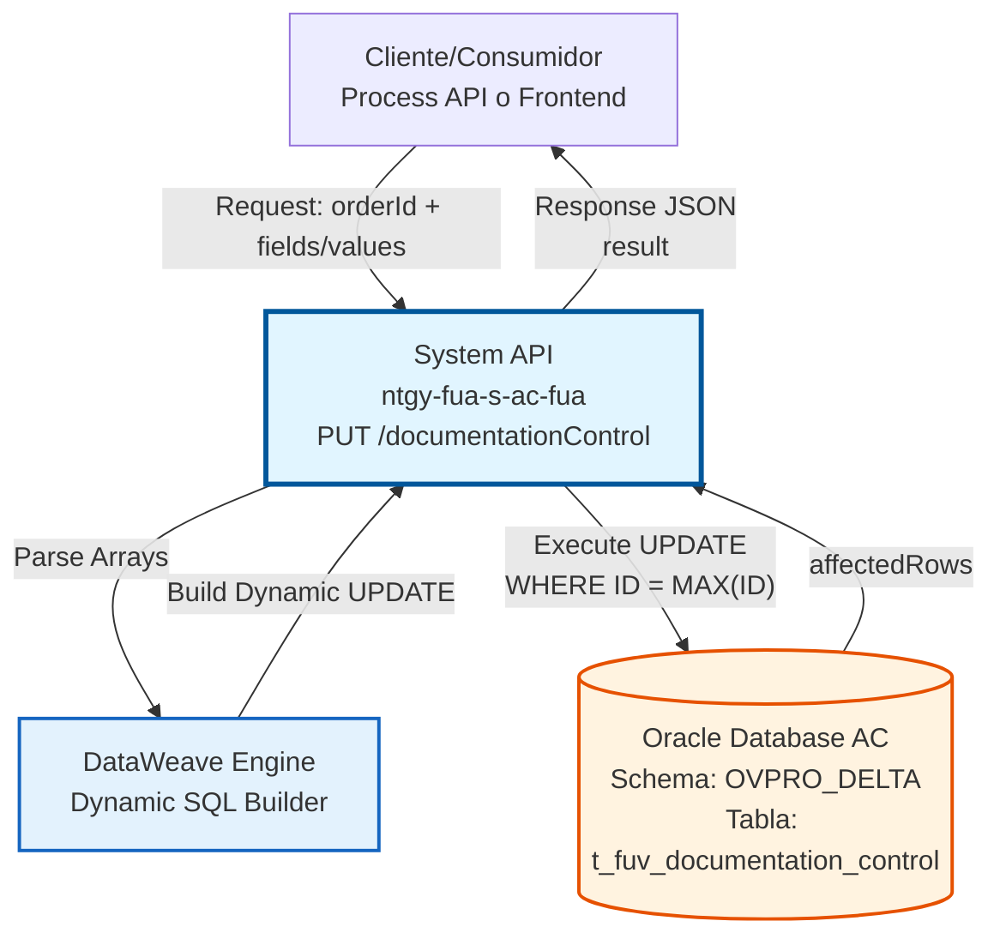
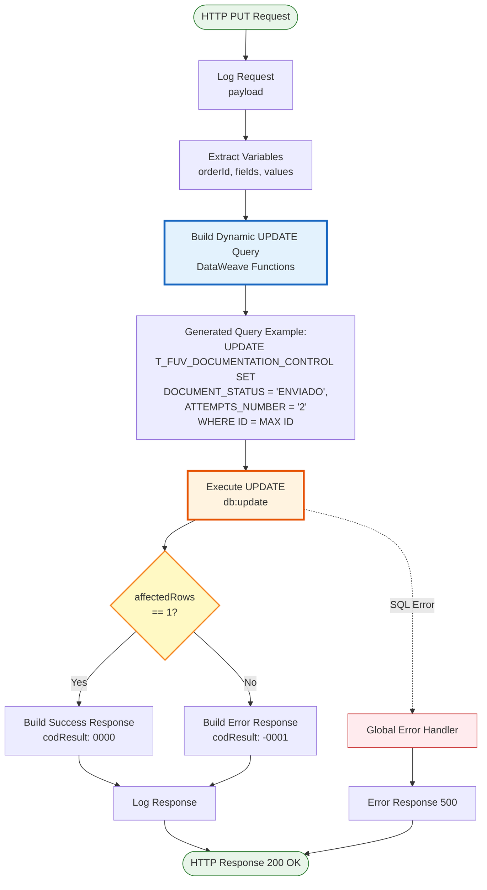
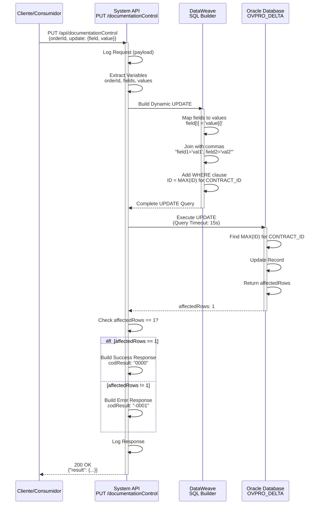

# PUT /documentationControl

## 📌 Descripción General

### Propósito del Endpoint

Este endpoint actualiza campos específicos del registro más reciente de control de documentación de un contrato FUV en la base de datos Oracle AC. Su característica distintiva es la **construcción dinámica de la query SQL UPDATE**, permitiendo actualizar uno o múltiples campos en una sola operación sin necesidad de especificar todos los campos de la tabla.

El endpoint soporta:
- **Actualización Dinámica**: Construye la query UPDATE basándose en los campos proporcionados
- **Flexibilidad Total**: Permite actualizar desde 1 hasta N campos simultáneamente
- **Registro Más Reciente**: Actualiza automáticamente el registro con el ID más alto para el contrato
- **Arrays Paralelos**: Usa arrays `field` y `value` para mapear campos a actualizar
- **Validación Automática**: Verifica que la actualización afectó exactamente 1 registro

### Tipo de API

**Capa:** System API (API-Led Connectivity)

**Función:** Integración directa con Oracle Database AC para actualización flexible de registros de control de documentación de contratos FUV.

### Patrón de Integración

**Tipo:** Request-Reply Síncrono con UPDATE SQL Dinámico

**Descripción:** El endpoint recibe un body JSON con el ID del pedido y arrays de campos/valores a actualizar. Mediante lógica DataWeave compleja, construye dinámicamente una query SQL UPDATE que modifica solo los campos especificados del registro más reciente (identificado por MAX(ID)) para el contrato dado. Retorna el resultado de la operación indicando éxito o fallo.

### Arquitectura API-Led Connectivity



---

## 💼 Propósito del Negocio

### Casos de Uso Principales

1. **Actualización de Estado de Documento**
   - Un proceso automatizado necesita cambiar el estado de un documento (PENDIENTE → ENVIADO)
   - El sistema actualiza solo el campo DOCUMENT_STATUS del registro más reciente
   - Beneficio: Actualización precisa sin afectar otros campos

2. **Incremento de Contador de Intentos**
   - Tras un intento fallido de envío, se incrementa el contador ATTEMPTS_NUMBER
   - Se actualiza solo este campo manteniendo el resto de información intacta
   - Beneficio: Tracking preciso de reintentos sin sobrescribir datos

3. **Actualización Múltiple de Campos**
   - Se necesita actualizar estado, intentos y fecha simultáneamente
   - Una sola llamada actualiza los 3 campos especificados
   - Beneficio: Operación atómica que garantiza consistencia de datos

4. **Modificación de Flag de Distribuidora**
   - Se marca o desmarca el envío a distribuidora (ENVIO_DISTRIBUIDORA)
   - Actualización específica del flag booleano
   - Beneficio: Control granular del flujo de documentos

5. **Actualización de Información de Auditoría**
   - Se actualizan campos UPDATE_USER, UPDATE_PROGRAM, UPDATE_DATE
   - Mantiene trazabilidad de cambios en el sistema
   - Beneficio: Cumplimiento de requisitos de auditoría

### Contexto Empresarial

- **Dominio:** Gestión Documental - Frontal de Ventas (FUV)
- **Sector:** Energía - Utilities
- **División:** Naturgy España - Área Cliente
- **Proceso de Negocio:** Actualización de estados y control de documentación de contratos
- **Sistema Backend:** Oracle Database AC (Área Cliente)

### Stakeholders

- **Sistemas Automatizados**: Procesos batch que actualizan estados de documentación
- **Agentes de Ventas**: Modifican manualmente estados cuando es necesario
- **Equipo de Operaciones**: Actualizan flags de control y contadores
- **Sistemas de Workflow**: Orquestan cambios de estado en el ciclo de vida del documento

### Valor de Negocio

- **Flexibilidad Operativa**: Actualizar solo los campos necesarios sin afectar otros datos
- **Eficiencia**: Una sola operación para actualizar múltiples campos
- **Integridad de Datos**: Actualización atómica del registro más reciente
- **Trazabilidad**: Mantiene historial de cambios mediante campos de auditoría
- **Reducción de Errores**: Construcción dinámica evita queries hardcodeadas

### Consumidores Potenciales

Este endpoint puede ser consumido por:
- Process APIs de gestión de workflow documental
- Sistemas batch de procesamiento de documentos
- Experience APIs de portales de administración
- Servicios de integración con distribuidoras
- Herramientas de monitoreo y corrección de estados

---

## 🔧 Especificación Técnica

### URLs por Ambiente

| Ambiente | URL Base | URL Completa |
|----------|----------|--------------|
| **Local** | `http://localhost:8081` | `http://localhost:8081/api/documentationControl` |
| **Development** | `https://ntgy-fua-s-ac-fua-dev.us-e2.cloudhub.io` | `https://ntgy-fua-s-ac-fua-dev.us-e2.cloudhub.io/api/documentationControl` |
| **UAT** | `https://ntgy-fua-s-ac-fua-uat.us-e2.cloudhub.io` | `https://ntgy-fua-s-ac-fua-uat.us-e2.cloudhub.io/api/documentationControl` |
| **Production** | `https://ntgy-fua-s-ac-fua-pro.us-e2.cloudhub.io` | `https://ntgy-fua-s-ac-fua-pro.us-e2.cloudhub.io/api/documentationControl` |

### Método HTTP

```
PUT /api/documentationControl
```

### Parámetros de Entrada

#### Headers HTTP

| Header | Tipo | Requerido | Descripción | Ejemplo |
|--------|------|-----------|-------------|---------|
| `Content-Type` | string | ✅ Sí | Tipo de contenido del request | `application/json` |
| `Accept` | string | ❌ No | Tipo de contenido esperado en response | `application/json` |

#### Body Parameters

**Estructura del Request Body:**

```json
{
  "orderId": "string",
  "update": {
    "field": ["string", "string", ...],
    "value": ["string", "string", ...]
  }
}
```

**Descripción de Campos:**

| Campo | Tipo | Requerido | Descripción |
|-------|------|-----------|-------------|
| `orderId` | string | ✅ Sí | ID del contrato/pedido (CONTRACT_ID) cuyo registro se actualizará |
| `update` | object | ✅ Sí | Objeto que contiene los arrays de campos y valores a actualizar |
| `update.field` | array[string] | ✅ Sí | Array de nombres de campos de la tabla a actualizar |
| `update.value` | array[string] | ✅ Sí | Array de valores correspondientes a cada campo (mismo orden) |

**Campos Actualizables:**

Los siguientes campos de la tabla `t_fuv_documentation_control` pueden ser actualizados:

| Campo | Tipo en DB | Descripción | Ejemplo de Valor |
|-------|------------|-------------|------------------|
| `DOCUMENT_STATUS` | VARCHAR2 | Estado del documento | `"ENVIADO"`, `"PENDIENTE"`, `"ERROR"` |
| `ATTEMPTS_NUMBER` | NUMBER | Número de intentos de envío | `"1"`, `"2"`, `"3"` |
| `DOCUMENT_NAME` | VARCHAR2 | Nombre del archivo | `"Contrato_Gas.pdf"` |
| `UPDATE_USER` | VARCHAR2 | Usuario que actualiza | `"admin"`, `"mulesoft"` |
| `UPDATE_PROGRAM` | VARCHAR2 | Programa que actualiza | `"batch_process"` |
| `UPDATE_DATE` | TIMESTAMP | Fecha de actualización | `"2026-07-21"` |
| `ENVIO_DISTRIBUIDORA` | VARCHAR2(1) | Flag de envío (Y/N) | `"Y"`, `"N"` |
| `CABECERA_CONTRATO` | CLOB | Datos de cabecera JSON | `"{...}"` |
| `LINEAS_CONTRATO` | CLOB | Datos de líneas JSON | `"{...}"` |
| `TIPO_DOCUMENTAL` | VARCHAR2 | Tipo de documento | `"CONTRATO"`, `"FACTURA"` |

**⚠️ Validaciones Críticas:**

1. **Longitud de Arrays:** Los arrays `field` y `value` DEBEN tener la misma longitud
2. **Campos Válidos:** Los nombres en `field` deben corresponder a columnas existentes en la tabla
3. **Valores como Strings:** Todos los valores se pasan como strings (incluso números)
4. **Registro Existente:** Debe existir al menos un registro para el `orderId` especificado

### Respuestas

#### Respuesta Exitosa (200 OK)

```json
{
  "result": {
    "codResult": "0000",
    "msgResult": "No hay error"
  }
}
```

**Condición:** La actualización afectó exactamente 1 registro (`affectedRows == 1`)

#### Respuesta de Error - Registro No Actualizado (200 OK)

```json
{
  "result": {
    "codResult": "-0001",
    "msgResult": "Ha habido un error en la actualización del registro o el registro no existe"
  }
}
```

### Ejemplo 8: Error - Arrays de Diferente Longitud

```bash
curl -X PUT "https://ntgy-fua-s-ac-fua-pro.us-e2.cloudhub.io/api/documentationControl" \
  -H "Content-Type: application/json" \
  -d '{
    "orderId": "12345",
    "update": {
      "field": ["DOCUMENT_STATUS", "ATTEMPTS_NUMBER"],
      "value": ["ENVIADO"]
    }
  }'
```

**Response (500 Internal Server Error):**

```json
{
  "result": {
    "codResult": "0001",
    "msgResult": "Error en la construcción de la query: arrays de diferente longitud"
  }
}
```

### Ejemplo 9: Integración con Postman

**Request:**
- **Method:** PUT
- **URL:** `{{baseUrl}}/api/documentationControl`
- **Headers:**
  - `Content-Type`: `application/json`
  - `Accept`: `application/json`
- **Body (raw JSON):**
```json
{
  "orderId": "12345",
  "update": {
    "field": ["DOCUMENT_STATUS", "ATTEMPTS_NUMBER"],
    "value": ["ENVIADO", "1"]
  }
}
```

**Tests (Postman):**

```javascript
pm.test("Status code is 200", function () {
    pm.response.to.have.status(200);
});

pm.test("Response has result", function () {
    var jsonData = pm.response.json();
    pm.expect(jsonData).to.have.property('result');
});

pm.test("Result code is success", function () {
    var jsonData = pm.response.json();
    pm.expect(jsonData.result.codResult).to.eql("0000");
});

pm.test("Success message is correct", function () {
    var jsonData = pm.response.json();
    pm.expect(jsonData.result.msgResult).to.eql("No hay error");
});

// Test para validar arrays paralelos
pm.test("Field and value arrays have same length", function () {
    var requestBody = JSON.parse(pm.request.body.raw);
    var fieldLength = requestBody.update.field.length;
    var valueLength = requestBody.update.value.length;
    pm.expect(fieldLength).to.eql(valueLength);
});
```

---

## 📊 Información Adicional

### Consideraciones de Performance

1. **Construcción Dinámica de Query:**
   - La construcción DataWeave añade overhead mínimo (< 100ms)
   - Más eficiente que múltiples UPDATEs individuales
   - Permite actualización atómica de múltiples campos

2. **Subquery MAX(ID):**
   - Requiere índice en (CONTRACT_ID, T_FUV_DOCUMENTATION_CONTROL_ID)
   - Performance óptima con índice compuesto
   - Alternativa: ORDER BY + ROWNUM = 1 (similar performance)

3. **Connection Pooling:**
   - Pool compartido con otros endpoints
   - Monitorear utilización en operaciones batch
   - Considerar pool dedicado para actualizaciones masivas

4. **Batch Updates:**
   - Para actualizar múltiples contratos, usar llamadas paralelas
   - Implementar rate limiting para evitar saturación
   - Considerar endpoint batch dedicado si es necesario

### Consideraciones de Seguridad

**⚠️ IMPORTANTE - Inyección SQL:**

Aunque la construcción es dinámica, el riesgo de inyección SQL es **CONTROLADO** porque:

1. **Nombres de Campos:** Provienen del cliente pero se validan contra la tabla
2. **Valores:** Se envuelven en comillas simples, pero NO se escapan
3. **Recomendación:** Implementar validación de nombres de campos permitidos
4. **Mejora Futura:** Usar prepared statements con parámetros dinámicos

**Ejemplo de Validación Recomendada:**

```dataweave
var allowedFields = [
  "DOCUMENT_STATUS",
  "ATTEMPTS_NUMBER",
  "DOCUMENT_NAME",
  "UPDATE_USER",
  "UPDATE_PROGRAM",
  "ENVIO_DISTRIBUIDORA",
  "TIPO_DOCUMENTAL"
]

var validFields = vars.fields filter (field) -> 
  allowedFields contains field
```

### Monitoreo y Alertas

**Métricas Clave:**
- Tiempo de respuesta promedio (objetivo: < 2 segundos)
- Tasa de errores -0001 (registro no encontrado)
- Tasa de errores de sintaxis SQL
- Distribución de número de campos actualizados (1, 2, 3+)

**Logs a Monitorear:**
- `STARTING updateDocumentationControl METHOD`
- `FINISHED updateDocumentationControl METHOD`
- Queries SQL generadas (para debugging)
- Errores ORA-00904 (campo inválido)

**Alertas Recomendadas:**
- Tasa de error > 5% en 5 minutos
- Tiempo de respuesta > 5 segundos
- Más de 10 errores de sintaxis SQL por hora

### Troubleshooting

**Problema:** Query muy lenta
- **Causa:** Falta índice en (CONTRACT_ID, ID)
- **Solución:** Crear índice compuesto
```sql
CREATE INDEX idx_doc_control_contract_id 
ON t_fuv_documentation_control(CONTRACT_ID, T_FUV_DOCUMENTATION_CONTROL_ID DESC);
```

**Problema:** Error ORA-00904 (invalid identifier)
- **Causa:** Nombre de campo incorrecto en array `field`
- **Solución:** Validar nombres contra lista permitida

**Problema:** Actualización no afecta ningún registro
- **Causa:** No existe registro para el orderId
- **Solución:** Verificar con GET antes de UPDATE

**Problema:** Valores con comillas causan error SQL
- **Causa:** Valor contiene comilla simple sin escapar
- **Ejemplo:** `"O'Brien"` → `'O'Brien'` (error)
- **Solución:** Escapar comillas: `"O''Brien"` → `'O''Brien'`

### Mejoras Futuras

1. **Validación de Campos:**
   - Implementar whitelist de campos permitidos
   - Rechazar campos no autorizados antes de construir query

2. **Prepared Statements:**
   - Migrar a prepared statements con parámetros dinámicos
   - Eliminar concatenación de strings en query

3. **Batch Update Endpoint:**
   - Crear endpoint dedicado para actualizar múltiples contratos
   - Usar transacciones para garantizar atomicidad

4. **Versionado de Registros:**
   - Implementar control de versiones optimista
   - Añadir campo VERSION para detectar actualizaciones concurrentes

5. **Audit Trail:**
   - Registrar cambios en tabla de auditoría
   - Mantener historial de valores anteriores

### Dependencias

**Upstream (Consumidores):**
- Process APIs de workflow documental
- Sistemas batch de procesamiento
- Experience APIs de administración

**Downstream (Dependencias):**
- Oracle Database AC (OVPRO_DELTA schema)
- Tabla: t_fuv_documentation_control

### Casos de Uso Avanzados

#### Actualización Condicional

Para actualizar solo si el estado actual es específico, combinar con GET:

```javascript
// 1. Obtener estado actual
const currentState = await fetch(`/api/documentationControl?idPedido=${orderId}`)
  .then(r => r.json());

// 2. Verificar condición
if (currentState.record.DOCUMENT_STATUS === 'PENDIENTE') {
  // 3. Actualizar solo si cumple condición
  await fetch('/api/documentationControl', {
    method: 'PUT',
    body: JSON.stringify({
      orderId: orderId,
      update: {
        field: ['DOCUMENT_STATUS', 'ATTEMPTS_NUMBER'],
        value: ['ENVIADO', '1']
      }
    })
  });
}
```

#### Actualización con Retry

Para operaciones críticas con reintentos:

```python
import requests
import time

def update_with_retry(order_id, fields, values, max_retries=3):
    url = "https://ntgy-fua-s-ac-fua-pro.us-e2.cloudhub.io/api/documentationControl"
    
    for attempt in range(max_retries):
        try:
            response = requests.put(url, json={
                "orderId": order_id,
                "update": {
                    "field": fields,
                    "value": values
                }
            })
            
            if response.status_code == 200:
                data = response.json()
                if data['result']['codResult'] == '0000':
                    return True
            
            # Esperar antes de reintentar
            time.sleep(2 ** attempt)
            
        except Exception as e:
            print(f"Intento {attempt + 1} falló: {e}")
    
    return False
```
    "msgResult": "Ha habido un error en la actualización del registro o el registro no existe"
  }
}
```

**Condiciones:**
- No existe ningún registro para el `orderId` especificado
- La actualización no afectó ningún registro (`affectedRows != 1`)
- Error en la ejecución de la query SQL

#### Respuesta de Error Técnico (500)

```json
{
  "result": {
    "codResult": "0001",
    "msgResult": "Error interno del servidor al actualizar control de documentación"
  }
}
```

### Autenticación y Autorización

- **Tipo:** Client ID & Client Secret (Anypoint Platform)
- **Autorización Oracle:** El usuario de base de datos debe tener permisos para:
  - Ejecutar UPDATE en tabla `t_fuv_documentation_control`
  - Ejecutar SELECT (para subquery MAX)
  - Acceso al schema `OVPRO_DELTA`

### Timeouts

| Tipo | Valor | Descripción |
|------|-------|-------------|
| **Query Timeout** | 15 segundos | Tiempo máximo de ejecución de la query UPDATE |
| **Connection Timeout** | 3600 segundos | Tiempo máximo para establecer conexión con Oracle |
| **Response Timeout** | 30 segundos | Tiempo máximo de espera para la respuesta completa |

---

## 🏗️ Implementación Técnica

### Arquitectura del Flow



### Detalles de Implementación

#### 1. Extracción de Variables (Líneas 75-92)

```dataweave
%dw 2.0
output application/java
---
// Variable 1: orderId
payload.orderId

// Variable 2: fields (array de nombres de campos)
payload.update.field

// Variable 3: values (array de valores)
payload.update.value
```

**Propósito:** Extraer los tres componentes necesarios para construir la query dinámica.

**Ejemplo de Entrada:**
```json
{
  "orderId": "12345",
  "update": {
    "field": ["DOCUMENT_STATUS", "ATTEMPTS_NUMBER"],
    "value": ["ENVIADO", "2"]
  }
}
```

**Variables Resultantes:**
- `vars.orderId` = `"12345"`
- `vars.fields` = `["DOCUMENT_STATUS", "ATTEMPTS_NUMBER"]`
- `vars.values` = `["ENVIADO", "2"]`

#### 2. Construcción Dinámica de UPDATE (Líneas 93-119)

Esta es la parte **MÁS COMPLEJA** del endpoint. Usa lógica DataWeave avanzada para construir dinámicamente la query SQL.

```dataweave
%dw 2.0
output application/java

var sentence_1 = "UPDATE T_FUV_DOCUMENTATION_CONTROL SET "
var sentence_2 = " WHERE T_FUV_DOCUMENTATION_CONTROL_ID = (SELECT MAX (T_FUV_DOCUMENTATION_CONTROL_ID) FROM T_FUV_DOCUMENTATION_CONTROL WHERE CONTRACT_ID = "

// Función 1: Mapear cada campo con su valor
fun setFieldsValuesSentence(listFields) = listFields map (field, findex) -> {
    printString : field ++ " = '" ++ (vars.values filter ((item, vindex) -> (findex == vindex)) map $)[0] ++ "'"
}

// Aplicar función 1
var fieldsValuesSentence = setFieldsValuesSentence(vars.fields)

// Función 2: Unir con comas
fun buildSentence(listfieldsValuesSentence) = listfieldsValuesSentence joinBy ", "

// Aplicar función 2
var SETSentenceGenerated = buildSentence(fieldsValuesSentence.printString)

---
// Query final
sentence_1 ++ SETSentenceGenerated ++ sentence_2 ++ vars.orderId ++ ")"
```

**Proceso Paso a Paso:**

**Paso 1:** Mapear campos con valores
```
Input: fields = ["DOCUMENT_STATUS", "ATTEMPTS_NUMBER"]
       values = ["ENVIADO", "2"]

Output: [
  {printString: "DOCUMENT_STATUS = 'ENVIADO'"},
  {printString: "ATTEMPTS_NUMBER = '2'"}
]
```

**Paso 2:** Unir con comas
```
Input: ["DOCUMENT_STATUS = 'ENVIADO'", "ATTEMPTS_NUMBER = '2'"]

Output: "DOCUMENT_STATUS = 'ENVIADO', ATTEMPTS_NUMBER = '2'"
```

**Paso 3:** Construir query completa
```sql
UPDATE T_FUV_DOCUMENTATION_CONTROL SET 
DOCUMENT_STATUS = 'ENVIADO', ATTEMPTS_NUMBER = '2' 
WHERE T_FUV_DOCUMENTATION_CONTROL_ID = (
  SELECT MAX(T_FUV_DOCUMENTATION_CONTROL_ID) 
  FROM T_FUV_DOCUMENTATION_CONTROL 
  WHERE CONTRACT_ID = 12345
)
```

**⚠️ Características Importantes:**

1. **Valores como Strings:** Todos los valores se envuelven en comillas simples `'value'`
2. **Subquery MAX:** Garantiza actualización del registro más reciente
3. **Construcción Dinámica:** Funciona con 1 campo o N campos
4. **Arrays Paralelos:** Usa índices para mapear field[i] con value[i]

#### 3. Ejecución de UPDATE (Líneas 120-122)

```xml
<db:update config-ref="Database_Config">
    <db:sql><![CDATA[#[payload]]]></db:sql>
</db:update>
```

**Características:**
- **Operación:** `db:update` (retorna número de filas afectadas)
- **Query Dinámica:** El payload contiene la query SQL construida
- **Config:** `Database_Config` (Oracle JDBC)
- **Timeout:** 15 segundos

**Resultado:**
```json
{
  "affectedRows": 1
}
```

#### 4. Construcción de Respuesta (Líneas 123-135)

```dataweave
%dw 2.0
output application/json
---
{
    "result": {
        "codResult": if (payload.affectedRows == 1) "0000" else "-0001",
        "msgResult": if (payload.affectedRows == 1) 
                        "No hay error" 
                     else 
                        "Ha habido un error en la actualización del registro o el registro no existe"
    }
}
```

**Lógica:**
- **Si affectedRows == 1:** Éxito (código "0000")
- **Si affectedRows != 1:** Error (código "-0001")

### Diagrama de Secuencia Detallado



### Ejemplos de Queries Generadas

#### Ejemplo 1: Actualizar Un Solo Campo

**Request:**
```json
{
  "orderId": "12345",
  "update": {
    "field": ["DOCUMENT_STATUS"],
    "value": ["ENVIADO"]
  }
}
```

**Query Generada:**
```sql
UPDATE T_FUV_DOCUMENTATION_CONTROL SET 
DOCUMENT_STATUS = 'ENVIADO' 
WHERE T_FUV_DOCUMENTATION_CONTROL_ID = (
  SELECT MAX(T_FUV_DOCUMENTATION_CONTROL_ID) 
  FROM T_FUV_DOCUMENTATION_CONTROL 
  WHERE CONTRACT_ID = 12345
)
```

#### Ejemplo 2: Actualizar Múltiples Campos

**Request:**
```json
{
  "orderId": "12345",
  "update": {
    "field": ["DOCUMENT_STATUS", "ATTEMPTS_NUMBER", "UPDATE_USER"],
    "value": ["ERROR", "3", "admin"]
  }
}
```

**Query Generada:**
```sql
UPDATE T_FUV_DOCUMENTATION_CONTROL SET 
DOCUMENT_STATUS = 'ERROR', 
ATTEMPTS_NUMBER = '3', 
UPDATE_USER = 'admin' 
WHERE T_FUV_DOCUMENTATION_CONTROL_ID = (
  SELECT MAX(T_FUV_DOCUMENTATION_CONTROL_ID) 
  FROM T_FUV_DOCUMENTATION_CONTROL 
  WHERE CONTRACT_ID = 12345
)
```

### Manejo de Errores

El endpoint utiliza el **Global Error Handler** (`s-ac-globalErrorHandler.xml`) para manejar excepciones:

**Errores Comunes:**

1. **Arrays de Diferente Longitud**
   - Causa: `field.length != value.length`
   - Resultado: Query malformada o error de índice
   - Acción: Validar longitudes antes de enviar

2. **Campo Inexistente**
   - Causa: Nombre de campo no existe en tabla
   - Código: ORA-00904 (invalid identifier)
   - Acción: Verificar nombres de campos válidos

3. **Registro No Encontrado**
   - Causa: No existe registro para el orderId
   - Resultado: `affectedRows = 0`
   - Respuesta: codResult "-0001"

4. **Query Timeout**
   - Causa: UPDATE excede 15 segundos
   - Código: DB_QUERY_TIMEOUT
   - Acción: Revisar índices y performance

5. **Syntax Error en Query**
   - Causa: Valores con comillas simples sin escapar
   - Ejemplo: `value = "O'Brien"` → Error SQL
   - Acción: Sanitizar valores con comillas

### Logging

**Puntos de Logging:**

1. **Request Log (Línea 74):**
   ```
   STARTING updateDocumentationControl METHOD. REQUEST: {"orderId": "12345", "update": {...}}
   ```

2. **Response Log (Línea 136):**
   ```
   FINISHED updateDocumentationControl METHOD. RESPONSE: {"result": {...}}
   ```

**Información Logged:**
- Payload completo normalizado
- Query SQL generada (implícito en transformación)
- Resultado de affectedRows
- Correlation ID (si está disponible)

### Configuración de Base de Datos

```xml
<db:config name="Database_Config">
    <db:oracle-connection 
        host="${dbAC.host1}" 
        port="${dbAC.port}"
        user="${dbAC.user}"
        password="${dbAC.pass}"
        serviceName="${dbAC.serviceName}">
        <db:pooling-profile 
            maxPoolSize="15"
            maxWait="300000"
            maxIdle="300000"/>
        <db:connection-properties>
            <db:connection-property key="oracle.net.CONNECT_TIMEOUT" value="6000000"/>
        </db:connection-properties>
    </db:oracle-connection>
</db:config>
```

---

## 💻 Ejemplos de Uso

### Ejemplo 1: Actualizar Estado de Documento

```bash
curl -X PUT "https://ntgy-fua-s-ac-fua-pro.us-e2.cloudhub.io/api/documentationControl" \
  -H "Content-Type: application/json" \
  -H "Accept: application/json" \
  -d '{
    "orderId": "12345",
    "update": {
      "field": ["DOCUMENT_STATUS"],
      "value": ["ENVIADO"]
    }
  }'
```

**Response (200 OK):**

```json
{
  "result": {
    "codResult": "0000",
    "msgResult": "No hay error"
  }
}
```

### Ejemplo 2: Incrementar Contador de Intentos

```bash
curl -X PUT "https://ntgy-fua-s-ac-fua-pro.us-e2.cloudhub.io/api/documentationControl" \
  -H "Content-Type: application/json" \
  -d '{
    "orderId": "12345",
    "update": {
      "field": ["ATTEMPTS_NUMBER"],
      "value": ["3"]
    }
  }'
```

**Response (200 OK):**

```json
{
  "result": {
    "codResult": "0000",
    "msgResult": "No hay error"
  }
}
```

### Ejemplo 3: Actualizar Múltiples Campos Simultáneamente

```bash
curl -X PUT "https://ntgy-fua-s-ac-fua-pro.us-e2.cloudhub.io/api/documentationControl" \
  -H "Content-Type: application/json" \
  -d '{
    "orderId": "12345",
    "update": {
      "field": ["DOCUMENT_STATUS", "ATTEMPTS_NUMBER", "UPDATE_USER", "UPDATE_PROGRAM"],
      "value": ["ERROR", "5", "admin", "manual_correction"]
    }
  }'
```

**Response (200 OK):**

```json
{
  "result": {
    "codResult": "0000",
    "msgResult": "No hay error"
  }
}
```

### Ejemplo 4: Actualizar Flag de Distribuidora

```bash
curl -X PUT "https://ntgy-fua-s-ac-fua-pro.us-e2.cloudhub.io/api/documentationControl" \
  -H "Content-Type: application/json" \
  -d '{
    "orderId": "12345",
    "update": {
      "field": ["ENVIO_DISTRIBUIDORA"],
      "value": ["Y"]
    }
  }'
```

**Response (200 OK):**

```json
{
  "result": {
    "codResult": "0000",
    "msgResult": "No hay error"
  }
}
```

**Nota:** Para desmarcar, usar `"value": ["N"]`

### Ejemplo 5: JavaScript (Fetch API)

```javascript
const orderId = '12345';
const fieldsToUpdate = ['DOCUMENT_STATUS', 'ATTEMPTS_NUMBER'];
const newValues = ['ENVIADO', '1'];

fetch('https://ntgy-fua-s-ac-fua-pro.us-e2.cloudhub.io/api/documentationControl', {
  method: 'PUT',
  headers: {
    'Content-Type': 'application/json',
    'Accept': 'application/json'
  },
  body: JSON.stringify({
    orderId: orderId,
    update: {
      field: fieldsToUpdate,
      value: newValues
    }
  })
})
  .then(response => response.json())
  .then(data => {
    if (data.result.codResult === '0000') {
      console.log('✅ Actualización exitosa');
    } else {
      console.error('❌ Error:', data.result.msgResult);
    }
  })
  .catch(error => {
    console.error('Error en la petición:', error);
  });
```

### Ejemplo 6: Python (requests)

```python
import requests

url = "https://ntgy-fua-s-ac-fua-pro.us-e2.cloudhub.io/api/documentationControl"

payload = {
    "orderId": "12345",
    "update": {
        "field": ["DOCUMENT_STATUS", "ATTEMPTS_NUMBER", "UPDATE_USER"],
        "value": ["ENVIADO", "1", "python_script"]
    }
}

headers = {
    "Content-Type": "application/json",
    "Accept": "application/json"
}

response = requests.put(url, json=payload, headers=headers)

if response.status_code == 200:
    data = response.json()
    if data['result']['codResult'] == '0000':
        print("✅ Actualización exitosa")
    else:
        print(f"❌ Error: {data['result']['msgResult']}")
else:
    print(f"Error HTTP: {response.status_code}")
    print(response.text)
```

### Ejemplo 7: Error - Registro No Encontrado

```bash
curl -X PUT "https://ntgy-fua-s-ac-fua-pro.us-e2.cloudhub.io/api/documentationControl" \
  -H "Content-Type: application/json" \
  -d '{
    "orderId": "99999",
    "update": {
      "field": ["DOCUMENT_STATUS"],
      "value": ["ENVIADO"]
    }
  }'
```

**Response (200 OK):**

```json
{
  "result": {
    "codResult": "-0001",