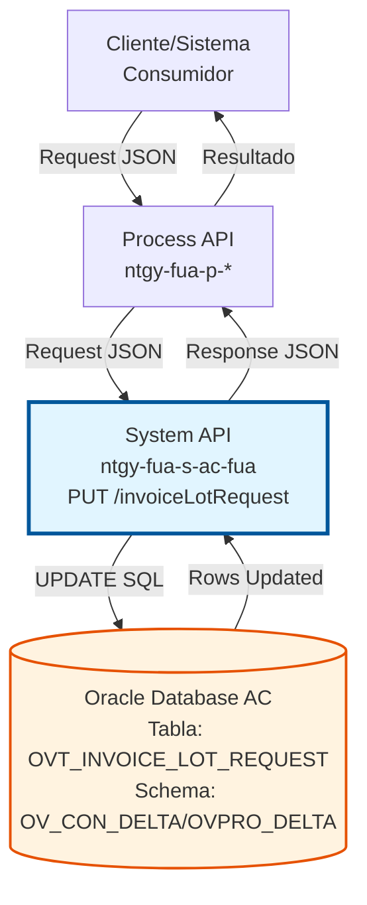
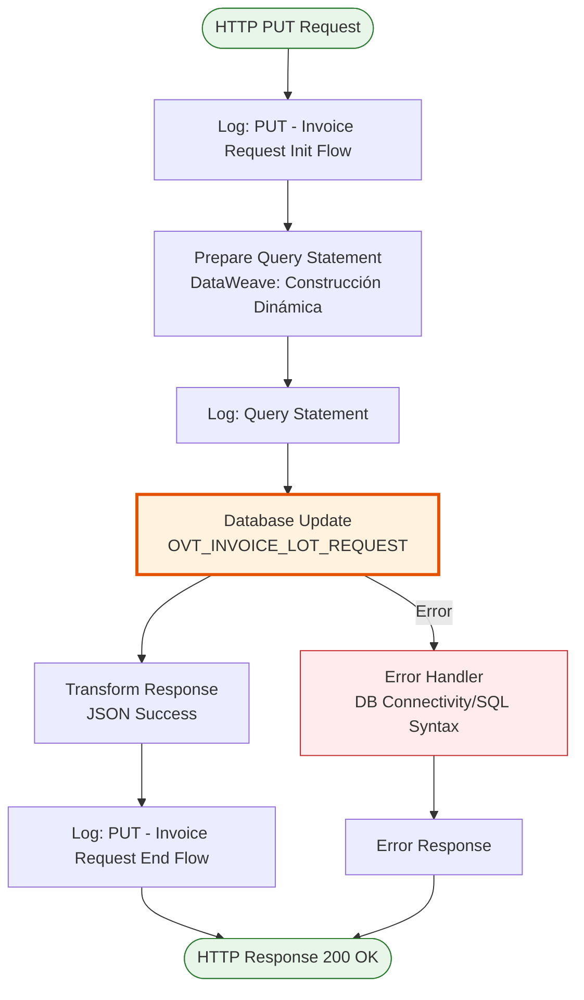
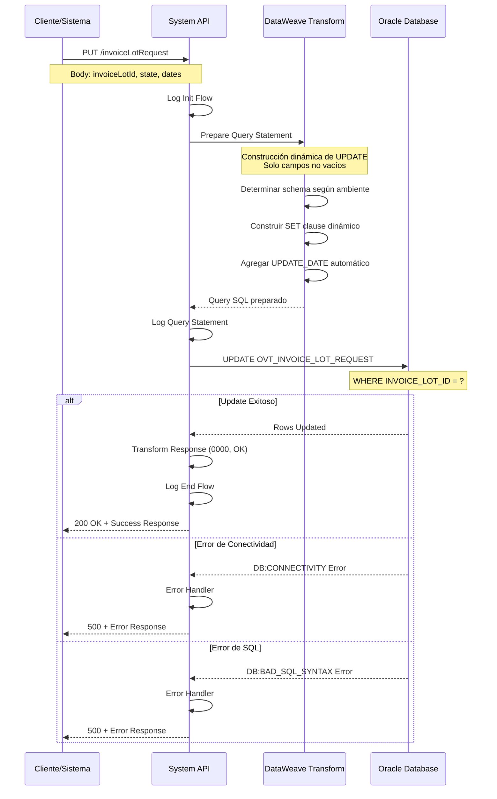
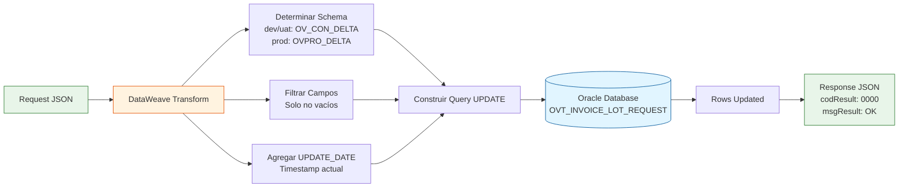

# PUT /invoiceLotRequest

## 📌 Descripción General

### Propósito del Endpoint

Este endpoint actualiza el estado y las fechas asociadas a una solicitud de lote de facturas en la base de datos Oracle del Área Cliente (AC). Permite modificar dinámicamente el estado de procesamiento, la fecha de envío de email y la fecha de descarga de un lote de facturas específico.

El endpoint soporta:
- **Actualización de Estado**: Modificar el estado actual de la solicitud de lote
- **Registro de Fecha de Email**: Actualizar la fecha en que se envió el email con el lote
- **Registro de Fecha de Descarga**: Actualizar la fecha en que se descargó el lote
- **Actualización Automática**: Registra automáticamente la fecha de actualización

### Tipo de API

**Capa:** System API (API-Led Connectivity)

**Función:** Integración directa con Oracle Database AC para actualización de registros de control de lotes de facturas.

### Patrón de Integración

**Tipo:** Request-Reply Síncrono con SQL UPDATE

**Descripción:** Recibe los datos de actualización en formato JSON, construye dinámicamente una query UPDATE basándose en los campos proporcionados, ejecuta la actualización en la base de datos Oracle y retorna un resultado estándar de éxito.

### Arquitectura API-Led Connectivity



---

## 💼 Propósito del Negocio

### Casos de Uso Principales

1. **Actualización de Estado de Procesamiento**
   - Un proceso batch actualiza el estado de una solicitud de lote de facturas
   - Se marca como "PROCESADO", "ENVIADO", "ERROR", etc.
   - Permite seguimiento del ciclo de vida del lote

2. **Registro de Envío de Email**
   - Cuando se envía un email con el lote de facturas al cliente
   - Se registra la fecha exacta del envío
   - Facilita auditoría y seguimiento de comunicaciones

3. **Registro de Descarga**
   - Cuando un cliente descarga el lote de facturas
   - Se registra la fecha de descarga
   - Permite métricas de uso y auditoría

### Contexto Empresarial

- **Dominio:** Gestión de Facturas
- **Sector:** Energía - Utilities
- **División:** Naturgy España - Área Cliente
- **Proceso de Negocio:** Control y seguimiento de lotes de facturas
- **Módulo:** Facturación y Comunicaciones

### Stakeholders

- **Equipo de Facturación**: Necesita seguimiento del estado de lotes de facturas
- **Equipo de Comunicaciones**: Requiere registro de envíos de emails
- **Clientes Finales**: Beneficiarios de la gestión eficiente de lotes de facturas
- **Equipo de Auditoría**: Necesita trazabilidad de operaciones

### Valor de Negocio

- **Trazabilidad Completa**: Registro detallado de todas las operaciones sobre lotes de facturas
- **Auditoría**: Capacidad de auditar cuándo se procesó, envió y descargó cada lote
- **Eficiencia Operativa**: Automatización del seguimiento de estados
- **Mejora de Servicio**: Mejor control sobre la entrega de facturas a clientes

### Consumidores Potenciales

Este endpoint puede ser consumido por:
- Process APIs de gestión de facturas
- Procesos batch de generación y envío de lotes
- Sistemas de notificaciones y comunicaciones
- Portales de autoservicio de clientes
- Sistemas de auditoría y reporting

---

## 🔧 Especificación Técnica

### URLs por Ambiente

| Ambiente | URL Base | URL Completa |
|----------|----------|--------------|
| **Local** | `http://localhost:8081` | `http://localhost:8081/api/invoiceLotRequest` |
| **Development** | `https://ntgy-fua-s-ac-fua-dev.us-e2.cloudhub.io` | `https://ntgy-fua-s-ac-fua-dev.us-e2.cloudhub.io/api/invoiceLotRequest` |
| **UAT** | `https://ntgy-fua-s-ac-fua-uat.us-e2.cloudhub.io` | `https://ntgy-fua-s-ac-fua-uat.us-e2.cloudhub.io/api/invoiceLotRequest` |
| **Production** | `https://ntgy-fua-s-ac-fua-pro.us-e2.cloudhub.io` | `https://ntgy-fua-s-ac-fua-pro.us-e2.cloudhub.io/api/invoiceLotRequest` |

### Método HTTP

```
PUT /api/invoiceLotRequest
```

### Parámetros de Entrada

#### Headers HTTP

| Header | Tipo | Requerido | Descripción | Ejemplo |
|--------|------|-----------|-------------|---------|
| `Content-Type` | string | ✅ Sí | Tipo de contenido del request | `application/json` |
| `Accept` | string | ❌ No | Tipo de contenido esperado en response | `application/json` |

#### Body Parameters

| Campo | Tipo | Requerido | Descripción | Ejemplo |
|-------|------|-----------|-------------|---------|
| `invoiceLotId` | string | ✅ Sí | Identificador único del lote de facturas | `"LOT-2026-001234"` |
| `state` | string | ❌ No | Nuevo estado del lote | `"ENVIADO"` |
| `sendEmailDate` | string | ❌ No | Fecha de envío del email (formato: yyyy-MM-dd HH:mm:ss) | `"2026-08-10 10:30:00"` |
| `downloadDate` | string | ❌ No | Fecha de descarga del lote (formato: yyyy-MM-dd HH:mm:ss) | `"2026-08-10 11:45:00"` |

**Nota:** Al menos uno de los campos opcionales (`state`, `sendEmailDate`, `downloadDate`) debe ser proporcionado para realizar la actualización.

#### Ejemplo de Request Body

```json
{
  "invoiceLotId": "LOT-2026-001234",
  "state": "ENVIADO",
  "sendEmailDate": "2026-08-10 10:30:00"
}
```

### Respuestas

#### Respuesta Exitosa (200 OK)

```json
{
  "result": {
    "codResult": "0000",
    "msgResult": "OK"
  }
}
```

#### Respuesta de Error de Validación (400 Bad Request)

```json
{
  "result": {
    "codResult": "0001",
    "msgResult": "invoiceLotId es requerido"
  }
}
```

#### Respuesta de Error de Base de Datos (500 Internal Server Error)

```json
{
  "result": {
    "codResult": "0002",
    "msgResult": "Error al actualizar el registro en la base de datos"
  }
}
```

### Autenticación y Autorización

- **Tipo:** Client ID & Client Secret (Anypoint Platform)
- **Autorización DB:** El usuario de base de datos debe tener permisos para:
  - Ejecutar UPDATE en tabla `OVT_INVOICE_LOT_REQUEST`
  - Acceso al schema `OV_CON_DELTA` (dev/uat) o `OVPRO_DELTA` (prod)

### Timeouts

| Tipo | Valor | Descripción |
|------|-------|-------------|
| **Request Timeout** | 30 segundos | Tiempo máximo de espera para la respuesta |
| **Database Query Timeout** | 15 segundos | Tiempo máximo para ejecutar la query UPDATE |
| **Connection Timeout** | 10 segundos | Tiempo máximo para establecer conexión con DB |

---

## 🏗️ Implementación Técnica

### Arquitectura del Flow



### Flujo de Datos Detallado



### Componentes del Flow

#### 1. Logger de Inicio
**Ubicación:** Línea 3 del código
```xml
<logger level="INFO" doc:name="PUT - Invoice Request Init Flow" 
        message="PUT - Invoice Request Init Flow"/>
```
**Propósito:** Registrar el inicio del procesamiento del request

#### 2. Transformación DataWeave - Preparación de Query
**Ubicación:** Líneas 4-32 del código
**Archivo:** Inline en el flow

**Lógica de Construcción Dinámica:**

```dataweave
%dw 2.0
output application/json

// Determinar schema según ambiente
var env = p('env')
var schema = if ( env == 'local' or env == 'dev' or env == 'uat' ) 'OV_CON_DELTA.' 
else if ( env == 'pro' ) 'OVPRO_DELTA.'
else ''

// Fecha actual en zona horaria de Madrid
var fechaActual = (now() >> 'Europe/Madrid') as String {format: 'yyyy-MM-dd hh:mm:ss'}

// Función para construir SET clause dinámicamente
fun updateBuilder()= do {
    var mapping = {
        STATE: if ( !isEmpty(payload.state) ) "'" ++ payload.state ++ "'" else null,
        DATE_SEND_EMAIL: if ( !isEmpty(payload.sendEmailDate) ) 
            "TO_DATE('" ++ payload.sendEmailDate ++ "'" ++ ",'YYYY-MM-DD HH24:MI:SS')" 
            else null,
        DATE_DOWNLOAD: if ( !isEmpty(payload.downloadDate) ) 
            "TO_DATE('" ++ payload.downloadDate ++ "'" ++ ",'YYYY-MM-DD HH24:MI:SS')" 
            else null,
        UPDATE_DATE: "TO_DATE('" ++ fechaActual ++ "'" ++ ",'YYYY-MM-DD HH24:MI:SS')"
    } filterObject ((value, key, index) -> value != null)
    ---
    " SET " ++ (mapping pluck ((value, key, index) ->  key ++ "=" ++  value) joinBy ",") 
}
---
{
    query: "UPDATE " ++ schema ++ "OVT_INVOICE_LOT_REQUEST "  
           ++ updateBuilder() 
           ++  " WHERE INVOICE_LOT_ID = '" ++ payload.invoiceLotId ++"'"
}
```

**Características Clave:**
- **Construcción Dinámica**: Solo incluye campos que no están vacíos
- **Schema Dinámico**: Selecciona schema según ambiente (dev/uat vs prod)
- **Fecha Automática**: Siempre actualiza `UPDATE_DATE` con timestamp actual
- **Formato Oracle**: Usa `TO_DATE` para conversión de fechas
- **Zona Horaria**: Usa 'Europe/Madrid' para fechas

#### 3. Logger de Query
**Ubicación:** Línea 33 del código
```xml
<logger level="INFO" doc:name="log prepared statement" 
        message="Query statement: #[vars.queryJson.query]"/>
```
**Propósito:** Registrar la query SQL que se va a ejecutar (para debugging)

#### 4. Database Update
**Ubicación:** Líneas 34-39 del código
```xml
<db:update doc:name="Update invoice lot request" 
           config-ref="Database_Config">
    <error-mapping sourceType="DB:CONNECTIVITY" 
                   targetType="APP:DB_CONNECTIVITY_ERROR" />
    <error-mapping sourceType="DB:BAD_SQL_SYNTAX" 
                   targetType="APP:SQL_SYNTAX_ERROR" />
    <error-mapping sourceType="DB:QUERY_EXECUTION" 
                   targetType="APP:SQL_SYNTAX_ERROR" />
    <db:sql><![CDATA[#[vars.queryJson.query]]]></db:sql>
</db:update>
```

**Configuración:**
- **Config:** `Database_Config` (conexión Oracle)
- **Query:** Dinámica desde variable `vars.queryJson.query`
- **Error Mapping:** Mapeo de errores de DB a errores de aplicación

#### 5. Transformación de Respuesta
**Ubicación:** Líneas 40-51 del código
```xml
<ee:transform doc:name="json response">
    <ee:message>
        <ee:set-payload><![CDATA[%dw 2.0
output application/json
---
{
    "result": {
        "codResult": "0000",
        "msgResult": "OK"
    }
}
        ]]></ee:set-payload>
    </ee:message>
</ee:transform>
```

**Respuesta Estándar:**
- Código `0000` indica éxito
- Mensaje `OK` confirma operación exitosa

#### 6. Logger de Fin
**Ubicación:** Línea 52 del código
```xml
<logger level="INFO" doc:name="PUT - Invoice Request End Flow" 
        message="PUT - Invoice Request End Flow" />
```
**Propósito:** Registrar la finalización exitosa del procesamiento

### Operación de Base de Datos

#### Query UPDATE Dinámica

**Estructura Base:**
```sql
UPDATE [SCHEMA].OVT_INVOICE_LOT_REQUEST 
SET [CAMPOS_DINAMICOS]
WHERE INVOICE_LOT_ID = '[ID]'
```

**Ejemplo 1 - Actualización de Estado:**
```sql
UPDATE OV_CON_DELTA.OVT_INVOICE_LOT_REQUEST 
SET STATE='ENVIADO', UPDATE_DATE=TO_DATE('2026-08-10 10:30:45','YYYY-MM-DD HH24:MI:SS')
WHERE INVOICE_LOT_ID = 'LOT-2026-001234'
```

**Ejemplo 2 - Actualización de Fecha de Email:**
```sql
UPDATE OVPRO_DELTA.OVT_INVOICE_LOT_REQUEST 
SET DATE_SEND_EMAIL=TO_DATE('2026-08-10 10:30:00','YYYY-MM-DD HH24:MI:SS'), 
    UPDATE_DATE=TO_DATE('2026-08-10 10:30:45','YYYY-MM-DD HH24:MI:SS')
WHERE INVOICE_LOT_ID = 'LOT-2026-001234'
```

**Ejemplo 3 - Actualización Completa:**
```sql
UPDATE OVPRO_DELTA.OVT_INVOICE_LOT_REQUEST 
SET STATE='DESCARGADO', 
    DATE_SEND_EMAIL=TO_DATE('2026-08-10 10:30:00','YYYY-MM-DD HH24:MI:SS'),
    DATE_DOWNLOAD=TO_DATE('2026-08-10 11:45:00','YYYY-MM-DD HH24:MI:SS'),
    UPDATE_DATE=TO_DATE('2026-08-10 11:45:30','YYYY-MM-DD HH24:MI:SS')
WHERE INVOICE_LOT_ID = 'LOT-2026-001234'
```

#### Tabla: OVT_INVOICE_LOT_REQUEST

**Campos Actualizables:**

| Campo | Tipo | Descripción | Actualización |
|-------|------|-------------|---------------|
| `STATE` | VARCHAR2 | Estado del lote de facturas | Condicional (si se proporciona) |
| `DATE_SEND_EMAIL` | DATE | Fecha de envío del email | Condicional (si se proporciona) |
| `DATE_DOWNLOAD` | DATE | Fecha de descarga del lote | Condicional (si se proporciona) |
| `UPDATE_DATE` | DATE | Fecha de última actualización | Siempre (automático) |

**Campo de Búsqueda:**

| Campo | Tipo | Descripción |
|-------|------|-------------|
| `INVOICE_LOT_ID` | VARCHAR2 | Identificador único del lote (PK) |

### Manejo de Errores

#### Errores Mapeados

| Error Origen | Error Mapeado | Descripción |
|--------------|---------------|-------------|
| `DB:CONNECTIVITY` | `APP:DB_CONNECTIVITY_ERROR` | Error de conexión a base de datos |
| `DB:BAD_SQL_SYNTAX` | `APP:SQL_SYNTAX_ERROR` | Error de sintaxis SQL |
| `DB:QUERY_EXECUTION` | `APP:SQL_SYNTAX_ERROR` | Error en ejecución de query |

#### Estrategia de Retry

**Configuración:**
- **Reintentos:** 3 intentos automáticos
- **Intervalo:** Exponential backoff
- **Condiciones:** Solo para errores de conectividad

### Configuración de Base de Datos

**Connection Pool:**
- **MaxPoolSize:** 15 conexiones
- **MaxWaitTime:** 300 segundos
- **MaxIdleTime:** 300 segundos
- **Query Timeout:** 15 segundos

**Hosts (Alta Disponibilidad):**
- **Primary:** oc-pro-exa-04-clu-02-hdfdi-scan.prodb03.ocpro.oraclevcn.com
- **Secondary:** oc-pro-exa-03-clu-02-dfhl9-scan.prodb03.ocpro.oraclevcn.com
- **Port:** 1521
- **Service Name:** s_areapriv_online_pro.prodb03.ocpro.oraclevcn.com

---

## 💻 Ejemplos de Uso

### Ejemplo 1: Actualización de Estado

#### Request

```bash
curl -X PUT "https://ntgy-fua-s-ac-fua-pro.us-e2.cloudhub.io/api/invoiceLotRequest" \
  -H "Content-Type: application/json" \
  -H "client_id: YOUR_CLIENT_ID" \
  -H "client_secret: YOUR_CLIENT_SECRET" \
  -d '{
    "invoiceLotId": "LOT-2026-001234",
    "state": "PROCESADO"
  }'
```

#### Response

```json
{
  "result": {
    "codResult": "0000",
    "msgResult": "OK"
  }
}
```

### Ejemplo 2: Registro de Envío de Email

#### Request

```bash
curl -X PUT "https://ntgy-fua-s-ac-fua-pro.us-e2.cloudhub.io/api/invoiceLotRequest" \
  -H "Content-Type: application/json" \
  -H "client_id: YOUR_CLIENT_ID" \
  -H "client_secret: YOUR_CLIENT_SECRET" \
  -d '{
    "invoiceLotId": "LOT-2026-001234",
    "state": "ENVIADO",
    "sendEmailDate": "2026-08-10 10:30:00"
  }'
```

#### Response

```json
{
  "result": {
    "codResult": "0000",
    "msgResult": "OK"
  }
}
```

### Ejemplo 3: Registro de Descarga

#### Request

```bash
curl -X PUT "https://ntgy-fua-s-ac-fua-pro.us-e2.cloudhub.io/api/invoiceLotRequest" \
  -H "Content-Type: application/json" \
  -H "client_id: YOUR_CLIENT_ID" \
  -H "client_secret: YOUR_CLIENT_SECRET" \
  -d '{
    "invoiceLotId": "LOT-2026-001234",
    "state": "DESCARGADO",
    "downloadDate": "2026-08-10 11:45:00"
  }'
```

#### Response

```json
{
  "result": {
    "codResult": "0000",
    "msgResult": "OK"
  }
}
```

### Ejemplo 4: Actualización Completa

#### Request

```bash
curl -X PUT "https://ntgy-fua-s-ac-fua-pro.us-e2.cloudhub.io/api/invoiceLotRequest" \
  -H "Content-Type: application/json" \
  -H "client_id: YOUR_CLIENT_ID" \
  -H "client_secret: YOUR_CLIENT_SECRET" \
  -d '{
    "invoiceLotId": "LOT-2026-001234",
    "state": "COMPLETADO",
    "sendEmailDate": "2026-08-10 10:30:00",
    "downloadDate": "2026-08-10 11:45:00"
  }'
```

#### Response

```json
{
  "result": {
    "codResult": "0000",
    "msgResult": "OK"
  }
}
```

### Ejemplo 5: Error - invoiceLotId Faltante

#### Request

```bash
curl -X PUT "https://ntgy-fua-s-ac-fua-pro.us-e2.cloudhub.io/api/invoiceLotRequest" \
  -H "Content-Type: application/json" \
  -H "client_id: YOUR_CLIENT_ID" \
  -H "client_secret: YOUR_CLIENT_SECRET" \
  -d '{
    "state": "PROCESADO"
  }'
```

#### Response

```json
{
  "result": {
    "codResult": "0001",
    "msgResult": "invoiceLotId es requerido"
  }
}
```

### Ejemplo 6: Integración con JavaScript

```javascript
async function updateInvoiceLotRequest(lotId, state, sendEmailDate, downloadDate) {
  const url = 'https://ntgy-fua-s-ac-fua-pro.us-e2.cloudhub.io/api/invoiceLotRequest';
  
  const requestBody = {
    invoiceLotId: lotId
  };
  
  // Agregar campos opcionales solo si se proporcionan
  if (state) requestBody.state = state;
  if (sendEmailDate) requestBody.sendEmailDate = sendEmailDate;
  if (downloadDate) requestBody.downloadDate = downloadDate;
  
  try {
    const response = await fetch(url, {
      method: 'PUT',
      headers: {
        'Content-Type': 'application/json',
        'client_id': 'YOUR_CLIENT_ID',
        'client_secret': 'YOUR_CLIENT_SECRET'
      },
      body: JSON.stringify(requestBody)
    });
    
    const data = await response.json();
    
    if (data.result.codResult === '0000') {
      console.log('Actualización exitosa');
      return true;
    } else {
      console.error('Error en actualización:', data.result.msgResult);
      return false;
    }
  } catch (error) {
    console.error('Error de red:', error);
    return false;
  }
}

// Uso
updateInvoiceLotRequest(
  'LOT-2026-001234', 
  'ENVIADO', 
  '2026-08-10 10:30:00', 
  null
);
```

### Ejemplo 7: Integración con Python

```python
import requests
from datetime import datetime

def update_invoice_lot_request(lot_id, state=None, send_email_date=None, download_date=None):
    """
    Actualiza una solicitud de lote de facturas
    
    Args:
        lot_id (str): ID del lote de facturas
        state (str, optional): Nuevo estado
        send_email_date (str, optional): Fecha de envío de email (YYYY-MM-DD HH:MM:SS)
        download_date (str, optional): Fecha de descarga (YYYY-MM-DD HH:MM:SS)
    
    Returns:
        bool: True si la actualización fue exitosa
    """
    url = 'https://ntgy-fua-s-ac-fua-pro.us-e2.cloudhub.io/api/invoiceLotRequest'
    
    headers = {
        'Content-Type': 'application/json',
        'client_id': 'YOUR_CLIENT_ID',
        'client_secret': 'YOUR_CLIENT_SECRET'
    }
    
    payload = {'invoiceLotId': lot_id}
    
    # Agregar campos opcionales solo si se proporcionan
    if state:
        payload['state'] = state
    if send_email_date:
        payload['sendEmailDate'] = send_email_date
    if download_date:
        payload['downloadDate'] = download_date
    
    try:
        response = requests.put(url, json=payload, headers=headers, timeout=30)
        response.raise_for_status()
        
        data = response.json()
        
        if data['result']['codResult'] == '0000':
            print(f'Actualización exitosa para lote {lot_id}')
            return True
        else:
            print(f"Error: {data['result']['msgResult']}")
            return False
            
    except requests.exceptions.RequestException as e:
        print(f'Error de red: {e}')
        return False

# Uso
update_invoice_lot_request(
    lot_id='LOT-2026-001234',
    state='ENVIADO',
    send_email_date='2026-08-10 10:30:00'
)
```

### Diagrama de Transformación de Datos


