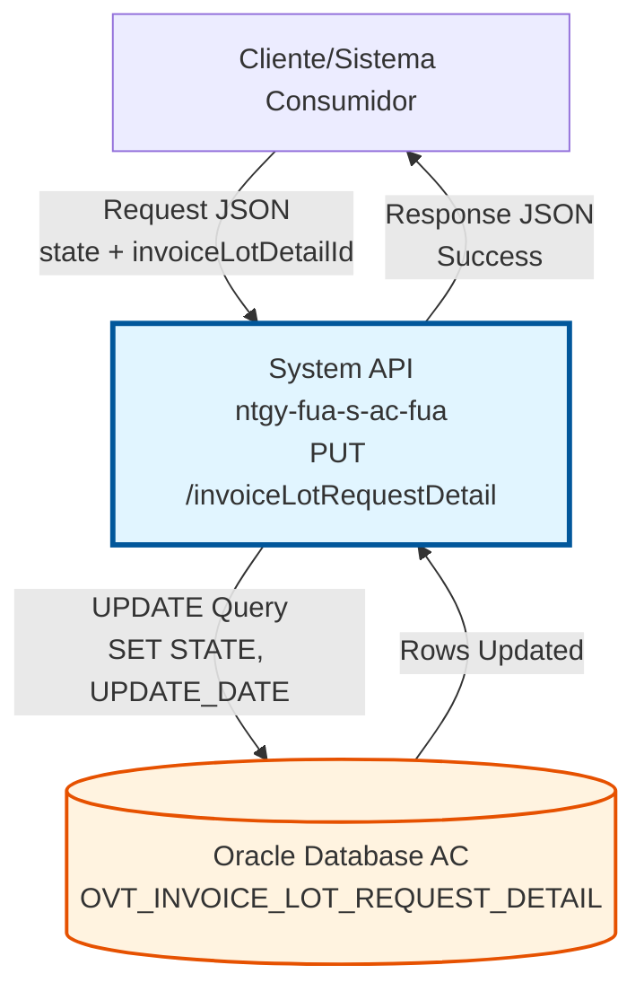
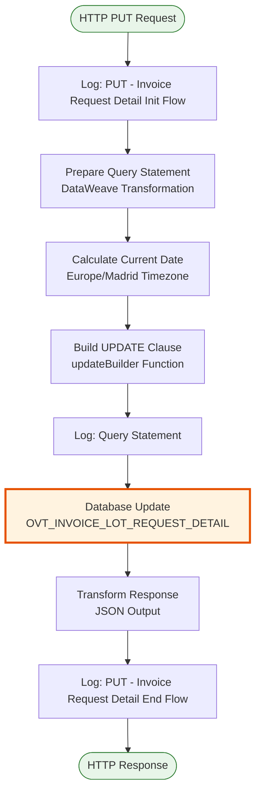
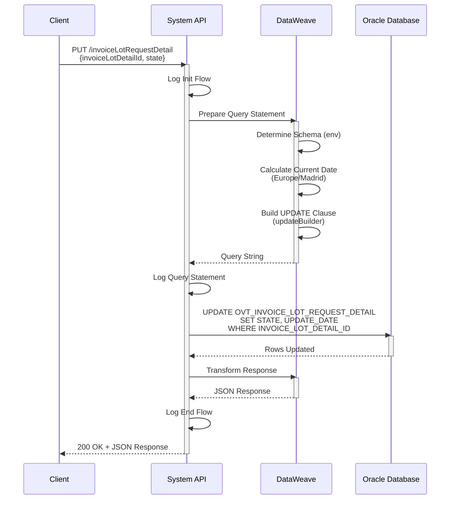
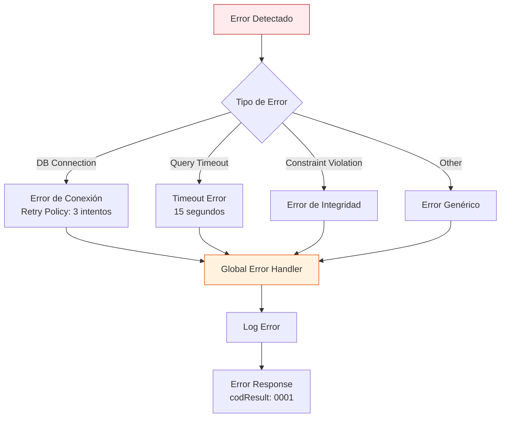

# PUT /invoiceLotRequestDetail

## 📌 Descripción General

### Propósito del Endpoint

Este endpoint actualiza el estado de los detalles de solicitudes de lotes de facturación en la base de datos Oracle del sistema Área Cliente (AC). Permite modificar el estado de procesamiento de líneas o items específicos dentro de un lote de facturación, manteniendo automáticamente la trazabilidad temporal mediante la actualización de la fecha de modificación.

El endpoint soporta:
- **Actualización de Estado**: Modifica el campo STATE de un detalle específico
- **Timestamp Automático**: Actualiza automáticamente UPDATE_DATE con la fecha/hora actual
- **Construcción Dinámica**: Solo actualiza campos proporcionados (no nulos)
- **Timezone Aware**: Utiliza timezone Europe/Madrid para fechas

### Tipo de API

**Capa:** System API (API-Led Connectivity)

**Función:** Integración directa con Oracle Database AC para actualización de estados de detalles de lotes de facturación.

### Patrón de Integración

**Tipo:** Request-Reply Síncrono con SQL UPDATE

**Descripción:** El endpoint recibe un JSON con el ID del detalle y el nuevo estado, construye dinámicamente una query UPDATE con solo los campos proporcionados, calcula la fecha actual con timezone Europe/Madrid, ejecuta la actualización en la base de datos Oracle, y retorna una confirmación de éxito.

### Arquitectura API-Led Connectivity



---

## 💼 Propósito del Negocio

### Casos de Uso Principales

1. **Actualización de Estado de Procesamiento**
   - Permite cambiar el estado de un detalle de lote (ej: PENDING → PROCESSED)
   - Facilita el seguimiento del flujo de trabajo de facturación
   - Mantiene trazabilidad automática con fecha de actualización

2. **Control de Flujo de Facturación**
   - Gestiona el ciclo de vida de solicitudes de facturación
   - Permite marcar items como procesados, rechazados, o en revisión
   - Soporta workflows de aprobación y validación

3. **Auditoría y Trazabilidad**
   - Registra automáticamente cuándo se modificó cada detalle
   - Permite reconstruir el historial de cambios de estado
   - Facilita auditorías de procesos de facturación

### Contexto Empresarial

- **Dominio:** Facturación y Cobros
- **Sector:** Energía - Utilities
- **División:** Naturgy España - Área Cliente
- **Proceso de Negocio:** Gestión de Estados de Lotes de Facturación
- **Sistema:** Oracle Database AC (Área Cliente)

### Stakeholders

- **Equipo de Facturación**: Actualiza estados según avanza el procesamiento
- **Sistemas Automatizados**: Actualizan estados tras completar validaciones
- **Equipo de Auditoría**: Requiere trazabilidad de cambios de estado
- **Sistemas de Workflow**: Gestionan el flujo de aprobaciones

### Valor de Negocio

- **Control de Proceso**: Gestión precisa del estado de cada item de facturación
- **Trazabilidad Automática**: Fecha de actualización registrada automáticamente
- **Integridad de Datos**: Actualización atómica y consistente
- **Auditoría**: Soporte para cumplimiento normativo y auditorías

### Consumidores Potenciales

Este endpoint puede ser consumido por:
- Process APIs de facturación y cobros
- Sistemas de workflow y orquestación
- Aplicaciones de gestión de facturación
- Procesos batch de actualización masiva

---

## 🔧 Especificación Técnica

### URLs por Ambiente

| Ambiente | URL Base | URL Completa |
|----------|----------|--------------|
| **Local** | `http://localhost:8081` | `http://localhost:8081/api/invoiceLotRequestDetail` |
| **Development** | `https://ntgy-fua-s-ac-fua-dev.us-e2.cloudhub.io` | `https://ntgy-fua-s-ac-fua-dev.us-e2.cloudhub.io/api/invoiceLotRequestDetail` |
| **UAT** | `https://ntgy-fua-s-ac-fua-uat.us-e2.cloudhub.io` | `https://ntgy-fua-s-ac-fua-uat.us-e2.cloudhub.io/api/invoiceLotRequestDetail` |
| **Production** | `https://ntgy-fua-s-ac-fua-pro.us-e2.cloudhub.io` | `https://ntgy-fua-s-ac-fua-pro.us-e2.cloudhub.io/api/invoiceLotRequestDetail` |

### Método HTTP

```
PUT /api/invoiceLotRequestDetail
```

### Parámetros de Entrada

#### Headers HTTP

| Header | Tipo | Requerido | Descripción | Ejemplo |
|--------|------|-----------|-------------|---------|
| `Content-Type` | string | ✅ Sí | Tipo de contenido del request | `application/json` |
| `Accept` | string | ❌ No | Tipo de contenido esperado en response | `application/json` |

#### Body Parameters (JSON)

| Campo | Tipo | Requerido | Descripción | Ejemplo |
|-------|------|-----------|-------------|---------|
| `invoiceLotDetailId` | string | ✅ Sí | ID único del detalle de lote a actualizar | `"12345"` |
| `state` | string | ❌ No | Nuevo estado del detalle | `"PROCESSED"` |

**Estructura del Body:**
```json
{
  "invoiceLotDetailId": "string",
  "state": "string"
}
```

**Nota sobre Campos:**
- Si `state` no se proporciona o está vacío, solo se actualizará `UPDATE_DATE`
- `UPDATE_DATE` siempre se actualiza automáticamente con la fecha/hora actual (timezone Europe/Madrid)
- La construcción del UPDATE es dinámica: solo incluye campos no vacíos

### Respuestas

#### Respuesta Exitosa (200 OK)

```json
{
  "result": {
    "codResult": "0000",
    "msgResult": "OK"
  }
}
```

#### Respuesta de Error - ID No Encontrado (200 OK)

```json
{
  "result": {
    "codResult": "0000",
    "msgResult": "OK"
  }
}
```

**Nota:** La operación UPDATE retorna éxito incluso si no se actualizó ningún registro (ID no existe). Para verificar si se actualizó un registro, se debe consultar el número de filas afectadas.

#### Respuesta de Error Técnico (500)

```json
{
  "result": {
    "codResult": "0001",
    "msgResult": "Error interno del servidor"
  }
}
```

### Autenticación y Autorización

- **Tipo:** Client ID & Client Secret (Anypoint Platform)
- **Autorización DB:** El usuario de base de datos debe tener permisos para:
  - Acceso de escritura (UPDATE) a la tabla `OVT_INVOICE_LOT_REQUEST_DETAIL`
  - Acceso al schema `OV_CON_DELTA` (dev/uat) o `OVPRO_DELTA` (producción)

### Timeouts

| Tipo | Valor | Descripción |
|------|-------|-------------|
| **Query Timeout** | 15 segundos | Tiempo máximo de ejecución de la query UPDATE |
| **Connection Timeout** | 3600 segundos | Tiempo máximo para mantener conexión a base de datos |

---

## 🏗️ Implementación Técnica

### Arquitectura del Flow



### Componentes Principales

#### 1. Preparación de Query (DataWeave)

**Ubicación en el código:** Transformación inline en el flow

**Función:** Construye dinámicamente la query UPDATE con el schema apropiado y solo los campos proporcionados

**Lógica de Schema:**
```dataweave
var env = p('env')
var schema = if(env == 'local' or env == 'dev' or env == 'uat') 'OV_CON_DELTA.' 
else if(env == 'pro') 'OVPRO_DELTA.'
else ''
```

**Cálculo de Fecha Actual:**
```dataweave
var fechaActual = (now() >> 'Europe/Madrid') as String {format: 'yyyy-MM-dd hh:mm:ss'}
```

**Construcción Dinámica del UPDATE:**
```dataweave
fun updateBuilder()= do {
    var mapping = {
        STATE: if ( !isEmpty(payload.state) ) "'" ++ payload.state ++ "'" else null,
        UPDATE_DATE: "TO_DATE('" ++ fechaActual ++ "'" ++ ",'YYYY-MM-DD HH24:MI:SS')"
    } filterObject ((value, key, index) -> value != null)
    ---
    " SET " ++ (mapping pluck ((value, key, index) -> key ++ "=" ++  value ) joinBy ",") 
}
```

**Características:**
- Solo incluye campos no nulos en el SET
- UPDATE_DATE siempre se incluye (nunca es null)
- STATE solo se incluye si se proporciona y no está vacío
- Formato de fecha compatible con Oracle: `TO_DATE('YYYY-MM-DD HH24:MI:SS')`

#### 2. Actualización en Base de Datos

**Operación:** `<db:update>`

**Query SQL Generada:**
```sql
UPDATE [schema]OVT_INVOICE_LOT_REQUEST_DETAIL 
SET STATE = '[state]', UPDATE_DATE = TO_DATE('[fechaActual]','YYYY-MM-DD HH24:MI:SS')
WHERE INVOICE_LOT_DETAIL_ID = '[invoiceLotDetailId]'
```

**Ejemplos de Queries Generadas:**

**Con state proporcionado:**
```sql
UPDATE OV_CON_DELTA.OVT_INVOICE_LOT_REQUEST_DETAIL 
SET STATE='PROCESSED', UPDATE_DATE=TO_DATE('2026-08-10 08:50:00','YYYY-MM-DD HH24:MI:SS')
WHERE INVOICE_LOT_DETAIL_ID = '12345'
```

**Sin state (solo UPDATE_DATE):**
```sql
UPDATE OV_CON_DELTA.OVT_INVOICE_LOT_REQUEST_DETAIL 
SET UPDATE_DATE=TO_DATE('2026-08-10 08:50:00','YYYY-MM-DD HH24:MI:SS')
WHERE INVOICE_LOT_DETAIL_ID = '12345'
```

**Configuración:**
- **Config Reference:** `Database_Config`
- **Connection Pool:** MaxPoolSize=15, MaxWaitTime=300s
- **Query Timeout:** 15 segundos

#### 3. Transformación de Respuesta

**Formato de Salida:**
```json
{
  "result": {
    "codResult": "0000",
    "msgResult": "OK"
  }
}
```

**Nota:** La respuesta es estándar y no incluye el número de filas actualizadas.

### Diagrama de Secuencia



### Manejo de Errores



### Configuración de Base de Datos

**Schemas por Ambiente:**
- **Local/Dev/UAT:** `OV_CON_DELTA.OVT_INVOICE_LOT_REQUEST_DETAIL`
- **Producción:** `OVPRO_DELTA.OVT_INVOICE_LOT_REQUEST_DETAIL`

**Connection Pool:**
- MaxPoolSize: 15 conexiones
- MaxWaitTime: 300 segundos
- MaxIdleTime: 300 segundos

**Tabla Actualizada:**
- **Nombre:** `OVT_INVOICE_LOT_REQUEST_DETAIL`
- **Operación:** UPDATE
- **Campos Actualizados:**
  - `STATE`: Estado del detalle (si se proporciona)
  - `UPDATE_DATE`: Fecha de actualización (siempre)
- **WHERE Clause:** `INVOICE_LOT_DETAIL_ID`

### Logging

**Puntos de Log:**
1. **Inicio del Flow:** "PUT - Invoice Request Detail Init Flow"
2. **Query Preparada:** "Query statement: [query]"
3. **Fin del Flow:** "PUT - Invoice Request Detail End Flow"

### Consideraciones Técnicas

**Timezone:**
- Todas las fechas se calculan con timezone `Europe/Madrid`
- Formato: `yyyy-MM-dd hh:mm:ss`
- Conversión a Oracle: `TO_DATE('...','YYYY-MM-DD HH24:MI:SS')`

**Construcción Dinámica:**
- Solo se incluyen en el SET los campos proporcionados (no nulos)
- `UPDATE_DATE` siempre se actualiza automáticamente
- Permite actualizaciones parciales sin afectar otros campos

**Idempotencia:**
- La operación es idempotente: ejecutar múltiples veces con los mismos datos produce el mismo resultado
- Solo cambia `UPDATE_DATE` en ejecuciones repetidas

---

## 💻 Ejemplos de Uso

### Ejemplo 1: Actualización de Estado

**Request:**
```bash
curl -X PUT "https://ntgy-fua-s-ac-fua-dev.us-e2.cloudhub.io/api/invoiceLotRequestDetail" \
  -H "Content-Type: application/json" \
  -H "Accept: application/json" \
  -d '{
    "invoiceLotDetailId": "12345",
    "state": "PROCESSED"
  }'
```

**Response (200 OK):**
```json
{
  "result": {
    "codResult": "0000",
    "msgResult": "OK"
  }
}
```

**Query SQL Ejecutada:**
```sql
UPDATE OV_CON_DELTA.OVT_INVOICE_LOT_REQUEST_DETAIL 
SET STATE='PROCESSED', UPDATE_DATE=TO_DATE('2026-08-10 08:50:00','YYYY-MM-DD HH24:MI:SS')
WHERE INVOICE_LOT_DETAIL_ID = '12345'
```

### Ejemplo 2: Solo Actualizar Timestamp

**Request:**
```bash
curl -X PUT "https://ntgy-fua-s-ac-fua-dev.us-e2.cloudhub.io/api/invoiceLotRequestDetail" \
  -H "Content-Type: application/json" \
  -H "Accept: application/json" \
  -d '{
    "invoiceLotDetailId": "12345"
  }'
```

**Response (200 OK):**
```json
{
  "result": {
    "codResult": "0000",
    "msgResult": "OK"
  }
}
```

**Query SQL Ejecutada:**
```sql
UPDATE OV_CON_DELTA.OVT_INVOICE_LOT_REQUEST_DETAIL 
SET UPDATE_DATE=TO_DATE('2026-08-10 08:50:00','YYYY-MM-DD HH24:MI:SS')
WHERE INVOICE_LOT_DETAIL_ID = '12345'
```

### Ejemplo 3: Cambio de Estado a Rechazado

**Request:**
```bash
curl -X PUT "https://ntgy-fua-s-ac-fua-dev.us-e2.cloudhub.io/api/invoiceLotRequestDetail" \
  -H "Content-Type: application/json" \
  -d '{
    "invoiceLotDetailId": "67890",
    "state": "REJECTED"
  }'
```

**Response (200 OK):**
```json
{
  "result": {
    "codResult": "0000",
    "msgResult": "OK"
  }
}
```

### Ejemplo 4: Uso desde JavaScript

**Código:**
```javascript
const axios = require('axios');

async function updateInvoiceLotRequestDetail(detailId, newState) {
  try {
    const response = await axios.put(
      'https://ntgy-fua-s-ac-fua-dev.us-e2.cloudhub.io/api/invoiceLotRequestDetail',
      {
        invoiceLotDetailId: detailId,
        state: newState
      },
      {
        headers: {
          'Content-Type': 'application/json',
          'Accept': 'application/json'
        }
      }
    );
    
    console.log('Detalle actualizado exitosamente');
    return response.data;
  } catch (error) {
    console.error('Error al actualizar detalle:', error.message);
    throw error;
  }
}

// Uso
updateInvoiceLotRequestDetail('12345', 'PROCESSED')
  .then(data => console.log('Éxito:', data))
  .catch(err => console.error('Error:', err));
```

### Ejemplo 5: Uso desde Python

**Código:**
```python
import requests
from datetime import datetime

def update_invoice_lot_request_detail(detail_id, state=None):
    """
    Actualiza el estado de un detalle de lote de facturación
    """
    url = "https://ntgy-fua-s-ac-fua-dev.us-e2.cloudhub.io/api/invoiceLotRequestDetail"
    
    payload = {
        'invoiceLotDetailId': detail_id
    }
    
    if state:
        payload['state'] = state
    
    headers = {
        'Content-Type': 'application/json',
        'Accept': 'application/json'
    }
    
    try:
        response = requests.put(url, json=payload, headers=headers)
        response.raise_for_status()
        
        data = response.json()
        print(f"Detalle {detail_id} actualizado exitosamente")
        return data
        
    except requests.exceptions.RequestException as e:
        print(f"Error al actualizar detalle: {e}")
        raise

# Uso
if __name__ == "__main__":
    # Actualizar estado
    result = update_invoice_lot_request_detail('12345', 'PROCESSED')
    print(f"Resultado: {result}")
    
    # Solo actualizar timestamp
    result = update_invoice_lot_request_detail('12345')
    print(f"Timestamp actualizado: {result}")
```

### Ejemplo 6: Actualización Masiva (Batch)

**Código Python:**
```python
import requests
import time

def batch_update_invoice_lot_details(detail_ids, new_state):
    """
    Actualiza múltiples detalles de lote en batch
    """
    url = "https://ntgy-fua-s-ac-fua-dev.us-e2.cloudhub.io/api/invoiceLotRequestDetail"
    
    results = {
        'success': [],
        'failed': []
    }
    
    for detail_id in detail_ids:
        try:
            response = requests.put(
                url,
                json={
                    'invoiceLotDetailId': detail_id,
                    'state': new_state
                },
                headers={'Content-Type': 'application/json'}
            )
            response.raise_for_status()
            
            results['success'].append(detail_id)
            print(f"✓ Detalle {detail_id} actualizado")
            
        except requests.exceptions.RequestException as e:
            results['failed'].append({
                'id': detail_id,
                'error': str(e)
            })
            print(f"✗ Error en detalle {detail_id}: {e}")
        
        # Pequeña pausa para no saturar el API
        time.sleep(0.1)
    
    return results

# Uso
detail_ids = ['12345', '12346', '12347', '12348']
results = batch_update_invoice_lot_details(detail_ids, 'PROCESSED')

print(f"\nResumen:")
print(f"Exitosos: {len(results['success'])}")
print(f"Fallidos: {len(results['failed'])}")
```

### Ejemplo 7: Integración con Postman

**Configuración de Request:**

1. **Método:** PUT
2. **URL:** `{{baseUrl}}/api/invoiceLotRequestDetail`
3. **Headers:**
   - Key: `Content-Type`, Value: `application/json`
   - Key: `Accept`, Value: `application/json`
4. **Body (raw JSON):**
```json
{
  "invoiceLotDetailId": "{{detailId}}",
  "state": "{{newState}}"
}
```

**Variables de Ambiente:**
```json
{
  "baseUrl": "https://ntgy-fua-s-ac-fua-dev.us-e2.cloudhub.io",
  "detailId": "12345",
  "newState": "PROCESSED"
}
```

**Test Script:**
```javascript
pm.test("Status code is 200", function () {
    pm.response.to.have.status(200);
});

pm.test("Response has result object", function () {
    var jsonData = pm.response.json();
    pm.expect(jsonData).to.have.property('result');
    pm.expect(jsonData.result.codResult).to.eql('0000');
    pm.expect(jsonData.result.msgResult).to.eql('OK');
});

pm.test("Response time is less than 3000ms", function () {
    pm.expect(pm.response.responseTime).to.be.below(3000);
});

// Guardar resultado para siguiente request
pm.environment.set("lastUpdateResult", JSON.stringify(pm.response.json()));
```

### Ejemplo 8: Workflow de Estados

**Código JavaScript - Gestión de Workflow:**
```javascript
const axios = require('axios');

class InvoiceLotDetailWorkflow {
  constructor(baseUrl) {
    this.baseUrl = baseUrl;
    this.api = axios.create({
      baseURL: baseUrl,
      headers: {
        'Content-Type': 'application/json',
        'Accept': 'application/json'
      }
    });
  }

  async updateState(detailId, newState) {
    try {
      const response = await this.api.put('/api/invoiceLotRequestDetail', {
        invoiceLotDetailId: detailId,
        state: newState
      });
      return response.data;
    } catch (error) {
      throw new Error(`Failed to update state: ${error.message}`);
    }
  }

  async processWorkflow(detailId) {
    const states = ['PENDING', 'VALIDATING', 'APPROVED', 'PROCESSED'];
    
    for (const state of states) {
      console.log(`Transitioning to ${state}...`);
      await this.updateState(detailId, state);
      console.log(`✓ State updated to ${state}`);
      
      // Simular procesamiento
      await new Promise(resolve => setTimeout(resolve, 1000));
    }
    
    console.log('Workflow completed successfully');
  }
}

// Uso
const workflow = new InvoiceLotDetailWorkflow(
  'https://ntgy-fua-s-ac-fua-dev.us-e2.cloudhub.io'
);

workflow.processWorkflow('12345')
  .then(() => console.log('Done'))
  .catch(err => console.error('Error:', err));