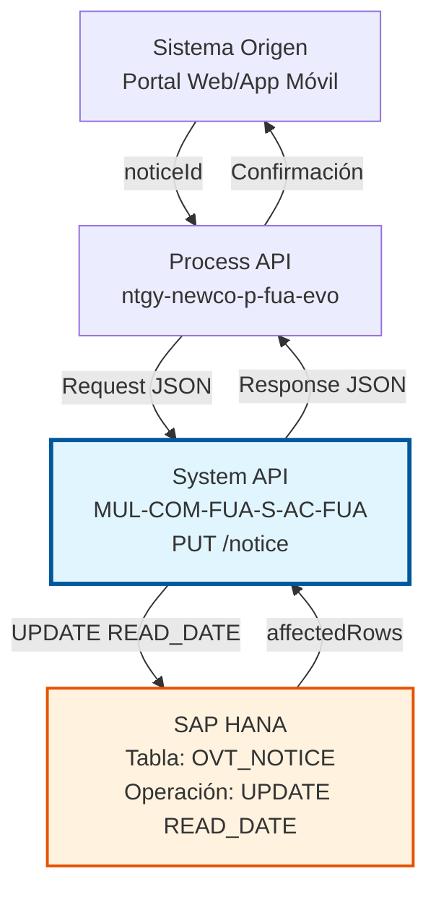
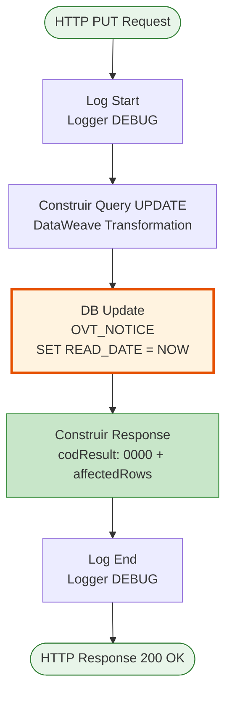
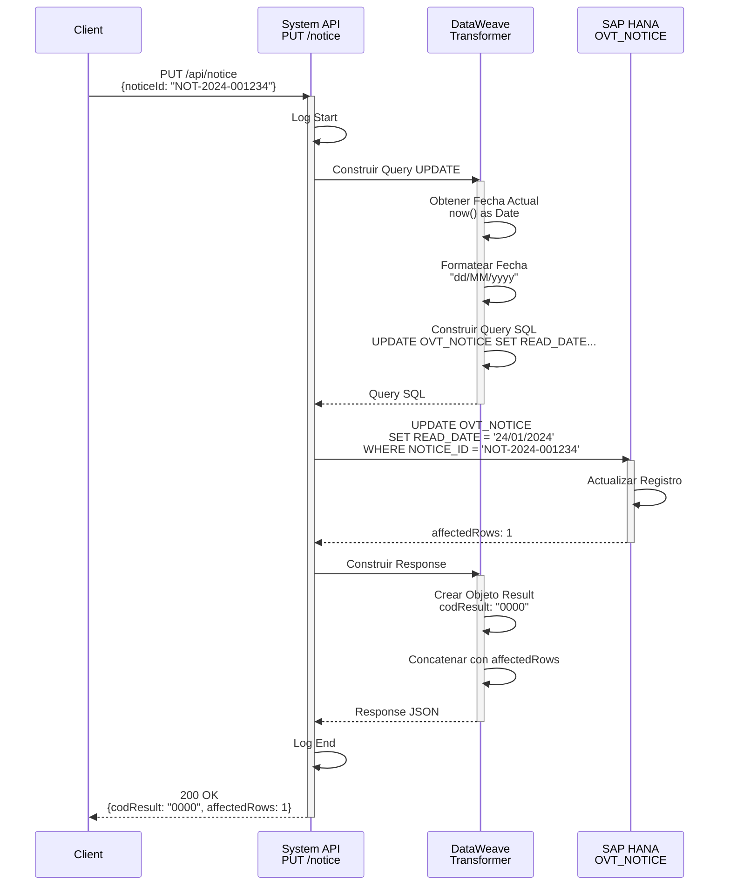

# PUT /notice

## 📌 Descripción General

### Propósito del Endpoint

Este endpoint actualiza la fecha de lectura de un aviso específico, marcándolo como leído en la base de datos SAP HANA. Se utiliza cuando un cliente visualiza un aviso en el portal web o aplicación móvil.

El endpoint soporta:
- **Marcado de Lectura**: Actualiza el campo READ_DATE con la fecha y hora actual
- **Trazabilidad**: Registra cuándo fue leído cada aviso por el cliente
- **Actualización Automática**: Usa la fecha actual del sistema automáticamente

### Tipo de API

**Capa:** System API (API-Led Connectivity)

**Función:** Integración directa con SAP HANA (PostgreSQL compatible) para actualización de estado de lectura de avisos.

### Patrón de Integración

**Tipo:** Request-Reply Síncrono con SQL UPDATE

**Descripción:** Recibe el ID del aviso en el body del request, construye un query SQL UPDATE dinámico con la fecha actual, ejecuta la actualización en la tabla OVT_NOTICE, y retorna una respuesta estructurada indicando el resultado de la operación.

### Arquitectura API-Led Connectivity



---

## 💼 Propósito del Negocio

### Casos de Uso Principales

1. **Marcado de Aviso como Leído**
   - Un cliente abre y lee un aviso en su portal web
   - El sistema marca automáticamente el aviso como leído
   - Se registra la fecha y hora exacta de lectura

2. **Seguimiento de Comunicaciones**
   - El equipo de marketing necesita saber qué avisos han sido leídos
   - Se genera estadística de tasa de lectura de avisos
   - Permite medir efectividad de comunicaciones

3. **Auditoría de Visualizaciones**
   - El equipo de soporte verifica si un cliente ha leído un aviso importante
   - Se consulta histórico de lectura para resolución de incidencias
   - Cumplimiento de requisitos de trazabilidad

4. **Gestión de Notificaciones Pendientes**
   - El sistema identifica avisos no leídos para mostrar en dashboard
   - Al marcar como leído, se actualiza el contador de pendientes
   - Mejora la experiencia de usuario mostrando solo avisos nuevos

### Contexto Empresarial

- **Dominio:** Gestión de Comunicaciones con Clientes
- **Sector:** Energía - Utilities
- **División:** Naturgy España - NewCo
- **Proceso de Negocio:** Customer Engagement y Seguimiento de Comunicaciones
- **Módulo SAP:** CRM (Customer Relationship Management)

### Stakeholders

- **Clientes Finales**: Marcan avisos como leídos al visualizarlos
- **Equipo de Marketing**: Analiza tasas de lectura de campañas
- **Equipo de Atención al Cliente**: Verifica lectura de avisos importantes
- **Equipo de Producto**: Mide engagement con notificaciones

### Valor de Negocio

- **Trazabilidad**: Registro exacto de cuándo se leyó cada aviso
- **Métricas**: Datos para análisis de efectividad de comunicaciones
- **Experiencia de Usuario**: Diferenciación visual entre leídos/no leídos
- **Cumplimiento**: Evidencia de comunicaciones entregadas y leídas

### Consumidores Potenciales

Este endpoint puede ser consumido por:
- Process APIs de gestión de clientes (ntgy-newco-p-fua-evo)
- Portales web de autoservicio
- Aplicaciones móviles de clientes
- Sistemas de agentes de call center
- Flujos de Salesforce (Platform Events, Flows)

---

## 🔧 Especificación Técnica

### URLs por Ambiente

| Ambiente | URL Base | URL Completa |
|----------|----------|--------------|
| **Local** | `http://localhost:8081` | `http://localhost:8081/api/notice` |
| **Development** | `https://mul-com-fua-s-ac-fua-dev.us-e2.cloudhub.io` | `https://mul-com-fua-s-ac-fua-dev.us-e2.cloudhub.io/api/notice` |
| **UAT** | `https://mul-com-fua-s-ac-fua-uat.us-e2.cloudhub.io` | `https://mul-com-fua-s-ac-fua-uat.us-e2.cloudhub.io/api/notice` |
| **Production** | `https://mul-com-fua-s-ac-fua-pro.us-e2.cloudhub.io` | `https://mul-com-fua-s-ac-fua-pro.us-e2.cloudhub.io/api/notice` |

### Método HTTP

```
PUT /api/notice
```

### Parámetros de Entrada

#### Headers HTTP

| Header | Tipo | Requerido | Descripción | Ejemplo |
|--------|------|-----------|-------------|---------|
| `Content-Type` | string | ✅ Sí | Tipo de contenido del request | `application/json` |
| `Accept` | string | ❌ No | Tipo de contenido esperado en response | `application/json` |

#### Body Parameters

| Campo | Tipo | Requerido | Descripción | Ejemplo |
|-------|------|-----------|-------------|---------|
| `noticeId` | string | ✅ Sí | Identificador único del aviso a marcar como leído | `"NOT-2024-001234"` |

**Ejemplo de Request Body:**

```json
{
  "noticeId": "NOT-2024-001234"
}
```

### Respuestas

#### Respuesta Exitosa (200 OK)

Cuando el aviso se actualiza correctamente:

```json
{
  "result": {
    "codResult": "0000",
    "msgResult": "Ok"
  },
  "affectedRows": 1
}
```

**Estructura de Campos de Respuesta:**

| Campo | Tipo | Descripción |
|-------|------|-------------|
| `result.codResult` | string | Código de resultado de la operación |
| `result.msgResult` | string | Mensaje descriptivo del resultado |
| `affectedRows` | number | Número de filas afectadas por el UPDATE |

#### Códigos de Resultado

| Código | Descripción | Tipo |
|--------|-------------|------|
| `0000` | Operación exitosa | Success |

**⚠️ NOTA:** Este endpoint no tiene manejo de errores explícito en el código. Cualquier error de base de datos se propagará como error HTTP 500.

### Autenticación y Autorización

- **Tipo:** Client ID & Client Secret (Anypoint Platform)
- **Autorización Base de Datos:** El usuario de conexión debe tener permisos para:
  - Ejecutar UPDATE en tabla `OVT_NOTICE`
  - Acceso al schema `SAPSR3`

### Timeouts

| Tipo | Valor | Descripción |
|------|-------|-------------|
| **Query Timeout** | 30000 ms (30 segundos) | Tiempo máximo de ejecución del UPDATE |
| **Connection Timeout** | 10 segundos | Tiempo máximo para establecer conexión con BD |

---

## 🏗️ Implementación Técnica

### Arquitectura del Flow



### Operación de Base de Datos

**Tipo:** SQL UPDATE (Query Dinámico)

**Query SQL (Líneas 7-11):**
```sql
UPDATE OVT_NOTICE 
SET READ_DATE = TO_DATE('{current_date}', 'yyyy-MM-dd') 
WHERE NOTICE_ID = '{noticeId}'
```

**Tabla:** `OVT_NOTICE`

**Columnas Actualizadas:**

| Columna | Tipo | Descripción | Valor |
|---------|------|-------------|-------|
| `READ_DATE` | DATE | Fecha de lectura del aviso | Fecha actual del sistema |

**Condición WHERE:**
- `NOTICE_ID = '{noticeId}'` - Identifica el aviso específico a actualizar

**Formato de Fecha:**
- Formato de entrada: `dd/MM/yyyy` (ej: "24/01/2024")
- Formato de conversión: `yyyy-MM-dd` (para TO_DATE)
- Función: `now() as Date {format: "dd/MM/yyyy"}`

### Transformaciones DataWeave

#### Transformación 1: Construcción de Query UPDATE (Líneas 7-11)

**Propósito:** Construir query SQL UPDATE con fecha actual

```dataweave
%dw 2.0
output application/json
var update = "UPDATE OVT_NOTICE SET READ_DATE = TO_DATE('" 
             ++ now() as Date {format: "dd/MM/yyyy"} as String 
             ++ "', 'yyyy-MM-dd') WHERE NOTICE_ID = '" 
             ++ payload.noticeId 
             ++ "'" 
---
update
```

**Lógica:**
1. Obtiene fecha actual: `now()`
2. Formatea a string: `as Date {format: "dd/MM/yyyy"} as String`
3. Construye query con concatenación de strings
4. Incluye noticeId del payload

**Ejemplo de Query Generado:**
```sql
UPDATE OVT_NOTICE 
SET READ_DATE = TO_DATE('24/01/2024', 'yyyy-MM-dd') 
WHERE NOTICE_ID = 'NOT-2024-001234'
```

#### Transformación 2: Construcción de Response (Líneas 16-24)

**Propósito:** Construir respuesta estándar con resultado de la operación

```dataweave
%dw 2.0
output application/json
---
"result":
{
    "codResult": "0000",
    "msgResult": "Ok"
}
++ payload
```

**Lógica:**
- Crea objeto `result` con código y mensaje estándar
- Concatena con `payload` (que contiene `affectedRows` del UPDATE)
- Resultado final incluye tanto el resultado como las filas afectadas

### Lógica de Negocio

**Flujo de Ejecución:**

1. **Recepción del Request** (Línea 1)
   - Recibe JSON con `noticeId`

2. **Log de Inicio** (Línea 2)
   - Registra inicio de operación

3. **Construcción de Query** (Líneas 3-11)
   - Obtiene fecha actual del sistema
   - Formatea fecha a string
   - Construye query UPDATE dinámico
   - Almacena en variable `query`

4. **Ejecución de UPDATE** (Líneas 12-14)
   - Ejecuta query contra base de datos
   - Timeout configurado: 30000ms
   - Retorna número de filas afectadas

5. **Construcción de Response** (Líneas 15-24)
   - Crea respuesta estándar con código 0000
   - Incluye `affectedRows` del resultado del UPDATE

6. **Log de Fin** (Línea 25)
   - Registra fin de operación

### ⚠️ Consideraciones de Seguridad

**Query Dinámico con Concatenación:**

El código construye el query SQL mediante concatenación de strings:
```dataweave
var update = "UPDATE OVT_NOTICE SET READ_DATE = TO_DATE('" 
             ++ now() as Date {format: "dd/MM/yyyy"} as String 
             ++ "', 'yyyy-MM-dd') WHERE NOTICE_ID = '" 
             ++ payload.noticeId 
             ++ "'"
```

**⚠️ RIESGO:** Potencial vulnerabilidad de SQL Injection

**Recomendaciones:**
1. **Usar Parámetros Preparados:** Modificar para usar `<db:input-parameters>`
2. **Validación de Entrada:** Implementar validación estricta del noticeId
3. **Sanitización:** Escapar caracteres especiales en el noticeId
4. **Mejora Futura:** Refactorizar a query parametrizado

**Ejemplo de Mejora Sugerida:**
```xml
<db:update config-ref="Database_Config">
    <db:sql>
        UPDATE OVT_NOTICE 
        SET READ_DATE = CURRENT_DATE 
        WHERE NOTICE_ID = :noticeId
    </db:sql>
    <db:input-parameters>
        #[{'noticeId': payload.noticeId}]
    </db:input-parameters>
</db:update>
```

**Ventajas de la Mejora:**
- Elimina riesgo de SQL injection
- Usa `CURRENT_DATE` nativo de la BD (más eficiente)
- Código más limpio y mantenible
- Mejor rendimiento

### ⚠️ Manejo de Errores

**IMPORTANTE:** Este flow NO tiene error handler explícito.

**Comportamiento Actual:**
- Cualquier error de base de datos se propaga como HTTP 500
- No hay transformación de errores a formato estándar
- No hay logging específico de errores

**Errores Potenciales:**
1. **noticeId no existe:** UPDATE afecta 0 filas (pero retorna 200 OK)
2. **Error de conexión BD:** HTTP 500
3. **Timeout de query:** HTTP 500
4. **Formato de fecha inválido:** HTTP 500

**Recomendación de Mejora:**
```xml
<error-handler>
    <on-error-continue type="DB:CONNECTIVITY">
        <ee:transform>
            <ee:set-payload>
                {
                    "result": {
                        "codResult": "0002",
                        "msgResult": "Error de conexión con base de datos"
                    }
                }
            </ee:set-payload>
        </ee:transform>
    </on-error-continue>
    <on-error-continue type="DB:QUERY_EXECUTION">
        <ee:transform>
            <ee:set-payload>
                {
                    "result": {
                        "codResult": "0003",
                        "msgResult": "Error al ejecutar actualización"
                    }
                }
            </ee:set-payload>
        </ee:transform>
    </on-error-continue>
</error-handler>
```

### Diagrama de Secuencia Completo



---

## 💻 Ejemplos de Uso

### Ejemplo 1: Marcado de Aviso como Leído

#### Request

```bash
curl -X PUT "https://mul-com-fua-s-ac-fua-dev.us-e2.cloudhub.io/api/notice" \
  -H "Content-Type: application/json" \
  -H "Accept: application/json" \
  -H "client_id: YOUR_CLIENT_ID" \
  -H "client_secret: YOUR_CLIENT_SECRET" \
  -d '{
    "noticeId": "NOT-2024-001234"
  }'
```

#### Response (200 OK)

```json
{
  "result": {
    "codResult": "0000",
    "msgResult": "Ok"
  },
  "affectedRows": 1
}
```

### Ejemplo 2: Integración desde JavaScript

```javascript
// Función para marcar aviso como leído
async function markNoticeAsRead(noticeId) {
  const response = await fetch(
    'https://mul-com-fua-s-ac-fua-dev.us-e2.cloudhub.io/api/notice',
    {
      method: 'PUT',
      headers: {
        'Content-Type': 'application/json',
        'Accept': 'application/json',
        'client_id': 'YOUR_CLIENT_ID',
        'client_secret': 'YOUR_CLIENT_SECRET'
      },
      body: JSON.stringify({
        noticeId: noticeId
      })
    }
  );

  const result = await response.json();

  if (result.result.codResult === "0000") {
    console.log(`Aviso ${noticeId} marcado como leído`);
    console.log(`Filas afectadas: ${result.affectedRows}`);
    return true;
  } else {
    console.error("Error al marcar aviso como leído");
    return false;
  }
}

// Uso
markNoticeAsRead("NOT-2024-001234");
```

### Ejemplo 3: Integración desde Python

```python
import requests
from datetime import datetime

def mark_notice_as_read(notice_id: str) -> bool:
    """
    Marca un aviso como leído
    
    Args:
        notice_id: ID del aviso a marcar como leído
    
    Returns:
        True si se marcó correctamente, False en caso contrario
    """
    url = "https://mul-com-fua-s-ac-fua-dev.us-e2.cloudhub.io/api/notice"
    
    headers = {
        "Content-Type": "application/json",
        "Accept": "application/json",
        "client_id": "YOUR_CLIENT_ID",
        "client_secret": "YOUR_CLIENT_SECRET"
    }
    
    payload = {
        "noticeId": notice_id
    }
    
    try:
        response = requests.put(url, json=payload, headers=headers)
        result = response.json()
        
        if result["result"]["codResult"] == "0000":
            print(f"✓ Aviso {notice_id} marcado como leído")
            print(f"  Filas afectadas: {result['affectedRows']}")
            return True
        else:
            print(f"✗ Error al marcar aviso: {result['result']['msgResult']}")
            return False
            
    except Exception as e:
        print(f"✗ Error de conexión: {str(e)}")
        return False

# Uso
success = mark_notice_as_read("NOT-2024-001234")
```

### Ejemplo 4: Marcado Automático al Abrir Aviso (React)

```javascript
import React, { useEffect, useState } from 'react';

function NoticeDetail({ noticeId }) {
  const [notice, setNotice] = useState(null);
  const [marked, setMarked] = useState(false);

  useEffect(() => {
    // Cargar detalles del aviso
    loadNoticeDetails(noticeId);
    
    // Marcar como leído automáticamente al abrir
    if (!marked) {
      markAsRead(noticeId);
    }
  }, [noticeId]);

  const markAsRead = async (id) => {
    try {
      const response = await fetch(
        'https://mul-com-fua-s-ac-fua-dev.us-e2.cloudhub.io/api/notice',
        {
          method: 'PUT',
          headers: {
            'Content-Type': 'application/json',
            'client_id': process.env.REACT_APP_CLIENT_ID,
            'client_secret': process.env.REACT_APP_CLIENT_SECRET
          },
          body: JSON.stringify({ noticeId: id })
        }
      );

      const result = await response.json();
      
      if (result.result.codResult === "0000") {
        setMarked(true);
        console.log('Aviso marcado como leído');
      }
    } catch (error) {
      console.error('Error al marcar aviso:', error);
    }
  };

  const loadNoticeDetails = async (id) => {
    // Lógica para cargar detalles del aviso
    // ...
  };

  return (
    <div className="notice-detail">
      {/* Renderizar detalles del aviso */}
    </div>
  );
}

export default NoticeDetail;
```

### Ejemplo 5: Marcado Masivo de Avisos

```javascript
// Función para marcar múltiples avisos como leídos
async function markMultipleNoticesAsRead(noticeIds) {
  const results = {
    success: [],
    failed: []
  };

  for (const noticeId of noticeIds) {
    try {
      const response = await fetch(
        'https://mul-com-fua-s-ac-fua-dev.us-e2.cloudhub.io/api/notice',
        {
          method: 'PUT',
          headers: {
            'Content-Type': 'application/json',
            'client_id': 'YOUR_CLIENT_ID',
            'client_secret': 'YOUR_CLIENT_SECRET'
          },
          body: JSON.stringify({ noticeId: noticeId })
        }
      );

      const result = await response.json();

      if (result.result.codResult === "0000") {
        results.success.push(noticeId);
      } else {
        results.failed.push(noticeId);
      }
    } catch (error) {
      results.failed.push(noticeId);
    }

    // Pequeña pausa entre requests para no saturar el servidor
    await new Promise(resolve => setTimeout(resolve, 100));
  }

  console.log(`Marcados correctamente: ${results.success.length}`);
  console.log(`Fallidos: ${results.failed.length}`);
  
  return results;
}

// Uso: Marcar todos los avisos de una lista como leídos
const noticeIds = ["NOT-2024-001234", "NOT-2024-001235", "NOT-2024-001236"];
markMultipleNoticesAsRead(noticeIds);
```

### Ejemplo 6: Testing Local

```bash
# Testing en ambiente local
curl -X PUT "http://localhost:8081/api/notice" \
  -H "Content-Type: application/json" \
  -d '{
    "noticeId": "NOT-2024-001234"
  }'
```

### Ejemplo 7: Integración con Verificación Previa

```python
import requests

def mark_notice_as_read_with_verification(notice_id: str, doc_number: str) -> dict:
    """
    Marca un aviso como leído después de verificar que existe
    
    Args:
        notice_id: ID del aviso
        doc_number: Número de documento del cliente
    
    Returns:
        Diccionario con resultado de la operación
    """
    base_url = "https://mul-com-fua-s-ac-fua-dev.us-e2.cloudhub.io/api"
    
    headers = {
        "Content-Type": "application/json",
        "Accept": "application/json",
        "client_id": "YOUR_CLIENT_ID",
        "client_secret": "YOUR_CLIENT_SECRET"
    }
    
    # Paso 1: Verificar que el aviso existe
    get_params = {
        "docNumber": doc_number,
        "noticeId": notice_id
    }
    
    get_response = requests.get(
        f"{base_url}/notice",
        params=get_params,
        headers=headers
    )
    
    get_result = get_response.json()
    
    if get_result["result"]["codResult"] != "0000" or len(get_result["items"]) == 0:
        return {
            "success": False,
            "message": "Aviso no encontrado"
        }
    
    notice = get_result["items"][0]
    
    # Verificar si ya está leído
    if notice["isRead"]:
        return {
            "success": True,
            "message": "Aviso ya estaba marcado como leído",
            "already_read": True
        }
    
    # Paso 2: Marcar como leído
    put_payload = {"noticeId": notice_id}
    
    put_response = requests.put(
        f"{base_url}/notice",
        json=put_payload,
        headers=headers
    )
    
    put_result = put_response.json()
    
    if put_result["result"]["codResult"] == "0000":
        return {
            "success": True,
            "message": "Aviso marcado como leído correctamente",
            "affected_rows": put_result["affectedRows"],
            "already_read": False
        }
    else:
        return {
            "success": False,
            "message": "Error al marcar aviso como leído"
        }

# Uso
result = mark_notice_as_read_with_verification(
    "NOT-2024-001234",
    "12345678A"
)

print(result)