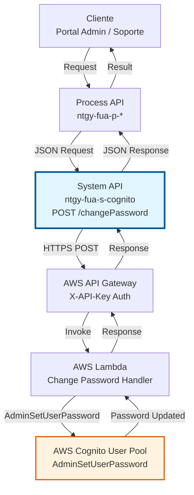
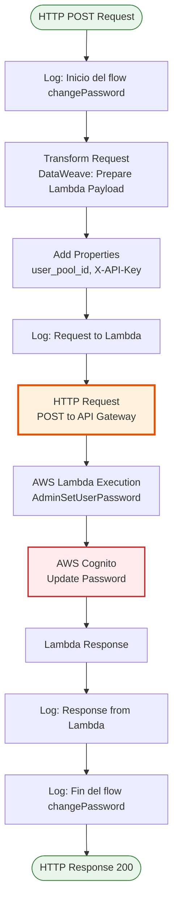
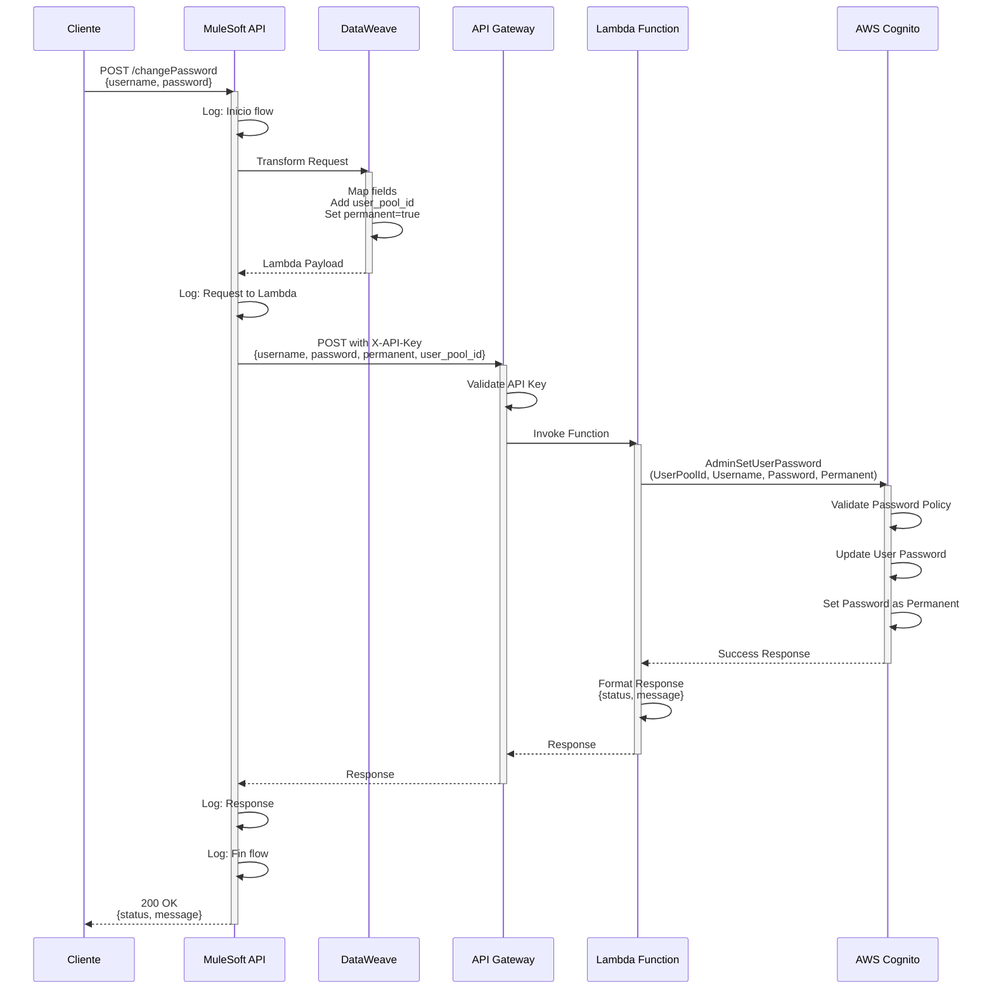

# POST /changePassword

## 📌 Descripción General

### Propósito del Endpoint

El endpoint **POST /changePassword** permite cambiar la contraseña de un usuario en AWS Cognito de forma administrativa, sin requerir la contraseña anterior. Utiliza la operación `AdminSetUserPassword` de AWS Cognito para establecer una nueva contraseña de forma permanente.

El endpoint soporta:
- **Cambio Administrativo**: Establecimiento de contraseña sin autenticación del usuario
- **Contraseña Permanente**: La nueva contraseña no requiere cambio en el primer login
- **Validación Automática**: Cognito valida automáticamente la política de contraseñas
- **Gestión de Credenciales**: Permite a administradores gestionar accesos de usuarios

### Tipo de API

**Capa:** System API (API-Led Connectivity)

**Función:** Integración directa con AWS Cognito User Pools vía API Gateway y Lambda para gestión administrativa de contraseñas.

### Patrón de Integración

**Tipo:** Request-Reply Síncrono con AWS Cognito

**Descripción:** El endpoint recibe username y nueva contraseña, transforma los datos al formato requerido por Lambda, invoca la operación AdminSetUserPassword a través de API Gateway, y retorna el resultado de la operación.

### Arquitectura API-Led Connectivity



---

## 💼 Propósito del Negocio

### Casos de Uso Principales

1. **Restablecimiento de Contraseña por Administrador**
   - Usuario olvidó su contraseña y contacta soporte
   - Administrador establece contraseña temporal
   - Usuario puede acceder inmediatamente con nueva contraseña

2. **Recuperación de Acceso**
   - Usuario bloqueado por múltiples intentos fallidos
   - Soporte técnico restablece contraseña
   - Usuario recupera acceso a su cuenta

3. **Gestión de Credenciales Corporativas**
   - Cambio de contraseña por políticas de seguridad
   - Rotación periódica de credenciales
   - Cumplimiento de normativas de seguridad

### Contexto Empresarial

- **Dominio:** Gestión de Identidad y Acceso (IAM)
- **Sector:** Energía - Utilities
- **División:** Naturgy España - Front Único de Atención (FUA)
- **Proceso de Negocio:** Gestión de usuarios y autenticación
- **Servicio Cloud:** AWS Cognito User Pools

### Stakeholders

- **Usuarios Finales**: Clientes de Naturgy que necesitan restablecer contraseña
- **Equipo de Soporte**: Personal que gestiona incidencias de acceso
- **Administradores de Sistema**: Responsables de gestión de usuarios
- **Equipo de Seguridad**: Encargados de políticas de contraseñas

### Valor de Negocio

- **Reducción de Tiempo de Resolución**: Cambio inmediato de contraseña sin procesos manuales
- **Mejora en Experiencia de Usuario**: Recuperación rápida de acceso
- **Cumplimiento de Seguridad**: Aplicación automática de políticas de contraseñas
- **Eficiencia Operativa**: Automatización de gestión de credenciales

### Consumidores Potenciales

Este endpoint puede ser consumido por:
- Process APIs de gestión de usuarios
- Portales de administración y soporte
- Sistemas de help desk y ticketing
- Aplicaciones de autoservicio con permisos administrativos

---

## 🔧 Especificación Técnica

### URLs por Ambiente

| Ambiente | URL Base | URL Completa |
|----------|----------|--------------|
| **Local** | `http://localhost:8081` | `http://localhost:8081/api/changePassword` |
| **Development** | `https://ntgy-fua-s-cognito-dev.us-e2.cloudhub.io` | `https://ntgy-fua-s-cognito-dev.us-e2.cloudhub.io/api/changePassword` |
| **UAT** | `https://ntgy-fua-s-cognito-uat.us-e2.cloudhub.io` | `https://ntgy-fua-s-cognito-uat.us-e2.cloudhub.io/api/changePassword` |
| **Production** | `https://ntgy-fua-s-cognito-pro.us-e2.cloudhub.io` | `https://ntgy-fua-s-cognito-pro.us-e2.cloudhub.io/api/changePassword` |

### Método HTTP

```
POST /api/changePassword
```

### Parámetros de Entrada

#### Headers HTTP

| Header | Tipo | Requerido | Descripción | Ejemplo |
|--------|------|-----------|-------------|---------|
| `Content-Type` | string | ✅ Sí | Tipo de contenido del request | `application/json` |
| `Accept` | string | ❌ No | Tipo de contenido esperado en response | `application/json` |

#### Body Parameters

| Campo | Tipo | Requerido | Descripción | Ejemplo |
|-------|------|-----------|-------------|---------|
| `username` | string | ✅ Sí | Nombre de usuario en AWS Cognito | `"user@example.com"` |
| `password` | string | ✅ Sí | Nueva contraseña (debe cumplir política de Cognito) | `"NewP@ssw0rd123"` |

**Política de Contraseñas AWS Cognito:**
- Mínimo 8 caracteres
- Al menos una letra mayúscula
- Al menos una letra minúscula
- Al menos un número
- Al menos un carácter especial

### Respuestas

#### Respuesta Exitosa (200 OK)

```json
{
  "status": "success",
  "message": "Password changed successfully"
}
```

#### Respuesta de Error - Contraseña Inválida (200 OK)

```json
{
  "status": "error",
  "message": "Password does not conform to policy: Password must have uppercase characters"
}
```

#### Respuesta de Error - Usuario No Encontrado (200 OK)

```json
{
  "status": "error",
  "message": "User does not exist"
}
```

#### Respuesta de Error Técnico (400/500)

```json
{
  "result": {
    "codResult": "0001",
    "msgResult": "Error interno del servidor"
  }
}
```

### Autenticación y Autorización

- **Tipo:** Client ID & Client Secret (Anypoint Platform)
- **AWS API Gateway:** X-API-Key header
- **Permisos AWS Cognito:** El Lambda debe tener permisos IAM para:
  - `cognito-idp:AdminSetUserPassword`
  - Acceso al User Pool específico

### Timeouts

| Tipo | Valor | Descripción |
|------|-------|-------------|
| **Request Timeout** | 30 segundos | Tiempo máximo de espera para la respuesta de AWS |
| **Connection Timeout** | 30 segundos | Tiempo máximo para establecer conexión con API Gateway |

---

## 🏗️ Implementación Técnica

### Arquitectura del Flow



### Componentes del Flow

#### 1. Logger - Inicio del Flow
```xml
<logger level="INFO" message="Inicio del flow changePassword" doc:name="Inicio" />
```
- Registra el inicio de la ejecución del flow
- Nivel INFO para trazabilidad

#### 2. DataWeave Transformation - Preparar Request Lambda
```dataweave
%dw 2.0
output application/json
---
{
    "username": payload.username,
    "password": payload.password,
    "permanent": true,
    "user_pool_id": p('cognito.userPoolId')
}
```
- Transforma request JSON a formato Lambda
- Inyecta `user_pool_id` desde properties seguras
- Establece `permanent: true` para contraseña permanente

#### 3. HTTP Request - Invocación a API Gateway
```xml
<http:request 
    method="POST" 
    config-ref="HTTP_Cognito" 
    path="${cognito.path.changepassword}">
    <http:headers>
        <![CDATA[#[output application/java
        ---
        {
            "X-API-Key" : p('cognito.apikey')
        }]]]>
    </http:headers>
</http:request>
```
- Invoca API Gateway con método POST
- Añade header X-API-Key para autenticación
- Path configurado por ambiente

#### 4. Logger - Response
```xml
<logger level="INFO" message="#[%dw 2.0 output application/json --- payload]" />
```
- Registra respuesta de Lambda
- Formato JSON para análisis

#### 5. Logger - Fin del Flow
```xml
<logger level="INFO" message="Fin del flow changePassword" doc:name="Fin" />
```
- Marca finalización exitosa del flow

### Diagrama de Secuencia Detallado



### Transformación de Datos

#### Input Transformation (Request → Lambda)

**Entrada (JSON):**
```json
{
  "username": "user@example.com",
  "password": "NewP@ssw0rd123"
}
```

**Salida (Lambda Payload):**
```json
{
  "username": "user@example.com",
  "password": "NewP@ssw0rd123",
  "permanent": true,
  "user_pool_id": "us-east-1_XXXXXXXXX"
}
```

**Mapeo de Campos:**
- `username` → `username` (pass-through)
- `password` → `password` (pass-through)
- `permanent` → `true` (hardcoded, contraseña permanente)
- `user_pool_id` → Inyectado desde `p('cognito.userPoolId')`

#### Output Transformation (Lambda → Response)

**Entrada (Lambda Response):**
```json
{
  "status": "success",
  "message": "Password changed successfully"
}
```

**Salida (API Response):**
```json
{
  "status": "success",
  "message": "Password changed successfully"
}
```

**Nota:** La respuesta de Lambda se retorna directamente sin transformación adicional.

### Configuración por Ambiente

#### Properties Requeridas

```yaml
cognito:
  host: "api-gateway-url.execute-api.us-east-1.amazonaws.com"
  path:
    globalpath: "/prod"
    changepassword: "/changepassword"
  userPoolId: "us-east-1_XXXXXXXXX"
  apikey: "secure-api-key"
  timeout: "30000"
```

#### HTTP Request Configuration

```xml
<http:request-config name="HTTP_Cognito" basePath="${cognito.path.globalpath}">
  <http:request-connection 
    host="${cognito.host}" 
    connectionIdleTimeout="${cognito.timeout}" 
    protocol="HTTPS"/>
</http:request-config>
```

### Manejo de Errores

#### Errores de AWS Cognito

| Error | Causa | Respuesta |
|-------|-------|-----------|
| `UserNotFoundException` | Usuario no existe en User Pool | `{status: "error", message: "User does not exist"}` |
| `InvalidPasswordException` | Contraseña no cumple política | `{status: "error", message: "Password does not conform to policy"}` |
| `InvalidParameterException` | Parámetros inválidos | `{status: "error", message: "Invalid parameters"}` |
| `TooManyRequestsException` | Rate limit excedido | `{status: "error", message: "Too many requests"}` |

#### Errores HTTP

| Error | Causa | Código HTTP |
|-------|-------|-------------|
| `HTTP:TIMEOUT` | Timeout de 30 segundos excedido | 500 |
| `HTTP:CONNECTIVITY` | No se puede conectar a API Gateway | 500 |
| `APIKIT:BAD_REQUEST` | Request malformado | 400 |

---

## 💻 Ejemplos de Uso

### Ejemplo 1: Cambio de Contraseña Exitoso

#### Request

```bash
curl -X POST "https://ntgy-fua-s-cognito-dev.us-e2.cloudhub.io/api/changePassword" \
  -H "Content-Type: application/json" \
  -H "client_id: your-client-id" \
  -H "client_secret: your-client-secret" \
  -d '{
    "username": "user@example.com",
    "password": "NewP@ssw0rd123"
  }'
```

#### Response (200 OK)

```json
{
  "status": "success",
  "message": "Password changed successfully"
}
```

### Ejemplo 2: Error - Contraseña No Cumple Política

#### Request

```bash
curl -X POST "https://ntgy-fua-s-cognito-dev.us-e2.cloudhub.io/api/changePassword" \
  -H "Content-Type: application/json" \
  -H "client_id: your-client-id" \
  -H "client_secret: your-client-secret" \
  -d '{
    "username": "user@example.com",
    "password": "weak"
  }'
```

#### Response (200 OK)

```json
{
  "status": "error",
  "message": "Password does not conform to policy: Password not long enough"
}
```

### Ejemplo 3: Error - Usuario No Encontrado

#### Request

```bash
curl -X POST "https://ntgy-fua-s-cognito-dev.us-e2.cloudhub.io/api/changePassword" \
  -H "Content-Type: application/json" \
  -H "client_id: your-client-id" \
  -H "client_secret: your-client-secret" \
  -d '{
    "username": "nonexistent@example.com",
    "password": "NewP@ssw0rd123"
  }'
```

#### Response (200 OK)

```json
{
  "status": "error",
  "message": "User does not exist"
}
```

### Ejemplo 4: Uso desde JavaScript/TypeScript

```typescript
async function changeUserPassword(username: string, newPassword: string) {
  const response = await fetch(
    'https://ntgy-fua-s-cognito-dev.us-e2.cloudhub.io/api/changePassword',
    {
      method: 'POST',
      headers: {
        'Content-Type': 'application/json',
        'client_id': 'your-client-id',
        'client_secret': 'your-client-secret'
      },
      body: JSON.stringify({
        username: username,
        password: newPassword
      })
    }
  );

  const data = await response.json();
  
  if (data.status === 'success') {
    console.log('Password changed successfully');
    return true;
  } else {
    console.error('Error changing password:', data.message);
    return false;
  }
}

// Uso
changeUserPassword('user@example.com', 'NewP@ssw0rd123');
```

### Ejemplo 5: Uso desde Python

```python
import requests
import json

def change_user_password(username: str, new_password: str) -> dict:
    url = "https://ntgy-fua-s-cognito-dev.us-e2.cloudhub.io/api/changePassword"
    
    headers = {
        "Content-Type": "application/json",
        "client_id": "your-client-id",
        "client_secret": "your-client-secret"
    }
    
    payload = {
        "username": username,
        "password": new_password
    }
    
    response = requests.post(url, headers=headers, json=payload)
    return response.json()

# Uso
result = change_user_password("user@example.com", "NewP@ssw0rd123")
print(f"Status: {result['status']}")
print(f"Message: {result['message']}")
```

### Consideraciones de Seguridad

1. **Nunca Loguear Contraseñas**: Las contraseñas nunca se registran en logs
2. **HTTPS Obligatorio**: Todas las comunicaciones deben usar HTTPS
3. **Validación de Política**: AWS Cognito valida automáticamente la política de contraseñas
4. **Contraseña Permanente**: La contraseña se establece como permanente (no requiere cambio en primer login)
5. **Permisos Administrativos**: Solo usuarios con permisos administrativos deben poder invocar este endpoint
6. **Rotación de API Keys**: Rotar periódicamente las API keys de API Gateway
