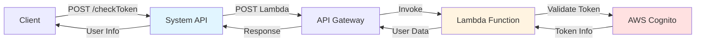
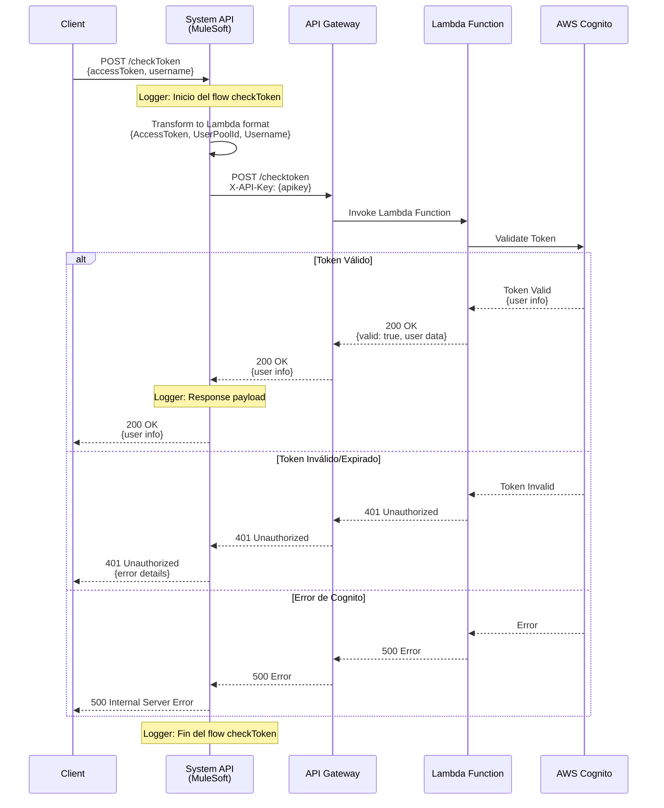
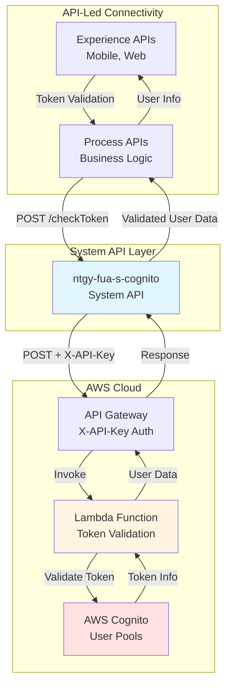
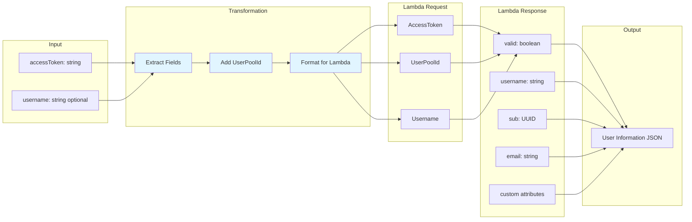

# POST /checkToken

## 📌 Descripción General

### Tipo de API
**System API** - Capa de integración directa con AWS Cognito User Pools vía Lambda

### Patrón de Integración
**Request-Reply Síncrono** con validación de token mediante Lambda

### Arquitectura



**Flujo de datos:**
1. Cliente envía accessToken y username opcional
2. System API transforma datos al formato Lambda
3. Invoca API Gateway con X-API-Key
4. Lambda valida token contra Cognito
5. Cognito verifica validez y expiración
6. Lambda retorna información del usuario
7. System API transforma y retorna respuesta

### Backend
- **Servicio**: AWS Cognito User Pools
- **Integración**: API Gateway + Lambda
- **Método HTTP**: POST
- **Autenticación**: X-API-Key (API Gateway)
- **Protocolo**: HTTPS

---

### Propósito
Validar tokens de acceso JWT emitidos por AWS Cognito y obtener información del usuario autenticado, permitiendo verificar sesiones activas y autorizar operaciones en aplicaciones.

### Casos de Uso

#### 1. Validación de Sesión Activa
**Escenario**: Una aplicación web necesita verificar si el usuario sigue autenticado antes de mostrar contenido protegido.

**Flujo**:
1. Usuario accede a página protegida
2. Aplicación envía accessToken almacenado
3. Sistema valida token contra Cognito vía Lambda
4. Si válido, muestra contenido; si no, redirige a login

**Beneficio**: Seguridad mejorada y experiencia de usuario fluida

#### 2. Middleware de Autenticación
**Escenario**: API Gateway necesita validar tokens antes de permitir acceso a endpoints protegidos.

**Flujo**:
1. Request llega con token
2. Middleware extrae token
3. Valida token con /checkToken
4. Si válido, permite acceso; si no, retorna 401

**Beneficio**: Centralización de validación de autenticación

#### 3. Verificación Pre-Operación
**Escenario**: Antes de ejecutar operación sensible, verificar autenticación.

**Flujo**:
1. Usuario intenta operación sensible
2. Sistema valida token actual
3. Si válido y no expirado, permite operación
4. Si expirado, solicita re-autenticación

**Beneficio**: Seguridad adicional en operaciones críticas

### Stakeholders
- **Usuarios Finales**: Clientes de Naturgy que usan portales y apps
- **Desarrolladores**: Equipos que implementan autenticación
- **Seguridad**: Equipo que gestiona políticas de autenticación
- **Operaciones**: Equipo que monitorea sesiones y accesos

---

## 🔧 Especificación Técnica

### Endpoint
```
POST /checkToken
```

### Headers
```http
Content-Type: application/json
```

### Request Body

```json
{
  "accessToken": "eyJraWQiOiJxxx...xxxxx",
  "username": "user@example.com"
}
```

#### Parámetros

| Campo | Tipo | Requerido | Descripción |
|-------|------|-----------|-------------|
| `accessToken` | string | ✅ Sí | Token JWT de acceso emitido por Cognito durante login |
| `username` | string | ❌ No | Username opcional para validación adicional |

**Validaciones**:
- `accessToken`: Debe ser un JWT válido (mínimo 100 caracteres)
- `username`: Si se proporciona, debe coincidir con el usuario del token

### Response Body

#### Respuesta Exitosa (200 OK)

```json
{
  "valid": true,
  "username": "user@example.com",
  "sub": "a1b2c3d4-e5f6-7890-abcd-ef1234567890",
  "email": "user@example.com",
  "email_verified": true,
  "custom:confirmedUser": "true"
}
```

#### Campos de Respuesta

| Campo | Tipo | Descripción |
|-------|------|-------------|
| `valid` | boolean | Indica si el token es válido |
| `username` | string | Nombre de usuario en Cognito |
| `sub` | string | Subject identifier único del usuario (UUID) |
| `email` | string | Email del usuario |
| `email_verified` | boolean | Indica si el email está verificado |
| `custom:confirmedUser` | string | Atributo custom de confirmación |

#### Respuesta de Error (401 Unauthorized)

```json
{
  "error": {
    "code": "NotAuthorizedException",
    "message": "Invalid or expired token"
  }
}
```

#### Respuesta de Error (500 Internal Server Error)

```json
{
  "error": {
    "code": "InternalErrorException",
    "message": "Internal server error"
  }
}
```

### Códigos de Estado HTTP

| Código | Descripción | Cuándo Ocurre |
|--------|-------------|---------------|
| 200 | OK | Token válido, información del usuario retornada |
| 401 | Unauthorized | Token inválido, expirado o malformado |
| 500 | Internal Server Error | Error en AWS Cognito, Lambda o System API |

---

## 🏗️ Implementación Técnica

### Diagrama de Secuencia



### Diagrama de Arquitectura



### Diagrama de Transformación de Datos



### Flow MuleSoft

**Archivo**: `s-cognito.xml`

**Flow Name**: `post:\checkToken:application\json:s-cognito-config`

**Componentes**:

1. **HTTP Listener** (APIKit Router)
   - Recibe POST request en `/checkToken`
   - Valida request contra RAML spec

2. **Logger - Inicio**
   ```xml
   <logger level="INFO" message="post:\checkToken:application\json:s-cognito-config" />
   ```

3. **Transform Message - Prepare Lambda Request**
   ```dataweave
   %dw 2.0
   output application/json
   ---
   {
     "AccessToken": payload.accessToken,
     "UserPoolId": p('cognito.userPoolId'),
     "Username": payload.username
   }
   ```
   - Extrae accessToken y username del body
   - Inyecta UserPoolId desde properties
   - Prepara formato esperado por Lambda

4. **HTTP Request - API Gateway**
   ```xml
   <http:request 
       method="POST" 
       config-ref="HTTP_Cognito" 
       path="${cognito.path.checktoken}">
       <http:headers>
           <![CDATA[#[output application/java
           ---
           {
               "X-API-Key": p('cognito.apikey')
           }]]]>
       </http:headers>
   </http:request>
   ```
   - Invoca API Gateway con método POST
   - Incluye X-API-Key para autenticación
   - Path configurado en properties
   - Timeout: 30 segundos

5. **Logger - Response**
   ```xml
   <logger level="INFO" doc:name="Logger" />
   ```

### Configuración

**Properties** (`s-cognito-{env}-config.yaml`):

```yaml
cognito:
  host: "{api-gateway-url}.execute-api.{region}.amazonaws.com"
  path:
    globalpath: "/prod"
    checktoken: "/checktoken"
  userPoolId: "{user-pool-id}"
  apikey: "{api-key}"
  timeout: "30000"
```

**Ejemplo de configuración por ambiente**:
- **Dev**: `https://abc123.execute-api.us-east-1.amazonaws.com/dev/checktoken`
- **UAT**: `https://def456.execute-api.us-east-1.amazonaws.com/uat/checktoken`
- **Prod**: `https://ghi789.execute-api.us-east-1.amazonaws.com/prod/checktoken`

### Manejo de Errores

#### Error: Token Expirado
```json
{
  "error": {
    "code": "NotAuthorizedException",
    "message": "Access token has expired"
  }
}
```
**Solución**: Cliente debe obtener nuevo token con /login o refresh token

#### Error: Token Inválido
```json
{
  "error": {
    "code": "NotAuthorizedException",
    "message": "Invalid access token"
  }
}
```
**Solución**: Verificar que el token sea correcto y pertenezca al User Pool

#### Error: Username No Coincide
```json
{
  "error": {
    "code": "InvalidParameterException",
    "message": "Username does not match token"
  }
}
```
**Solución**: Verificar que el username proporcionado coincida con el del token

### Consideraciones de Performance

- **Response Time**: < 3 segundos (p95)
- **Timeout**: 30 segundos configurado
- **Caching**: No se cachea (tokens pueden expirar)
- **Rate Limiting**: Limitado por AWS API Gateway y Cognito

### Consideraciones de Seguridad

1. **Token en HTTPS**: Siempre transmitir tokens sobre HTTPS
2. **No Logging de Tokens**: Tokens no se loguean en producción
3. **Validación en Cognito**: Validación criptográfica del JWT
4. **Expiración**: Tokens expiran automáticamente (típicamente 1 hora)
5. **API Key Rotation**: Rotar X-API-Key cada 90 días

---

## 💻 Ejemplos de Uso

### Ejemplo 1: Validación de Token Válido

#### Request
```bash
curl -X POST https://ntgy-fua-s-cognito-dev.us-e2.cloudhub.io/api/checkToken \
  -H "Content-Type: application/json" \
  -d '{
    "accessToken": "eyJraWQiOiJxNzVGR1wvXC9cL0pqQnhcL0RcL0pqQnhcL0RcL0pqQnhcL0RcL0pqQnhcL0RcL0pqQnhcL0RcL0pqQnhcL0RcL0pqQnhcL0RcL0pqQnhcL0RcL0pqQnhcL0RcL0pqQnhcL0RcL0pqQnhcL0RcL0pqQnhcL0RcL0pqQnhcL0RcL0pqQnhcL0RcL0pqQnhcL0RcL0pqQnhcL0RcL0pqQnhcL0RcL0pqQnhcL0RcL0pqQnhcL0RcL0pqQnhcL0RcL0pqQnhcL0RcL0pqQnhcL0RcL0pqQnhcL0RcL0pqQnhcL0RcL0pqQnhcL0RcL0pqQnhcL0RcL0pqQnhcL0RcL0pqQnhcL0RcL0pqQnhcL0RcL0pqQnhcL0RcL0pqQnhcL0RcL0pqQnhcL0RcL0pqQnhcL0RcL0pqQnhcL0RcL0pqQnhcL0RcL0pqQnhcL0RcL0pqQnhcL0RcL0pqQnhcL0RcL0pqQnhcL0RcL0pqQnhcL0RcL0pqQnhcL0RcL0pqQnhcL0RcL0pqQnhcL0RcL0pqQnhcL0RcL0pqQnhcL0RcL0pqQnhcL0RcL0pqQnhcL0RcL0pqQnhcL0RcL0pqQnhcL0RcL0pqQnhcL0RcL0pqQnhcL0RcL0pqQnhcL0RcL0pqQnhcL0RcL0pqQnhcL0RcL0pqQnhcL0RcL0pqQnhcL0RcL0pqQnhcL0RcL0pqQnhcL0RcL0pqQnhcL0RcL0pqQnhcL0RcL0pqQnhcL0RcL0pqQnhcL0RcL0pqQnhcL0RcL0pqQnhcL0RcL0pqQnhcL0RcL0pqQnhcL0RcL0pqQnhcL0RcL0pqQnhcL0RcL0pqQnhcL0RcL0pqQnhcL0RcL0pqQnhcL0RcL0pqQnhcL0RcL0pqQnhcL0RcL0pqQnhcL0RcL0pqQnhcL0RcL0pqQnhcL0RcL0pqQnhcL0RcL0pqQnhcL0RcL0pqQnhcL0RcL0pqQnhcL0RcL0pqQnhcL0RcL0pqQnhcL0RcL0pqQnhcL0RcL0pqQnhcL0RcL0pqQnhcL0RcL0pqQnhcL0RcL0pqQnhcL0RcL0pqQnhcL0RcL0pqQnhcL0RcL0pqQnhcL0RcL0pqQnhcL0RcL0pqQnhcL0RcL0pqQnhcL0RcL0pqQnhcL0RcL0pqQnhcL0RcL0pqQnhcL0RcL0pqQnhcL0RcL0pqQnhcL0RcL0pqQnhcL0RcL0pqQnhcL0RcL0pqQnhcL0RcL0pqQnhcL0RcL0pqQnhcL0RcL0pqQnhcL0RcL0pqQnhcL0RcL0pqQnhcL0RcL0pqQnhcL0RcL0pqQnhcL0RcL0pqQnhcL0RcL0pqQnhcL0RcL0pqQnhcL0RcL0pqQnhcL0RcL0pqQnhcL0RcL0pqQnhcL0RcL0pqQnhcL0RcL0pqQnhcL0RcL0pqQnhcL0RcL0pqQnhcL0RcL0pqQnhcL0RcL0pqQnhcL0RcL0pqQnhcL0RcL0pqQnhcL0RcL0pqQnhcL0RcL0pqQnhcL0RcL0pqQnhcL0RcL0pqQnhcL0RcL0pqQnhcL0RcL0pqQnhcL0RcL0pqQnhcL0RcL0pqQnhcL0RcL0pqQnhcL0RcL0pqQnhcL0RcL0pqQnhcL0RcL0pqQnhcL0RcL0pqQnhcL0RcL0pqQnhcL0RcL0pqQnhcL0RcL0pqQnhcL0RcL0pqQnhcL0RcL0pqQnhcL0RcL0pqQnhcL0RcL0pqQnhcL0RcL0pqQnhcL0RcL0pqQnhcL0RcL0pqQnhcL0RcL0pqQnhcL0RcL0pqQnhcL0RcL0pqQnhcL0RcL0pqQnhcL0RcL0pqQnhcL0RcL0pqQnhcL0RcL0pqQnhcL0RcL0pqQnhcL0RcL0pqQnhcL0RcL0pqQnhcL0RcL0pqQnhcL0RcL0pqQnhcL0RcL0pqQnhcL0RcL0pqQnhcL0RcL0pqQnhcL0RcL0pqQnhcL0RcL0pqQnhcL0RcL0pqQnhcL0RcL0pqQnhcL0RcL0pqQnhcL0RcL0pqQnhcL0RcL0pqQnhcL0RcL0pqQnhcL0RcL0pqQnhcL0RcL0pqQnhcL0RcL0pqQnhcL0RcL0pqQnhcL0RcL0pqQnhcL0RcL0pqQnhcL0RcL0pqQnhcL0RcL0pqQnhcL0RcL0pqQnhcL0RcL0pqQnhcL0RcL0pqQnhcL0RcL0pqQnhcL0RcL0pqQnhcL0RcL0pqQnhcL0RcL0pqQnhcL0RcL0pqQnhcL0RcL0pqQnhcL0RcL0pqQnhcL0RcL0pqQnhcL0RcL0pqQnhcL0RcL0pqQnhcL0RcL0pqQnhcL0RcL0pqQnhcL0RcL0pqQnhcL0RcL0pqQnhcL0RcL0pqQ