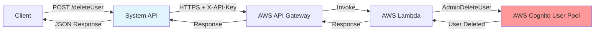
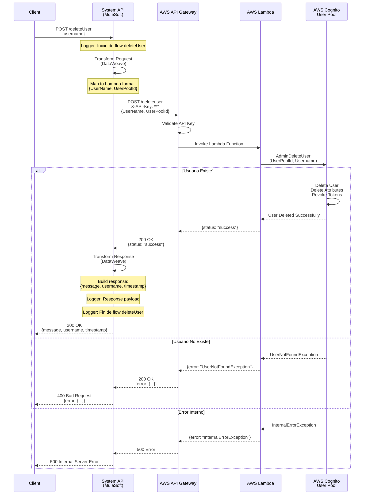
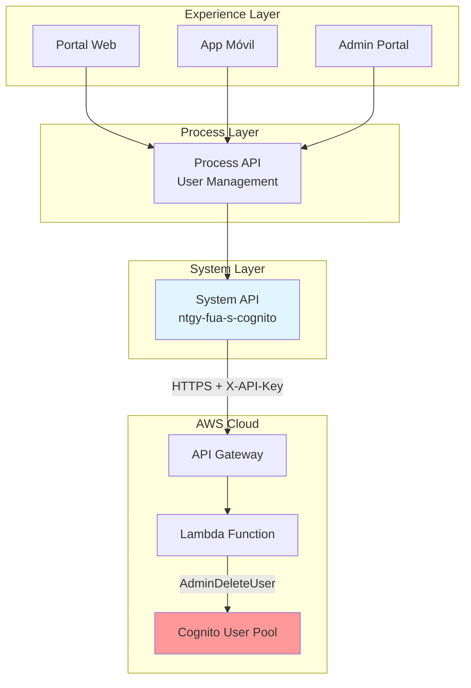
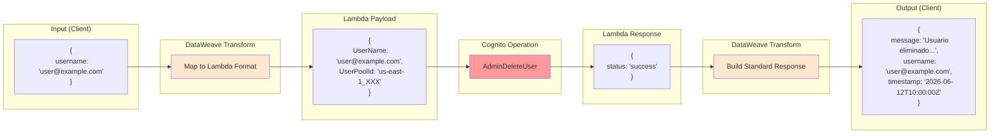

# POST /deleteUser

## 📌 Descripción General

### Tipo de API
**System API** - Capa de integración directa con AWS Cognito User Pools

### Patrón de Integración
**Request-Reply Síncrono** con backend AWS Cognito a través de API Gateway y Lambda

### Arquitectura



### Propósito

Endpoint de System API que elimina permanentemente un usuario de AWS Cognito User Pool mediante la operación administrativa `AdminDeleteUser`. Esta operación es **irreversible** y borra completamente el usuario y todos sus datos asociados, incluyendo atributos, tokens activos y configuración de sesión.

**⚠️ ADVERTENCIA CRÍTICA:** Esta operación es permanente e irreversible. Una vez eliminado, el usuario no puede ser recuperado.

---

## 💼 Propósito del Negocio

### Problema que Resuelve

1. **Cumplimiento GDPR (Derecho al Olvido)**
   - Permite a los usuarios ejercer su derecho a ser olvidados
   - Elimina permanentemente todos los datos personales del usuario
   - Cumple con regulaciones de protección de datos

2. **Gestión del Ciclo de Vida de Usuarios**
   - Cierre de cuentas por solicitud del usuario
   - Eliminación de usuarios inactivos o duplicados
   - Limpieza de cuentas de prueba en ambientes no productivos

3. **Seguridad y Prevención de Fraude**
   - Eliminación inmediata de cuentas fraudulentas
   - Bloqueo permanente de usuarios maliciosos
   - Gestión de incidentes de seguridad

4. **Gestión Administrativa**
   - Limpieza de usuarios de prueba
   - Eliminación de cuentas duplicadas
   - Gestión de usuarios por soporte técnico

### Casos de Uso

#### Caso de Uso 1: Solicitud de Eliminación de Cuenta (GDPR)
```
Actor: Usuario final
Trigger: Usuario solicita eliminar su cuenta
Flujo:
1. Usuario solicita eliminación de cuenta en portal web
2. Portal web envía request a Process API
3. Process API valida identidad y autorización
4. Process API invoca System API /deleteUser
5. System API elimina usuario de Cognito
6. Usuario recibe confirmación de eliminación
Resultado: Cuenta eliminada permanentemente, cumplimiento GDPR
```

#### Caso de Uso 2: Eliminación de Cuenta Fraudulenta
```
Actor: Administrador de seguridad
Trigger: Detección de actividad fraudulenta
Flujo:
1. Sistema de seguridad detecta actividad sospechosa
2. Administrador revisa y confirma fraude
3. Administrador invoca /deleteUser desde herramienta admin
4. System API elimina usuario inmediatamente
5. Tokens activos son revocados
6. Usuario no puede volver a autenticarse
Resultado: Cuenta fraudulenta eliminada, riesgo mitigado
```

#### Caso de Uso 3: Limpieza de Usuarios de Prueba
```
Actor: Equipo de QA
Trigger: Finalización de ciclo de testing
Flujo:
1. QA identifica usuarios de prueba a eliminar
2. Script automatizado invoca /deleteUser para cada usuario
3. System API elimina usuarios en lote
4. Ambiente queda limpio para siguiente ciclo
Resultado: Ambiente de prueba limpio y optimizado
```

### Stakeholders

- **Usuarios Finales**: Ejercen derecho al olvido (GDPR)
- **Equipo de Soporte**: Gestiona eliminación de cuentas por solicitud
- **Equipo de Seguridad**: Elimina cuentas fraudulentas o comprometidas
- **Equipo de Compliance**: Asegura cumplimiento de GDPR
- **Equipo de QA**: Limpia usuarios de prueba

### Beneficios de Negocio

- ✅ **Cumplimiento Legal**: Cumple con GDPR y regulaciones de protección de datos
- ✅ **Seguridad Mejorada**: Eliminación rápida de cuentas comprometidas
- ✅ **Gestión Eficiente**: Automatización de eliminación de usuarios
- ✅ **Reducción de Costos**: Limpieza de usuarios inactivos reduce costos de almacenamiento
- ✅ **Auditoría**: Trazabilidad completa de eliminaciones

---

## 🔧 Especificación Técnica

### Endpoint

```
POST /deleteUser
```

### Headers

| Header | Tipo | Requerido | Descripción |
|--------|------|-----------|-------------|
| `Content-Type` | string | ✅ Sí | Debe ser `application/json` |
| `X-API-Key` | string | ✅ Sí | API Key para autenticación con API Gateway (configurado en properties) |

### Request Body

#### Estructura

```json
{
  "username": "string"
}
```

#### Parámetros

| Campo | Tipo | Requerido | Descripción | Ejemplo |
|-------|------|-----------|-------------|---------|
| `username` | string | ✅ Sí | Nombre de usuario a eliminar del User Pool | `"user@example.com"` |

#### Validaciones

- `username`: 
  - Requerido
  - Longitud mínima: 1 carácter
  - Longitud máxima: 128 caracteres
  - Debe existir en el User Pool
  - Puede estar en cualquier estado (CONFIRMED, UNCONFIRMED, etc.)

### Response

#### Response Exitoso (200 OK)

```json
{
  "message": "Usuario eliminado exitosamente",
  "username": "user@example.com",
  "timestamp": "2026-06-12T10:00:00Z"
}
```

| Campo | Tipo | Descripción |
|-------|------|-------------|
| `message` | string | Mensaje de confirmación de la operación |
| `username` | string | Username del usuario eliminado |
| `timestamp` | datetime | Timestamp de la operación en formato ISO 8601 |

#### Response de Error (400 Bad Request)

```json
{
  "error": {
    "code": "UserNotFoundException",
    "message": "User does not exist"
  }
}
```

#### Response de Error (500 Internal Server Error)

```json
{
  "error": {
    "code": "InternalErrorException",
    "message": "Internal server error"
  }
}
```

### Códigos de Estado HTTP

| Código | Descripción | Cuándo Ocurre |
|--------|-------------|---------------|
| 200 | OK | Usuario eliminado exitosamente |
| 400 | Bad Request | Username no existe o request inválido |
| 500 | Internal Server Error | Error en AWS Cognito o Lambda |

### Errores Comunes de AWS Cognito

| Código de Error | Descripción | Solución |
|-----------------|-------------|----------|
| `UserNotFoundException` | Usuario no existe en el User Pool | Verificar que el username sea correcto |
| `InvalidParameterException` | Parámetros inválidos | Verificar formato del username |
| `TooManyRequestsException` | Rate limit excedido | Implementar retry con backoff |
| `InternalErrorException` | Error interno de AWS | Reintentar la operación |

---

## 🏗️ Implementación Técnica

### Diagrama de Secuencia Detallado



### Diagrama de Arquitectura de Capas



### Diagrama de Transformación de Datos



### Componentes Técnicos

#### 1. HTTP Listener
```xml
<http:listener-config name="HTTP_Listener_config">
  <http:listener-connection host="0.0.0.0" port="8081" />
</http:listener-config>
```

#### 2. Flow Principal
```xml
<flow name="post:\deleteUser:application\json:s-cognito-config">
  <!-- Logger de inicio -->
  <logger level="INFO" message="Inicio de flow deleteUser" />
  
  <!-- Transformación de request -->
  <ee:transform doc:name="Transform Message">
    <ee:message>
      <ee:set-payload><![CDATA[%dw 2.0
output application/json
---
{
  "UserName": payload.username,
  "UserPoolId": p('cognito.userPoolId')
}]]></ee:set-payload>
    </ee:message>
    <ee:variables>
      <ee:set-variable variableName="username"><![CDATA[%dw 2.0
output application/json
---
payload.username]]></ee:set-variable>
    </ee:variables>
  </ee:transform>
  
  <!-- Llamada a API Gateway -->
  <http:request method="POST" 
                config-ref="HTTP_Cognito" 
                path="${cognito.path.deleteuser}">
    <http:headers><![CDATA[#[output application/java
---
{
  "X-API-Key" : p('cognito.apikey')
}]]]></http:headers>
  </http:request>
  
  <!-- Transformación de response -->
  <ee:transform doc:name="Transform Message">
    <ee:message>
      <ee:set-payload><![CDATA[%dw 2.0
output application/json
---
{
  "message": "Usuario eliminado exitosamente",
  "username": vars.username,
  "timestamp": now()
}]]></ee:set-payload>
    </ee:message>
  </ee:transform>
  
  <!-- Logger de response -->
  <logger level="INFO" message="#[%dw 2.0 output application/json --- payload]" />
  
  <!-- Logger de fin -->
  <logger level="INFO" message="Fin de flow deleteUser" />
</flow>
```

#### 3. Configuración HTTP Request
```xml
<http:request-config name="HTTP_Cognito" 
                     basePath="${cognito.path.globalpath}">
  <http:request-connection 
    host="${cognito.host}" 
    connectionIdleTimeout="${cognito.timeout}" 
    protocol="HTTPS"/>
</http:request-config>
```

### Transformaciones DataWeave

#### Request Transformation
```dataweave
%dw 2.0
output application/json
---
{
  "UserName": payload.username,
  "UserPoolId": p('cognito.userPoolId')
}
```

**Propósito:** Transforma el request del cliente al formato esperado por la Lambda de AWS.

**Mapeo de Campos:**
- `username` (input) → `UserName` (Lambda)
- Inyecta `UserPoolId` desde properties seguras

#### Response Transformation
```dataweave
%dw 2.0
output application/json
---
{
  "message": "Usuario eliminado exitosamente",
  "username": vars.username,
  "timestamp": now()
}
```

**Propósito:** Construye una respuesta estandarizada con confirmación de eliminación.

**Campos Generados:**
- `message`: Mensaje de confirmación fijo
- `username`: Recuperado de variable de flow
- `timestamp`: Timestamp actual de la operación

### Propiedades de Configuración

#### Propiedades por Ambiente

```yaml
cognito:
  host: "api-gateway-url.execute-api.us-east-1.amazonaws.com"
  path:
    globalpath: "/prod"
    deleteuser: "/deleteuser"
  userPoolId: "us-east-1_XXXXXXXXX"
  apikey: "secure-api-key"
  timeout: "30000"
```

| Propiedad | Descripción | Ejemplo |
|-----------|-------------|---------|
| `cognito.host` | URL del API Gateway | `api-gateway.execute-api.us-east-1.amazonaws.com` |
| `cognito.path.globalpath` | Base path del API Gateway | `/prod` |
| `cognito.path.deleteuser` | Path específico del endpoint | `/deleteuser` |
| `cognito.userPoolId` | ID del User Pool de Cognito | `us-east-1_XXXXXXXXX` |
| `cognito.apikey` | API Key para autenticación | `***` (secure property) |
| `cognito.timeout` | Timeout de conexión (ms) | `30000` |

### Manejo de Errores

#### Error Handlers de APIKit
```xml
<apikit:mapping statusCode="400">
  <apikit:exception value="APIKIT:BAD_REQUEST" />
  <ee:transform>
    <ee:message>
      <ee:set-payload><![CDATA[%dw 2.0
output application/json
---
{
  message: "Bad request"
}]]></ee:set-payload>
    </ee:message>
  </ee:transform>
</apikit:mapping>
```

#### Errores de AWS Cognito
Los errores de Cognito se retornan en el payload con status 200:
```json
{
  "error": {
    "code": "UserNotFoundException",
    "message": "User does not exist"
  }
}
```

### Logging

#### Patrón de Logging
```
1. Logger: "Inicio de flow deleteUser" (INFO)
2. [Transformación y llamada a AWS]
3. Logger: Response payload (INFO)
4. Logger: "Fin de flow deleteUser" (INFO)
```

#### Información Loggeada
- ✅ Inicio y fin del flow
- ✅ Response payload completo
- ❌ NO se loggea el username por privacidad
- ❌ NO se loggea el API Key

### Seguridad

#### Autenticación
- **API Gateway**: X-API-Key header
- **Secure Properties**: API Key encriptada en Anypoint Platform
- **HTTPS**: Todas las comunicaciones encriptadas

#### Autorización
- Operación requiere permisos administrativos
- Lambda tiene rol IAM con permiso `cognito-idp:AdminDeleteUser`
- Scope limitado al User Pool específico

#### Auditoría
- Todos los logs se centralizan en Anypoint Platform
- CloudWatch logs en AWS para trazabilidad
- Recomendación: Implementar auditoría adicional para eliminaciones

### Performance

#### Métricas Esperadas
- **Response Time**: < 3 segundos (p95)
- **Timeout**: 30 segundos
- **Throughput**: > 100 requests/segundo

#### Optimizaciones
- Connection pooling habilitado
- Keep-alive para reutilización de conexiones
- Timeout configurado para evitar bloqueos

---

## 💻 Ejemplos de Uso

### Ejemplo 1: Eliminación Exitosa

#### Request
```bash
curl -X POST "https://ntgy-fua-s-cognito-dev.us-e2.cloudhub.io/api/deleteUser" \
  -H "Content-Type: application/json" \
  -H "X-API-Key: your-api-key" \
  -d '{
    "username": "user@example.com"
  }'
```

#### Response (200 OK)
```json
{
  "message": "Usuario eliminado exitosamente",
  "username": "user@example.com",
  "timestamp": "2026-06-12T10:00:00.000Z"
}
```

### Ejemplo 2: Usuario No Encontrado

#### Request
```bash
curl -X POST "https://ntgy-fua-s-cognito-dev.us-e2.cloudhub.io/api/deleteUser" \
  -H "Content-Type: application/json" \
  -H "X-API-Key: your-api-key" \
  -d '{
    "username": "nonexistent@example.com"
  }'
```

#### Response (400 Bad Request)
```json
{
  "error": {
    "code": "UserNotFoundException",
    "message": "User does not exist"
  }
}
```

### Ejemplo 3: Request con Postman

#### Configuración
```
Method: POST
URL: https://ntgy-fua-s-cognito-dev.us-e2.cloudhub.io/api/deleteUser

Headers:
  Content-Type: application/json
  X-API-Key: your-api-key-here

Body (raw JSON):
{
  "username": "testuser@example.com"
}
```

### Ejemplo 4: Integración desde JavaScript

```javascript
const deleteUser = async (username) => {
  try {
    const response = await fetch('https://ntgy-fua-s-cognito-dev.us-e2.cloudhub.io/api/deleteUser', {
      method: 'POST',
      headers: {
        'Content-Type': 'application/json',
        'X-API-Key': 'your-api-key'
      },
      body: JSON.stringify({ username })
    });

    const data = await response.json();
    
    if (response.ok) {
      console.log('Usuario eliminado:', data.message);
      console.log('Username:', data.username);
      console.log('Timestamp:', data.timestamp);
      return data;
    } else {
      console.error('Error al eliminar usuario:', data.error);
      throw new Error(data.error.message);
    }
  } catch (error) {
    console.error('Error de red:', error);
    throw error;
  }
};

// Uso
deleteUser('user@example.com')
  .then(result => console.log('Eliminación exitosa:', result))
  .catch(error => console.error('Error:', error));
```

### Ejemplo 5: Integración desde Python

```python
import requests
import json
from datetime import datetime

def delete_user(username):
    """
    Elimina un usuario de AWS Cognito
    
    Args:
        username (str): Username del usuario a eliminar
        
    Returns:
        dict: Response con confirmación de eliminación
        
    Raises:
        Exception: Si ocurre un error en la eliminación
    """
    url = "https://ntgy-fua-s-cognito-dev.us-e2.cloudhub.io/api/deleteUser"
    headers = {
        "Content-Type": "application/json",
        "X-API-Key": "your-api-key"
    }
    payload = {
        "username": username
    }
    
    try:
        response = requests.post(url, headers=headers, json=payload)
        response.raise_for_status()
        
        data = response.json()
        print(f"✅ Usuario eliminado: {data['username']}")
        print(f"📅 Timestamp: {data['timestamp']}")
        
        return data
        
    except requests.exceptions.HTTPError as e:
        error_data = response.json()
        print(f"❌ Error: {error_data.get('error', {}).get('message', 'Unknown error')}")
        raise Exception(f"Error al eliminar usuario: {e}")
    except Exception as e:
        print(f"❌ Error de conexión: {str(e)}")
        raise

# Uso
try:
    result = delete_user("user@example.com")
    print("Eliminación completada:", result)
except Exception as e:
    print("Error en la operación:", e)
```

### Ejemplo 6: Script de Limpieza Masiva

```python
import requests
import json
import time

def bulk_delete_users(usernames, api_key):
    """
    Elimina múltiples usuarios en lote
    
    Args:
        usernames (list): Lista de usernames a eliminar
        api_key (str): API Key para autenticación
        
    Returns:
        dict: Resumen de eliminaciones exitosas y fallidas
    """
    url = "https://ntgy-fua-s-cognito-dev.us-e2.cloudhub.io/api/deleteUser"
    headers = {
        "Content-Type": "application/json",
        "X-API-Key": api_key
    }
    
    results = {
        "successful": [],
        "failed": []
    }
    
    for username in usernames:
        try:
            response = requests.post(
                url, 
                headers=headers, 
                json={"username": username}
            )
            
            if response.status_code == 200:
                data = response.json()
                if "error" not in data:
                    results["successful"].append(username)
                    print(f"✅ Eliminado: {username}")
                else:
                    results["failed"].append({
                        "username": username,
                        "error": data["error"]["message"]
                    })
                    print(f"❌ Error en {username}: {data['error']['message']}")
            else:
                results["failed"].append({
                    "username": username,
                    "error": f"HTTP {response.status_code}"
                })
                print(f"❌ Error HTTP en {username}: {response.status_code}")
            
            # Pausa para evitar rate limiting
            time.sleep(0.5)
            
        except Exception as e:
            results["failed"].append({
                "username": username,
                "error": str(e)
            })
            print(f"❌ Excepción en {username}: {str(e)}")
    
    return results

# Uso
test_users = [
    "testuser1@example.com",
    "testuser2@example.com",
    "testuser3@example.com"
]

results = bulk_delete_users(test_users, "your-api-key")
print(f"\n📊 Resumen:")
print(f"✅ Exitosos: {len(results['successful'])}")
print(f"❌ Fallidos: {len(results['failed'])}")
```

### Ejemplo 7: Error de Rate Limiting

#### Request
```bash
# Múltiples requests rápidos pueden causar rate limiting
for i in {1..100}; do
  curl -X POST "https://ntgy-fua-s-cognito-dev.us-e2.cloudhub.io/api/deleteUser" \
    -H "Content-Type: application/json" \
    -H "X-API-Key: your-api-key" \
    -d "{\"username\": \"user$i@example.com\"}"
done
```

#### Response (429 Too Many Requests)
```json
{
  "error": {
    "code": "TooManyRequestsException",
    "message": "Rate exceeded"
  }
}
```

**Solución:** Implementar retry con exponential backoff:
```python
import time
import random

def delete_user_with_retry(username, max_retries=3):
    for attempt in range(max_retries):
        try:
            response = requests.post(url, headers=headers, json={"username": username})
            
            if response.status_code == 429:
                # Exponential backoff
                wait_time = (2 ** attempt) + random.uniform(0, 1)
                print(f"Rate limit alcanzado. Esperando {wait_time:.2f}s...")
                time.sleep(wait_time)
                continue
            
            return response.json()
            
        except Exception as e:
            if attempt == max_retries - 1:
                raise
            time.sleep(2 ** attempt)
    
    raise Exception("Max retries alcanzado")
```

---

## 📋 Notas Adicionales

### Consideraciones de GDPR

Este endpoint es crítico para el cumplimiento de GDPR (Reglamento General de Protección de Datos):

1. **Derecho al Olvido (Art. 17 GDPR)**
   - Los usuarios tienen derecho a solicitar la eliminación de sus datos personales
   - La eliminación debe ser completa y permanente
   - Debe completarse en un plazo razonable (típicamente 30 días)

2. **Documentación de Eliminaciones**
   - Mantener registro de solicitudes de eliminación
   - Documentar fecha y hora de eliminación
   - Conservar evidencia de cumplimiento (sin datos personales)

3. **Excepciones Legales**
   - Verificar si existen obligaciones legales de retención de datos
   - Considerar períodos de retención por regulaciones específicas
   - Documentar razones si no se puede eliminar inmediatamente

### Mejores Prácticas

1. **Antes de Eliminar**
   - ✅ Verificar identidad del solicitante
   - ✅ Confirmar autorización para eliminar
   - ✅ Notificar al usuario sobre la irreversibilidad
   - ✅ Ofrecer alternativa de desactivación temporal
   - ✅ Realizar backup si es necesario para auditoría

2. **Durante la Eliminación**
   - ✅ Loggear la operación con timestamp
   - ✅ Capturar username y contexto de la solicitud
   - ✅ Verificar eliminación exitosa
   - ✅ Manejar errores apropiadamente

3. **Después de Eliminar**
   - ✅ Confirmar eliminación al solicitante
   - ✅ Verificar que tokens fueron revocados
   - ✅ Actualizar sistemas dependientes si es necesario
   - ✅ Mantener registro de auditoría (sin datos personales)

### Limitaciones Conocidas

1. **No hay Rollback**
   - La operación es irreversible
   - No existe forma de recuperar el usuario eliminado
   - Considerar implementar "soft delete" en capa superior si se requiere

2. **Eliminación Inmediata**
   - No hay período de gracia
   - El usuario no puede autenticarse inmediatamente después
   - Tokens activos son revocados instantáneamente

3. **Sin Validación de Dependencias**
   - El endpoint no verifica si el usuario tiene datos en otros sistemas
   - La aplicación debe manejar limpieza de datos relacionados
   - Considerar implementar proceso de eliminación en cascada

### Recomendaciones de Seguridad

1. **Control de Acceso**
   - Restringir acceso solo a administradores autorizados
   - Implementar autenticación de dos factores para operaciones de eliminación
   - Auditar todas las eliminaciones

2. **Validación Adicional**
   - Implementar confirmación de dos pasos
   - Requerir razón de eliminación
   - Validar que el solicitante tiene autorización

3. **Monitoreo**
   - Alertar sobre eliminaciones masivas
   - Detectar patrones anómalos
   - Revisar logs regularmente

### Troubleshooting

#### Problema: Usuario no se elimina

**Síntomas:**
- Response 200 OK pero usuario sigue existiendo
- Error "UserNotFoundException" en operaciones posteriores

**Causas Posibles:**
1. Usuario ya fue eliminado previamente
2. Problema de sincronización con Cognito
3. Error en Lambda function

**Solución:**
1. Verificar logs de CloudWatch
2. Confirmar que el username es correcto
3. Verificar permisos de Lambda
4. Reintentar la operación

#### Problema: Rate Limiting

**Síntomas:**
- Error "TooManyRequestsException"
- Múltiples eliminaciones fallan

**Solución:**
1. Implementar exponential backoff
2. Reducir frecuencia de requests
3. Considerar procesamiento por lotes con delays

#### Problema: Timeout

**Síntomas:**
- Request tarda más de 30 segundos
- Error de timeout

**Solución:**
1. Verificar conectividad con AWS
2. Revisar estado de API Gateway
3. Verificar logs de Lambda
4. Reintentar la operación

---

## 🔗 Endpoints Relacionados

| Endpoint | Propósito | Relación |
|----------|-----------|----------|
| `POST /signupUser` | Crear usuario | Operación inversa - crea usuarios |
| `POST /getUser` | Consultar usuario | Verificar existencia antes de eliminar |
| `POST /updateUser` | Actualizar usuario | Alternativa a eliminación (desactivar) |
| `POST /logout` | Cerrar sesión | Revocar tokens antes de eliminar |

---

**⚠️ ADVERTENCIA FINAL:** Este endpoint realiza una eliminación permanente e irreversible. Asegúrese de tener procesos de validación y autorización adecuados antes de invocar esta operación. Se recomienda implementar confirmación de dos pasos y auditoría completa de todas las eliminaciones.
