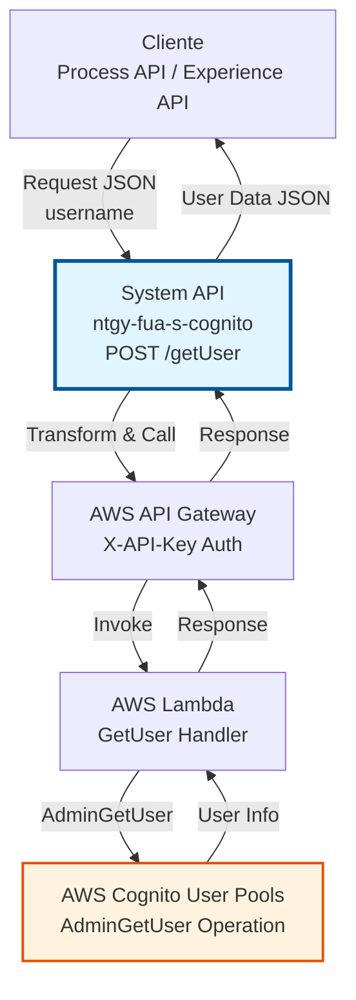
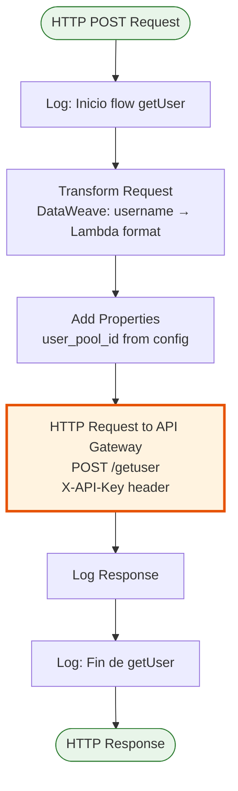
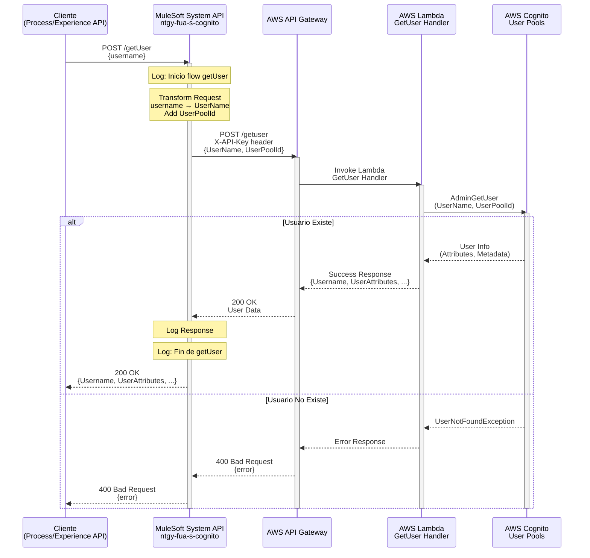
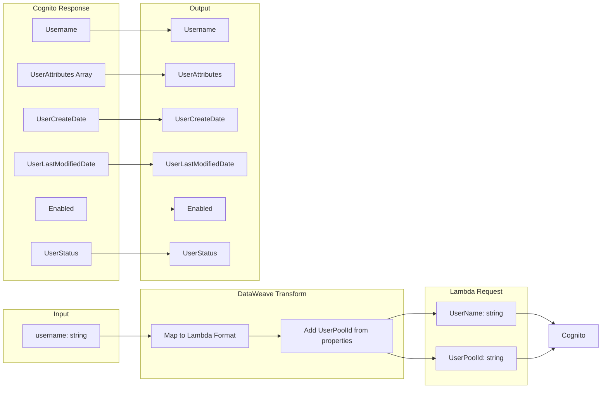

# POST /getUser

## 📌 Descripción General

### Propósito del Endpoint

Obtiene información detallada de un usuario desde AWS Cognito User Pool mediante una operación administrativa. Este endpoint permite consultar todos los atributos de un usuario (estándar y custom), su estado, fechas de creación y modificación, sin requerir autenticación del usuario objetivo.

El endpoint soporta:
- **Consulta Administrativa**: Obtención de información sin autenticación del usuario
- **Atributos Completos**: Retorna todos los atributos estándar y custom configurados
- **Metadata del Usuario**: Incluye fechas de creación, modificación y estado
- **Validación de Existencia**: Verifica que el usuario exista en el User Pool

### Tipo de API

**Capa:** System API (API-Led Connectivity)

**Función:** Integración directa con AWS Cognito User Pools a través de API Gateway y Lambda para consulta administrativa de usuarios.

### Patrón de Integración

**Tipo:** Request-Reply Síncrono con AWS Cognito AdminGetUser

**Descripción:** Recibe el username del usuario a consultar, transforma los datos al formato esperado por Lambda, invoca la operación AdminGetUser de AWS Cognito a través de API Gateway, y retorna la información completa del usuario incluyendo todos sus atributos y metadata.

### Arquitectura API-Led Connectivity



---

## 💼 Propósito del Negocio

### Casos de Uso Principales

1. **Consulta de Perfil de Usuario**
   - Administradores necesitan ver información completa de un usuario
   - Obtención de atributos para validación de datos
   - Verificación de estado de cuenta de usuario

2. **Soporte Técnico**
   - Agentes de soporte consultan información para resolver incidencias
   - Verificación de configuración de atributos custom
   - Validación de estado de confirmación de usuario

3. **Procesos de Negocio**
   - Obtención de atributos para flujos de onboarding
   - Validación de información antes de operaciones críticas
   - Sincronización de datos con otros sistemas

4. **Auditoría y Compliance**
   - Verificación de información de usuario para auditorías
   - Validación de fechas de creación y modificación
   - Comprobación de estado de habilitación

### Contexto Empresarial

- **Dominio:** Gestión de Identidad y Acceso (IAM)
- **Sector:** Energía - Utilities
- **División:** Naturgy España - Front Único de Atención (FUA)
- **Proceso de Negocio:** Consulta y validación de información de usuarios
- **Sistema Backend:** AWS Cognito User Pools

### Stakeholders

- **Administradores de Sistema**: Necesitan consultar información completa de usuarios para gestión
- **Agentes de Soporte**: Requieren acceso a información de usuario para resolver incidencias
- **Equipos de Desarrollo**: Utilizan el endpoint para validar datos en flujos de integración
- **Equipos de Auditoría**: Consultan información para verificación de compliance

### Valor de Negocio

- **Visibilidad Completa**: Acceso a toda la información del usuario en un solo endpoint
- **Soporte Eficiente**: Permite resolver incidencias rápidamente con información completa
- **Validación de Datos**: Facilita verificación de información antes de operaciones críticas
- **Auditoría**: Proporciona información necesaria para procesos de compliance

### Consumidores Potenciales

Este endpoint puede ser consumido por:
- Process APIs de gestión de usuarios
- Portales de administración web
- Sistemas de soporte técnico
- Flujos de validación de datos
- Procesos de auditoría y compliance

---

## 🔧 Especificación Técnica

### URLs por Ambiente

| Ambiente | URL Base | URL Completa |
|----------|----------|--------------|
| **Local** | `http://localhost:8081` | `http://localhost:8081/api/getUser` |
| **Development** | `https://ntgy-fua-s-cognito-dev.us-e2.cloudhub.io` | `https://ntgy-fua-s-cognito-dev.us-e2.cloudhub.io/api/getUser` |
| **UAT** | `https://ntgy-fua-s-cognito-uat.us-e2.cloudhub.io` | `https://ntgy-fua-s-cognito-uat.us-e2.cloudhub.io/api/getUser` |
| **Production** | `https://ntgy-fua-s-cognito-pro.us-e2.cloudhub.io` | `https://ntgy-fua-s-cognito-pro.us-e2.cloudhub.io/api/getUser` |

### Método HTTP

```
POST /api/getUser
```

### Parámetros de Entrada

#### Headers HTTP

| Header | Tipo | Requerido | Descripción | Ejemplo |
|--------|------|-----------|-------------|---------|
| `Content-Type` | string | ✅ Sí | Tipo de contenido del request | `application/json` |
| `Accept` | string | ❌ No | Tipo de contenido esperado en response | `application/json` |

#### Body Parameters

| Campo | Tipo | Requerido | Descripción | Ejemplo |
|-------|------|-----------|-------------|---------|
| `username` | string | ✅ Sí | Nombre de usuario en AWS Cognito User Pool | `"usuario@example.com"` |

**Estructura del Request:**

```json
{
  "username": "usuario@example.com"
}
```

### Respuestas

#### Respuesta Exitosa (200 OK)

```json
{
  "Username": "usuario@example.com",
  "UserAttributes": [
    {
      "Name": "sub",
      "Value": "12345678-1234-1234-1234-123456789012"
    },
    {
      "Name": "email",
      "Value": "usuario@example.com"
    },
    {
      "Name": "email_verified",
      "Value": "true"
    },
    {
      "Name": "phone_number",
      "Value": "+34600123456"
    },
    {
      "Name": "phone_number_verified",
      "Value": "false"
    },
    {
      "Name": "name",
      "Value": "Juan Pérez"
    },
    {
      "Name": "custom:confirmedUser",
      "Value": "true"
    },
    {
      "Name": "custom:role",
      "Value": "customer"
    }
  ],
  "UserCreateDate": "2024-01-15T10:30:00Z",
  "UserLastModifiedDate": "2024-06-12T08:00:00Z",
  "Enabled": true,
  "UserStatus": "CONFIRMED"
}
```

**Campos de la Respuesta:**

| Campo | Tipo | Descripción |
|-------|------|-------------|
| `Username` | string | Nombre de usuario en Cognito |
| `UserAttributes` | array | Lista de atributos del usuario (estándar y custom) |
| `UserAttributes[].Name` | string | Nombre del atributo |
| `UserAttributes[].Value` | string | Valor del atributo |
| `UserCreateDate` | string | Fecha de creación del usuario (ISO 8601) |
| `UserLastModifiedDate` | string | Fecha de última modificación (ISO 8601) |
| `Enabled` | boolean | Indica si el usuario está habilitado |
| `UserStatus` | string | Estado del usuario (CONFIRMED, UNCONFIRMED, etc.) |

**Atributos Estándar Comunes:**
- `sub`: ID único del usuario en Cognito
- `email`: Dirección de correo electrónico
- `email_verified`: Indica si el email está verificado
- `phone_number`: Número de teléfono (formato E.164)
- `phone_number_verified`: Indica si el teléfono está verificado
- `name`: Nombre completo del usuario
- `family_name`: Apellido
- `given_name`: Nombre de pila

**Atributos Custom del Proyecto:**
- `custom:confirmedUser`: Indica si el usuario está confirmado en el sistema
- `custom:role`: Rol del usuario en la aplicación
- `custom:clientHR`: Identificador de cliente HR

#### Respuesta de Error - Usuario No Encontrado (400 Bad Request)

```json
{
  "error": {
    "code": "UserNotFoundException",
    "message": "User does not exist"
  }
}
```

#### Respuesta de Error - Parámetros Inválidos (400 Bad Request)

```json
{
  "error": {
    "code": "InvalidParameterException",
    "message": "Username is required"
  }
}
```

#### Respuesta de Error Técnico (500 Internal Server Error)

```json
{
  "error": {
    "code": "InternalErrorException",
    "message": "Internal server error"
  }
}
```

### Códigos de Estado HTTP

| Código | Descripción | Cuándo Ocurre |
|--------|-------------|---------------|
| `200` | OK | Usuario encontrado y información retornada exitosamente |
| `400` | Bad Request | Username no proporcionado o usuario no existe |
| `500` | Internal Server Error | Error en AWS Cognito o error interno del servidor |

### Autenticación y Autorización

- **Tipo:** Client ID & Client Secret (Anypoint Platform)
- **Autorización AWS:** El usuario de la aplicación debe tener permisos para:
  - Ejecutar operación `AdminGetUser` en AWS Cognito
  - Acceso al User Pool configurado
  - Permisos IAM adecuados en Lambda

### Timeouts

| Tipo | Valor | Descripción |
|------|-------|-------------|
| **Request Timeout** | 30 segundos | Tiempo máximo de espera para la respuesta de AWS |
| **Connection Timeout** | 30 segundos | Tiempo máximo para establecer conexión con API Gateway |

---

## 🏗️ Implementación Técnica

### Arquitectura del Flow



### Componentes del Flow

#### 1. Logger de Inicio
```xml
<logger level="INFO" message="Inicio flow getUser" doc:name="Inicio" />
```

**Propósito:** Registrar el inicio de la ejecución del flow para trazabilidad.

#### 2. Transformación de Request (DataWeave)

```dataweave
%dw 2.0
output application/json
---
{
    "UserName": payload.username,
    "UserPoolId": p('cognito.userPoolId')
}
```

**Propósito:** Transformar el request JSON de entrada al formato esperado por la Lambda de AWS.

**Mapeo de Campos:**
- `payload.username` → `UserName`: Nombre de usuario a consultar
- `p('cognito.userPoolId')` → `UserPoolId`: ID del User Pool desde properties

#### 3. HTTP Request a API Gateway

```xml
<http:request 
    method="POST" 
    config-ref="HTTP_Cognito" 
    path="${cognito.path.getuser}">
    <http:headers>
        <![CDATA[#[output application/java
        ---
        {
            "X-API-Key" : p('cognito.apikey')
        }]]]>
    </http:headers>
</http:request>
```

**Configuración:**
- **Método:** POST
- **Config:** HTTP_Cognito (configuración global)
- **Path:** `${cognito.path.getuser}` (típicamente `/getuser`)
- **Header:** `X-API-Key` con valor desde properties seguras

**Timeout:** 30 segundos (configurado en HTTP_Cognito)

#### 4. Logger de Response
```xml
<logger level="INFO" message="#[%dw 2.0 output application/json --- payload]" />
```

**Propósito:** Registrar la respuesta de AWS Cognito para debugging y auditoría.

#### 5. Logger de Fin
```xml
<logger level="INFO" message="Fin de getUser" doc:name="Fin" />
```

**Propósito:** Registrar el fin exitoso de la ejecución del flow.

### Diagrama de Secuencia Completo



### Configuración por Ambiente

#### Properties Requeridas

```yaml
cognito:
  host: "api-gateway-url.execute-api.region.amazonaws.com"
  path:
    globalpath: "/prod"
    getuser: "/getuser"
  userPoolId: "region_XXXXXXXXX"
  apikey: "secure-api-key-for-gateway"
  timeout: "30000"
```

#### Archivos de Configuración

| Ambiente | Archivo | Ubicación |
|----------|---------|-----------|
| Local | `s-cognito-local-config.yaml` | `src/main/resources/` |
| Development | `s-cognito-dev-config.yaml` | `src/main/resources/` |
| UAT | `s-cognito-uat-config.yaml` | `src/main/resources/` |
| Production | `s-cognito-pro-config.yaml` | `src/main/resources/` |

### Manejo de Errores

#### Errores de AWS Cognito

| Error | Código | Descripción | Acción |
|-------|--------|-------------|--------|
| UserNotFoundException | 400 | Usuario no existe en el User Pool | Verificar username |
| InvalidParameterException | 400 | Parámetros inválidos o faltantes | Validar request |
| TooManyRequestsException | 429 | Rate limit excedido | Implementar retry con backoff |
| InternalErrorException | 500 | Error interno de AWS Cognito | Reintentar operación |

#### Errores de Conectividad

| Error | Código | Descripción | Acción |
|-------|--------|-------------|--------|
| HTTP:TIMEOUT | 500 | Timeout de 30 segundos excedido | Verificar conectividad con AWS |
| HTTP:CONNECTIVITY | 500 | No se puede conectar a API Gateway | Verificar configuración de host |

### Diagrama de Transformación de Datos



**Transformación de Entrada:**
- `username` (string) → `UserName` (string)
- Inyección de `UserPoolId` desde properties

**Transformación de Salida:**
- Respuesta de Cognito se retorna sin transformación adicional
- Incluye todos los atributos del usuario en formato array

---

## 💻 Ejemplos de Uso

### Ejemplo 1: Consulta Exitosa de Usuario

#### Request

```bash
curl -X POST "https://ntgy-fua-s-cognito-dev.us-e2.cloudhub.io/api/getUser" \
  -H "Content-Type: application/json" \
  -H "Accept: application/json" \
  -d '{
    "username": "juan.perez@naturgy.com"
  }'
```

#### Response (200 OK)

```json
{
  "Username": "juan.perez@naturgy.com",
  "UserAttributes": [
    {
      "Name": "sub",
      "Value": "a1b2c3d4-e5f6-7890-abcd-ef1234567890"
    },
    {
      "Name": "email",
      "Value": "juan.perez@naturgy.com"
    },
    {
      "Name": "email_verified",
      "Value": "true"
    },
    {
      "Name": "phone_number",
      "Value": "+34612345678"
    },
    {
      "Name": "phone_number_verified",
      "Value": "true"
    },
    {
      "Name": "name",
      "Value": "Juan Pérez García"
    },
    {
      "Name": "family_name",
      "Value": "Pérez García"
    },
    {
      "Name": "given_name",
      "Value": "Juan"
    },
    {
      "Name": "custom:confirmedUser",
      "Value": "true"
    },
    {
      "Name": "custom:role",
      "Value": "customer"
    },
    {
      "Name": "custom:clientHR",
      "Value": "CLI001234"
    }
  ],
  "UserCreateDate": "2024-01-15T10:30:00.000Z",
  "UserLastModifiedDate": "2024-06-10T14:25:30.000Z",
  "Enabled": true,
  "UserStatus": "CONFIRMED"
}
```

### Ejemplo 2: Usuario No Encontrado

#### Request

```bash
curl -X POST "https://ntgy-fua-s-cognito-dev.us-e2.cloudhub.io/api/getUser" \
  -H "Content-Type: application/json" \
  -d '{
    "username": "usuario.inexistente@example.com"
  }'
```

#### Response (400 Bad Request)

```json
{
  "error": {
    "code": "UserNotFoundException",
    "message": "User does not exist."
  }
}
```

### Ejemplo 3: Request con Username Vacío

#### Request

```bash
curl -X POST "https://ntgy-fua-s-cognito-dev.us-e2.cloudhub.io/api/getUser" \
  -H "Content-Type: application/json" \
  -d '{
    "username": ""
  }'
```

#### Response (400 Bad Request)

```json
{
  "error": {
    "code": "InvalidParameterException",
    "message": "Username cannot be empty"
  }
}
```

### Ejemplo 4: Error de Conectividad

#### Request

```bash
curl -X POST "https://ntgy-fua-s-cognito-dev.us-e2.cloudhub.io/api/getUser" \
  -H "Content-Type: application/json" \
  -d '{
    "username": "usuario@example.com"
  }'
```

#### Response (500 Internal Server Error)

```json
{
  "error": {
    "code": "InternalErrorException",
    "message": "Unable to connect to AWS Cognito"
  }
}
```

### Ejemplo 5: Uso desde JavaScript/TypeScript

```typescript
interface GetUserRequest {
  username: string;
}

interface UserAttribute {
  Name: string;
  Value: string;
}

interface GetUserResponse {
  Username: string;
  UserAttributes: UserAttribute[];
  UserCreateDate?: string;
  UserLastModifiedDate?: string;
  Enabled?: boolean;
  UserStatus?: string;
}

async function getUserInfo(username: string): Promise<GetUserResponse> {
  const response = await fetch(
    'https://ntgy-fua-s-cognito-dev.us-e2.cloudhub.io/api/getUser',
    {
      method: 'POST',
      headers: {
        'Content-Type': 'application/json',
        'Accept': 'application/json'
      },
      body: JSON.stringify({ username })
    }
  );

  if (!response.ok) {
    const error = await response.json();
    throw new Error(`Error ${response.status}: ${error.error?.message || 'Unknown error'}`);
  }

  return await response.json();
}

// Uso
try {
  const userInfo = await getUserInfo('juan.perez@naturgy.com');
  console.log('Usuario encontrado:', userInfo.Username);
  console.log('Estado:', userInfo.UserStatus);
  
  // Extraer email del usuario
  const emailAttr = userInfo.UserAttributes.find(attr => attr.Name === 'email');
  console.log('Email:', emailAttr?.Value);
  
  // Extraer atributo custom
  const roleAttr = userInfo.UserAttributes.find(attr => attr.Name === 'custom:role');
  console.log('Rol:', roleAttr?.Value);
} catch (error) {
  console.error('Error al obtener usuario:', error);
}
```

### Ejemplo 6: Uso desde Python

```python
import requests
from typing import Dict, List, Optional
from datetime import datetime

class CognitoUserClient:
    def __init__(self, base_url: str):
        self.base_url = base_url
        self.headers = {
            'Content-Type': 'application/json',
            'Accept': 'application/json'
        }
    
    def get_user(self, username: str) -> Dict:
        """
        Obtiene información de un usuario desde AWS Cognito
        
        Args:
            username: Nombre de usuario a consultar
            
        Returns:
            Dict con información del usuario
            
        Raises:
            requests.HTTPError: Si hay error en la petición
        """
        url = f"{self.base_url}/api/getUser"
        payload = {"username": username}
        
        response = requests.post(url, json=payload, headers=self.headers)
        response.raise_for_status()
        
        return response.json()
    
    def get_user_attribute(self, username: str, attribute_name: str) -> Optional[str]:
        """
        Obtiene un atributo específico de un usuario
        
        Args:
            username: Nombre de usuario
            attribute_name: Nombre del atributo a obtener
            
        Returns:
            Valor del atributo o None si no existe
        """
        user_info = self.get_user(username)
        
        for attr in user_info.get('UserAttributes', []):
            if attr['Name'] == attribute_name:
                return attr['Value']
        
        return None

# Uso
client = CognitoUserClient('https://ntgy-fua-s-cognito-dev.us-e2.cloudhub.io')

try:
    # Obtener información completa del usuario
    user_info = client.get_user('juan.perez@naturgy.com')
    print(f"Usuario: {user_info['Username']}")
    print(f"Estado: {user_info['UserStatus']}")
    print(f"Habilitado: {user_info['Enabled']}")
    
    # Obtener atributo específico
    email = client.get_user_attribute('juan.perez@naturgy.com', 'email')
    print(f"Email: {email}")
    
    role = client.get_user_attribute('juan.perez@naturgy.com', 'custom:role')
    print(f"Rol: {role}")
    
except requests.HTTPError as e:
    print(f"Error HTTP: {e.response.status_code}")
    print(f"Detalle: {e.response.json()}")
except Exception as e:
    print(f"Error: {str(e)}")
```

---

## 📊 Consideraciones de Rendimiento

### Tiempos de Respuesta Esperados

| Escenario | Tiempo Esperado | Percentil |
|-----------|-----------------|-----------|
| Usuario existe | < 1 segundo | p50 |
| Usuario existe | < 2 segundos | p95 |
| Usuario existe | < 3 segundos | p99 |
| Usuario no existe | < 500ms | p95 |

### Límites y Cuotas

- **Rate Limit AWS Cognito**: 10 requests/segundo por User Pool (configurable)
- **Timeout MuleSoft**: 30 segundos
- **Tamaño máximo de respuesta**: ~256 KB (límite de Lambda)

### Optimizaciones Recomendadas

1. **Caching**: Implementar cache de respuestas con TTL de 5 minutos
2. **Retry Logic**: Implementar retry con exponential backoff para errores transitorios
3. **Circuit Breaker**: Proteger contra fallos en cascada de AWS

---

## 🔒 Consideraciones de Seguridad

### Datos Sensibles

- **PII (Personally Identifiable Information)**: Email, teléfono, nombre
- **Logging**: No registrar atributos sensibles en logs de producción
- **Auditoría**: Registrar quién consulta información de usuarios

### Permisos Requeridos

El usuario/aplicación que invoca este endpoint debe tener:
- Permisos de lectura en el User Pool de Cognito
- Rol IAM con política `cognito-idp:AdminGetUser`
- Acceso al API Gateway con X-API-Key válida

### Recomendaciones

1. **Principio de Mínimo Privilegio**: Solo otorgar acceso a usuarios/sistemas que realmente lo necesiten
2. **Auditoría**: Implementar logging de todas las consultas de información de usuario
3. **Rate Limiting**: Implementar límites por cliente para prevenir abuso
4. **Encriptación**: Toda comunicación debe ser sobre HTTPS

---

## 🧪 Testing

### Casos de Prueba Recomendados

1. **Happy Path**: Usuario existe y se retorna información completa
2. **Usuario No Existe**: Verificar error UserNotFoundException
3. **Username Vacío**: Verificar validación de parámetros
4. **Username Null**: Verificar manejo de valores nulos
5. **Timeout**: Simular timeout de AWS y verificar manejo
6. **Rate Limit**: Verificar comportamiento al exceder límite de requests

### Datos de Prueba

```json
{
  "test_users": {
    "valid_user": "test.user@naturgy.com",
    "invalid_user": "nonexistent@example.com",
    "empty_username": "",
    "special_chars": "user+test@naturgy.com"
  }
}
```

---

## 📝 Notas Adicionales

### Limitaciones Conocidas

1. **Duplicate user_pool_id**: El código XML tiene una línea duplicada (línea 180-181) que debe corregirse
2. **No Caching**: Actualmente no hay caching implementado, cada request va a AWS
3. **No Retry Logic**: No hay reintentos automáticos para errores transitorios

### Mejoras Futuras

1. Implementar caching con Object Store V2
2. Añadir retry logic con exponential backoff
3. Implementar circuit breaker pattern
4. Añadir métricas de performance
5. Implementar paginación para usuarios con muchos atributos

### Troubleshooting

**Problema**: Usuario existe pero retorna UserNotFoundException
- **Causa**: Username incorrecto o User Pool ID incorrecto
- **Solución**: Verificar username exacto y configuración de User Pool ID

**Problema**: Timeout constante
- **Causa**: Problemas de conectividad con AWS
- **Solución**: Verificar configuración de red y API Gateway URL

**Problema**: Atributos custom no apar
