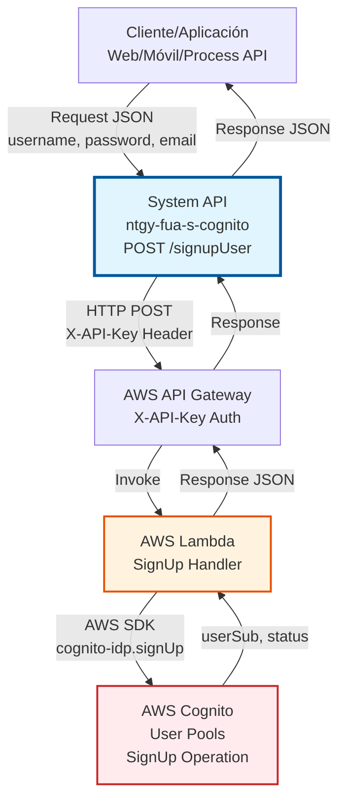
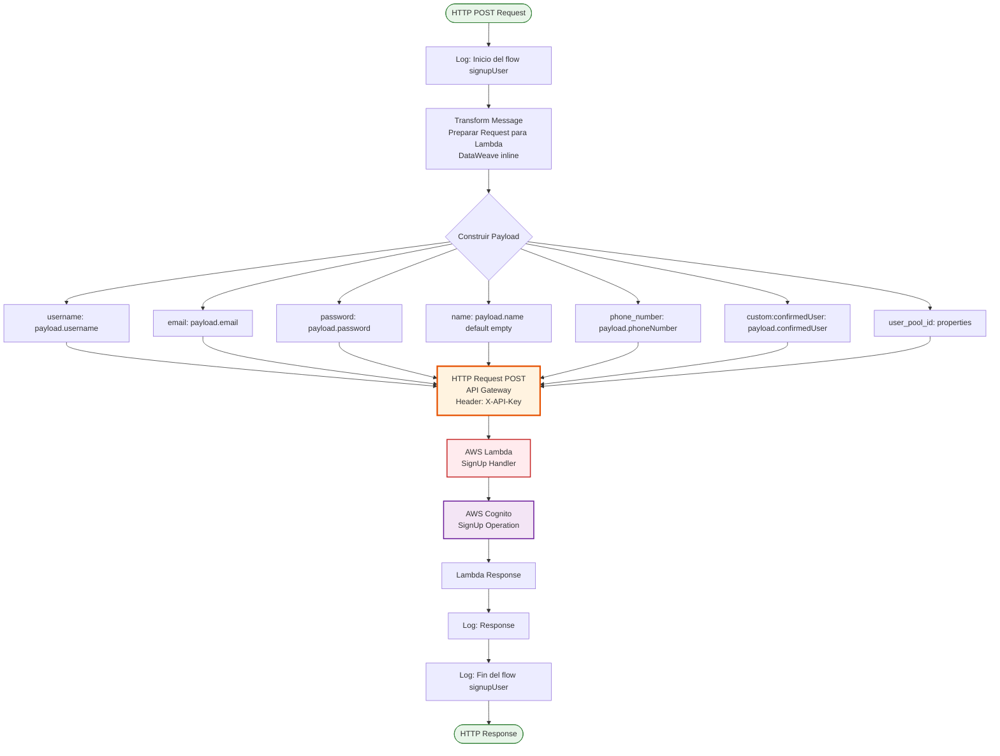
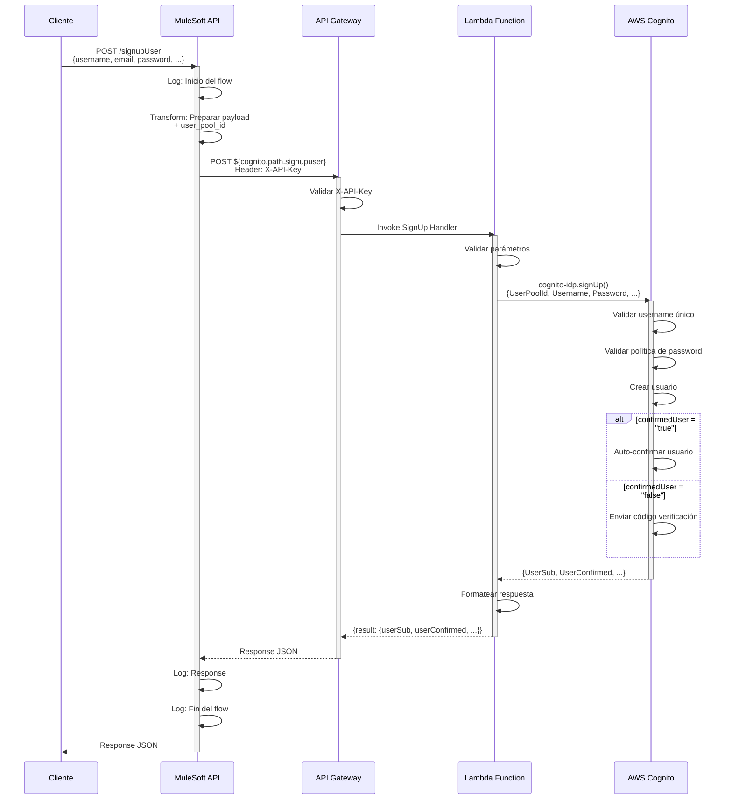
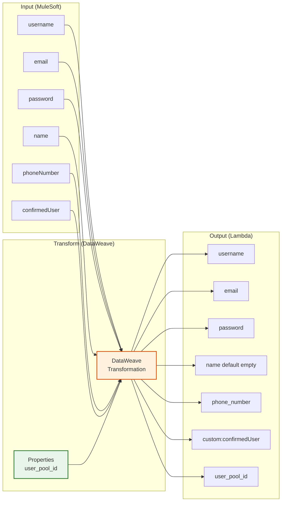

# POST /signupUser

## 📌 Descripción General

### Propósito del Endpoint

Este endpoint permite registrar nuevos usuarios en AWS Cognito User Pool a través de una arquitectura serverless que utiliza API Gateway y Lambda como capa intermedia. Proporciona una interfaz estandarizada para la creación de cuentas de usuario con validación de credenciales, gestión de atributos personalizados y configuración de confirmación automática.

El endpoint soporta:
- **Registro de usuarios**: Creación de nuevas cuentas con username, password y email
- **Atributos personalizados**: Soporte para name, phone_number y custom:confirmedUser
- **Validación de credenciales**: Verificación de políticas de contraseña y unicidad de username
- **Confirmación configurable**: Control de auto-confirmación mediante atributo custom
- **Autenticación segura**: Uso de X-API-Key para autenticación con API Gateway

### Tipo de API

**Capa:** System API (API-Led Connectivity)

**Función:** Integración con AWS Cognito User Pools a través de API Gateway y Lambda para gestión de registro de usuarios.

### Patrón de Integración

**Tipo:** Request-Reply Síncrono con AWS API Gateway + Lambda + Cognito

**Descripción:** El endpoint recibe datos del usuario en formato JSON, los transforma al formato esperado por la Lambda (incluyendo user_pool_id), invoca API Gateway con autenticación X-API-Key, la Lambda procesa la solicitud y llama a AWS Cognito SignUp, y finalmente retorna el resultado con la información del usuario creado o el error correspondiente.

### Arquitectura API-Led Connectivity



---

## 💼 Propósito del Negocio

### Casos de Uso Principales

1. **Registro de Nuevos Clientes en Portales**
   - Usuarios finales crean cuentas en portales web o aplicaciones móviles de Naturgy
   - Se validan credenciales y se almacenan de forma segura en Cognito
   - Beneficio: Onboarding rápido y seguro con gestión centralizada de identidades

2. **Integración con Sistemas de Terceros**
   - Sistemas externos pueden crear usuarios programáticamente vía API
   - Sincronización de usuarios desde CRM o sistemas de gestión
   - Beneficio: Automatización del aprovisionamiento de usuarios

3. **Registro con Auto-Confirmación Configurable**
   - Control de si el usuario requiere confirmación manual o automática
   - Atributo custom `confirmedUser` permite flexibilidad en el flujo
   - Beneficio: Adaptación a diferentes requisitos de seguridad por canal

### Contexto Empresarial

- **Dominio:** Gestión de Identidad y Acceso (IAM)
- **Sector:** Energía - Utilities
- **División:** Naturgy España - FUA (Front Único de Atención)
- **Proceso de Negocio:** Onboarding de usuarios y gestión de identidades
- **Arquitectura:** Serverless (API Gateway + Lambda + Cognito)
- **Servicio Cloud:** AWS Cognito User Pools

### Stakeholders

- **Usuarios Finales**: Clientes que necesitan crear cuentas para acceder a servicios de Naturgy
- **Desarrolladores de Aplicaciones**: Equipos que integran autenticación en portales y apps
- **Equipo de Seguridad**: Responsables de políticas de contraseñas y seguridad de identidades
- **Equipo de Soporte**: Personal que asiste a usuarios con problemas de registro
- **Arquitectos Cloud**: Responsables de la infraestructura serverless en AWS

### Valor de Negocio

- **Seguridad**: Gestión segura de credenciales con AWS Cognito (servicio gestionado)
- **Escalabilidad**: Arquitectura serverless que escala automáticamente sin gestión de infraestructura
- **Cumplimiento**: Cumplimiento de estándares de seguridad (GDPR, ISO 27001)
- **Flexibilidad**: Control de confirmación de usuarios mediante atributos custom
- **Reducción de Costos**: Modelo pay-per-use sin servidores dedicados
- **Mantenibilidad**: Separación de responsabilidades (API → Gateway → Lambda → Cognito)

### Consumidores Potenciales

Este endpoint puede ser consumido por:
- Process APIs de gestión de usuarios
- Portales web de autoservicio (registro de clientes)
- Aplicaciones móviles (iOS, Android)
- Sistemas de integración middleware
- Flujos de Salesforce (Platform Events, Flows)
- APIs de terceros autorizados
- Sistemas de CRM para aprovisionamiento de usuarios

---

## 🔧 Especificación Técnica

### URLs por Ambiente

| Ambiente | URL Base | URL Completa |
|----------|----------|--------------|
| **Local** | `http://localhost:8081` | `http://localhost:8081/api/signupUser` |
| **Development** | `https://ntgy-fua-s-cognito-dev.us-e2.cloudhub.io` | `https://ntgy-fua-s-cognito-dev.us-e2.cloudhub.io/api/signupUser` |
| **UAT** | `https://ntgy-fua-s-cognito-uat.us-e2.cloudhub.io` | `https://ntgy-fua-s-cognito-uat.us-e2.cloudhub.io/api/signupUser` |
| **Production** | `https://ntgy-fua-s-cognito-pro.us-e2.cloudhub.io` | `https://ntgy-fua-s-cognito-pro.us-e2.cloudhub.io/api/signupUser` |

### Método HTTP

```
POST /api/signupUser
```

### Parámetros de Entrada

#### Headers HTTP

| Header | Tipo | Requerido | Descripción | Ejemplo |
|--------|------|-----------|-------------|---------|
| `Content-Type` | string | ✅ Sí | Tipo de contenido del request | `application/json` |
| `Accept` | string | ❌ No | Tipo de contenido esperado en response | `application/json` |

#### Body Parameters

| Campo | Tipo | Requerido | Descripción | Ejemplo |
|-------|------|-----------|-------------|---------|
| `username` | string | ✅ Sí | Nombre de usuario único (1-128 caracteres) | `"usuario123"` |
| `email` | string | ✅ Sí | Email válido del usuario | `"usuario@example.com"` |
| `password` | string | ✅ Sí | Contraseña (mínimo 8 caracteres, mayúsculas, minúsculas, números, especiales) | `"Password123!"` |
| `name` | string \| nil | ❌ No | Nombre completo del usuario | `"Juan Pérez"` |
| `phoneNumber` | string \| nil | ❌ No | Teléfono en formato internacional (+34...) | `"+34600000000"` |
| `confirmedUser` | string | ✅ Sí | Auto-confirmación: "true" o "false" | `"true"` |

### Respuestas

#### Respuesta Exitosa (200 OK)

```json
{
  "result": {
    "userSub": "a1b2c3d4-e5f6-7890-abcd-ef1234567890",
    "userConfirmed": true,
    "username": "usuario123",
    "email": "usuario@example.com"
  }
}
```

**Campos de Respuesta:**

| Campo | Tipo | Descripción |
|-------|------|-------------|
| `result.userSub` | string | UUID único del usuario en Cognito |
| `result.userConfirmed` | boolean | `true` si confirmado, `false` si requiere verificación |
| `result.username` | string | Username del usuario creado |
| `result.email` | string | Email del usuario creado |

#### Respuesta de Error (200 OK con error object)

```json
{
  "error": {
    "code": "UsernameExistsException",
    "message": "El nombre de usuario ya existe"
  }
}
```

#### Respuesta de Error Técnico (400/500)

```json
{
  "result": {
    "codResult": "0001",
    "msgResult": "Error interno del servidor"
  }
}
```

### Códigos de Estado HTTP

| Código | Descripción | Escenario |
|--------|-------------|-----------|
| **200** | OK | Usuario registrado exitosamente o error de negocio controlado |
| **400** | Bad Request | Request malformado o parámetros inválidos |
| **500** | Internal Server Error | Error técnico en el servidor, API Gateway o Lambda |

### Errores Específicos de AWS Cognito

| Error Code | Descripción | Solución |
|------------|-------------|----------|
| `UsernameExistsException` | El username ya está registrado | Usar un username diferente |
| `InvalidPasswordException` | La contraseña no cumple requisitos | Verificar política de contraseñas |
| `InvalidParameterException` | Parámetros inválidos o faltantes | Revisar campos requeridos |
| `CodeDeliveryFailureException` | Error al enviar código de verificación | Verificar email/teléfono válido |
| `TooManyRequestsException` | Demasiadas solicitudes | Implementar retry con backoff |
| `UserPoolNotFoundException` | User Pool no encontrado | Verificar configuración de user_pool_id |

### Autenticación y Autorización

- **Tipo:** Client ID & Client Secret (Anypoint Platform)
- **Autorización AWS:** 
  - API Gateway requiere X-API-Key (configurado en `cognito.apikey`)
  - Lambda utiliza rol IAM con permisos para invocar Cognito
- **Permisos AWS Requeridos (Lambda Role):**
  - `cognito-idp:SignUp`
  - `cognito-idp:AdminConfirmSignUp` (si confirmedUser = "true")
  - Acceso al User Pool específico

### Timeouts

| Tipo | Valor | Descripción |
|------|-------|-------------|
| **Request Timeout** | 30 segundos | Tiempo máximo de espera para la respuesta de API Gateway |
| **Connection Timeout** | Configurado en `cognito.timeout` | Tiempo máximo para establecer conexión con API Gateway |
| **Lambda Timeout** | 30 segundos (típico) | Tiempo máximo de ejecución de la Lambda |

---

## 🏗️ Implementación Técnica

### Arquitectura del Flow



### Componentes del Flow

#### 1. Logger de Inicio
```xml
<logger level="INFO" message="Inicio del flow signupUser" doc:name="Inicio" />
```
- Registra el inicio de la ejecución del flow
- Facilita troubleshooting y auditoría

#### 2. Transformación de Request (DataWeave Inline)

**Código del Flow:**
```dataweave
%dw 2.0
output application/json
---
{
	"username": payload.username,
	"email": payload.email,
	"password": payload.password,
	"name": payload.name default "",
	"phone_number": payload.phoneNumber,
	"custom:confirmedUser": payload.confirmedUser,
	"user_pool_id": p('cognito.userPoolId')  
}
```

**Mapeo de Campos:**

| Campo Entrada | Campo Salida | Transformación | Descripción |
|---------------|--------------|----------------|-------------|
| `username` | `username` | Directo | Username del usuario |
| `email` | `email` | Directo | Email del usuario |
| `password` | `password` | Directo | Contraseña del usuario |
| `name` | `name` | Default "" | Nombre completo (opcional) |
| `phoneNumber` | `phone_number` | Mapeo | Teléfono en formato Cognito |
| `confirmedUser` | `custom:confirmedUser` | Mapeo a custom attribute | Control de auto-confirmación |
| N/A | `user_pool_id` | Desde properties | ID del User Pool de Cognito |

**Lógica Especial:**
- `name` tiene valor por defecto de cadena vacía si no se proporciona
- `custom:confirmedUser` es un atributo custom de Cognito que controla la confirmación automática
- `user_pool_id` se obtiene de las properties del ambiente (`cognito.userPoolId`)

#### 3. Llamada HTTP a API Gateway

**Configuración:**
```xml
<http:request 
  method="POST" 
  config-ref="HTTP_Cognito" 
  path="${cognito.path.signupuser}">
  <http:headers>
    <![CDATA[#[output application/java
    ---
    {
      "X-API-Key" : p('cognito.apikey')
    }]]]>
  </http:headers>
</http:request>
```

**Detalles de Configuración:**

| Configuración | Valor | Descripción |
|---------------|-------|-------------|
| **Config Reference** | `HTTP_Cognito` | Configuración HTTP definida en global.xml |
| **Host** | `${cognito.host}` | Host de API Gateway (desde properties) |
| **Base Path** | `${cognito.path.globalpath}` | Path base de la API |
| **Endpoint Path** | `${cognito.path.signupuser}` | Path específico del endpoint SignUp |
| **Protocol** | HTTPS | Conexión segura |
| **Connection Idle Timeout** | `${cognito.timeout}` | Timeout de conexión |

**Headers Requeridos:**
- `X-API-Key`: API Key para autenticación con API Gateway (desde `cognito.apikey`)

**Configuración HTTP (global.xml):**
```xml
<http:request-config name="HTTP_Cognito" basePath="${cognito.path.globalpath}">
  <http:request-connection 
    host="${cognito.host}" 
    connectionIdleTimeout="${cognito.timeout}" 
    protocol="HTTPS"/>
</http:request-config>
```

#### 4. Procesamiento de Respuesta

**Logger de Response:**
```xml
<logger level="INFO" message="#[%dw 2.0 output application/json --- payload]" />
```
- Registra la respuesta completa de la Lambda
- Útil para debugging y auditoría

**Logger de Fin:**
```xml
<logger level="INFO" message="Fin del flow signupUser" doc:name="Fin" />
```
- Marca el fin exitoso del flow

### Diagrama de Secuencia Detallado



### Transformación de Datos



### Properties de Configuración

**Archivo:** `s-cognito-${env}-config.yaml`

```yaml
cognito:
  host: "api-gateway-url.execute-api.us-east-1.amazonaws.com"
  path:
    globalpath: "/prod"
    signupuser: "/signup"
  userPoolId: "us-east-1_XXXXXXXXX"
  apikey: "your-api-key-here"
  timeout: "30000"
```

**Variables por Ambiente:**

| Variable | Descripción | Ejemplo |
|----------|-------------|---------|
| `cognito.host` | Host de API Gateway | `api-gateway.execute-api.us-east-1.amazonaws.com` |
| `cognito.path.globalpath` | Path base de la API | `/prod` |
| `cognito.path.signupuser` | Path del endpoint SignUp | `/signup` |
| `cognito.userPoolId` | ID del User Pool de Cognito | `us-east-1_XXXXXXXXX` |
| `cognito.apikey` | API Key para autenticación | `xxxxxxxxxxxxxxxxxxxxxxxx` |
| `cognito.timeout` | Timeout de conexión (ms) | `30000` |

---

## 💻 Ejemplos de Uso

### Ejemplo 1: Registro Exitoso con Auto-Confirmación

**Request:**
```bash
curl -X POST "https://ntgy-fua-s-cognito-dev.us-e2.cloudhub.io/api/signupUser" \
  -H "Content-Type: application/json" \
  -H "client_id: your-client-id" \
  -H "client_secret: your-client-secret" \
  -d '{
    "username": "usuario123",
    "email": "usuario@example.com",
    "password": "Password123!",
    "name": "Juan Pérez",
    "phoneNumber": "+34600000000",
    "confirmedUser": "true"
  }'
```

**Response (200 OK):**
```json
{
  "result": {
    "userSub": "a1b2c3d4-e5f6-7890-abcd-ef1234567890",
    "userConfirmed": true,
    "username": "usuario123",
    "email": "usuario@example.com"
  }
}
```

### Ejemplo 2: Registro con Confirmación Manual

**Request:**
```json
{
  "username": "maria.garcia",
  "email": "maria.garcia@example.com",
  "password": "SecurePass456!",
  "name": "María García",
  "phoneNumber": "+34611222333",
  "confirmedUser": "false"
}
```

**Response (200 OK):**
```json
{
  "result": {
    "userSub": "b2c3d4e5-f6g7-8901-bcde-fg2345678901",
    "userConfirmed": false,
    "username": "maria.garcia",
    "email": "maria.garcia@example.com"
  }
}
```

### Ejemplo 3: Error - Username Ya Existe

**Request:**
```json
{
  "username": "usuario123",
  "email": "otro@example.com",
  "password": "Password123!",
  "confirmedUser": "true"
}
```

**Response (200 OK con error):**
```json
{
  "error": {
    "code": "UsernameExistsException",
    "message": "El nombre de usuario ya existe"
  }
}
```

### Ejemplo 4: Error - Contraseña Inválida

**Request:**
```json
{
  "username": "nuevouser",
  "email": "nuevo@example.com",
  "password": "123",
  "confirmedUser": "true"
}
```

**Response (200 OK con error):**
```json
{
  "error": {
    "code": "InvalidPasswordException",
    "message": "La contraseña no cumple con los requisitos de complejidad"
  }
}
```

### Ejemplo 5: Request con Postman

**Configuración:**
- **Method:** POST
- **URL:** `https://ntgy-fua-s-cognito-dev.us-e2.cloudhub.io/api/signupUser`
- **Headers:**
  - `Content-Type: application/json`
  - `client_id: {{client_id}}`
  - `client_secret: {{client_secret}}`
- **Body (raw JSON):**
```json
{
  "username": "testuser",
  "email": "test@example.com",
  "password": "TestPass123!",
  "name": "Test User",
  "phoneNumber": "+34600111222",
  "confirmedUser": "true"
}
```

### Ejemplo 6: Integración desde JavaScript

```javascript
const signupUser = async (userData) => {
  const response = await fetch('https://ntgy-fua-s-cognito-dev.us-e2.cloudhub.io/api/signupUser', {
    method: 'POST',
    headers: {
      'Content-Type': 'application/json',
      'client_id': 'your-client-id',
      'client_secret': 'your-client-secret'
    },
    body: JSON.stringify({
      username: userData.username,
      email: userData.email,
      password: userData.password,
      name: userData.name,
      phoneNumber: userData.phoneNumber,
      confirmedUser: "true"
    })
  });
  
  const data = await response.json();
  
  if (data.result) {
    console.log('Usuario creado:', data.result.userSub);
    return data.result;
  } else if (data.error) {
    console.error('Error:', data.error.message);
    throw new Error(data.error.message);
  }
};

// Uso
signupUser({
  username: 'jsuser',
  email: 'jsuser@example.com',
  password: 'JSPass123!',
  name: 'JavaScript User',
  phoneNumber: '+34600333444'
}).then(result => {
  console.log('Registro exitoso:', result);
}).catch(error => {
  console.error('Error en registro:', error);
});
```

### Ejemplo 7: Integración desde Python

```python
import requests
import json

def signup_user(username, email, password, name=None, phone_number=None, confirmed_user="true"):
    url = "https://ntgy-fua-s-cognito-dev.us-e2.cloudhub.io/api/signupUser"
    
    headers = {
        "Content-Type": "application/json",
        "client_id": "your-client-id",
        "client_secret": "your-client-secret"
    }
    
    payload = {
        "username": username,
        "email": email,
        "password": password,
        "name": name or "",
        "phoneNumber": phone_number,
        "confirmedUser": confirmed_user
    }
    
    response = requests.post(url, headers=headers, json=payload)
    data = response.json()
    
    if "result" in data:
        print(f"Usuario creado: {data['result']['userSub']}")
        return data["result"]
    elif "error" in data:
        print(f"Error: {data['error']['message']}")
        raise Exception(data["error"]["message"])

# Uso
try:
    result = signup_user(
        username="pythonuser",
        email="pythonuser@example.com",
        password="PyPass123!",
        name="Python User",
        phone_number="+34600555666",
        confirmed_user="true"
    )
    print("Registro exitoso:", result)
except Exception as e:
    print("Error en registro:", str(e))
```

### Ejemplo 8: Testing con Newman (Postman CLI)

**Collection JSON:**
```json
{
  "info": {
    "name": "Cognito SignUp Test",
    "schema": "https://schema.getpostman.com/json/collection/v2.1.0/collection.json"
  },
  "item": [
    {
      "name": "SignUp User",
      "request": {
        "method": "POST",
        "header": [
          {
            "key": "Content-Type",
            "value": "application/json"
          }
        ],
        "body": {
          "mode": "raw",
          "raw": "{\n  \"username\": \"{{username}}\",\n  \"email\": \"{{email}}\",\n  \"password\": \"{{password}}\",\n  \"confirmedUser\": \"true\"\n}"
        },
        "url": {
          "raw": "{{base_url}}/api/signupUser",
          "host": ["{{base_url}}"],
          "path": ["api", "signupUser"]
        }
      }
    }
  ]
}
```

**Comando Newman:**
```bash
newman run cognito-signup-collection.json \
  --environment dev-environment.json \
  --reporters cli,json \
  --reporter-json-export results.json