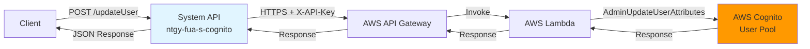
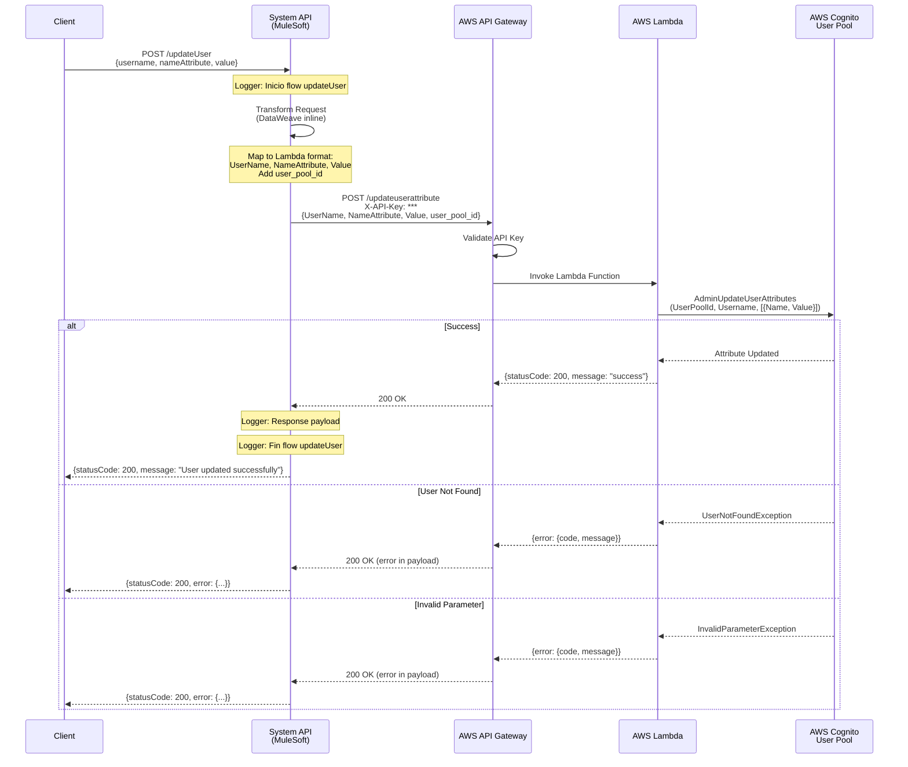
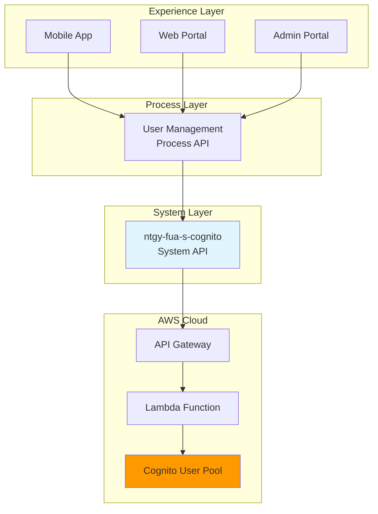

# POST /updateUser

## 📌 Descripción General

### Tipo de API
**System API** - Capa de integración directa con AWS Cognito User Pools

### Patrón de Integración
**Request-Reply Síncrono** con backend AWS serverless (API Gateway + Lambda + Cognito)

### Propósito
Actualizar un atributo de usuario en AWS Cognito User Pool de forma administrativa, permitiendo modificar información de perfil, atributos estándar y custom sin requerir autenticación del usuario.

### Arquitectura



---

## 💼 Propósito del Negocio

### Problema que Resuelve

1. **Gestión Administrativa de Usuarios**
   - Permite a administradores actualizar información de usuarios sin requerir que el usuario inicie sesión
   - Facilita corrección de datos incorrectos o desactualizados
   - Soporta actualización de atributos individuales

2. **Actualización de Perfil**
   - Modificación de email, teléfono y otros datos de contacto
   - Actualización de información personal (nombre, apellidos, etc.)
   - Gestión de atributos custom específicos del negocio

3. **Gestión de Roles y Permisos**
   - Actualización de atributos custom como roles o permisos
   - Modificación de contexto de cliente (clientHR)
   - Gestión de estados de confirmación de usuario

### Casos de Uso

#### Caso 1: Actualización de Email por Soporte
```
Escenario: Cliente reporta email incorrecto en su perfil
1. Agente de soporte verifica identidad del cliente
2. Agente invoca POST /updateUser con nameAttribute="email"
3. Sistema actualiza email en Cognito
4. Cliente recibe confirmación de cambio
```

#### Caso 2: Actualización de Atributo Custom
```
Escenario: Cambio de rol de usuario en el sistema
1. Administrador determina nuevo rol para usuario
2. Sistema invoca POST /updateUser con nameAttribute="custom:role"
3. Cognito actualiza atributo custom
4. Usuario obtiene nuevos permisos en próximo login
```

#### Caso 3: Corrección de Datos de Contacto
```
Escenario: Usuario tiene teléfono desactualizado
1. Usuario contacta soporte para actualizar teléfono
2. Soporte valida identidad y nuevo número
3. Sistema invoca POST /updateUser con nameAttribute="phone_number"
4. Cognito actualiza y verifica nuevo número
```

### Stakeholders

- **Administradores de Sistema**: Gestión de usuarios y permisos
- **Equipo de Soporte**: Resolución de problemas de acceso
- **Usuarios Finales**: Beneficiarios de actualizaciones de perfil
- **Equipos de Desarrollo**: Consumidores del API para funcionalidades de gestión

---

## 🔧 Especificación Técnica

### Endpoint
```
POST /updateUser
```

### Headers Requeridos
```http
Content-Type: application/json
```

### Request Body

#### Estructura
```json
{
  "username": "string",
  "nameAttribute": "string",
  "value": "string"
}
```

#### Parámetros

| Campo | Tipo | Requerido | Descripción | Ejemplo |
|-------|------|-----------|-------------|---------|
| `username` | string | ✅ Sí | Username del usuario en Cognito | `"user@example.com"` |
| `nameAttribute` | string | ✅ Sí | Nombre del atributo a actualizar | `"email"` |
| `value` | string | ✅ Sí | Nuevo valor para el atributo | `"newemail@example.com"` |

#### Atributos Soportados (nameAttribute)

**Atributos Estándar:**
- `email` - Dirección de correo electrónico
- `phone_number` - Número de teléfono (formato E.164: +34600000000)
- `name` - Nombre completo
- `family_name` - Apellido
- `given_name` - Nombre de pila
- `middle_name` - Segundo nombre
- `nickname` - Apodo
- `preferred_username` - Username preferido
- `profile` - URL del perfil
- `picture` - URL de la foto
- `website` - URL del sitio web
- `gender` - Género
- `birthdate` - Fecha de nacimiento (YYYY-MM-DD)
- `zoneinfo` - Zona horaria
- `locale` - Configuración regional
- `address` - Dirección

**Atributos Custom:**
- `custom:confirmedUser` - Estado de confirmación del usuario
- `custom:role` - Rol del usuario en el sistema
- `custom:clientHR` - Contexto de cliente HR
- Cualquier otro atributo custom definido en el User Pool

### Response

#### Success Response (200 OK)
```json
{
  "statusCode": 200,
  "message": "User updated successfully"
}
```

#### Error Response (AWS Cognito Error)
```json
{
  "statusCode": 200,
  "error": {
    "code": "UserNotFoundException",
    "message": "User does not exist"
  }
}
```

#### Códigos de Error Comunes

| Código | Descripción | Causa |
|--------|-------------|-------|
| `UserNotFoundException` | Usuario no encontrado | Username no existe en User Pool |
| `InvalidParameterException` | Parámetro inválido | Formato de atributo incorrecto |
| `InvalidEmailRoleAccessPolicyException` | Política de email inválida | Email no cumple política |
| `AliasExistsException` | Alias ya existe | Email/phone ya usado por otro usuario |
| `TooManyRequestsException` | Demasiadas peticiones | Rate limit excedido |
| `InternalErrorException` | Error interno | Error de AWS Cognito |

### Validaciones

#### Validaciones de Entrada
- ✅ Username es requerido y no puede estar vacío
- ✅ nameAttribute es requerido y no puede estar vacío
- ✅ value es requerido y no puede estar vacío

#### Validaciones de Negocio
- ✅ Usuario debe existir en el User Pool
- ✅ Email debe tener formato válido (si nameAttribute es "email")
- ✅ Phone number debe tener formato E.164 (si nameAttribute es "phone_number")
- ✅ Atributos custom deben estar definidos en el User Pool
- ✅ Usuario no debe estar deshabilitado

---

## 🏗️ Implementación Técnica

### Flujo de Datos



### Componentes Técnicos

#### 1. HTTP Listener (Inbound)
```xml
<http:listener 
    config-ref="HTTP_Listener_config" 
    path="/updateUser" 
    doc:name="POST /updateUser">
    <http:response statusCode="#[vars.httpStatus default 200]">
        <http:headers>#[vars.outboundHeaders default {}]</http:headers>
    </http:response>
</http:listener>
```

#### 2. Transformación de Request (DataWeave Inline)
```dataweave
%dw 2.0
output application/json
---
{
  "UserName": payload.username,
  "NameAttribute": payload.nameAttribute,
  "Value": payload.value,
  "user_pool_id": p('cognito.userPoolId')  
}
```

**Mapeo de Campos:**
- `username` → `UserName` (formato Lambda)
- `nameAttribute` → `NameAttribute` (formato Lambda)
- `value` → `Value` (formato Lambda)
- `user_pool_id` → Inyectado desde properties

#### 3. HTTP Request (Outbound a AWS)
```xml
<http:request 
    method="POST" 
    config-ref="HTTP_Cognito" 
    path="${cognito.path.updateuserattribute}"
    doc:name="Request">
    <http:headers>
        <![CDATA[#[output application/java
---
{
    "X-API-Key" : p('cognito.apikey')
}]]]>
    </http:headers>
</http:request>
```

**Configuración:**
- **Host**: `${cognito.host}` (API Gateway URL)
- **Path**: `${cognito.path.updateuserattribute}` (típicamente `/updateuserattribute`)
- **Timeout**: 30 segundos
- **Protocol**: HTTPS

#### 4. Logging
```xml
<logger level="INFO" message="Inicio flow updateUser" doc:name="Inicio" />
<!-- Business logic -->
<logger level="INFO" message="#[%dw 2.0 output application/json --- payload]" doc:name="Logger" />
<logger level="INFO" message="Fin flow updateUser" doc:name="Fin" />
```

### Configuración por Ambiente

#### Properties Requeridas
```yaml
cognito:
  host: "api-gateway-url.execute-api.region.amazonaws.com"
  path:
    globalpath: "/prod"
    updateuserattribute: "/updateuserattribute"
  userPoolId: "region_XXXXXXXXX"
  apikey: "secure-api-key"
  timeout: "30000"
```

#### Ambientes Configurados
- **Local**: `s-cognito-local-config.yaml`
- **Development**: `s-cognito-dev-config.yaml`
- **UAT**: `s-cognito-uat-config.yaml`
- **UAT01**: `s-cognito-uat01-config.yaml`
- **Production**: `s-cognito-pro-config.yaml`

### Diagrama de Arquitectura de Capas



### Manejo de Errores

#### Error Handler de APIKit
```xml
<on-error-propagate type="APIKIT:BAD_REQUEST">
    <ee:transform>
        <ee:message>
            <ee:set-payload><![CDATA[%dw 2.0
output application/json
---
{
    message: "Bad request"
}]]></ee:set-payload>
        </ee:message>
        <ee:variables>
            <ee:set-variable variableName="httpStatus">400</ee:set-variable>
        </ee:variables>
    </ee:transform>
</on-error-propagate>
```

#### Errores de AWS Cognito
Los errores de AWS Cognito se retornan en el payload con statusCode 200:
```json
{
  "statusCode": 200,
  "error": {
    "code": "UserNotFoundException",
    "message": "User does not exist"
  }
}
```

---

## 💻 Ejemplos de Uso

### Ejemplo 1: Actualizar Email

#### Request
```bash
curl -X POST https://ntgy-fua-s-cognito-dev.us-e2.cloudhub.io/api/updateUser \
  -H "Content-Type: application/json" \
  -d '{
    "username": "user@example.com",
    "nameAttribute": "email",
    "value": "newemail@example.com"
  }'
```

#### Response (Success)
```json
{
  "statusCode": 200,
  "message": "User updated successfully"
}
```

### Ejemplo 2: Actualizar Teléfono

#### Request
```bash
curl -X POST https://ntgy-fua-s-cognito-dev.us-e2.cloudhub.io/api/updateUser \
  -H "Content-Type: application/json" \
  -d '{
    "username": "user@example.com",
    "nameAttribute": "phone_number",
    "value": "+34600000000"
  }'
```

#### Response (Success)
```json
{
  "statusCode": 200,
  "message": "User updated successfully"
}
```

### Ejemplo 3: Actualizar Nombre

#### Request
```bash
curl -X POST https://ntgy-fua-s-cognito-dev.us-e2.cloudhub.io/api/updateUser \
  -H "Content-Type: application/json" \
  -d '{
    "username": "user@example.com",
    "nameAttribute": "name",
    "value": "Juan Pérez García"
  }'
```

#### Response (Success)
```json
{
  "statusCode": 200,
  "message": "User updated successfully"
}
```

### Ejemplo 4: Actualizar Atributo Custom - Rol

#### Request
```bash
curl -X POST https://ntgy-fua-s-cognito-dev.us-e2.cloudhub.io/api/updateUser \
  -H "Content-Type: application/json" \
  -d '{
    "username": "user@example.com",
    "nameAttribute": "custom:role",
    "value": "admin"
  }'
```

#### Response (Success)
```json
{
  "statusCode": 200,
  "message": "User updated successfully"
}
```

### Ejemplo 5: Actualizar Atributo Custom - Confirmed User

#### Request
```bash
curl -X POST https://ntgy-fua-s-cognito-dev.us-e2.cloudhub.io/api/updateUser \
  -H "Content-Type: application/json" \
  -d '{
    "username": "user@example.com",
    "nameAttribute": "custom:confirmedUser",
    "value": "true"
  }'
```

#### Response (Success)
```json
{
  "statusCode": 200,
  "message": "User updated successfully"
}
```

### Ejemplo 6: Error - Usuario No Encontrado

#### Request
```bash
curl -X POST https://ntgy-fua-s-cognito-dev.us-e2.cloudhub.io/api/updateUser \
  -H "Content-Type: application/json" \
  -d '{
    "username": "nonexistent@example.com",
    "nameAttribute": "email",
    "value": "newemail@example.com"
  }'
```

#### Response (Error)
```json
{
  "statusCode": 200,
  "error": {
    "code": "UserNotFoundException",
    "message": "User does not exist"
  }
}
```

### Ejemplo 7: Error - Email Inválido

#### Request
```bash
curl -X POST https://ntgy-fua-s-cognito-dev.us-e2.cloudhub.io/api/updateUser \
  -H "Content-Type: application/json" \
  -d '{
    "username": "user@example.com",
    "nameAttribute": "email",
    "value": "invalid-email"
  }'
```

#### Response (Error)
```json
{
  "statusCode": 200,
  "error": {
    "code": "InvalidParameterException",
    "message": "Invalid email format"
  }
}
```

### Ejemplo 8: Error - Email Ya Existe

#### Request
```bash
curl -X POST https://ntgy-fua-s-cognito-dev.us-e2.cloudhub.io/api/updateUser \
  -H "Content-Type: application/json" \
  -d '{
    "username": "user@example.com",
    "nameAttribute": "email",
    "value": "existing@example.com"
  }'
```

#### Response (Error)
```json
{
  "statusCode": 200,
  "error": {
    "code": "AliasExistsException",
    "message": "An account with the given email already exists"
  }
}
```

### Ejemplo 9: Código JavaScript (Node.js)

```javascript
const axios = require('axios');

async function updateUserAttribute(username, attributeName, attributeValue) {
  try {
    const response = await axios.post(
      'https://ntgy-fua-s-cognito-dev.us-e2.cloudhub.io/api/updateUser',
      {
        username: username,
        nameAttribute: attributeName,
        value: attributeValue
      },
      {
        headers: {
          'Content-Type': 'application/json'
        }
      }
    );
    
    if (response.data.error) {
      console.error('