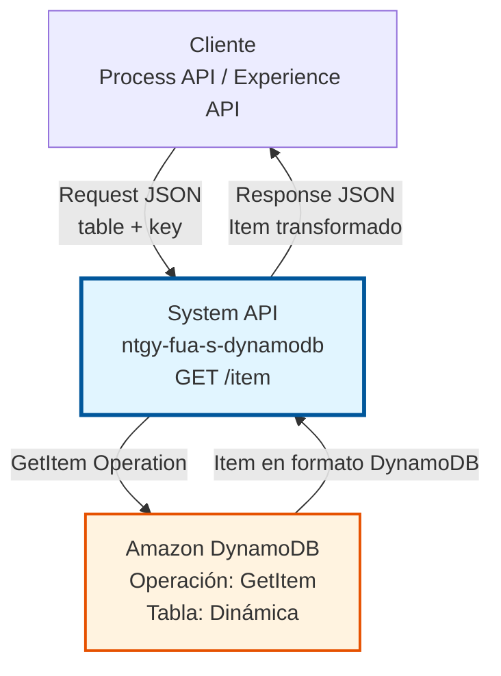
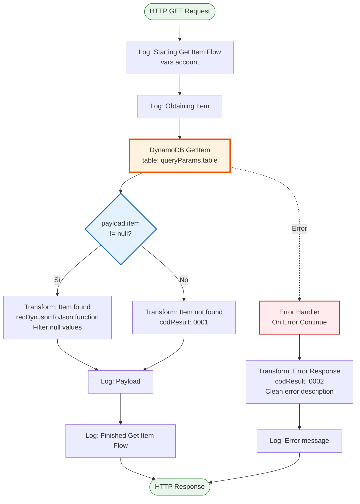
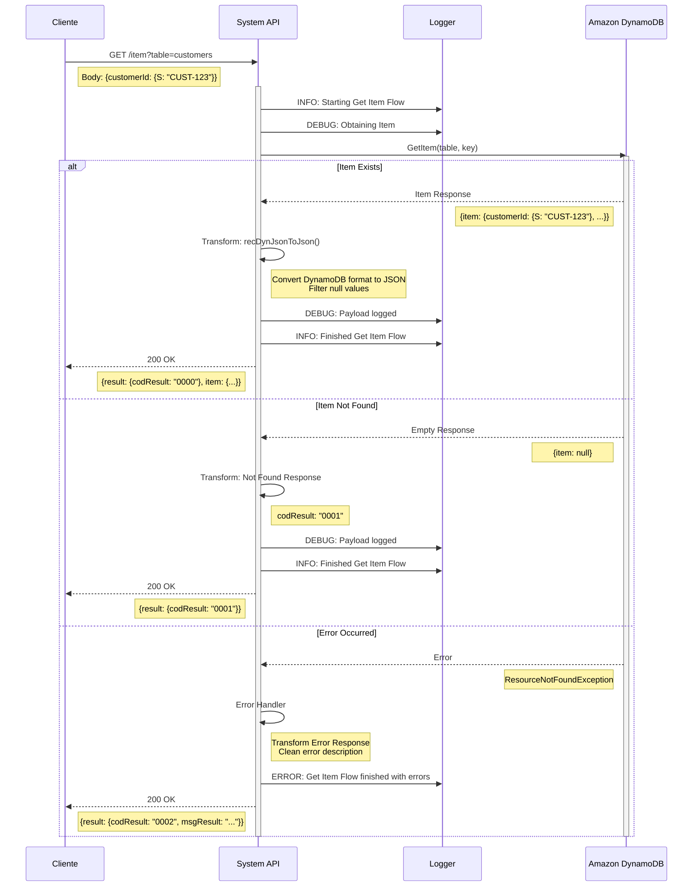
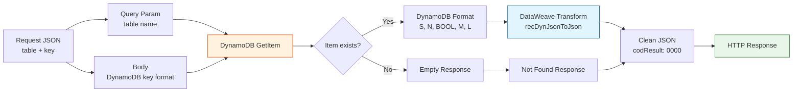

# GET /item

## 📌 Descripción General

### Propósito del Endpoint

Este endpoint recupera un item individual de una tabla DynamoDB utilizando su clave primaria. Proporciona una interfaz REST simple para la operación GetItem de DynamoDB, abstrayendo la complejidad del formato de atributos de DynamoDB y devolviendo datos en JSON estándar.

El endpoint soporta:
- **Recuperación por clave primaria**: Obtiene un item específico usando partition key y opcionalmente sort key
- **Tabla dinámica**: Permite especificar la tabla objetivo mediante query parameter
- **Transformación automática**: Convierte el formato de atributos DynamoDB a JSON limpio
- **Manejo de items no encontrados**: Responde apropiadamente cuando el item no existe

### Tipo de API

**Capa:** System API (API-Led Connectivity)

**Función:** Integración directa con Amazon DynamoDB para operaciones de lectura de items individuales.

### Patrón de Integración

**Tipo:** Request-Reply Síncrono con DynamoDB GetItem

**Descripción:** El endpoint recibe una solicitud con el nombre de la tabla y la clave del item, invoca la operación GetItem de DynamoDB, transforma la respuesta del formato de atributos DynamoDB a JSON estándar, y retorna el resultado con códigos de estado apropiados.

### Arquitectura API-Led Connectivity



---

## 💼 Propósito del Negocio

### Casos de Uso Principales

1. **Consulta de Datos de Cliente**
   - Recuperar información específica de un cliente por su ID
   - Obtener datos actualizados en tiempo real
   - Beneficio: Acceso rápido a datos de clientes sin escanear toda la tabla

2. **Verificación de Existencia de Registros**
   - Comprobar si un item existe antes de realizar operaciones
   - Validar datos antes de actualizaciones
   - Beneficio: Prevención de errores y validación de datos

3. **Recuperación de Configuraciones**
   - Obtener configuraciones específicas por clave
   - Acceder a parámetros de sistema almacenados
   - Beneficio: Gestión centralizada de configuraciones

### Contexto Empresarial

- **Dominio:** Gestión de Datos NoSQL
- **Sector:** Energía - Utilities
- **División:** Naturgy España - FUA (Área de Usuario Funcional)
- **Proceso de Negocio:** Acceso a datos de clientes y operaciones
- **Tecnología:** Amazon DynamoDB (NoSQL Database)

### Stakeholders

- **Desarrolladores de Process APIs**: Necesitan acceso simple a datos de DynamoDB
- **Equipos de Integración**: Requieren interfaz REST estándar para DynamoDB
- **Arquitectos de Soluciones**: Buscan abstracción de complejidad de AWS

### Valor de Negocio

- **Simplicidad**: Interfaz REST simple oculta complejidad del SDK de DynamoDB
- **Seguridad**: Centraliza gestión de credenciales AWS
- **Estandarización**: Formato JSON consistente para todos los consumidores
- **Performance**: Acceso directo y rápido a items individuales (< 500ms)

### Consumidores Potenciales

Este endpoint puede ser consumido por:
- Process APIs de gestión de clientes (FUA)
- Process APIs de operaciones comerciales
- Experience APIs de portales web y móviles
- Sistemas de integración middleware
- Flujos de Salesforce que requieran datos de DynamoDB

---

## 🔧 Especificación Técnica

### URLs por Ambiente

| Ambiente | URL Base | URL Completa |
|----------|----------|--------------|
| **Local** | `http://localhost:8081` | `http://localhost:8081/api/item?table=:tableName` |
| **Development** | `https://ntgy-fua-s-dynamodb-dev.cloudhub.io` | `https://ntgy-fua-s-dynamodb-dev.cloudhub.io/api/item?table=:tableName` |
| **Test** | `https://ntgy-fua-s-dynamodb-test.cloudhub.io` | `https://ntgy-fua-s-dynamodb-test.cloudhub.io/api/item?table=:tableName` |
| **Production** | `https://ntgy-fua-s-dynamodb.cloudhub.io` | `https://ntgy-fua-s-dynamodb.cloudhub.io/api/item?table=:tableName` |

### Método HTTP

```
GET /api/item
```

### Parámetros de Entrada

#### Headers HTTP

| Header | Tipo | Requerido | Descripción | Ejemplo |
|--------|------|-----------|-------------|---------|
| `Content-Type` | string | ✅ Sí | Tipo de contenido del request | `application/json` |
| `Accept` | string | ❌ No | Tipo de contenido esperado en response | `application/json` |

#### Query Parameters

| Parámetro | Tipo | Requerido | Descripción | Ejemplo |
|-----------|------|-----------|-------------|---------|
| `table` | string | ✅ Sí | Nombre de la tabla DynamoDB a consultar | `"customers"` |

#### Body Parameters

El body debe contener la clave del item. El conector de DynamoDB acepta el formato de atributos de DynamoDB directamente.

**Estructura para clave simple (solo partition key):**
```json
{
  "id": {
    "S": "customer-123"
  }
}
```

**Estructura para clave compuesta (partition key + sort key):**
```json
{
  "customerId": {
    "S": "customer-123"
  },
  "timestamp": {
    "N": "1704729600"
  }
}
```

**Tipos de atributos DynamoDB soportados:**
- `S`: String
- `N`: Number (como string)
- `BOOL`: Boolean
- `B`: Binary
- `SS`: String Set
- `NS`: Number Set
- `BS`: Binary Set
- `M`: Map
- `L`: List

**Nota:** El body representa directamente la estructura de la clave (Key) que se enviará a DynamoDB. No es necesario envolver en un objeto `"key"` adicional.

### Respuestas

#### Respuesta Exitosa - Item Encontrado (200 OK)

```json
{
  "result": {
    "codResult": "0000",
    "msgResult": "Item found"
  },
  "item": {
    "id": "customer-123",
    "name": "Juan Pérez",
    "email": "juan.perez@example.com",
    "status": "active",
    "createdAt": "2024-01-08T10:00:00Z"
  }
}
```

#### Respuesta - Item No Encontrado (200 OK)

```json
{
  "result": {
    "codResult": "0001",
    "msgResult": "Item not found"
  }
}
```

#### Respuesta de Error Técnico (200 OK con error)

```json
{
  "result": {
    "codResult": "0002",
    "msgResult": "ResourceNotFoundException: Requested resource not found"
  }
}
```

### Códigos de Resultado

| Código | Descripción | Significado |
|--------|-------------|-------------|
| `0000` | Item found | Item recuperado exitosamente |
| `0001` | Item not found | El item no existe en la tabla |
| `0002` | Error | Error técnico en la operación (tabla no existe, credenciales inválidas, etc.) |

### Autenticación y Autorización

- **Tipo:** Client ID & Client Secret (Anypoint Platform)
- **Autorización AWS:** El usuario de servicio debe tener permisos IAM para:
  - Ejecutar operación `dynamodb:GetItem`
  - Acceso de lectura a las tablas especificadas
  - Permisos configurados mediante IAM policies

### Timeouts

| Tipo | Valor | Descripción |
|------|-------|-------------|
| **Request Timeout** | 30 segundos | Tiempo máximo de espera para la respuesta |
| **Connection Timeout** | 10 segundos | Tiempo máximo para establecer conexión con DynamoDB |
| **DynamoDB Operation** | 5 segundos | Timeout específico para operación GetItem |

---

## 🏗️ Implementación Técnica

### Arquitectura del Flow



### Diagrama de Secuencia



**Flujo de Interacciones:**

1. **Request Inicial**: El cliente envía la petición con tabla y clave
2. **Logging**: Se registra el inicio de la operación con nivel INFO
3. **Operación DynamoDB**: Se ejecuta GetItem en la tabla especificada
4. **Decisión por Resultado**:
   - **Item Encontrado**: Transformación recursiva del formato DynamoDB a JSON limpio
   - **Item No Encontrado**: Respuesta con código 0001
   - **Error**: Captura y transformación del error con código 0002
5. **Logging Final**: Se registra el resultado de la operación
6. **Response**: Se devuelve la respuesta al cliente con código HTTP 200

### Componentes Principales

#### 1. Logging Inicial
```xml
<logger level="INFO" message='Starting Get Item Flow #[vars.account]'/>
<logger level="DEBUG" message='#["Obtaining Item"]'/>
```
- Registra inicio del flow con identificador de cuenta
- Log de debug para trazabilidad de operación

#### 2. Operación DynamoDB GetItem
```xml
<dynamodb:get-item 
    config-ref="Amazon_DynamoDB_Configuration" 
    tableName="#[attributes.queryParams.table]" />
```
- **Conector:** Amazon DynamoDB Connector 1.5.3
- **Operación:** GetItem
- **Tabla:** Dinámica desde query parameter
- **Configuración:** Credenciales AWS desde secure properties

#### 3. Decisión por Existencia de Item
```xml
<choice>
    <when expression="#[payload.item != null]">
        <!-- Item encontrado -->
    </when>
    <otherwise>
        <!-- Item no encontrado -->
    </otherwise>
</choice>
```

#### 4. Transformación DataWeave - Item Encontrado

**Función recursiva para convertir formato DynamoDB:**
```dataweave
%dw 2.0
output application/json  

fun recDynJsonToJson(o: Object) =
  o mapObject ((value, key, index) -> recConvertObject(value, key))

fun recConvertObject(o: Object, key) =
  o mapObject ((v, k, i) -> v match {
      case v is Object -> 
        (key): recDynJsonToJson(v) filterObject ((val) -> (val != null))
      case v is Array -> 
        (key): v map ((item) -> (recConvertObject(item, k) filterObject ((val) -> (val != null)))[0])
      else -> 
        (key): v
    })
---
{
    "result": {
        "codResult": "0000",
        "msgResult": "Item found"
    }, 
    "item": recDynJsonToJson(payload.item) filterObject ((val) -> (val != null))
}
```

**Características de la transformación:**
- Convierte formato de atributos DynamoDB (`{S: "value"}`) a JSON simple (`"value"`)
- Maneja tipos anidados (Objects y Arrays) recursivamente
- Filtra valores null del resultado
- Preserva estructura de datos compleja

#### 5. Transformación DataWeave - Item No Encontrado

```dataweave
%dw 2.0
output application/json
---
{
    "result": {
        "codResult": "0001",
        "msgResult": "Item not found"
    }
}
```

#### 6. Manejo de Errores

```xml
<error-handler>
    <on-error-continue>
        <ee:transform>
            <!-- Error Response -->
            {
                "result": {
                    "codResult": "0002",
                    "msgResult": error.description replace /\"/ with("")
                }
            }
        </ee:transform>
        <logger level="ERROR" 
                message='#["Get Item Flow finished with errors: " ++ error.description]'/>
    </on-error-continue>
</error-handler>
```

**Errores capturados:**
- `ResourceNotFoundException`: Tabla no existe
- `ValidationException`: Parámetros inválidos
- `ProvisionedThroughputExceededException`: Límite de capacidad excedido
- Errores de conectividad con AWS
- Errores de autenticación IAM

### Configuración de DynamoDB

**Conexión configurada en global.xml:**
```xml
<dynamodb:config name="Amazon_DynamoDB_Configuration">
    <dynamodb:basic-connection 
        accessKey="#[Mule::p(vars.account ++ '.accessKey')]" 
        secretKey='#[Mule::p("secure::" ++ vars.account ++ ".secretKey")]' 
        region="#[Mule::p(vars.account ++ '.region')]" />
</dynamodb:config>
```

**Características:**
- Credenciales dinámicas por cuenta AWS
- Secret Key encriptado con Secure Properties
- Región configurable por ambiente
- Soporte multi-cuenta (account1, account2, etc.)

### Diagrama de Transformación de Datos



### Variables de Contexto

| Variable | Tipo | Descripción | Ejemplo |
|----------|------|-------------|---------|
| `vars.account` | String | Identificador de cuenta AWS para credenciales dinámicas | `"account1"` |
| `attributes.queryParams.table` | String | Nombre de tabla DynamoDB desde query parameter | `"customers"` |
| `payload.item` | Object | Item recuperado de DynamoDB (si existe) | `{id: {S: "123"}}` |

### Dependencias Técnicas

**Conectores:**
- Amazon DynamoDB Connector 1.5.3
- HTTP Connector 1.11.1
- APIKit Module 1.11.11

**Módulos:**
- Secure Configuration Property Module (credenciales)
- Naturgy CLI Logger Extension 1.0.0 (logging)
- Mule Tracing Module (observabilidad)

---

## 💻 Ejemplos de Uso

### Ejemplo 1: Recuperar Item con Clave Simple

**Request:**
```bash
curl -X GET "http://localhost:8081/api/item?table=customers" \
  -H "Content-Type: application/json" \
  -d '{
    "customerId": {
      "S": "CUST-12345"
    }
  }'
```

**Response (200 OK - Item encontrado):**
```json
{
  "result": {
    "codResult": "0000",
    "msgResult": "Item found"
  },
  "item": {
    "customerId": "CUST-12345",
    "name": "María García",
    "email": "maria.garcia@naturgy.com",
    "contractNumber": "ES-2024-001",
    "status": "active",
    "createdDate": "2024-01-08",
    "lastModified": "2024-01-08T10:30:00Z"
  }
}
```

### Ejemplo 2: Recuperar Item con Clave Compuesta

**Request:**
```bash
curl -X GET "http://localhost:8081/api/item?table=transactions" \
  -H "Content-Type: application/json" \
  -d '{
    "accountId": {
      "S": "ACC-98765"
    },
    "transactionDate": {
      "N": "1704729600"
    }
  }'
```

**Response (200 OK - Item encontrado):**
```json
{
  "result": {
    "codResult": "0000",
    "msgResult": "Item found"
  },
  "item": {
    "accountId": "ACC-98765",
    "transactionDate": 1704729600,
    "amount": 150.75,
    "currency": "EUR",
    "type": "payment",
    "description": "Pago de factura mensual",
    "status": "completed"
  }
}
```

### Ejemplo 3: Item No Encontrado

**Request:**
```bash
curl -X GET "http://localhost:8081/api/item?table=customers" \
  -H "Content-Type: application/json" \
  -d '{
    "customerId": {
      "S": "CUST-99999"
    }
  }'
```

**Response (200 OK - Item no encontrado):**
```json
{
  "result": {
    "codResult": "0001",
    "msgResult": "Item not found"
  }
}
```

### Ejemplo 4: Error - Tabla No Existe

**Request:**
```bash
curl -X GET "http://localhost:8081/api/item?table=nonexistent_table" \
  -H "Content-Type: application/json" \
  -d '{
    "id": {
      "S": "123"
    }
  }'
```

**Response (200 OK - Error técnico):**
```json
{
  "result": {
    "codResult": "0002",
    "msgResult": "ResourceNotFoundException: Requested resource not found: Table: nonexistent_table not found"
  }
}
```

### Ejemplo 5: Item con Estructura Compleja

**Request:**
```bash
curl -X GET "http://localhost:8081/api/item?table=customer_profiles" \
  -H "Content-Type: application/json" \
  -d '{
    "profileId": {
      "S": "PROF-54321"
    }
  }'
```

**Response (200 OK - Item con datos anidados):**
```json
{
  "result": {
    "codResult": "0000",
    "msgResult": "Item found"
  },
  "item": {
    "profileId": "PROF-54321",
    "personalInfo": {
      "firstName": "Carlos",
      "lastName": "Rodríguez",
      "dateOfBirth": "1985-03-15"
    },
    "contactInfo": {
      "email": "carlos.rodriguez@email.com",
      "phone": "+34612345678",
      "address": {
        "street": "Calle Mayor 123",
        "city": "Madrid",
        "postalCode": "28013",
        "country": "España"
      }
    },
    "preferences": {
      "language": "es",
      "notifications": true,
      "newsletter": false
    },
    "contracts": [
      {
        "contractId": "CNT-001",
        "type": "electricity",
        "status": "active"
      },
      {
        "contractId": "CNT-002",
        "type": "gas",
        "status": "active"
      }
    ]
  }
}
```

### Ejemplo 6: Uso desde JavaScript/Node.js

```javascript
const axios = require('axios');

async function getItemFromDynamoDB(tableName, key) {
  try {
    const response = await axios.get(
      `https://ntgy-fua-s-dynamodb.cloudhub.io/api/item?table=${tableName}`,
      {
        headers: {
          'Content-Type': 'application/json',
          'client_id': 'your-client-id',
          'client_secret': 'your-client-secret'
        },
        data: {
          key: key
        }
      }
    );

    if (response.data.result.codResult === '0000') {
      console.log('Item encontrado:', response.data.item);
      return response.data.item;
    } else if (response.data.result.codResult === '0001') {
      console.log('Item no encontrado');
      return null;
    } else {
      console.error('Error:', response.data.result.msgResult);
      throw new Error(response.data.result.msgResult);
    }
  } catch (error) {
    console.error('Error en la petición:', error.message);
    throw error;
  }
}

// Uso
const key = {
  customerId: { S: 'CUST-12345' }
};

getItemFromDynamoDB('customers', key)
  .then(item => console.log('Resultado:', item))
  .catch(err => console.error('Error:', err));
```

**Nota:** El objeto `key` se envía directamente en el body, sin envolverlo en un objeto `"key"` adicional.

### Ejemplo 7: Uso desde Python

```python
import requests
import json

def get_item_from_dynamodb(table_name, key):
    url = f"https://ntgy-fua-s-dynamodb.cloudhub.io/api/item?table={table_name}"
    
    headers = {
        'Content-Type': 'application/json',
        'client_id': 'your-client-id',
        'client_secret': 'your-client-secret'
    }
    
    payload = {
        'key': key
    }
    
    try:
        response = requests.get(url, headers=headers, json=payload)
        response.raise_for_status()
        
        data = response.json()
        
        if data['result']['codResult'] == '0000':
            print('Item encontrado:', data['item'])
            return data['item']
        elif data['result']['codResult'] == '0001':
            print('Item no encontrado')
            return None
        else:
            print('Error:', data['result']['msgResult'])
            raise Exception(data['result']['msgResult'])
            
    except requests.exceptions.RequestException as e:
        print(f'Error en la petición: {e}')
        raise

# Uso
key = {
    'customerId': {'S': 'CUST-12345'}
}

item = get_item_from_dynamodb('customers', key)
print('Resultado:', item)
```

**Nota:** El diccionario `key` se envía directamente en el body, sin envolverlo en un diccionario `"key"` adicional.

### Consideraciones de Uso

**Performance:**
- Operación GetItem es muy rápida (< 10ms en DynamoDB)
- Tiempo total de respuesta típico: 200-500ms
- Usar para consultas de items individuales, no para escaneos

**Mejores Prácticas:**
- Siempre especificar la clave completa (partition key + sort key si aplica)
- Validar que la tabla existe antes de hacer múltiples llamadas
- Implementar retry logic para errores transitorios (throttling)
- Cachear resultados si los datos no cambian frecuentemente

**Limitaciones:**
- Solo recupera un item por llamada
- Requiere conocer la clave exacta del item
- No soporta búsquedas por atributos no-clave (usar POST /query para eso)
- Tabla debe existir y tener permisos configurados