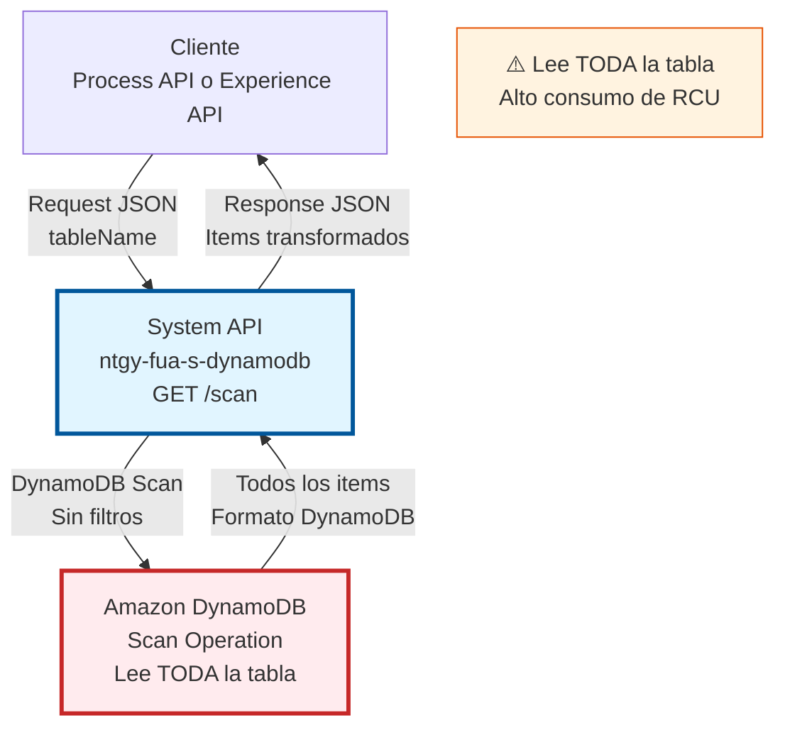
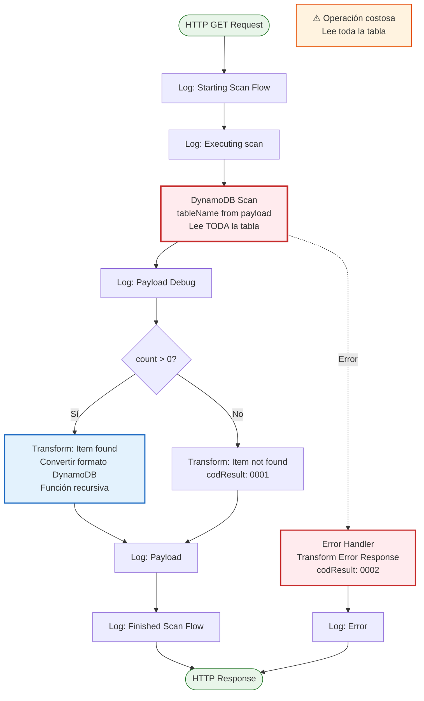
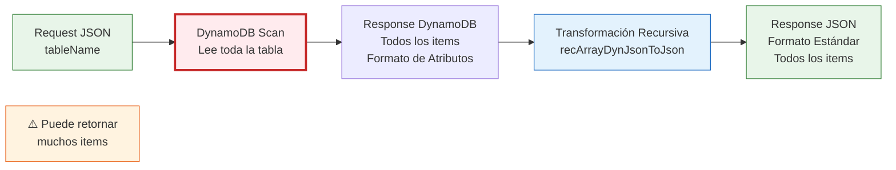

# GET /scan

:::warning[⚠️ ADVERTENCIA DE PERFORMANCE]
**Scan lee TODA la tabla secuencialmente.** Esta operación puede ser muy lenta y costosa en tablas grandes. Considere usar POST /query para búsquedas específicas. Use Scan solo para:
- Tablas pequeñas (< 1000 items)
- Exportación completa de datos
- Operaciones de mantenimiento ocasionales
:::

## 📌 Descripción General

### Propósito del Endpoint

Este endpoint permite escanear todos los items de una tabla de Amazon DynamoDB. A diferencia de Query, Scan no utiliza índices y lee la tabla completa secuencialmente, lo que lo hace menos eficiente pero útil para ciertos casos de uso específicos.

El endpoint soporta:
- **Escaneo Completo de Tabla**: Lee todos los items sin filtros
- **Retorno de Todos los Atributos**: No soporta proyección selectiva
- **Transformación Automática**: Convierte formato DynamoDB a JSON estándar
- **Manejo de Tablas Vacías**: Respuesta clara cuando no hay items

### ⚠️ Diferencias Importantes con POST /query

| Característica | GET /scan | POST /query |
|----------------|-----------|-------------|
| **Uso de Índices** | ❌ No | ✅ Sí |
| **KeyConditionExpression** | ❌ No | ✅ Sí |
| **Proyección de Atributos** | ❌ No | ✅ Sí |
| **Performance** | 🐌 Lento en tablas grandes | ⚡ Rápido con índices |
| **Consumo de RCU** | 📈 Alto (toda la tabla) | 📊 Bajo (solo items necesarios) |
| **Uso Recomendado** | Tablas pequeñas, exportación | Búsquedas específicas |

### Tipo de API

**Capa:** System API (API-Led Connectivity)

**Función:** Integración directa con Amazon DynamoDB para operaciones de escaneo completo de tablas NoSQL.

### Patrón de Integración

**Tipo:** Request-Reply Síncrono con DynamoDB Scan Operation

**Descripción:** El endpoint recibe una solicitud con el nombre de la tabla, ejecuta la operación Scan en DynamoDB (leyendo todos los items), transforma la respuesta del formato DynamoDB a JSON estándar, y retorna todos los items encontrados.

### Arquitectura API-Led Connectivity



---

## 💼 Propósito del Negocio

### Casos de Uso Principales

1. **Exportación Completa de Datos**
   - Exportar todos los items de una tabla para backup
   - Migración de datos entre ambientes
   - Análisis completo de datos históricos
   - ⚠️ Solo para tablas pequeñas o en horarios de baja demanda

2. **Análisis y Reporting Ocasional**
   - Generar reportes que requieren todos los datos
   - Análisis estadístico de toda la tabla
   - Auditorías completas de datos
   - ⚠️ Considerar usar AWS Data Pipeline o EMR para tablas grandes

3. **Operaciones de Mantenimiento**
   - Limpieza de datos obsoletos
   - Validación de integridad de datos
   - Actualización masiva de atributos
   - ⚠️ Implementar paginación para tablas grandes

4. **Tablas de Configuración Pequeñas**
   - Cargar catálogos completos (países, categorías, etc.)
   - Sincronizar datos de referencia
   - Cachear configuraciones
   - ✅ Uso apropiado si la tabla tiene < 1000 items

### Contexto Empresarial

- **Dominio:** Gestión de Datos NoSQL
- **Sector:** Energía - Utilities
- **División:** Naturgy España - FUA (Área de Usuario Funcional)
- **Proceso de Negocio:** Operaciones de lectura completa de datos operacionales
- **Tecnología:** Amazon DynamoDB (NoSQL Database)

### Stakeholders

- **Desarrolladores de Process APIs**: Necesitan acceso completo a datos de tablas pequeñas
- **Equipos de Data Analytics**: Requieren exportación de datos para análisis
- **Equipos de Operaciones**: Realizan mantenimiento y validación de datos

### Valor de Negocio

- **Simplicidad**: No requiere definir condiciones de búsqueda
- **Completitud**: Garantiza acceso a todos los items de la tabla
- **Flexibilidad**: Útil para casos de uso que requieren datos completos

### ⚠️ Consideraciones de Costos

- **Alto Consumo de RCU**: Scan consume Read Capacity Units proporcional al tamaño de la tabla
- **Impacto en Performance**: Puede afectar otras operaciones si la tabla está bajo carga
- **Throttling**: Puede causar errores de capacidad excedida en tablas grandes
- **Alternativas Recomendadas**: 
  - Usar Query con índices para búsquedas específicas
  - Usar DynamoDB Streams para procesamiento continuo
  - Usar AWS Data Pipeline para exportaciones grandes

### Consumidores Potenciales

Este endpoint puede ser consumido por:
- Process APIs que gestionan tablas de configuración pequeñas
- Servicios de exportación y backup de datos
- Herramientas de análisis y reporting (con precaución)
- Scripts de mantenimiento y migración de datos

---

## 🔧 Especificación Técnica

### URLs por Ambiente

| Ambiente | URL Base | URL Completa |
|----------|----------|--------------|
| **Local** | `http://localhost:8081` | `http://localhost:8081/api/scan` |
| **Development** | `https://ntgy-fua-s-dynamodb-dev.cloudhub.io` | `https://ntgy-fua-s-dynamodb-dev.cloudhub.io/api/scan` |
| **UAT** | `https://ntgy-fua-s-dynamodb-uat.cloudhub.io` | `https://ntgy-fua-s-dynamodb-uat.cloudhub.io/api/scan` |
| **Production** | `https://ntgy-fua-s-dynamodb.cloudhub.io` | `https://ntgy-fua-s-dynamodb.cloudhub.io/api/scan` |

### Método HTTP

```
GET /api/scan
```

### Parámetros de Entrada

#### Headers HTTP

| Header | Tipo | Requerido | Descripción | Ejemplo |
|--------|------|-----------|-------------|---------|
| `Content-Type` | string | ✅ Sí | Tipo de contenido del request | `application/json` |
| `Accept` | string | ❌ No | Tipo de contenido esperado en response | `application/json` |

#### Query Parameters

No hay query parameters para este endpoint.

#### Body Parameters

**Estructura del Request Body:**

```json
{
  "tableName": "string"
}
```

**Descripción de Campos:**

| Campo | Tipo | Requerido | Descripción |
|-------|------|-----------|-------------|
| `tableName` | string | ✅ Sí | Nombre de la tabla DynamoDB a escanear |

**⚠️ Nota Importante:** A diferencia de Query, Scan NO acepta:
- `condition` (KeyConditionExpression)
- `attributes` (valores de atributos)
- `index` (índices secundarios)
- `projectionExpression` (proyección de atributos)

### Respuestas

#### Respuesta Exitosa - Items Encontrados (200 OK)

```json
{
  "result": {
    "codResult": "0000",
    "msgResult": "Item found"
  },
  "items": [
    {
      "id": "item-001",
      "name": "Product A",
      "category": "Electronics",
      "price": 299.99,
      "stock": 50
    },
    {
      "id": "item-002",
      "name": "Product B",
      "category": "Books",
      "price": 19.99,
      "stock": 100
    }
  ]
}
```

#### Respuesta Exitosa - Tabla Vacía (200 OK)

```json
{
  "result": {
    "codResult": "0001",
    "msgResult": "Item not found"
  }
}
```

#### Respuesta de Error (200 OK con error)

```json
{
  "result": {
    "codResult": "0002",
    "msgResult": "ResourceNotFoundException: Requested resource not found"
  }
}
```

**Códigos de Resultado:**

| Código | Descripción | Significado |
|--------|-------------|-------------|
| `0000` | Item found | Scan ejecutado exitosamente, items encontrados |
| `0001` | Item not found | Scan ejecutado exitosamente, tabla vacía |
| `0002` | Error | Error en la ejecución del scan |

### Autenticación y Autorización

- **Tipo:** Client ID & Client Secret (Anypoint Platform)
- **Autorización AWS:** El usuario debe tener permisos IAM para:
  - Ejecutar operación `dynamodb:Scan` en la tabla especificada
  - Permisos de lectura en todos los atributos de la tabla

### Timeouts

| Tipo | Valor | Descripción |
|------|-------|-------------|
| **Request Timeout** | 30 segundos | Tiempo máximo de espera para la respuesta |
| **Connection Timeout** | 10 segundos | Tiempo máximo para establecer conexión con DynamoDB |

:::warning[⚠️ TIMEOUT EN TABLAS GRANDES]
Para tablas con muchos items, el scan puede exceder el timeout de 30 segundos. En estos casos:
- Considere usar Query en lugar de Scan
- Implemente paginación con LastEvaluatedKey
- Aumente el timeout si es absolutamente necesario
:::

---

## 🏗️ Implementación Técnica

### Arquitectura del Flow



### Componentes del Flow

#### 1. Logging Inicial
**Ubicación en código:** Líneas 8-9

```xml
<logger level="INFO" message='Starting Scan Flow #[vars.account]'/>
<logger level="DEBUG" message='#["Executing scan"]'/>
```

**Propósito:** Registrar el inicio de la operación de scan con el identificador de cuenta AWS.

#### 2. DynamoDB Scan Operation
**Ubicación en código:** Línea 10

```xml
<dynamodb:scan 
  tableName="#[payload.tableName]" 
  config-ref="Amazon_DynamoDB_Configuration" />
```

**Parámetros:**
- `tableName`: Nombre de la tabla DynamoDB a escanear
- `config-ref`: Referencia a la configuración de DynamoDB

**⚠️ Importante:** 
- NO usa `select` (siempre retorna todos los atributos)
- NO usa `keyConditionExpression` (no hay filtros)
- NO usa `indexName` (escanea la tabla principal)
- Lee TODOS los items secuencialmente

#### 3. Logging de Payload Debug
**Ubicación en código:** Líneas 11-15

```xml
<logger level="DEBUG" message="#[%dw 2.0
output application/json
---
payload]"/>
```

**Propósito:** Registrar el payload completo de DynamoDB para debugging.

#### 4. Choice: Verificar si hay Items
**Ubicación en código:** Líneas 16-54

```xml
<choice>
  <when expression="#[payload.count > 0]">
    <!-- Transformación cuando hay items -->
  </when>
  <otherwise>
    <!-- Respuesta cuando tabla está vacía -->
  </otherwise>
</choice>
```

**Lógica:** Verifica si el scan retornó algún item.

#### 5. Transformación de Respuesta

**Transformación cuando se encuentran items (líneas 18-43):**

```dataweave
%dw 2.0
output application/json  

fun recArrayDynJsonToJson(m: Array) =
  m map ((itA, keyA) -> recDynJsonToJson(itA) filterObject ((itA) -> (itA != null)) )

fun recDynJsonToJson(o: Object) =
  o mapObject ((value, k1, index) -> recConvertObject(value, k1) filterObject ((value) -> (value != null)))

fun recConvertObject(o: Object, key) =
  o mapObject ((v, k, i) -> v match {
      case v is Object -> 
        (key): recDynJsonToJson(v) filterObject ((v) -> (v) != null)
      case v is Array -> 
        (key): v map ((item) -> (recConvertObject(item, k) filterObject ((v) -> (v != null)))[0])
      else -> 
        (key): v
    })
---
{
  "result": {
    "codResult": "0000",
    "msgResult": "Item found"
  }, 
  "items": recArrayDynJsonToJson(payload.items)
}
```

**Funciones DataWeave:**
- `recArrayDynJsonToJson`: Procesa array de items de DynamoDB
- `recDynJsonToJson`: Convierte objeto DynamoDB a JSON estándar
- `recConvertObject`: Maneja conversión recursiva de objetos anidados
- Filtra valores null automáticamente

**Transformación cuando NO se encuentran items (líneas 46-54):**

```dataweave
%dw 2.0
output application/json
---
{
  "result": {
    "codResult": "0001",
    "msgResult": "Item not found"
  }
}
```

#### 6. Error Handler
**Ubicación en código:** Líneas 59-71

```xml
<on-error-continue>
  <ee:transform>
    <ee:set-payload>
      {
        "result": {
          "codResult": "0002",
          "msgResult": error.description as String replace /\"/ with("")
        }
      }
    </ee:set-payload>
  </ee:transform>
  <logger level="ERROR" message='#["Scan Flow finished with errors: " ++ error.description]' />
</on-error-continue>
```

**Manejo:** Captura cualquier error de DynamoDB y lo transforma en respuesta estándar.

### Diagrama de Transformación de Datos



### Configuración de DynamoDB

**Connector Configuration:**
```xml
<dynamodb:config name="Amazon_DynamoDB_Configuration">
  <dynamodb:basic-connection 
    accessKey="#[Mule::p(vars.account ++ '.accessKey')]" 
    secretKey='#[Mule::p("secure::" ++ vars.account ++ ".secretKey")]' 
    region="#[Mule::p(vars.account ++ '.region')]" />
</dynamodb:config>
```

**Características:**
- Configuración dinámica por cuenta AWS
- Credenciales encriptadas con Secure Properties
- Región configurable por ambiente

### Manejo de Errores de DynamoDB

**Errores Comunes:**

| Error DynamoDB | Código | Descripción |
|----------------|--------|-------------|
| `ResourceNotFoundException` | 0002 | Tabla no existe |
| `ProvisionedThroughputExceededException` | 0002 | Capacidad de lectura excedida (común con Scan) |
| `InternalServerError` | 0002 | Error interno de DynamoDB |
| `RequestLimitExceeded` | 0002 | Demasiadas solicitudes concurrentes |

**Estrategia de Retry:**
- DynamoDB Connector implementa retry automático para errores transitorios
- Exponential backoff para throttling
- Máximo 3 reintentos

### ⚠️ Limitaciones y Consideraciones de Performance

#### Límites de DynamoDB Scan

1. **Límite de 1 MB por Scan:**
   - Scan retorna máximo 1 MB de datos por llamada
   - Si la tabla es más grande, requiere paginación con `LastEvaluatedKey`
   - Este endpoint NO implementa paginación automática

2. **Consumo de Capacidad:**
   - Scan consume RCU proporcional al tamaño escaneado
   - Puede agotar la capacidad provisionada rápidamente
   - Afecta otras operaciones en la misma tabla

3. **Performance:**
   - Scan es secuencial y lento
   - No se beneficia de índices
   - Tiempo de respuesta aumenta linealmente con el tamaño de la tabla

#### Recomendaciones de Uso

✅ **USAR Scan cuando:**
- La tabla tiene menos de 1000 items
- Necesitas exportar todos los datos ocasionalmente
- Es una operación de mantenimiento fuera de horario pico
- La tabla es de configuración/catálogo pequeña

❌ **NO USAR Scan cuando:**
- La tabla tiene millones de items
- Necesitas buscar items específicos (usar Query)
- Es una operación frecuente en producción
- La tabla está bajo carga alta

#### Alternativas Recomendadas

| Caso de Uso | Alternativa Recomendada |
|-------------|-------------------------|
| Búsqueda específica | POST /query con KeyConditionExpression |
| Exportación grande | AWS Data Pipeline o DynamoDB Export to S3 |
| Procesamiento continuo | DynamoDB Streams |
| Análisis de datos | Amazon EMR con DynamoDB connector |

---

## 💻 Ejemplos de Uso

### Ejemplo 1: Scan Simple de Tabla Pequeña

**Request:**
```bash
curl -X GET "https://ntgy-fua-s-dynamodb.cloudhub.io/api/scan" \
  -H "Content-Type: application/json" \
  -H "client_id: YOUR_CLIENT_ID" \
  -H "client_secret: YOUR_CLIENT_SECRET" \
  -d '{
    "tableName": "ProductCatalog"
  }'
```

**Response:**
```json
{
  "result": {
    "codResult": "0000",
    "msgResult": "Item found"
  },
  "items": [
    {
      "id": "PROD-001",
      "name": "Laptop",
      "category": "Electronics",
      "price": 999.99,
      "stock": 25
    },
    {
      "id": "PROD-002",
      "name": "Mouse",
      "category": "Accessories",
      "price": 29.99,
      "stock": 150
    },
    {
      "id": "PROD-003",
      "name": "Keyboard",
      "category": "Accessories",
      "price": 79.99,
      "stock": 80
    }
  ]
}
```

### Ejemplo 2: Scan de Tabla Vacía

**Request:**
```bash
curl -X GET "https://ntgy-fua-s-dynamodb.cloudhub.io/api/scan" \
  -H "Content-Type: application/json" \
  -H "client_id: YOUR_CLIENT_ID" \
  -H "client_secret: YOUR_CLIENT_SECRET" \
  -d '{
    "tableName": "EmptyTable"
  }'
```

**Response:**
```json
{
  "result": {
    "codResult": "0001",
    "msgResult": "Item not found"
  }
}
```

### Ejemplo 3: Error - Tabla No Existe

**Request:**
```bash
curl -X GET "https://ntgy-fua-s-dynamodb.cloudhub.io/api/scan" \
  -H "Content-Type: application/json" \
  -H "client_id: YOUR_CLIENT_ID" \
  -H "client_secret: YOUR_CLIENT_SECRET" \
  -d '{
    "tableName": "NonExistentTable"
  }'
```

**Response:**
```json
{
  "result": {
    "codResult": "0002",
    "msgResult": "ResourceNotFoundException: Requested resource not found"
  }
}
```

### Ejemplo 4: Integración desde JavaScript

```javascript
const scanDynamoDBTable = async (tableName) => {
  try {
    const response = await fetch('https://ntgy-fua-s-dynamodb.cloudhub.io/api/scan', {
      method: 'GET',
      headers: {
        'Content-Type': 'application/json',
        'client_id': process.env.CLIENT_ID,
        'client_secret': process.env.CLIENT_SECRET
      },
      body: JSON.stringify({
        tableName: tableName
      })
    });
    
    const data = await response.json();
    
    if (data.result.codResult === '0000') {
      console.log(`Scan completed: Found ${data.items.length} items`);
      console.warn(`⚠️ Warning: Scanned entire table "${tableName}"`);
      return data.items;
    } else if (data.result.codResult === '0001') {
      console.log('Table is empty');
      return [];
    } else {
      throw new Error(`Scan failed: ${data.result.msgResult}`);
    }
  } catch (error) {
    console.error('Error scanning DynamoDB table:', error);
    throw error;
  }
};

// Uso con advertencia
console.warn('⚠️ About to scan entire table - use with caution!');
const allItems = await scanDynamoDBTable('ProductCatalog');
```

### Ejemplo 5: Integración desde Python

```python
import requests
import os
import warnings

def scan_dynamodb_table(table_name):
    """
    Escanea una tabla completa de DynamoDB.
    
    ⚠️ WARNING: Esta operación lee TODA la tabla.
    Solo usar con tablas pequeñas o en operaciones de mantenimiento.
    """
    warnings.warn(
        f"Scanning entire table '{table_name}' - this may be slow and expensive",
        UserWarning
    )
    
    url = 'https://ntgy-fua-s-dynamodb.cloudhub.io/api/scan'
    headers = {
        'Content-Type': 'application/json',
        'client_id': os.getenv('CLIENT_ID'),
        'client_secret': os.getenv('CLIENT_SECRET')
    }
    payload = {
        'tableName': table_name
    }
    
    response = requests.get(url, json=payload, headers=headers)
    data = response.json()
    
    if data['result']['codResult'] == '0000':
        item_count = len(data['items'])
        print(f"✅ Scan completed: Found {item_count} items")
        if item_count > 100:
            warnings.warn(
                f"Large result set ({item_count} items) - consider using Query instead",
                UserWarning
            )
        return data['items']
    elif data['result']['codResult'] == '0001':
        print('ℹ️ Table is empty')
        return []
    else:
        raise Exception(f"❌ Scan failed: {data['result']['msgResult']}")

# Uso
try:
    all_products = scan_dynamodb_table('ProductCatalog')
    print(f"Retrieved {len(all_products)} products")
except Exception as e:
    print(f"Error: {e}")
```

### Ejemplo 6: Script de Exportación con Manejo de Errores

```python
import requests
import json
import os
from datetime import datetime

def export_table_to_file(table_name, output_file):
    """
    Exporta una tabla completa de DynamoDB a un archivo JSON.
    Incluye manejo de errores y logging.
    """
    print(f"🔄 Starting export of table '{table_name}'...")
    start_time = datetime.now()
    
    url = 'https://ntgy-fua-s-dynamodb.cloudhub.io/api/scan'
    headers = {
        'Content-Type': 'application/json',
        'client_id': os.getenv('CLIENT_ID'),
        'client_secret': os.getenv('CLIENT_SECRET')
    }
    payload = {'tableName': table_name}
    
    try:
        response = requests.get(url, json=payload, headers=headers, timeout=30)
        data = response.json()
        
        if data['result']['codResult'] == '0000':
            items = data['items']
            
            # Guardar a archivo
            with open(output_file, 'w', encoding='utf-8') as f:
                json.dump(items, f, indent=2, ensure_ascii=False)
            
            elapsed = (datetime.now() - start_time).total_seconds()
            print(f"✅ Export completed successfully!")
            print(f"   - Items exported: {len(items)}")
            print(f"   - Output file: {output_file}")
            print(f"   - Time elapsed: {elapsed:.2f} seconds")
            
            if len(items) > 1000:
                print(f"⚠️  WARNING: Large table ({len(items)} items)")
                print(f"   Consider using AWS Data Pipeline for better performance")
            
            return True
            
        elif data['result']['codResult'] == '0001':
            print(f"ℹ️  Table '{table_name}' is empty - nothing to export")
            return False
            
        else:
            print(f"❌ Export failed: {data['result']['msgResult']}")
            return False
            
    except requests.Timeout:
        print(f"❌ Export failed: Request timeout (table too large?)")
        print(f"   Consider using Query with pagination or AWS Data Pipeline")
        return False
        
    except Exception as e:
        print(f"❌ Export failed: {str(e)}")
        return False

# Uso
if __name__ == "__main__":
    success = export_table_to_file(
        table_name='ProductCatalog',
        output_file='product_catalog_export.json'
    )
    
    if success:
        print("\n✅ Export process completed successfully")
    else:
        print("\n❌ Export process failed")
```

### Consideraciones de Uso

1. **⚠️ Performance:**
   - Scan lee TODA la tabla secuencialmente
   - Puede ser muy lento en tablas grandes
   - Tiempo de respuesta aumenta con el tamaño de la tabla

2. **⚠️ Costos:**
   - Consume RCU proporcional al tamaño de la tabla
   - Puede agotar la capacidad provisionada
   - Más costoso que Query para búsquedas específicas

3. **⚠️ Límites:**
   - Máximo 1 MB de datos por llam