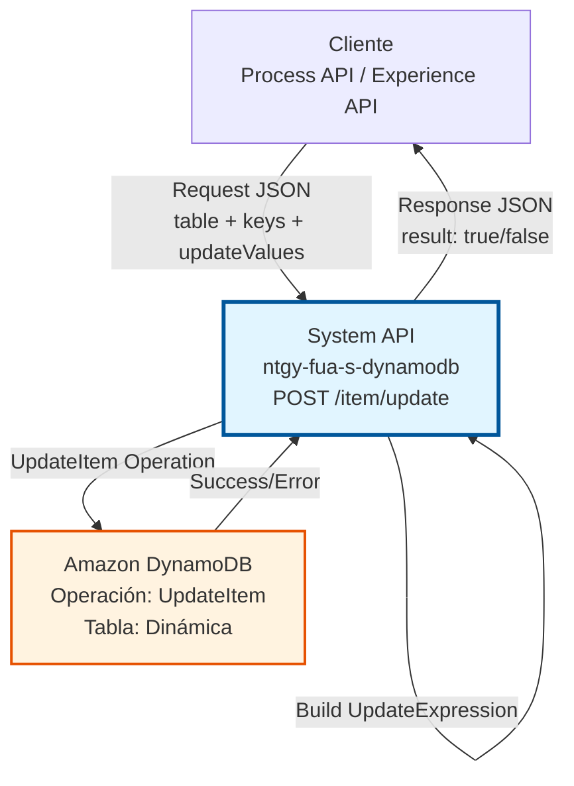
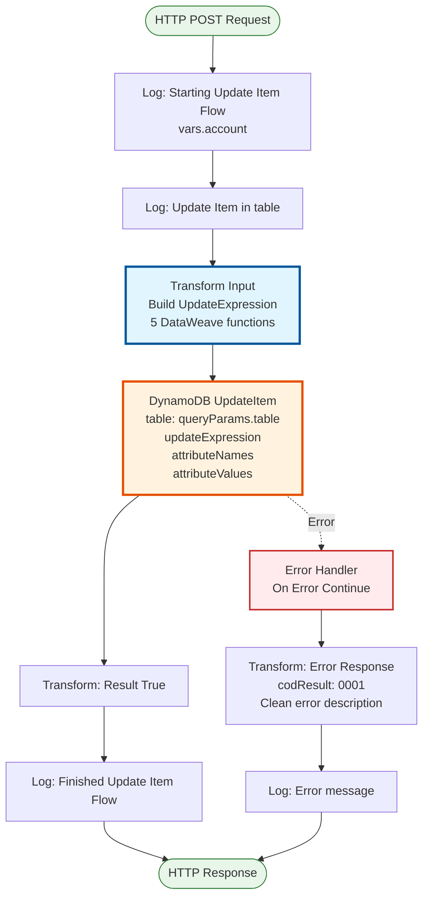
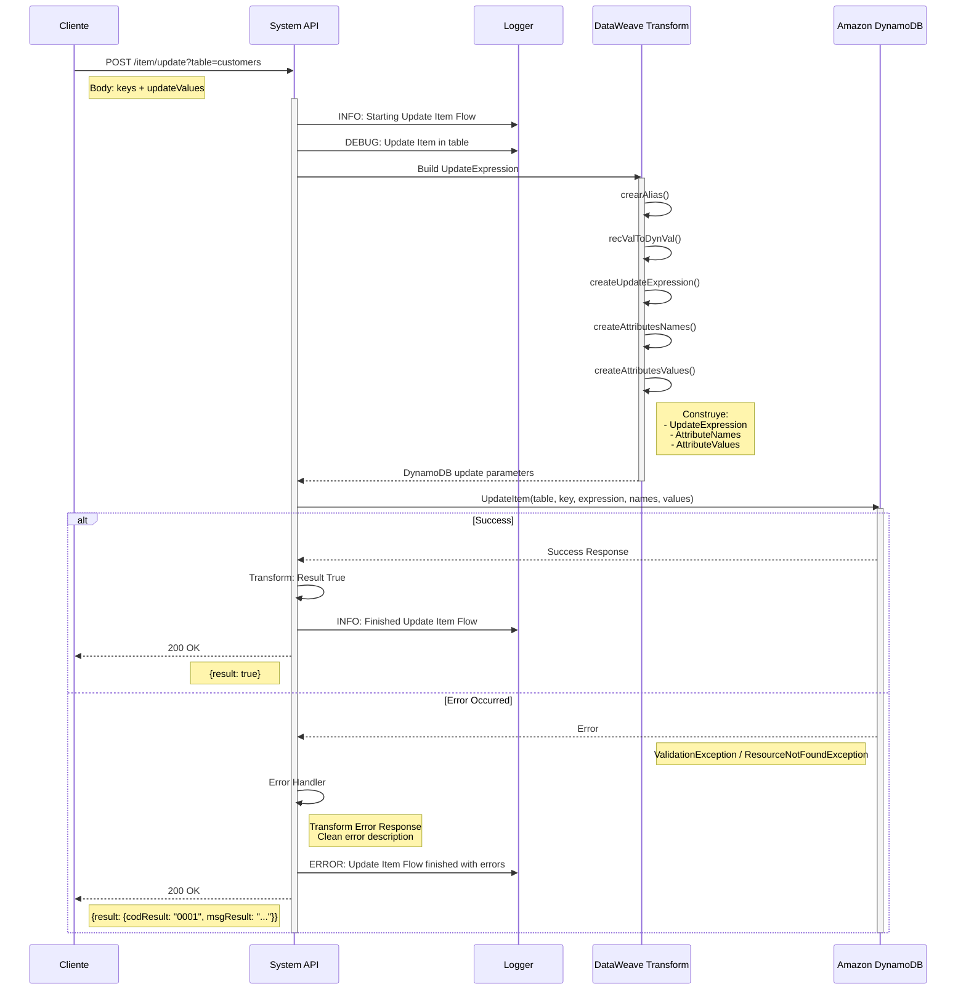
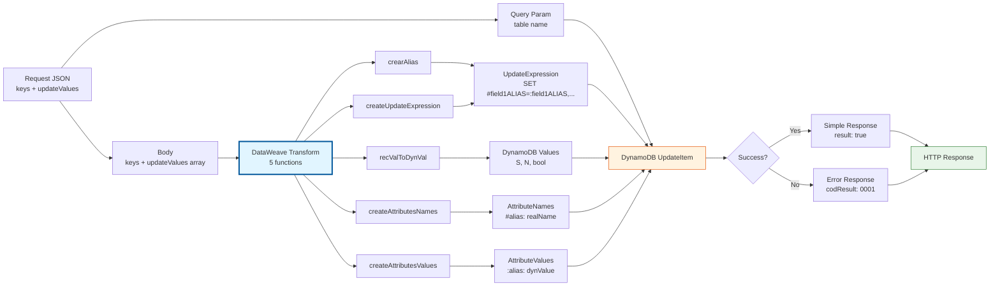

# POST /item/update

## 📌 Descripción General

### Propósito del Endpoint

Este endpoint actualiza campos específicos de un item existente en una tabla DynamoDB sin reemplazar el item completo. Proporciona una interfaz REST simple para la operación UpdateItem de DynamoDB, construyendo automáticamente la UpdateExpression y manejando la complejidad de los nombres de atributos y valores.

El endpoint soporta:
- **Actualización parcial**: Modifica solo los campos especificados
- **Preservación de datos**: Mantiene intactos los campos no mencionados
- **Tabla dinámica**: Permite especificar la tabla objetivo mediante query parameter
- **Construcción automática**: Genera UpdateExpression, AttributeNames y AttributeValues
- **Protección de nombres reservados**: Sistema de alias para evitar conflictos con palabras reservadas de DynamoDB

### Tipo de API

**Capa:** System API (API-Led Connectivity)

**Función:** Integración directa con Amazon DynamoDB para operaciones de actualización parcial de items.

### Patrón de Integración

**Tipo:** Request-Reply Síncrono con DynamoDB UpdateItem

**Descripción:** El endpoint recibe una solicitud con el nombre de la tabla, la clave del item y los campos a actualizar, construye automáticamente la UpdateExpression de DynamoDB con sus atributos, invoca la operación UpdateItem, y retorna una confirmación simple de éxito o error.

### Arquitectura API-Led Connectivity



---

## 💼 Propósito del Negocio

### Casos de Uso Principales

1. **Actualización de Estado de Clientes**
   - Cambiar estado de activo a inactivo
   - Actualizar información de contacto
   - Beneficio: Modificación eficiente sin afectar otros datos

2. **Modificación de Configuraciones**
   - Actualizar preferencias de usuario
   - Cambiar parámetros operacionales
   - Beneficio: Actualizaciones granulares y controladas

3. **Actualización de Métricas**
   - Incrementar contadores
   - Actualizar timestamps de última actividad
   - Beneficio: Operaciones atómicas sin condiciones de carrera

4. **Corrección de Datos**
   - Corregir errores en campos específicos
   - Actualizar información desactualizada
   - Beneficio: Precisión sin riesgo de perder otros datos

### Contexto Empresarial

- **Dominio:** Gestión de Datos NoSQL
- **Sector:** Energía - Utilities
- **División:** Naturgy España - FUA (Área de Usuario Funcional)
- **Proceso de Negocio:** Actualización y mantenimiento de datos de clientes y operaciones
- **Tecnología:** Amazon DynamoDB (NoSQL Database)

### Stakeholders

- **Desarrolladores de Process APIs**: Necesitan actualizar datos específicos sin reemplazar items
- **Equipos de Integración**: Requieren actualizaciones parciales eficientes
- **Arquitectos de Soluciones**: Buscan operaciones atómicas y seguras

### Valor de Negocio

- **Eficiencia**: Solo actualiza campos necesarios, no todo el item
- **Seguridad**: Preserva datos no modificados, evita pérdida accidental
- **Atomicidad**: Operaciones atómicas garantizadas por DynamoDB
- **Performance**: Más rápido que leer-modificar-escribir

### Consumidores Potenciales

Este endpoint puede ser consumido por:
- Process APIs de gestión de clientes (FUA)
- Process APIs de operaciones comerciales
- Experience APIs de portales web y móviles
- Sistemas de integración middleware
- Flujos de Salesforce que requieran actualizar datos en DynamoDB

---

## 🔧 Especificación Técnica

### URLs por Ambiente

| Ambiente | URL Base | URL Completa |
|----------|----------|--------------|
| **Local** | `http://localhost:8081` | `http://localhost:8081/api/item/update?table=:tableName` |
| **Development** | `https://ntgy-fua-s-dynamodb-dev.cloudhub.io` | `https://ntgy-fua-s-dynamodb-dev.cloudhub.io/api/item/update?table=:tableName` |
| **Test** | `https://ntgy-fua-s-dynamodb-test.cloudhub.io` | `https://ntgy-fua-s-dynamodb-test.cloudhub.io/api/item/update?table=:tableName` |
| **Production** | `https://ntgy-fua-s-dynamodb.cloudhub.io` | `https://ntgy-fua-s-dynamodb.cloudhub.io/api/item/update?table=:tableName` |

### Método HTTP

```
POST /api/item/update
```

### Parámetros de Entrada

#### Headers HTTP

| Header | Tipo | Requerido | Descripción | Ejemplo |
|--------|------|-----------|-------------|---------|
| `Content-Type` | string | ✅ Sí | Tipo de contenido del request | `application/json` |
| `Accept` | string | ❌ No | Tipo de contenido esperado en response | `application/json` |

#### Query Parameters

| Parámetro | Tipo | Requerido | Descripción | Ejemplo |
|-----------|------|-----------|-------------|---------|
| `table` | string | ✅ Sí | Nombre de la tabla DynamoDB donde actualizar el item | `"customers"` |

#### Body Parameters

El body debe contener la clave del item y los campos a actualizar.

**Estructura obligatoria:**
```json
{
  "keys": {
    "customerId": "CUST-12345"
  },
  "updateValues": [
    {
      "name": "email",
      "value": "nuevo.email@example.com"
    },
    {
      "name": "status",
      "value": "active"
    }
  ]
}
```

**Componentes del body:**

- **`keys`** (Object, requerido): Clave primaria del item a actualizar
  - Debe incluir partition key
  - Incluir sort key si la tabla lo requiere
  
- **`updateValues`** (Array, requerido): Lista de campos a actualizar
  - Cada elemento debe tener:
    - `name` (String): Nombre del campo
    - `value` (Any): Nuevo valor del campo

**Ejemplo con clave compuesta:**
```json
{
  "keys": {
    "customerId": "CUST-12345",
    "timestamp": "1704729600"
  },
  "updateValues": [
    {
      "name": "status",
      "value": "processed"
    }
  ]
}
```

**Tipos de valores soportados:**
- **String**: Texto simple
- **Number**: Enteros y decimales
- **Boolean**: true/false

**Nota Importante:** 
- Solo se actualizan los campos especificados en `updateValues`
- Los demás campos del item permanecen sin cambios
- El sistema añade automáticamente alias a los nombres para evitar conflictos con palabras reservadas de DynamoDB

### Respuestas

#### Respuesta Exitosa (200 OK)

```json
{
  "result": true
}
```

#### Respuesta de Error (200 OK con error)

```json
{
  "result": {
    "codResult": "0001",
    "msgResult": "ValidationException: The provided key element does not match the schema"
  }
}
```

### Códigos de Resultado

| Código | Descripción | Significado |
|--------|-------------|-------------|
| `true` | Success | Item actualizado exitosamente |
| `0001` | Error | Error técnico en la operación (item no existe, clave inválida, etc.) |

### Comportamiento de UpdateItem

**⚠️ Importante:** La operación UpdateItem tiene las siguientes características:

- **Actualización Parcial**: Solo modifica los campos especificados
- **Preserva Datos**: Los campos no mencionados permanecen intactos
- **Requiere Item Existente**: El item debe existir previamente (no crea items nuevos)
- **Operación Atómica**: Garantiza consistencia en actualizaciones concurrentes
- **Sistema de Alias**: Protege automáticamente contra nombres reservados de DynamoDB

### Autenticación y Autorización

- **Tipo:** Client ID & Client Secret (Anypoint Platform)
- **Autorización AWS:** El usuario de servicio debe tener permisos IAM para:
  - Ejecutar operación `dynamodb:UpdateItem`
  - Acceso de escritura a las tablas especificadas
  - Permisos configurados mediante IAM policies

### Timeouts

| Tipo | Valor | Descripción |
|------|-------|-------------|
| **Request Timeout** | 30 segundos | Tiempo máximo de espera para la respuesta |
| **Connection Timeout** | 10 segundos | Tiempo máximo para establecer conexión con DynamoDB |
| **DynamoDB Operation** | 10 segundos | Timeout específico para operación UpdateItem |

---

## 🏗️ Implementación Técnica

### Arquitectura del Flow



### Diagrama de Secuencia



**Flujo de Interacciones:**

1. **Request Inicial**: El cliente envía la petición con tabla, clave y campos a actualizar
2. **Logging**: Se registra el inicio de la operación
3. **Construcción de UpdateExpression**: DataWeave ejecuta 5 funciones para construir los parámetros de DynamoDB
4. **Operación DynamoDB**: Se ejecuta UpdateItem con la expresión construida
5. **Decisión por Resultado**:
   - **Éxito**: Respuesta simple `{"result": true}`
   - **Error**: Captura y transformación del error con código 0001
6. **Logging Final**: Se registra el resultado de la operación
7. **Response**: Se devuelve la respuesta al cliente con código HTTP 200

### Componentes Principales

#### 1. Logging Inicial
```xml
<logger level="INFO" message='Starting Update Item Flow #[vars.account]'/>
<logger level="DEBUG" message='#["Update Item in " ++ attributes.queryParams.table ++ " table"]'/>
```
- Registra inicio del flow con identificador de cuenta
- Log de debug con nombre de tabla

#### 2. Transformación DataWeave - Construcción de UpdateExpression

**5 Funciones DataWeave para construir la actualización:**

```dataweave
%dw 2.0
output application/json

// Función 1: Crear alias para nombres de atributos
fun crearAlias(value) = value ++ "ALIAS"

// Función 2: Convertir valor a formato DynamoDB
fun recValToDynVal(value) = 
    if (typeOf(value) ~= "String") ({"S": value})
    else if (typeOf(value) ~= "Number") ({"N": value as String})
    else if (typeOf(value) ~= "Boolean") ({"bool": value})
    else value  

// Función 3: Crear UpdateExpression
fun createUpdateExpression(expressions) = 
    "SET " ++ ((expressions map ((item, index) -> 
        ("#" ++ crearAlias(item.name)) ++ "=:" ++ (crearAlias(item.name))
    )) joinBy  ",")  

// Función 4: Crear AttributeNames (mapeo de alias a nombres reales)
fun createAttributesNames(attributes) = 
    attributes reduce ((item, accumulator={}) -> 
        accumulator ++ ("#" ++ crearAlias(item)) : item
    ) 

// Función 5: Crear AttributeValues (valores en formato DynamoDB)
fun createAttributesValues(attributes) = 
    attributes reduce ((item, accumulator={}) -> 
        accumulator ++ {(":" ++ crearAlias(item.name)): recValToDynVal(item.value)}
    )                    
           
---
{
    "key": payload.keys mapObject ((value, key, index) -> {
        (key as String): recValToDynVal(value)
    }),
    "updateExpression": createUpdateExpression(payload.updateValues),
    "attributesNames": createAttributesNames(payload.updateValues..name),
    "attributesValues": createAttributesValues(payload.updateValues)    
}
```

**Explicación de cada función:**

1. **`crearAlias(value)`**
   - Añade sufijo "ALIAS" al nombre del atributo
   - Protege contra palabras reservadas de DynamoDB
   - Ejemplo: `"email"` → `"emailALIAS"`

2. **`recValToDynVal(value)`**
   - Convierte valores a formato de atributos DynamoDB
   - String → `{"S": "value"}`
   - Number → `{"N": "123"}`
   - Boolean → `{"bool": true}`

3. **`createUpdateExpression(expressions)`**
   - Construye la expresión SET de DynamoDB
   - Ejemplo: `"SET #emailALIAS=:emailALIAS,#statusALIAS=:statusALIAS"`

4. **`createAttributesNames(attributes)`**
   - Mapea alias a nombres reales de atributos
   - Ejemplo: `{"#emailALIAS": "email", "#statusALIAS": "status"}`

5. **`createAttributesValues(attributes)`**
   - Convierte valores a formato DynamoDB con alias
   - Ejemplo: `{":emailALIAS": {"S": "nuevo@email.com"}}`

**Ejemplo completo de transformación:**

```javascript
// Input
{
  "keys": {"customerId": "CUST-123"},
  "updateValues": [
    {"name": "email", "value": "nuevo@email.com"},
    {"name": "status", "value": "active"},
    {"name": "age", "value": 30}
  ]
}

// Output (interno para DynamoDB)
{
  "key": {
    "customerId": {"S": "CUST-123"}
  },
  "updateExpression": "SET #emailALIAS=:emailALIAS,#statusALIAS=:statusALIAS,#ageALIAS=:ageALIAS",
  "attributesNames": {
    "#emailALIAS": "email",
    "#statusALIAS": "status",
    "#ageALIAS": "age"
  },
  "attributesValues": {
    ":emailALIAS": {"S": "nuevo@email.com"},
    ":statusALIAS": {"S": "active"},
    ":ageALIAS": {"N": "30"}
  }
}
```

#### 3. Operación DynamoDB UpdateItem
```xml
<dynamodb:update-item 
    config-ref="Amazon_DynamoDB_Configuration" 
    tableName="#[attributes.queryParams.table]"
    updateExpression="#[payload.updateExpression]"
    attributeValues="#[payload.attributesValues]"
    attributeNames="#[payload.attributesNames]">
    <dynamodb:key><![CDATA[#[payload.key]]]></dynamodb:key>
</dynamodb:update-item>
```

**Parámetros de la operación:**
- **tableName**: Nombre de la tabla desde query parameter
- **key**: Clave primaria del item (ya transformada)
- **updateExpression**: Expresión SET construida
- **attributeNames**: Mapeo de alias a nombres reales
- **attributeValues**: Valores en formato DynamoDB con alias

#### 4. Transformación de Respuesta Exitosa

```dataweave
%dw 2.0
output application/json
---
{
    "result": true
}
```

**Respuesta simple:** Solo indica éxito de la operación.

#### 5. Manejo de Errores

```xml
<error-handler>
    <on-error-continue>
        <ee:transform>
            {
                "result": {
                    "codResult": "0001",
                    "msgResult": error.description replace /\"/ with("")
                }
            }
        </ee:transform>
        <logger level="ERROR" 
                message='#["Update Item Flow finished with errors: " ++ error.description]'/>
    </on-error-continue>
</error-handler>
```

**Errores capturados:**
- `ResourceNotFoundException`: Item o tabla no existe
- `ValidationException`: Clave inválida o expresión malformada
- `ConditionalCheckFailedException`: Condición de actualización no cumplida
- `ProvisionedThroughputExceededException`: Límite de capacidad excedido
- Errores de conectividad con AWS
- Errores de autenticación IAM

### Configuración de DynamoDB

**Conexión configurada en global.xml:**
```xml
<dynamodb:config name="Amazon_DynamoDB_Configuration">
    <dynamodb:basic-connection 
        accessKey="#[Mule::p(vars.account ++ '.accessKey')]" 
        secretKey='#[Mule::p("secure::" ++ vars.account ++ ".secretKey")]' 
        region="#[Mule::p(vars.account ++ '.region')]" />
</dynamodb:config>
```

**Características:**
- Credenciales dinámicas por cuenta AWS
- Secret Key encriptado con Secure Properties
- Región configurable por ambiente
- Soporte multi-cuenta (account1, account2, etc.)

### Diagrama de Transformación de Datos



### Variables de Contexto

| Variable | Tipo | Descripción | Ejemplo |
|----------|------|-------------|---------|
| `vars.account` | String | Identificador de cuenta AWS para credenciales dinámicas | `"account1"` |
| `attributes.queryParams.table` | String | Nombre de tabla DynamoDB desde query parameter | `"customers"` |
| `payload.key` | Object | Clave del item (después de transformación) | `{customerId: {S: "123"}}` |
| `payload.updateExpression` | String | Expresión SET construida | `"SET #emailALIAS=:emailALIAS"` |
| `payload.attributesNames` | Object | Mapeo de alias a nombres reales | `{"#emailALIAS": "email"}` |
| `payload.attributesValues` | Object | Valores en formato DynamoDB | `{":emailALIAS": {"S": "..."}}` |

### Dependencias Técnicas

**Conectores:**
- Amazon DynamoDB Connector 1.5.3
- HTTP Connector 1.11.1
- APIKit Module 1.11.11

**Módulos:**
- Secure Configuration Property Module (credenciales)
- Naturgy CLI Logger Extension 1.0.0 (logging)
- Mule Tracing Module (observabilidad)

---

## 💻 Ejemplos de Uso

### Ejemplo 1: Actualizar Un Campo

**Request:**
```bash
curl -X POST "http://localhost:8081/api/item/update?table=customers" \
  -H "Content-Type: application/json" \
  -d '{
    "keys": {
      "customerId": "CUST-12345"
    },
    "updateValues": [
      {
        "name": "email",
        "value": "nuevo.email@naturgy.com"
      }
    ]
  }'
```

**Response (200 OK):**
```json
{
  "result": true
}
```

### Ejemplo 2: Actualizar Múltiples Campos

**Request:**
```bash
curl -X POST "http://localhost:8081/api/item/update?table=customers" \
  -H "Content-Type: application/json" \
  -d '{
    "keys": {
      "customerId": "CUST-12345"
    },
    "updateValues": [
      {
        "name": "email",
        "value": "nuevo.email@naturgy.com"
      },
      {
        "name": "status",
        "value": "inactive"
      },
      {
        "name": "lastModified",
        "value": "2024-01-08T10:30:00Z"
      }
    ]
  }'
```

**Response (200 OK):**
```json
{
  "result": true
}
```

### Ejemplo 3: Actualizar con Diferentes Tipos de Datos

**Request:**
```bash
curl -X POST "http://localhost:8081/api/item/update?table=customer_profiles" \
  -H "Content-Type: application/json" \
  -d '{
    "keys": {
      "profileId": "PROF-54321"
    },
    "updateValues": [
      {
        "name": "age",
        "value": 39
      },
      {
        "name": "active",
        "value": true
      },
      {
        "name": "lastLogin",
        "value": "2024-01-08T10:30:00Z"
      }
    ]
  }'
```

**Response (200 OK):**
```json
{
  "result": true
}
```

### Ejemplo 4: Actualizar con Clave Compuesta

**Request:**
```bash
curl -X POST "http://localhost:8081/api/item/update?table=transactions" \
  -H "Content-Type: application/json" \
  -d '{
    "keys": {
      "accountId": "ACC-98765",
      "transactionDate": "1704729600"
    },
    "updateValues": [
      {
        "name": "status",
        "value": "completed"
      },
      {
        "name": "processedBy",
        "value": "system-auto"
      }
    ]
  }'
```

**Response (200 OK):**
```json
{
  "result": true
}
```

### Ejemplo 5: Error - Item No Existe

**Request:**
```bash
curl -X POST "http://localhost:8081/api/item/update?table=customers" \
  -H "Content-Type: application/json" \
  -d '{
    "keys": {
      "customerId": "CUST-99999"
    },
    "updateValues": [
      {
        "name": "status",
        "value": "active"
      }
    ]
  }'
```

**Response (200 OK - Error):**
```json
{
  "result": {
    "codResult": "0001",
    "msgResult": "The conditional request failed"
  }
}
```

### Ejemplo 6: Error - Clave Inválida

**Request:**
```bash
curl -X POST "http://localhost:8081/api/item/update?table=customers" \
  -H "Content-Type: application/json" \
  -d '{
    "keys": {
      "wrongKey": "CUST-12345"
    },
    "updateValues": [
      {
        "name": "status",
        "value": "active"
      }
    ]
  }'
```

**Response (200 OK - Error):**
```json
{
  "result": {
    "codResult": "0001",
    "msgResult": "ValidationException: The provided key element does not match the schema"
  }
}
```

### Ejemplo 7: Uso desde JavaScript/Node.js

```javascript
const axios = require('axios');

async function updateItemInDynamoDB(tableName, keys, updates) {
  try {
    const response = await axios.post(
      `https://ntgy-fua-s-dynamodb.cloudhub.io/api/item/update?table=${tableName}`,
      {
        keys: keys,
        updateValues: updates
      },
      {
        headers: {
          'Content-Type': 'application/json',
          'client_id': 'your-client-id',
          'client_secret': 'your-client-secret'
        }
      }
    );

    if (response.data.result === true) {
      console.log('Item actualizado exitosamente');
      return true;
    } else {
      console.error('Error al actualizar item:', response.data.result.msgResult);
      throw new Error(response.data.result.msgResult);
    }
  } catch (error) {
    console.error('Error en la petición:', error.message);
    throw error;
  }
}

// Uso
const keys = {
  customerId: 'CUST-12345'
};

const updates = [
  { name: 'email', value: 'nuevo.email@naturgy.com' },
  { name: 'status', value: 'active' },
  { name: 'lastModified', value: new Date().toISOString() }
];

updateItemInDynamoDB('customers', keys, updates)
  .then(() => console.log('Operación completada'))
  .catch(err => console.error('Error:', err));
```

### Ejemplo 8: Uso desde Python

```python
import requests
import json
from datetime import datetime

def update_item_in_dynamodb(table_name, keys, updates):
    url = f"https://ntgy-fua-s-dynamodb.cloudhub.io/api/item/update?table={table_name}"
    
    headers = {
        'Content-Type': 'application/json',
        'client_id': 'your-client-id',
        'client_secret': 'your-client-secret'
    }
    
    payload = {
        'keys': keys,
        'updateValues': updates
    }
    
    try:
        response = requests.post(url, headers=headers, json=payload)
        response.raise_for_status()
        
        data = response.json()
        
        if data.get('result') == True:
            print('Item actualizado exitosamente')
            return True
        else:
            error_msg = data['result']['msgResult']
            print(f'Error al actualizar item: {error_msg}')
            raise Exception(error_msg)
            
    except requests.exceptions.RequestException as e:
        print(f'Error en la petición: {e}')
        raise

# Uso
keys = {
    'customerId': 'CUST-12345'
}

updates = [
    {'name': 'email', 'value': 'nuevo.email@naturgy.com'},
    {'name': 'status', 'value': 'active'},
    {'name': 'lastModified', 'value': datetime.now().isoformat()}
]

try:
    update_item_in_dynamodb('customers', keys, updates)
    print('Operación completada')
except Exception as e:
    print(f'Error: {e}')
```

### Consideraciones de Uso

**Performance:**
- Operación UpdateItem es muy rápida (< 20ms en DynamoDB)
- Tiempo total de respuesta típico: 500ms - 1s
- Más eficiente que POST /item para actualizaciones parciales

**Mejores Prácticas:**
- **Actualizar solo campos necesarios**: No incluir campos que no cambian
- **Validar clave antes de actualizar**: Asegurar que el item existe
- **Usar para actualizaciones parciales**: Ideal cuando solo cambian algunos campos
- **Implementar retry logic**: Para errores transitorios (throttling)
- **Verificar tipos de datos**: Asegurar que los valores son del tipo correcto

**Limitaciones:**
- **Requiere item existente**: No crea items nuevos (usar POST /item para eso)
- **Solo tipos primitivos**: No soporta actualización de objetos anidados o arrays complejos
- **Clave completa requerida**: Debe incluir partition key (y sort key si aplica)
- **Tabla debe existir**: No crea tablas automáticamente

**Comparación con Otros Endpoints:**

| Aspecto | POST /item | POST /item/update |
|---------|------------|-------------------|
| **Operación DynamoDB** | PutItem | UpdateItem |
| **Comportamiento** | Crea o reemplaza completo | Actualiza campos específicos |
| **Campos no mencionados** | Se pierden | Se preservan |
| **Uso ideal** | Crear nuevos items | Actualizar items existentes |
| **Eficiencia** | Menos eficiente para updates | Más eficiente para updates |
| **Riesgo de pérdida de datos** | Alto (reemplaza todo) | Bajo (solo actualiza especificados) |

**Cuándo usar cada endpoint:**

- **POST /item**: 
  - Crear nuevos items
  - Reemplazar un item completo
  - Cuando tienes todos los datos del item

- **POST /item/update**: 
  - Actualizar campos específicos
  - Modificar estado o configuración
  - Cuando solo algunos campos cambian
  - Cuando quieres preservar datos existentes

**Sistema de Alias:**

El endpoint añade automáticamente el sufijo "ALIAS" a todos los nombres de atributos para proteger contra palabras reservadas de DynamoDB (como "name", "status", "data", etc.). Esto es transparente para el usuario - solo necesitas enviar los nombres de campos normales.

**Ejemplo de protección:**
```javascript
// Tu request
{
  "keys": {"id": "123"},
  "updateValues": [
    {"name": "status", "value": "active"}  // "status" es palabra reservada
  ]
}

// Internamente se convierte a
{
  "updateExpression": "SET #statusALIAS=:statusALIAS",
  "attributesNames": {"#statusALIAS": "status"},
  "attributesValues": {":statusALIAS": {"S": "active"}}
}
```
