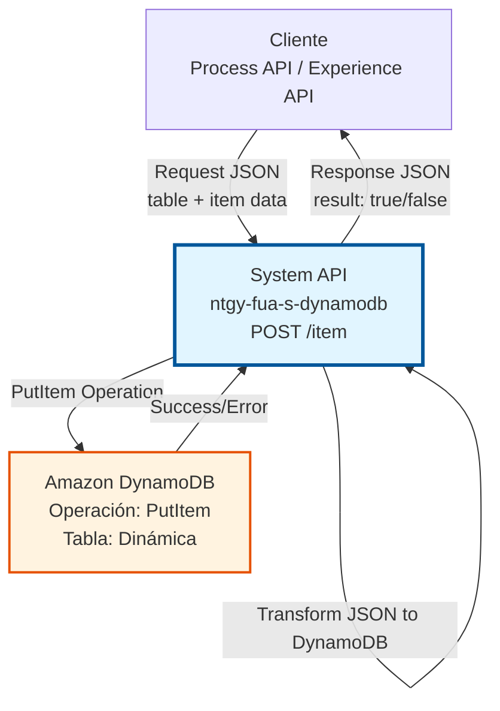
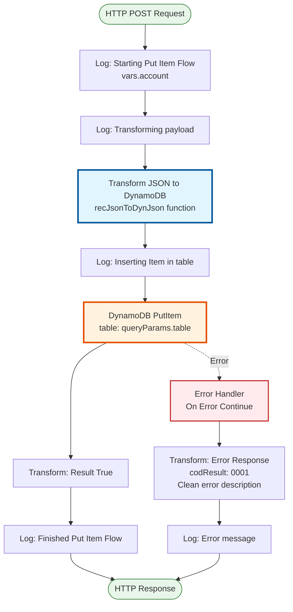
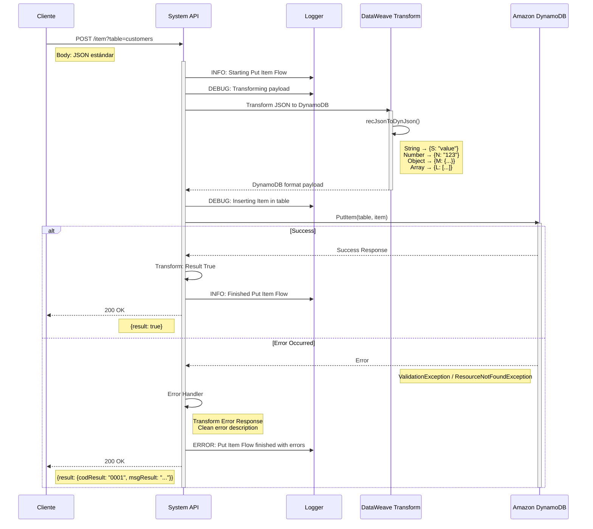
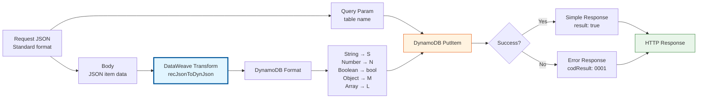

# POST /item

## 📌 Descripción General

### Propósito del Endpoint

Este endpoint crea un nuevo item en una tabla DynamoDB o reemplaza un item existente si la clave ya existe. Proporciona una interfaz REST simple para la operación PutItem de DynamoDB, abstrayendo la complejidad del formato de atributos de DynamoDB mediante transformación automática de JSON estándar.

El endpoint soporta:
- **Creación de items**: Inserta nuevos registros en la tabla especificada
- **Reemplazo de items**: Sobrescribe items existentes con la misma clave
- **Tabla dinámica**: Permite especificar la tabla objetivo mediante query parameter
- **Transformación automática**: Convierte JSON estándar a formato de atributos DynamoDB
- **Soporte de tipos complejos**: Maneja objetos anidados, arrays, y tipos primitivos

### Tipo de API

**Capa:** System API (API-Led Connectivity)

**Función:** Integración directa con Amazon DynamoDB para operaciones de escritura de items.

### Patrón de Integración

**Tipo:** Request-Reply Síncrono con DynamoDB PutItem

**Descripción:** El endpoint recibe una solicitud con el nombre de la tabla y los datos del item en JSON estándar, transforma automáticamente el JSON al formato de atributos DynamoDB, invoca la operación PutItem, y retorna una confirmación simple de éxito o error.

### Arquitectura API-Led Connectivity



---

## 💼 Propósito del Negocio

### Casos de Uso Principales

1. **Registro de Nuevos Clientes**
   - Crear perfiles de clientes en el sistema
   - Almacenar información de contacto y preferencias
   - Beneficio: Onboarding rápido de nuevos clientes

2. **Almacenamiento de Transacciones**
   - Registrar operaciones comerciales
   - Guardar histórico de actividades
   - Beneficio: Trazabilidad completa de operaciones

3. **Gestión de Configuraciones**
   - Crear nuevas configuraciones de sistema
   - Actualizar parámetros operacionales
   - Beneficio: Gestión centralizada y flexible

4. **Sincronización de Datos**
   - Replicar datos desde sistemas externos
   - Mantener copias de información crítica
   - Beneficio: Disponibilidad y redundancia de datos

### Contexto Empresarial

- **Dominio:** Gestión de Datos NoSQL
- **Sector:** Energía - Utilities
- **División:** Naturgy España - FUA (Área de Usuario Funcional)
- **Proceso de Negocio:** Creación y actualización de datos de clientes y operaciones
- **Tecnología:** Amazon DynamoDB (NoSQL Database)

### Stakeholders

- **Desarrolladores de Process APIs**: Necesitan crear datos en DynamoDB de forma simple
- **Equipos de Integración**: Requieren interfaz REST estándar para escritura
- **Arquitectos de Soluciones**: Buscan abstracción de complejidad de AWS

### Valor de Negocio

- **Simplicidad**: Interfaz REST con JSON estándar (no requiere formato DynamoDB)
- **Seguridad**: Centraliza gestión de credenciales AWS
- **Flexibilidad**: Soporta estructuras de datos complejas y anidadas
- **Performance**: Escritura rápida y directa en DynamoDB (< 1s)

### Consumidores Potenciales

Este endpoint puede ser consumido por:
- Process APIs de gestión de clientes (FUA)
- Process APIs de operaciones comerciales
- Experience APIs de portales web y móviles
- Sistemas de integración middleware
- Flujos de Salesforce que requieran persistir datos en DynamoDB

---

## 🔧 Especificación Técnica

### URLs por Ambiente

| Ambiente | URL Base | URL Completa |
|----------|----------|--------------|
| **Local** | `http://localhost:8081` | `http://localhost:8081/api/item?table=:tableName` |
| **Development** | `https://ntgy-fua-s-dynamodb-dev.cloudhub.io` | `https://ntgy-fua-s-dynamodb-dev.cloudhub.io/api/item?table=:tableName` |
| **Test** | `https://ntgy-fua-s-dynamodb-test.cloudhub.io` | `https://ntgy-fua-s-dynamodb-test.cloudhub.io/api/item?table=:tableName` |
| **Production** | `https://ntgy-fua-s-dynamodb.cloudhub.io` | `https://ntgy-fua-s-dynamodb.cloudhub.io/api/item?table=:tableName` |

### Método HTTP

```
POST /api/item
```

### Parámetros de Entrada

#### Headers HTTP

| Header | Tipo | Requerido | Descripción | Ejemplo |
|--------|------|-----------|-------------|---------|
| `Content-Type` | string | ✅ Sí | Tipo de contenido del request | `application/json` |
| `Accept` | string | ❌ No | Tipo de contenido esperado en response | `application/json` |

#### Query Parameters

| Parámetro | Tipo | Requerido | Descripción | Ejemplo |
|-----------|------|-----------|-------------|---------|
| `table` | string | ✅ Sí | Nombre de la tabla DynamoDB donde crear el item | `"customers"` |

#### Body Parameters

El body debe contener el item completo en formato JSON estándar. **NO es necesario usar el formato de atributos DynamoDB** - la transformación es automática.

**Estructura para item simple:**
```json
{
  "customerId": "CUST-12345",
  "name": "Juan Pérez",
  "email": "juan.perez@example.com",
  "status": "active"
}
```

**Estructura para item con datos anidados:**
```json
{
  "customerId": "CUST-12345",
  "personalInfo": {
    "firstName": "Juan",
    "lastName": "Pérez",
    "age": 35
  },
  "contacts": [
    {
      "type": "email",
      "value": "juan@example.com"
    },
    {
      "type": "phone",
      "value": "+34612345678"
    }
  ],
  "active": true
}
```

**Tipos de datos soportados:**
- **String**: Texto simple
- **Number**: Enteros y decimales
- **Boolean**: true/false
- **Object**: Objetos anidados
- **Array**: Listas de valores

**Nota Importante:** El endpoint transforma automáticamente:
- String → `{"S": "value"}`
- Number → `{"N": "123"}`
- Boolean → `{"bool": true}`
- Object → `{"M": {...}}`
- Array → `{"L": [...]}`

### Respuestas

#### Respuesta Exitosa (200 OK)

```json
{
  "result": true
}
```

#### Respuesta de Error (200 OK con error)

```json
{
  "result": {
    "codResult": "0001",
    "msgResult": "ConditionalCheckFailedException: The conditional request failed"
  }
}
```

### Códigos de Resultado

| Código | Descripción | Significado |
|--------|-------------|-------------|
| `true` | Success | Item creado/actualizado exitosamente |
| `0001` | Error | Error técnico en la operación (tabla no existe, validación fallida, etc.) |

### Comportamiento de PutItem

**⚠️ Importante:** La operación PutItem tiene las siguientes características:

- **Crea o Reemplaza**: Si el item no existe, lo crea. Si existe (misma clave), lo reemplaza completamente.
- **Reemplazo Completo**: No hace merge de campos - reemplaza el item entero.
- **Requiere Clave Completa**: El body debe incluir la partition key (y sort key si aplica).

### Autenticación y Autorización

- **Tipo:** Client ID & Client Secret (Anypoint Platform)
- **Autorización AWS:** El usuario de servicio debe tener permisos IAM para:
  - Ejecutar operación `dynamodb:PutItem`
  - Acceso de escritura a las tablas especificadas
  - Permisos configurados mediante IAM policies

### Timeouts

| Tipo | Valor | Descripción |
|------|-------|-------------|
| **Request Timeout** | 30 segundos | Tiempo máximo de espera para la respuesta |
| **Connection Timeout** | 10 segundos | Tiempo máximo para establecer conexión con DynamoDB |
| **DynamoDB Operation** | 10 segundos | Timeout específico para operación PutItem |

---

## 🏗️ Implementación Técnica

### Arquitectura del Flow



### Diagrama de Secuencia



**Flujo de Interacciones:**

1. **Request Inicial**: El cliente envía la petición con tabla y datos del item en JSON estándar
2. **Logging**: Se registra el inicio de la operación
3. **Transformación JSON → DynamoDB**: DataWeave convierte el JSON a formato de atributos DynamoDB
4. **Operación DynamoDB**: Se ejecuta PutItem en la tabla especificada
5. **Decisión por Resultado**:
   - **Éxito**: Respuesta simple `{"result": true}`
   - **Error**: Captura y transformación del error con código 0001
6. **Logging Final**: Se registra el resultado de la operación
7. **Response**: Se devuelve la respuesta al cliente con código HTTP 200

### Componentes Principales

#### 1. Logging Inicial
```xml
<logger level="INFO" message='Starting Put Item Flow #[vars.account]'/>
<logger level="DEBUG" message='#["Transforming payload from JSON to DynamoJSON"]'/>
```
- Registra inicio del flow con identificador de cuenta
- Log de debug para trazabilidad de transformación

#### 2. Transformación DataWeave - JSON a DynamoDB

**Función recursiva para convertir JSON estándar a formato DynamoDB:**
```dataweave
%dw 2.0
import * from dw::core::Strings
output application/json

fun recJsonToDynJson(o: Object) = 
    o mapObject ((value, key, index) -> 
        {
            (key): if (typeOf(value) ~= "String") ({"S": value})
                    else if (typeOf(value) ~= "Object") ({"M": recJsonToDynJson(value)})
                    else if (typeOf(value) ~= "Array") ({"L": recConvertArray(value)})
                    else if (typeOf(value) ~= "Number") ({"N": value as String})
                    else if (typeOf(value) ~= "Boolean") ({"bool": value})
                    else value
        }
    )

fun recConvertArray(ar: Array) =
    ar map (val, ind) ->
            if (typeOf(val) ~= "String") ({"S": val})
                else if (typeOf(val) ~= "Object") ({"M": recJsonToDynJson(val)})
                else if (typeOf(val) ~= "Array") ({"L": val})
                else if (typeOf(val) ~= "Number") ({"N": val as String})
                else if (typeOf(val) ~= "Boolean") ({"bool": val})
                else val
---
recJsonToDynJson(payload)
```

**Características de la transformación:**
- Detecta automáticamente el tipo de cada campo
- Convierte String a formato `{"S": "value"}`
- Convierte Number a formato `{"N": "123"}` (como string)
- Convierte Boolean a formato `{"bool": true}`
- Maneja objetos anidados recursivamente con `{"M": {...}}`
- Maneja arrays con `{"L": [...]}`
- Preserva la estructura completa del JSON original

**Ejemplo de transformación:**
```javascript
// Input (JSON estándar)
{
  "id": "123",
  "name": "Juan",
  "age": 30,
  "active": true,
  "address": {
    "city": "Madrid"
  }
}

// Output (formato DynamoDB)
{
  "id": {"S": "123"},
  "name": {"S": "Juan"},
  "age": {"N": "30"},
  "active": {"bool": true},
  "address": {
    "M": {
      "city": {"S": "Madrid"}
    }
  }
}
```

#### 3. Operación DynamoDB PutItem
```xml
<dynamodb:put-item 
    config-ref="Amazon_DynamoDB_Configuration" 
    tableName="#[attributes.queryParams.table]" />
```
- **Conector:** Amazon DynamoDB Connector 1.5.3
- **Operación:** PutItem
- **Tabla:** Dinámica desde query parameter
- **Payload:** Item en formato DynamoDB (ya transformado)
- **Configuración:** Credenciales AWS desde secure properties

#### 4. Transformación de Respuesta Exitosa

```dataweave
%dw 2.0
output application/json
---
{
    "result": true
}
```

**Respuesta simple:** Solo indica éxito de la operación, sin devolver el item creado.

#### 5. Manejo de Errores

```xml
<error-handler>
    <on-error-continue>
        <ee:transform>
            {
                "result": {
                    "codResult": "0001",
                    "msgResult": error.description replace /\"/ with("")
                }
            }
        </ee:transform>
        <logger level="ERROR" 
                message='#["Put Item Flow finished with errors: " ++ error.description]'/>
    </on-error-continue>
</error-handler>
```

**Errores capturados:**
- `ResourceNotFoundException`: Tabla no existe
- `ValidationException`: Datos inválidos o clave faltante
- `ProvisionedThroughputExceededException`: Límite de capacidad excedido
- `ConditionalCheckFailedException`: Condición de escritura no cumplida
- Errores de conectividad con AWS
- Errores de autenticación IAM

### Configuración de DynamoDB

**Conexión configurada en global.xml:**
```xml
<dynamodb:config name="Amazon_DynamoDB_Configuration">
    <dynamodb:basic-connection 
        accessKey="#[Mule::p(vars.account ++ '.accessKey')]" 
        secretKey='#[Mule::p("secure::" ++ vars.account ++ ".secretKey")]' 
        region="#[Mule::p(vars.account ++ '.region')]" />
</dynamodb:config>
```

**Características:**
- Credenciales dinámicas por cuenta AWS
- Secret Key encriptado con Secure Properties
- Región configurable por ambiente
- Soporte multi-cuenta (account1, account2, etc.)

### Diagrama de Transformación de Datos



### Variables de Contexto

| Variable | Tipo | Descripción | Ejemplo |
|----------|------|-------------|---------|
| `vars.account` | String | Identificador de cuenta AWS para credenciales dinámicas | `"account1"` |
| `attributes.queryParams.table` | String | Nombre de tabla DynamoDB desde query parameter | `"customers"` |
| `payload` | Object | Item a insertar (después de transformación a formato DynamoDB) | `{id: {S: "123"}, ...}` |

### Dependencias Técnicas

**Conectores:**
- Amazon DynamoDB Connector 1.5.3
- HTTP Connector 1.11.1
- APIKit Module 1.11.11

**Módulos:**
- Secure Configuration Property Module (credenciales)
- Naturgy CLI Logger Extension 1.0.0 (logging)
- Mule Tracing Module (observabilidad)

---

## 💻 Ejemplos de Uso

### Ejemplo 1: Crear Item Simple

**Request:**
```bash
curl -X POST "http://localhost:8081/api/item?table=customers" \
  -H "Content-Type: application/json" \
  -d '{
    "customerId": "CUST-12345",
    "name": "María García",
    "email": "maria.garcia@naturgy.com",
    "status": "active",
    "createdDate": "2024-01-08"
  }'
```

**Response (200 OK):**
```json
{
  "result": true
}
```

### Ejemplo 2: Crear Item con Estructura Compleja

**Request:**
```bash
curl -X POST "http://localhost:8081/api/item?table=customer_profiles" \
  -H "Content-Type: application/json" \
  -d '{
    "profileId": "PROF-54321",
    "personalInfo": {
      "firstName": "Carlos",
      "lastName": "Rodríguez",
      "dateOfBirth": "1985-03-15",
      "age": 38
    },
    "contactInfo": {
      "email": "carlos.rodriguez@email.com",
      "phone": "+34612345678",
      "address": {
        "street": "Calle Mayor 123",
        "city": "Madrid",
        "postalCode": "28013",
        "country": "España"
      }
    },
    "preferences": {
      "language": "es",
      "notifications": true,
      "newsletter": false
    },
    "active": true
  }'
```

**Response (200 OK):**
```json
{
  "result": true
}
```

### Ejemplo 3: Crear Item con Arrays

**Request:**
```bash
curl -X POST "http://localhost:8081/api/item?table=contracts" \
  -H "Content-Type: application/json" \
  -d '{
    "contractId": "CNT-2024-001",
    "customerId": "CUST-12345",
    "services": [
      {
        "type": "electricity",
        "status": "active",
        "startDate": "2024-01-01"
      },
      {
        "type": "gas",
        "status": "active",
        "startDate": "2024-01-01"
      }
    ],
    "billingCycle": "monthly",
    "totalAmount": 150.75
  }'
```

**Response (200 OK):**
```json
{
  "result": true
}
```

### Ejemplo 4: Error - Tabla No Existe

**Request:**
```bash
curl -X POST "http://localhost:8081/api/item?table=nonexistent_table" \
  -H "Content-Type: application/json" \
  -d '{
    "id": "123",
    "name": "Test"
  }'
```

**Response (200 OK - Error):**
```json
{
  "result": {
    "codResult": "0001",
    "msgResult": "ResourceNotFoundException: Requested resource not found: Table: nonexistent_table not found"
  }
}
```

### Ejemplo 5: Error - Datos Inválidos

**Request:**
```bash
curl -X POST "http://localhost:8081/api/item?table=customers" \
  -H "Content-Type: application/json" \
  -d '{
    "name": "Test sin clave primaria"
  }'
```

**Response (200 OK - Error):**
```json
{
  "result": {
    "codResult": "0001",
    "msgResult": "ValidationException: One or more parameter values were invalid: Missing the key customerId in the item"
  }
}
```

### Ejemplo 6: Uso desde JavaScript/Node.js

```javascript
const axios = require('axios');

async function createItemInDynamoDB(tableName, itemData) {
  try {
    const response = await axios.post(
      `https://ntgy-fua-s-dynamodb.cloudhub.io/api/item?table=${tableName}`,
      itemData,
      {
        headers: {
          'Content-Type': 'application/json',
          'client_id': 'your-client-id',
          'client_secret': 'your-client-secret'
        }
      }
    );

    if (response.data.result === true) {
      console.log('Item creado exitosamente');
      return true;
    } else {
      console.error('Error al crear item:', response.data.result.msgResult);
      throw new Error(response.data.result.msgResult);
    }
  } catch (error) {
    console.error('Error en la petición:', error.message);
    throw error;
  }
}

// Uso
const newCustomer = {
  customerId: 'CUST-12345',
  name: 'María García',
  email: 'maria.garcia@naturgy.com',
  status: 'active',
  createdDate: new Date().toISOString(),
  preferences: {
    language: 'es',
    notifications: true
  }
};

createItemInDynamoDB('customers', newCustomer)
  .then(() => console.log('Operación completada'))
  .catch(err => console.error('Error:', err));
```

### Ejemplo 7: Uso desde Python

```python
import requests
import json
from datetime import datetime

def create_item_in_dynamodb(table_name, item_data):
    url = f"https://ntgy-fua-s-dynamodb.cloudhub.io/api/item?table={table_name}"
    
    headers = {
        'Content-Type': 'application/json',
        'client_id': 'your-client-id',
        'client_secret': 'your-client-secret'
    }
    
    try:
        response = requests.post(url, headers=headers, json=item_data)
        response.raise_for_status()
        
        data = response.json()
        
        if data.get('result') == True:
            print('Item creado exitosamente')
            return True
        else:
            error_msg = data['result']['msgResult']
            print(f'Error al crear item: {error_msg}')
            raise Exception(error_msg)
            
    except requests.exceptions.RequestException as e:
        print(f'Error en la petición: {e}')
        raise

# Uso
new_customer = {
    'customerId': 'CUST-12345',
    'name': 'María García',
    'email': 'maria.garcia@naturgy.com',
    'status': 'active',
    'createdDate': datetime.now().isoformat(),
    'preferences': {
        'language': 'es',
        'notifications': True
    }
}

try:
    create_item_in_dynamodb('customers', new_customer)
    print('Operación completada')
except Exception as e:
    print(f'Error: {e}')
```

### Ejemplo 8: Batch Creation (Múltiples Items)

```javascript
const axios = require('axios');

async function createMultipleItems(tableName, items) {
  const results = [];
  
  for (const item of items) {
    try {
      const response = await axios.post(
        `https://ntgy-fua-s-dynamodb.cloudhub.io/api/item?table=${tableName}`,
        item,
        {
          headers: {
            'Content-Type': 'application/json',
            'client_id': 'your-client-id',
            'client_secret': 'your-client-secret'
          }
        }
      );
      
      results.push({
        item: item,
        success: response.data.result === true,
        error: response.data.result !== true ? response.data.result.msgResult : null
      });
    } catch (error) {
      results.push({
        item: item,
        success: false,
        error: error.message
      });
    }
  }
  
  return results;
}

// Uso
const customers = [
  { customerId: 'CUST-001', name: 'Cliente 1', email: 'cliente1@example.com' },
  { customerId: 'CUST-002', name: 'Cliente 2', email: 'cliente2@example.com' },
  { customerId: 'CUST-003', name: 'Cliente 3', email: 'cliente3@example.com' }
];

createMultipleItems('customers', customers)
  .then(results => {
    const successful = results.filter(r => r.success).length;
    const failed = results.filter(r => !r.success).length;
    console.log(`Creados: ${successful}, Fallidos: ${failed}`);
    
    // Mostrar errores
    results.filter(r => !r.success).forEach(r => {
      console.error(`Error en ${r.item.customerId}: ${r.error}`);
    });
  });
```

### Consideraciones de Uso

**Performance:**
- Operación PutItem es rápida (< 20ms en DynamoDB)
- Tiempo total de respuesta típico: 500ms - 1s
- Para operaciones masivas, considerar batch operations (futura mejora)

**Mejores Prácticas:**
- **Incluir siempre la clave primaria** (partition key y sort key si aplica)
- **Validar datos antes de enviar** para evitar errores de validación
- **Usar idempotencia**: PutItem reemplaza items existentes, útil para reintentos
- **Estructurar datos apropiadamente**: Aprovechar objetos anidados y arrays
- **Implementar retry logic** para errores transitorios (throttling)

**Limitaciones:**
- **Reemplazo completo**: PutItem reemplaza el item entero, no hace merge de campos
- **Requiere clave completa**: Debe incluir partition key (y sort key si la tabla lo requiere)
- **No soporta actualizaciones parciales**: Para actualizar campos específicos, usar POST /item/update
- **Tabla debe existir**: No crea tablas automáticamente
- **Permisos necesarios**: Requiere permisos IAM de escritura en la tabla

**Diferencias con GET /item:**
- **GET**: Transforma DynamoDB → JSON (salida)
- **POST**: Transforma JSON → DynamoDB (entrada)
- **GET**: Devuelve el item completo
- **POST**: Devuelve solo confirmación de éxito
- **GET**: Códigos 0000, 0001, 0002
- **POST**: Solo true o código 0001

**Cuándo usar POST /item vs POST /item/update:**
- **POST /item**: Crear nuevos items o reemplazar items completos
- **POST /item/update**: Actualizar campos específicos sin reemplazar el item entero
