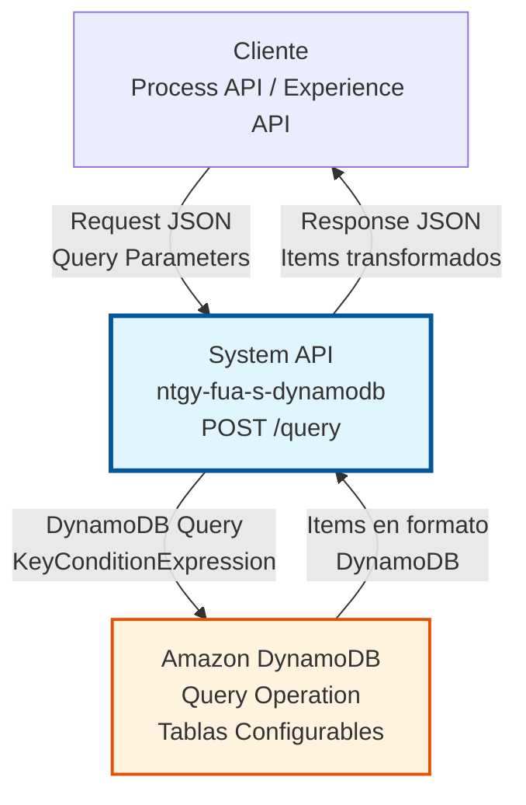
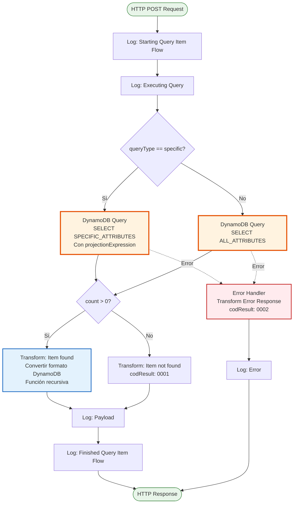
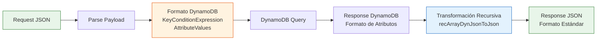

# POST /query

## 📌 Descripción General

### Propósito del Endpoint

Este endpoint permite realizar consultas eficientes en tablas de Amazon DynamoDB utilizando condiciones de clave (partition key y opcionalmente sort key). A diferencia del endpoint `/scan`, Query es más eficiente ya que utiliza índices para localizar items específicos en lugar de escanear toda la tabla.

El endpoint soporta:
- **Consultas por Partition Key**: Búsqueda eficiente usando la clave de partición
- **Condiciones de Sort Key**: Filtrado adicional usando la clave de ordenamiento
- **Índices Secundarios**: Soporte para Global Secondary Indexes (GSI) y Local Secondary Indexes (LSI)
- **Proyección de Atributos**: Selección de atributos específicos para optimizar el consumo de capacidad
- **Dos Modos de Query**: 
  - `queryType=specific`: Retorna solo atributos específicos definidos en `projectionExpression`
  - Modo por defecto: Retorna todos los atributos del item

### Tipo de API

**Capa:** System API (API-Led Connectivity)

**Función:** Integración directa con Amazon DynamoDB para operaciones de consulta eficiente de datos NoSQL.

### Patrón de Integración

**Tipo:** Request-Reply Síncrono con DynamoDB Query Operation

**Descripción:** El endpoint recibe una solicitud con los parámetros de consulta (tabla, condición, índice opcional), ejecuta la operación Query en DynamoDB, transforma la respuesta del formato DynamoDB a JSON estándar, y retorna los items encontrados.

### Arquitectura API-Led Connectivity



---

## 💼 Propósito del Negocio

### Casos de Uso Principales

1. **Búsqueda de Items por Clave de Partición**
   - Localizar todos los items que pertenecen a una entidad específica (ej: todos los pedidos de un cliente)
   - Utiliza la partition key para acceso eficiente
   - Retorna múltiples items relacionados

2. **Consultas con Filtros de Rango**
   - Buscar items dentro de un rango de fechas o valores
   - Utiliza sort key con operadores de comparación (`>`, `<`, `BETWEEN`, etc.)
   - Ideal para consultas temporales o secuenciales

3. **Consultas en Índices Secundarios**
   - Buscar items usando atributos alternativos mediante GSI/LSI
   - Permite patrones de acceso adicionales sin duplicar datos
   - Optimiza consultas por atributos no-clave

4. **Optimización de Consumo de Capacidad**
   - Proyectar solo los atributos necesarios
   - Reduce el consumo de Read Capacity Units (RCU)
   - Mejora el rendimiento de la red

### Contexto Empresarial

- **Dominio:** Gestión de Datos NoSQL
- **Sector:** Energía - Utilities
- **División:** Naturgy España - FUA (Área de Usuario Funcional)
- **Proceso de Negocio:** Consulta eficiente de datos operacionales y transaccionales
- **Tecnología:** Amazon DynamoDB (NoSQL Database)

### Stakeholders

- **Desarrolladores de Process APIs**: Necesitan consultar datos de DynamoDB de forma eficiente
- **Arquitectos de Datos**: Requieren patrones de acceso optimizados para diferentes casos de uso
- **Equipos de Operaciones**: Monitorean el consumo de capacidad y rendimiento de consultas

### Valor de Negocio

- **Eficiencia**: Query es significativamente más rápido que Scan para búsquedas específicas
- **Escalabilidad**: Soporta consultas en tablas con millones de items sin degradación
- **Flexibilidad**: Permite múltiples patrones de acceso mediante índices secundarios
- **Optimización de Costos**: Proyección de atributos reduce el consumo de RCU

### Consumidores Potenciales

Este endpoint puede ser consumido por:
- Process APIs que requieren consultas eficientes de datos
- Experience APIs que necesitan acceso directo a datos NoSQL
- Sistemas de integración que consultan datos operacionales
- Servicios de análisis y reporting que requieren datos específicos

---

## 🔧 Especificación Técnica

### URLs por Ambiente

| Ambiente | URL Base | URL Completa |
|----------|----------|--------------|
| **Local** | `http://localhost:8081` | `http://localhost:8081/api/query` |
| **Development** | `https://ntgy-fua-s-dynamodb-dev.cloudhub.io` | `https://ntgy-fua-s-dynamodb-dev.cloudhub.io/api/query` |
| **UAT** | `https://ntgy-fua-s-dynamodb-uat.cloudhub.io` | `https://ntgy-fua-s-dynamodb-uat.cloudhub.io/api/query` |
| **Production** | `https://ntgy-fua-s-dynamodb.cloudhub.io` | `https://ntgy-fua-s-dynamodb.cloudhub.io/api/query` |

### Método HTTP

```
POST /api/query
```

### Parámetros de Entrada

#### Headers HTTP

| Header | Tipo | Requerido | Descripción | Ejemplo |
|--------|------|-----------|-------------|---------|
| `Content-Type` | string | ✅ Sí | Tipo de contenido del request | `application/json` |
| `Accept` | string | ❌ No | Tipo de contenido esperado en response | `application/json` |

#### Query Parameters

| Parámetro | Tipo | Requerido | Descripción | Ejemplo |
|-----------|------|-----------|-------------|---------|
| `queryType` | string | ❌ No | Tipo de query: `specific` para proyección de atributos, omitir para todos los atributos | `specific` |

#### Body Parameters

**Estructura del Request Body:**

```json
{
  "tableName": "string",
  "condition": "string",
  "attributes": {
    ":value1": "string",
    ":value2": "number"
  },
  "index": "string",
  "expressionAttributeNames": {
    "#attr1": "actualAttributeName"
  },
  "projectionExpression": "string"
}
```

**Descripción de Campos:**

| Campo | Tipo | Requerido | Descripción |
|-------|------|-----------|-------------|
| `tableName` | string | ✅ Sí | Nombre de la tabla DynamoDB a consultar |
| `condition` | string | ✅ Sí | Expresión de condición de clave (KeyConditionExpression) |
| `attributes` | object | ✅ Sí | Valores de los atributos usados en la condición |
| `index` | string | ❌ No | Nombre del índice secundario (GSI/LSI) a utilizar |
| `expressionAttributeNames` | object | ❌ No | Mapeo de nombres de atributos (para palabras reservadas) |
| `projectionExpression` | string | ❌ No | Atributos a proyectar (solo con `queryType=specific`) |

**Ejemplo de KeyConditionExpression:**
- `"customerId = :customerId"` - Partition key exacta
- `"customerId = :customerId AND orderDate > :startDate"` - Con sort key
- `"customerId = :customerId AND orderDate BETWEEN :start AND :end"` - Rango

### Respuestas

#### Respuesta Exitosa - Items Encontrados (200 OK)

```json
{
  "result": {
    "codResult": "0000",
    "msgResult": "Item found"
  },
  "items": [
    {
      "customerId": "12345",
      "orderDate": "2026-01-08",
      "orderId": "ORD-001",
      "amount": 150.50,
      "status": "completed"
    },
    {
      "customerId": "12345",
      "orderDate": "2026-01-10",
      "orderId": "ORD-002",
      "amount": 200.00,
      "status": "pending"
    }
  ]
}
```

#### Respuesta Exitosa - No Items Encontrados (200 OK)

```json
{
  "result": {
    "codResult": "0001",
    "msgResult": "Item not found"
  }
}
```

#### Respuesta de Error (200 OK con error)

```json
{
  "result": {
    "codResult": "0002",
    "msgResult": "ValidationException: Invalid KeyConditionExpression"
  }
}
```

**Códigos de Resultado:**

| Código | Descripción | Significado |
|--------|-------------|-------------|
| `0000` | Item found | Query ejecutada exitosamente, items encontrados |
| `0001` | Item not found | Query ejecutada exitosamente, sin resultados |
| `0002` | Error | Error en la ejecución de la query |

### Autenticación y Autorización

- **Tipo:** Client ID & Client Secret (Anypoint Platform)
- **Autorización AWS:** El usuario debe tener permisos IAM para:
  - Ejecutar operación `dynamodb:Query` en la tabla especificada
  - Acceso al índice secundario (si se especifica)
  - Permisos de lectura en los atributos consultados

### Timeouts

| Tipo | Valor | Descripción |
|------|-------|-------------|
| **Request Timeout** | 30 segundos | Tiempo máximo de espera para la respuesta |
| **Connection Timeout** | 10 segundos | Tiempo máximo para establecer conexión con DynamoDB |

---

## 🏗️ Implementación Técnica

### Arquitectura del Flow



### Componentes del Flow

#### 1. Logging Inicial
**Ubicación en código:** Líneas 8-9

```xml
<logger level="INFO" message='Starting Query Item Flow #[vars.account]'/>
<logger level="DEBUG" message='#["Executing Query"]'/>
```

**Propósito:** Registrar el inicio de la operación con el identificador de cuenta AWS.

#### 2. Choice: Tipo de Query
**Ubicación en código:** Líneas 10-20

```xml
<choice>
  <when expression='#[attributes.queryParams.queryType == "specific"]'>
    <!-- Query con proyección específica -->
  </when>
  <otherwise>
    <!-- Query de todos los atributos -->
  </otherwise>
</choice>
```

**Lógica:** Determina si se debe proyectar atributos específicos o retornar todos.

#### 3. DynamoDB Query Operation

**Query con Atributos Específicos (líneas 11-12):**
```xml
<dynamodb:query 
  config-ref="Amazon_DynamoDB_Configuration" 
  select="SPECIFIC_ATTRIBUTES" 
  tableName="#[payload.tableName]" 
  keyConditionExpression="#[payload.condition]" 
  attributeValues="#[payload.attributes]" 
  indexName="#[payload.index]" 
  attributeNames="#[payload.expressionAttributeNames]" 
  projectionExpression="#[payload.projectionExpression]" />
```

**Query de Todos los Atributos (líneas 15-16):**
```xml
<dynamodb:query 
  config-ref="Amazon_DynamoDB_Configuration" 
  select="ALL_ATTRIBUTES" 
  tableName="#[payload.tableName]" 
  keyConditionExpression="#[payload.condition]" 
  attributeValues="#[payload.attributes]" 
  indexName="#[payload.index]" />
```

**Parámetros:**
- `select`: Tipo de selección (SPECIFIC_ATTRIBUTES o ALL_ATTRIBUTES)
- `tableName`: Nombre de la tabla DynamoDB
- `keyConditionExpression`: Condición de búsqueda
- `attributeValues`: Valores para la expresión de condición
- `indexName`: Índice secundario (opcional)
- `attributeNames`: Mapeo de nombres (opcional, para palabras reservadas)
- `projectionExpression`: Atributos a proyectar (solo en modo specific)

#### 4. Transformación de Respuesta

**Transformación cuando se encuentran items (líneas 23-48):**

```dataweave
%dw 2.0
output application/json  

fun recArrayDynJsonToJson(m: Array) =
  m map ((itA, keyA) -> recDynJsonToJson(itA) filterObject ((itA) -> (itA != null)) )

fun recDynJsonToJson(o: Object) =
  o mapObject ((value, k1, index) -> recConvertObject(value, k1) filterObject ((value) -> (value != null)))

fun recConvertObject(o: Object, key) =
  o mapObject ((v, k, i) -> v match {
      case v is Object -> 
        (key): recDynJsonToJson(v) filterObject ((v) -> (v) != null)
      case v is Array -> 
        (key): v map ((item) -> (recConvertObject(item, k) filterObject ((v) -> (v != null)))[0])
      else -> 
        (key): v
    })
---
{
  "result": {
    "codResult": "0000",
    "msgResult": "Item found"
  }, 
  "items": recArrayDynJsonToJson(payload.items)
}
```

**Funciones DataWeave:**
- `recArrayDynJsonToJson`: Procesa array de items de DynamoDB
- `recDynJsonToJson`: Convierte objeto DynamoDB a JSON estándar
- `recConvertObject`: Maneja conversión recursiva de objetos anidados
- Filtra valores null automáticamente

**Transformación cuando NO se encuentran items (líneas 51-59):**

```dataweave
%dw 2.0
output application/json
---
{
  "result": {
    "codResult": "0001",
    "msgResult": "Item not found"
  }
}
```

#### 5. Error Handler
**Ubicación en código:** Líneas 63-75

```xml
<on-error-continue>
  <ee:transform>
    <ee:set-payload>
      {
        "result": {
          "codResult": "0002",
          "msgResult": error.description as String replace /\"/ with("")
        }
      }
    </ee:set-payload>
  </ee:transform>
  <logger level="ERROR" message='#["Query Item Flow finished with errors: " ++ error.description]' />
</on-error-continue>
```

**Manejo:** Captura cualquier error de DynamoDB y lo transforma en respuesta estándar.

### Diagrama de Transformación de Datos



### Configuración de DynamoDB

**Connector Configuration:**
```xml
<dynamodb:config name="Amazon_DynamoDB_Configuration">
  <dynamodb:basic-connection 
    accessKey="#[Mule::p(vars.account ++ '.accessKey')]" 
    secretKey='#[Mule::p("secure::" ++ vars.account ++ ".secretKey")]' 
    region="#[Mule::p(vars.account ++ '.region')]" />
</dynamodb:config>
```

**Características:**
- Configuración dinámica por cuenta AWS
- Credenciales encriptadas con Secure Properties
- Región configurable por ambiente

### Manejo de Errores de DynamoDB

**Errores Comunes:**

| Error DynamoDB | Código | Descripción |
|----------------|--------|-------------|
| `ValidationException` | 0002 | KeyConditionExpression inválida o parámetros incorrectos |
| `ResourceNotFoundException` | 0002 | Tabla o índice no existe |
| `ProvisionedThroughputExceededException` | 0002 | Capacidad de lectura excedida |
| `InternalServerError` | 0002 | Error interno de DynamoDB |

**Estrategia de Retry:**
- DynamoDB Connector implementa retry automático para errores transitorios
- Exponential backoff para throttling
- Máximo 3 reintentos

### Optimizaciones de Performance

1. **Uso de Índices Secundarios:**
   - GSI para patrones de acceso alternativos
   - LSI para sort keys adicionales en la misma partition key

2. **Proyección de Atributos:**
   - Reduce consumo de RCU
   - Mejora latencia de red
   - Usar `queryType=specific` cuando sea posible

3. **KeyConditionExpression Eficiente:**
   - Siempre incluir partition key
   - Usar operadores de rango en sort key cuando sea apropiado
   - Evitar filtros adicionales (usar FilterExpression solo si es necesario)

---

## 💻 Ejemplos de Uso

### Ejemplo 1: Query Simple por Partition Key

**Request:**
```bash
curl -X POST "https://ntgy-fua-s-dynamodb.cloudhub.io/api/query" \
  -H "Content-Type: application/json" \
  -H "client_id: YOUR_CLIENT_ID" \
  -H "client_secret: YOUR_CLIENT_SECRET" \
  -d '{
    "tableName": "Orders",
    "condition": "customerId = :customerId",
    "attributes": {
      ":customerId": "CUST-12345"
    }
  }'
```

**Response:**
```json
{
  "result": {
    "codResult": "0000",
    "msgResult": "Item found"
  },
  "items": [
    {
      "customerId": "CUST-12345",
      "orderId": "ORD-001",
      "orderDate": "2026-01-08",
      "amount": 150.50,
      "status": "completed"
    },
    {
      "customerId": "CUST-12345",
      "orderId": "ORD-002",
      "orderDate": "2026-01-10",
      "amount": 200.00,
      "status": "pending"
    }
  ]
}
```

### Ejemplo 2: Query con Sort Key y Rango de Fechas

**Request:**
```bash
curl -X POST "https://ntgy-fua-s-dynamodb.cloudhub.io/api/query" \
  -H "Content-Type: application/json" \
  -H "client_id: YOUR_CLIENT_ID" \
  -H "client_secret: YOUR_CLIENT_SECRET" \
  -d '{
    "tableName": "Orders",
    "condition": "customerId = :customerId AND orderDate BETWEEN :startDate AND :endDate",
    "attributes": {
      ":customerId": "CUST-12345",
      ":startDate": "2026-01-01",
      ":endDate": "2026-01-31"
    }
  }'
```

**Response:**
```json
{
  "result": {
    "codResult": "0000",
    "msgResult": "Item found"
  },
  "items": [
    {
      "customerId": "CUST-12345",
      "orderId": "ORD-001",
      "orderDate": "2026-01-08",
      "amount": 150.50,
      "status": "completed"
    },
    {
      "customerId": "CUST-12345",
      "orderId": "ORD-002",
      "orderDate": "2026-01-10",
      "amount": 200.00,
      "status": "pending"
    }
  ]
}
```

### Ejemplo 3: Query en Índice Secundario con Proyección

**Request:**
```bash
curl -X POST "https://ntgy-fua-s-dynamodb.cloudhub.io/api/query?queryType=specific" \
  -H "Content-Type: application/json" \
  -H "client_id: YOUR_CLIENT_ID" \
  -H "client_secret: YOUR_CLIENT_SECRET" \
  -d '{
    "tableName": "Orders",
    "condition": "status = :status",
    "attributes": {
      ":status": "pending"
    },
    "index": "StatusIndex",
    "projectionExpression": "orderId, customerId, amount"
  }'
```

**Response:**
```json
{
  "result": {
    "codResult": "0000",
    "msgResult": "Item found"
  },
  "items": [
    {
      "orderId": "ORD-002",
      "customerId": "CUST-12345",
      "amount": 200.00
    },
    {
      "orderId": "ORD-005",
      "customerId": "CUST-67890",
      "amount": 350.75
    }
  ]
}
```

### Ejemplo 4: Query con Expression Attribute Names

**Request:**
```bash
curl -X POST "https://ntgy-fua-s-dynamodb.cloudhub.io/api/query?queryType=specific" \
  -H "Content-Type: application/json" \
  -H "client_id: YOUR_CLIENT_ID" \
  -H "client_secret: YOUR_CLIENT_SECRET" \
  -d '{
    "tableName": "Orders",
    "condition": "customerId = :customerId",
    "attributes": {
      ":customerId": "CUST-12345"
    },
    "expressionAttributeNames": {
      "#status": "status",
      "#date": "date"
    },
    "projectionExpression": "orderId, #status, #date"
  }'
```

**Nota:** `expressionAttributeNames` se usa cuando los nombres de atributos son palabras reservadas de DynamoDB.

**Response:**
```json
{
  "result": {
    "codResult": "0000",
    "msgResult": "Item found"
  },
  "items": [
    {
      "orderId": "ORD-001",
      "status": "completed",
      "date": "2026-01-08"
    }
  ]
}
```

### Ejemplo 5: Query sin Resultados

**Request:**
```bash
curl -X POST "https://ntgy-fua-s-dynamodb.cloudhub.io/api/query" \
  -H "Content-Type: application/json" \
  -H "client_id: YOUR_CLIENT_ID" \
  -H "client_secret: YOUR_CLIENT_SECRET" \
  -d '{
    "tableName": "Orders",
    "condition": "customerId = :customerId",
    "attributes": {
      ":customerId": "CUST-99999"
    }
  }'
```

**Response:**
```json
{
  "result": {
    "codResult": "0001",
    "msgResult": "Item not found"
  }
}
```

### Ejemplo 6: Error - KeyConditionExpression Inválida

**Request:**
```bash
curl -X POST "https://ntgy-fua-s-dynamodb.cloudhub.io/api/query" \
  -H "Content-Type: application/json" \
  -H "client_id: YOUR_CLIENT_ID" \
  -H "client_secret: YOUR_CLIENT_SECRET" \
  -d '{
    "tableName": "Orders",
    "condition": "invalidField = :value",
    "attributes": {
      ":value": "test"
    }
  }'
```

**Response:**
```json
{
  "result": {
    "codResult": "0002",
    "msgResult": "ValidationException: Query key condition not supported"
  }
}
```

### Ejemplo 7: Integración desde JavaScript

```javascript
const queryDynamoDB = async (tableName, customerId) => {
  const response = await fetch('https://ntgy-fua-s-dynamodb.cloudhub.io/api/query', {
    method: 'POST',
    headers: {
      'Content-Type': 'application/json',
      'client_id': process.env.CLIENT_ID,
      'client_secret': process.env.CLIENT_SECRET
    },
    body: JSON.stringify({
      tableName: tableName,
      condition: 'customerId = :customerId',
      attributes: {
        ':customerId': customerId
      }
    })
  });
  
  const data = await response.json();
  
  if (data.result.codResult === '0000') {
    console.log(`Found ${data.items.length} items`);
    return data.items;
  } else if (data.result.codResult === '0001') {
    console.log('No items found');
    return [];
  } else {
    throw new Error(`Query failed: ${data.result.msgResult}`);
  }
};

// Uso
const orders = await queryDynamoDB('Orders', 'CUST-12345');
```

### Ejemplo 8: Integración desde Python

```python
import requests
import os

def query_dynamodb(table_name, customer_id):
    url = 'https://ntgy-fua-s-dynamodb.cloudhub.io/api/query'
    headers = {
        'Content-Type': 'application/json',
        'client_id': os.getenv('CLIENT_ID'),
        'client_secret': os.getenv('CLIENT_SECRET')
    }
    payload = {
        'tableName': table_name,
        'condition': 'customerId = :customerId',
        'attributes': {
            ':customerId': customer_id
        }
    }
    
    response = requests.post(url, json=payload, headers=headers)
    data = response.json()
    
    if data['result']['codResult'] == '0000':
        print(f"Found {len(data['items'])} items")
        return data['items']
    elif data['result']['codResult'] == '0001':
        print('No items found')
        return []
    else:
        raise Exception(f"Query failed: {data['result']['msgResult']}")

# Uso
orders = query_dynamodb('Orders', 'CUST-12345')
```

### Consideraciones de Uso

1. **Eficiencia de Query:**
   - Siempre incluir partition key en la condición
   - Usar índices secundarios para patrones de acceso alternativos
   - Proyectar solo atributos necesarios con `queryType=specific`

2. **Límites de DynamoDB:**
   - Query retorna máximo 1 MB de datos por llamada
   - Implementar paginación si se esperan resultados grandes
   - Considerar usar Scan solo para tablas pequeñas

3. **Optimización de Costos:**
   - Proyección de atributos reduce consumo de RCU
   - Usar índices sparse para consultas selectivas
   - Monitorear consumed capacity units

4. **Manejo de Errores:**
   - Implementar retry logic para errores transitorios
   - Validar KeyConditionExpression antes de enviar
   - Manejar throttling con exponential backoff