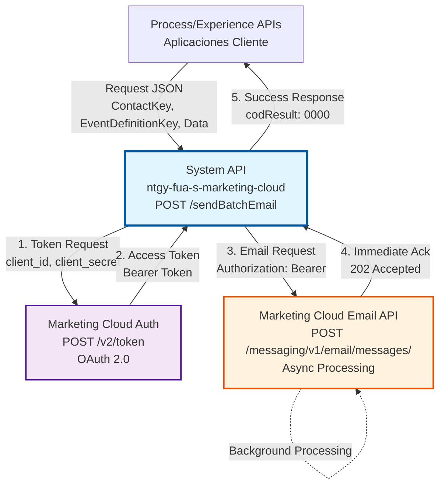
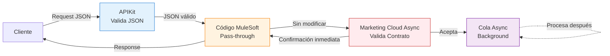
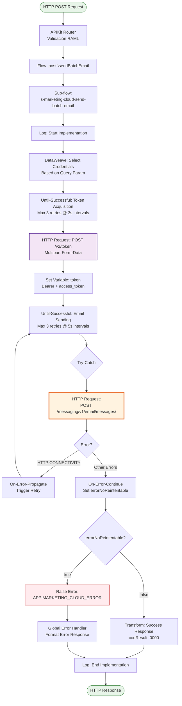
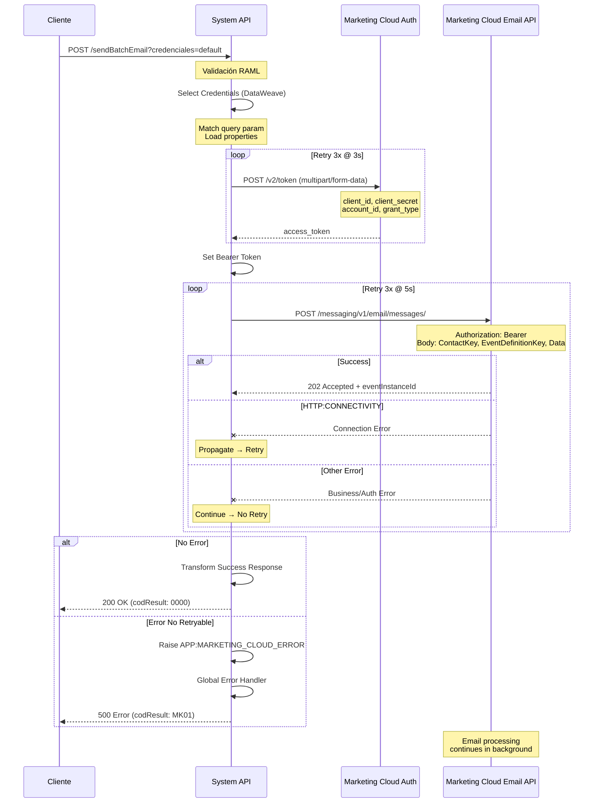
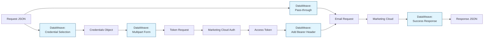

# POST /sendBatchEmail

## 📌 Descripción General

### Propósito del Endpoint

Envía emails en lote de forma asíncrona a través de Salesforce Marketing Cloud, proporcionando una interfaz unificada para campañas masivas y notificaciones no críticas. Este endpoint implementa el patrón **Fire-and-Forget**, retornando confirmación inmediata sin esperar el procesamiento completo del email.

El endpoint soporta:
- **Envío Asíncrono**: Procesamiento en background por Marketing Cloud
- **Multi-Tenant**: Soporte para 3 business units diferentes
- **Retry Automático**: Reintentos inteligentes en caso de fallos transitorios
- **Alta Disponibilidad**: Timeout extendido (10 minutos) para manejar latencia de Marketing Cloud

### Tipo de API

**Capa:** System API (API-Led Connectivity)

**Función:** Integración directa con Salesforce Marketing Cloud para envío masivo de emails transaccionales y de marketing.

### Patrón de Integración

**Tipo:** Fire-and-Forget Asíncrono con REST API

**Descripción:** El endpoint recibe la solicitud de envío, adquiere token OAuth 2.0, envía el email de forma asíncrona a Marketing Cloud y retorna confirmación inmediata. El procesamiento real del email ocurre en background en Marketing Cloud.

### Arquitectura API-Led Connectivity



---

## ⚠️ Arquitectura de Proxy Transparente (Async)

### Este API es un Proxy Sin Validación

**Importante:** Este System API actúa como un **proxy transparente** de Salesforce Marketing Cloud para envío asíncrono.
La estructura del request NO es validada por este API, sino por Marketing Cloud.

### Responsabilidades de Validación

| Componente | Responsabilidad | Qué Valida |
|------------|-----------------|------------|
| **APIKit** | Validación básica | Solo que el JSON esté bien formado |
| **Código MuleSoft** | Pass-through | NO valida estructura, solo reenvía |
| **Marketing Cloud** | Validación completa | Campos requeridos, tipos, reglas de negocio |

### Arquitectura de Validación (Fire-and-Forget)



### Fuente del Contrato

- **API Externa:** Salesforce Marketing Cloud Async Events API
- **Endpoint:** `POST /interaction/v1/async/events`
- **Documentación Oficial:** [Marketing Cloud Events API](https://developer.salesforce.com/docs/marketing/marketing-cloud/guide/postEvent.html)

### Por Qué No Se Valida la Estructura

1. **El código hace pass-through completo** - No usa ni modifica los campos del request
2. **Marketing Cloud define el contrato** - Es la fuente de verdad del esquema de datos
3. **Flexibilidad** - Cambios en Marketing Cloud no rompen este API
4. **Menos mantenimiento** - No hay que sincronizar RAML con actualizaciones de Marketing Cloud

### Beneficios del Proxy Transparente

- ✅ **Cambios automáticos**: Actualizaciones en Marketing Cloud se soportan sin modificar este API
- ✅ **Nuevos campos**: Templates con campos adicionales funcionan automáticamente
- ✅ **Validación actualizada**: Marketing Cloud valida con sus reglas más recientes
- ✅ **Menos complejidad**: El código MuleSoft es más simple y mantenible
- ✅ **Async nativo**: Fire-and-forget pattern sin validación previa

### Consideraciones Importantes (Async)

- ⚠️ **Detección de errores**: Errores de estructura se detectan en Marketing Cloud, no antes
- ⚠️ **Sin confirmación de entrega**: La respuesta indica aceptación, NO entrega del email
- ⚠️ **Documentación externa**: Consultar docs de Marketing Cloud para estructura exacta
- ⚠️ **RAML documentativo**: El RAML documenta la estructura típica pero no la valida
- ⚠️ **Procesamiento diferido**: El email se procesa en background después de la respuesta

---

## 💼 Propósito del Negocio

### Casos de Uso Principales

1. **Campañas de Marketing Masivas**
   - Envío de newsletters a miles de suscriptores
   - Comunicaciones promocionales segmentadas
   - Beneficio: Alta velocidad de procesamiento sin bloquear al cliente

2. **Notificaciones No Críticas en Volumen**
   - Recordatorios de facturación
   - Actualizaciones de estado de servicios
   - Beneficio: Procesamiento eficiente sin impactar performance del sistema origen

3. **Comunicaciones Segmentadas por Business Unit**
   - Emails específicos para clientes industriales
   - Comunicaciones de servicios de impresión
   - Beneficio: Gestión centralizada con segregación de credenciales

### Contexto Empresarial

- **Dominio:** Customer Communications & Marketing Automation
- **Sector:** Energía - Utilities
- **División:** Naturgy España
- **Proceso de Negocio:** Gestión de comunicaciones digitales multicanal
- **Plataforma:** Salesforce Marketing Cloud

### Stakeholders

- **Equipos de Marketing**: Necesitan enviar campañas masivas de forma eficiente
- **Equipos de Customer Service**: Requieren notificaciones automáticas a clientes
- **Equipos de Operaciones**: Necesitan monitoreo y gestión centralizada de envíos

### Valor de Negocio

- **Centralización**: Punto único de integración con Marketing Cloud para toda la organización
- **Escalabilidad**: Soporte para alto volumen de emails sin degradación de performance
- **Flexibilidad**: Multi-tenant con segregación de credenciales por segmento de negocio
- **Confiabilidad**: Retry automático y manejo robusto de errores

### Consumidores Potenciales

Este endpoint puede ser consumido por:
- Process APIs de gestión de clientes (FUA)
- Sistemas de gestión de campañas
- Plataformas de automatización de marketing
- Servicios de notificaciones batch
- Integraciones con Salesforce (Platform Events, Flows)

---

## 🔧 Especificación Técnica

### URLs por Ambiente

| Ambiente | URL Base | URL Completa |
|----------|----------|--------------|
| **Local** | `http://localhost:8081` | `http://localhost:8081/api/sendBatchEmail` |
| **Development** | `https://ntgy-fua-s-marketing-cloud-dev.cloudhub.io` | `https://ntgy-fua-s-marketing-cloud-dev.cloudhub.io/api/sendBatchEmail` |
| **UAT** | `https://ntgy-fua-s-marketing-cloud-uat.cloudhub.io` | `https://ntgy-fua-s-marketing-cloud-uat.cloudhub.io/api/sendBatchEmail` |
| **Production** | `https://ntgy-fua-s-marketing-cloud-pro.cloudhub.io` | `https://ntgy-fua-s-marketing-cloud-pro.cloudhub.io/api/sendBatchEmail` |

### Método HTTP

```
POST /api/sendBatchEmail
```

### Parámetros de Entrada

#### Headers HTTP

| Header | Tipo | Requerido | Descripción | Ejemplo |
|--------|------|-----------|-------------|---------|
| `Content-Type` | string | ✅ Sí | Tipo de contenido del request | `application/json` |
| `Accept` | string | ❌ No | Tipo de contenido esperado en response | `application/json` |

#### Query Parameters

| Parámetro | Tipo | Requerido | Descripción | Valores | Ejemplo |
|-----------|------|-----------|-------------|---------|---------|
| `credenciales` | string | ❌ No | Selecciona el conjunto de credenciales de Marketing Cloud | `industrial`, `impresion`, `default` | `default` |

**Comportamiento del parámetro `credenciales`:**
- `industrial` → Usa credenciales de Business Unit Industrial (Account ID: 510010681)
- `impresion` → Usa credenciales de Business Unit Impresión (Account ID: 510006070)
- Cualquier otro valor o ausencia → Usa credenciales Default (Account ID: 510004969)

#### Body Parameters

**Estructura del Request:**

```json
{
  "ContactKey": "string",
  "EventDefinitionKey": "string",
  "Data": {
    "emailAddress": "string",
    "firstName": "string",
    "lastName": "string",
    "customField1": "any",
    "customField2": "any"
  }
}
```

**Campos del Body:**

| Campo | Tipo | Requerido | Descripción | Ejemplo |
|-------|------|-----------|-------------|---------|
| `ContactKey` | string | ✅ Sí | Identificador único del contacto (email o subscriber ID) | `"customer@example.com"` |
| `EventDefinitionKey` | string | ✅ Sí | Clave de definición del evento en Marketing Cloud (identifica plantilla) | `"APIEvent-WelcomeEmail"` |
| `Data` | object | ✅ Sí | Datos personalizados para la plantilla de email | Ver estructura abajo |
| `Data.emailAddress` | string | ✅ Sí | Dirección de email del destinatario | `"customer@example.com"` |
| `Data.firstName` | string | ❌ No | Nombre del destinatario | `"Juan"` |
| `Data.lastName` | string | ❌ No | Apellido del destinatario | `"Pérez"` |
| `Data.*` | any | ❌ No | Campos adicionales según plantilla de Marketing Cloud | Cualquier valor |

### Respuestas

#### Respuesta Exitosa (200 OK)

```json
{
  "result": {
    "codResult": "0000",
    "msgResult": "No hay error"
  }
}
```

**Campos de la Respuesta:**

| Campo | Tipo | Descripción |
|-------|------|-------------|
| `result.codResult` | string | Código de resultado (`0000` = éxito) |
| `result.msgResult` | string | Mensaje descriptivo del resultado |

**Nota:** La respuesta exitosa indica que el email fue aceptado por Marketing Cloud para procesamiento asíncrono, NO que fue entregado al destinatario.

#### Respuesta de Error (500 Internal Server Error)

```json
{
  "result": {
    "codResult": "MK01",
    "msgResult": "Error en la llamada a MarketingCloud: Connection timeout"
  }
}
```

**Códigos de Error:**

| Código | Descripción | Causa Común |
|--------|-------------|-------------|
| `MK01` | Error en llamada a Marketing Cloud | Timeout, credenciales inválidas, error de red |

### Autenticación y Autorización

- **Tipo:** Client ID & Client Secret (Anypoint Platform)
- **Autorización Marketing Cloud:** El sistema utiliza OAuth 2.0 con:
  - Client ID y Client Secret por business unit
  - Grant type: `client_credentials`
  - Token adquirido automáticamente por cada request
  - Token incluido como Bearer en header Authorization

### Timeouts

| Tipo | Valor | Descripción |
|------|-------|-------------|
| **Connection Timeout** | 600 segundos (10 min) | Tiempo máximo para establecer conexión con Marketing Cloud |
| **Response Timeout** | 600 segundos (10 min) | Tiempo máximo de espera para respuesta de Marketing Cloud |

**Rationale:** Marketing Cloud puede experimentar latencia durante picos de carga, especialmente en operaciones asíncronas.

---

## 🏗️ Implementación Técnica

### Arquitectura del Flow



### Componentes Principales

#### 1. Selección de Credenciales (DataWeave)

**Ubicación:** Inline en sub-flow `s-marketing-cloud-send-batch-email`

**Lógica:**
```dataweave
%dw 2.0
output application/java
---
attributes.queryParams.credenciales match {
  case "industrial" -> {
    "clientId": p('marketing-cloud.auth.clientIdIndustrial'),
    "clientSecret": p('marketing-cloud.auth.clientSecretIndustrial'),
    "accountId": p('marketing-cloud.auth.accountIdIndustrial')
  }
  case "impresion" -> {
    "clientId": p('marketing-cloud.auth.clientIdImpresion'),
    "clientSecret": p('marketing-cloud.auth.clientSecretImpresion'),
    "accountId": p('marketing-cloud.auth.accountIdImpresion')
  }
  else -> {
    "clientId": p('marketing-cloud.auth.clientId'),
    "clientSecret": p('marketing-cloud.auth.clientSecret'),
    "accountId": p('marketing-cloud.auth.accountId')
  }
}
```

**Propósito:** Selecciona dinámicamente las credenciales según el query parameter.

#### 2. Adquisición de Token OAuth 2.0

**Configuración HTTP:** `MKC_Token_Request`
- **Host:** `${marketing-cloud.auth.host}`
- **Path:** `/v2/token`
- **Method:** POST
- **Content-Type:** multipart/form-data

**Retry Strategy:**
- **Pattern:** Until-Successful
- **Max Attempts:** 3
- **Interval:** 3000 ms (3 segundos)

**Request Body (Multipart Form-Data):**
```dataweave
%dw 2.0
output multipart/form-data
---
{
  "parts": {
    "client_id": {
      "headers": {"Content-Type": "text/plain"},
      "content": vars.inputCredentials.clientId
    },
    "client_secret": {
      "headers": {"Content-Type": "text/plain"},
      "content": vars.inputCredentials.clientSecret
    },
    "account_id": {
      "headers": {"Content-Type": "text/plain"},
      "content": vars.inputCredentials.accountId
    },
    "grant_type": {
      "headers": {"Content-Type": "text/plain"},
      "content": p('marketing-cloud.auth.grantType')
    }
  }
}
```

**Response Processing:**
```dataweave
"Bearer " ++ vars.respToken.access_token
```

#### 3. Envío Asíncrono de Email

**Configuración HTTP:** `MKC_Email_Sender`
- **Host:** `${marketing-cloud.rest.host}`
- **Path:** `/messaging/v1/email/messages/`
- **Method:** POST
- **Content-Type:** application/json
- **Authorization:** Bearer token (from step 2)

**Retry Strategy:**
- **Pattern:** Until-Successful
- **Max Attempts:** 3
- **Interval:** 5000 ms (5 segundos)

**Error Handling:**
- **HTTP:CONNECTIVITY** → Propagate (trigger retry)
- **Other errors** → Continue (set errorNoReintentable flag)

**Request Body:**
```json
{
  "ContactKey": "<from payload>",
  "EventDefinitionKey": "<from payload>",
  "Data": {
    "emailAddress": "<from payload>",
    "firstName": "<from payload>",
    "...": "..."
  }
}
```

#### 4. Manejo de Respuestas

**Success Response (DataWeave):**
```dataweave
%dw 2.0
output application/json
---
{
  "result": {
    "codResult": "0000",
    "msgResult": "No hay error"
  }
}
```

**Error Response (Global Error Handler):**
```dataweave
%dw 2.0
output application/json
---
{
  "result": {
    "codResult": "MK01",
    "msgResult": "Error en la llamada a MarketingCloud: " ++ vars.mensajeError
  }
}
```

### Diagrama de Secuencia Completo



### Transformación de Datos



### Configuraciones HTTP

**MKC_Token_Request:**
```xml
<http:request-config name="MKC_Token_Request">
    <http:request-connection 
        host="${marketing-cloud.auth.host}"
        protocol="HTTPS"
        connectionIdleTimeout="600000"/>
</http:request-config>
```

**MKC_Email_Sender:**
```xml
<http:request-config name="MKC_Email_Sender">
    <http:request-connection 
        host="${marketing-cloud.rest.host}"
        protocol="HTTPS"
        connectionIdleTimeout="600000"/>
</http:request-config>
```

### Variables de Flow

| Variable | Tipo | Descripción | Ejemplo |
|----------|------|-------------|---------|
| `inputCredentials` | object | Credenciales seleccionadas según query param | `{clientId, clientSecret, accountId}` |
| `respToken` | object | Respuesta de token de Marketing Cloud | `{access_token, expires_in}` |
| `token` | string | Bearer token formateado | `"Bearer eyJ0eXAi..."` |
| `inputMK` | object | Payload para Marketing Cloud (pass-through) | Request JSON original |
| `mensajeError` | string | Mensaje de error capturado | `"Connection timeout"` |
| `errorNoReintentable` | boolean | Flag de error no retryable | `true` o `false` |

---

## 💻 Ejemplos de Uso

### Ejemplo 1: Envío Básico con Credenciales Default

**Request:**
```bash
curl -X POST "https://ntgy-fua-s-marketing-cloud-pro.cloudhub.io/api/sendBatchEmail" \
  -H "Content-Type: application/json" \
  -d '{
    "ContactKey": "customer@example.com",
    "EventDefinitionKey": "APIEvent-WelcomeEmail",
    "Data": {
      "emailAddress": "customer@example.com",
      "firstName": "Juan",
      "lastName": "Pérez"
    }
  }'
```

**Response (200 OK):**
```json
{
  "result": {
    "codResult": "0000",
    "msgResult": "No hay error"
  }
}
```

### Ejemplo 2: Envío con Credenciales Industrial

**Request:**
```bash
curl -X POST "https://ntgy-fua-s-marketing-cloud-pro.cloudhub.io/api/sendBatchEmail?credenciales=industrial" \
  -H "Content-Type: application/json" \
  -d '{
    "ContactKey": "industrial.client@company.com",
    "EventDefinitionKey": "APIEvent-IndustrialNotification",
    "Data": {
      "emailAddress": "industrial.client@company.com",
      "companyName": "Acme Industries",
      "contractNumber": "IND-2024-001",
      "notificationType": "Maintenance"
    }
  }'
```

**Response (200 OK):**
```json
{
  "result": {
    "codResult": "0000",
    "msgResult": "No hay error"
  }
}
```

### Ejemplo 3: Envío con Campos Personalizados

**Request:**
```bash
curl -X POST "https://ntgy-fua-s-marketing-cloud-pro.cloudhub.io/api/sendBatchEmail?credenciales=impresion" \
  -H "Content-Type: application/json" \
  -d '{
    "ContactKey": "print.customer@example.com",
    "EventDefinitionKey": "APIEvent-PrintJobComplete",
    "Data": {
      "emailAddress": "print.customer@example.com",
      "firstName": "María",
      "lastName": "García",
      "jobId": "PRINT-2024-12345",
      "documentCount": 150,
      "completionDate": "2024-06-11",
      "downloadLink": "https://portal.naturgy.com/downloads/PRINT-2024-12345"
    }
  }'
```

**Response (200 OK):**
```json
{
  "result": {
    "codResult": "0000",
    "msgResult": "No hay error"
  }
}
```

### Ejemplo 4: Error de Autenticación

**Request:**
```bash
curl -X POST "https://ntgy-fua-s-marketing-cloud-pro.cloudhub.io/api/sendBatchEmail" \
  -H "Content-Type: application/json" \
  -d '{
    "ContactKey": "test@example.com",
    "EventDefinitionKey": "APIEvent-Test",
    "Data": {
      "emailAddress": "test@example.com"
    }
  }'
```

**Response (500 Internal Server Error):**
```json
{
  "result": {
    "codResult": "MK01",
    "msgResult": "Error en la llamada a MarketingCloud: Invalid client credentials"
  }
}
```

### Ejemplo 5: Request con Node.js

```javascript
const axios = require('axios');

async function sendBatchEmail() {
  try {
    const response = await axios.post(
      'https://ntgy-fua-s-marketing-cloud-pro.cloudhub.io/api/sendBatchEmail',
      {
        ContactKey: 'customer@example.com',
        EventDefinitionKey: 'APIEvent-Newsletter',
        Data: {
          emailAddress: 'customer@example.com',
          firstName: 'Carlos',
          lastName: 'Rodríguez',
          subscriptionType: 'Premium',
          newsletterDate: '2024-06-11'
        }
      },
      {
        params: {
          credenciales: 'default'
        },
        headers: {
          'Content-Type': 'application/json'
        }
      }
    );
    
    console.log('Email sent successfully:', response.data);
  } catch (error) {
    console.error('Error sending email:', error.response?.data || error.message);
  }
}

sendBatchEmail();
```

### Ejemplo 6: Request con Python

```python
import requests
import json

def send_batch_email():
    url = "https://ntgy-fua-s-marketing-cloud-pro.cloudhub.io/api/sendBatchEmail"
    
    params = {
        "credenciales": "default"
    }
    
    payload = {
        "ContactKey": "customer@example.com",
        "EventDefinitionKey": "APIEvent-BillingReminder",
        "Data": {
            "emailAddress": "customer@example.com",
            "firstName": "Ana",
            "lastName": "Martínez",
            "invoiceNumber": "INV-2024-5678",
            "dueDate": "2024-06-30",
            "amount": "125.50"
        }
    }
    
    headers = {
        "Content-Type": "application/json"
    }
    
    try:
        response = requests.post(url, params=params, json=payload, headers=headers)
        response.raise_for_status()
        print("Email sent successfully:", response.json())
    except requests.exceptions.RequestException as e:
        print("Error sending email:", e)

send_batch_email()
```

### Ejemplo 7: Batch de Múltiples Emails

```bash
#!/bin/bash

# Script para enviar múltiples emails en lote
API_URL="https://ntgy-fua-s-marketing-cloud-pro.cloudhub.io/api/sendBatchEmail"

# Array de destinatarios
recipients=(
  "customer1@example.com"
  "customer2@example.com"
  "customer3@example.com"
)

# Enviar email a cada destinatario
for email in "${recipients[@]}"; do
  echo "Sending email to: $email"
  
  curl -X POST "$API_URL?credenciales=default" \
    -H "Content-Type: application/json" \
    -d "{
      \"ContactKey\": \"$email\",
      \"EventDefinitionKey\": \"APIEvent-MonthlyNewsletter\",
      \"Data\": {
        \"emailAddress\": \"$email\",
        \"month\": \"June\",
        \"year\": \"2024\"
      }
    }"
  
  echo ""
  sleep 1  # Pequeña pausa entre requests
done

echo "Batch sending completed"
```

### Notas Importantes

1. **Respuesta Inmediata**: El endpoint retorna confirmación inmediata. El procesamiento real del email ocurre en background en Marketing Cloud.

2. **No Tracking de Entrega**: Este endpoint NO proporciona información sobre si el email fue entregado al destinatario. Para tracking de entrega, consultar los reportes de Marketing Cloud.

3. **Límites de Rate**: Marketing Cloud tiene límites de rate. Para volúmenes muy altos, considerar implementar throttling en el cliente.

4. **Timeout Extendido**: El timeout de 10 minutos es para manejar latencia de Marketing Cloud durante picos de carga.

5. **Credenciales**: Asegurarse de usar el query parameter `credenciales` correcto según el segmento de negocio del destinatario.
