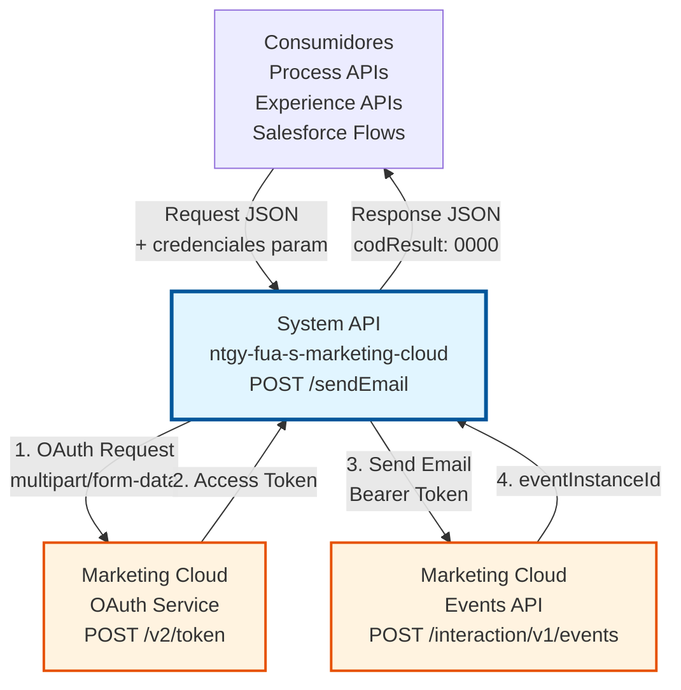
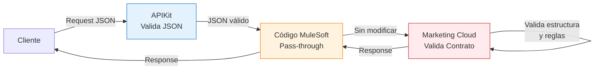
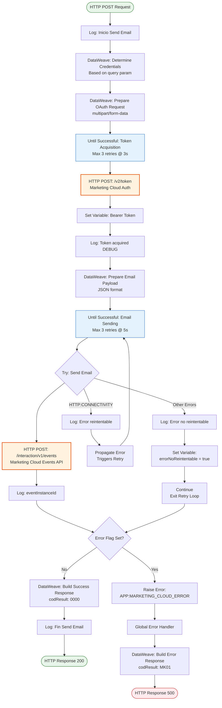
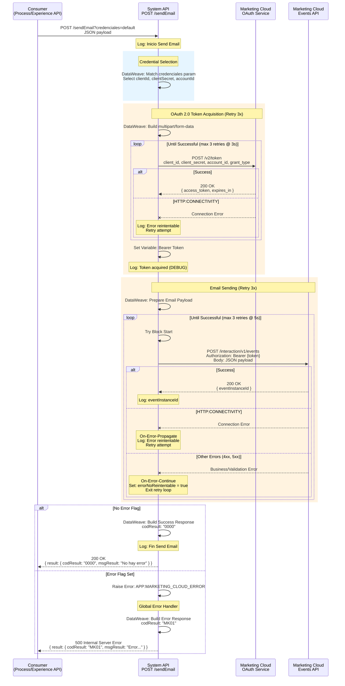
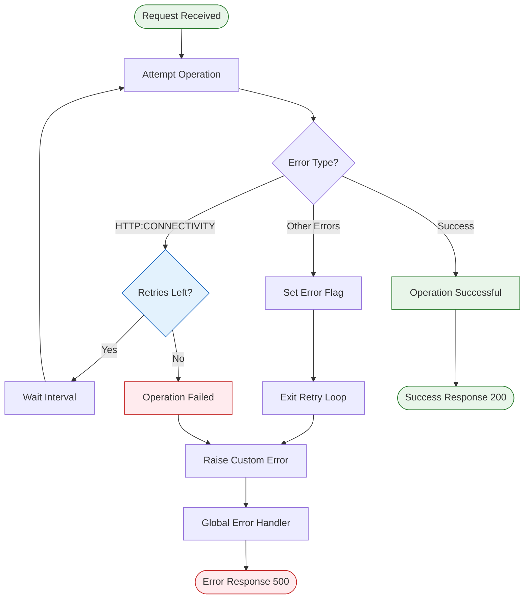

# POST /sendEmail

## 📌 Descripción General

### Propósito del Endpoint

El endpoint **POST /sendEmail** proporciona un servicio centralizado para el envío individual de emails transaccionales a través de Salesforce Marketing Cloud. Este System API abstrae la complejidad de la autenticación OAuth 2.0 y la integración con Marketing Cloud, ofreciendo una interfaz REST simple y confiable para todos los canales digitales de Naturgy.

El endpoint soporta:
- **Envío Síncrono**: Confirmación inmediata de que el email fue aceptado por Marketing Cloud
- **Multi-Tenant**: Soporte para 3 business units diferentes mediante query parameter
- **Retry Automático**: Lógica de reintentos para errores transitorios de conectividad
- **OAuth 2.0**: Gestión automática de tokens de autenticación
- **Personalización**: Soporte para datos dinámicos según templates de Marketing Cloud

### Tipo de API

**Capa:** System API (API-Led Connectivity)

**Función:** Integración directa con Salesforce Marketing Cloud REST API para envío de emails transaccionales. Proporciona una capa de abstracción que simplifica la autenticación OAuth 2.0 y el manejo de errores para los consumidores upstream.

### Patrón de Integración

**Tipo:** Request-Reply Síncrono con REST API Externa

**Descripción:** El endpoint recibe una solicitud JSON con los datos del email, adquiere un token OAuth 2.0 de Marketing Cloud, transforma el payload al formato de Events API, envía el email de forma síncrona, y retorna una confirmación o error. Incluye lógica de reintentos automáticos para errores de conectividad.

### Arquitectura API-Led Connectivity



---

## ⚠️ Arquitectura de Proxy Transparente

### Este API es un Proxy Sin Validación

**Importante:** Este System API actúa como un **proxy transparente** de Salesforce Marketing Cloud.
La estructura del request NO es validada por este API, sino por Marketing Cloud.

### Responsabilidades de Validación

| Componente | Responsabilidad | Qué Valida |
|------------|-----------------|------------|
| **APIKit** | Validación básica | Solo que el JSON esté bien formado |
| **Código MuleSoft** | Pass-through | NO valida estructura, solo reenvía |
| **Marketing Cloud** | Validación completa | Campos requeridos, tipos, reglas de negocio |

### Arquitectura de Validación



### Fuente del Contrato

- **API Externa:** Salesforce Marketing Cloud Events API
- **Endpoint:** `POST /interaction/v1/events`
- **Documentación Oficial:** [Marketing Cloud Events API](https://developer.salesforce.com/docs/marketing/marketing-cloud/guide/postEvent.html)

### Por Qué No Se Valida la Estructura

1. **El código hace pass-through completo** - No usa ni modifica los campos del request
2. **Marketing Cloud define el contrato** - Es la fuente de verdad del esquema de datos
3. **Flexibilidad** - Cambios en Marketing Cloud no rompen este API
4. **Menos mantenimiento** - No hay que sincronizar RAML con actualizaciones de Marketing Cloud

### Beneficios del Proxy Transparente

- ✅ **Cambios automáticos**: Actualizaciones en Marketing Cloud se soportan sin modificar este API
- ✅ **Nuevos campos**: Templates con campos adicionales funcionan automáticamente
- ✅ **Validación actualizada**: Marketing Cloud valida con sus reglas más recientes
- ✅ **Menos complejidad**: El código MuleSoft es más simple y mantenible

### Consideraciones Importantes

- ⚠️ **Detección de errores**: Errores de estructura se detectan en Marketing Cloud, no antes
- ⚠️ **Documentación externa**: Consultar docs de Marketing Cloud para estructura exacta
- ⚠️ **RAML documentativo**: El RAML documenta la estructura típica pero no la valida
- ⚠️ **Responsabilidad**: Los consumidores deben asegurar que envían la estructura correcta

---

## 💼 Propósito del Negocio

### Casos de Uso Principales

1. **Emails Transaccionales de Confirmación**
   - Confirmaciones de alta de contrato
   - Confirmaciones de cambios en servicios
   - Notificaciones de actualización de datos
   - **Beneficio**: Comunicación inmediata con confirmación de envío

2. **Notificaciones de Procesos de Negocio**
   - Alertas de facturación
   - Recordatorios de pago
   - Notificaciones de lectura de contador
   - **Beneficio**: Mantener al cliente informado en tiempo real

3. **Comunicaciones de Atención al Cliente**
   - Respuestas a solicitudes
   - Confirmaciones de gestiones
   - Notificaciones de resolución de incidencias
   - **Beneficio**: Mejorar la experiencia del cliente con comunicación oportuna

### Contexto Empresarial

- **Dominio:** Comunicaciones con Clientes y Marketing Automation
- **Sector:** Energía - Utilities
- **División:** Naturgy España
- **Proceso de Negocio:** Gestión de Comunicaciones Digitales
- **Plataforma:** Salesforce Marketing Cloud (Email Service)

### Stakeholders

- **Equipos de Marketing**: Necesitan enviar comunicaciones personalizadas a clientes
- **Equipos de Customer Service**: Requieren notificar a clientes sobre gestiones y resoluciones
- **Equipos de Operaciones**: Necesitan enviar alertas y notificaciones operativas
- **Desarrolladores de Process/Experience APIs**: Consumen este servicio para integrar envío de emails

### Valor de Negocio

- **Centralización**: Punto único de integración con Marketing Cloud, evitando duplicación de lógica
- **Reusabilidad**: Servicio compartido entre múltiples canales y aplicaciones
- **Confiabilidad**: Retry automático y manejo robusto de errores garantiza entrega
- **Mantenibilidad**: Gestión centralizada de credenciales y configuración
- **Escalabilidad**: Soporte para múltiples business units sin cambios en consumidores
- **Seguridad**: Credenciales protegidas mediante secure properties de Anypoint Platform

### Consumidores Potenciales

Este endpoint puede ser consumido por:
- **Process APIs**: FUA Process APIs, Customer Management Process APIs
- **Experience APIs**: Portales web, aplicaciones móviles, sistemas de agentes
- **Salesforce**: Platform Events, Flows, Apex triggers
- **Sistemas Internos**: Servicios de notificación, sistemas de campaña
- **Integraciones Middleware**: ESB, sistemas de orquestación

---

## 🔧 Especificación Técnica

### URLs por Ambiente

| Ambiente | URL Base | URL Completa |
|----------|----------|--------------|
| **Local** | `http://localhost:8081` | `http://localhost:8081/api/sendEmail` |
| **Development** | `https://ntgy-fua-s-marketing-cloud-dev.cloudhub.io` | `https://ntgy-fua-s-marketing-cloud-dev.cloudhub.io/api/sendEmail` |
| **UAT** | `https://ntgy-fua-s-marketing-cloud-uat.cloudhub.io` | `https://ntgy-fua-s-marketing-cloud-uat.cloudhub.io/api/sendEmail` |
| **Production** | `https://ntgy-fua-s-marketing-cloud-pro.cloudhub.io` | `https://ntgy-fua-s-marketing-cloud-pro.cloudhub.io/api/sendEmail` |

### Método HTTP

```
POST /api/sendEmail
```

### Parámetros de Entrada

#### Headers HTTP

| Header | Tipo | Requerido | Descripción | Ejemplo |
|--------|------|-----------|-------------|---------|
| `Content-Type` | string | ✅ Sí | Tipo de contenido del request | `application/json` |
| `Accept` | string | ❌ No | Tipo de contenido esperado en response | `application/json` |

#### Query Parameters

| Parámetro | Tipo | Requerido | Descripción | Valores Permitidos | Default |
|-----------|------|-----------|-------------|-------------------|---------|
| `credenciales` | string | ❌ No | Selecciona el business unit de Marketing Cloud | `default`, `industrial`, `impresion` | `default` |

**Descripción de Business Units:**
- **`default`**: Business unit general para comunicaciones estándar (Account ID: 510004969)
- **`industrial`**: Business unit para clientes del segmento industrial (Account ID: 510010681)
- **`impresion`**: Business unit para servicios de impresión y documentos (Account ID: 510006070)

#### Body Parameters

**Content-Type:** `application/json`

| Campo | Tipo | Requerido | Descripción | Ejemplo |
|-------|------|-----------|-------------|---------|
| `ContactKey` | string | ✅ Sí | Identificador único del destinatario (típicamente email) | `"customer@example.com"` |
| `EventDefinitionKey` | string | ✅ Sí | Clave del template de email en Marketing Cloud | `"APIEvent-WelcomeEmail"` |
| `Data` | object | ✅ Sí | Objeto con datos personalizados del email | Ver estructura abajo |

**Estructura del objeto `Data`:**

| Campo | Tipo | Requerido | Descripción | Ejemplo |
|-------|------|-----------|-------------|---------|
| `emailAddress` | string | ✅ Sí | Email del destinatario | `"customer@example.com"` |
| `nombre` | string | ❌ No | Nombre del destinatario | `"Juan Pérez"` |
| `[customFields]` | any | ❌ No | Campos personalizados según template | Dinámico |

**Nota:** Los campos dentro de `Data` deben coincidir con los atributos definidos en el Event Definition de Marketing Cloud.

### Respuestas

#### Respuesta Exitosa (200 OK)

```json
{
  "result": {
    "codResult": "0000",
    "msgResult": "No hay error"
  }
}
```

**Descripción:** El email fue aceptado exitosamente por Marketing Cloud y está en proceso de envío.

#### Respuesta de Error de Marketing Cloud (500 Internal Server Error)

```json
{
  "result": {
    "codResult": "MK01",
    "msgResult": "Error en la llamada a MarketingCloud: Invalid client credentials"
  }
}
```

**Descripción:** Error al comunicarse con Marketing Cloud. El mensaje incluye detalles del problema.

**Códigos de Error Comunes:**
- `MK01`: Error en la llamada a Marketing Cloud (autenticación, conectividad, validación)

#### Respuesta de Error de Validación (400 Bad Request)

```json
{
  "message": "Bad request"
}
```

**Descripción:** El request no cumple con la especificación RAML (campos faltantes, tipos incorrectos).

### Autenticación y Autorización

#### Autenticación del Consumidor
- **Tipo:** Client ID & Client Secret (Anypoint Platform)
- **Método:** Configurado en API Manager de Anypoint Platform
- **Políticas:** Client ID Enforcement, Rate Limiting (según configuración)

#### Autenticación con Marketing Cloud
- **Tipo:** OAuth 2.0 Client Credentials Grant
- **Gestión:** Automática por el System API (transparente para el consumidor)
- **Credenciales:** Almacenadas como secure properties en Anypoint Platform
- **Token Lifecycle:** Token adquirido por cada request (sin caché actualmente)

### Timeouts y Retry

| Configuración | Valor | Descripción |
|---------------|-------|-------------|
| **Connection Timeout** | 600 segundos (10 min) | Tiempo máximo para establecer conexión con Marketing Cloud |
| **Token Acquisition Retry** | 3 intentos @ 3 segundos | Reintentos para obtener token OAuth |
| **Email Sending Retry** | 3 intentos @ 5 segundos | Reintentos para enviar email |
| **Retry Condition** | `HTTP:CONNECTIVITY` | Solo errores de conectividad se reintentan |

**Nota:** Los timeouts largos (10 minutos) son necesarios porque Marketing Cloud puede experimentar latencia durante períodos de alta carga.

---

## 🏗️ Implementación Técnica

### Arquitectura del Flow



### Diagrama de Secuencia Completo



### Componentes Clave del Flow

#### 1. Sub-flow Principal
**Nombre:** `s-marketing-cloud-send-email`

**Ubicación:** `src/main/mule/mailing/s-marketing-cloud-send-email.xml`

**Responsabilidades:**
- Gestión completa del proceso de envío de email
- Selección de credenciales según query parameter
- Adquisición de token OAuth 2.0
- Envío de email a Marketing Cloud
- Manejo de errores y retry logic

#### 2. Transformación de Credenciales

**DataWeave:**
```dataweave
%dw 2.0
output multipart/form-data

var aux = attributes.queryParams.credenciales match {
  case "industrial" -> {
    "clientId": p('marketing-cloud.auth.clientIdIndustrial'),
    "clientSecret": p('marketing-cloud.auth.clientSecretIndustrial'),
    "accountId": p('marketing-cloud.auth.accountIdIndustrial')
  }
  case "impresion" -> {
    "clientId": p('marketing-cloud.auth.clientIdImpresion'),
    "clientSecret": p('marketing-cloud.auth.clientSecretImpresion'),
    "accountId": p('marketing-cloud.auth.accountIdImpresion')
  }
  else -> {
    "clientId": p('marketing-cloud.auth.clientId'),
    "clientSecret": p('marketing-cloud.auth.clientSecret'),
    "accountId": p('marketing-cloud.auth.accountId')
  }
}
---
{
  "parts": {
    "client_id": {
      "headers": { "Content-Type": "text/plain" },
      "content": aux.clientId
    },
    "client_secret": {
      "headers": { "Content-Type": "text/plain" },
      "content": aux.clientSecret
    },
    "account_id": {
      "headers": { "Content-Type": "text/plain" },
      "content": aux.accountId
    },
    "grant_type": {
      "headers": { "Content-Type": "text/plain" },
      "content": p('marketing-cloud.auth.grantType')
    }
  }
}
```

**Propósito:** Selecciona dinámicamente las credenciales correctas según el business unit solicitado y construye el payload multipart/form-data requerido por Marketing Cloud OAuth.

#### 3. Until-Successful Pattern

**Token Acquisition:**
```xml
<until-successful maxRetries="3" millisBetweenRetries="3000">
    <http:request method="POST" path="/v2/token" 
                  config-ref="MKC_Token_Request" 
                  target="respToken">
        <http:body>#[vars.inputCredentials]</http:body>
    </http:request>
</until-successful>
```

**Email Sending:**
```xml
<until-successful maxRetries="3" millisBetweenRetries="5000">
    <try>
        <http:request method="POST" path="/interaction/v1/events" 
                      config-ref="MKC_Email_Sender">
            <http:body>#[vars.inputMK]</http:body>
            <http:headers>#[{ "Authorization": vars.token }]</http:headers>
        </http:request>
        <error-handler>
            <on-error-propagate type="HTTP:CONNECTIVITY">
                <!-- Retry automático -->
            </on-error-propagate>
            <on-error-continue>
                <!-- No retry, set error flag -->
            </on-error-continue>
        </error-handler>
    </try>
</until-successful>
```

#### 4. Error Handler Global

**Nombre:** `globlaError_Handler`

**Ubicación:** `src/main/mule/error/globlaError_Handler.xml`

**Maneja:** `APP:MARKETING_CLOUD_ERROR`

**Response:**
```dataweave
%dw 2.0
output application/json
---
{
  "result": {
    "codResult": "MK01",
    "msgResult": "Error en la llamada a MarketingCloud: " ++ vars.mensajeError
  }
}
```

### Configuraciones HTTP

#### Marketing Cloud Email Sender
```xml
<http:request-config name="MKC_Email_Sender">
    <http:request-connection 
        host="${marketing-cloud.rest.host}" 
        connectionIdleTimeout="${marketing-cloud.rest.timeout}" 
        protocol="HTTPS"/>
</http:request-config>
```

**Propiedades:**
- `host`: `mc8p72ysm3cv2gbklx7mv61hb-54.rest.marketingcloudapis.com`
- `timeout`: `600000` ms (10 minutos)
- `protocol`: HTTPS

#### Marketing Cloud Token Request
```xml
<http:request-config name="MKC_Token_Request">
    <http:request-connection 
        host="${marketing-cloud.auth.host}" 
        connectionIdleTimeout="${marketing-cloud.auth.timeout}" 
        protocol="HTTPS"/>
</http:request-config>
```

**Propiedades:**
- `host`: `mc8p72ysm3cv2gbklx7mv61hb-54.auth.marketingcloudapis.com`
- `timeout`: `600000` ms (10 minutos)
- `protocol`: HTTPS

### Estrategia de Retry y Error Handling



**Clasificación de Errores:**

| Tipo de Error | Acción | Razón |
|---------------|--------|-------|
| `HTTP:CONNECTIVITY` | **Retry** (propagate) | Error transitorio de red, puede resolverse |
| `HTTP:UNAUTHORIZED` | **No Retry** (continue) | Credenciales inválidas, no se resolverá con retry |
| `HTTP:BAD_REQUEST` | **No Retry** (continue) | Payload inválido, no se resolverá con retry |
| `HTTP:INTERNAL_SERVER_ERROR` | **No Retry** (continue) | Error del servidor, requiere investigación |
| Otros errores | **No Retry** (continue) | Errores de negocio o validación |

### Logging Strategy

**Puntos de Log:**

1. **Inicio del Flow**
   ```
   Level: INFO
   Message: "Inicio Send Email: #[payload]"
   ```

2. **Token Adquirido**
   ```
   Level: DEBUG
   Message: "#[vars.token]"
   ```

3. **Event Instance ID**
   ```
   Level: INFO
   Message: "eventInstanceId: #[payload.eventInstanceId]"
   ```

4. **Error Reintentable**
   ```
   Level: INFO
   Message: "Error de conectividad reintentable: #[error.errorMessage.payload]"
   ```

5. **Error No Reintentable**
   ```
   Level: INFO
   Message: "Error no reintentable: #[vars.mensajeError]"
   ```

6. **Fin del Flow**
   ```
   Level: INFO
   Message: "Fin Send Email"
   ```

---

## 💻 Ejemplos de Uso

### Ejemplo 1: Envío con Credenciales Default

#### Request

```bash
curl -X POST "https://ntgy-fua-s-marketing-cloud-pro.cloudhub.io/api/sendEmail" \
  -H "Content-Type: application/json" \
  -H "client_id: YOUR_CLIENT_ID" \
  -H "client_secret: YOUR_CLIENT_SECRET" \
  -d '{
    "ContactKey": "customer@naturgy.com",
    "EventDefinitionKey": "APIEvent-WelcomeEmail",
    "Data": {
      "emailAddress": "customer@naturgy.com",
      "nombre": "María García",
      "accountNumber": "1234567890",
      "contractType": "Electricidad"
    }
  }'
```

#### Response (Success)

```json
{
  "result": {
    "codResult": "0000",
    "msgResult": "No hay error"
  }
}
```

**HTTP Status:** `200 OK`

---

### Ejemplo 2: Envío con Credenciales Industrial

#### Request

```bash
curl -X POST "https://ntgy-fua-s-marketing-cloud-pro.cloudhub.io/api/sendEmail?credenciales=industrial" \
  -H "Content-Type: application/json" \
  -H "client_id: YOUR_CLIENT_ID" \
  -H "client_secret: YOUR_CLIENT_SECRET" \
  -d '{
    "ContactKey": "industrial.client@company.com",
    "EventDefinitionKey": "APIEvent-IndustrialNotification",
    "Data": {
      "emailAddress": "industrial.client@company.com",
      "nombre": "Empresa Industrial S.A.",
      "contractNumber": "IND-9876543",
      "consumptionAlert": "High consumption detected"
    }
  }'
```

#### Response (Success)

```json
{
  "result": {
    "codResult": "0000",
    "msgResult": "No hay error"
  }
}
```

**HTTP Status:** `200 OK`

---

### Ejemplo 3: Request Completo con Todos los Campos

#### Request JSON

```json
{
  "ContactKey": "premium.customer@naturgy.com",
  "EventDefinitionKey": "APIEvent-BillingNotification",
  "Data": {
    "emailAddress": "premium.customer@naturgy.com",
    "nombre": "Carlos Rodríguez",
    "accountNumber": "ACC-1234567890",
    "contractType": "Gas",
    "billAmount": "125.50",
    "billDueDate": "2026-07-15",
    "billPeriod": "Junio 2026",
    "paymentLink": "https://portal.naturgy.com/pay/12345",
    "customerServicePhone": "+34 900 123 456"
  }
}
```

#### Response (Success)

```json
{
  "result": {
    "codResult": "0000",
    "msgResult": "No hay error"
  }
}
```

---

### Ejemplo 4: Error de Autenticación

#### Request

```bash
curl -X POST "https://ntgy-fua-s-marketing-cloud-pro.cloudhub.io/api/sendEmail" \
  -H "Content-Type: application/json" \
  -H "client_id: INVALID_CLIENT_ID" \
  -H "client_secret: INVALID_SECRET" \
  -d '{
    "ContactKey": "test@example.com",
    "EventDefinitionKey": "APIEvent-Test",
    "Data": {
      "emailAddress": "test@example.com",
      "nombre": "Test User"
    }
  }'
```

#### Response (Error)

```json
{
  "result": {
    "codResult": "MK01",
    "msgResult": "Error en la llamada a MarketingCloud: Invalid client credentials"
  }
}
```

**HTTP Status:** `500 Internal Server Error`

---

### Ejemplo 5: Error de Validación (Bad Request)

#### Request

```bash
curl -X POST "https://ntgy-fua-s-marketing-cloud-pro.cloudhub.io/api/sendEmail" \
  -H "Content-Type: application/json" \
  -H "client_id: YOUR_CLIENT_ID" \
  -H "client_secret: YOUR_CLIENT_SECRET" \
  -d '{
    "ContactKey": "test@example.com"
  }'
```

#### Response (Error)

```json
{
  "message": "Bad request"
}
```

**HTTP Status:** `400 Bad Request`

**Razón:** Faltan campos requeridos (`EventDefinitionKey` y `Data`)

---

### Ejemplo 6: Uso desde JavaScript/Node.js

```javascript
const axios = require('axios');

/**
 * Envía un email a través del System API de Marketing Cloud
 * @param {Object} emailData - Datos del email (ContactKey, EventDefinitionKey, Data)
 * @param {string} businessUnit - Business unit: 'default', 'industrial', o 'impresion'
 * @returns {Promise<Object>} Response del API
 */
async function sendEmail(emailData, businessUnit = 'default') {
  try {
    const response = await axios.post(
      `https://ntgy-fua-s-marketing-cloud-pro.cloudhub.io/api/sendEmail?credenciales=${businessUnit}`,
      emailData,
      {
        headers: {
          'Content-Type': 'application/json',
          'client_id': process.env.ANYPOINT_CLIENT_ID,
          'client_secret': process.env.ANYPOINT_CLIENT_SECRET
        }
      }
    );
    
    console.log('Email sent successfully:', response.data);
    return response.data;
  } catch (error) {
    console.error('Error sending email:', error.response?.data || error.message);
    throw error;
  }
}

// Ejemplo de uso
const emailData = {
  ContactKey: 'customer@naturgy.com',
  EventDefinitionKey: 'APIEvent-WelcomeEmail',
  Data: {
    emailAddress: 'customer@naturgy.com',
    nombre: 'Juan Pérez',
    accountNumber: '1234567890'
  }
};

sendEmail(emailData, 'default')
  .then(result => console.log('Success:', result))
  .catch(error => console.error('Failed:', error));
```

---

### Ejemplo 7: Uso desde Python

```python
import requests
import os

def send_email(email_data, business_unit='default'):
    """
    Envía un email a través del System API de Marketing Cloud
    
    Args:
        email_data (dict): Datos del email (ContactKey, EventDefinitionKey, Data)
        business_unit (str): Business unit: 'default', 'industrial', o 'impresion'
    
    Returns:
        dict: Response del API
    
    Raises:
        requests.exceptions.HTTPError: Si hay un error en la petición HTTP
    """
    url = f"https://ntgy-fua-s-marketing-cloud-pro.cloudhub.io/api/sendEmail?credenciales={business_unit}"
    
    headers = {
        'Content-Type': 'application/json',
        'client_id': os.getenv('ANYPOINT_CLIENT_ID'),
        'client_secret': os.getenv('ANYPOINT_CLIENT_SECRET')
    }
    
    try:
        response = requests.post(url, json=email_data, headers=headers)
        response.raise_for_status()
        print(f"Email sent successfully: {response.json()}")
        return response.json()
    except requests.exceptions.HTTPError as error:
        print(f"Error sending email: {error.response.text}")
        raise

# Ejemplo de uso
if __name__ == "__main__":
    email_data = {
        "ContactKey": "customer@naturgy.com",
        "EventDefinitionKey": "APIEvent-WelcomeEmail",
        "Data": {
            "emailAddress": "customer@naturgy.com",
            "nombre": "Ana Martínez",
            "accountNumber": "9876543210"
        }
    }
    
    result = send_email(email_data, 'default')
    print(f"Result: {result}")
```

---

### Notas de Implementación

#### Mejores Prácticas

1. **Manejo de Errores**: Siempre implementar try-catch para manejar errores de red o del servidor
2. **Timeouts**: Configurar timeouts apropiados en el cliente (mínimo 30 segundos)
3. **Retry en Cliente**: No implementar retry adicional en el cliente, el System API ya lo maneja
4. **Logging**: Registrar todas las llamadas para auditoría y troubleshooting
5. **Credenciales**: Nunca hardcodear credenciales, usar variables de entorno

#### Consideraciones de Performance

- **Latencia Esperada**: 3-5 segundos (incluye autenticación OAuth)
- **Throughput**: Limitado por rate limits de Marketing Cloud
- **Concurrencia**: El System API puede manejar múltiples requests concurrentes
- **Caché de Token**: Actualmente no implementado, cada request adquiere nuevo token

#### Troubleshooting

**Problema:** Timeout después de 10 minutos
- **Causa**: Marketing Cloud experimentando alta latencia
- **Solución**: Verificar estado de Marketing Cloud, reintentar más tarde

**Problema:** Error "Invalid credentials"
- **Causa**: Credenciales incorrectas o expiradas
- **Solución**: Verificar secure properties en Anypoint Platform

**Problema:** Error "Event Definition not found"
- **Causa**: EventDefinitionKey no existe en el business unit
- **Solución**: Verificar que el template existe en Marketing Cloud para el business unit correcto

