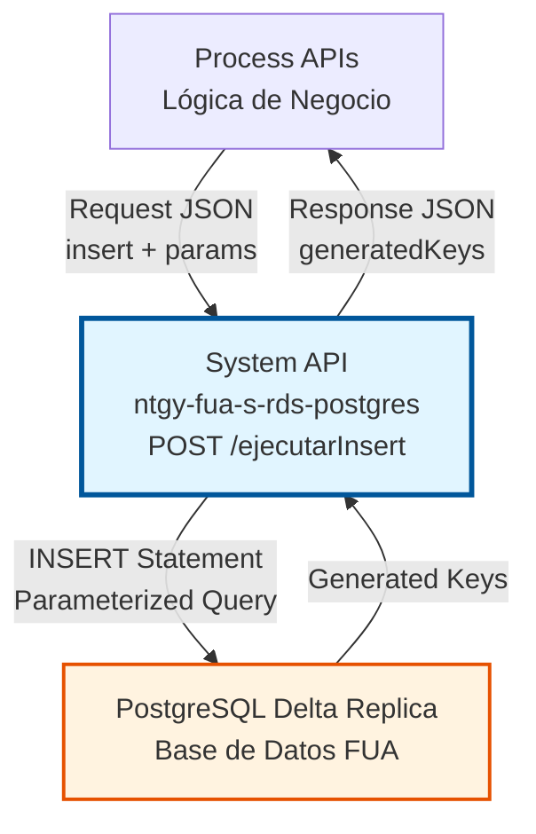
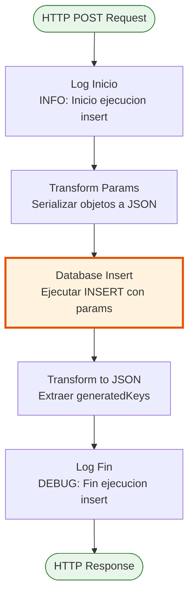
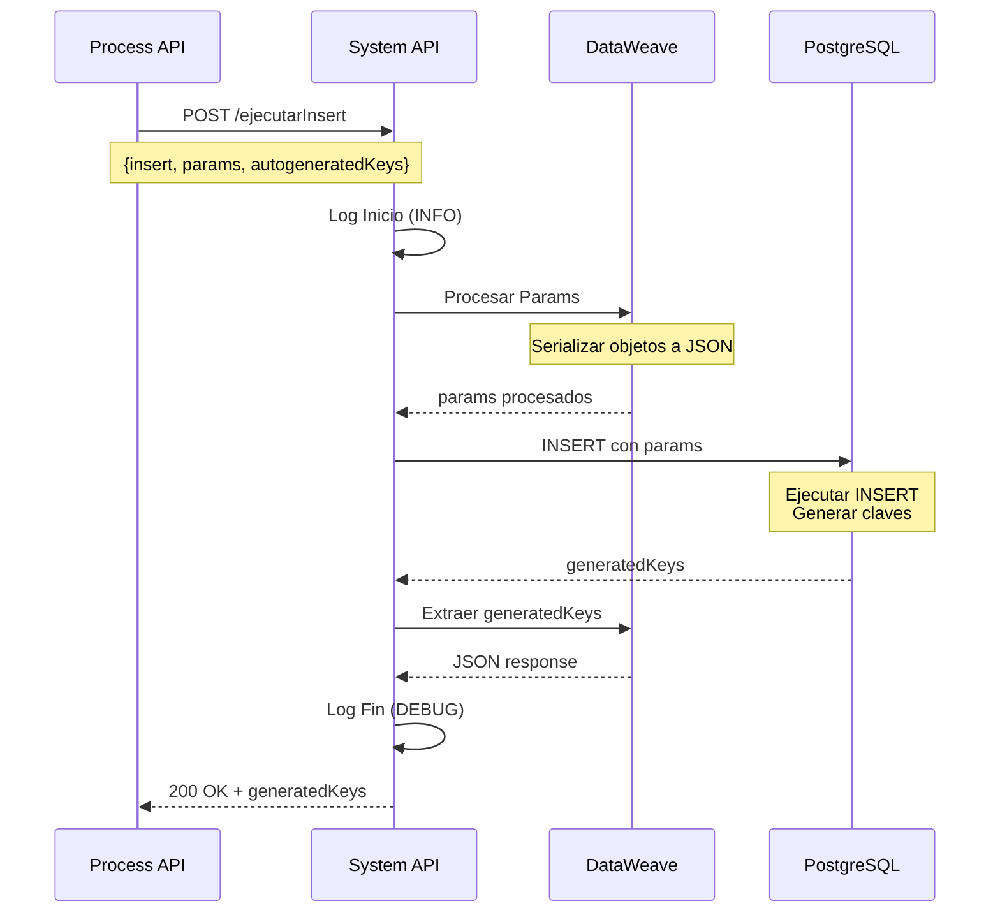
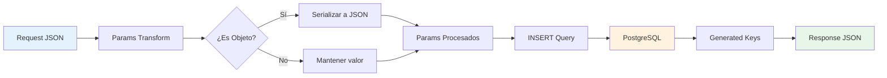

# POST /ejecutarInsert

## 📌 Descripción General

### Propósito del Endpoint

Este endpoint proporciona una interfaz genérica para ejecutar operaciones INSERT dinámicas en la base de datos PostgreSQL Delta Replica. Permite a los consumidores insertar registros en cualquier tabla de la base de datos mediante sentencias SQL parametrizadas, retornando las claves autogeneradas por la base de datos.

El endpoint soporta:
- **Queries INSERT Dinámicas**: Acepta cualquier sentencia INSERT válida en el payload
- **Parámetros Parametrizados**: Soporta parámetros seguros para prevenir SQL injection
- **Objetos Complejos**: Serializa automáticamente objetos complejos a JSON
- **Claves Autogeneradas**: Retorna los IDs generados automáticamente por la base de datos
- **Configuración Flexible**: Permite especificar qué columnas deben retornar sus valores autogenerados

### Tipo de API

**Capa:** System API (API-Led Connectivity)

**Función:** Proporciona acceso directo y estandarizado a PostgreSQL Delta Replica para operaciones de inserción de datos.

### Patrón de Integración

**Tipo:** Request-Reply Síncrono con SQL INSERT

**Descripción:** El endpoint recibe una sentencia INSERT y parámetros en formato JSON, transforma los parámetros complejos a JSON si es necesario, ejecuta la operación INSERT en PostgreSQL con auto-generación de claves habilitada, y retorna las claves generadas en formato JSON.

### Arquitectura API-Led Connectivity



---

## 💼 Propósito del Negocio

### Casos de Uso Principales

1. **Creación de Registros de Clientes**
   - Insertar nuevos clientes en el sistema FUA
   - Obtener el ID generado automáticamente para referencias futuras
   - Garantizar integridad de datos mediante parámetros seguros

2. **Registro de Transacciones**
   - Insertar registros de transacciones financieras
   - Capturar timestamps y IDs autogenerados
   - Mantener trazabilidad completa de operaciones

3. **Creación de Datos Maestros**
   - Insertar configuraciones del sistema
   - Crear registros de referencia
   - Establecer relaciones entre entidades

### Contexto Empresarial

- **Dominio:** Gestión de Datos - Operaciones CRUD
- **Sector:** Energía - Utilities
- **División:** Naturgy España - FUA (Factura Única Actualizada)
- **Proceso de Negocio:** Persistencia de datos en el ecosistema FUA
- **Capa de Integración:** System API - Acceso directo a base de datos

### Stakeholders

- **Desarrolladores de Process APIs**: Necesitan una interfaz simple y confiable para insertar datos
- **Administradores de Base de Datos**: Requieren control centralizado de operaciones de escritura
- **Equipos de Negocio**: Dependen de la integridad y disponibilidad de los datos

### Valor de Negocio

- **Centralización**: Punto único de acceso para operaciones INSERT en PostgreSQL
- **Flexibilidad**: Soporta cualquier tabla sin necesidad de cambios en el API
- **Seguridad**: Uso de parámetros preparados reduce riesgo de SQL injection
- **Trazabilidad**: Logging completo de todas las operaciones de inserción
- **Eficiencia**: Connection pooling optimizado para alto rendimiento

### Consumidores Potenciales

Este endpoint puede ser consumido por:
- Process APIs del ecosistema FUA que requieren persistir datos
- Flujos de integración que necesitan crear registros en PostgreSQL
- Sistemas de migración de datos
- Servicios de sincronización de datos

---

## 🔧 Especificación Técnica

### URLs por Ambiente

| Ambiente | URL Base | URL Completa |
|----------|----------|--------------|
| **Local** | `http://localhost:8081` | `http://localhost:8081/api/ejecutarInsert` |
| **Development** | `https://ntgy-fua-s-rds-postgres-dev.us-e2.cloudhub.io` | `https://ntgy-fua-s-rds-postgres-dev.us-e2.cloudhub.io/api/ejecutarInsert` |
| **UAT** | `https://ntgy-fua-s-rds-postgres-uat.us-e2.cloudhub.io` | `https://ntgy-fua-s-rds-postgres-uat.us-e2.cloudhub.io/api/ejecutarInsert` |
| **Production** | `https://ntgy-fua-s-rds-postgres-pro.us-e2.cloudhub.io` | `https://ntgy-fua-s-rds-postgres-pro.us-e2.cloudhub.io/api/ejecutarInsert` |

### Método HTTP

```
POST /api/ejecutarInsert
```

### Parámetros de Entrada

#### Headers HTTP

| Header | Tipo | Requerido | Descripción | Ejemplo |
|--------|------|-----------|-------------|---------|
| `Content-Type` | string | ✅ Sí | Tipo de contenido del request | `application/json` |
| `Accept` | string | ❌ No | Tipo de contenido esperado en response | `application/json` |

#### Body Parameters

El body debe contener un objeto JSON con la siguiente estructura:

| Campo | Tipo | Requerido | Descripción |
|-------|------|-----------|-------------|
| `insert` | string | ✅ Sí | Sentencia SQL INSERT a ejecutar. Puede contener placeholders para parámetros (`:paramName`) |
| `params` | object | ❌ No | Objeto con los parámetros a sustituir en la query. Las claves deben coincidir con los placeholders |
| `autogeneratedKeys` | array[string] | ❌ No | Array con los nombres de las columnas que generan valores automáticamente (ej: IDs) |

**Estructura del Body:**

```json
{
  "insert": "INSERT INTO tabla (columna1, columna2) VALUES (:param1, :param2)",
  "params": {
    "param1": "valor1",
    "param2": "valor2"
  },
  "autogeneratedKeys": ["id"]
}
```

**Notas Importantes:**
- Los objetos complejos en `params` se serializan automáticamente a JSON
- Los parámetros deben usar la sintaxis `:paramName` en la query
- Si no se especifica `autogeneratedKeys`, se retornan todas las claves generadas por defecto

### Respuestas

#### Respuesta Exitosa (200 OK)

```json
{
  "id": 12345
}
```

**Descripción:** Retorna un objeto JSON con las claves autogeneradas. El nombre de las propiedades corresponde a las columnas especificadas en `autogeneratedKeys`.

#### Respuesta de Error de Sintaxis SQL (400 Bad Request)

```json
{
  "error": {
    "code": "DB_BAD_SQL_SYNTAX",
    "message": "Error de sintaxis en la sentencia SQL",
    "timestamp": "2026-08-18T12:00:00Z"
  }
}
```

#### Respuesta de Error de Constraint (409 Conflict)

```json
{
  "error": {
    "code": "DB_CONSTRAINT_VIOLATION",
    "message": "Violación de constraint: duplicate key value violates unique constraint",
    "timestamp": "2026-08-18T12:00:00Z"
  }
}
```

#### Respuesta de Error de Conectividad (503 Service Unavailable)

```json
{
  "error": {
    "code": "DB_CONNECTIVITY_ERROR",
    "message": "Base de datos temporalmente no disponible",
    "timestamp": "2026-08-18T12:00:00Z"
  }
}
```

### Autenticación y Autorización

- **Tipo:** Client ID & Client Secret (Anypoint Platform)
- **Autorización PostgreSQL:** El usuario de base de datos debe tener permisos para:
  - Ejecutar operaciones INSERT en las tablas objetivo
  - Acceso al schema correspondiente
  - Permisos de escritura en las tablas

### Timeouts

| Tipo | Valor | Descripción |
|------|-------|-------------|
| **Request Timeout** | 30 segundos | Tiempo máximo de espera para la respuesta |
| **Connection Timeout** | Configurable | Definido en connection pooling (maxWait) |
| **Query Timeout** | Implícito | Configurado en PostgreSQL |

---

## 🏗️ Implementación Técnica

### Arquitectura del Flow



### Componentes del Flow

#### 1. Logger Inicio (Línea 7)
```xml
<logger level="INFO" message="Inicio ejecucion insert: #[payload]"/>
```
- **Propósito:** Registrar el inicio de la operación con el payload completo
- **Nivel:** INFO
- **Contenido:** Payload de entrada con la sentencia INSERT y parámetros

#### 2. Transform Params (Líneas 8-18)
```dataweave
%dw 2.0
output application/java
---
payload.params mapObject ((value, key, index) -> 
    if(value is Object)
        (key): write(value,"application/json")
    else
        (key): value
)
```
- **Propósito:** Preparar parámetros para la query
- **Lógica:** 
  - Itera sobre cada parámetro en `payload.params`
  - Si el valor es un objeto complejo, lo serializa a JSON
  - Si es un valor simple, lo mantiene tal cual
- **Output:** Variable `params` con parámetros procesados

#### 3. Database Insert (Líneas 19-23)
```xml
<db:insert config-ref="BBDD_Delta_Replica" 
           autoGeneratedKeysColumnNames="#[payload.autogeneratedKeys]" 
           autoGenerateKeys="true">
    <db:sql><![CDATA[#[payload.insert]]]></db:sql>
    <db:input-parameters><![CDATA[#[vars.params]]]></db:input-parameters>
</db:insert>
```
- **Propósito:** Ejecutar la operación INSERT en PostgreSQL
- **Configuración:**
  - `config-ref`: BBDD_Delta_Replica (connection pooling)
  - `autoGenerateKeys`: true (habilita retorno de claves)
  - `autoGeneratedKeysColumnNames`: Columnas a retornar (del payload)
- **Input:**
  - SQL: Sentencia INSERT del payload
  - Parameters: Variable `params` procesada
- **Output:** Objeto con `generatedKeys`

#### 4. Transform to JSON (Líneas 24-30)
```dataweave
%dw 2.0
output application/json
---
payload.generatedKeys
```
- **Propósito:** Extraer y formatear las claves generadas
- **Lógica:** Extrae solo el objeto `generatedKeys` del resultado
- **Output:** JSON con las claves autogeneradas

#### 5. Logger Fin (Línea 31)
```xml
<logger level="DEBUG" message="Fin ejecucion insert: #[payload]"/>
```
- **Propósito:** Registrar el fin exitoso de la operación
- **Nivel:** DEBUG
- **Contenido:** Payload de respuesta con las claves generadas

### Diagrama de Secuencia Completo



### Configuración de Base de Datos

**Config Reference:** `BBDD_Delta_Replica`

**Características:**
- **Driver:** PostgreSQL JDBC 42.7.3
- **Connection Pooling:**
  - Min Pool Size: Configurable por ambiente
  - Max Pool Size: Configurable por ambiente
  - Max Wait Time: Configurable
  - Max Idle Time: Configurable
- **Seguridad:** Credenciales encriptadas con Secure Properties

### Manejo de Errores

El endpoint maneja los siguientes tipos de errores:

1. **DB:BAD_SQL_SYNTAX**: Error de sintaxis en la sentencia SQL
2. **DB:CONSTRAINT_VIOLATION**: Violación de constraints (PK, FK, unique)
3. **DB:CONNECTIVITY**: Fallo de conexión a PostgreSQL
4. **DB:AUTHENTICATION**: Error de autenticación en base de datos

Todos los errores se transforman a un formato estándar JSON con código, mensaje y timestamp.

### Transformación de Datos



---

## 💻 Ejemplos de Uso

### Ejemplo 1: INSERT Simple con ID Autogenerado

**Request:**

```bash
curl -X POST "http://localhost:8081/api/ejecutarInsert" \
  -H "Content-Type: application/json" \
  -d '{
    "insert": "INSERT INTO customers (name, email, created_at) VALUES (:name, :email, NOW())",
    "params": {
      "name": "Juan Pérez",
      "email": "juan.perez@example.com"
    },
    "autogeneratedKeys": ["id"]
  }'
```

**Response (200 OK):**

```json
{
  "id": 12345
}
```

---

### Ejemplo 2: INSERT con Parámetros Complejos (Objeto JSON)

**Request:**

```bash
curl -X POST "http://localhost:8081/api/ejecutarInsert" \
  -H "Content-Type: application/json" \
  -d '{
    "insert": "INSERT INTO orders (customer_id, order_data, total) VALUES (:customerId, :orderData::jsonb, :total)",
    "params": {
      "customerId": 12345,
      "orderData": {
        "items": [
          {"product": "Electricidad", "quantity": 100},
          {"product": "Gas", "quantity": 50}
        ],
        "discount": 10
      },
      "total": 150.00
    },
    "autogeneratedKeys": ["id", "order_number"]
  }'
```

**Response (200 OK):**

```json
{
  "id": 67890,
  "order_number": "ORD-2026-001234"
}
```

**Nota:** El objeto `orderData` se serializa automáticamente a JSON antes de insertarse.

---

### Ejemplo 3: INSERT sin Claves Autogeneradas Especificadas

**Request:**

```bash
curl -X POST "http://localhost:8081/api/ejecutarInsert" \
  -H "Content-Type: application/json" \
  -d '{
    "insert": "INSERT INTO audit_log (user_id, action, timestamp) VALUES (:userId, :action, NOW())",
    "params": {
      "userId": 999,
      "action": "LOGIN"
    }
  }'
```

**Response (200 OK):**

```json
{
  "log_id": 54321,
  "timestamp": "2026-08-18T12:00:00Z"
}
```

**Nota:** Sin especificar `autogeneratedKeys`, se retornan todas las columnas con valores autogenerados.

---

### Ejemplo 4: Error de Constraint Violation

**Request:**

```bash
curl -X POST "http://localhost:8081/api/ejecutarInsert" \
  -H "Content-Type: application/json" \
  -d '{
    "insert": "INSERT INTO customers (id, email) VALUES (:id, :email)",
    "params": {
      "id": 12345,
      "email": "duplicate@example.com"
    }
  }'
```

**Response (409 Conflict):**

```json
{
  "error": {
    "code": "DB_CONSTRAINT_VIOLATION",
    "message": "duplicate key value violates unique constraint \"customers_pkey\"",
    "timestamp": "2026-08-18T12:00:00Z",
    "correlationId": "abc-123-def"
  }
}
```

---

### Ejemplo 5: INSERT con Múltiples Parámetros

**Request:**

```bash
curl -X POST "http://localhost:8081/api/ejecutarInsert" \
  -H "Content-Type: application/json" \
  -d '{
    "insert": "INSERT INTO contracts (customer_id, contract_type, start_date, end_date, status, metadata) VALUES (:customerId, :contractType, :startDate, :endDate, :status, :metadata::jsonb)",
    "params": {
      "customerId": 12345,
      "contractType": "ELECTRICITY",
      "startDate": "2026-01-01",
      "endDate": "2027-01-01",
      "status": "ACTIVE",
      "metadata": {
        "tariff": "2.0TD",
        "power": 4.6,
        "voltage": "BT"
      }
    },
    "autogeneratedKeys": ["contract_id"]
  }'
```

**Response (200 OK):**

```json
{
  "contract_id": 98765
}
```

---

### Ejemplo 6: Uso desde JavaScript (Node.js)

```javascript
const axios = require('axios');

async function insertCustomer(name, email) {
  try {
    const response = await axios.post(
      'https://ntgy-fua-s-rds-postgres-dev.us-e2.cloudhub.io/api/ejecutarInsert',
      {
        insert: 'INSERT INTO customers (name, email, created_at) VALUES (:name, :email, NOW())',
        params: {
          name: name,
          email: email
        },
        autogeneratedKeys: ['id']
      },
      {
        headers: {
          'Content-Type': 'application/json',
          'client_id': 'your-client-id',
          'client_secret': 'your-client-secret'
        }
      }
    );
    
    console.log('Customer created with ID:', response.data.id);
    return response.data.id;
  } catch (error) {
    console.error('Error inserting customer:', error.response?.data || error.message);
    throw error;
  }
}

// Uso
insertCustomer('María García', 'maria.garcia@example.com')
  .then(id => console.log('Success! ID:', id))
  .catch(err => console.error('Failed:', err));
```

---

### Consideraciones de Seguridad

1. **SQL Injection Prevention:**
   - SIEMPRE usar parámetros preparados (`:paramName`)
   - NUNCA concatenar valores directamente en la query
   - Validar entrada en Process APIs antes de llamar

2. **Validación de Datos:**
   - Validar tipos de datos en el consumidor
   - Verificar constraints antes de insertar
   - Manejar errores de constraint apropiadamente

3. **Permisos:**
   - Asegurar que el usuario de BD tiene permisos INSERT
   - Limitar acceso a tablas sensibles
   - Auditar todas las operaciones de inserción

4. **Performance:**
   - Evitar INSERTs masivos (usar batch operations en su lugar)
   - Considerar índices en tablas con alto volumen
   - Monitorear uso del connection pool