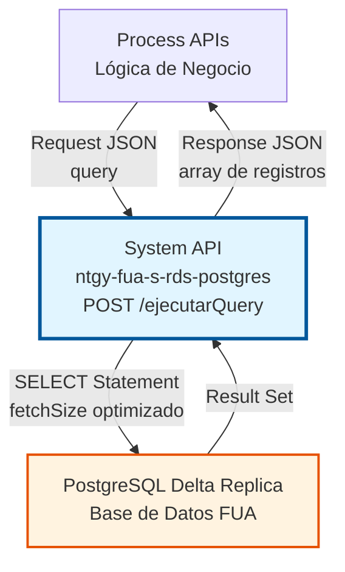
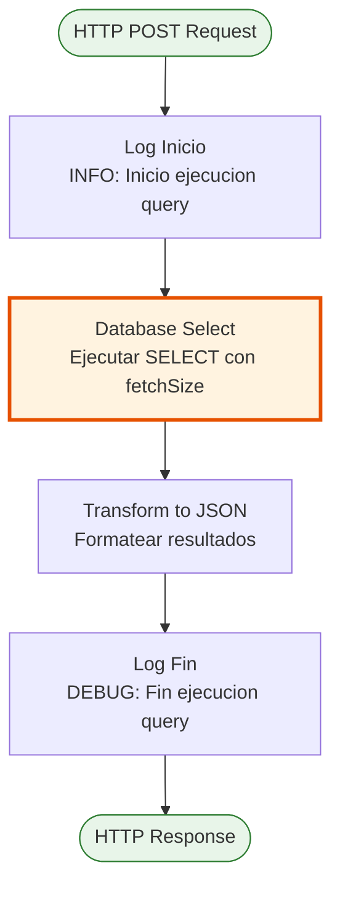
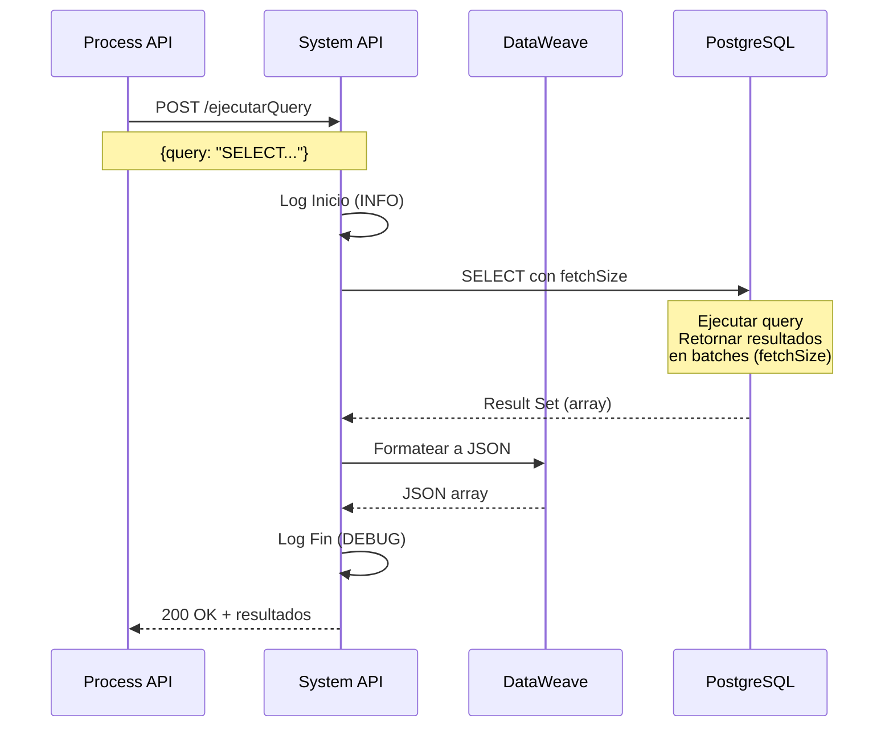
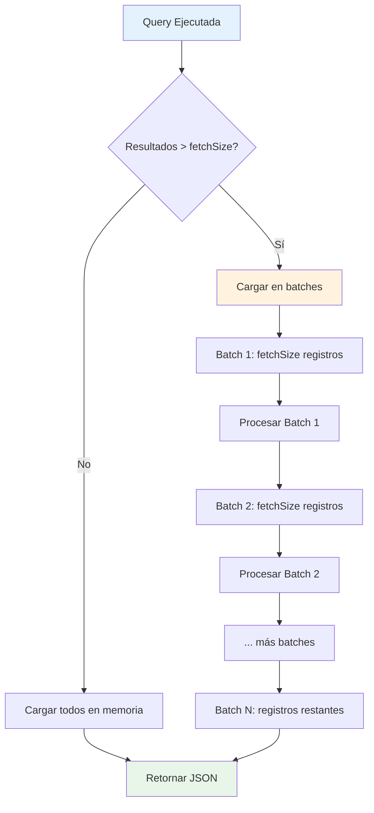
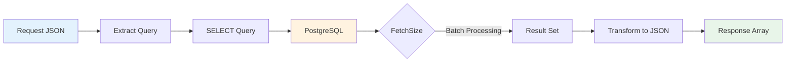

# POST /ejecutarQuery

## 📌 Descripción General

### Propósito del Endpoint

Este endpoint proporciona una interfaz genérica para ejecutar queries SELECT dinámicas en la base de datos PostgreSQL Delta Replica. Permite a los consumidores consultar datos de cualquier tabla de la base de datos mediante sentencias SQL, retornando los resultados en formato JSON con optimización de memoria mediante fetchSize configurable.

El endpoint soporta:
- **Queries SELECT Dinámicas**: Acepta cualquier sentencia SELECT válida en el payload
- **Consultas Complejas**: Soporta JOINs, subconsultas, agregaciones y funciones SQL
- **Optimización de Memoria**: Usa fetchSize configurable para manejar resultsets grandes eficientemente
- **Resultados Estructurados**: Retorna datos en formato JSON array
- **Solo Lectura**: Operación segura que no modifica datos

### Tipo de API

**Capa:** System API (API-Led Connectivity)

**Función:** Proporciona acceso directo y estandarizado a PostgreSQL Delta Replica para operaciones de consulta de datos.

### Patrón de Integración

**Tipo:** Request-Reply Síncrono con SQL SELECT

**Descripción:** El endpoint recibe una sentencia SELECT en formato JSON, ejecuta la query en PostgreSQL con optimización de fetchSize, y retorna los resultados en formato JSON array.

### Arquitectura API-Led Connectivity



---

## 💼 Propósito del Negocio

### Casos de Uso Principales

1. **Consulta de Información de Clientes**
   - Obtener datos de clientes por diferentes criterios
   - Buscar información histórica
   - Generar reportes de clientes

2. **Análisis de Datos**
   - Ejecutar queries de agregación (COUNT, SUM, AVG)
   - Generar estadísticas de negocio
   - Obtener métricas operacionales

3. **Validación de Datos**
   - Verificar existencia de registros
   - Validar relaciones entre entidades
   - Comprobar integridad de datos

4. **Generación de Reportes**
   - Extraer datos para reportes
   - Consultas complejas con múltiples JOINs
   - Obtener datos agregados por períodos

### Contexto Empresarial

- **Dominio:** Gestión de Datos - Operaciones de Consulta
- **Sector:** Energía - Utilities
- **División:** Naturgy España - FUA (Factura Única Actualizada)
- **Proceso de Negocio:** Consulta y análisis de datos en el ecosistema FUA
- **Capa de Integración:** System API - Acceso directo a base de datos

### Stakeholders

- **Desarrolladores de Process APIs**: Necesitan una interfaz flexible para consultar datos
- **Analistas de Negocio**: Requieren acceso a datos para análisis y reportes
- **Administradores de Base de Datos**: Necesitan monitorear queries y optimizar performance

### Valor de Negocio

- **Centralización**: Punto único de acceso para consultas en PostgreSQL
- **Flexibilidad**: Soporta cualquier query SELECT sin cambios en el API
- **Performance**: FetchSize optimizado para manejar grandes volúmenes de datos
- **Trazabilidad**: Logging completo de todas las consultas ejecutadas
- **Eficiencia**: Connection pooling optimizado para alto rendimiento

### Consumidores Potenciales

Este endpoint puede ser consumido por:
- Process APIs del ecosistema FUA que requieren consultar datos
- Servicios de reporting y analytics
- Sistemas de validación de datos
- Herramientas de migración y sincronización

---

## 🔧 Especificación Técnica

### URLs por Ambiente

| Ambiente | URL Base | URL Completa |
|----------|----------|--------------|
| **Local** | `http://localhost:8081` | `http://localhost:8081/api/ejecutarQuery` |
| **Development** | `https://ntgy-fua-s-rds-postgres-dev.us-e2.cloudhub.io` | `https://ntgy-fua-s-rds-postgres-dev.us-e2.cloudhub.io/api/ejecutarQuery` |
| **UAT** | `https://ntgy-fua-s-rds-postgres-uat.us-e2.cloudhub.io` | `https://ntgy-fua-s-rds-postgres-uat.us-e2.cloudhub.io/api/ejecutarQuery` |
| **Production** | `https://ntgy-fua-s-rds-postgres-pro.us-e2.cloudhub.io` | `https://ntgy-fua-s-rds-postgres-pro.us-e2.cloudhub.io/api/ejecutarQuery` |

### Método HTTP

```
POST /api/ejecutarQuery
```

### Parámetros de Entrada

#### Headers HTTP

| Header | Tipo | Requerido | Descripción | Ejemplo |
|--------|------|-----------|-------------|---------|
| `Content-Type` | string | ✅ Sí | Tipo de contenido del request | `application/json` |
| `Accept` | string | ❌ No | Tipo de contenido esperado en response | `application/json` |

#### Body Parameters

El body debe contener un objeto JSON con la siguiente estructura:

| Campo | Tipo | Requerido | Descripción |
|-------|------|-----------|-------------|
| `query` | string | ✅ Sí | Sentencia SQL SELECT a ejecutar. Debe ser una query válida de PostgreSQL |

**Estructura del Body:**

```json
{
  "query": "SELECT * FROM tabla WHERE columna = 'valor'"
}
```

**Notas Importantes:**
- Solo se permiten sentencias SELECT (operaciones de lectura)
- La query debe ser sintácticamente válida para PostgreSQL
- Se recomienda usar LIMIT para queries que puedan retornar muchos registros
- El fetchSize está configurado en `${bbdd.fetchSize}` para optimizar memoria

### Respuestas

#### Respuesta Exitosa (200 OK) - Múltiples Registros

```json
[
  {
    "id": 1,
    "name": "Cliente 1",
    "email": "cliente1@example.com",
    "created_at": "2026-01-15T10:30:00Z"
  },
  {
    "id": 2,
    "name": "Cliente 2",
    "email": "cliente2@example.com",
    "created_at": "2026-02-20T14:45:00Z"
  }
]
```

**Descripción:** Retorna un array JSON con los registros que cumplen la query. Cada objeto en el array representa una fila del resultado.

#### Respuesta Exitosa (200 OK) - Sin Resultados

```json
[]
```

**Descripción:** Retorna un array vacío cuando la query no encuentra registros. Esto NO es un error.

#### Respuesta Exitosa (200 OK) - Query de Agregación

```json
[
  {
    "count": 150,
    "total": 45000.50,
    "average": 300.00
  }
]
```

**Descripción:** Para queries con funciones de agregación (COUNT, SUM, AVG), retorna un array con un objeto conteniendo los resultados.

#### Respuesta de Error de Sintaxis SQL (400 Bad Request)

```json
{
  "error": {
    "code": "DB_BAD_SQL_SYNTAX",
    "message": "ERROR: syntax error at or near \"FORM\"",
    "timestamp": "2026-08-18T12:00:00Z"
  }
}
```

#### Respuesta de Error de Tabla No Existe (400 Bad Request)

```json
{
  "error": {
    "code": "DB_BAD_SQL_SYNTAX",
    "message": "ERROR: relation \"tabla_inexistente\" does not exist",
    "timestamp": "2026-08-18T12:00:00Z"
  }
}
```

#### Respuesta de Error de Conectividad (503 Service Unavailable)

```json
{
  "error": {
    "code": "DB_CONNECTIVITY_ERROR",
    "message": "Base de datos temporalmente no disponible",
    "timestamp": "2026-08-18T12:00:00Z"
  }
}
```

### Autenticación y Autorización

- **Tipo:** Client ID & Client Secret (Anypoint Platform)
- **Autorización PostgreSQL:** El usuario de base de datos debe tener permisos para:
  - Ejecutar operaciones SELECT en las tablas objetivo
  - Acceso al schema correspondiente
  - Permisos de lectura en las tablas

### Timeouts

| Tipo | Valor | Descripción |
|------|-------|-------------|
| **Request Timeout** | 30 segundos | Tiempo máximo de espera para la respuesta |
| **Connection Timeout** | Configurable | Definido en connection pooling (maxWait) |
| **Query Timeout** | Implícito | Configurado en PostgreSQL |

### Configuración de FetchSize

**FetchSize:** `${bbdd.fetchSize}` (configurable por ambiente)

**Propósito:** Controla cuántas filas se cargan en memoria a la vez cuando se ejecuta una query que retorna muchos registros.

**Beneficios:**
- Reduce uso de memoria para queries grandes
- Mejora performance en resultsets extensos
- Previene OutOfMemory errors

---

## 🏗️ Implementación Técnica

### Arquitectura del Flow



### Componentes del Flow

#### 1. Logger Inicio (Línea 11)
```xml
<logger level="INFO" message="Inicio ejecucion query: #[payload]"/>
```
- **Propósito:** Registrar el inicio de la operación con el payload completo
- **Nivel:** INFO
- **Contenido:** Payload de entrada con la sentencia SELECT

#### 2. Database Select (Líneas 12-14)
```xml
<db:select config-ref="BBDD_Delta_Replica" fetchSize="${bbdd.fetchSize}">
    <db:sql><![CDATA[#[payload.query]]]></db:sql>
</db:select>
```
- **Propósito:** Ejecutar la query SELECT en PostgreSQL
- **Configuración:**
  - `config-ref`: BBDD_Delta_Replica (connection pooling)
  - `fetchSize`: `${bbdd.fetchSize}` (optimización de memoria)
- **Input:**
  - SQL: Sentencia SELECT del payload
- **Output:** Array de registros (puede ser vacío)

**Nota sobre FetchSize:**
- Valor típico: 100-1000 registros
- Menor valor = menos memoria, más round-trips a BD
- Mayor valor = más memoria, menos round-trips a BD
- Configurable por ambiente según necesidades

#### 3. Transform to JSON (Líneas 15-21)
```dataweave
%dw 2.0
output application/json
---
payload
```
- **Propósito:** Formatear los resultados a JSON
- **Lógica:** Convierte el payload (array de registros) a formato JSON
- **Output:** JSON array con los resultados de la query

#### 4. Logger Fin (Línea 22)
```xml
<logger level="DEBUG" message="Fin ejecucion query: #[payload]"/>
```
- **Propósito:** Registrar el fin exitoso de la operación
- **Nivel:** DEBUG
- **Contenido:** Payload de respuesta con los resultados

### Diagrama de Secuencia Completo



### Optimización con FetchSize



### Configuración de Base de Datos

**Config Reference:** `BBDD_Delta_Replica`

**Características:**
- **Driver:** PostgreSQL JDBC 42.7.3
- **Connection Pooling:**
  - Min Pool Size: Configurable por ambiente
  - Max Pool Size: Configurable por ambiente
  - Max Wait Time: Configurable
  - Max Idle Time: Configurable
- **FetchSize:** Configurable por ambiente (`${bbdd.fetchSize}`)
- **Seguridad:** Credenciales encriptadas con Secure Properties

### Manejo de Errores

El endpoint maneja los siguientes tipos de errores:

1. **DB:BAD_SQL_SYNTAX**: Error de sintaxis en la sentencia SQL
2. **DB:CONNECTIVITY**: Fallo de conexión a PostgreSQL
3. **DB:AUTHENTICATION**: Error de autenticación en base de datos
4. **DB:QUERY_EXECUTION**: Error durante la ejecución de la query

Todos los errores se transforman a un formato estándar JSON con código, mensaje y timestamp.

### Transformación de Datos



---

## 💻 Ejemplos de Uso

### Ejemplo 1: SELECT Simple

**Request:**

```bash
curl -X POST "http://localhost:8081/api/ejecutarQuery" \
  -H "Content-Type: application/json" \
  -d '{
    "query": "SELECT id, name, email FROM customers WHERE id = 12345"
  }'
```

**Response (200 OK):**

```json
[
  {
    "id": 12345,
    "name": "Juan Pérez",
    "email": "juan.perez@example.com"
  }
]
```

---

### Ejemplo 2: SELECT con Múltiples Registros

**Request:**

```bash
curl -X POST "http://localhost:8081/api/ejecutarQuery" \
  -H "Content-Type: application/json" \
  -d '{
    "query": "SELECT id, name, status FROM contracts WHERE customer_id = 12345 ORDER BY created_at DESC"
  }'
```

**Response (200 OK):**

```json
[
  {
    "id": 1001,
    "name": "Contrato Electricidad",
    "status": "ACTIVE"
  },
  {
    "id": 1002,
    "name": "Contrato Gas",
    "status": "ACTIVE"
  },
  {
    "id": 1003,
    "name": "Contrato Anterior",
    "status": "CANCELLED"
  }
]
```

---

### Ejemplo 3: SELECT con JOIN

**Request:**

```bash
curl -X POST "http://localhost:8081/api/ejecutarQuery" \
  -H "Content-Type: application/json" \
  -d '{
    "query": "SELECT c.id, c.name, c.email, co.contract_number, co.status FROM customers c INNER JOIN contracts co ON c.id = co.customer_id WHERE c.id = 12345"
  }'
```

**Response (200 OK):**

```json
[
  {
    "id": 12345,
    "name": "Juan Pérez",
    "email": "juan.perez@example.com",
    "contract_number": "CTR-2026-001",
    "status": "ACTIVE"
  },
  {
    "id": 12345,
    "name": "Juan Pérez",
    "email": "juan.perez@example.com",
    "contract_number": "CTR-2026-002",
    "status": "ACTIVE"
  }
]
```

---

### Ejemplo 4: Query de Agregación (COUNT)

**Request:**

```bash
curl -X POST "http://localhost:8081/api/ejecutarQuery" \
  -H "Content-Type: application/json" \
  -d '{
    "query": "SELECT COUNT(*) as total_customers, COUNT(CASE WHEN status = '\''ACTIVE'\'' THEN 1 END) as active_customers FROM customers"
  }'
```

**Response (200 OK):**

```json
[
  {
    "total_customers": 15000,
    "active_customers": 12500
  }
]
```

---

### Ejemplo 5: Query con Paginación (LIMIT y OFFSET)

**Request:**

```bash
curl -X POST "http://localhost:8081/api/ejecutarQuery" \
  -H "Content-Type: application/json" \
  -d '{
    "query": "SELECT id, name, email, created_at FROM customers ORDER BY created_at DESC LIMIT 10 OFFSET 0"
  }'
```

**Response (200 OK):**

```json
[
  {
    "id": 15000,
    "name": "Cliente Más Reciente",
    "email": "reciente@example.com",
    "created_at": "2026-08-18T10:00:00Z"
  },
  {
    "id": 14999,
    "name": "Otro Cliente",
    "email": "otro@example.com",
    "created_at": "2026-08-17T15:30:00Z"
  }
]
```

**Nota:** Para obtener la siguiente página, incrementar OFFSET: `LIMIT 10 OFFSET 10`

---

### Ejemplo 6: Query sin Resultados

**Request:**

```bash
curl -X POST "http://localhost:8081/api/ejecutarQuery" \
  -H "Content-Type: application/json" \
  -d '{
    "query": "SELECT * FROM customers WHERE id = 99999"
  }'
```

**Response (200 OK):**

```json
[]
```

**Nota:** Array vacío indica que no se encontraron registros. Esto NO es un error.

---

### Ejemplo 7: Query con Funciones de Agregación

**Request:**

```bash
curl -X POST "http://localhost:8081/api/ejecutarQuery" \
  -H "Content-Type: application/json" \
  -d '{
    "query": "SELECT status, COUNT(*) as count, SUM(total_amount) as total, AVG(total_amount) as average FROM orders WHERE created_at >= '\''2026-01-01'\'' GROUP BY status"
  }'
```

**Response (200 OK):**

```json
[
  {
    "status": "COMPLETED",
    "count": 1250,
    "total": 375000.50,
    "average": 300.00
  },
  {
    "status": "PENDING",
    "count": 150,
    "total": 45000.00,
    "average": 300.00
  },
  {
    "status": "CANCELLED",
    "count": 50,
    "total": 15000.00,
    "average": 300.00
  }
]
```

---

### Ejemplo 8: Query con Subconsulta

**Request:**

```bash
curl -X POST "http://localhost:8081/api/ejecutarQuery" \
  -H "Content-Type: application/json" \
  -d '{
    "query": "SELECT c.id, c.name, c.email, (SELECT COUNT(*) FROM orders o WHERE o.customer_id = c.id) as total_orders FROM customers c WHERE c.status = '\''ACTIVE'\'' LIMIT 5"
  }'
```

**Response (200 OK):**

```json
[
  {
    "id": 12345,
    "name": "Juan Pérez",
    "email": "juan.perez@example.com",
    "total_orders": 15
  },
  {
    "id": 12346,
    "name": "María García",
    "email": "maria.garcia@example.com",
    "total_orders": 8
  }
]
```

---

### Ejemplo 9: Error de Sintaxis SQL

**Request:**

```bash
curl -X POST "http://localhost:8081/api/ejecutarQuery" \
  -H "Content-Type: application/json" \
  -d '{
    "query": "SELCT * FORM customers"
  }'
```

**Response (400 Bad Request):**

```json
{
  "error": {
    "code": "DB_BAD_SQL_SYNTAX",
    "message": "ERROR: syntax error at or near \"SELCT\"",
    "timestamp": "2026-08-18T12:00:00Z",
    "correlationId": "abc-123-def"
  }
}
```

---

### Ejemplo 10: Uso desde JavaScript (Node.js)

```javascript
const axios = require('axios');

async function queryCustomers(status, limit = 10) {
  try {
    const query = `
      SELECT id, name, email, created_at 
      FROM customers 
      WHERE status = '${status}' 
      ORDER BY created_at DESC 
      LIMIT ${limit}
    `;
    
    const response = await axios.post(
      'https://ntgy-fua-s-rds-postgres-dev.us-e2.cloudhub.io/api/ejecutarQuery',
      {
        query: query
      },
      {
        headers: {
          'Content-Type': 'application/json',
          'client_id': 'your-client-id',
          'client_secret': 'your-client-secret'
        }
      }
    );
    
    console.log(`Found ${response.data.length} customers`);
    return response.data;
  } catch (error) {
    console.error('Error querying customers:', error.response?.data || error.message);
    throw error;
  }
}

// Uso
queryCustomers('ACTIVE', 5)
  .then(customers => {
    customers.forEach(customer => {
      console.log(`${customer.id}: ${customer.name} (${customer.email})`);
    });
  })
  .catch(err => console.error('Failed:', err));
```

---

### Ejemplo 11: Query con Fechas y Rangos

```bash
curl -X POST "http://localhost:8081/api/ejecutarQuery" \
  -H "Content-Type: application/json" \
  -d '{
    "query": "SELECT DATE(created_at) as date, COUNT(*) as orders, SUM(total_amount) as revenue FROM orders WHERE created_at BETWEEN '\''2026-01-01'\'' AND '\''2026-01-31'\'' GROUP BY DATE(created_at) ORDER BY date"
  }'
```

---

### Consideraciones de Seguridad

1. **⚠️ SQL Injection Prevention - CRÍTICO:**
   - Este endpoint NO usa parámetros preparados explícitos
   - La query viene directamente del payload
   - **RESPONSABILIDAD DEL CONSUMIDOR:** Validar y sanitizar TODA entrada
   - NUNCA concatenar input de usuario directamente en la query
   - Usar validación estricta en Process APIs antes de llamar

2. **Validación de Queries:**
   - Validar que la query comienza con SELECT
   - Rechazar queries con múltiples statements (;)
   - Validar caracteres peligrosos
   - Implementar whitelist de tablas permitidas

3. **Permisos:**
   - Asegurar que el usuario de BD tiene permisos SELECT únicamente
   - Limitar acceso a tablas sensibles
   - Auditar todas las consultas ejecutadas

4. **Performance:**
   - SIEMPRE usar LIMIT para queries que puedan retornar muchos registros
   - Implementar paginación con LIMIT y OFFSET
   - Evitar SELECT * en tablas grandes
   - Usar índices apropiados en columnas de WHERE

5. **Mejores Prácticas:**
   - Documentar queries comunes en Process APIs
   - Implementar timeout apropiado para queries largas
   - Monitorear queries lentas
   - Considerar caching para queries frecuentes

### Ejemplo de Validación Segura (Process API)

```javascript
// ❌ INCORRECTO - Vulnerable a SQL Injection
const unsafeQuery = `SELECT * FROM customers WHERE email = '${userInput}'`;

// ✅ CORRECTO - Validación y sanitización
function buildSafeQuery(email) {
  // Validar formato de email
  const emailRegex = /^[^\s@]+@[^\s@]+\.[^\s@]+$/;
  if (!emailRegex.test(email)) {
    throw new Error('Invalid email format');
  }
  
  // Escapar caracteres especiales
  const safeEmail = email.replace(/'/g, "''");
  
  // Construir query segura
  return `SELECT id, name, email FROM customers WHERE email = '${safeEmail}' LIMIT 1`;
}
```

### Recomendaciones de Paginación

Para queries que retornan muchos registros, implementar paginación:

```javascript
function buildPaginatedQuery(tableName, page = 1, pageSize = 10) {
  const offset = (page - 1) * pageSize;
  return `SELECT * FROM ${tableName} ORDER BY id LIMIT ${pageSize} OFFSET ${offset}`;
}

// Página 1: LIMIT 10 OFFSET 0
// Página 2: LIMIT 10 OFFSET 10
// Página 3: LIMIT 10 OFFSET 20