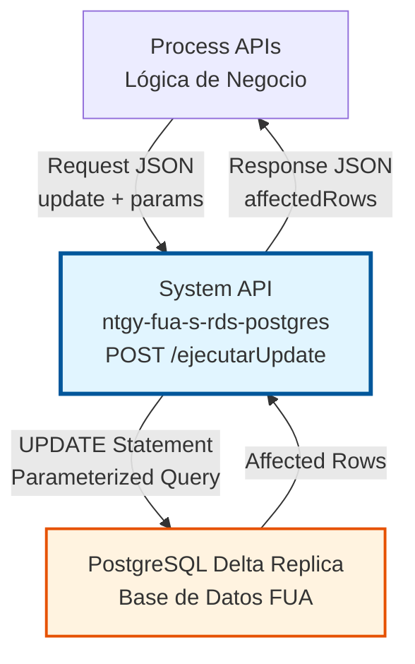
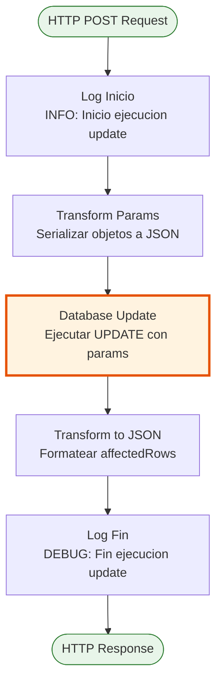
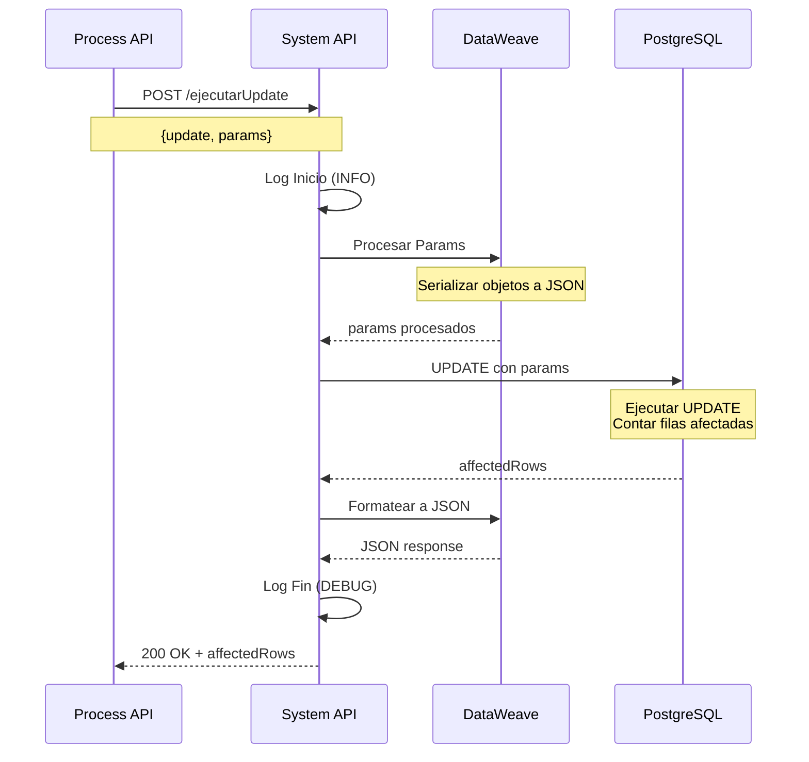
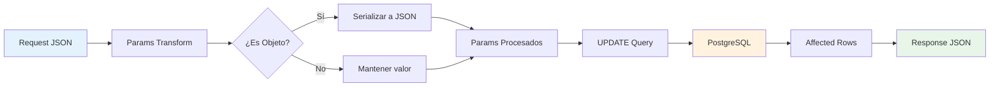

# POST /ejecutarUpdate

## 📌 Descripción General

### Propósito del Endpoint

Este endpoint proporciona una interfaz genérica para ejecutar operaciones UPDATE dinámicas en la base de datos PostgreSQL Delta Replica. Permite a los consumidores actualizar registros en cualquier tabla de la base de datos mediante sentencias SQL parametrizadas, retornando el número de filas afectadas por la operación.

El endpoint soporta:
- **Queries UPDATE Dinámicas**: Acepta cualquier sentencia UPDATE válida en el payload
- **Parámetros Parametrizados**: Soporta parámetros seguros para prevenir SQL injection
- **Objetos Complejos**: Serializa automáticamente objetos complejos a JSON
- **Affected Rows**: Retorna el número de filas actualizadas por la operación
- **Actualizaciones Condicionales**: Soporta cláusulas WHERE complejas con múltiples condiciones

### Tipo de API

**Capa:** System API (API-Led Connectivity)

**Función:** Proporciona acceso directo y estandarizado a PostgreSQL Delta Replica para operaciones de actualización de datos.

### Patrón de Integración

**Tipo:** Request-Reply Síncrono con SQL UPDATE

**Descripción:** El endpoint recibe una sentencia UPDATE y parámetros en formato JSON, transforma los parámetros complejos a JSON si es necesario, ejecuta la operación UPDATE en PostgreSQL, y retorna el número de filas afectadas en formato JSON.

### Arquitectura API-Led Connectivity



---

## 💼 Propósito del Negocio

### Casos de Uso Principales

1. **Actualización de Información de Clientes**
   - Modificar datos de contacto de clientes existentes
   - Actualizar preferencias y configuraciones
   - Mantener información actualizada en tiempo real

2. **Cambio de Estados de Transacciones**
   - Actualizar estados de pedidos o contratos
   - Modificar flags de procesamiento
   - Registrar cambios de estado con timestamps

3. **Corrección de Datos**
   - Corregir errores en registros existentes
   - Actualizar información desactualizada
   - Aplicar cambios masivos con condiciones específicas

### Contexto Empresarial

- **Dominio:** Gestión de Datos - Operaciones CRUD
- **Sector:** Energía - Utilities
- **División:** Naturgy España - FUA (Factura Única Actualizada)
- **Proceso de Negocio:** Mantenimiento y actualización de datos en el ecosistema FUA
- **Capa de Integración:** System API - Acceso directo a base de datos

### Stakeholders

- **Desarrolladores de Process APIs**: Necesitan una interfaz simple y confiable para actualizar datos
- **Administradores de Base de Datos**: Requieren control centralizado de operaciones de escritura
- **Equipos de Negocio**: Dependen de la precisión y disponibilidad de los datos actualizados

### Valor de Negocio

- **Centralización**: Punto único de acceso para operaciones UPDATE en PostgreSQL
- **Flexibilidad**: Soporta cualquier tabla sin necesidad de cambios en el API
- **Seguridad**: Uso de parámetros preparados reduce riesgo de SQL injection
- **Trazabilidad**: Logging completo de todas las operaciones de actualización
- **Eficiencia**: Connection pooling optimizado para alto rendimiento

### Consumidores Potenciales

Este endpoint puede ser consumido por:
- Process APIs del ecosistema FUA que requieren actualizar datos
- Flujos de integración que necesitan modificar registros en PostgreSQL
- Sistemas de sincronización de datos
- Servicios de corrección y mantenimiento de datos

---

## 🔧 Especificación Técnica

### URLs por Ambiente

| Ambiente | URL Base | URL Completa |
|----------|----------|--------------|
| **Local** | `http://localhost:8081` | `http://localhost:8081/api/ejecutarUpdate` |
| **Development** | `https://ntgy-fua-s-rds-postgres-dev.us-e2.cloudhub.io` | `https://ntgy-fua-s-rds-postgres-dev.us-e2.cloudhub.io/api/ejecutarUpdate` |
| **UAT** | `https://ntgy-fua-s-rds-postgres-uat.us-e2.cloudhub.io` | `https://ntgy-fua-s-rds-postgres-uat.us-e2.cloudhub.io/api/ejecutarUpdate` |
| **Production** | `https://ntgy-fua-s-rds-postgres-pro.us-e2.cloudhub.io` | `https://ntgy-fua-s-rds-postgres-pro.us-e2.cloudhub.io/api/ejecutarUpdate` |

### Método HTTP

```
POST /api/ejecutarUpdate
```

### Parámetros de Entrada

#### Headers HTTP

| Header | Tipo | Requerido | Descripción | Ejemplo |
|--------|------|-----------|-------------|---------|
| `Content-Type` | string | ✅ Sí | Tipo de contenido del request | `application/json` |
| `Accept` | string | ❌ No | Tipo de contenido esperado en response | `application/json` |

#### Body Parameters

El body debe contener un objeto JSON con la siguiente estructura:

| Campo | Tipo | Requerido | Descripción |
|-------|------|-----------|-------------|
| `update` | string | ✅ Sí | Sentencia SQL UPDATE a ejecutar. Puede contener placeholders para parámetros (`:paramName`) |
| `params` | object | ❌ No | Objeto con los parámetros a sustituir en la query. Las claves deben coincidir con los placeholders |

**Estructura del Body:**

```json
{
  "update": "UPDATE tabla SET columna1 = :param1, columna2 = :param2 WHERE id = :id",
  "params": {
    "param1": "valor1",
    "param2": "valor2",
    "id": 123
  }
}
```

**Notas Importantes:**
- Los objetos complejos en `params` se serializan automáticamente a JSON
- Los parámetros deben usar la sintaxis `:paramName` en la query
- La cláusula WHERE es altamente recomendada para evitar actualizaciones masivas no intencionadas

### Respuestas

#### Respuesta Exitosa (200 OK)

```json
{
  "affectedRows": 1
}
```

**Descripción:** Retorna un objeto JSON con el número de filas afectadas por la operación UPDATE.

**Valores posibles:**
- `affectedRows: 0` - Ninguna fila cumplió las condiciones del WHERE
- `affectedRows: 1` - Una fila fue actualizada (caso más común)
- `affectedRows: N` - N filas fueron actualizadas (UPDATE masivo)

#### Respuesta de Error de Sintaxis SQL (400 Bad Request)

```json
{
  "error": {
    "code": "DB_BAD_SQL_SYNTAX",
    "message": "Error de sintaxis en la sentencia SQL",
    "timestamp": "2026-08-18T12:00:00Z"
  }
}
```

#### Respuesta de Error de Constraint (409 Conflict)

```json
{
  "error": {
    "code": "DB_CONSTRAINT_VIOLATION",
    "message": "Violación de constraint: foreign key constraint fails",
    "timestamp": "2026-08-18T12:00:00Z"
  }
}
```

#### Respuesta de Error de Conectividad (503 Service Unavailable)

```json
{
  "error": {
    "code": "DB_CONNECTIVITY_ERROR",
    "message": "Base de datos temporalmente no disponible",
    "timestamp": "2026-08-18T12:00:00Z"
  }
}
```

### Autenticación y Autorización

- **Tipo:** Client ID & Client Secret (Anypoint Platform)
- **Autorización PostgreSQL:** El usuario de base de datos debe tener permisos para:
  - Ejecutar operaciones UPDATE en las tablas objetivo
  - Acceso al schema correspondiente
  - Permisos de escritura en las tablas

### Timeouts

| Tipo | Valor | Descripción |
|------|-------|-------------|
| **Request Timeout** | 30 segundos | Tiempo máximo de espera para la respuesta |
| **Connection Timeout** | Configurable | Definido en connection pooling (maxWait) |
| **Query Timeout** | Implícito | Configurado en PostgreSQL |

---

## 🏗️ Implementación Técnica

### Arquitectura del Flow



### Componentes del Flow

#### 1. Logger Inicio (Línea 11)
```xml
<logger level="INFO" message="Inicio ejecucion update: #[payload]"/>
```
- **Propósito:** Registrar el inicio de la operación con el payload completo
- **Nivel:** INFO
- **Contenido:** Payload de entrada con la sentencia UPDATE y parámetros

#### 2. Transform Params (Líneas 12-22)
```dataweave
%dw 2.0
output application/java
---
payload.params mapObject ((value, key, index) -> 
    if(value is Object)
        (key): write(value,"application/json")
    else
        (key): value
)
```
- **Propósito:** Preparar parámetros para la query
- **Lógica:** 
  - Itera sobre cada parámetro en `payload.params`
  - Si el valor es un objeto complejo, lo serializa a JSON
  - Si es un valor simple, lo mantiene tal cual
- **Output:** Variable `params` con parámetros procesados

#### 3. Database Update (Líneas 24-27)
```xml
<db:update config-ref="BBDD_Delta_Replica">
    <db:sql><![CDATA[#[payload.update]]]></db:sql>
    <db:input-parameters><![CDATA[#[vars.params]]]></db:input-parameters>
</db:update>
```
- **Propósito:** Ejecutar la operación UPDATE en PostgreSQL
- **Configuración:**
  - `config-ref`: BBDD_Delta_Replica (connection pooling)
- **Input:**
  - SQL: Sentencia UPDATE del payload
  - Parameters: Variable `params` procesada
- **Output:** Número de filas afectadas

#### 4. Transform to JSON (Líneas 28-33)
```dataweave
%dw 2.0
output application/json
---
payload
```
- **Propósito:** Formatear la respuesta a JSON
- **Lógica:** Convierte el payload (affectedRows) a formato JSON
- **Output:** JSON con el número de filas afectadas

#### 5. Logger Fin (Línea 34)
```xml
<logger level="DEBUG" message="Fin ejecucion update: #[payload]"/>
```
- **Propósito:** Registrar el fin exitoso de la operación
- **Nivel:** DEBUG
- **Contenido:** Payload de respuesta con las filas afectadas

### Diagrama de Secuencia Completo



### Configuración de Base de Datos

**Config Reference:** `BBDD_Delta_Replica`

**Características:**
- **Driver:** PostgreSQL JDBC 42.7.3
- **Connection Pooling:**
  - Min Pool Size: Configurable por ambiente
  - Max Pool Size: Configurable por ambiente
  - Max Wait Time: Configurable
  - Max Idle Time: Configurable
- **Seguridad:** Credenciales encriptadas con Secure Properties

### Manejo de Errores

El endpoint maneja los siguientes tipos de errores:

1. **DB:BAD_SQL_SYNTAX**: Error de sintaxis en la sentencia SQL
2. **DB:CONSTRAINT_VIOLATION**: Violación de constraints (FK, unique, check)
3. **DB:CONNECTIVITY**: Fallo de conexión a PostgreSQL
4. **DB:AUTHENTICATION**: Error de autenticación en base de datos

Todos los errores se transforman a un formato estándar JSON con código, mensaje y timestamp.

### Transformación de Datos



---

## 💻 Ejemplos de Uso

### Ejemplo 1: UPDATE Simple de un Campo

**Request:**

```bash
curl -X POST "http://localhost:8081/api/ejecutarUpdate" \
  -H "Content-Type: application/json" \
  -d '{
    "update": "UPDATE customers SET email = :newEmail WHERE id = :customerId",
    "params": {
      "newEmail": "nuevo.email@example.com",
      "customerId": 12345
    }
  }'
```

**Response (200 OK):**

```json
{
  "affectedRows": 1
}
```

---

### Ejemplo 2: UPDATE de Múltiples Campos

**Request:**

```bash
curl -X POST "http://localhost:8081/api/ejecutarUpdate" \
  -H "Content-Type: application/json" \
  -d '{
    "update": "UPDATE customers SET name = :name, email = :email, phone = :phone, updated_at = NOW() WHERE id = :id",
    "params": {
      "name": "Juan Pérez García",
      "email": "juan.perez@example.com",
      "phone": "+34600123456",
      "id": 12345
    }
  }'
```

**Response (200 OK):**

```json
{
  "affectedRows": 1
}
```

---

### Ejemplo 3: UPDATE con Objeto Complejo (JSON)

**Request:**

```bash
curl -X POST "http://localhost:8081/api/ejecutarUpdate" \
  -H "Content-Type: application/json" \
  -d '{
    "update": "UPDATE orders SET status = :status, metadata = :metadata::jsonb, updated_at = NOW() WHERE order_id = :orderId",
    "params": {
      "status": "COMPLETED",
      "metadata": {
        "completedBy": "system",
        "completionDate": "2026-08-18",
        "notes": "Procesado automáticamente"
      },
      "orderId": 67890
    }
  }'
```

**Response (200 OK):**

```json
{
  "affectedRows": 1
}
```

**Nota:** El objeto `metadata` se serializa automáticamente a JSON antes de actualizarse.

---

### Ejemplo 4: UPDATE Masivo con Condición

**Request:**

```bash
curl -X POST "http://localhost:8081/api/ejecutarUpdate" \
  -H "Content-Type: application/json" \
  -d '{
    "update": "UPDATE contracts SET status = :newStatus, updated_at = NOW() WHERE status = :oldStatus AND end_date < :cutoffDate",
    "params": {
      "newStatus": "EXPIRED",
      "oldStatus": "ACTIVE",
      "cutoffDate": "2026-01-01"
    }
  }'
```

**Response (200 OK):**

```json
{
  "affectedRows": 47
}
```

**Nota:** Este UPDATE afectó 47 filas que cumplían las condiciones.

---

### Ejemplo 5: UPDATE sin Filas Afectadas

**Request:**

```bash
curl -X POST "http://localhost:8081/api/ejecutarUpdate" \
  -H "Content-Type: application/json" \
  -d '{
    "update": "UPDATE customers SET email = :email WHERE id = :id",
    "params": {
      "email": "nuevo@example.com",
      "id": 99999
    }
  }'
```

**Response (200 OK):**

```json
{
  "affectedRows": 0
}
```

**Nota:** El ID 99999 no existe, por lo que no se actualizó ninguna fila. Esto NO es un error.

---

### Ejemplo 6: Error de Constraint Violation

**Request:**

```bash
curl -X POST "http://localhost:8081/api/ejecutarUpdate" \
  -H "Content-Type: application/json" \
  -d '{
    "update": "UPDATE customers SET email = :email WHERE id = :id",
    "params": {
      "email": "email.duplicado@example.com",
      "id": 12345
    }
  }'
```

**Response (409 Conflict):**

```json
{
  "error": {
    "code": "DB_CONSTRAINT_VIOLATION",
    "message": "duplicate key value violates unique constraint \"customers_email_key\"",
    "timestamp": "2026-08-18T12:00:00Z",
    "correlationId": "abc-123-def"
  }
}
```

---

### Ejemplo 7: UPDATE con Incremento

**Request:**

```bash
curl -X POST "http://localhost:8081/api/ejecutarUpdate" \
  -H "Content-Type: application/json" \
  -d '{
    "update": "UPDATE products SET stock = stock + :quantity, updated_at = NOW() WHERE product_id = :productId",
    "params": {
      "quantity": 100,
      "productId": "PROD-001"
    }
  }'
```

**Response (200 OK):**

```json
{
  "affectedRows": 1
}
```

---

### Ejemplo 8: Uso desde JavaScript (Node.js)

```javascript
const axios = require('axios');

async function updateCustomerEmail(customerId, newEmail) {
  try {
    const response = await axios.post(
      'https://ntgy-fua-s-rds-postgres-dev.us-e2.cloudhub.io/api/ejecutarUpdate',
      {
        update: 'UPDATE customers SET email = :email, updated_at = NOW() WHERE id = :id',
        params: {
          email: newEmail,
          id: customerId
        }
      },
      {
        headers: {
          'Content-Type': 'application/json',
          'client_id': 'your-client-id',
          'client_secret': 'your-client-secret'
        }
      }
    );
    
    if (response.data.affectedRows === 0) {
      console.log('Warning: No rows were updated. Customer ID may not exist.');
      return false;
    }
    
    console.log(`Successfully updated ${response.data.affectedRows} customer(s)`);
    return true;
  } catch (error) {
    console.error('Error updating customer:', error.response?.data || error.message);
    throw error;
  }
}

// Uso
updateCustomerEmail(12345, 'nuevo.email@example.com')
  .then(success => console.log('Update result:', success))
  .catch(err => console.error('Failed:', err));
```

---

### Ejemplo 9: UPDATE con Múltiples Condiciones

```bash
curl -X POST "http://localhost:8081/api/ejecutarUpdate" \
  -H "Content-Type: application/json" \
  -d '{
    "update": "UPDATE contracts SET status = :status, cancellation_date = NOW(), cancellation_reason = :reason WHERE customer_id = :customerId AND status IN (:activeStatus, :pendingStatus) AND contract_type = :contractType",
    "params": {
      "status": "CANCELLED",
      "reason": "Customer request",
      "customerId": 12345,
      "activeStatus": "ACTIVE",
      "pendingStatus": "PENDING",
      "contractType": "ELECTRICITY"
    }
  }'
```

---

### Consideraciones de Seguridad

1. **SQL Injection Prevention:**
   - SIEMPRE usar parámetros preparados (`:paramName`)
   - NUNCA concatenar valores directamente en la query
   - Validar entrada en Process APIs antes de llamar

2. **Validación de Datos:**
   - Validar tipos de datos en el consumidor
   - Verificar constraints antes de actualizar
   - Manejar errores de constraint apropiadamente

3. **Cláusula WHERE Obligatoria:**
   - SIEMPRE incluir WHERE para evitar UPDATEs masivos no intencionados
   - Validar que la condición WHERE es específica
   - Considerar el impacto de UPDATEs masivos

4. **Permisos:**
   - Asegurar que el usuario de BD tiene permisos UPDATE
   - Limitar acceso a tablas sensibles
   - Auditar todas las operaciones de actualización

5. **Performance:**
   - Evitar UPDATEs masivos sin índices apropiados
   - Considerar el impacto en tablas con alto volumen
   - Monitorear uso del connection pool
   - Usar transacciones cuando sea necesario

6. **Verificación de Resultados:**
   - Verificar `affectedRows` para confirmar la operación
   - `affectedRows: 0` puede indicar que el registro no existe
   - Implementar lógica de retry solo cuando sea apropiado